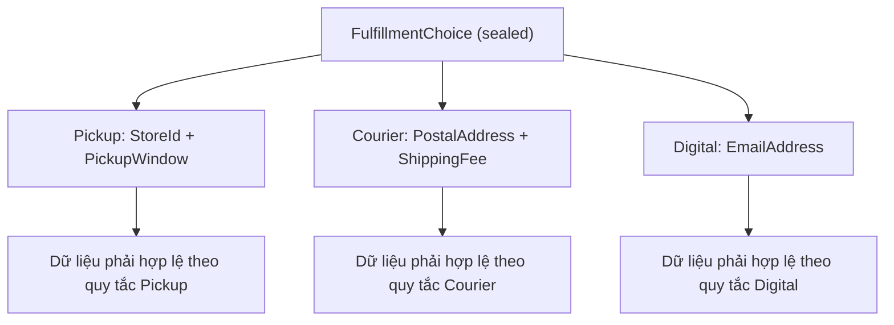
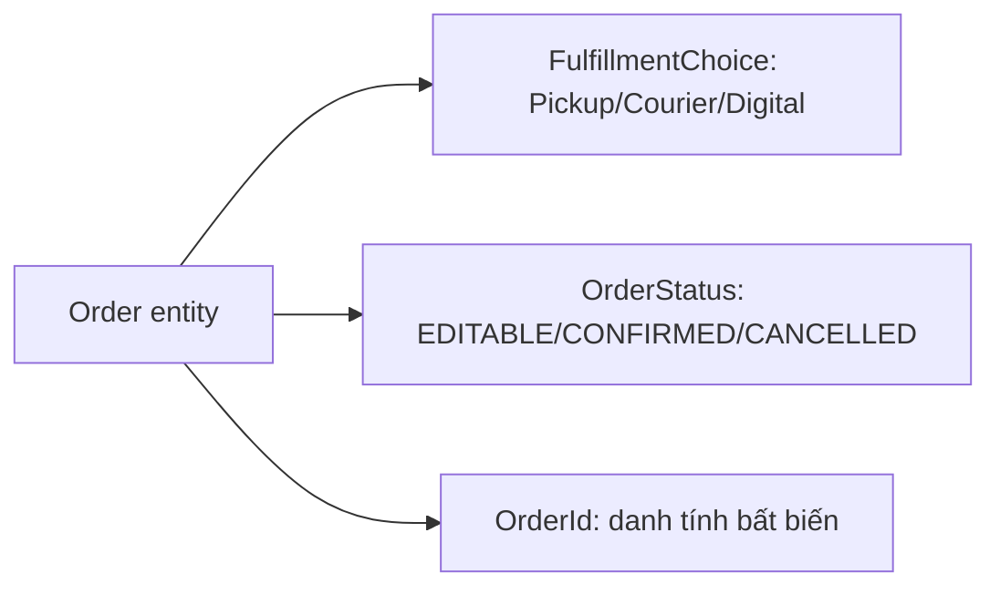

# Sealed class và hệ phân cấp cho các biến thể dữ liệu hữu hạn

Một đơn hàng có thể được hoàn tất bằng **nhận tại cửa hàng**, **giao tới địa chỉ** hoặc **giao sản phẩm số**. Ba phương thức này cần những thông tin khác nhau: nhận tại cửa hàng cần điểm nhận và khung giờ; giao hàng cần địa chỉ và phí; giao sản phẩm số cần địa chỉ email. Nếu dồn mọi trường vào một lớp với nhiều `null` và cờ boolean, chương trình rất dễ tạo trạng thái vô nghĩa như đơn giao điện tử có phí vận chuyển vật lý nhưng không có email.

Trong Java 17+, `sealed class` và `sealed interface` giúp biểu diễn một **hệ phân cấp có tập biến thể trực tiếp được kiểm soát**. Kết hợp với `record` và constructor kiểm tra bất biến, ta có thể biến quy tắc “chỉ có ba kiểu hoàn tất đơn hàng” thành ràng buộc trong cấu trúc kiểu, thay vì chỉ thành lời chú thích.

Bài học thuộc chương **Mô hình Java** của module **DATABASE_DATA_MODELING**. Trọng tâm của module là chuyển yêu cầu nghiệp vụ thành thực thể, quan hệ và ràng buộc có thể kiểm chứng; đi từ chuẩn hóa, khóa, chỉ mục tới lược đồ vật lý; đồng thời so sánh mô hình quan hệ, document, đồ thị và phân tích. Vì vậy, bên cạnh cú pháp Java, bài này làm rõ cách giữ nguyên **tập biến thể, cấu trúc dữ liệu, ràng buộc và khả năng tiến hóa** khi lưu trữ hoặc truyền dữ liệu.

## 1. Khi nào mô hình có “tập biến thể hữu hạn”?

Một tập biến thể là **hữu hạn theo hợp đồng hiện tại** nếu nghiệp vụ đã xác định rõ những trường hợp có thể tồn tại và từng trường hợp mang dữ liệu riêng. Ví dụ:

| Khái niệm | Các biến thể | Dữ liệu riêng |
| --- | --- | --- |
| Cách hoàn tất đơn hàng | `Pickup`, `Courier`, `Digital` | Cửa hàng/khung giờ; địa chỉ/phí; email |
| Kết quả xác thực | `Authenticated`, `Denied`, `NeedsVerification` | Phiên; lý do; yêu cầu xác minh |
| Phương thức thanh toán | `BankTransfer`, `CashOnDelivery`, `CardToken` | Thông tin chuyển khoản; địa chỉ nhận; token |
| Ngày hết hạn | `Known`, `Unknown`, `NotApplicable` | Ngày hoặc không có payload |
| Sự kiện nghiệp vụ | `OrderPlaced`, `PaymentReceived`, `OrderCancelled` | Các trường đặc thù từng sự kiện |

Điểm quan trọng là **không phải mọi trường hợp cùng là một đối tượng với vài cờ**. Với từng biến thể, có những trường bắt buộc và những trường hoàn toàn không có ý nghĩa.

Ví dụ mô hình dễ sai:

```java
// Minh họa anti-pattern; KHÔNG phải thiết kế được khuyên dùng.
final class DeliveryData {
    String type;
    String storeId;
    String pickupStart;
    String pickupEnd;
    String street;
    String city;
    Long shippingFeeCents;
    String email;
}
```

Lớp này cho phép `type = "DIGITAL"` nhưng `email = null`, hoặc `type = "PICKUP"` cùng `shippingFeeCents = -10`. Mỗi caller phải ghi nhiều nhánh kiểm tra và có thể quên một trường hợp.

Thiết kế bằng **kiểu tổng (sum type/variant type)** thể hiện “**hoặc** biến thể A, **hoặc** B, **hoặc** C”, mỗi biến thể là **tích (product)** của các trường bắt buộc riêng.



**Lợi ích:** Một biến `FulfillmentChoice` chỉ có thể giữ đối tượng thuộc một subtype được phép; mỗi subtype tự bảo vệ dữ liệu của nó. Điều này loại bỏ nhiều tổ hợp trường vô nghĩa *trước khi* database tham gia.

## 2. `sealed` trong Java 17 hoạt động như thế nào?

`sealed` là tính năng chuẩn từ **Java 17**. Một class hoặc interface `sealed` chỉ cho phép **những subtype trực tiếp đã được cấp quyền** kế thừa hoặc triển khai nó.

```java
sealed interface DeliveryChoice
    permits PickupChoice, CourierChoice, DigitalChoice {}

record PickupChoice(String storeCode) implements DeliveryChoice {}
record CourierChoice(String street) implements DeliveryChoice {}
record DigitalChoice(String email) implements DeliveryChoice {}
```

Các `record` là `final` một cách ngầm định, nên phù hợp để làm những **lá hữu hạn** trong hệ phân cấp. Khi code khác cố khai báo `class DroneChoice implements DeliveryChoice` mà chưa được cấp quyền, trình biên dịch từ chối.

### 2.1. Quy tắc quan trọng của `permits`

- Một subtype **trực tiếp** được cấp quyền phải khai báo đúng một trong ba cách: `final`, `sealed` hoặc `non-sealed`. `record` đáp ứng bằng tính chất `final` ngầm định.
- Nếu `sealed` tiếp tục mở thành `sealed` ở tầng dưới, tầng đó có danh sách subtype trực tiếp riêng.
- Nếu chọn `non-sealed`, nhánh đó **mở cho kế thừa tiếp**; lúc này hệ phân cấp không còn đóng hoàn toàn tại các lá, dù các subtype trực tiếp vẫn được liệt kê.
- Với **named module**, subtype được cấp quyền phải nằm trong cùng module với lớp sealed; khi **không dùng named module**, chúng phải cùng package.
- `permits` có thể được Java suy ra nếu các subtype trực tiếp được khai báo trong **cùng compilation unit** theo quy tắc ngôn ngữ. Viết `permits` tường minh thường giúp bài học dễ đọc và giúp kiểm soát API.
- Một `final class` không thể bị kế thừa; một `non-sealed class` thì có thể bị mở rộng theo các quy tắc khác của Java.

Ví dụ phân cấp nhiều tầng:

```java
sealed interface Action permits Command, Query {}

sealed interface Command extends Action
    permits CreateCommand, CancelCommand {}

record CreateCommand(String title) implements Command {}
record CancelCommand(String id) implements Command {}

non-sealed interface Query extends Action {}
```

Ở đây các loại command được đóng ở `CreateCommand` và `CancelCommand`. Nhưng bất kỳ kiểu hợp lệ nào trong phạm vi Java cho phép đều có thể triển khai `Query`; vì thế **không thể** nói toàn bộ `Action` chỉ có đúng ba leaf type trên mọi thời điểm. Khi nghiệp vụ cần một tập trường hợp thực sự cố định, đừng dùng `non-sealed` một cách vô ý.

## 3. `sealed` khác `enum`, record và đa hình thông thường

| Công cụ | Có thể mang payload khác nhau theo biến thể? | Tập subtype được kiểm soát? | Khi nên dùng |
| --- | --- | --- | --- |
| `enum` | Mỗi hằng có thể có thuộc tính/hành vi, nhưng không có các bộ trường độc lập như các record biến thể | Tập hằng cố định | Trạng thái/mã cố định không cần dữ liệu đa dạng |
| `sealed interface` + `record` | **Có**; mỗi record khai báo dữ liệu riêng | **Có** tại subtype trực tiếp; đóng hoàn toàn nếu mọi nhánh kết thúc bằng final/record | Variant có dữ liệu khác nhau; message/command/result |
| `sealed abstract class` | Có; có thể chia sẻ state và code | Có | Cần chung implementation/invariant hoặc constructor được kiểm soát |
| Interface thường | Có qua nhiều class | Không đóng tập subtype | Hệ thống plugin hoặc extension point cho bên ngoài |
| Một record có field `type` và nhiều field nullable | Có nhưng mọi tổ hợp field vẫn tồn tại ở cấp kiểu | Không | Chỉ nên cân nhắc như DTO/định dạng trung gian kèm validation rõ ràng |

Nếu chỉ có trạng thái `DRAFT`, `SUBMITTED`, `PAID` và chúng **không mang payload khác nhau**, `enum OrderStatus` có thể đủ. Nếu `PAID` phải kèm `paymentId` và `paidAt`, còn `CANCELLED` kèm `reason` và `cancelledAt`, một tập variant có payload sẽ rõ nghĩa hơn.

**Lưu ý:** `sealed` kiểm soát **ai được kế thừa/implement**, không tự làm đối tượng bất biến. Một subtype `final class` vẫn có thể có setter và collection mutable. Dùng `record`, field bất biến, sao chép phòng vệ và constructor validation nếu hợp đồng cần bất biến.

## 4. Ví dụ Java 17+ tự chứa: ba cách hoàn tất đơn hàng

Giả sử nghiệp vụ quy định:

1. `Pickup`: bắt buộc có mã cửa hàng và khoảng thời gian nhận, bắt đầu trước kết thúc.
2. `Courier`: bắt buộc có địa chỉ giao và phí vận chuyển không âm. Phí tính theo đơn vị **cent** của USD trong ví dụ này.
3. `Digital`: bắt buộc có email nhận sản phẩm, không có địa chỉ vật lý hay phí giao hàng.
4. Một đơn hàng chỉ chọn **một** cách hoàn tất tại một thời điểm; có thể đổi cách hoàn tất nếu đơn vẫn đang ở trạng thái cho phép chỉnh sửa.

### Mã có thể chạy trên Java 17

Lưu nguyên khối sau vào `SealedFulfillmentDemo.java`; các kiểu nằm trong một class để minh họa đầy đủ mà không cần file phụ:

```java
import java.time.Instant;
import java.util.List;
import java.util.Objects;
import java.util.UUID;

public class SealedFulfillmentDemo {

    record StoreId(UUID value) {
        public StoreId {
            Objects.requireNonNull(value, "value");
        }
    }

    record PickupWindow(Instant startsAt, Instant endsAt) {
        public PickupWindow {
            Objects.requireNonNull(startsAt, "startsAt");
            Objects.requireNonNull(endsAt, "endsAt");
            if (!startsAt.isBefore(endsAt)) {
                throw new IllegalArgumentException(
                    "Pickup start must precede end"
                );
            }
        }
    }

    record PostalAddress(String street, String city) {
        public PostalAddress {
            Objects.requireNonNull(street, "street");
            Objects.requireNonNull(city, "city");
            street = street.strip();
            city = city.strip();
            if (street.isEmpty() || city.isEmpty()) {
                throw new IllegalArgumentException(
                    "Street and city must be provided"
                );
            }
        }
    }

    record ShippingFee(long usdCents) {
        public ShippingFee {
            if (usdCents < 0) {
                throw new IllegalArgumentException(
                    "Shipping fee cannot be negative"
                );
            }
        }
    }

    record EmailAddress(String value) {
        public EmailAddress {
            Objects.requireNonNull(value, "value");
            value = value.strip();
            // Validation tối thiểu để tập trung vào mô hình biến thể.
            if (value.isBlank() || !value.contains("@")) {
                throw new IllegalArgumentException(
                    "Invalid email"
                );
            }
        }
    }

    sealed interface FulfillmentChoice
        permits Pickup, Courier, Digital {}

    record Pickup(StoreId store, PickupWindow window)
        implements FulfillmentChoice {
        public Pickup {
            Objects.requireNonNull(store, "store");
            Objects.requireNonNull(window, "window");
        }
    }

    record Courier(PostalAddress address, ShippingFee fee)
        implements FulfillmentChoice {
        public Courier {
            Objects.requireNonNull(address, "address");
            Objects.requireNonNull(fee, "fee");
        }
    }

    record Digital(EmailAddress recipient)
        implements FulfillmentChoice {
        public Digital {
            Objects.requireNonNull(recipient, "recipient");
        }
    }

    enum OrderStatus { EDITABLE, CONFIRMED, CANCELLED }

    static final class Order {
        private final UUID id;
        private FulfillmentChoice fulfillment;
        private OrderStatus status;

        private Order(UUID id, FulfillmentChoice fulfillment) {
            this.id = Objects.requireNonNull(id, "id");
            this.fulfillment = Objects.requireNonNull(
                fulfillment, "fulfillment"
            );
            this.status = OrderStatus.EDITABLE;
        }

        static Order create(FulfillmentChoice choice) {
            return new Order(UUID.randomUUID(), choice);
        }

        void changeFulfillment(FulfillmentChoice next) {
            if (status != OrderStatus.EDITABLE) {
                throw new IllegalStateException(
                    "Fulfillment cannot change now"
                );
            }
            fulfillment = Objects.requireNonNull(next, "next");
        }

        void confirm() {
            if (status != OrderStatus.EDITABLE) {
                throw new IllegalStateException(
                    "Only an editable order may be confirmed"
                );
            }
            status = OrderStatus.CONFIRMED;
        }

        FulfillmentChoice fulfillment() {
            return fulfillment;
        }

        OrderStatus status() {
            return status;
        }
    }

    static String instructions(FulfillmentChoice choice) {
        Objects.requireNonNull(choice, "choice");
        if (choice instanceof Pickup p) {
            return "Pick up at store " + p.store().value()
                + " from " + p.window().startsAt();
        }
        if (choice instanceof Courier c) {
            return "Ship to " + c.address().street()
                + ", " + c.address().city()
                + "; USD cents: " + c.fee().usdCents();
        }
        if (choice instanceof Digital d) {
            return "Send access details to " + d.recipient().value();
        }
        throw new IllegalStateException(
            "Unhandled fulfillment variant: " + choice.getClass()
        );
    }

    public static void main(String[] args) {
        Pickup pickup = new Pickup(
            new StoreId(UUID.randomUUID()),
            new PickupWindow(
                Instant.parse("2030-01-10T08:00:00Z"),
                Instant.parse("2030-01-10T10:00:00Z")
            )
        );
        Courier courier = new Courier(
            new PostalAddress("12 Main Street", "Hanoi"),
            new ShippingFee(250)
        );
        Digital digital = new Digital(
            new EmailAddress("reader@example.com")
        );

        List<FulfillmentChoice> choices =
            List.of(pickup, courier, digital);
        choices.forEach(choice ->
            System.out.println(instructions(choice))
        );

        Order order = Order.create(pickup);
        order.changeFulfillment(digital);
        order.confirm();
        System.out.println(order.status()); // CONFIRMED
        System.out.println(instructions(order.fulfillment()));

        // order.changeFulfillment(courier);
        // Bỏ comment sẽ ném IllegalStateException.
        // new PickupWindow(
        //     Instant.parse("2030-01-10T10:00:00Z"),
        //     Instant.parse("2030-01-10T08:00:00Z")
        // );
        // Bỏ comment sẽ ném IllegalArgumentException.
    }
}
```

Trong đoạn code:

- `FulfillmentChoice` là **sum type**; mỗi `record` là một biến thể với các trường cần thiết, không cần cờ boolean hoặc các trường không liên quan.
- `PickupWindow` và `PostalAddress` tự kiểm tra invariant; `ShippingFee(0)` hợp lệ, còn phí âm không hợp lệ.
- `Order` là **entity có ID và vòng đời**, trong khi `Pickup`/`Courier`/`Digital` là các **giá trị mô tả một lựa chọn**. Thay đổi lựa chọn không nhất thiết tạo một đơn hàng mới.
- Biến thể tồn tại độc lập với trạng thái vòng đời `EDITABLE/CONFIRMED`. Tránh tạo các lớp như `ConfirmedCourierOrder`, `EditableCourierOrder`, `ConfirmedPickupOrder`,… trừ khi thực sự cần một cấu trúc tích trạng thái.
- Phương thức `instructions` chỉ sử dụng dữ liệu tương ứng của từng variant. Không còn `switch` trên chuỗi `type` rồi ép null-check từng field.
- Ví dụ cố ý chỉ kiểm tra email tối thiểu để minh họa kiểu. Hệ thống thật cần kiểm tra cú pháp và xác minh địa chỉ theo yêu cầu sản phẩm, tránh coi `contains("@")` là bộ kiểm tra email đầy đủ.

**Giới hạn quan trọng:** kiểu `FulfillmentChoice` không thể bảo đảm rằng sản phẩm số không bị chọn giao hàng vật lý, hoặc cửa hàng có thực sự hoạt động trong khung giờ đã chọn. Những điều kiện phụ thuộc dữ liệu khác cần được kiểm tra tại application service/transaction và bảo vệ thêm bằng ràng buộc phù hợp.

## 5. Xử lý biến thể: đa hình hay phân nhánh theo kiểu?

Có hai cách chính để thực hiện hành vi dựa trên variant.

### 5.1. Đưa hành vi vào interface và từng biến thể

Nếu hành vi là **một phần ổn định của miền**, có thể khai báo method trên interface để mỗi subtype tự triển khai:

```java
sealed interface FeeRule
    permits FreeFee, FixedFee {
    long feeCents();
}

record FreeFee() implements FeeRule {
    @Override
    public long feeCents() {
        return 0;
    }
}

record FixedFee(long cents) implements FeeRule {
    public FixedFee {
        if (cents < 0) {
            throw new IllegalArgumentException("Negative fee");
        }
    }

    @Override
    public long feeCents() {
        return cents;
    }
}
```

Thêm biến thể mới buộc subtype mới cài đặt method abstract. Đây là lợi thế khi **hành vi gắn chặt với loại dữ liệu** và không cần tách nhiều ứng dụng đọc khác nhau.

### 5.2. Để hành vi ở lớp xử lý (visitor/pattern matching)

Nếu cùng một loại dữ liệu được dùng cho **nhiều mục đích**—hiển thị UI, audit, ghi database, gửi message, tính phí—có thể giữ các variant như **dữ liệu thuần túy**, còn logic nằm trong các hàm xử lý riêng. Ví dụ `instructions` dùng `instanceof` và rút trường tương ứng.

**Lưu ý về phiên bản Java:**

- Java 17 hỗ trợ **pattern matching cho `instanceof`** dưới dạng chuẩn, như `if (choice instanceof Pickup p)`.
- **Pattern matching cho `switch` trên kiểu sealed** trở thành tính năng chuẩn ở Java 21; với Java 17, tính năng này chỉ có ở chế độ preview và thay đổi theo phiên bản. Đoạn ví dụ chạy trên Java 17 ở trên **không dùng preview**.
- Khi biên dịch với Java 21+, một `switch` biểu thức bao quát tất cả subtype trong hệ phân cấp đóng có thể được kiểm tra **exhaustiveness** tại thời điểm biên dịch.

Ví dụ **chỉ dành cho Java 21+** (viết dưới dạng method trong lớp `SealedFulfillmentDemo` ở trên):

```java
// Java 21+: đặt method này bên trong SealedFulfillmentDemo.
static String typeLabel(FulfillmentChoice choice) {
    return switch (choice) {
        case Pickup p -> "PICKUP";
        case Courier c -> "COURIER";
        case Digital d -> "DIGITAL";
    };
}
```

Nếu sau này thêm `LockerPickup` vào một hệ phân cấp đóng mà switch không có `default`, việc biên dịch lại code xử lý có thể phát hiện thiếu trường hợp. **Không tự thêm `default` chỉ để che thiếu nhánh** nếu mục tiêu là buộc mỗi variant được xử lý có chủ đích. Với mã đã biên dịch cũ và kiểu mới ở runtime, vẫn cần chiến lược tương thích phù hợp; compile-time exhaustiveness không thay thế kiểm soát version của các dịch vụ triển khai riêng.

### Khi chọn cách nào?

| Bài toán | Hướng thường phù hợp |
| --- | --- |
| Mỗi variant tự biết cách tính một hành vi ổn định | Phương thức đa hình trên interface |
| Nhiều hệ thống đọc cùng một tập dữ liệu nhưng trình bày khác nhau | Dữ liệu dạng record + hàm xử lý riêng |
| Thường thêm **hành vi**, ít thêm variant | Hàm xử lý riêng hoặc visitor dễ bổ sung mà không sửa mọi variant |
| Thường thêm **variant**, ít thêm hành vi | Polymorphism có thể giảm số vị trí phải thêm nhánh |
| Hợp đồng yêu cầu kiểm tra đủ trường hợp bằng compiler | Sealed hierarchy đóng + Java 21 pattern switch không `default` |

Không biến một sealed type thành lớp “biết mọi thứ” với hàng chục method phụ thuộc HTTP, SQL, email, UI cùng lúc. Domain variant nên giữ invariant và ngữ nghĩa của nó; adapter thực hiện giao tiếp với hệ thống bên ngoài.

## 6. Thiết kế constructor để các trạng thái sai khó được tạo ra

Một sealed interface **không tự áp đặt invariant giữa các field**. Điều đó nằm ở constructor/factory của subtype.

Ví dụ các ràng buộc cần kiểm tra:

| Variant | Invariant bên trong một object | Điều kiện bên ngoài object |
| --- | --- | --- |
| `Pickup` | `store != null`, `window != null`, `start < end` | Cửa hàng có tồn tại/mở cửa, khung giờ chưa bị đặt? |
| `Courier` | Có địa chỉ đủ thông tin, phí `>= 0` | Khu vực có hỗ trợ giao hàng, phí tính đúng theo policy? |
| `Digital` | Có người nhận hợp lệ về mặt cấu trúc | Sản phẩm có thể cung cấp dưới dạng số, email đã được xác minh? |

Các trường không xuất hiện trong subtype **không cần gán null**. Đây là cách giảm số tổ hợp sai mà chương trình có thể biểu diễn.

Một ví dụ nâng cao: nếu `Digital` cần hoặc `EmailAddress` hoặc `AccountId`, đừng đưa cả hai field nullable vào cùng record và đếm số null. Có thể tạo một sealed type con:

```java
import java.util.Objects;

sealed interface DigitalRecipient
    permits RecipientEmail, RecipientAccount {}

record RecipientEmail(String address)
    implements DigitalRecipient {
    public RecipientEmail {
        Objects.requireNonNull(address, "address");
        if (address.isBlank()) {
            throw new IllegalArgumentException("Blank email");
        }
    }
}

record RecipientAccount(String accountId)
    implements DigitalRecipient {
    public RecipientAccount {
        Objects.requireNonNull(accountId, "accountId");
        if (accountId.isBlank()) {
            throw new IllegalArgumentException("Blank account ID");
        }
    }
}
```

Nhưng **không cần lồng sealed type cho mọi thuộc tính**. Khi chỉ có một giá trị tùy chọn thực sự và không có nhiều trạng thái riêng, một field nullable có kiểm soát hoặc `Optional` ở API kết quả có thể đủ. Sử dụng kiểu phong phú khi nó loại bỏ nhầm lẫn có thật trong miền.

## 7. Tách biến thể dữ liệu khỏi trạng thái vòng đời

Hai câu hỏi thường bị trộn:

1. **Đơn hàng được hoàn tất bằng cách nào?** `Pickup`, `Courier`, `Digital`.
2. **Đơn hàng đang ở giai đoạn nào?** `EDITABLE`, `CONFIRMED`, `CANCELLED`.

Đây là **hai trục khác nhau**. Nếu có 3 phương thức và 3 trạng thái, tạo 9 subclass là dấu hiệu của *combinatorial explosion*; khi thêm một trạng thái mới, số lớp tăng mạnh.



Cách biểu diễn bằng composition giúp thêm một status mà không sửa cấu trúc của từng variant. Tuy vậy, có thể có **ràng buộc kết hợp** giữa hai trục: chẳng hạn khi `CONFIRMED` thì không được đổi cách hoàn tất. Trong ví dụ, phương thức `changeFulfillment` chặn thao tác sau xác nhận. Những điều kiện này thuộc aggregate/entity và transaction, không nằm trong một value record.

Khi trạng thái có **payload riêng** (ví dụ `Paid(paymentId, paidAt)` và `Cancelled(reason, cancelledAt)`) thì một sealed type cho chính **trạng thái** có thể phù hợp hơn enum. Quyết định dựa vào nhu cầu dữ liệu thực sự, không phải vì sealed “mới” hơn enum.

## 8. Lược đồ quan hệ: ánh xạ sealed hierarchy xuống PostgreSQL

SQL không hiểu trực tiếp từ khóa Java `sealed`. Để giữ đúng ngữ nghĩa, cần chọn một trong các mô hình lưu trữ. Với ví dụ đơn hàng, cách phổ biến là dùng **discriminator column** cho biết variant và các cột payload tương ứng.

### 8.1. Một bảng cho toàn bộ variant với `CHECK` ràng buộc hình dạng

Lược đồ PostgreSQL minh họa đầy đủ (tiền vận chuyển dùng `BIGINT` cent USD; chưa mô hình đa tiền tệ):

```sql
CREATE TABLE stores (
    id UUID PRIMARY KEY,
    store_name TEXT NOT NULL
);

CREATE TABLE orders (
    id UUID PRIMARY KEY,
    status VARCHAR(16) NOT NULL CHECK (
        status IN ('EDITABLE', 'CONFIRMED', 'CANCELLED')
    ),
    version BIGINT NOT NULL DEFAULT 0 CHECK (version >= 0)
);

CREATE TABLE order_fulfillment (
    order_id UUID PRIMARY KEY REFERENCES orders(id),
    kind VARCHAR(12) NOT NULL CHECK (
        kind IN ('PICKUP', 'COURIER', 'DIGITAL')
    ),

    pickup_store_id UUID REFERENCES stores(id),
    pickup_starts_at TIMESTAMPTZ,
    pickup_ends_at TIMESTAMPTZ,

    courier_street TEXT,
    courier_city TEXT,
    shipping_fee_cents BIGINT,

    digital_email TEXT,

    CONSTRAINT ck_pickup_window CHECK (
        pickup_starts_at IS NULL
        OR pickup_ends_at IS NULL
        OR pickup_starts_at < pickup_ends_at
    ),
    CONSTRAINT ck_shipping_fee_nonnegative CHECK (
        shipping_fee_cents IS NULL OR shipping_fee_cents >= 0
    ),
    CONSTRAINT ck_fulfillment_shape CHECK (
        (
            kind = 'PICKUP'
            AND pickup_store_id IS NOT NULL
            AND pickup_starts_at IS NOT NULL
            AND pickup_ends_at IS NOT NULL
            AND courier_street IS NULL
            AND courier_city IS NULL
            AND shipping_fee_cents IS NULL
            AND digital_email IS NULL
        )
        OR
        (
            kind = 'COURIER'
            AND pickup_store_id IS NULL
            AND pickup_starts_at IS NULL
            AND pickup_ends_at IS NULL
            AND courier_street IS NOT NULL
            AND length(btrim(courier_street)) > 0
            AND courier_city IS NOT NULL
            AND length(btrim(courier_city)) > 0
            AND shipping_fee_cents IS NOT NULL
            AND digital_email IS NULL
        )
        OR
        (
            kind = 'DIGITAL'
            AND pickup_store_id IS NULL
            AND pickup_starts_at IS NULL
            AND pickup_ends_at IS NULL
            AND courier_street IS NULL
            AND courier_city IS NULL
            AND shipping_fee_cents IS NULL
            AND digital_email IS NOT NULL
            AND length(btrim(digital_email)) > 0
        )
    )
);
```

Ở đây:

- `kind` là **discriminator**: cho biết hàng đang là variant nào.
- `ck_fulfillment_shape` cấm payload của variant khác xuất hiện cùng lúc, đồng thời bắt buộc payload của variant đã chọn.
- `PRIMARY KEY(order_id)` bảo đảm tối đa một bản fulfillment cho mỗi đơn; FK bảo đảm order tồn tại.
- `ck_pickup_window` chặn giờ kết thúc trước hoặc bằng giờ bắt đầu nếu cả hai có giá trị; với `PICKUP`, constraint hình dạng còn yêu cầu cả hai không được null.
- `CHECK` trong PostgreSQL chỉ bác bỏ điều kiện FALSE, còn UNKNOWN do NULL có thể được chấp nhận. Vì vậy cần kết hợp `IS NULL`/`IS NOT NULL` và các điều kiện ràng buộc một cách cẩn thận; không tin rằng `CHECK (x > 0)` tự cấm NULL.
- `shipping_fee_cents` là số nguyên không âm. Khi mở rộng đa tiền tệ cần thêm mã tiền và chính sách đơn vị nhỏ nhất, hoặc một value object tiền tệ chuẩn hóa khác.

**Hai giới hạn quan trọng:** Lược đồ trên bảo đảm **tối đa một** fulfillment cho mỗi order, nhưng một order có thể chưa có hàng `order_fulfillment`; để bảo đảm **mọi** order đều có fulfillment cần quy trình tạo trong transaction và/hoặc cơ chế ràng buộc bổ sung. Constraint cũng không tự chứng minh email nhận có thật hay có thể chuyển hàng tới địa chỉ đó. Những điều kiện ngoài hàng thuộc policy, foreign key, transaction hoặc tích hợp phù hợp.

### 8.2. Đọc và tạo lại subtype từ dữ liệu

Repository có thể đọc một row rồi chuyển `kind` thành record phù hợp:

```text
order_fulfillment.kind = PICKUP
    -> đọc pickup_store_id, pickup_starts_at, pickup_ends_at
    -> StoreId + PickupWindow
    -> new Pickup(...)

order_fulfillment.kind = COURIER
    -> đọc courier_street, courier_city, shipping_fee_cents
    -> PostalAddress + ShippingFee
    -> new Courier(...)

order_fulfillment.kind = DIGITAL
    -> đọc digital_email
    -> new Digital(...)
```

Không tạo `new Digital(null)` để “cố khôi phục” bản ghi xấu. Nếu `kind` lạ, thiếu cột hoặc vi phạm invariant, repository cần có chiến lược rõ: từ chối load, ghi nhận lỗi dữ liệu, thực hiện migration hoặc cô lập bản ghi. Không nên tự chọn một subtype mặc định có thể gây gửi hàng hoặc thanh toán sai.

### 8.3. Một bảng cha và bảng con cho từng subtype

Một thiết kế khác:

```text
order_fulfillment(order_id PK, kind)
    |
    +-- pickup_details(order_id PK/FK, store_id, starts_at, ends_at)
    |
    +-- courier_details(order_id PK/FK, street, city, fee_cents)
    |
    +-- digital_details(order_id PK/FK, email)
```

Ưu điểm là cột đặc thù không bị để NULL trong một bảng lớn; mỗi bảng con có constraint riêng. Đổi lại, phải join khi đọc và **FK thông thường chưa bảo đảm mỗi hàng cha có đúng một hàng con thuộc subtype tương ứng**. Cần thiết kế transaction, constraint, trigger hoặc cơ chế có thể chứng minh quy tắc “đúng một” theo phạm vi DB. Không coi việc có `sealed` ở Java là đủ để bảo vệ dữ liệu ghi bởi service khác.

### 8.4. Lựa chọn mô hình lưu

| Chiến lược | Ưu điểm | Rủi ro / chi phí |
| --- | --- | --- |
| **Single table + discriminator** | Đọc một hàng đơn giản; constraint shape có thể biểu diễn ngay trong bảng | Nhiều cột NULL; thêm variant phải đổi CHECK/schema/mapping |
| **Class table / table per variant** | Cột đặc thù được tách rõ; mỗi bảng con ràng buộc tại chỗ | Cần join; khó bảo đảm đúng một subtype nếu chỉ dùng FK thường |
| **Payload JSONB + discriminator** | Linh hoạt với payload khác nhau, thuận tiện khi shape tiến hóa nhanh | Cần JSON Schema/validation hoặc CHECK chuyên biệt; index/query/quan hệ bên trong phức tạp hơn |
| **Tách thành nhiều aggregate** | Có thể phù hợp khi mỗi loại có vòng đời độc lập rõ rệt | Không còn là một sealed value cùng lifecycle; phải giải quyết định danh và orchestration |

Chọn theo truy vấn, mức độ ổn định của variant, tính toàn vẹn yêu cầu và khối lượng dữ liệu. Không có quy tắc “cứ sealed thì phải dùng single-table inheritance”.

## 9. JPA/Hibernate và serialization

Một mô hình domain với `sealed interface` và `record` không phải lúc nào cũng ánh xạ trực tiếp thành hierarchy `@Entity` trong JPA. Provider thường cần constructor và khả năng tạo proxy/bytecode enhancement; `record` ngầm `final` và sealed giới hạn subtype có thể không phù hợp với proxy subclass.

Có những cách tổ chức:

1. **Tách persistence model**: entity JPA nhận các cột discriminator và dữ liệu, repository dựng `Pickup/Courier/Digital` thành domain value; giữ invariant domain độc lập với ORM.
2. **Dùng mapping được provider hỗ trợ**: với hierarchy entity thực sự, chọn chiến lược inheritance thích hợp và kiểm chứng phiên bản Hibernate/JPA, proxy, lazy loading, cascade, chính sách trạng thái.
3. **Dùng JSON/DTO ở biên**: request DTO được parse theo discriminator, validation payload từng loại rồi mới tạo record domain. Không cho consumer tự đưa bất kỳ class name nào để deserializer instantiate.

Lược đồ JSON theo kiểu discriminator có thể là:

```json
{
  "kind": "PICKUP",
  "storeId": "53d825e4-065c-4c6f-8dca-3910542ecbe2",
  "pickupWindow": {
    "startsAt": "2030-01-10T08:00:00Z",
    "endsAt": "2030-01-10T10:00:00Z"
  }
}
```

```json
{
  "kind": "COURIER",
  "address": {
    "street": "12 Main Street",
    "city": "Hanoi"
  },
  "shippingFeeCents": 250
}
```

```json
{
  "kind": "DIGITAL",
  "recipientEmail": "reader@example.com"
}
```

Phần mềm có thể dùng JSON Schema với `oneOf` hoặc cơ chế phân biệt variant do thư viện hỗ trợ để kiểm tra đúng một hình dạng payload. Nhưng `oneOf` chỉ đúng khi các schema con được định nghĩa sao cho kiểm tra đúng dự kiến; cần đặc biệt lưu ý required fields, discriminator, field lạ và version. Không mặc định rằng mọi mapper Java sẽ giữ đúng semantics nếu bỏ qua validation.

**An toàn:** không mở polymorphic deserialization theo class name không đáng tin cậy nhận từ người dùng. Hãy dùng tập tag/type ID được phép và ánh xạ tường minh; với dữ liệu nhạy cảm, hạn chế log payload và kiểm tra quyền xử lý từng biến thể.

## 10. Thêm biến thể mới: thay đổi kiểu, schema và hợp đồng

Giả sử nghiệp vụ thêm `LockerPickup`: nhận hàng tại tủ khóa có `lockerId` và `expiryAt`. Về mặt Java, ta thêm subtype và cập nhật `permits`:

```java
// Minh họa cấu trúc thay đổi, không thay trực tiếp đoạn demo Java 17.
sealed interface FulfillmentChoice
    permits Pickup, Courier, Digital, LockerPickup {}

record LockerPickup(String lockerId, java.time.Instant expiryAt)
    implements FulfillmentChoice {}
```

Nhưng thêm class mới **chưa hoàn tất tính năng**. Các bước cần xem xét:

| Ranh giới | Thay đổi cần kiểm tra |
| --- | --- |
| **Domain model** | Bất biến `LockerPickup`, ID, thời điểm hết hạn, factory, chính sách thay đổi |
| **Code xử lý** | Handler, mapper, tính phí, UI, audit, policy; Java 21 sealed switch có thể phát hiện nhánh thiếu khi build |
| **API/JSON** | Tag mới, schema payload, validation, response và client cũ |
| **Database** | Discriminator `LOCKER`, cột hoặc bảng con, constraint, index, migration và rollback |
| **Message/event** | Consumer cũ có nhận biết tag mới không? Có cần version hoặc phát hành có điều kiện? |
| **Analytics/report** | Bảng phân nhóm có biết phương thức mới không, báo cáo có bị lọc mất loại mới không? |
| **Triển khai nhiều phiên bản** | Trình tự deploy writer/reader, tương thích với rolling update, xử lý rollback |

### Khác biệt giữa code đóng và hệ thống mở

`sealed` giúp **mã nguồn trong cùng một version** biết ai có quyền kế thừa; nó **không buộc** hai dịch vụ độc lập chạy cùng phiên bản biết hết tag được gửi qua mạng.

Nếu producer mới gửi `"kind": "LOCKER"` trong khi consumer cũ chỉ biết ba loại, consumer cũ phải phản hồi có kiểm soát: từ chối một cách tường minh, chuyển vào dead-letter/retry có giám sát hoặc chỉ nhận sau khi được nâng cấp. Không nên lặng lẽ đổi thành `Pickup` hay `Courier` nếu hành vi ấy có thể gây sai giao nhận.

Với payload lưu trữ lâu dài, có thể cần `schemaVersion` hoặc chuẩn hóa/tag ổn định để ứng dụng hiểu dữ liệu cũ. Khi bỏ một variant, phải tính toán cách đọc dữ liệu lịch sử, migration và các event đã ghi thay vì chỉ xóa class Java.

### Tiến hóa theo pha

Một lộ trình an toàn khi thêm variant mới thường là:

1. Mở rộng consumer, database/mapping/schema để **đọc** được tag mới hoặc từ chối theo cách được kiểm soát.
2. Cập nhật API và xử lý nghiệp vụ, thêm test cho payload hợp lệ và không hợp lệ.
3. Triển khai khả năng **ghi** tag mới sau khi các nơi đọc liên quan sẵn sàng.
4. Theo dõi lỗi deserialize, dữ liệu lịch sử, chỉ số chất lượng và hành vi rollback.

Trình tự cụ thể còn phụ thuộc topology dịch vụ, feature flag và hợp đồng tương thích. Không bảo đảm rolling deployment an toàn chỉ nhờ Java compiler.

## 11. Khi nào sealed type không phù hợp?

Không dùng sealed hierarchy như một mẫu mặc định trong mọi trường hợp:

- **Hệ plugin cần bên ngoài tự thêm loại mới:** sealed ngăn extension hợp lệ từ module khác; interface mở cùng cơ chế đăng ký plugin sẽ phù hợp hơn.
- **Dữ liệu có nhiều tổ hợp thuộc tính độc lập:** hàng chục flag có thể tạo ra hàng trăm tổ hợp; thay vì tạo một subclass cho từng tổ hợp, hãy dùng composition của các value object và tập rule.
- **Chỉ có các nhãn đơn giản:** enum thường đủ và ít boilerplate hơn.
- **Biến thể thay đổi cực nhanh ở runtime theo cấu hình:** schema dữ liệu có version và validator có thể phù hợp hơn code type đóng, dù vẫn cần kiểm soát input.
- **Domain model đã dùng JPA proxy phức tạp:** có thể giữ sealed type ở tầng domain/DTO, không nhất thiết áp trực tiếp cho entity ORM.

Điểm mấu chốt là có một **tập biến thể được công nhận như một phần của hợp đồng nghiệp vụ**, không phải cố dùng một tính năng ngôn ngữ vì nó sẵn có.

## 12. Tác động đến mô hình document, đồ thị và phân tích

| Kiểu kho dữ liệu | Cách biểu diễn biến thể | Điều phải giữ |
| --- | --- | --- |
| **Quan hệ** | Discriminator + cột payload; hoặc bảng con mỗi subtype | PK/FK, `CHECK` hình dạng, transaction, index/truy vấn theo variant |
| **Document** | Object có `kind` và các field đặc thù, schema `oneOf` hoặc validator | Tag ổn định, payload đủ trường, không nhập chung unknown/null với variant khác |
| **Đồ thị** | Node/cạnh có label/type, hoặc node con theo loại quan hệ | Cardinality cạnh, thuộc tính đặc thù và lịch sử; hai cạnh cùng loại không tự là một thực thể |
| **Phân tích / warehouse** | Dimension `fulfillment_kind`, các cột hoặc bảng thuộc tính riêng, fact tham chiếu ID/order | Không gộp nhầm loại mới vào “khác” mà không đánh dấu; thời điểm hiệu lực và schema version |

Trong hệ đồ thị, “nhận hàng tại cửa hàng” có thể được mô hình thành cạnh từ đơn tới `Store` với khoảng thời gian; còn “giao điện tử” có thể liên kết tới tài khoản/người nhận số. Đây là lựa chọn **về quan hệ**, không phải phép dịch trực tiếp từ việc một Java subtype tên `Pickup` hay `Digital`.

Với warehouse, dữ liệu sự kiện như `FulfillmentSelected` có thể ghi cả `orderId`, `kind`, `occurredAt` và payload hoặc khóa tham chiếu. Hai sự kiện có cùng `kind` và payload nhưng khác thời điểm/ID có thể đại diện hai lần người dùng đổi lựa chọn; dedup theo record giá trị sẽ làm mất lịch sử.

## 13. Kiểm thử theo từng variant và toàn bộ ranh giới

Kiểm thử cần phân biệt **tính đầy đủ của tập biến thể**, **bất biến bên trong variant** và **nhất quán lưu trữ**.

| Trường hợp | Kỳ vọng |
| --- | --- |
| Tạo `Pickup` với `PickupWindow(start < end)` | Thành công |
| `PickupWindow(start >= end)` | Bị từ chối bởi constructor |
| `Courier` có phí âm | Bị từ chối bởi `ShippingFee` |
| `Digital` thiếu email | Bị từ chối bởi constructor/value type |
| `Order` chuyển từ `EDITABLE` sang `CONFIRMED` | Thành công |
| Đổi fulfillment sau `CONFIRMED` | Bị từ chối bởi phương thức domain |
| JSON `kind=PICKUP` nhưng có payload `recipientEmail` không được phép | Lỗi validation; không âm thầm bỏ qua dữ liệu trái kiểu |
| SQL `kind=DIGITAL` nhưng có `pickup_store_id` | Vi phạm `ck_fulfillment_shape` |
| SQL `kind=COURIER` nhưng `shipping_fee_cents=-1` | Vi phạm constraint |
| Repository đọc row có `kind` không hỗ trợ | Báo lỗi/định tuyến dữ liệu có kiểm soát, không suy đoán subtype |
| Thêm `LockerPickup` trong Java 21 khi switch chưa xử lý | Compile-time exhaustiveness có thể báo lỗi khi biên dịch lại |
| Consumer cũ nhận tag mới qua JSON | Phản hồi theo chính sách tương thích, không xử lý sai nghĩa |
| Hai request cùng sửa fulfillment của một đơn | Bảo vệ bằng version/transaction, không chỉ bằng constructor |

Với database thực, cần integration test trên phiên bản PostgreSQL thực để xác nhận `CHECK`, FK và hành vi transaction. Một unit test Java không chứng minh hệ thống sẽ từ chối row sai khi dữ liệu được ghi từ một service khác hoặc từ script migration.

### Kiểm thử contract của từng subtype

Ví dụ JUnit 5 (minh họa, yêu cầu dependency JUnit; sử dụng các kiểu nested của `SealedFulfillmentDemo` trong cùng package):

```java
import static org.junit.jupiter.api.Assertions.*;
import org.junit.jupiter.api.Test;

final class FulfillmentTest {
    @Test
    void feeCannotBeNegative() {
        assertThrows(IllegalArgumentException.class,
            () -> new SealedFulfillmentDemo.ShippingFee(-1));
    }

    @Test
    void digitalHasNoPhysicalDeliveryFields() {
        var digital = new SealedFulfillmentDemo.Digital(
            new SealedFulfillmentDemo.EmailAddress(
                "reader@example.com"
            )
        );
        assertInstanceOf(
            SealedFulfillmentDemo.FulfillmentChoice.class,
            digital
        );
    }
}
```

Nếu kiểm thử nằm ở package khác, các kiểu nested trong ví dụ cần được cấp mức truy cập phù hợp; đoạn JUnit này chỉ minh họa trong cùng package với file demo. Không cần mở public mọi subtype chỉ vì framework test.

## 14. Bài tập thực hành

### Bài tập A — Trạng thái xử lý yêu cầu

Hệ thống có một yêu cầu hỗ trợ với các trạng thái: `New(createdAt)`, `Assigned(agentId, assignedAt)`, `Resolved(resolvedAt, resolutionCode)`, `Rejected(reason, rejectedAt)`. Hãy viết `sealed interface TicketState` và bốn record. Xác định những field nào không bao giờ cần nullable; quy tắc chuyển trạng thái thuộc nơi nào; đề xuất cách lưu vào database.

**Gợi ý:** từng record kiểm tra payload riêng. Entity `Ticket` giữ danh tính và chuyển trạng thái bằng phương thức nghiệp vụ. Database dùng discriminator + ràng buộc shape hoặc bảng con; không cho ghi `RESOLVED` thiếu mã kết quả.

### Bài tập B — Phương thức tính phí

Đơn hàng có `FreeShipping`, `FlatFee(Money)`, `DistanceBased(ratePerKm, distanceKm)`. Hãy quyết định có nên dùng enum hay sealed type; biểu diễn fee và quantity có unit rõ ràng, tránh số âm. Nếu bổ sung `SubscriptionIncluded(planId)`, cần thay đổi những lớp xử lý và bảng dữ liệu nào?

**Gợi ý:** sealed type phù hợp khi mỗi biến thể có bộ dữ liệu riêng. Chú ý tổng phí có thể phụ thuộc bảng giá/thuế và version policy; không tính mọi thứ trong constructor.

### Bài tập C — Hệ thống plugin mở

Một nền tảng cho phép đối tác cài plugin tự cung cấp phương thức thanh toán. Nếu dùng `sealed interface PaymentMethod`, các plugin từ module khác không thể tự implement subtype tùy ý. Hãy đưa ra giải pháp vừa có hệ **core variant** an toàn, vừa hỗ trợ extension bên ngoài mà không phải sửa `permits` cho mọi plugin.

**Gợi ý:** tách một API plugin mở khỏi model giao dịch nội bộ, sử dụng adapter/registry với khóa loại được duyệt và payload version hóa. Không dùng class name không tin cậy từ network để instantiate.

### Bài tập D — Sửa schema khi thêm một biến thể

Cho bảng `order_fulfillment` ở mục 8. Sản phẩm yêu cầu thêm `LockerPickup(lockerId, expiryAt)`. Hãy đề xuất migration thêm cột, mở rộng `CHECK`, tạo mapping Java/JSON, triển khai có thứ tự và kiểm thử rollback. Chỉ ra consumer cũ sẽ làm gì khi gặp `kind='LOCKER'`.

**Gợi ý:** mở đường đọc rồi mới cho ghi tag mới; dùng feature flag nếu cần. Không âm thầm coi loại mới là `PICKUP`. Xem xét hàng lịch sử và phiên bản hệ thống đang triển khai.

## 15. Checklist trước khi chốt hệ biến thể

- [ ] Đã chứng minh nghiệp vụ thực sự có **tập trường hợp hữu hạn** cần được biểu diễn như các biến thể.
- [ ] Đã chọn `enum` khi chỉ cần nhãn, hoặc sealed hierarchy khi các loại mang payload và invariant khác nhau.
- [ ] Các subtype được cấp quyền đều khai báo `final`, `sealed` hoặc `non-sealed` có chủ đích; tránh mở nhánh ngoài dự kiến.
- [ ] Mỗi subtype có constructor/factory bảo vệ invariant; không dùng các field nullable ngoài ý nghĩa riêng của nó.
- [ ] Đã tách variant của dữ liệu khỏi trạng thái vòng đời entity để tránh nhân số lớp không cần thiết.
- [ ] Các nhánh xử lý đã bao quát variant; hiểu khác biệt giữa Java 17 `instanceof` và Java 21 pattern `switch`.
- [ ] Đã xác định khóa, quan hệ, discriminator, shape constraint, tính nhất quán đọc/ghi và transaction ở database.
- [ ] Mapper JSON/JPA không bỏ qua validation hoặc deserialize từ class name không đáng tin cậy.
- [ ] Có chiến lược versioning/triển khai khi thêm, đổi tên hoặc bỏ biến thể; consumer cũ xử lý tag lạ an toàn.
- [ ] Có kiểm thử constructor, luồng chuyển trạng thái, dữ liệu JSON sai, SQL constraint và tương thích nhiều phiên bản.
- [ ] Với document/graph/analytics, đã giữ đúng ý nghĩa từng loại và các quan hệ/thuộc tính riêng.

**Ghi nhớ:** `sealed` đóng tập **subtype trực tiếp được phép**, còn `record` và constructor bảo vệ **dữ liệu hợp lệ bên trong từng subtype**. Hệ phân cấp này thể hiện “một trong những trường hợp được công nhận”, không phải “một object có thể mang bất kỳ tổ hợp cờ nào”. Khi đưa mô hình sang database hay API, vẫn phải thực thi discriminator, shape constraint, transaction và chiến lược tiến hóa schema để mọi tầng hiểu cùng một tập biến thể.
