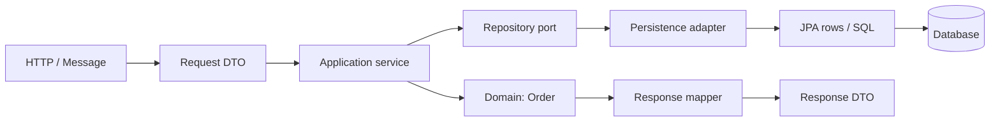
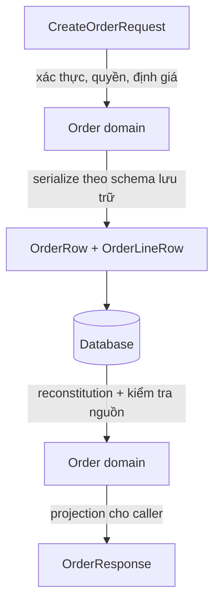

# Tách mô hình miền, DTO trao đổi và đối tượng phục vụ lưu trữ

Một lớp Java tên `Order` có thể được dùng làm kiểu trả về API, thực thể JPA và đối tượng xử lý nghiệp vụ cùng lúc. Cách làm này trông tiết kiệm: không cần viết bộ chuyển đổi, không cần thêm class, không cần phân biệt các biểu diễn. Nhưng khi hệ thống lớn lên, một thay đổi ở bảng cơ sở dữ liệu có thể làm vỡ hợp đồng API; một field mà client được phép gửi có thể bị gán trực tiếp vào cột nhạy cảm; hoặc một thao tác xác nhận đơn hàng vô tình bỏ qua bất biến nghiệp vụ.

**Tách mô hình miền (domain model), DTO trao đổi (Data Transfer Object) và đối tượng phục vụ lưu trữ (persistence model)** là cách đặt mỗi quyết định vào đúng ranh giới trách nhiệm. Ba mô hình có thể mô tả cùng một sự vật, nhưng chúng trả lời **ba nhóm câu hỏi khác nhau**:

- **Miền:** Đơn hàng là gì, được làm gì và trạng thái nào được coi là hợp lệ?
- **Trao đổi:** Client được gửi/nhìn thấy trường nào, theo hợp đồng và phiên bản API nào?
- **Lưu trữ:** Cấu trúc bảng, khóa ngoại, khóa chính, ràng buộc và cơ chế ghi/đọc thực sự là gì?

Bài thuộc chương **Mô hình Java** của module **DATABASE_DATA_MODELING**: rèn kỹ năng biến yêu cầu nghiệp vụ thành thực thể, quan hệ, bất biến, khóa, chỉ mục và lược đồ vật lý; đồng thời cân nhắc cách ánh xạ chúng trong mô hình quan hệ, document, graph hoặc phân tích. Ví dụ dùng **Java 17+**, Jakarta Bean Validation và các khái niệm JPA; những lớp/thư viện cụ thể có thể khác theo framework, nhưng nguyên tắc tách ranh giới vẫn giữ nguyên.

## 1. Tại sao một đối tượng duy nhất thường không đủ?

Giả sử hệ thống thương mại điện tử cần:

1. Tạo đơn nháp cho một khách hàng thuộc tenant hiện tại.
2. Thêm các dòng sản phẩm với số lượng dương; đơn giá lấy từ chính sách giá của hệ thống và được **chốt tại thời điểm tạo dòng**.
3. Xác nhận đơn chỉ khi có ít nhất một dòng và chưa bị xác nhận/hủy.
4. Mọi dòng hàng phải tham chiếu tới sản phẩm thuộc **cùng tenant**.
5. API công khai không cho phép client tự ghi `status`, `unit_price_minor`, `tenant_id` hoặc `version`.
6. Database phải giữ quan hệ đến khách hàng, sản phẩm và lịch sử đơn.
7. Có thể thay đổi schema, ORM hoặc cách trình bày API mà không bắt buộc viết lại toàn bộ logic xác nhận đơn.

Một lớp mang tất cả annotation thường được viết như sau:

```java
// Ví dụ phản diện: không phải mẫu nên sao chép vào production.
@Entity
public class Order {
    @Id
    public UUID id;

    public long tenantId;
    public UUID customerId;
    public String status;
    public long subtotalMinor;

    @OneToMany
    public List<OrderLine> lines;
}
```

Nếu JSON serializer truy cập trực tiếp entity, client có thể thấy trường nội bộ và quan hệ ORM; nếu controller bind request vào entity, người gọi có thể cố đặt `status = "CONFIRMED"` hoặc `subtotalMinor = -1`. Khi thêm cột lưu trữ, hình dạng JSON có thể đổi ngoài ý muốn. JPA còn mang những đặc tính riêng như entity đang được quản lý (*managed*), proxy, lazy loading, dirty checking và yêu cầu constructor; chúng không phải khái niệm nghiệp vụ cần lộ ra ở miền.

**Điểm mấu chốt:** vấn đề không phải vì một tên class xuất hiện ở nhiều nơi, mà vì **một quyết định ở một ranh giới được phép âm thầm thay đổi ranh giới khác**.

## 2. Ba loại mô hình và ba loại hợp đồng

| Tiêu chí | Domain model | DTO trao đổi | Persistence model |
|---|---|---|---|
| Câu hỏi chính | “Quy tắc nghiệp vụ nào phải đúng?” | “Ai được gửi/nhận gì?” | “Dữ liệu được ghi/đọc thế nào?” |
| Ví dụ tên | `Order`, `OrderLine`, `Money` | `CreateOrderRequest`, `OrderResponse` | `OrderRow`, `OrderLineRow` |
| Bất biến | Chuyển trạng thái, tổng tiền, số lượng | Cấu trúc, định dạng, field bắt buộc của request | PK, FK, unique, check, version, index |
| Vòng đời | Theo khái niệm đơn hàng | Theo một request/response hoặc message | Theo transaction, ORM session, schema |
| Phụ thuộc đặc thù | Ngôn ngữ miền, logic Java | JSON, API version, validation | JPA/JDBC, SQL, ORM mapping |
| Trường không được lộ | Không phải giao diện trực tiếp của API | Chỉ những trường được chủ động công khai | Có thể chứa khóa/metadata kỹ thuật |
| Khả năng thay thế | Giữ khi đổi database/transport | Giữ tương thích khi đổi storage | Có thể đổi schema mà không đổi hành vi miền |

Không nhất thiết **mỗi trường phải có đúng ba class**. Một value object bất biến có thể dùng lại ở những ranh giới đã được thiết kế rõ. Nhưng **không nên mặc định** mọi class miền được serialize trực tiếp và mọi class JPA được đưa vào API.

### Sơ đồ luồng phụ thuộc



Luồng dữ liệu đi qua các adapter/mapper, nhưng **chiều phụ thuộc trong mã nguồn** nên được lựa chọn cẩn thận: miền không cần import `@Entity`, `HttpServletRequest` hay JSON annotation; tầng adapter phụ thuộc vào các giao diện/định nghĩa miền, không buộc miền phải biết cơ sở dữ liệu nào đang dùng.

Ở ứng dụng nhỏ, có thể đơn giản hóa tầng lớp. Điều không nên đánh đổi là tính đúng của dữ liệu, quyền ghi và ranh giới hợp đồng.

## 3. Mô hình miền bắt đầu từ bất biến, không từ cột SQL

Ta xác nhận các quy tắc của một đơn hàng:

| Mã | Bất biến miền | Ai phải hiểu? |
|---|---|---|
| O-01 | Một đơn có ID và thuộc đúng một tenant/khách hàng | Domain, service, persistence |
| O-02 | Dòng có `lineNo` dương, sản phẩm định danh, số lượng dương | Domain và persistence |
| O-03 | Đơn giá đã chốt không âm, giữ nguyên nghĩa của đơn vị tiền nhỏ nhất | Domain và persistence |
| O-04 | Trong một đơn, `lineNo` không trùng | Domain, PK/unique tại DB |
| O-05 | Xác nhận chỉ cho phép từ `DRAFT` và khi có ít nhất một dòng | Domain, đường ghi đồng bộ |
| O-06 | Tổng phụ bằng tổng thành tiền của từng dòng | Có thể tính từ domain; nếu lưu summary phải đối soát |
| O-07 | Khách hàng và sản phẩm phải thuộc cùng tenant | Application + FK ghép |
| O-08 | Khi hai người cùng sửa đơn, không được lặng lẽ mất cập nhật | Transaction/optimistic lock/DB |
| O-09 | Client không được tự quyết định đơn giá hay tenant | DTO và authorization tại application boundary |

Không một class `Order` đơn lẻ, kể cả thiết kế tốt, có thể tự bảo vệ O-07 nếu nó không có dữ liệu chủ sở hữu của khách hàng/sản phẩm. Đây là bất biến **xuyên aggregate** hoặc **xuyên bảng**; nó đòi hỏi cổng ứng dụng và ràng buộc lưu trữ phù hợp. Ngược lại, O-05 là quy tắc trực tiếp của hành vi “xác nhận đơn”, rất phù hợp để đặt ở mô hình miền.

### Phân biệt entity, value object và aggregate

- **Entity miền:** có danh tính và vòng đời. Hai đơn có cùng nội dung nhưng khác `orderId` vẫn là hai đơn.
- **Value object:** mang giá trị và bất biến, không cần ID riêng; ví dụ `Money` hoặc `Quantity`.
- **Aggregate:** nhóm đối tượng cần được thay đổi theo một ranh giới nhất quán. `Order` là aggregate root, quản lý các dòng và điều kiện xác nhận đơn.

`OrderLine` có thể là entity con trong aggregate nếu nó được xác định bằng `lineNo` và cần được sửa/xóa riêng trong phạm vi đơn. Nếu nghiệp vụ coi mỗi dòng là một giá trị bất biến không có vòng đời riêng, cách biểu diễn domain có thể khác. **Không suy ra ranh giới aggregate từ `@OneToMany`**; ORM mapping chỉ nói tới quan hệ lưu trữ.

## 4. Mã Java: domain model không phụ thuộc JPA hay HTTP

### 4.1. Kiểu trạng thái và dòng đơn

```java
package example.domain;

public enum OrderStatus {
    DRAFT,
    CONFIRMED,
    CANCELLED
}
```

```java
package example.domain;

import java.util.Objects;
import java.util.UUID;

public record OrderLine(
        int lineNo,
        UUID productId,
        int quantity,
        long unitPriceMinor) {

    public OrderLine {
        if (lineNo <= 0) {
            throw new IllegalArgumentException("lineNo must be positive");
        }
        Objects.requireNonNull(productId, "productId");
        if (quantity <= 0) {
            throw new IllegalArgumentException("quantity must be positive");
        }
        if (unitPriceMinor < 0) {
            throw new IllegalArgumentException("unitPriceMinor must be non-negative");
        }
    }

    public long lineTotalMinor() {
        return Math.multiplyExact((long) quantity, unitPriceMinor);
    }
}
```

Giá ở đây được biểu diễn bằng `long` **đơn vị nhỏ nhất** (ví dụ 25.000 VND theo quy ước tiền tệ), không phải `double`. `Math.multiplyExact` phát hiện tràn số thay vì âm thầm tạo tổng sai. Trong hệ thống đa tiền tệ, cần một `Money` value object chứa mã tiền và quy tắc scale/rounding thích hợp; không trộn các minor unit của hai đồng tiền vào cùng một tổng.

Dòng không có `@Column`, `@JsonProperty` hay annotation framework. Nó bảo vệ các bất biến cục bộ tại lúc tạo, bất kể dòng được khởi tạo từ HTTP, message hoặc việc đọc cơ sở dữ liệu.

### 4.2. Aggregate `Order` và chuyển trạng thái

```java
package example.domain;

import java.util.HashSet;
import java.util.List;
import java.util.Objects;
import java.util.Set;
import java.util.UUID;

public record Order(
        UUID id,
        long tenantId,
        UUID customerId,
        String currencyCode,
        OrderStatus status,
        List<OrderLine> lines) {

    public Order {
        Objects.requireNonNull(id, "id");
        if (tenantId <= 0) {
            throw new IllegalArgumentException("tenantId must be positive");
        }
        Objects.requireNonNull(customerId, "customerId");
        Objects.requireNonNull(currencyCode, "currencyCode");
        if (!currencyCode.matches("[A-Z]{3}")) {
            throw new IllegalArgumentException("invalid currency code");
        }
        Objects.requireNonNull(status, "status");
        Objects.requireNonNull(lines, "lines");

        lines = List.copyOf(lines);
        Set<Integer> lineNumbers = new HashSet<>();
        for (OrderLine line : lines) {
            if (!lineNumbers.add(line.lineNo())) {
                throw new IllegalArgumentException("duplicate lineNo");
            }
        }
        if (status == OrderStatus.CONFIRMED && lines.isEmpty()) {
            throw new IllegalArgumentException("confirmed order must have lines");
        }
    }

    public static Order draft(
            UUID id, long tenantId, UUID customerId,
            String currencyCode, List<OrderLine> lines) {
        return new Order(
            id, tenantId, customerId, currencyCode,
            OrderStatus.DRAFT, lines
        );
    }

    public Order confirm() {
        if (status != OrderStatus.DRAFT) {
            throw new IllegalStateException(
                "only a draft order can be confirmed"
            );
        }
        if (lines.isEmpty()) {
            throw new IllegalStateException(
                "cannot confirm an empty order"
            );
        }
        return new Order(
            id, tenantId, customerId, currencyCode,
            OrderStatus.CONFIRMED, lines
        );
    }

    public long subtotalMinor() {
        long total = 0;
        for (OrderLine line : lines) {
            total = Math.addExact(total, line.lineTotalMinor());
        }
        return total;
    }
}
```

Đây là **mẫu miền bất biến** (*immutable*) dùng `record` để ngắn gọn, không phải quy định rằng mọi aggregate đều phải là record. `List.copyOf` ngăn caller sửa tập dòng sau khi tạo; việc đổi trạng thái trả về một `Order` mới. Dù constructor được gọi từ mã nào, đơn `CONFIRMED` không thể rỗng.

**Giới hạn đã chủ ý:** ví dụ chỉ có hành vi `confirm()`, chưa triển khai thêm/sửa/xóa dòng, hủy đơn, giá vốn, thuế hoặc discount. Khi bổ sung những lệnh đó, phải giữ bất biến: ví dụ không cho sửa dòng sau xác nhận, số dòng không trùng và không đặt số lượng âm. Không nên cho phép `Order` nhận một `List<OrderLine>` rồi mở getter trả về danh sách có thể sửa trực tiếp.

### 4.3. Domain có nên lưu `version` không?

`@Version` của JPA phục vụ chống mất cập nhật theo cơ chế lưu trữ. Nó không nhất thiết là một khái niệm miền. Ở ví dụ, domain record **không chứa** phiên bản DB; adapter/repository giữ version của bản ghi được load và dùng optimistic locking khi ghi.

Nếu nghiệp vụ có khái niệm **phiên bản tài liệu** hoặc quy tắc “chỉ sửa bản kế hoạch revision 5”, version có thể là dữ liệu nghiệp vụ cần mô hình hóa riêng. Đừng gộp mặc định optimistic-lock version với “phiên bản hợp đồng”, “phiên bản API” hoặc “phiên bản quy tắc tính tiền”.

## 5. DTO: hợp đồng trao đổi không phải cửa hậu sửa dữ liệu

DTO là cấu trúc dành cho **một ranh giới trao đổi**: HTTP request/response, command trên message bus hoặc giao tiếp giữa các dịch vụ. Nó có thể khác miền về tên, kiểu biểu diễn và độ chi tiết.

### 5.1. Request chỉ chứa những gì người dùng được đề nghị

```java
package example.api;

import jakarta.validation.Valid;
import jakarta.validation.constraints.NotNull;
import jakarta.validation.constraints.Positive;
import java.util.List;
import java.util.UUID;

public record CreateOrderLineRequest(
    @NotNull UUID productId,
    @Positive int quantity
) {}

public record CreateOrderRequest(
    @NotNull UUID customerId,
    @NotNull List<@Valid CreateOrderLineRequest> lines
) {}
```

**Không có** `tenantId`, `unitPriceMinor`, `status`, `version`, `createdBy` trong request công khai:

- `tenantId` được xác định từ ngữ cảnh xác thực/ủy quyền, không tin số do caller tự khai.
- Đơn giá đến từ chính sách định giá đáng tin cậy, có thể cần báo giá có hiệu lực/giữ giá.
- Trạng thái ban đầu do use case xác định là `DRAFT`.
- `version` là metadata cạnh tranh, có thể được biểu diễn ở `ETag`/`If-Match` cho lệnh sửa, nhưng không phải field mà client được phép đặt tùy ý trong entity.

Ở đây `lines` cho phép danh sách rỗng nếu nghiệp vụ tạo nháp rỗng; `@NotNull` không đồng nghĩa `@NotEmpty`. Nếu một endpoint khác yêu cầu tạo và xác nhận ngay, request của endpoint đó có thể dùng `@NotEmpty` và **vẫn** cần domain kiểm tra trước khi xác nhận.

`@Positive`, `@NotNull` là **kiểm tra đầu vào** trước khi chạy use case; chúng không thay thế bất biến của miền. Request có thể đến từ batch hoặc message không đi qua cùng HTTP validator, và dữ liệu DB có thể bị sửa bởi nguồn khác.

### 5.2. Response được thiết kế cho người đọc

```java
package example.api;

import java.util.List;
import java.util.UUID;

public record OrderLineResponse(
    int lineNo,
    UUID productId,
    int quantity,
    long unitPriceMinor,
    long lineTotalMinor
) {}

public record OrderResponse(
    UUID orderId,
    String status,
    String currencyCode,
    long subtotalMinor,
    List<OrderLineResponse> lines
) {}
```

Response có tổng tiền để UI không phải tự lặp công thức, nhưng **không nhất thiết chứa** khóa/metadata nội bộ như `rowVersion`, dấu vết retry, thông tin người sửa cuối hoặc dữ liệu khách hàng chưa được ủy quyền công khai.

Đừng dùng trực tiếp `OrderLineResponse` làm request vì request không có quyền tự quyết đơn giá. Hai kiểu có vài field giống nhau vẫn có **ý nghĩa và quyền sở hữu dữ liệu khác nhau**. Tách ra giúp thay response mà không vô tình nới request.

### 5.3. DTO command, query và event có mục tiêu khác nhau

| Loại | Ví dụ | Trọng tâm |
|---|---|---|
| **Command/request** | `CreateOrderRequest`, `ConfirmOrderRequest` | Ý định thay đổi dữ liệu, trường caller được phép quyết định |
| **Query/response** | `OrderResponse`, `OrderListItemResponse` | Hình dạng dữ liệu phục vụ một màn hình/use case |
| **Integration event** | `OrderConfirmedV1` | Sự kiện đã xảy ra, schema/version cho consumer khác |
| **Batch import DTO** | `ImportOrderRow` | Dữ liệu đầu vào có thể chưa sạch, phải đối soát và báo lỗi |

Không nên tái sử dụng cùng một DTO cho mọi endpoint chỉ vì các field có vẻ giống. Một danh sách đơn có thể cần `subtotalMinor` và `lineCount` mà không cần tải mọi dòng; một response chi tiết có thể cần danh sách dòng và điều kiện hiển thị khác. Mỗi DTO nên được đánh giá theo **hợp đồng tiêu thụ thực tế**.

## 6. Persistence model: dữ liệu lưu trữ và ràng buộc của DB

Một persistence model diễn đạt cách domain được lưu: khóa, quan hệ, cột, nullability, version và cơ chế ORM/JDBC. Nó có thể chia một aggregate thành nhiều bảng hoặc gộp một số giá trị thành cột JSON. **Không phải mọi thực thể JPA đều là entity miền và không phải mọi entity miền đều ánh xạ một bảng.**

### 6.1. Lược đồ SQL cho ví dụ

Trong mô hình quan hệ, khóa ngoại ghép bảo vệ rằng đơn, khách và sản phẩm đều thuộc cùng tenant. Ta lưu `order_id`/`line_id` dạng UUID toàn cục để dễ tham chiếu; vẫn có unique ghép theo tenant phục vụ các FK chống tham chiếu chéo.

```sql
-- PostgreSQL 15+, lược đồ minh họa.
CREATE TABLE customer_accounts (
    tenant_id BIGINT NOT NULL,
    customer_id UUID NOT NULL,
    display_name TEXT NOT NULL,
    CONSTRAINT pk_customer_accounts
        PRIMARY KEY (tenant_id, customer_id),
    CONSTRAINT ck_customer_name CHECK (btrim(display_name) <> '')
);

CREATE TABLE catalog_products (
    tenant_id BIGINT NOT NULL,
    product_id UUID NOT NULL,
    sku TEXT NOT NULL,
    CONSTRAINT pk_catalog_products
        PRIMARY KEY (tenant_id, product_id),
    CONSTRAINT uq_catalog_sku
        UNIQUE (tenant_id, sku),
    CONSTRAINT ck_catalog_sku CHECK (btrim(sku) <> '')
);

CREATE TABLE orders (
    order_id UUID PRIMARY KEY,
    tenant_id BIGINT NOT NULL,
    customer_id UUID NOT NULL,
    currency_code CHAR(3) NOT NULL,
    status_code VARCHAR(16) NOT NULL DEFAULT 'DRAFT',
    row_version BIGINT NOT NULL DEFAULT 0,

    CONSTRAINT uq_order_with_tenant
        UNIQUE (tenant_id, order_id),
    CONSTRAINT fk_order_customer
        FOREIGN KEY (tenant_id, customer_id)
        REFERENCES customer_accounts (tenant_id, customer_id)
        ON DELETE RESTRICT,
    CONSTRAINT ck_order_status
        CHECK (status_code IN ('DRAFT', 'CONFIRMED', 'CANCELLED')),
    CONSTRAINT ck_currency_code
        CHECK (currency_code ~ '^[A-Z]{3}$'),
    CONSTRAINT ck_row_version CHECK (row_version >= 0)
);

CREATE TABLE order_lines (
    line_id UUID PRIMARY KEY,
    tenant_id BIGINT NOT NULL,
    order_id UUID NOT NULL,
    line_no INTEGER NOT NULL,
    product_id UUID NOT NULL,
    quantity INTEGER NOT NULL,
    unit_price_minor BIGINT NOT NULL,

    CONSTRAINT uq_line_number_in_order
        UNIQUE (tenant_id, order_id, line_no),
    CONSTRAINT fk_line_order
        FOREIGN KEY (tenant_id, order_id)
        REFERENCES orders (tenant_id, order_id)
        ON DELETE RESTRICT,
    CONSTRAINT fk_line_product
        FOREIGN KEY (tenant_id, product_id)
        REFERENCES catalog_products (tenant_id, product_id)
        ON DELETE RESTRICT,
    CONSTRAINT ck_line_no CHECK (line_no > 0),
    CONSTRAINT ck_line_quantity CHECK (quantity > 0),
    CONSTRAINT ck_line_price CHECK (unit_price_minor >= 0)
);

CREATE INDEX ix_lines_by_order
    ON order_lines (tenant_id, order_id, line_no);
```

`ix_lines_by_order` là một chỉ mục **minh họa về mẫu truy vấn**. Ở PostgreSQL, `UNIQUE (tenant_id, order_id, line_no)` đã tự tạo B-tree có đúng tiền tố ấy; vì vậy **không cần thực sự tạo thêm `ix_lines_by_order` trong production nếu nó trùng chỉ mục unique đã có**. Đo `EXPLAIN` và loại bỏ chỉ mục trùng để tránh chi phí ghi vô ích.

**Điểm quan trọng về bất biến:**

- FK `orders(tenant_id, customer_id)` ngăn đơn của tenant A trỏ khách tenant B.
- FK `order_lines(tenant_id, product_id)` ngăn dòng dùng sản phẩm tenant khác.
- FK `order_lines(tenant_id, order_id)` bảo vệ dòng thuộc đúng đơn của tenant đó.
- `UNIQUE (tenant_id, order_id, line_no)` ngăn số dòng trùng.
- `CHECK` bảo vệ số lượng và đơn giá theo miền.
- **Không có** FK/`CHECK` đơn giản nào tự khẳng định “đơn `CONFIRMED` luôn có ít nhất một dòng”. Đường xác nhận đơn phải kiểm tra và đồng bộ.
- Dòng lưu `unit_price_minor` là **snapshot giao dịch** có chủ đích; thay giá catalogue sau đó không được làm giá cũ tự đổi.

Việc dùng UUID toàn cục cho `orders.order_id` kết hợp `tenant_id` không thay thế kiểm tra quyền đọc/ghi theo tenant. Mọi truy vấn của người dùng thông thường vẫn cần scope tenant hoặc cơ chế cô lập tương đương.

### 6.2. Entity JPA không cần là domain object

Một lớp ánh xạ tối giản:

```java
package example.persistence;

import jakarta.persistence.Column;
import jakarta.persistence.Entity;
import jakarta.persistence.Id;
import jakarta.persistence.Table;
import jakarta.persistence.Version;
import java.util.UUID;

@Entity
@Table(name = "orders")
public class OrderRow {
    @Id
    @Column(name = "order_id", nullable = false)
    private UUID id;

    @Column(name = "tenant_id", nullable = false)
    private long tenantId;

    @Column(name = "customer_id", nullable = false)
    private UUID customerId;

    @Column(name = "currency_code", nullable = false, length = 3)
    private String currencyCode;

    @Column(name = "status_code", nullable = false, length = 16)
    private String statusCode;

    @Version
    @Column(name = "row_version", nullable = false)
    private long rowVersion;

    protected OrderRow() {} // Dành cho JPA.

    public UUID getId() { return id; }
    public long getTenantId() { return tenantId; }
    public UUID getCustomerId() { return customerId; }
    public String getCurrencyCode() { return currencyCode; }
    public String getStatusCode() { return statusCode; }
    public long getRowVersion() { return rowVersion; }

    public void updateStatusCode(String newStatusCode) {
        this.statusCode = newStatusCode;
    }
}
```

Ở đây entity JPA là **đối tượng lưu trữ**, sử dụng tên cột vật lý, `@Id` và `@Version`. Nó không quyết định khi nào được xác nhận đơn. Mapper/application chỉ gọi `updateStatusCode` **sau khi** domain đã trả về trạng thái hợp lệ.

Đoạn trên chỉ cho thấy những trường chính và thay đổi trạng thái; một adapter tạo đơn sẽ cần factory/constructor để khởi tạo bản ghi mới, và một `OrderLineRow` tương ứng với bảng dòng. Không có lý do buộc domain `Order` extends `OrderRow` hoặc có cùng constructor.

### 6.3. Tránh lạm dụng `@OneToMany`

Có thể ánh xạ quan hệ cha–con bằng `@OneToMany` hoặc truy vấn dòng theo `(tenant_id, order_id)` qua repository riêng. Hai cách có đánh đổi khác nhau về `fetch`, `cascade`, `orphanRemoval`, vòng đời đối tượng và số câu SQL.

Không lấy cấu trúc collection ORM làm định nghĩa aggregate một cách tự động. Ví dụ, một order aggregate có quyền thay đổi dòng trong transaction, nhưng bảng `order_lines` vẫn cần ràng buộc đủ mạnh nếu batch import hoặc thủ tục vận hành ghi trực tiếp.

Nếu dùng ORM lazy loading, không expose entity cho JSON serializer: serialization có thể kích hoạt truy vấn ngoài ý muốn, lỗi lazy initialization, vòng tham chiếu hoặc tải một lượng dữ liệu lớn. Response DTO nên được tạo từ một **query shape** đã được lựa chọn chủ động.

## 7. Mapping có chủ đích giữa ba biểu diễn

Mapper là chỗ biến đổi **biểu diễn**; nó không được trở thành nơi tự phê duyệt nghiệp vụ sai.



### 7.1. Response mapper là phép chiếu, không phải gói toàn bộ object

```java
package example.api;

import example.domain.Order;
import example.domain.OrderLine;
import java.util.List;

public final class OrderResponseMapper {
    private OrderResponseMapper() {}

    public static OrderResponse fromDomain(Order order) {
        List<OrderLineResponse> lines = order.lines().stream()
            .map(OrderResponseMapper::mapLine)
            .toList();

        return new OrderResponse(
            order.id(),
            order.status().name(),
            order.currencyCode(),
            order.subtotalMinor(),
            lines
        );
    }

    private static OrderLineResponse mapLine(OrderLine line) {
        return new OrderLineResponse(
            line.lineNo(),
            line.productId(),
            line.quantity(),
            line.unitPriceMinor(),
            line.lineTotalMinor()
        );
    }
}
```

Code này cho thấy những trường được phép công khai là **danh sách trắng** (*allowlist*), không phải tất cả field nào entity hiện có. Nếu hệ thống có dữ liệu cá nhân, chi phí nội bộ hoặc audit log, mapper không tự động thêm chúng vào response chỉ vì database đã lưu.

### 7.2. Khôi phục domain từ persistence

Một adapter có thể lấy một dòng `orders` và những dòng `order_lines` của nó, sắp theo `line_no`, rồi tạo lại domain:

```java
// Mã minh họa thuật toán bên trong adapter, không phải class hoàn chỉnh.
Order restored = new Order(
    row.getId(),
    row.getTenantId(),
    row.getCustomerId(),
    row.getCurrencyCode(),
    OrderStatus.valueOf(row.getStatusCode()),
    lineRows.stream()
        .sorted(Comparator.comparingInt(OrderLineRow::getLineNo))
        .map(l -> new OrderLine(
            l.getLineNo(),
            l.getProductId(),
            l.getQuantity(),
            l.getUnitPriceMinor()
        ))
        .toList()
);
```

Khi khôi phục, **không được âm thầm bỏ qua dòng sai**. Nếu database chứa `status_code` không được domain nhận biết, dòng trùng, đơn xác nhận rỗng hay giá trị không hợp lệ, mapper nên trả lỗi có thể theo dõi/đối soát thay vì biến dữ liệu lỗi thành một domain object “hợp lệ giả”.

Ví dụ dùng `OrderLineRow` như persistence model chưa viết trọn trong bài; adapter thực có thể dùng JPA entity, JDBC row mapping hoặc SQL projection. `OrderStatus.valueOf` chỉ phù hợp khi mã DB trùng tên enum; nếu mã lưu trữ khác hoặc cần chuyển đổi phiên bản, phải có converter tường minh và chính sách xử lý unknown value.

### 7.3. Mapping input cần thêm dữ liệu đáng tin cậy

Không thể lấy `CreateOrderRequest` rồi gọi thẳng constructor domain `OrderLine` vì request **không chứa giá chốt** và không đủ bằng chứng cùng tenant. Application service phải:

1. Lấy `tenantId` từ ngữ cảnh đã xác thực, không từ JSON caller.
2. Kiểm tra `customerId` thuộc tenant và được phép sử dụng.
3. Kiểm tra từng `productId` cùng tenant, còn được bán và hợp lệ với chính sách giá.
4. Lấy báo giá/giá bán theo tiền tệ và thời điểm của use case; **chốt** giá vào dòng domain.
5. Chọn `lineNo`, `orderId` ổn định và tạo aggregate `DRAFT`.
6. Ghi toàn bộ trong transaction bảo vệ các ràng buộc và xử lý xung đột.

Nếu client được phép đề xuất mã coupon hoặc số lượng, đó là **yêu cầu đầu vào**; quyền áp dụng giảm giá và kết quả tiền cần được tính/kiểm tra ở hệ thống có thẩm quyền.

## 8. Application service và repository port

Miền nên mô tả hành vi; **application service** điều phối người gọi, transaction, repository và những dịch vụ bên ngoài.

### 8.1. Giao diện repository theo nhu cầu miền

```java
package example.application;

import example.domain.Order;
import java.util.Optional;
import java.util.UUID;

public interface OrderRepository {
    Optional<Order> findById(long tenantId, UUID orderId);
    void save(Order order);
}
```

Đây là một **port** của ứng dụng, không phải contract JPA. Adapter được phép dùng JPA, JDBC hoặc document store, nhưng phải đảm bảo ngữ nghĩa `findById` và `save` cùng transaction. Ví dụ đơn giản này chưa chứa expected version; implementation phải có chính sách optimistic/pessimistic locking hoặc bổ sung version token trong API nếu use case cần cập nhật từ bản đã đọc trước.

### 8.2. Use case xác nhận đơn

```java
package example.application;

import example.domain.Order;
import java.util.UUID;

public final class ConfirmOrderUseCase {
    private final OrderRepository orders;

    public ConfirmOrderUseCase(OrderRepository orders) {
        this.orders = orders;
    }

    // Giao dịch do application boundary / decorator quản lý.
    public Order confirm(long authenticatedTenantId, UUID orderId) {
        Order current = orders.findById(authenticatedTenantId, orderId)
            .orElseThrow(() -> new OrderNotFoundException(orderId));

        Order confirmed = current.confirm();
        orders.save(confirmed);
        return confirmed;
    }
}
```

`OrderNotFoundException` trong đoạn trên đại diện cho exception của ứng dụng (cần định nghĩa trong mã dự án); ví dụ chỉ mô tả use case, chưa bao gồm cấu hình transaction, authorization chi tiết hoặc cách ánh xạ lỗi sang HTTP. Không phải cứ gọi `save` là toàn bộ thao tác **tự động atomic** nếu không có transaction boundary.

**Quy tắc phân trách nhiệm:**

- Controller/adapter HTTP: parse request, authentication, validation cấu trúc, mã phản hồi.
- Use case: xác định tenant, kiểm tra quyền, lấy aggregate, điều phối transaction và gửi thông báo.
- Domain: kiểm tra “chỉ nháp mới xác nhận”, “xác nhận phải có dòng”.
- Repository adapter: truy vấn và ghi đúng dữ liệu thuộc tenant, đảm bảo optimistic locking/transaction.
- Database: PK/FK/unique/check và constraint xuyên bảng được thiết kế tương ứng.

Nếu chỉ controller kiểm tra nghiệp vụ thì batch job hoặc message consumer dễ bỏ qua; nếu chỉ domain kiểm tra tính cùng tenant nhưng không có quyền truy cập dữ liệu đầu mút, nó có thể bỏ sót trường hợp tham chiếu sai. Cần **phối hợp** các tầng, không cố nhét mọi kiểm tra vào một class.

## 9. Transaction và cạnh tranh: tách lớp không có nghĩa tách sự nhất quán

Tách domain và entity giúp mã dễ tiến hóa, nhưng cũng tạo một câu hỏi quan trọng: **ai đảm bảo khi hai người sửa cùng đơn, dữ liệu được ghi đúng?**

### 9.1. Optimistic locking bằng `@Version`

Giả sử hai request T1 và T2 cùng đọc `row_version = 5`. T1 xác nhận đơn và commit, version tăng lên 6. T2 cố lưu một thay đổi dựa trên version 5; ORM có thể phát hiện xung đột và ném lỗi optimistic locking khi flush/commit.

Với JPA, `@Version` hoạt động khi **cập nhật managed entity** đúng cách; nó không tự bảo vệ câu lệnh SQL tùy ý chạy trực tiếp trên bảng. Repository adapter không nên tạo một entity mới với version mặc định rồi `merge` bừa bãi như thể đây là bản đã đọc; phải quản lý version/identity và phân biệt tạo mới với cập nhật.

Một mapping an toàn cho chuyển trạng thái có thể là:

1. Trong transaction, load `OrderRow` managed theo **tenant + orderId**.
2. Load các `OrderLineRow` cần thiết và tạo domain `Order`.
3. Gọi `order.confirm()`; nếu không hợp lệ, không ghi.
4. Gán trạng thái đã được domain xác nhận vào managed `OrderRow`.
5. Flush/commit; xử lý xung đột version thành lỗi retry hoặc conflict phù hợp.

### 9.2. Cập nhật dòng con phải cùng chiến lược khóa

**Bẫy:** chỉ đặt `@Version` trên `OrderRow` nhưng một luồng khác sửa `order_lines` mà không thay parent row. T1 có thể kiểm tra đơn còn dòng, T2 xóa hết dòng, cả hai commit theo thứ tự gây ra đơn `CONFIRMED` rỗng.

Vì vậy mọi thao tác **thêm/sửa/xóa dòng** có thể ảnh hưởng bất biến của đơn phải tham gia cùng cơ chế đồng bộ: ví dụ khóa dòng parent `orders` bằng `SELECT ... FOR UPDATE` trước khi sửa dòng; hoặc luôn tăng version parent và kiểm tra xung đột; hoặc cô lập `SERIALIZABLE` kèm retry và quyền ghi tập trung. Chỉ `@Version` ở parent **không đủ** nếu một code path thay đổi child mà không phối hợp.

### 9.3. Lỗi transaction và retry

Một transaction có thể thất bại do FK, unique constraint, optimistic locking, deadlock hoặc lỗi kết nối. Khi retry, phải phân biệt thao tác có thể chạy lại an toàn hay không. Với tạo đơn, nếu caller gửi cùng yêu cầu hai lần do timeout, tạo hai `orderId` khác nhau có thể dẫn tới hai đơn; cần **idempotency key** có ràng buộc duy nhất theo tenant/use case nếu nghiệp vụ muốn xử lý lặp như một yêu cầu.

Exception thuộc JPA/SQL nên được adapter dịch sang lỗi ứng dụng có nghĩa, không trả nguyên stacktrace hoặc tên bảng ra API công khai.

## 10. Tính đúng của giá và tổng tiền xuyên các lớp

`OrderLine.unitPriceMinor` trong domain là **snapshot giá tại thời điểm giao dịch**, không phải một pointer tự động đọc giá hiện tại từ `Product`. Tầng ứng dụng phải xác định:

- **Nguồn báo giá**: bảng giá có hiệu lực, khuyến mãi, thuế, khách hàng hoặc currency.
- **Thời điểm chốt**: khi tạo dòng, khi xác nhận, hay khi thanh toán?
- **Hiệu lực báo giá**: nếu đơn nháp lưu trong nhiều ngày, xác nhận có cần kiểm tra giá mới không?
- **Quy tắc làm tròn**: minor unit, precision, discount, thuế và giới hạn tràn số.
- **Kiểm soát lịch sử**: sau khi xác nhận, đơn giá đã chốt phải giữ nguyên trừ lệnh điều chỉnh có chứng cứ.

Nếu ví dụ dùng `long` nhưng cơ sở dữ liệu lưu `BIGINT`, giới hạn và overflow phải được xử lý nhất quán. `Math.addExact`/`Math.multiplyExact` giúp domain phát hiện overflow; DB `BIGINT` cũng giới hạn phạm vi, nhưng **không tự kiểm tra công thức tổng tiền**. Nếu aggregate có tổng dẫn xuất lưu riêng để đọc nhanh, cần nguồn chân lý và cơ chế đối soát/rebuild.

Không nên dùng entity `ProductRow` rồi đọc `getCurrentPrice()` mỗi lần hiển thị đơn lịch sử. Điều này làm tổng tiền cũ thay đổi khi sản phẩm đổi giá mà không có giao dịch đơn hàng nào.

## 11. Identity, value object, nullability và kiểu dữ liệu

### 11.1. Định danh và khóa dữ liệu

Một `UUID orderId` trong domain định danh đơn; bảng `orders` có `order_id` làm PK kỹ thuật. Nếu hệ thống hỗ trợ nhiều tenant, một số nghiệp vụ dùng `(tenantId, orderId)` làm định danh logic. Dù ID UUID có vẻ duy nhất toàn cục, **truy vấn có scope tenant** vẫn là yêu cầu bảo mật.

Có thể dùng value object như:

```java
package example.domain;

import java.util.UUID;

public record OrderId(UUID value) {
    public OrderId {
        if (value == null) {
            throw new IllegalArgumentException("missing order id");
        }
    }
}
```

`OrderId` giúp tránh nhầm các UUID trong domain (ví dụ truyền `customerId` vào chỗ `orderId`). Tuy nhiên, DTO có thể vẫn dùng chuỗi UUID/`UUID` và ORM dùng `UUID` ở cột; mapper chịu trách nhiệm bọc/mở value object. Có đáng thêm value object cho mọi ID hay không phụ thuộc độ phức tạp miền và giá trị an toàn kiểu.

### 11.2. Nullability không giống nhau ở mọi ranh giới

| Trường hợp | Biểu diễn khuyến nghị | Ý nghĩa |
|---|---|---|
| Request thiếu `customerId` | Validation error | Caller chưa đưa đủ thông tin |
| Domain `Order.customerId` | Không được rỗng | Đơn hợp lệ luôn thuộc một khách |
| DB `orders.customer_id` | `NOT NULL` + FK | Chặn ghi mồ côi/bypass ứng dụng |
| Response chưa có ngày thanh toán | Omit field hoặc nullable có tài liệu hóa | Trạng thái chưa thanh toán |
| Dữ liệu nhập từ nguồn ngoài chưa xác định khách | Staging/import model riêng | Chưa thể coi là `Order` nghiệp vụ hoàn chỉnh |

Đừng gán `null` để “làm qua” constructor domain khi dữ liệu nguồn bị thiếu. Với import chưa hợp lệ, giữ nó ở **staging** và lưu lỗi đối soát; chỉ đưa vào aggregate chính thức khi đủ điều kiện.

### 11.3. Enum và mã trạng thái

Domain `OrderStatus` có enum; DB lưu `status_code` dạng chuỗi và có `CHECK`; DTO response trả mã trạng thái. Ba biểu diễn có thể cùng tên giá trị nhưng **mỗi bên có vòng đời khác nhau**:

- Một trạng thái mới phải được domain cho phép và định nghĩa chuyển trạng thái.
- Migration DB phải chấp nhận mã mới trước khi writer bắt đầu ghi.
- Consumer API cũ có thể không nhận biết mã mới; có thể cần API version hoặc giá trị fallback rõ ràng.

Không dùng Java `enum.ordinal()` làm giá trị DB hoặc hợp đồng API nếu thứ tự enum có thể thay đổi. Nếu dùng ORM enum, ưu tiên mapping mã ổn định và migration có kiểm soát; không mặc định `@Enumerated` thay thế chính sách tương thích ngược.

## 12. Hiệu năng và N+1: DTO không có nghĩa là luôn load aggregate đầy đủ

Một màn hình danh sách cần 100 đơn với số dòng và tổng tiền, nhưng không cần chi tiết từng sản phẩm. Nếu repository load từng `OrderRow` rồi lazy-load `orderLines` một lần cho mỗi đơn, có thể tạo mô hình truy vấn **N+1**.

Điều này không có nghĩa cần bỏ tách lớp. Nó có nghĩa **cách đọc phải phù hợp với use case**.

### 12.1. Tách write model và read projection khi cần

Một đường ghi `ConfirmOrderUseCase` cần domain aggregate đầy đủ để kiểm tra bất biến. Ngược lại, `ListOrdersQuery` có thể dùng một truy vấn SQL/projection chỉ trả:

```text
OrderListItem
  orderId
  customerName
  status
  lineCount
  subtotalMinor
  currencyCode
```

Query DTO có thể được tạo trực tiếp từ truy vấn tối ưu hoặc bảng tổng hợp đã đối soát. Không bắt buộc phải tạo 100 aggregate `Order` rồi chuyển chúng sang 100 DTO.

Điều này phù hợp với **CQRS ở mức nhẹ**: đường ghi chịu trách nhiệm bất biến, đường đọc tối ưu cho nhu cầu hiển thị. Không cần event sourcing, message bus hoặc hai database chỉ vì dùng hai kiểu DTO. Nếu chọn eventual consistency cho read model, API phải chấp nhận/hiển thị độ trễ theo hợp đồng.

### 12.2. Kế hoạch truy vấn và chỉ mục

Với lược đồ ví dụ:

- Truy vấn `orders` theo `(tenant_id, order_id)` cần chỉ mục/unique tương ứng.
- Truy vấn `order_lines` theo `(tenant_id, order_id)` dùng tiền tố của unique `(tenant_id, order_id, line_no)`.
- Thống kê theo khách hàng có thể cần chỉ mục `(tenant_id, customer_id)` trên `orders` nếu workload lớn.
- Các FK không phải luôn tự tạo chỉ mục ở phía con; cần kiểm tra engine và truy vấn thật.
- Một DTO không làm truy vấn tự nhanh hơn: cần xem `EXPLAIN`, pagination, lọc tenant và kích thước payload.

Một cách tiếp cận có thể dùng fetch join/entity graph cho dữ liệu chi tiết cần thiết, query projection cho danh sách, và tách giao dịch/đọc hợp lý. Đừng bật `EAGER` toàn bộ quan hệ chỉ để né lazy-loading error khi serialize entity.

## 13. Tiến hóa API, domain và database độc lập có kiểm soát

Tách ba mô hình cho phép thay đổi có chủ ý mà không bắt mọi consumer thay đổi ngay lập tức.

| Thay đổi | Ảnh hưởng chính | Chiến lược |
|---|---|---|
| Đổi tên cột `status_code` trong DB | Persistence model/migration | Adapter thay mapping; DTO/miền giữ nghĩa cũ |
| Thêm field nội bộ `risk_score` | Database và có thể domain | Không tự expose vào API |
| API v2 đổi tên `orderId` thành `id` | DTO/serializer và API client | Mapper điều chỉnh, domain/DB không cần đổi ID |
| Thêm trạng thái `ON_HOLD` | Domain, chuyển trạng thái, DB và API | Đồng bộ migration và consumer, có chính sách phiên bản |
| Thêm phí vận chuyển vào tổng đơn | Quy tắc miền và báo cáo | Định nghĩa công thức mới, snapshot/đối soát và migration |
| Đổi ORM hoặc JDBC | Persistence adapter | Giữ repository port và test hành vi |
| Chuyển read model sang document/search index | Read adapter/DTO | Bảo vệ nguồn chân lý và SLA hội tụ |

Tách lớp **không làm mọi thay đổi trở nên miễn phí**. Nếu nghiệp vụ định nghĩa lại “đơn đã xác nhận”, miền, kiểm thử, dữ liệu lịch sử, API và DB có thể đều cần cập nhật. Lợi ích là **biết thay đổi ở đâu và vì sao**, thay vì phải chỉnh mọi nơi vì đang dùng chung một class.

### 13.1. Chiến lược expand–migrate–contract

Với thay đổi schema có nhiều phiên bản ứng dụng cùng chạy:

1. **Expand:** thêm cột/bảng mới theo cách tương thích với writer/reader cũ.
2. **Migrate/backfill:** chuyển dữ liệu với đối soát, xử lý trường hợp không ánh xạ được.
3. **Switch:** cho adapter dùng cột mới; giữ API ổn định nếu không có yêu cầu đổi hợp đồng.
4. **Contract:** chỉ xóa cấu trúc cũ sau khi tất cả client/worker đã ngừng phụ thuộc và kiểm chứng dữ liệu đạt.

DTO tách riêng giúp phần JSON không bị thay theo tên cột mới, nhưng không tự bảo đảm quá trình dual-write/backfill nhất quán. Cần xác định một nguồn chân lý cho giai đoạn chuyển đổi.

### 13.2. Quy tắc tương thích cho event và external API

Đối với event `OrderConfirmedV1`, không nên serialize toàn bộ domain object rồi coi đó là contract ổn định. Nếu domain thêm trường hoặc đổi cấu trúc class, consumer ngoài tiến trình có thể gãy. Dùng integration event DTO có version, schema rõ, không chứa dữ liệu nội bộ không cần thiết và có idempotency/event ID khi cần.

## 14. Bảo mật: chống mass assignment và rò rỉ dữ liệu

Dùng một entity làm input và output dễ dẫn tới **mass assignment**: client gửi thêm field không được phép như `isAdmin`, `tenantId`, `paidAmount`, `approvedBy` hoặc `rowVersion`, rồi binder/mapper ghi thẳng vào entity.

Tách request DTO và mapping theo allowlist giúp giảm nguy cơ:

```text
JSON client
  customerId: C-1
  lines: ...
  status: CONFIRMED       <- không thuộc request contract
  tenantId: 999           <- không thuộc request contract
  unitPriceMinor: 1       <- không thuộc request contract
```

Tuy nhiên, chỉ việc request record **không khai báo field** chưa chắc serializer từ chối trường JSON thừa; nhiều bộ deserializer có cấu hình **bỏ qua unknown properties**. Cần chọn chính sách từ chối/bỏ qua và kiểm thử nó. Điều không đổi là application **không bao giờ** dùng field ngoài allowlist để quyết định giá, tenant hay chuyển trạng thái.

Đồng thời:

- Scope mọi truy vấn theo tenant và xác thực quyền trên từng đối tượng.
- Không tin một `orderId` UUID khó đoán là đủ để bảo vệ truy cập.
- Không trả email, giá vốn, dữ liệu thanh toán nội bộ chỉ vì entity có field đó.
- Không để message consumer hay import job đi vòng qua những quy tắc bắt buộc của domain/DB.
- Ghi audit log ở đúng ranh giới, tránh đưa bí mật hoặc dữ liệu nhạy cảm dư thừa vào log/DTO.

**DTO là một lớp phòng vệ về hợp đồng**, không thay thế authorization, transaction hay constraint ở cơ sở dữ liệu.

## 15. Kịch bản nhập dữ liệu, document, graph và analytics

Việc tách miền/trao đổi/lưu trữ không phụ thuộc vào việc dữ liệu phía dưới là SQL.

| Kiến trúc lưu trữ | Domain model | DTO trao đổi | Persistence/read model |
|---|---|---|---|
| **RDBMS** | `Order` với bất biến | JSON request/response | JPA row hoặc JDBC mapping nhiều bảng |
| **Document** | `Order` vẫn bảo vệ quy tắc xác nhận | DTO theo API | Document có dòng nhúng hoặc reference, version để tránh lost update |
| **Graph** | Quy tắc “đơn thuộc khách, dòng thuộc đơn” | DTO request/query | Node/edge, ràng buộc cardinality và quyền theo graph engine |
| **Analytics** | Quy tắc nghiệp vụ định nghĩa grain và giá trị | Query/report DTO | FactOrderLine, dimension theo thời gian, snapshot |

### Document: domain không nhất thiết trùng JSON document

Một database document có thể lưu nguyên một order document chứa mảng `lines`. Đây là biểu diễn vật lý có lợi nếu mọi thao tác thường đọc/ghi cả aggregate và kích thước document có giới hạn. Nhưng domain `Order` vẫn cần bất biến giống ở RDBMS, và adapter cần xử lý concurrency khi hai request sửa cùng document.

Nếu document lưu thêm `customerName` để đọc nhanh, cần biết đó là snapshot lịch sử hay dữ liệu dẫn xuất từ hồ sơ khách; không biến tên hiện tại thành bất biến của đơn cũ chỉ vì tiện nhúng.

### Graph: quan hệ lưu trữ không thay thế hành vi miền

Một graph lưu node `Order`, `Customer`, `Product` và edge `HAS_LINE`, `REFERENCES`. Domain `Order.confirm()` vẫn yêu cầu ít nhất một dòng; một edge tự tồn tại không tự bảo vệ việc không tham chiếu chéo tenant hoặc không có hai dòng cùng số. Adapter graph phải đảm bảo ràng buộc tương ứng với khả năng của engine.

### Analytics: read DTO theo đúng grain

Một báo cáo doanh thu có thể tạo `OrderRevenueRow` từ fact cấp **dòng đơn**, không cần dựng aggregate `Order` cho hàng triệu dòng. Nhưng phải chọn đúng grain: nếu doanh thu cấp đơn được join sang nhiều dòng rồi cộng, sẽ xảy ra *fan-out*. Tầng phân tích cần định nghĩa snapshot, đồng tiền, lịch sử, version và nguồn chân lý chứ không chỉ copy response DTO từ API.

## 16. Bộ kiểm thử theo từng ranh giới

Một thiết kế tách lớp có lợi khi **mỗi ranh giới có phép thử đúng trách nhiệm**.

| Ca kiểm thử | Tầng chính | Kết quả mong đợi |
|---|---|---|
| Tạo `OrderLine(quantity = 0)` | Domain unit test | Bị từ chối |
| Tạo `OrderLine(unitPriceMinor = -1)` | Domain unit test | Bị từ chối |
| Tổng tiền vượt giới hạn `long` | Domain unit test | Ném lỗi overflow, không ra số âm im lặng |
| Xác nhận đơn `DRAFT` không có dòng | Domain unit test | Bị từ chối |
| Xác nhận `DRAFT` có dòng | Domain unit test | Trả đơn `CONFIRMED` hợp lệ |
| Xác nhận lại đơn đã `CONFIRMED` | Domain unit test | Bị từ chối theo state machine |
| Hai dòng trùng `lineNo` | Domain unit test | Bị từ chối |
| Request thiếu `customerId` | DTO/transport validation | Lỗi đầu vào rõ ràng |
| Request gửi `tenantId`/`status` ngoài hợp đồng | API contract/security test | Không dùng các field đó để ghi; ứng xử với unknown field theo chính sách |
| Client đề xuất đơn giá rất thấp | Application test | Không lấy giá từ client |
| Khách hàng thuộc tenant khác | Adapter integration test | FK/authorization từ chối |
| Product thuộc tenant khác | Adapter integration test | FK/authorization từ chối |
| Hai order trùng `(tenant,order,lineNo)` | Database integration test | Unique constraint từ chối |
| Mapping đơn đã xác nhận rỗng từ DB | Persistence mapping test | Phát hiện dữ liệu lỗi, không che giấu |
| Hai giao dịch cùng sửa parent/child | Concurrency integration test | Không mất cập nhật hoặc xác nhận đơn sai |
| JSON response có field nội bộ | API contract test | Field nội bộ không xuất hiện |
| Danh sách 100 đơn | Read adapter performance test | Không có N+1 ngoài mức chấp nhận, payload đúng nhu cầu |
| Đổi tên cột SQL trong migration | Persistence integration test | API/domain không đổi nghĩa, dữ liệu còn nguyên |

**Cần phân biệt test cấp logic và test cấp lưu trữ:** một unit test chạy trong bộ nhớ không thể chứng minh FK ghép hay hành vi của `@Version` trên transaction đồng thời. Ngược lại, một integration test có FK không chứng minh domain đã chặn chuyển trạng thái sai nếu hệ thống có đường ghi bypass.

### 16.1. Test của domain không cần khởi động database

```java
package example.domain;

import static org.junit.jupiter.api.Assertions.*;
import java.util.List;
import java.util.UUID;
import org.junit.jupiter.api.Test;

class OrderTest {
    @Test
    void emptyDraftCannotBeConfirmed() {
        Order draft = Order.draft(
            UUID.randomUUID(),
            42,
            UUID.randomUUID(),
            "VND",
            List.of()
        );

        assertThrows(IllegalStateException.class, draft::confirm);
    }

    @Test
    void validDraftCanBeConfirmed() {
        Order draft = Order.draft(
            UUID.randomUUID(),
            42,
            UUID.randomUUID(),
            "VND",
            List.of(new OrderLine(
                1, UUID.randomUUID(), 2, 12000
            ))
        );

        Order confirmed = draft.confirm();

        assertEquals(OrderStatus.CONFIRMED, confirmed.status());
        assertEquals(24000, confirmed.subtotalMinor());
        assertEquals(OrderStatus.DRAFT, draft.status());
    }
}
```

Đây là ví dụ kiểm thử JUnit 5 theo domain code của bài; không yêu cầu JPA, Servlet container hoặc database để xác nhận quy tắc cơ bản. Ngược lại, thử FK/transaction và JSON serialization cần bộ kiểm thử riêng.

### 16.2. Test adapter cần cơ sở dữ liệu giống hành vi production

Đừng chỉ thử JPA trên mock repository rồi tuyên bố ràng buộc FK đã đúng. Cần thử schema thực tế hoặc môi trường có ngữ nghĩa tương thích cao với production:

1. Tạo hai tenant và các ID có thể trùng ở phạm vi nghiệp vụ.
2. Thử chèn `order_lines` cùng tenant và khác tenant.
3. Thử xung đột unique `lineNo` trong cùng đơn.
4. Tạo hai transaction cập nhật trạng thái và dòng theo thứ tự cạnh tranh.
5. Xác minh rollback toàn bộ khi một dòng không hợp lệ.
6. Kiểm tra truy vấn danh sách và hiệu ứng N+1 bằng số SQL/query plan.

Khi ứng dụng dùng `@Version`, cần test cả lúc flush và commit; có thể exception xuất hiện muộn hơn lệnh `save`. Application phải đảm bảo không gửi event “đã xác nhận thành công” ra bên ngoài **trước khi giao dịch commit**, hoặc dùng transactional outbox để tránh sai lệch giữa database và message broker.

## 17. Các anti-pattern phổ biến

| Anti-pattern | Tại sao rủi ro | Hướng thay thế |
|---|---|---|
| Controller nhận `@RequestBody OrderRow` | Mass assignment, coupling với schema | Request DTO có allowlist và validation |
| Controller trả thẳng entity JPA | Rò rỉ field, lazy load, vòng serialize | Response DTO/query projection |
| Domain class kế thừa JPA base entity để “tái sử dụng” | Lẫn nghiệp vụ với transaction/lifecycle ORM | Value object hoặc abstraction theo nghĩa miền |
| Domain getter trả collection có thể sửa tự do | Bỏ qua bất biến aggregate | Bản sao bất biến, lệnh thay đổi rõ |
| DTO nhận `unitPriceMinor` rồi lưu thẳng | Cho client tự quyết giá | Lấy từ dịch vụ giá/quote được kiểm chứng |
| Dùng `@NotNull` trên DTO rồi bỏ kiểm tra ở domain/DB | Đường ghi khác bypass validation | Bảo vệ nhiều tầng theo trách nhiệm |
| Mapper tự biến trạng thái không biết thành `DRAFT` | Che dữ liệu/migration sai | Lỗi rõ, mapping version và đối soát |
| `@Version` chỉ ở parent nhưng child viết trực tiếp | Lost update, vi phạm xác nhận có dòng | Cùng quy ước transaction/khóa |
| Dùng entity cho mọi danh sách | N+1, tải dữ liệu thừa | Query projection chỉ lấy field cần |
| Tạo ba model copy từng field 1:1 không có ranh giới | Thêm boilerplate không tạo giá trị | Tách theo khác biệt hợp đồng và khả năng tiến hóa thực |
| Đổi schema làm API đổi ngay | Client bị vỡ vì coupling | DTO versioned + mapper |
| Map từ DB sai rồi im lặng bỏ qua | Dữ liệu tồn tại nhưng hành vi nghiệp vụ sai | Fail/đánh dấu lỗi, sửa dữ liệu nguồn có kiểm soát |

**Không cực đoan hóa:** một ứng dụng CRUD nội bộ rất nhỏ, không có quy tắc miền đáng kể, có thể dùng mô hình đơn giản hơn nếu vẫn bảo vệ quyền, schema và hợp đồng. Tách ba lớp đặc biệt có giá trị khi **nghiệp vụ thay đổi độc lập**, có nhiều nguồn ghi, cần test/domain logic mạnh, hoặc API/schema có vòng đời khác nhau. Mục tiêu là **quản lý coupling**, không đếm số class.

## 18. Bài tập thực hành: quản lý đăng ký khóa học

Một nền tảng học trực tuyến có yêu cầu:

- `Student` thuộc một tenant.
- `Course` có học phí hiện tại và trạng thái đăng ký.
- `Enrollment` là lần học viên đăng ký một khóa, giữ **học phí đã chốt**, ngày đăng ký và trạng thái.
- Một học viên có thể đăng ký lại cùng khóa ở kỳ khác; hai lượt có ID riêng.
- Không được có hai lượt `ACTIVE` đồng thời cho cùng học viên–khóa.
- Client chỉ gửi `courseId`; `studentId` và `tenantId` lấy từ phiên đăng nhập. Client không được gửi học phí chốt hoặc trạng thái `COMPLETED`.
- Sau khi đã hoàn thành khóa, không được tự hạ trạng thái về `ACTIVE`; nếu có chỉnh sửa hành chính, phải có lệnh riêng và dấu vết.
- Một dashboard thường xuyên hiển thị danh sách lượt học kèm tên khóa và trạng thái; có thể dùng projection tối ưu.

Hãy thực hiện:

1. **Domain model:** xác định aggregate/entity/value object; viết lệnh `enroll()` và `complete()`, quy tắc học phí chốt và state transitions.
2. **Request DTO:** thiết kế `EnrollRequest` và `CompleteEnrollmentRequest` (nếu cần); liệt kê rõ những field caller không được tự quyết.
3. **Response DTO:** thiết kế màn hình chi tiết và dashboard; quyết định có cần hai DTO khác nhau hay không.
4. **Persistence model:** vẽ ERD, chọn khóa `enrollment_id`, FK ghép tenant và chỉ mục phù hợp; nêu cách chặn hai lượt `ACTIVE` cho cùng cặp.
5. **Mapping:** mô tả cách đọc học phí đáng tin cậy và tạo domain, cách chuyển domain thành DB rows, cách dựng response không lộ metadata nội bộ.
6. **Concurrency:** giả lập hai request đăng ký đồng thời; giải thích vì sao chỉ kiểm tra `SELECT COUNT(*) = 0` trước khi insert là chưa đủ. Có thể cân nhắc unique index có điều kiện trên những lượt `ACTIVE` nếu DBMS hỗ trợ, cùng giao dịch và xử lý conflict.
7. **Lịch sử:** giải thích vì sao học phí đã chốt trong `Enrollment` không nên thay theo `Course.currentTuition`; thiết kế lưu chuyển trạng thái nếu cần kiểm toán.
8. **Kiểm thử:** ít nhất ba unit test miền, ba integration test FK/unique/transaction và hai API contract test.
9. **Phân tích công nghệ:** nếu lưu enrollment bằng document hoặc phục vụ analytics, xác định lại source of truth, grain và projection; giữ nguyên bất biến nghiệp vụ.

**Tiêu chí đạt:** cùng một yêu cầu nghiệp vụ được diễn đạt nhất quán ở **ba ranh giới**, không có field client dùng để vượt quyền, domain có hành vi thực sự, persistence giữ khóa/FK và đồng bộ giao dịch, còn DTO thay đổi độc lập với schema khi thích hợp.

## 19. Tổng kết

- **Domain model** bảo vệ ý nghĩa, bất biến và hành vi nghiệp vụ; không cần phụ thuộc JSON hay JPA.
- **DTO** là hợp đồng tại ranh giới trao đổi. Request chỉ chứa dữ liệu caller được phép quyết định; response chỉ lộ thông tin consumer được quyền nhìn thấy.
- **Persistence model** ánh xạ khóa, FK, unique, trạng thái lưu, version và cách ghi/đọc; JPA entity không mặc định là entity miền.
- **Mapper** chuyển biểu diễn có chủ đích và phát hiện dữ liệu sai, không tự hợp thức hóa trạng thái không hợp lệ.
- **Application service** xác thực quyền, lấy dữ liệu tin cậy, điều phối transaction và các adapter; miền không cần biết HTTP hoặc DB.
- **Bất biến xuyên bảng và cạnh tranh** cần DB constraint/đường ghi đồng bộ; tách class không tự giải quyết race condition.
- **Đọc dữ liệu** có thể dùng query projection/DTO tối ưu mà không cần dựng toàn bộ aggregate cho mọi màn hình.
- Giá trị cốt lõi của việc tách ba mô hình là **tiến hóa API, nghiệp vụ và lưu trữ có kiểm soát**, giữ được khả năng kiểm thử và tính đúng của dữ liệu.
