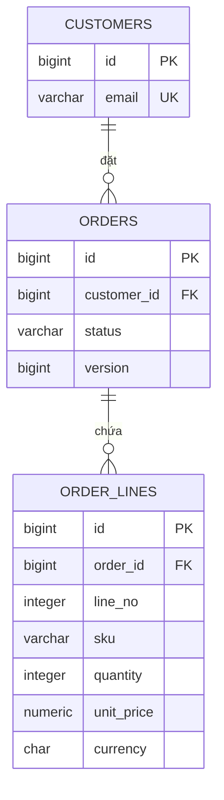

# Độ lệch giữa mô hình đối tượng và mô hình quan hệ

Trong ứng dụng hướng đối tượng, lập trình viên thường mô tả nghiệp vụ bằng lớp, đối tượng, thuộc tính và tham chiếu. Cơ sở dữ liệu quan hệ lại lưu thông tin bằng bảng, hàng, cột, khóa và các phép toán tập hợp. Cùng biểu diễn một nghiệp vụ, nhưng hai mô hình trả lời những câu hỏi khác nhau: **đối tượng nên cộng tác như thế nào khi chương trình chạy?** và **dữ liệu nên được tổ chức, ràng buộc, truy vấn và duy trì như thế nào theo thời gian?**

Sự không khớp này gọi là *object–relational impedance mismatch* (độ lệch giữa mô hình đối tượng và mô hình quan hệ). Nó xuất hiện ngay cả khi mỗi mô hình, xét riêng, đều được thiết kế đúng. Object–Relational Mapping (ORM) giúp chuyển đổi giữa hai mô hình nhưng không tự loại bỏ các khác biệt về danh tính, quan hệ, vòng đời, truy vấn và tính nhất quán.

Trong phạm vi **DATABASE_DATA_MODELING**, mục tiêu là hiểu độ lệch trước khi chọn cấu trúc lưu trữ. Một thiết kế tốt bắt đầu từ yêu cầu nghiệp vụ, xác định thực thể và bất biến, sau đó chủ động quyết định cách biểu diễn chúng trong lược đồ quan hệ và mã ứng dụng.

## 1. Hai mô hình nhìn cùng một dữ liệu theo hai cách

| Khía cạnh | Mô hình đối tượng | Mô hình quan hệ |
|---|---|---|
| Đơn vị biểu diễn | Đối tượng có trạng thái và hành vi | Hàng trong bảng, với các giá trị ở cột |
| Danh tính | Tham chiếu đối tượng; đôi khi thêm định danh nghiệp vụ | Khóa chính, khóa ứng viên và các ràng buộc duy nhất |
| Liên kết | Thuộc tính tham chiếu, tập hợp đối tượng | Khóa ngoại, bảng liên kết và phép `JOIN` |
| Cấu trúc | Lớp, thành phần, kế thừa, đa hình | Quan hệ, cột, kiểu SQL, ràng buộc |
| Truy cập | Đi theo tham chiếu: `order.getCustomer()` | Truy vấn tập hợp: `SELECT`, `JOIN`, `GROUP BY` |
| Vòng đời | Tạo, thay đổi, bỏ tham chiếu; phụ thuộc bộ nhớ và ứng dụng | `INSERT`, `UPDATE`, `DELETE`; tồn tại qua nhiều phiên làm việc |
| Tính nhất quán | Phương thức, quy tắc miền nghiệp vụ, kiểm tra trong mã | `NOT NULL`, `UNIQUE`, `CHECK`, `FOREIGN KEY`, giao dịch |
| Thứ tự | `List` có vị trí xác định | Kết quả truy vấn không có thứ tự nếu thiếu `ORDER BY` |

Không thể suy ra rằng một lớp luôn tương ứng với đúng một bảng, một thuộc tính luôn tương ứng với đúng một cột, hay một tham chiếu luôn có thể tải mà không cần truy vấn. Đây là nguồn gốc của nhiều lỗi thiết kế ORM.

### Ví dụ xuyên suốt: đơn hàng

Giả sử hệ thống bán hàng có các quy tắc:

- Mỗi đơn hàng thuộc về đúng một khách hàng.
- Một đơn hàng chứa nhiều dòng hàng, mỗi dòng ghi sản phẩm, số lượng và đơn giá tại thời điểm đặt.
- Số lượng phải lớn hơn 0; một dòng hàng không được tồn tại độc lập ngoài đơn hàng.
- Các dòng hàng được hiển thị theo thứ tự mà người dùng đã sắp xếp.
- Hai yêu cầu xác nhận đồng thời không được âm thầm ghi đè trạng thái của nhau.

Trong mã Java, ta có thể hình dung một đồ thị:

```text
Order
 ├── id
 ├── customer ──────────> Customer
 ├── status
 └── lines: List<OrderLine>
       ├── OrderLine(lineNo=1, sku="BOOK-01", quantity=2, ...)
       └── OrderLine(lineNo=2, sku="PEN-02", quantity=1, ...)
```

Ở cơ sở dữ liệu quan hệ, cấu trúc tương ứng là ba bảng với các khóa rõ ràng:



Ví dụ lược đồ PostgreSQL tối giản:

```sql
CREATE TABLE customers (
    id BIGINT GENERATED ALWAYS AS IDENTITY PRIMARY KEY,
    email VARCHAR(255) NOT NULL UNIQUE
);

CREATE TABLE orders (
    id BIGINT GENERATED ALWAYS AS IDENTITY PRIMARY KEY,
    customer_id BIGINT NOT NULL REFERENCES customers(id),
    status VARCHAR(20) NOT NULL
        CHECK (status IN ('NEW', 'CONFIRMED', 'CANCELLED')),
    version BIGINT NOT NULL DEFAULT 0
);

CREATE TABLE order_lines (
    id BIGINT GENERATED ALWAYS AS IDENTITY PRIMARY KEY,
    order_id BIGINT NOT NULL REFERENCES orders(id) ON DELETE CASCADE,
    line_no INTEGER NOT NULL CHECK (line_no > 0),
    sku VARCHAR(64) NOT NULL,
    quantity INTEGER NOT NULL CHECK (quantity > 0),
    unit_price NUMERIC(19, 2) NOT NULL CHECK (unit_price >= 0),
    currency CHAR(3) NOT NULL,
    UNIQUE (order_id, line_no)
);

CREATE INDEX idx_orders_customer_id ON orders(customer_id);
CREATE INDEX idx_order_lines_order_id ON order_lines(order_id);
```

Ở đây, `Order.lines` là một `List<OrderLine>`, nhưng trong database các dòng hàng là những hàng độc lập về mặt lưu trữ, được nối qua `order_id`; vị trí nằm trong `line_no`. Tham chiếu `Order.customer` được biểu diễn bằng `customer_id` và khóa ngoại. Đồng thời, `version` hỗ trợ phát hiện xung đột cập nhật, không phải một thuộc tính nghiệp vụ cần hiển thị.

**Lưu ý:** `ON DELETE CASCADE` chỉ minh họa chính sách xóa dòng hàng cùng đơn hàng. Nó phải được quyết định từ quy tắc lưu giữ dữ liệu; hệ thống thực tế có thể cấm xóa đơn đã phát sinh giao dịch và dùng trạng thái lưu trữ thay thế.

## 2. Các dạng độ lệch thường gặp

### 2.1. Danh tính đối tượng khác danh tính hàng dữ liệu

Trong Java, `a == b` kiểm tra hai biến có trỏ tới cùng một đối tượng hay không. Trong SQL, một hàng được nhận diện bởi khóa, ví dụ `orders.id = 42`. Hai đối tượng Java được tải ở **hai persistence context khác nhau** có thể đại diện cho cùng hàng `orders.id = 42` nhưng không cùng tham chiếu:

```java
Order first  = entityManagerA.find(Order.class, 42L);
Order second = entityManagerB.find(Order.class, 42L);

// Hai instance có thể khác nhau dù đều biểu diễn đơn hàng 42.
boolean sameReference = first == second; // có thể false
```

Trong một persistence context JPA thông thường, cùng kiểu entity và cùng khóa chính được quản lý như một danh tính duy nhất. Bảo đảm này không kéo dài xuyên qua mọi phiên làm việc, yêu cầu HTTP hoặc dịch vụ.

Phân biệt ba loại danh tính:

1. **Danh tính kỹ thuật**: `orders.id`, thường là surrogate key ổn định.
2. **Danh tính nghiệp vụ**: mã đơn hàng do khách hàng nhìn thấy; có thể cần `UNIQUE` nhưng có quy tắc sinh, đổi hoặc phạm vi riêng.
3. **Danh tính trong bộ nhớ**: tham chiếu cụ thể của đối tượng ở thời điểm chạy.

Không tự động dùng toàn bộ thuộc tính của entity để tính `equals()` và `hashCode()`: trạng thái của entity thường thay đổi, các quan hệ có thể tạo vòng lặp, và khóa được phát sinh sau `persist()`. Nếu entity tham gia `HashSet` hoặc làm khóa `HashMap`, phải xây dựng chính sách bình đẳng và hash ổn định theo vòng đời; tránh sinh các phương thức đó một cách máy móc từ mọi field.

### 2.2. Quan hệ và tập hợp khác khóa ngoại

Một tham chiếu `order.customer` gợi cảm giác rằng `Customer` luôn nằm sẵn trong bộ nhớ. Trong database, `customer_id` chỉ là một giá trị khóa ngoại; muốn đọc email khách hàng cần truy vấn hoặc dữ liệu đã tải trước.

Các cấu trúc đối tượng còn biểu diễn quan hệ đa dạng:

| Cấu trúc trong mã | Biểu diễn quan hệ điển hình | Câu hỏi cần trả lời |
|---|---|---|
| `Order.customer` | `orders.customer_id`, nhiều–một | Bên nào giữ khóa ngoại? Có bắt buộc không? |
| `Order.lines` | `order_lines.order_id`, một–nhiều | Có quyền xóa phần tử khi bỏ khỏi tập hợp không? |
| `Student.courses` | Bảng nối `enrollments(student_id, course_id, ...)` | Quan hệ có thêm thuộc tính như ngày ghi danh không? |
| `Order.lines: List` | `order_lines.line_no` và `ORDER BY` | Thứ tự có ý nghĩa nghiệp vụ hay chỉ để trình bày? |

Với quan hệ nhiều–nhiều có thuộc tính riêng, bảng nối thường nên được mô hình hóa thành **thực thể liên kết** (`Enrollment`) thay vì chỉ là một collection ẩn: điều này cho phép ràng buộc ngày ghi danh, trạng thái, vai trò hoặc tính duy nhất của quan hệ.

Quan hệ trong domain cũng khác ranh giới **aggregate**: một đơn hàng có thể sở hữu vòng đời của các dòng hàng nhưng chỉ **tham chiếu** khách hàng. Vì vậy `cascade = ALL` có thể hợp lý từ đơn hàng đến dòng hàng, nhưng thường nguy hiểm từ đơn hàng sang khách hàng.

### 2.3. Kế thừa và đa hình không có tương ứng trực tiếp

Lớp có thể kế thừa (`Payment` → `CardPayment`, `BankTransferPayment`) và gọi phương thức theo kiểu động. Bảng SQL không có cơ chế kế thừa/đa hình tương đương một cách phổ quát giữa các hệ quản trị.

Ba chiến lược ánh xạ phổ biến:

| Chiến lược | Cách lưu | Ưu điểm | Đánh đổi |
|---|---|---|---|
| Một bảng cho toàn bộ phân cấp (`SINGLE_TABLE`) | Một bảng với cột phân biệt loại | Truy vấn đa hình đơn giản, không cần join phân cấp | Nhiều cột nullable; ràng buộc theo từng subtype khó hơn |
| Bảng gốc và bảng con (`JOINED`) | Field chung trong bảng cha, field riêng trong bảng con | Tách phần chung, dễ biểu đạt cấu trúc | Thêm join khi đọc một subtype hoàn chỉnh |
| Mỗi lớp cụ thể một bảng (`TABLE_PER_CLASS`) | Bảng riêng cho từng concrete subtype | Dữ liệu mỗi loại được lưu riêng | Truy vấn trên kiểu cha có thể cần `UNION`; khóa và ràng buộc phức tạp hơn |

Đừng chọn chiến lược chỉ vì cây kế thừa Java hiện tại. Cần xem truy vấn thường gặp, mức độ thay đổi subtype, quy tắc bắt buộc theo loại và khả năng tiến hóa schema. Nhiều miền nghiệp vụ chỉ cần một cột `type` và thành phần (*composition*) thay vì kế thừa entity.

### 2.4. Kiểu dữ liệu và cấu trúc giá trị không khớp

Một `Money(amount, currency)` là **value object** có hai thành phần nhưng về mặt nghiệp vụ là một giá trị. SQL có thể lưu thành hai cột `unit_price` và `currency`, một bảng phụ hoặc một cột JSON. Không có quy tắc cố định “một object = một cột”.

Một số tình huống cần quyết định rõ:

- **Tiền tệ:** dùng kiểu chính xác như `BigDecimal`/`NUMERIC` cùng mã tiền; tránh `double` cho số tiền cần tính chính xác thập phân. Quy định cách làm tròn tại ranh giới nghiệp vụ.
- **Thời gian:** phân biệt thời điểm tuyệt đối (`Instant`/`TIMESTAMP WITH TIME ZONE` theo semantics của DB) với ngày địa phương (`LocalDate`/`DATE`), múi giờ hiển thị và quy tắc lịch.
- **Enum:** `EnumType.STRING` dễ đọc hơn ordinal nhưng đổi tên enum làm thay đổi giá trị lưu; ứng dụng và ràng buộc SQL phải tiến hóa đồng bộ.
- **Null:** `null` trong Java không tự phản ánh đầy đủ ý nghĩa “không tồn tại”, “chưa biết” và “không áp dụng”; SQL `NULL` tuân theo logic ba giá trị. Phải xác định khi nào `NOT NULL` là bất biến.
- **Collection/Map:** có thể tách bảng con, bảng liên kết, hoặc lưu JSON nếu dữ liệu tương đối độc lập và ít cần join/lọc bên trong.

Ví dụ Java có thể đóng gói `unitPrice` và `currency` thành một `@Embeddable Money` trong entity, trong khi schema vẫn dùng hai cột được kiểm soát độc lập. Lựa chọn này giữ ngôn ngữ miền nghiệp vụ rõ ràng mà không đánh mất ràng buộc và khả năng truy vấn.

### 2.5. Vòng đời bộ nhớ khác vòng đời lưu trữ

Đối tượng Java có thể mới tạo, đang được quản lý, đã tách khỏi persistence context hoặc bị đánh dấu xóa. Hàng dữ liệu chỉ thực sự đổi khi thao tác SQL tương ứng được thực thi trong giao dịch.

Với JPA, cần phân biệt:

- **Transient:** entity chưa được quản lý, thường chưa có hàng tương ứng.
- **Managed:** entity thuộc persistence context; thay đổi thuộc tính được phát hiện khi `flush`.
- **Detached:** entity không còn được quản lý; sửa field không tự ghi xuống database.
- **Removed:** entity được đánh dấu để xóa trong persistence context; lệnh xóa được đồng bộ khi `flush`.

`flush` đồng bộ câu lệnh SQL nhưng **không đồng nghĩa** `commit`. Giao dịch vẫn có thể rollback. `cascade` cũng không đồng nghĩa với quyền sở hữu nghiệp vụ: nó chỉ chỉ định cách lan truyền một số thao tác persistence. `orphanRemoval = true` chỉ phù hợp khi bỏ thành phần khỏi aggregate thực sự có nghĩa là xóa nó.

Đặc biệt, việc bộ gom rác Java thu hồi một đối tượng **không** đồng nghĩa xóa hàng trong database.

### 2.6. Điều hướng đồ thị khác truy vấn theo tập hợp

Mã đối tượng khuyến khích viết:

```java
for (Order order : orders) {
    System.out.println(order.getLines().size());
}
```

Giả sử `orders` chứa 100 đơn, `lines` tải chậm (lazy) và chưa được khởi tạo. Đoạn mã có thể phát sinh **1 truy vấn lấy danh sách đơn + 100 truy vấn lấy dòng hàng**. Đây là vấn đề **N+1 query**, gây thêm lượt trao đổi với database và tăng độ trễ. Nó tùy vào cách ORM truy vấn, cache và batch fetching; không phải mọi trường hợp đều đúng 101 truy vấn.

Một cách lấy tập dữ liệu theo nhu cầu:

```java
List<Order> orders = entityManager.createQuery("""
        select distinct o
        from Order o
        left join fetch o.lines
        where o.id in :ids
        """, Order.class)
    .setParameter("ids", ids)
    .getResultList();
```

`JOIN FETCH` ở đây nhằm tải dòng hàng cho **một tập đơn đã được chọn**. Nó không phải quy tắc “luôn eager load”. Join một collection có thể nhân số hàng SQL; kết hợp fetch join collection với phân trang `LIMIT/OFFSET` hoặc nhiều collection có thể gặp hạn chế hoặc sai kỳ vọng hiệu năng. Với trang danh sách lớn, thường nên lấy **trang ID đơn hàng trước**, rồi fetch các liên kết cần thiết theo tập ID; nếu chỉ cần số dòng, dùng truy vấn `COUNT`/`GROUP BY` hoặc DTO projection.

Ví dụ chỉ cần số dòng trên một đơn:

```sql
SELECT o.id, COUNT(ol.id) AS line_count
FROM orders AS o
LEFT JOIN order_lines AS ol ON ol.order_id = o.id
WHERE o.id = :order_id
GROUP BY o.id;
```

Kết luận thực hành: **thiết kế truy vấn từ dữ liệu mà màn hình/use case cần**, sau đó mới quyết định fetch strategy. Tham chiếu trong mô hình đối tượng không phải cam kết rằng liên kết có thể được truy cập miễn phí.

### 2.7. Thứ tự trong List khác tính không thứ tự của quan hệ

`List<OrderLine>` có vị trí phần tử, nhưng trong quan hệ, không có thứ tự hàng mặc định. Ngay cả khi truy vấn tình cờ trả về theo thứ tự khóa chính hôm nay, điều đó không phải bảo đảm.

Nếu việc đổi vị trí hai dòng hàng là thao tác nghiệp vụ, hãy lưu `line_no`, ràng buộc tính hợp lệ và luôn truy vấn với `ORDER BY line_no`. JPA có thể dùng `@OrderColumn` cho một số ánh xạ hoặc một thuộc tính vị trí tường minh kết hợp `@OrderBy`. Cần chọn một nguồn sự thật cho thứ tự, đồng thời xử lý trùng vị trí hoặc cập nhật đồng thời.

Nếu collection chỉ biểu diễn một tập giá trị không cần thứ tự, đừng tạo cột vị trí không có ý nghĩa.

### 2.8. Bất biến trong phương thức khác bất biến ở database

Giả sử constructor `OrderLine` kiểm tra `quantity > 0`. Quy tắc đó bảo vệ một đường tạo object, nhưng không bảo vệ được SQL trực tiếp, import dữ liệu, công cụ quản trị, ứng dụng khác hoặc thay đổi mã sau này.

Đối với bất biến có thể phát biểu ở cấp hàng và quan hệ, nên ưu tiên ràng buộc database:

| Quy tắc | Mã miền nghiệp vụ | Bảo vệ ở database |
|---|---|---|
| Số lượng > 0 | Từ chối dòng hàng không hợp lệ | `CHECK (quantity > 0)` |
| Dòng hàng phải có đơn | Kiểm tra khi tạo `OrderLine` | `order_id NOT NULL` và `FOREIGN KEY` |
| Vị trí dòng không trùng trong cùng đơn | Kiểm tra khi sắp xếp | `UNIQUE (order_id, line_no)` |
| Trạng thái đơn nằm trong tập hợp cho phép | Enum hoặc state machine | `CHECK`, bảng tham chiếu hoặc cơ chế thích hợp |
| Chuyển `CONFIRMED → NEW` bị cấm | Phương thức chuyển trạng thái theo quy tắc | Cần cơ chế giao dịch/đồng bộ phù hợp; `CHECK` đơn hàng đơn giản không đủ để kiểm tra lịch sử chuyển |

Domain model kiểm soát **ý nghĩa và trình tự thao tác**; database bảo vệ **tính toàn vẹn dữ liệu trước mọi nguồn ghi**. Không phải bất biến nào cũng biểu diễn được bằng một `CHECK`: ví dụ “tổng tiền bằng tổng các dòng”, giới hạn liên quan nhiều bảng hay quy tắc lịch sử cần thiết kế thêm bằng giao dịch, dữ liệu suy diễn, trigger hoặc cơ chế điều phối phù hợp.

## 3. Một bản ánh xạ JPA cần quyết định chủ động

Với schema đơn hàng ở trên, đoạn mã minh họa sau làm rõ các quyết định ánh xạ quan trọng (lược bỏ constructor nghiệp vụ, getter và kiểm tra đầu vào để tập trung vào quan hệ):

```java
@Entity
@Table(name = "orders")
public class Order {
    @Id
    @GeneratedValue(strategy = GenerationType.IDENTITY)
    private Long id;

    @ManyToOne(fetch = FetchType.LAZY, optional = false)
    @JoinColumn(name = "customer_id", nullable = false)
    private Customer customer;

    @OneToMany(
        mappedBy = "order",
        cascade = CascadeType.ALL,
        orphanRemoval = true
    )
    @OrderBy("lineNo ASC")
    private List<OrderLine> lines = new ArrayList<>();

    @Enumerated(EnumType.STRING)
    @Column(nullable = false, length = 20)
    private OrderStatus status = OrderStatus.NEW;

    @Version
    private long version;

    protected Order() {} // JPA yêu cầu constructor không tham số

    public void addLine(OrderLine line) {
        line.attachTo(this);  // cập nhật phía giữ khóa ngoại
        lines.add(line);
    }
}

@Entity
@Table(name = "order_lines")
public class OrderLine {
    @Id
    @GeneratedValue(strategy = GenerationType.IDENTITY)
    private Long id;

    @ManyToOne(fetch = FetchType.LAZY, optional = false)
    @JoinColumn(name = "order_id", nullable = false)
    private Order order;

    @Column(name = "line_no", nullable = false)
    private int lineNo;

    @Column(nullable = false)
    private String sku;

    @Column(nullable = false)
    private int quantity;

    @Column(name = "unit_price", precision = 19, scale = 2, nullable = false)
    private BigDecimal unitPrice;

    @Column(length = 3, nullable = false)
    private String currency;

    protected OrderLine() {}

    void attachTo(Order order) {
        this.order = order;
    }
}
```

Giả định `Customer` là một entity được ánh xạ riêng và `OrderStatus` có các giá trị `NEW`, `CONFIRMED`, `CANCELLED`. Các import, constructor nghiệp vụ, getter và xác thực được lược bỏ; đây là **bản minh họa ánh xạ**, chưa phải mã hoàn chỉnh để chạy độc lập.

Những điểm đáng chú ý:

1. **Khóa ngoại thuộc `OrderLine.order`.** `mappedBy = "order"` báo rằng `Order.lines` là phía nghịch trong quan hệ hai chiều. Khi thêm dòng hàng, phải cập nhật phía giữ quan hệ, không chỉ `lines.add(line)`.
2. **Khách hàng có vòng đời riêng.** `@ManyToOne` không gắn `CascadeType.REMOVE` đến khách hàng. Xóa một đơn không được kéo theo xóa khách hàng đang được nhiều đơn tham chiếu.
3. **Dòng hàng thuộc đơn hàng.** `cascade = ALL` và `orphanRemoval = true` phản ánh quyết định rằng dòng hàng không tồn tại độc lập. Nếu cần giữ lịch sử dòng hàng bị hủy, thay bằng chính sách trạng thái/lưu vết thích hợp.
4. **Thứ tự có dữ liệu riêng.** `lineNo` và `@OrderBy` tương thích với ràng buộc `UNIQUE (order_id, line_no)`. Việc hoán đổi vị trí cần xử lý để không vi phạm `UNIQUE` trong các bước cập nhật trung gian.
5. **Cập nhật đồng thời có kiểm soát.** `@Version` cho phép ORM phát hiện cập nhật dựa trên phiên bản cũ, thường bằng câu lệnh `UPDATE ... WHERE id = ? AND version = ?` và kiểm tra số hàng bị tác động.

### Khi hai yêu cầu đồng thời cùng sửa đơn hàng

Giả sử A và B đều đọc đơn có `version = 7`. A xác nhận và lưu, làm phiên bản tăng thành 8. Khi B cố cập nhật dựa trên 7, hệ thống phải phát hiện xung đột và xử lý theo quy tắc nghiệp vụ (báo người dùng tải lại, hoặc thử lại có kiểm soát sau khi đọc trạng thái mới).

Minh họa SQL cho cơ chế khóa lạc quan:

```sql
UPDATE orders
SET status = 'CONFIRMED',
    version = version + 1
WHERE id = :order_id
  AND version = :expected_version;
```

Nếu số hàng được cập nhật bằng **0**, có thể bản ghi không còn tồn tại hoặc phiên bản đã thay đổi; ứng dụng cần phân biệt nếu nghiệp vụ yêu cầu. JPA thực hiện quản lý phiên bản đối với những cập nhật entity thích hợp, nhưng các câu `bulk UPDATE` tự viết có thể bỏ qua cơ chế này nếu không được thiết kế cẩn thận.

Khóa lạc quan xử lý *lost update* trên hàng được bảo vệ; nó không tự giải quyết mọi điều kiện tranh chấp giữa nhiều hàng, ví dụ “chỉ cho phép đặt số lượng không vượt tồn kho”. Khi ấy cần xác định giao dịch, khóa, câu cập nhật có điều kiện và mức cô lập phù hợp.

## 4. Những quyết định mô hình hóa giúp kiểm soát độ lệch

### 4.1. Không biến mọi lớp thành một bảng

Phân biệt các loại thành phần trong miền nghiệp vụ:

| Thành phần | Câu hỏi thiết kế | Cách lưu thường gặp |
|---|---|---|
| **Entity** (`Order`) | Có danh tính và vòng đời cần theo dõi không? | Bảng với khóa chính |
| **Value object** (`Money`, `Address`) | Được so sánh bằng giá trị và thay thế toàn bộ không? | Nhóm cột nhúng, bảng phụ hoặc JSON tùy truy vấn |
| **Aggregate root** (`Order`) | Đối tượng nào bảo vệ bất biến và điều phối thay đổi? | Entity gốc; các bảng con vẫn có khóa/ràng buộc riêng |
| **DTO / view model** (`OrderSummary`) | Màn hình/API cần đúng dữ liệu nào? | Kết quả projection, không nhất thiết có bảng hay entity |
| **Domain service** | Có hành vi không thuộc tự nhiên về một entity? | Thường không phải bảng |

Một `Address` nhúng vào khách hàng có thể phù hợp khi chỉ cần hiển thị địa chỉ theo khách. Nếu cần tìm kiếm toàn hệ thống theo địa chỉ chuẩn, dùng chung địa chỉ hoặc quản lý lịch sử địa chỉ, thiết kế lưu trữ có thể cần thay đổi. Quyết định dựa trên **truy vấn, ràng buộc, quyền sở hữu và mức thay đổi**, không dựa riêng vào số lớp.

### 4.2. Chọn biên giới aggregate và hướng quan hệ

Đừng mặc định mọi quan hệ database đều phải hiện thành hai chiều trong Java. Từ `Order` đến `Customer` có thể chỉ cần `customerId` hoặc tham chiếu một chiều; từ `Customer` không nhất thiết phải có `List<Order>`.

Mỗi collection hai chiều làm tăng trách nhiệm đồng bộ phía chủ sở hữu, dễ tạo đồ thị lớn và khó tuần tự hóa. Chỉ đưa quan hệ vào entity khi hành vi miền nghiệp vụ thực sự cần điều hướng quan hệ đó. Các trường hợp đọc báo cáo có thể dùng repository/query riêng.

Với mỗi quan hệ, ghi rõ:

- Bội số: một–một, một–nhiều, nhiều–nhiều; quan hệ có bắt buộc hay không.
- Bên giữ khóa ngoại; quy tắc `ON DELETE` hoặc `RESTRICT`.
- Biên giới giao dịch và việc thay đổi có phải đi qua aggregate root không.
- Quy tắc xóa, lưu lịch sử và thay đổi quyền sở hữu.
- Nhu cầu truy vấn: thường đọc theo chiều nào, có phân trang hay không.

### 4.3. Thiết kế lược đồ cho dữ liệu trước khi tối ưu API object

Mô hình quan hệ cần chống dữ liệu mồ côi, trùng lặp, mất chính xác và anomalies khi cập nhật. Ví dụ:

- Tên khách hàng không nên bị sao chép vào mọi đơn chỉ để phù hợp cấu trúc `Order.customer.name`, nếu nó được coi là thuộc tính hiện tại của khách hàng.
- Ngược lại, **giá bán tại thời điểm đặt** cần được chụp vào `order_lines.unit_price`: đây là dữ liệu lịch sử riêng của giao dịch, không phải trùng lặp sai. Nếu chỉ tham chiếu giá hiện tại ở bảng sản phẩm, tổng tiền đơn cũ có thể thay đổi sau khi cập nhật bảng giá.
- Nếu quy tắc cho phép một SKU xuất hiện nhiều lần với khuyến mại khác nhau, không nên tự đặt `UNIQUE(order_id, sku)`. Ràng buộc vị trí `UNIQUE(order_id, line_no)` có ý nghĩa khác.

Như vậy, chuẩn hóa dữ liệu không có nghĩa cấm mọi bản sao giá trị: cần phân biệt **thông tin có cùng ý nghĩa** với **ảnh chụp bất biến ở thời điểm khác**.

### 4.4. Ánh xạ theo cách đọc và ghi thực tế

Mô hình domain thường tối ưu cho ghi: gọi `order.confirm()` và bảo đảm trạng thái chuyển hợp lệ. Trang danh sách đơn lại cần ID, tổng tiền, tên khách và số dòng. Nếu ép trang danh sách tải toàn bộ entity graph rồi mới tính giá trị, ứng dụng dễ tốn bộ nhớ và truy vấn.

Có thể chọn:

1. **Entity/aggregate** cho giao dịch thay đổi trạng thái.
2. **Projection/DTO** cho truy vấn danh sách và báo cáo.
3. **Câu SQL hoặc read model chuyên biệt** cho tổng hợp nhiều bảng, thống kê hoặc truy vấn lớn.

Đây không nhất thiết là triển khai CQRS đầy đủ. Chỉ cần thừa nhận rằng mô hình cập nhật và dạng dữ liệu đọc không luôn có cùng cấu trúc tối ưu.

### 4.5. Coi độ trễ và tính nhất quán là phần của thiết kế

Lựa chọn `LAZY`, `EAGER`, fetch join, batch fetching hoặc cache đều tác động đến số truy vấn, lượng dữ liệu truyền và điều kiện transaction. Không có cấu hình tải nào tốt cho mọi use case.

- **Lazy:** giảm tải dữ liệu chưa dùng, nhưng có thể gây N+1 hoặc truy cập quan hệ sau khi context đã đóng.
- **Eager:** tiện khi luôn cần liên kết nhỏ, nhưng dễ lấy thừa dữ liệu và làm truy vấn phức tạp.
- **Fetch join/entity graph:** phù hợp truy vấn biết rõ các liên kết cần tải; phải xem xét phân trang và nhân bản hàng.
- **Projection:** hiệu quả cho màn hình chỉ cần ít cột; không dùng DTO như entity managed để cập nhật tùy tiện.
- **Cache:** có thể giảm truy vấn lặp lại nhưng cần chiến lược hết hạn, cập nhật và kiểm chứng tính mới của dữ liệu.

Phân tích theo số lượng bản ghi dự kiến và *query plan* thực tế. Chỉ mục trên khóa ngoại phục vụ hướng join thường dùng, bộ lọc hoặc sắp xếp cần được đánh giá dựa trên workload, không tạo chỉ mục cho mọi cột.

## 5. Quy trình chuyển yêu cầu thành mô hình nhất quán

Một quy trình thực hành cho bài toán ORM:

**Bước 1 — Viết hành vi và bất biến.** Ví dụ “xác nhận đơn chỉ một lần”, “dòng hàng thuộc đúng một đơn”, “giá đã đặt không thay đổi khi cập nhật giá sản phẩm”. Phân biệt quy tắc cần giao dịch với quy tắc có thể biểu diễn bằng constraint.

**Bước 2 — Tìm danh tính và vòng đời.** Xác định entity, value object, aggregate root; hỏi khi nào thành phần được tạo/xóa và đối tượng nào có quyền thay đổi nó.

**Bước 3 — Thiết kế quan hệ lưu trữ.** Chọn khóa chính, khóa ngoại, khóa duy nhất, ràng buộc `NULL`/`CHECK`, chiến lược lưu dữ liệu lịch sử, thứ tự và phiên bản. Chuẩn hóa các dữ liệu có chung ý nghĩa; chủ động lưu snapshot khi nghiệp vụ cần.

**Bước 4 — Thiết kế ánh xạ.** Xác định owning side của quan hệ, một chiều/hai chiều, cascade, orphan removal, value-object embedding, enum, kiểu tiền/thời gian và chiến lược inheritance nếu có.

**Bước 5 — Thiết kế truy vấn theo use case.** Liệt kê màn hình/API và cột cần trả về. Với từng truy vấn, ước lượng cardinality, kiểm tra N+1, phân trang và các index phục vụ `JOIN`, `WHERE`, `ORDER BY`.

**Bước 6 — Kiểm chứng bằng dữ liệu và cạnh tranh đồng thời.** Thử tạo–đọc lại–sửa–xóa, dữ liệu không hợp lệ, cùng một entity qua nhiều context, cập nhật song song và tải nhiều bản ghi. Đối chiếu SQL thực tế, số lần query và ràng buộc DB.

### Bảng đối chiếu trước khi chốt thiết kế

| Câu hỏi | Dấu hiệu thiết kế cần xem lại |
|---|---|
| Entity nào bảo vệ bất biến chính? | Thay đổi một đơn yêu cầu sửa trực tiếp nhiều entity không cùng giao dịch |
| Có đang dùng quan hệ hai chiều vì “cho tiện”? | Tuần tự hóa tạo vòng lặp, truy vấn tự động tải cả đồ thị |
| Bảng có ràng buộc danh tính và tham chiếu không? | Trùng email, dòng hàng mồ côi, số lượng âm vẫn ghi được |
| Thứ tự collection có quan trọng không? | UI phụ thuộc thứ tự trả về ngẫu nhiên từ database |
| Trường nào là snapshot lịch sử? | Giá đơn cũ đổi khi giá sản phẩm hiện tại đổi |
| Query có phù hợp quy mô dữ liệu không? | Danh sách 100 đơn tạo hàng trăm lệnh SQL hoặc tải tất cả dòng hàng |
| Có xử lý ghi đồng thời không? | Hai người cùng thay đổi trạng thái và yêu cầu đến sau ghi đè dữ liệu |
| Có thể tiến hóa schema mà không gây mất dữ liệu không? | Đổi tên enum, chuyển loại khóa hoặc thay cơ chế kế thừa khiến dữ liệu cũ không đọc được |

## 6. Các nhầm lẫn dễ mắc

**“ORM sẽ tự thiết kế schema tốt.”** Công cụ có thể sinh DDL từ annotation, nhưng không biết hết quy tắc lịch sử, chính sách lưu trữ, hiệu năng, biên giới aggregate hay migration. Với môi trường production, thay đổi schema cần được quản lý và kiểm thử rõ ràng.

**“Để `EAGER` là hết lỗi N+1.”** Eager có thể làm tải thừa dữ liệu, tạo join lớn hoặc nhiều truy vấn bổ sung. Cách đúng là xác định nhu cầu đọc cụ thể và đo số truy vấn phát sinh.

**“Mọi liên kết nên có `cascade = ALL`.”** Cascade chỉ nên đi theo vòng đời thật. Nếu từ `Order` lan sang `Customer`, thao tác trên một đơn có thể ảnh hưởng đối tượng được nhiều đơn dùng chung.

**“Một entity phải chứa mọi field và collection dùng trong API.”** DTO/view model giúp trả về đúng cấu trúc dữ liệu mà API cần; entity có thể giữ nguyên bất biến và hành vi nghiệp vụ.

**“Chỉ cần kiểm tra trong Java, không cần constraint.”** Mã Java không kiểm soát mọi nguồn ghi. Những bất biến cơ bản cần được bảo vệ bằng kiểu dữ liệu và ràng buộc tại database.

**“Schema chuẩn hóa luôn loại bỏ bản sao giá trị.”** Giá hiện tại của sản phẩm và đơn giá đã cam kết là hai sự thật ở thời điểm khác nhau. Snapshot đúng nghĩa nghiệp vụ không phải lỗi trùng lặp.

**“Không có lỗi khi cập nhật nghĩa là không có xung đột.”** Nếu không quản lý phiên bản, điều kiện ghi và giao dịch, cập nhật cuối cùng có thể âm thầm ghi đè thay đổi trước đó.

## 7. Bài tập tự kiểm tra

**Tình huống:** một hệ thống quản lý khóa học có `Course`, `Student` và danh sách sinh viên đăng ký. Mỗi lần đăng ký có thời điểm đăng ký, trạng thái (đang học/đã hủy) và điểm cuối khóa. Nhân viên cần xem danh sách sinh viên của một khóa học theo thời điểm đăng ký; giảng viên cần thống kê số học viên đang học của 500 khóa học cùng lúc.

Hãy tự trả lời:

1. Vì sao `Course.students: List<Student>` không biểu diễn đầy đủ yêu cầu?
2. Cần những bảng, khóa ngoại, khóa duy nhất và cột thứ tự nào?
3. Trường hợp nào nên dùng entity liên kết `Enrollment` thay vì `@ManyToMany` thuần?
4. Truy vấn thống kê 500 khóa học có nên duyệt `course.getStudents()` trong vòng lặp không?
5. Nên xử lý thế nào nếu hai yêu cầu cùng đăng ký một sinh viên vào cùng khóa?

**Gợi ý đáp án:**

- `Enrollment` có danh tính/vòng đời và thuộc tính riêng (`enrolled_at`, `status`, `final_grade`). Một bảng `enrollments` với `course_id` và `student_id` phù hợp hơn bảng nối ẩn.
- Nếu mỗi sinh viên chỉ có một hồ sơ đăng ký cho mỗi khóa, đặt `UNIQUE(course_id, student_id)`; nếu cho phép học lại nhiều đợt, cần thêm định danh đợt hoặc khóa khác theo nghiệp vụ.
- Sắp xếp khi đọc bằng `ORDER BY enrolled_at, id`. Không nhất thiết lưu cột vị trí nếu chỉ yêu cầu thứ tự theo thời gian. Thêm khóa phụ để kết quả ổn định khi hai lượt có cùng timestamp.
- Thống kê số học viên đang học dùng truy vấn có điều kiện `WHERE status = 'ACTIVE'` với `GROUP BY course_id` hoặc projection tương đương, thay vì tải toàn bộ 500 collection.
- Ràng buộc duy nhất tại database là hàng rào cuối cùng chống đăng ký trùng; ứng dụng phải bắt và chuyển lỗi cạnh tranh thành thông báo hoặc hành vi idempotent phù hợp.

## 8. Ghi nhớ khi làm data modeling

Độ lệch đối tượng–quan hệ là **khác biệt về cách tổ chức dữ liệu và hành vi**, không phải một lỗi kỹ thuật có thể xóa sạch bằng annotation. Thiết kế bền vững tách rõ: danh tính của đối tượng và hàng dữ liệu; tham chiếu và khóa ngoại; vòng đời aggregate và vòng đời bản ghi; điều hướng object và truy vấn tập hợp; bất biến trong domain và constraint trong database.

ORM có giá trị khi giúp chuyển đổi các biểu diễn đã được lựa chọn có chủ đích. Trước khi hoàn thiện một ánh xạ, hãy xác minh đồng thời ba điều: **nghiệp vụ được thể hiện đúng, dữ liệu được ràng buộc đúng, và truy vấn hoạt động đúng ở quy mô dự kiến**.
