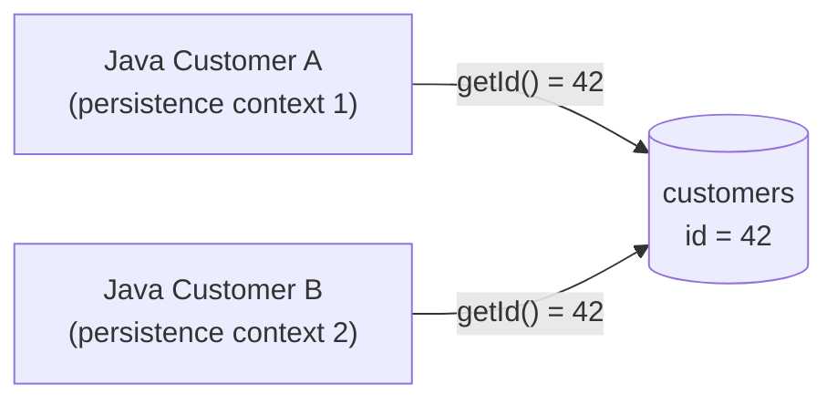

# Phân biệt định danh đối tượng Java với khóa của bản ghi lưu trữ

Trong Java, một đối tượng có thể được nhận biết qua **tham chiếu trong bộ nhớ**. Trong cơ sở dữ liệu quan hệ, một bản ghi được nhận biết qua **khóa** và các ràng buộc của bảng. Hai khái niệm này giải quyết những vấn đề khác nhau: một đối tượng đang nằm ở đâu trong chương trình, và một thực thể nghiệp vụ nào đang được lưu giữ qua nhiều lần chạy ứng dụng.

Chênh lệch này đặc biệt quan trọng khi dùng Object–Relational Mapping (ORM). Một hàng `customers.id = 42` có thể được đại diện bởi nhiều đối tượng Java khác nhau qua nhiều phiên làm việc. Ngược lại, một đối tượng Java mới được tạo chưa chắc có khóa chính hoặc một hàng tương ứng trong database. Nếu đánh đồng chúng, ứng dụng dễ gặp lỗi so sánh entity, trùng bản ghi, sai hành vi của `HashSet`, cập nhật nhầm trạng thái hoặc mất dữ liệu.

Trong module **DATABASE_DATA_MODELING**, bài học đặt danh tính ở cả hai phía của thiết kế: *lớp đối tượng và quy tắc nghiệp vụ*; *bảng, khóa ứng viên, khóa chính, khóa ngoại và tính toàn vẹn*. Mục tiêu không phải chọn một kiểu `equals()` áp dụng máy móc cho tất cả entity, mà là hiểu danh tính nào cần tồn tại ở tầng nào và kiểm chứng được bằng ràng buộc lẫn truy vấn.

## 1. Bốn khái niệm thường bị gọi chung là “ID”

| Khái niệm | Ý nghĩa | Ví dụ | Phạm vi bảo đảm |
|---|---|---|---|
| **Danh tính tham chiếu** (*reference identity*) | Hai biến trỏ đến cùng một object Java | `a == b` | Trong lần chạy chương trình và bộ nhớ đang dùng |
| **Bình đẳng logic** (*logical equality*) | Hai object được xem là bằng nhau theo quy tắc mã Java | `a.equals(b)` | Do lớp định nghĩa; phải tuân thủ hợp đồng `equals`/`hashCode` |
| **Danh tính lưu trữ** (*persistence identity*) | Một hàng được xác định duy nhất trong bảng | `customers.id = 42` | Theo khóa chính và các ràng buộc ở database |
| **Định danh nghiệp vụ** (*business/natural key*) | Giá trị người dùng hoặc hệ thống nghiệp vụ dùng để nhận biết thực thể | `(tenant_id, customer_code)` | Theo phạm vi và tính ổn định được xác định bởi nghiệp vụ |

Không phải cặp nào cũng tương đương:

- `a == b` là `true` thì `a` và `b` chắc chắn là cùng một object ở thời điểm kiểm tra.
- `a.equals(b)` là `true` không có nghĩa `a == b` là `true`; hai object khác nhau có thể được coi là bằng nhau.
- Hai entity có cùng khóa chính và cùng loại entity có thể đại diện cho cùng hàng lưu trữ dù là hai instance khác nhau.
- Hai bản ghi có cùng tên hiển thị chưa chắc là cùng khách hàng; ngược lại, một khách hàng đổi tên vẫn là cùng thực thể.

### Hình dung một hàng được tải thành nhiều đối tượng



Ở hình trên, A và B không nhất thiết cùng tham chiếu: `A == B` có thể là `false`. Tuy nhiên, cả hai đều đại diện cho hàng khóa chính 42. Một chính sách `equals()` dựa trên khóa chính có thể coi A và B bằng nhau; chính sách mặc định kế thừa từ `Object` thì không.

## 2. Danh tính tham chiếu và bình đẳng trong Java

### 2.1. Toán tử `==` kiểm tra điều gì?

Với hai biến kiểu tham chiếu, `==` trả về `true` khi chúng chứa **cùng một tham chiếu**; nó không tra database và cũng không gọi `equals()`.

```java
Customer a = new Customer("C-001", "An");
Customer b = a;
Customer c = new Customer("C-001", "An");

System.out.println(a == b); // true: cùng object
System.out.println(a == c); // false: hai object mới khác nhau
```

Đoạn mã giả định `Customer` có constructor minh họa tương ứng. Việc `a` và `c` có cùng giá trị thuộc tính **không** thay đổi kết quả so sánh tham chiếu.

Đừng nhầm so sánh tham chiếu với so sánh khóa đã được bọc trong object Java:

```java
Long firstId = 128L;
Long secondId = 128L;

boolean sameBoxedReference = firstId == secondId; // không nên dựa vào
boolean sameNumericValue = firstId.equals(secondId); // true
```

Đối với khóa kiểu `Long`, dùng phép so sánh giá trị phù hợp như `Objects.equals(firstId, secondId)`. Toán tử `==` trên hai biến `Long` so sánh đối tượng đóng hộp, trừ trường hợp có unboxing theo ngữ cảnh.

### 2.2. `equals()` không mặc nhiên có ý nghĩa nghiệp vụ

`Object.equals()` mặc định so sánh theo danh tính tham chiếu. Một lớp có thể ghi đè để so sánh theo thuộc tính hoặc khóa. Ví dụ, một **value object** biểu diễn tiền có thể có bình đẳng theo số tiền và đơn vị tiền tệ:

```java
record Money(BigDecimal amount, String currency) {
    Money {
        Objects.requireNonNull(amount);
        Objects.requireNonNull(currency);
    }
}

Money x = new Money(new BigDecimal("10.00"), "USD");
Money y = new Money(new BigDecimal("10.00"), "USD");

System.out.println(x == y);      // false
System.out.println(x.equals(y));  // true
```

Lưu ý `BigDecimal.equals()` có xét cả *scale*; vì vậy `new BigDecimal("10.0")` và `new BigDecimal("10.00")` **không** bằng nhau theo `BigDecimal.equals()`, mặc dù `compareTo()` trả về 0. Nếu muốn bình đẳng tiền theo giá trị số học, cần thiết kế chuẩn hóa scale hoặc quy tắc so sánh, rồi xây dựng `hashCode()` tương ứng. Java `record` hữu ích cho value object đơn giản; nó không mặc nhiên thích hợp để ánh xạ thành JPA entity có vòng đời và proxy.

**Entity khác value object:** hai khách hàng cùng tên, cùng địa chỉ không nhất thiết là cùng khách hàng. Khi tên hoặc địa chỉ của một khách hàng thay đổi, danh tính khách hàng vẫn cần ổn định. Vì vậy, so sánh entity bằng “tất cả field hiện tại” thường không phù hợp.

### 2.3. Hợp đồng `equals()` và `hashCode()` liên quan trực tiếp tới entity

Khi ghi đè `equals()`, Java yêu cầu tính phản xạ, đối xứng, bắc cầu, nhất quán khi dữ liệu dùng để so sánh không đổi, và `x.equals(null)` luôn là `false`. Đồng thời:

> Nếu `a.equals(b)` là `true`, `a.hashCode() == b.hashCode()` **phải** là `true`. Hai object không bằng nhau vẫn có thể trùng hash code.

Đây là cơ sở của `HashSet` và `HashMap`. Nếu field tham gia `hashCode()` bị thay đổi **sau khi** object đã được đưa vào bộ sưu tập dựa trên hash, object có thể nằm sai bucket:

```java
// Ví dụ cách làm lỗi: hashCode phụ thuộc id được gán sau khi persist.
@Override
public int hashCode() {
    return Objects.hash(id);
}

Set<Customer> customers = new HashSet<>();
Customer customer = new Customer("C-001", "An"); // id = null
customers.add(customer);

entityManager.persist(customer); // tại một thời điểm id được gán
// Sau khi id thay đổi, customers.contains(customer) có thể trả false.
```

Thời điểm `id` xuất hiện tùy chiến lược phát sinh khóa và ORM. Vấn đề cốt lõi là **hash code không ổn định trong lúc object còn nằm trong tập hợp**. Tương tự, dùng `name` hoặc `email` có thể thay đổi để tính hash cũng gây lỗi.

## 3. Khóa của bản ghi được xác định bởi lược đồ

### 3.1. Khóa chính, khóa ứng viên và khóa nghiệp vụ

Xét hệ thống bán hàng phục vụ nhiều doanh nghiệp (*tenant*). Mỗi doanh nghiệp có thể dùng mã khách hàng riêng như `C-001`. Mã này chỉ duy nhất **trong cùng một tenant**; hai tenant có thể cùng sử dụng `C-001`.

```sql
CREATE TABLE customers (
    id BIGINT GENERATED ALWAYS AS IDENTITY PRIMARY KEY,
    tenant_id BIGINT NOT NULL,
    customer_code VARCHAR(40) NOT NULL,
    display_name VARCHAR(180) NOT NULL,
    email VARCHAR(254),
    version BIGINT NOT NULL DEFAULT 0,
    CONSTRAINT uq_customer_tenant_code
        UNIQUE (tenant_id, customer_code)
);
```

Ở đây:

- `id` là **khóa chính thay thế** (*surrogate primary key*). Nó dùng để liên kết bản ghi, thường không mang ý nghĩa nghiệp vụ.
- `(tenant_id, customer_code)` là **khóa ứng viên có ý nghĩa nghiệp vụ** và được bảo vệ bởi ràng buộc `UNIQUE`. Phạm vi duy nhất là từng tenant, không phải toàn hệ thống.
- `display_name` và `email` là thuộc tính. Không nên tự xem email là danh tính bất biến nếu người dùng được đổi email hoặc cùng email có thể xuất hiện hợp lệ theo chính sách.

Trong mô hình quan hệ, một khóa ứng viên là tập thuộc tính nhận diện duy nhất một hàng và không có tập con thực sự nào vẫn đủ nhận diện duy nhất. Hệ thống chọn một trong các khóa phù hợp làm khóa chính; các khóa khác có thể được bảo vệ bằng `UNIQUE` cùng điều kiện `NOT NULL` khi cần đầy đủ ngữ nghĩa khóa.

**Chú ý với `NULL`:** hành vi ràng buộc `UNIQUE` đối với nhiều giá trị `NULL` khác nhau giữa hệ quản trị và tính năng cấu hình. Nếu định danh là bắt buộc, hãy khai báo `NOT NULL` thay vì chỉ trông cậy vào `UNIQUE`.

### 3.2. Khóa chính là hợp đồng dài hạn giữa các bảng

Đơn hàng cần tham chiếu đúng khách hàng. Với hệ thống nhiều tenant, ta còn cần ngăn một đơn ở tenant A tham chiếu khách hàng của tenant B. Một cách là dùng khóa ngoại ghép:

```sql
-- Bổ sung cặp cột đủ điều kiện được FK ghép tham chiếu.
ALTER TABLE customers
ADD CONSTRAINT uq_customer_tenant_id UNIQUE (tenant_id, id);

CREATE TABLE sales_orders (
    id BIGINT GENERATED ALWAYS AS IDENTITY PRIMARY KEY,
    tenant_id BIGINT NOT NULL,
    customer_id BIGINT NOT NULL,
    status VARCHAR(20) NOT NULL,
    CONSTRAINT fk_order_customer_same_tenant
        FOREIGN KEY (tenant_id, customer_id)
        REFERENCES customers (tenant_id, id)
);
```

`UNIQUE(tenant_id, id)` là ràng buộc phụ phục vụ tham chiếu ghép; `id` đã duy nhất do khóa chính. Ưu điểm của cách thiết kế này là database kiểm tra quan hệ cùng tenant **ngay cả khi có đường ghi khác ngoài ứng dụng Java**. Việc phân quyền và giới hạn truy cập theo tenant vẫn cần được kiểm soát ở tầng thích hợp; ràng buộc khóa ngoại chỉ bảo đảm tính hợp lệ của mối liên hệ.

Nếu mô hình không có tenant, khóa ngoại một cột `customer_id REFERENCES customers(id)` thường là đủ. Không nên thêm cột phức tạp khi nghiệp vụ không yêu cầu.

### 3.3. Khóa chính có thể là khóa tự nhiên hoặc khóa ghép

Không có quy tắc tất cả bảng phải dùng `BIGINT IDENTITY`:

| Cách định danh | Ví dụ | Thích hợp khi | Điểm cần cân nhắc |
|---|---|---|---|
| Surrogate số nguyên | `customers.id = 42` | Muốn khóa liên kết ngắn, ít thay đổi | Phải tạo `UNIQUE` riêng cho các quy tắc nghiệp vụ |
| UUID được cấp từ ứng dụng | `orders.id = UUID` | Cần tạo định danh trước khi ghi hoặc phối hợp nhiều nút | Kích thước chỉ mục/khóa, cách sinh, thứ tự và hiệu năng cần đánh giá |
| Khóa tự nhiên | Mã chuẩn đã ổn định | Giá trị thực sự duy nhất, ít đổi và có ngữ nghĩa lâu dài | Thay đổi quy tắc mã có thể gây lan truyền đến FK |
| Khóa ghép | `(course_id, student_id)` | Bản ghi là quan hệ duy nhất giữa hai thực thể | Mọi FK tham chiếu cần nhiều cột; khó khi cần nhiều lần đăng ký |

Ví dụ bảng `enrollments(course_id, student_id)` có thể dùng cặp khóa ghép nếu **mỗi sinh viên chỉ được đăng ký một lần vào mỗi khóa**. Nếu cho phép học lại các kỳ, cặp đó không còn nhận diện duy nhất một lượt đăng ký; phải bổ sung `term_id` hoặc chọn `enrollment_id` và đặt ràng buộc duy nhất theo đúng quy tắc mới.

Danh tính lưu trữ phải phản ánh thực thể có thể **thay đổi và tồn tại qua thời gian**. Đừng chọn khóa chỉ vì hôm nay chưa quan sát thấy dữ liệu trùng.

## 4. JPA quản lý danh tính như thế nào?

### 4.1. Một persistence context có identity map

Trong JPA, **persistence context** theo dõi các entity được quản lý (*managed entities*), tổ chức theo loại entity và khóa chính. Đối với một danh tính thực thể trong cùng persistence context, các lần tìm kiếm phù hợp thường trả về cùng một managed instance:

```java
Customer first  = em.find(Customer.class, 42L);
Customer second = em.find(Customer.class, 42L);

System.out.println(first == second); // true trong cùng persistence context
```

Ví dụ giả định tồn tại khách hàng có khóa 42 và cả hai thao tác dùng cùng `EntityManager`, cùng persistence context. Lần `find` thứ hai có thể được giải quyết ngay từ identity map mà không cần truy vấn lại database.

Đảm bảo này **không phải cơ chế duy nhất toàn ứng dụng**. Hai `EntityManager` độc lập có thể nạp hai object khác nhau:

```java
Customer fromA = emA.find(Customer.class, 42L);
Customer fromB = emB.find(Customer.class, 42L);

System.out.println(fromA == fromB); // thường false
System.out.println(fromA.getId().equals(fromB.getId())); // true
```

Không nên dùng `==` để quyết định hai entity do các giao dịch, request HTTP hay dịch vụ khác nhau trả về có phải cùng thực thể lưu trữ hay không. Kiểm tra qua khóa, loại entity, và nếu cần thì cả phạm vi tenant.

### 4.2. Trạng thái entity không đồng nghĩa trạng thái bản ghi

Một entity JPA có các trạng thái thường gặp:

| Trạng thái entity | Ý nghĩa với object Java | Liên hệ với database |
|---|---|---|
| **New/transient** | Vừa tạo bằng `new`, chưa được context quản lý | Có thể chưa có khóa và chưa có hàng |
| **Managed** | Được context theo dõi | Thay đổi có thể được đồng bộ khi `flush` |
| **Detached** | Từng được quản lý nhưng không còn thuộc context đang xét | Có thể còn khóa dù hiện không có SQL tự động từ thay đổi field |
| **Removed** | Được đánh dấu xóa trong context | SQL `DELETE` được thực thi ở thời điểm đồng bộ thích hợp |

Đừng suy ra `id != null` nghĩa là hàng đã được commit. ORM có thể cấp khóa trước khi giao dịch commit; giao dịch sau đó vẫn có thể rollback, hoặc mã nguồn có thể tự gán ID cho object chưa lưu.

### 4.3. Thời điểm xuất hiện khóa phụ thuộc chiến lược sinh ID

```java
@Id
@GeneratedValue(strategy = GenerationType.IDENTITY)
private Long id;
```

Với `IDENTITY`, database thường phát sinh khóa khi thực hiện `INSERT`; ORM có thể phải thực hiện chèn sớm để biết khóa. Với `SEQUENCE`, ORM thường lấy số từ sequence trước khi chèn. Với UUID do ứng dụng sinh, khóa có thể sẵn ngay sau constructor. Thời điểm chính xác phụ thuộc provider, cấu hình và database.

Ba mốc khác nhau:

1. **Object tồn tại** sau `new`.
2. **Đối tượng có khóa** khi khóa được gán.
3. **Hàng đã được commit** sau giao dịch thành công.

Không được đồng nhất cả ba. Ví dụ một giao dịch chèn đã nhận `id = 42` rồi rollback: object có thể vẫn giữ giá trị 42, nhưng hàng không tồn tại trong database sau rollback.

### 4.4. `merge()` không biến mọi reference thành một object

Một lỗi phổ biến là coi `merge(detached)` như thao tác làm cho chính object đã truyền vào được quản lý lại.

```java
Customer detached = loadCustomerInPreviousTransaction();

Customer managed = em.merge(detached);
System.out.println(detached == managed); // thường false

managed.changeDisplayName("Tên mới");
// Thực hiện commit/flush theo transaction đang mở.
```

`merge` trả về instance managed tương ứng; object truyền vào vẫn detached. Nó có thể sao chép trạng thái từ detached sang managed, tùy cấu hình và cơ chế provider. Nếu sau `merge` vẫn thay đổi `detached` và chờ dirty checking tự động, có thể không có cập nhật mong muốn.

Ngoài ra, trạng thái detached có thể **cũ** so với database. Một chính sách update an toàn cần version hoặc điều kiện ghi để tránh ghi đè dữ liệu của giao dịch khác.

### 4.5. Proxy và lazy loading tạo thêm bẫy khi kiểm tra class

Một ORM có thể trả về proxy để hoãn tải dữ liệu liên quan. Proxy có thể là lớp con được sinh động; do đó cách dùng:

```java
if (getClass() != other.getClass()) return false;
```

trong `equals()` có nguy cơ coi entity thật và proxy của cùng entity là khác loại ở một số provider. Ngược lại, chỉ dùng `instanceof` tùy tiện với hệ phân cấp entity cũng có thể gây bất đối xứng khi lớp con thay đổi quy tắc bình đẳng.

Phải thiết kế `equals()` phù hợp **kiểu entity, chiến lược kế thừa và ORM provider thực tế**. Đừng phát sinh `equals()` trên toàn bộ field, cũng đừng gọi các collection lazy bên trong phương thức này.

## 5. Thiết kế `equals()` và `hashCode()` cho entity

Không có một công thức phổ quát tốt cho mọi entity. Ta cần hỏi trước: “Hai object đại diện cho cùng một thực thể bằng tiêu chí nào, và tiêu chí đó ổn định từ lúc tạo đến sau khi lưu không?”

### 5.1. Chiến lược theo khóa chính do database cấp

Với `Customer` không tham gia kế thừa entity trong ví dụ này, có thể dùng khóa chính **khi khác null** để xét bằng nhau, đồng thời giữ `hashCode()` ổn định xuyên suốt vòng đời object:

```java
import jakarta.persistence.*;
import java.util.Objects;

@Entity
@Table(
    name = "customers",
    uniqueConstraints = @UniqueConstraint(
        name = "uq_customer_tenant_code",
        columnNames = {"tenant_id", "customer_code"}
    )
)
public class Customer {

    @Id
    @GeneratedValue(strategy = GenerationType.IDENTITY)
    private Long id;

    @Column(name = "tenant_id", nullable = false)
    private Long tenantId;

    @Column(name = "customer_code", nullable = false, length = 40)
    private String customerCode;

    @Column(name = "display_name", nullable = false, length = 180)
    private String displayName;

    @Version
    @Column(nullable = false)
    private Long version;

    protected Customer() {} // yêu cầu của JPA

    public Customer(Long tenantId, String customerCode, String displayName) {
        this.tenantId = Objects.requireNonNull(tenantId);
        this.customerCode = Objects.requireNonNull(customerCode);
        this.displayName = Objects.requireNonNull(displayName);
    }

    public Long getId() {
        return id;
    }

    public void changeDisplayName(String nextName) {
        this.displayName = Objects.requireNonNull(nextName);
    }

    @Override
    public boolean equals(Object other) {
        if (this == other) return true;
        if (!(other instanceof Customer)) return false;

        Customer that = (Customer) other;
        return getId() != null && getId().equals(that.getId());
    }

    @Override
    public int hashCode() {
        return Customer.class.hashCode();
    }
}
```

**Giả định của ví dụ:** `Customer` không có phân cấp entity con và hệ thống dùng một khóa chính duy nhất toàn bảng. Đoạn mã minh họa chính sách bình đẳng; có thể cần điều chỉnh cho proxy, bytecode enhancement và chiến lược kế thừa của ORM được chọn. Các kiểm tra nghiệp vụ khác và migration không được thể hiện hết trong ví dụ.

Hành vi mong muốn:

- `customer.equals(customer)` là `true` với chính object đó, kể cả lúc `id = null`.
- Hai object mới khác nhau, đều `id = null`, **không tự động** bằng nhau.
- Hai object cùng loại, có cùng khóa chính đã được cấp, bằng nhau dù được tải từ hai context khác nhau.
- Đổi `displayName` hoặc `version` không đổi danh tính.
- `hashCode()` không đổi khi `id` chuyển từ `null` sang một số cụ thể, nhờ đó tránh lỗi bucket của `HashSet`.

**Đánh đổi:** `hashCode()` cố định theo lớp khiến nhiều entity cùng loại cùng bucket. Với tập hợp hash rất lớn, điều này có thể làm giảm hiệu năng. Nếu cần giữ hàng triệu entity trong `HashSet`, phải đánh giá lại cấu trúc dữ liệu và chính sách định danh thay vì xem đoạn mã như lời giải tối ưu tuyệt đối.

### 5.2. Chiến lược theo định danh nghiệp vụ ổn định

Nếu miền nghiệp vụ có khóa tự nhiên **không bao giờ đổi**, được gán trước khi object tham gia collection, và duy nhất trong phạm vi xác định, có thể dùng khóa đó cho bình đẳng. Ví dụ:

```java
record CustomerKey(long tenantId, String customerCode) {
    CustomerKey {
        Objects.requireNonNull(customerCode);
    }
}

CustomerKey keyA = new CustomerKey(7, "C-001");
CustomerKey keyB = new CustomerKey(7, "C-001");
CustomerKey keyC = new CustomerKey(8, "C-001");

System.out.println(keyA.equals(keyB)); // true
System.out.println(keyA.equals(keyC)); // false: tenant khác
```

Đây là **value object định danh**, phù hợp làm khóa tra cứu hay trao đổi giữa các tầng. Nếu một entity chọn `CustomerKey` làm căn cứ `equals/hashCode`, cả `tenantId` lẫn `customerCode` phải giữ nguyên trong suốt vòng đời đối tượng. Nếu khách hàng được phép đổi mã `C-001` thành `C-002`, tiêu chí này không còn ổn định; surrogate ID hoặc một mã bất biến khác phù hợp hơn.

Phân biệt:

- **Bình đẳng entity:** “Có phải cùng khách hàng không?”
- **Bình đẳng giá trị:** “Hai địa chỉ hoặc hai khoản tiền có cùng nội dung không?”
- **Định danh nghiệp vụ:** “Người dùng tra cứu khách hàng bằng mã nào?”

Trong nhiều hệ thống, mã nghiệp vụ là **khóa tìm kiếm duy nhất**, còn `equals` của entity dựa trên surrogate ID. Điều này hợp lý nếu mã có thể được chỉnh sửa hợp lệ mà danh tính thực thể vẫn giữ nguyên.

### 5.3. Những cách làm cần tránh hoặc phải giải thích rõ

| Cách làm | Vấn đề |
|---|---|
| `equals()` so sánh mọi thuộc tính của entity | Cập nhật trạng thái làm “đổi danh tính”; dễ tải lazy, tạo vòng lặp, khó kiểm soát |
| Hai entity mới có `id == null` được coi bằng nhau | Mọi object chưa lưu có thể bị gộp thành một phần tử trong `Set` |
| `hashCode()` dùng `id` tự sinh và đổi sau `persist` | Làm hỏng khả năng tra cứu trong collection dựa trên hash |
| `equals()` dựa trên `getClass()` mà không xét proxy | Entity và proxy có thể không được so sánh như mong muốn |
| `equals()` so sánh bằng `id` nhưng bỏ qua loại entity | Hai bảng khác nhau cùng có `id = 42` có thể bị coi là cùng thực thể |
| `equals()` dựa trên tên/email có thể thay đổi | Danh tính biến động theo thuộc tính và quy tắc nghiệp vụ |
| Dùng annotation sinh tự động `equals/hashCode` cho toàn bộ field và quan hệ | Có thể chạm quan hệ lazy, đệ quy và khiến hash thay đổi |

Đặc biệt, một entity có `id` do database phát sinh không được dùng điều kiện `Objects.equals(this.id, other.id)` một cách đơn lẻ: nếu cả hai `id` đều `null`, kết quả là `true` dù hai entity khác nhau. Cần xử lý riêng trường hợp chưa có khóa.

## 6. Các loại ID khác nhau trong luồng nghiệp vụ

Giả sử API tạo khách hàng có các giá trị:

```json
{
  "tenantId": 7,
  "customerCode": "C-001",
  "displayName": "Công ty Ánh Dương"
}
```

Khi xử lý, ứng dụng nên phân biệt các câu hỏi:

1. **Có được phép tạo khách hàng này không?** Kiểm tra quy tắc nghiệp vụ và phân quyền tenant.
2. **Đã có mã `C-001` trong tenant 7 chưa?** Tìm theo khóa nghiệp vụ `(tenant_id, customer_code)`.
3. **Hai yêu cầu tạo đồng thời có làm xuất hiện hai hàng không?** Ràng buộc `UNIQUE(tenant_id, customer_code)` ở database phải ngăn trùng, kể cả khi cả hai cùng “kiểm tra chưa có” trước đó.
4. **Sau khi tạo, bản ghi mang khóa chính nào?** `customers.id` do database cấp, ví dụ 42.
5. **Khi trả về API, nên gửi mã nào?** Tùy hợp đồng API: ID kỹ thuật, mã nghiệp vụ, hoặc cả hai; không phải mọi ID nội bộ đều cần lộ ra ngoài.

Ví dụ hai tiến trình cùng cố tạo khách hàng:

```text
T1: SELECT ... WHERE tenant_id=7 AND customer_code='C-001' -> chưa có
T2: SELECT ... WHERE tenant_id=7 AND customer_code='C-001' -> chưa có
T1: INSERT khách hàng -> thành công
T2: INSERT khách hàng -> vi phạm UNIQUE
```

“Kiểm tra trước rồi ghi” **không đủ** để bảo đảm duy nhất khi có cạnh tranh đồng thời. Database mới là nơi enforce duy nhất trên mọi luồng ghi. Ứng dụng cần biến lỗi constraint thành phản hồi phù hợp; nếu muốn tạo idempotent, phải định nghĩa rõ đầu vào lặp lại được xử lý thế nào.

### Vì sao `@Version` không phải khóa định danh?

Hai entity có cùng `id` nhưng khác `version` vẫn đại diện cho **cùng bản ghi**, chỉ khác thời điểm hoặc trạng thái:

```text
Customer { id=42, version=3, displayName="Tên cũ" }
Customer { id=42, version=4, displayName="Tên mới" }
```

`@Version` dùng cho **optimistic locking**, giúp phát hiện cập nhật dựa trên trạng thái cũ. Nó không nên tham gia `equals()` dùng để nhận diện cùng entity. Việc cùng danh tính cũng **không** bảo đảm hai object có dữ liệu mới như nhau.

Để lưu một thay đổi an toàn, cơ chế ORM có thể thực hiện cập nhật có điều kiện tương đương:

```sql
UPDATE customers
SET display_name = :next_name,
    version = version + 1
WHERE id = :id
  AND version = :previous_version;
```

Nếu không cập nhật hàng nào, có thể bản ghi đã bị xóa hoặc bị giao dịch khác sửa. Ứng dụng cần xử lý xung đột, tải lại hoặc yêu cầu người dùng quyết định. Các lệnh bulk update tự viết phải xem xét liệu chúng có bỏ qua cơ chế version tự động của ORM hay không.

## 7. Khóa ghép: danh tính của quan hệ cũng là dữ liệu

Giả sử một sinh viên được đăng ký vào một khóa học duy nhất một lần:

```sql
CREATE TABLE enrollments (
    course_id BIGINT NOT NULL REFERENCES courses(id),
    student_id BIGINT NOT NULL REFERENCES students(id),
    enrolled_at TIMESTAMP NOT NULL,
    status VARCHAR(20) NOT NULL,
    PRIMARY KEY (course_id, student_id)
);
```

Danh tính hàng `enrollments` là cặp `(course_id, student_id)`. Trong Java, ta nên biểu diễn cặp khóa thành một **giá trị bất biến** có quy tắc `equals()`/`hashCode()` nhất quán, rồi ánh xạ qua `@EmbeddedId` hoặc `@IdClass` theo yêu cầu của JPA. Ví dụ tối giản:

```java
@Embeddable
public class EnrollmentId implements java.io.Serializable {
    @Column(name = "course_id", nullable = false)
    private Long courseId;

    @Column(name = "student_id", nullable = false)
    private Long studentId;

    protected EnrollmentId() {}

    public EnrollmentId(Long courseId, Long studentId) {
        this.courseId = Objects.requireNonNull(courseId);
        this.studentId = Objects.requireNonNull(studentId);
    }

    @Override
    public boolean equals(Object other) {
        if (this == other) return true;
        if (!(other instanceof EnrollmentId)) return false;
        EnrollmentId that = (EnrollmentId) other;
        return courseId.equals(that.courseId)
            && studentId.equals(that.studentId);
    }

    @Override
    public int hashCode() {
        return Objects.hash(courseId, studentId);
    }
}

@Entity
@Table(name = "enrollments")
public class Enrollment {
    @EmbeddedId
    private EnrollmentId id;

    @Column(name = "enrolled_at", nullable = false)
    private LocalDateTime enrolledAt;

    @Column(nullable = false)
    private String status;

    protected Enrollment() {}
}
```

Các import cho JPA, `Objects` và `LocalDateTime` được lược bớt. Với `@EmbeddedId` thực tế, còn cần quyết định có ánh xạ quan hệ `Course`/`Student` bằng `@MapsId` hay giữ khóa trực tiếp; không được tạo hai nguồn giá trị khóa thiếu đồng bộ. Sau khi dùng làm ID, các thành phần `courseId` và `studentId` không được thay đổi tùy tiện. Việc dùng `Long` trong ví dụ hàm ý các ID thành phần đã được xác lập trước lúc tạo enrollment.

**Nếu nghiệp vụ cho phép học lại:** khóa ghép trên sẽ không còn phù hợp. Có thể dùng:

```sql
CREATE TABLE enrollments_v2 (
    enrollment_id BIGINT GENERATED ALWAYS AS IDENTITY PRIMARY KEY,
    course_id BIGINT NOT NULL REFERENCES courses(id),
    student_id BIGINT NOT NULL REFERENCES students(id),
    term_code VARCHAR(20) NOT NULL,
    UNIQUE (course_id, student_id, term_code)
);
```

Ở bản này, `enrollment_id` định danh mỗi lượt đăng ký; bộ ba `(course_id, student_id, term_code)` bảo vệ quy tắc “một lượt đăng ký cho mỗi kỳ học”. Nếu có thể đăng ký lại trong cùng kỳ, quy tắc `UNIQUE` cũng phải thay đổi. **Danh tính lưu trữ là quyết định mô hình hóa xuất phát từ yêu cầu**, không chỉ là một annotation trong Java.

## 8. Phân biệt danh tính khi thiết kế API, cache và tích hợp

### Trong API

Một DTO có thể chứa `customerId` để gọi API chi tiết và `customerCode` để người dùng tra cứu. Hai trường phục vụ hai mục tiêu. Khi cập nhật:

```text
PUT /customers/42
Body: { "displayName": "Công ty Ánh Dương" }
```

`42` là cách định tuyến đến bản ghi, nhưng server vẫn cần kiểm tra người gọi có quyền thay đổi bản ghi đó. Nếu dữ liệu phân tách theo tenant, kiểm tra tenant không được bỏ qua chỉ vì đã có khóa số nguyên duy nhất toàn bảng.

### Trong cache

Cache theo ID cần định nghĩa không gian tên. Ví dụ `customer:42` hợp lý nếu `42` duy nhất trên toàn hệ thống và cache chỉ có một loại đối tượng; nếu ID chỉ duy nhất theo tenant hoặc có nhiều loại entity, khóa cache cần gồm thông tin phân biệt như `customer:{tenantId}:{id}`. Khi giá trị hiển thị thay đổi, phải cập nhật hoặc vô hiệu cache đúng thời điểm; **ID không bảo đảm dữ liệu cache luôn mới**.

### Trong tích hợp dữ liệu

Hai hệ thống có thể cấp hai surrogate ID khác nhau cho **cùng một khách hàng ngoài đời**. Vì vậy không thể ghép dữ liệu giữa hai hệ thống chỉ bằng cách so sánh `customers.id`. Cần một quy tắc đối chiếu phù hợp: mã định danh chung được quản trị, bảng mapping ID giữa hệ thống, hoặc quy trình xác minh trùng lặp.

Ngược lại, hai bản ghi trùng email hoặc cùng tên không đủ để kết luận cùng một người hay tổ chức. Thiết kế tích hợp nên phân biệt **danh tính nội bộ**, **danh tính do hệ thống nguồn cấp** và **khóa nghiệp vụ dùng để đối chiếu**.

## 9. Quy trình lựa chọn ID khi chuyển yêu cầu thành mô hình dữ liệu

Áp dụng tuần tự các câu hỏi sau:

**Bước 1 — Xác định thực thể và ranh giới tồn tại.** Một khách hàng đổi tên có vẫn là cùng khách hàng? Một sinh viên học lại có tạo một enrollment mới không? Một đơn hàng bị hủy có phải giữ lịch sử không?

**Bước 2 — Tìm các khóa ứng viên.** Thuộc tính nào duy nhất theo quy tắc nghiệp vụ? Phạm vi duy nhất là toàn hệ thống, tenant, cửa hàng hay từng kỳ? Có được phép đổi không?

**Bước 3 — Chọn khóa chính lưu trữ.** Cân nhắc surrogate ID, UUID, khóa tự nhiên hoặc khóa ghép dựa trên tính ổn định, khóa ngoại, quy mô và nhu cầu tích hợp. Không gán ý nghĩa nghiệp vụ vào số tự tăng nếu nghiệp vụ không quy định.

**Bước 4 — Bảo vệ danh tính bằng database.** Khai báo `PRIMARY KEY`, `UNIQUE`, `NOT NULL` và `FOREIGN KEY` tương ứng. Với tenant, xem xét ràng buộc quan hệ cùng phạm vi và tránh kiểm tra chỉ ở tầng ứng dụng.

**Bước 5 — Chọn chính sách bình đẳng của Java entity.** Phân biệt transient với persisted; xác định ảnh hưởng của ID phát sinh sau `persist`, collections, proxy và entity inheritance. Dùng giá trị bất biến cho value object.

**Bước 6 — Kiểm chứng các vòng đời và tình huống cạnh tranh.** Test khi entity mới tạo, sau `persist`/`flush`, sau `detach`/`merge`, tải qua hai context, thêm vào `HashSet`, xung đột version và hai yêu cầu tạo cùng mã nghiệp vụ.

### Bảng kiểm thử mẫu

| Tình huống | Kết quả cần kỳ vọng |
|---|---|
| Hai biến cùng trỏ một object | `a == b` là `true` |
| Hai object mới có cùng tên, chưa có ID | Không mặc nhiên là cùng entity |
| Hai lần `find` cùng ID trong một persistence context | Cùng managed entity theo identity map |
| Hai context tải cùng khóa của cùng entity type | Tham chiếu có thể khác, danh tính lưu trữ vẫn như nhau |
| Entity vào `HashSet` trước rồi được cấp khóa | `hashCode` ổn định và vẫn tìm được phần tử |
| `merge(detached)` | Sử dụng object mà `merge` trả về để tiếp tục chỉnh sửa |
| Hai giao dịch cùng tạo `(tenant_id, customer_code)` | Database từ chối bản ghi trùng theo `UNIQUE` |
| Hai bản sao có cùng ID nhưng version khác nhau | Cùng entity, nhưng trạng thái khác; cập nhật cũ phải được phát hiện |
| Một đơn tenant A trỏ đến khách tenant B | Khóa ngoại ghép hoặc cơ chế bảo vệ phù hợp phải từ chối |
| Một entity bị đổi tên hiển thị | Không thay đổi danh tính thực thể |

## 10. Bài tập áp dụng

**Bối cảnh:** hệ thống quản lý kho cho nhiều cửa hàng có các lớp `Product`, `Warehouse` và `StockBalance`. Mỗi cửa hàng đặt mã SKU riêng. Một mã SKU có thể giống nhau ở hai cửa hàng; tên sản phẩm có thể đổi. Một sản phẩm có nhiều số dư tồn tại các kho khác nhau. Hai nhân viên có thể cùng điều chỉnh số lượng tồn.

Hãy trả lời:

1. Vì sao không nên dùng `product.name` làm khóa chính hoặc làm căn cứ duy nhất cho `equals()`?
2. Nếu mỗi cửa hàng có mã SKU duy nhất, phải đặt `UNIQUE` trên những cột nào? Khi nào SKU có thể làm natural key?
3. Đối với `StockBalance`, khi nào chọn `PRIMARY KEY (product_id, warehouse_id)`, khi nào nên dùng surrogate `balance_id`?
4. Hai đối tượng `Product` được tải từ hai `EntityManager` có cùng `id`; có chắc `==` trả về `true` không?
5. Nếu entity được đưa vào `HashSet` khi `id = null` rồi database cấp ID, có rủi ro gì nếu `hashCode()` phụ thuộc ID?
6. Với hai nhân viên cập nhật cùng một số dư, chỉ dựa vào `equals()` có giúp ngăn lost update không? Cần bổ sung cơ chế gì?

**Gợi ý hướng giải:**

- Tên hiển thị thay đổi được và không bảo đảm duy nhất. Danh tính sản phẩm nên tồn tại độc lập với tên.
- Nếu SKU duy nhất **theo cửa hàng**, đặt `UNIQUE(store_id, sku)` với cột bắt buộc không null. Chỉ dùng SKU cho equality nếu định danh ghép đó bất biến trong vòng đời và được xác định là danh tính thực của domain.
- Nếu một số dư là duy nhất cho đúng một cặp sản phẩm–kho, khóa ghép có thể phù hợp. Nếu cần nhiều trạng thái số dư theo lô, ngày hoặc phiên bản, phải bổ sung chiều định danh hoặc dùng khóa riêng và ràng buộc nghiệp vụ.
- Hai persistence context không bảo đảm cùng tham chiếu Java; cần phân biệt `==` với khóa hàng.
- Hash code phụ thuộc ID có thể thay đổi khiến `HashSet.contains` thất bại. Dùng chính sách equality/hash ổn định hoặc tránh đưa entity chưa có ID vào tập hợp hash trong luồng đó.
- `equals()` chỉ giúp nhận diện object. Chống cập nhật đè cần quy tắc giao dịch, `@Version`/optimistic locking, hoặc câu lệnh cập nhật số dư có điều kiện/khóa phù hợp khi nghiệp vụ cần nguyên tử.

## 11. Ghi nhớ cốt lõi

Một đối tượng Java là **một instance đang chạy**; một hàng dữ liệu là **một trạng thái lưu trữ được xác định bởi khóa**. Cùng một hàng có thể được vật hóa thành nhiều instance Java, còn một instance mới có thể chưa có hàng hoặc chưa có khóa chính.

Khi mô hình hóa dữ liệu, hãy xác định **entity nào phải được nhận diện qua thời gian**, **khóa nào bảo đảm duy nhất trong database**, **giá trị nào người dùng dùng để tra cứu**, và **quy tắc bình đẳng nào phù hợp với vòng đời Java/JPA**. Tách biệt bốn câu hỏi đó giúp thiết kế khóa và quan hệ dễ kiểm chứng, tránh lỗi ORM, đồng thời hỗ trợ tiến hóa mô hình khi nghiệp vụ thay đổi.
