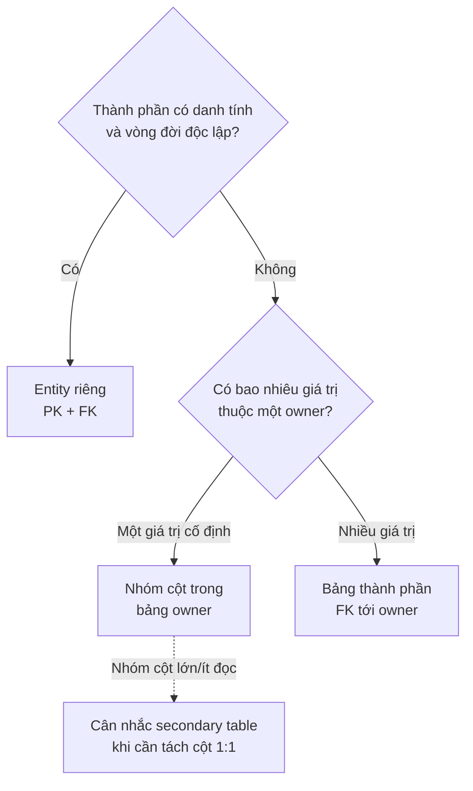
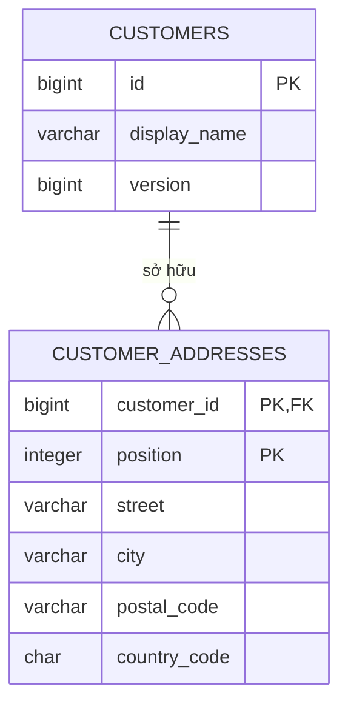

# Ánh xạ đối tượng giá trị vào nhiều cột hoặc bảng thành phần

Trong mô hình hướng đối tượng, nhiều khái niệm nghiệp vụ được biểu diễn bằng **đối tượng giá trị** (*value object*): số tiền và đơn vị tiền tệ, địa chỉ giao hàng, khoảng thời gian, tọa độ hoặc thông số kích thước. Một đối tượng giá trị thường chứa nhiều thuộc tính nhưng được nghiệp vụ coi là **một giá trị có nghĩa**, chẳng hạn `Money(150000, "VND")`, thay vì hai thông tin rời rạc.

Cơ sở dữ liệu quan hệ không buộc phải lưu mỗi đối tượng Java thành một bản ghi riêng. Một `Money` có thể trải trên hai cột `amount` và `currency` trong **cùng bảng** với đơn hàng; nhiều `Address` thuộc một khách hàng có thể nằm ở **bảng thành phần** chứa khóa ngoại về khách hàng. Đây là một quyết định *data modeling*: giá trị có cần danh tính độc lập không, có thể bị thay đổi riêng không, được đọc/truy vấn ra sao và cần những ràng buộc nào?

Bài này thuộc chương **Ánh xạ đối tượng** của module **DATABASE_DATA_MODELING**. Mục tiêu là chuyển yêu cầu nghiệp vụ thành cấu trúc quan hệ có thể kiểm chứng: xác định giá trị và thực thể, chọn giữa nhóm cột và bảng thành phần, ánh xạ với Java/JPA, bảo vệ bất biến bằng SQL và đánh giá chi phí truy vấn, cập nhật và thay đổi lược đồ.

## 1. Đối tượng giá trị khác thực thể ở đâu?

Một **entity** có danh tính riêng và vòng đời được theo dõi. Một **value object** được nhận diện bằng *nội dung giá trị*; không cần một mã định danh độc lập để quyết định “có phải cùng giá trị không”.

Ví dụ, hai đơn hàng khác nhau cùng có địa chỉ nhận hàng:

```text
Order #1001
  shippingAddress = Address("12 Đường A", "Đà Nẵng", "550000", "VN")

Order #1002
  shippingAddress = Address("12 Đường A", "Đà Nẵng", "550000", "VN")
```

Hai địa chỉ bằng nhau **về giá trị**, nhưng mỗi đơn có quyền giữ ảnh chụp địa chỉ tại thời điểm đặt. Việc khách hàng sửa địa chỉ mặc định ngày mai không nên âm thầm sửa địa chỉ lịch sử của hai đơn hôm nay.

| Khía cạnh | Entity (`Customer`, `Order`) | Value object (`Money`, `Address`) |
|---|---|---|
| Cách nhận diện | Theo khóa/danh tính bền vững | Theo các thành phần giá trị được quy định |
| Thay đổi | Danh tính vẫn giữ khi trạng thái thay đổi | Thường thay **toàn bộ giá trị** bằng giá trị mới |
| Chia sẻ | Có thể được nhiều entity tham chiếu | Có thể sao chép giá trị cho nhiều owner |
| Vòng đời | Có thể tồn tại và được quản lý độc lập | Thường phụ thuộc entity hoặc aggregate sở hữu |
| Biểu diễn trong SQL | Bảng có khóa chính riêng | Nhóm cột hoặc hàng thành phần gắn với owner |

Không phải mọi lớp Java không có `id` đều là value object. Nếu “địa chỉ” có người phụ trách, trạng thái xác minh, lịch sử cập nhật, được nhiều đơn cùng tham chiếu và có vòng đời riêng, nó có thể đã trở thành **entity địa chỉ**. Tiêu chí nằm ở nghiệp vụ, không nằm ở kiểu Java hay annotation.

### Ba nguyên tắc để mô hình hóa value object

1. **Bình đẳng theo giá trị:** các thuộc tính tham gia `equals()`/`hashCode()` được xác định rõ; không dùng danh tính tham chiếu Java làm khái niệm nghiệp vụ.
2. **Tính bất biến về mặt sử dụng:** tạo giá trị mới thay vì sửa một giá trị đang được chia sẻ. Nếu ORM yêu cầu constructor và field có thể gán, vẫn nên tránh public setter làm rò rỉ khả năng sửa tùy ý.
3. **Bất biến nội tại:** ví dụ số tiền phải có đơn vị, ngày bắt đầu không sau ngày kết thúc, tọa độ trong khoảng cho phép. Những bất biến kiểm được ở SQL cũng cần được thể hiện ở lược đồ.

## 2. Chọn nhóm cột, bảng thành phần hay entity riêng

Giả sử ứng dụng có `Order.total: Money` và `Customer.savedAddresses: List<Address>`. Hai giá trị cùng là value object nhưng có **bội số và kiểu truy cập khác nhau**.

| Nhu cầu nghiệp vụ | Biểu diễn quan hệ thường phù hợp | Ánh xạ JPA điển hình |
|---|---|---|
| Một giá trị có số thuộc tính cố định, ví dụ tổng tiền | Nhiều cột của **bảng owner** | `@Embeddable` + `@Embedded` |
| Hai giá trị cùng loại trong một entity, ví dụ tiền hàng/phí giao hàng | Hai nhóm cột được đặt tên khác nhau | `@AttributeOverrides` |
| Nhiều giá trị cùng loại do owner sở hữu, ví dụ danh sách địa chỉ đã lưu | **Bảng thành phần** có khóa ngoại đến owner | `@ElementCollection` + `@CollectionTable` |
| Một nhóm cột lớn/ít dùng muốn nằm ở bảng một–một phụ | Bảng phụ dùng chính khóa của owner | `@SecondaryTable` |
| Thành phần có danh tính, quyền tham chiếu hoặc vòng đời độc lập | Bảng entity riêng, có khóa riêng và quan hệ | `@OneToOne` / `@OneToMany` |
| Một cấu trúc linh hoạt, ít cần ràng buộc và truy vấn SQL bên trong | Có thể cân nhắc cột JSON/document | Ánh xạ phụ thuộc khả năng ORM và DB |

Sơ đồ tổng quát:



Đây là **hướng quyết định**, không phải thuật toán bắt buộc. Nhu cầu truy vấn, kích thước dữ liệu, tính toàn vẹn, quyền sở hữu và cách tiến hóa schema có thể khiến một lựa chọn khác phù hợp hơn.

## 3. Ánh xạ một value object vào nhiều cột: `Money`

### 3.1. Viết bất biến trước khi viết annotation

Giả sử mỗi đơn bán hàng có hai giá trị: **tiền hàng** và **phí giao hàng**. Mỗi giá trị gồm số tiền và mã tiền tệ; cả hai phải không âm và dùng cùng loại tiền để tính tổng trực tiếp.

Không nên chỉ tạo `BigDecimal amount` rồi ngầm hiểu tất cả giá trị đều là VND. Đơn vị tiền là một phần của ý nghĩa, và hệ thống sau này có thể có nhiều tiền tệ. Với số tiền cần chính xác thập phân, dùng `BigDecimal`/`NUMERIC` thay cho `double`/`FLOAT`.

```java
import jakarta.persistence.Column;
import jakarta.persistence.Embeddable;
import java.math.BigDecimal;
import java.math.RoundingMode;
import java.util.Locale;
import java.util.Objects;

@Embeddable
public class Money {

    @Column(name = "amount", precision = 19, scale = 2, nullable = false)
    private BigDecimal amount;

    @Column(name = "currency_code", length = 3, nullable = false)
    private String currencyCode;

    protected Money() {
        // JPA cần constructor không tham số theo dạng truy cập này.
    }

    public Money(BigDecimal amount, String currencyCode) {
        this.amount = Objects.requireNonNull(amount, "amount")
                .setScale(2, RoundingMode.UNNECESSARY);

        String code = Objects.requireNonNull(currencyCode, "currencyCode")
                .toUpperCase(Locale.ROOT);
        if (!code.matches("[A-Z]{3}")) {
            throw new IllegalArgumentException("Mã tiền tệ phải có 3 chữ cái");
        }
        this.currencyCode = code;
    }

    public BigDecimal getAmount() {
        return amount;
    }

    public String getCurrencyCode() {
        return currencyCode;
    }

    @Override
    public boolean equals(Object other) {
        if (this == other) return true;
        if (!(other instanceof Money)) return false;
        Money that = (Money) other;
        return Objects.equals(amount, that.amount)
                && Objects.equals(currencyCode, that.currencyCode);
    }

    @Override
    public int hashCode() {
        return Objects.hash(amount, currencyCode);
    }
}
```

Ví dụ dùng `setScale(2, UNNECESSARY)` để chuẩn hóa cách biểu diễn và từ chối giá trị có nhiều hơn hai chữ số thập phân khác 0. Đây là **giả định nghiệp vụ của ví dụ**, không phải luật cho mọi loại tiền tệ; có loại tiền tệ và sản phẩm tài chính đòi hỏi scale khác. Kiểm tra ba ký tự cũng mới bảo đảm *định dạng*, chưa xác minh mã ISO 4217 hợp lệ.

Vì `BigDecimal.equals()` phân biệt scale, chuẩn hóa scale trong constructor giúp `10.0` và `10.00` không trở thành hai trạng thái biểu diễn khác nhau khi dùng object được tạo hợp lệ. Với yêu cầu khác, cần định nghĩa rõ chính sách so sánh và hash tương ứng.

### 3.2. Dùng `@Embedded` để trải giá trị lên các cột

Entity `PurchaseOrder` sở hữu hai `Money`. Ta đặt tên riêng cho từng cột bằng `@AttributeOverrides`:

```java
import jakarta.persistence.*;
import java.util.Objects;

@Entity
@Table(name = "purchase_orders")
public class PurchaseOrder {

    @Id
    @GeneratedValue(strategy = GenerationType.IDENTITY)
    private Long id;

    @Embedded
    @AttributeOverrides({
        @AttributeOverride(
            name = "amount",
            column = @Column(
                name = "subtotal_amount", precision = 19,
                scale = 2, nullable = false
            )
        ),
        @AttributeOverride(
            name = "currencyCode",
            column = @Column(
                name = "subtotal_currency", length = 3, nullable = false
            )
        )
    })
    private Money subtotal;

    @Embedded
    @AttributeOverrides({
        @AttributeOverride(
            name = "amount",
            column = @Column(
                name = "shipping_fee_amount", precision = 19,
                scale = 2, nullable = false
            )
        ),
        @AttributeOverride(
            name = "currencyCode",
            column = @Column(
                name = "shipping_fee_currency", length = 3, nullable = false
            )
        )
    })
    private Money shippingFee;

    @Version
    @Column(nullable = false)
    private Long version;

    protected PurchaseOrder() {}

    public PurchaseOrder(Money subtotal, Money shippingFee) {
        replaceAmounts(subtotal, shippingFee);
    }

    public void replaceAmounts(Money newSubtotal, Money newShippingFee) {
        Objects.requireNonNull(newSubtotal);
        Objects.requireNonNull(newShippingFee);
        if (newSubtotal.getAmount().signum() < 0
                || newShippingFee.getAmount().signum() < 0) {
            throw new IllegalArgumentException("Tiền hàng/phí phải không âm");
        }
        if (!newSubtotal.getCurrencyCode()
                .equals(newShippingFee.getCurrencyCode())) {
            throw new IllegalArgumentException("Hai khoản phải cùng tiền tệ");
        }
        this.subtotal = newSubtotal;
        this.shippingFee = newShippingFee;
    }
}
```

Hai nhóm giá trị được lưu trong **một hàng** của bảng `purchase_orders`:

| id | subtotal_amount | subtotal_currency | shipping_fee_amount | shipping_fee_currency | version |
|---:|---:|---|---:|---|---:|
| 101 | 150000.00 | VND | 25000.00 | VND | 0 |

Lược đồ PostgreSQL tương ứng:

```sql
CREATE TABLE purchase_orders (
    id BIGINT GENERATED ALWAYS AS IDENTITY PRIMARY KEY,
    subtotal_amount NUMERIC(19, 2) NOT NULL,
    subtotal_currency VARCHAR(3) NOT NULL,
    shipping_fee_amount NUMERIC(19, 2) NOT NULL,
    shipping_fee_currency VARCHAR(3) NOT NULL,
    version BIGINT NOT NULL DEFAULT 0,
    CONSTRAINT ck_nonnegative_amounts
        CHECK (subtotal_amount >= 0 AND shipping_fee_amount >= 0),
    CONSTRAINT ck_same_currency
        CHECK (subtotal_currency = shipping_fee_currency),
    CONSTRAINT ck_subtotal_currency_format
        CHECK (subtotal_currency ~ '^[A-Z]{3}$'),
    CONSTRAINT ck_shipping_currency_format
        CHECK (shipping_fee_currency ~ '^[A-Z]{3}$')
);
```

Các `CHECK` trong ví dụ mang tính PostgreSQL, đặc biệt toán tử regex `~`. Khi dùng DB khác, cú pháp ràng buộc có thể khác. Kiểm tra định dạng ba ký tự vẫn không thay thế bảng danh mục tiền tệ khi cần bảo đảm mã được phép sử dụng.

**Tại sao phải có ràng buộc SQL dù constructor đã kiểm tra?** Vì database có thể nhận dữ liệu từ import, ứng dụng khác, SQL thủ công hoặc phiên bản mã cũ. Annotation `@Column(nullable = false)` thể hiện ý định ánh xạ, nhưng với hệ thống có schema quản lý bằng migration, hãy xác nhận ràng buộc thực sự tồn tại trên database.

### 3.3. Hệ quả của ánh xạ vào cùng bảng

Một thay đổi ở `subtotal` thường biến thành `UPDATE` trên hàng `purchase_orders`. Các thành phần của `Money` có thể được dùng trong SQL:

```sql
SELECT id,
       subtotal_amount + shipping_fee_amount AS payable_amount,
       subtotal_currency
FROM purchase_orders
WHERE subtotal_amount >= 100000
ORDER BY payable_amount DESC;
```

Trong JPQL, có thể điều hướng thuộc tính nhúng theo đường dẫn, chẳng hạn:

```java
var query = em.createQuery("""
    select p
    from PurchaseOrder p
    where p.subtotal.amount >= :minAmount
    """, PurchaseOrder.class);
query.setParameter("minAmount", new BigDecimal("100000.00"));
```

`@Embedded` không tạo bảng hoặc khóa ngoại mới. Database vẫn nhìn thấy những cột số và chuỗi bình thường; mô hình Java cung cấp lớp `Money` để tập trung quy tắc giá trị, tránh truyền các tham số rời rạc và nhầm loại tiền.

## 4. Ánh xạ `Address`: một giá trị gồm nhiều thuộc tính

Địa chỉ là ví dụ tốt vì cách biểu diễn cần xét **ngữ cảnh địa lý và nghiệp vụ**. Với hệ thống nội địa, có thể lưu `street`, `city`, `postalCode`, `countryCode`; với hệ thống quốc tế, cấu trúc vùng, tỉnh, quận và mã bưu chính khác nhau, cần thiết kế linh hoạt hơn.

Một mô hình Java giản lược:

```java
import jakarta.persistence.*;
import java.util.Objects;

@Embeddable
public class Address {
    @Column(name = "street", nullable = false, length = 200)
    private String street;

    @Column(name = "city", nullable = false, length = 120)
    private String city;

    @Column(name = "postal_code", nullable = false, length = 24)
    private String postalCode;

    @Column(name = "country_code", nullable = false, length = 2)
    private String countryCode;

    protected Address() {}

    public Address(
            String street, String city,
            String postalCode, String countryCode) {
        this.street = Objects.requireNonNull(street);
        this.city = Objects.requireNonNull(city);
        this.postalCode = Objects.requireNonNull(postalCode);
        this.countryCode = Objects.requireNonNull(countryCode);
    }

    public String getStreet() { return street; }
    public String getCity() { return city; }
    public String getPostalCode() { return postalCode; }
    public String getCountryCode() { return countryCode; }

    @Override
    public boolean equals(Object other) {
        if (this == other) return true;
        if (!(other instanceof Address)) return false;
        Address that = (Address) other;
        return Objects.equals(street, that.street)
                && Objects.equals(city, that.city)
                && Objects.equals(postalCode, that.postalCode)
                && Objects.equals(countryCode, that.countryCode);
    }

    @Override
    public int hashCode() {
        return Objects.hash(street, city, postalCode, countryCode);
    }
}
```

Mã bưu chính được biểu diễn bằng `String` vì có thể có số 0 đầu hoặc ký tự chữ ở một số quốc gia. Cần bổ sung chuẩn hóa và kiểm tra không rỗng theo nghiệp vụ thực tế; constructor ở đây chỉ minh họa cách giữ dữ liệu bắt buộc.

### 4.1. Hai địa chỉ trên cùng một entity

Giả sử một hóa đơn cần `billingAddress` và `shippingAddress`, đều là ảnh chụp tại thời điểm xuất hóa đơn. Các field trong hai value object trùng tên, nên nếu đặt cùng bảng phải **đổi tên cột ở từng lần sử dụng**:

```java
@Entity
@Table(name = "invoices")
public class Invoice {
    @Id
    @GeneratedValue(strategy = GenerationType.IDENTITY)
    private Long id;

    @Embedded
    @AttributeOverrides({
        @AttributeOverride(name = "street",
            column = @Column(name = "bill_street", nullable = false, length = 200)),
        @AttributeOverride(name = "city",
            column = @Column(name = "bill_city", nullable = false, length = 120)),
        @AttributeOverride(name = "postalCode",
            column = @Column(name = "bill_postal_code", nullable = false, length = 24)),
        @AttributeOverride(name = "countryCode",
            column = @Column(name = "bill_country_code", nullable = false, length = 2))
    })
    private Address billingAddress;

    @Embedded
    @AttributeOverrides({
        @AttributeOverride(name = "street",
            column = @Column(name = "ship_street", nullable = false, length = 200)),
        @AttributeOverride(name = "city",
            column = @Column(name = "ship_city", nullable = false, length = 120)),
        @AttributeOverride(name = "postalCode",
            column = @Column(name = "ship_postal_code", nullable = false, length = 24)),
        @AttributeOverride(name = "countryCode",
            column = @Column(name = "ship_country_code", nullable = false, length = 2))
    })
    private Address shippingAddress;

    protected Invoice() {}
}
```

Đoạn mã minh họa các annotation và lược bỏ constructor nghiệp vụ. Với các field bên trong `Address`, cột `bill_street` hoặc `ship_street` được lưu trực tiếp ở bảng `invoices`. Không có `address_id` chỉ để biểu diễn hai value object này.

Khi khách hàng cập nhật địa chỉ mặc định, hai ảnh chụp đã lưu trên hóa đơn **không tự đổi**. Đây là quyết định lưu lịch sử phù hợp với hóa đơn; với “địa chỉ giao hàng đang áp dụng” thì yêu cầu có thể khác.

### 4.2. Xử lý value object được phép vắng mặt

Một `Address` có thể là tùy chọn, ví dụ chưa có địa chỉ giao hàng trước khi hoàn tất giỏ hàng. Với mô hình nhiều cột, câu hỏi “có địa chỉ hay chưa?” không tương đương một cột `NULL` duy nhất.

Có hai cách phổ biến:

- **Bắt buộc:** từng cột địa chỉ có `NOT NULL` và quy tắc ứng dụng bảo đảm tạo đủ các thành phần.
- **Tùy chọn:** cho phép cả nhóm cột cùng null, nhưng **không chấp nhận nửa địa chỉ**; dùng ràng buộc dữ liệu thích hợp và kiểm tra hành vi đọc của ORM.

Ví dụ SQL (nếu bốn cột của địa chỉ giao hàng là tùy chọn):

```sql
ALTER TABLE invoices
ADD CONSTRAINT ck_shipping_address_all_or_none
CHECK (
    (ship_street IS NULL
     AND ship_city IS NULL
     AND ship_postal_code IS NULL
     AND ship_country_code IS NULL)
    OR
    (ship_street IS NOT NULL
     AND ship_city IS NOT NULL
     AND ship_postal_code IS NOT NULL
     AND ship_country_code IS NOT NULL)
);
```

**Để áp dụng ví dụ tùy chọn này**, các cột `ship_*` phải được tạo/đổi thành nullable trước; snippet `Invoice` ở mục trên đang khai báo chúng bắt buộc. Nên xem hai phiên bản là **hai lựa chọn thiết kế khác nhau**, không chạy trực tiếp lệnh `ALTER` trên schema bắt buộc rồi kỳ vọng cho phép null.

ORM có thể diễn giải nhóm cột toàn null thành `null` hoặc một object nhúng có các trường null tùy cấu hình/provider. Không nên dựa vào một hành vi ngầm không được kiểm chứng; API cần định nghĩa rõ cách nhận biết “chưa có địa chỉ”.

## 5. Nhiều value object: dùng bảng thành phần

Giả sử một khách hàng có thể lưu **nhiều địa chỉ gợi ý** để chọn khi đặt hàng. Từng địa chỉ không có ID nghiệp vụ riêng; người dùng chỉ thêm, sửa bằng cách thay thế hoặc xóa giá trị khỏi danh sách của khách hàng. Khi đó một bảng thành phần `customer_addresses` là lựa chọn tự nhiên.

### 5.1. Cấu trúc quan hệ



```sql
CREATE TABLE customers (
    id BIGINT GENERATED ALWAYS AS IDENTITY PRIMARY KEY,
    display_name VARCHAR(180) NOT NULL,
    version BIGINT NOT NULL DEFAULT 0
);

CREATE TABLE customer_addresses (
    customer_id BIGINT NOT NULL
        REFERENCES customers(id) ON DELETE CASCADE,
    position INTEGER NOT NULL CHECK (position >= 0),
    street VARCHAR(200) NOT NULL,
    city VARCHAR(120) NOT NULL,
    postal_code VARCHAR(24) NOT NULL,
    country_code VARCHAR(2) NOT NULL,
    PRIMARY KEY (customer_id, position)
);
```

Vì `position` là vị trí trong danh sách, cặp `(customer_id, position)` định danh **hàng trong cấu trúc lưu trữ**. Nó không biến địa chỉ thành một entity có danh tính nghiệp vụ. Nếu khách hàng sắp xếp lại thứ tự, `position` có thể thay đổi mà nội dung `Address` vẫn như cũ.

`ON DELETE CASCADE` ở ví dụ phản ánh chính sách: các địa chỉ gợi ý bị xóa khi xóa khách hàng. Quy tắc xóa thực tế còn phụ thuộc lịch sử giao dịch, lưu trữ pháp lý và các yêu cầu dữ liệu khác; địa chỉ đã chụp trên hóa đơn không nên bị xóa vì quan hệ này.

### 5.2. Ánh xạ với `@ElementCollection` và `@CollectionTable`

```java
import jakarta.persistence.*;
import java.util.ArrayList;
import java.util.Collections;
import java.util.List;
import java.util.Objects;

@Entity
@Table(name = "customers")
public class Customer {

    @Id
    @GeneratedValue(strategy = GenerationType.IDENTITY)
    private Long id;

    @Column(name = "display_name", nullable = false, length = 180)
    private String displayName;

    @Version
    @Column(nullable = false)
    private Long version;

    @ElementCollection(fetch = FetchType.LAZY)
    @CollectionTable(
        name = "customer_addresses",
        joinColumns = @JoinColumn(name = "customer_id")
    )
    @OrderColumn(name = "position")
    private List<Address> savedAddresses = new ArrayList<>();

    protected Customer() {}

    public void addAddress(Address address) {
        savedAddresses.add(Objects.requireNonNull(address));
    }

    public void replaceAddress(int index, Address nextAddress) {
        savedAddresses.set(index, Objects.requireNonNull(nextAddress));
    }

    public void removeAddress(int index) {
        savedAddresses.remove(index);
    }

    public List<Address> getSavedAddresses() {
        return Collections.unmodifiableList(savedAddresses);
    }
}
```

`Address` là lớp `@Embeddable` đã định nghĩa ở trên. Các annotation trên trường của `Address` đặt tên `street`, `city`, `postal_code` và `country_code` khớp với các cột của `customer_addresses`.

Vai trò từng annotation:

- `@ElementCollection`: đây là collection của **giá trị**, không phải collection entity; phần tử thuộc vòng đời của owner.
- `@CollectionTable`: lưu các phần tử ở bảng riêng và nối về khách hàng bằng `customer_id`.
- `@OrderColumn`: duy trì thứ tự `List` trong cột `position`; thứ tự có ý nghĩa lưu trữ, nên cần được kiểm chứng khi đọc lại.
- `fetch = LAZY`: tránh tải toàn bộ danh sách ngay khi chỉ cần thông tin cơ bản của khách hàng; nhu cầu đọc thực tế vẫn quyết định kế hoạch fetch.

Nếu không cần duy trì **thứ tự do người dùng sắp xếp**, có thể dùng `Set<Address>` hoặc `List` với cách truy vấn/sắp xếp phù hợp. `@OrderBy` theo thuộc tính, chẳng hạn theo `city`, **không tương đương** `@OrderColumn`: cái đầu tạo thứ tự từ dữ liệu đang có, cái sau lưu vị trí trong danh sách.

### 5.3. Vòng đời, tính bất biến và cập nhật

Thêm một `Address` vào `savedAddresses` không cần gọi `persist(address)` riêng: đây là giá trị do owner sở hữu. Xóa phần tử khỏi collection có nghĩa là **bỏ giá trị khỏi danh sách của khách hàng**; khi đồng bộ, ORM sẽ điều chỉnh các hàng thuộc `customer_addresses`.

Nên tạo object `Address` mới và thay phần tử thay vì sửa từng field trên một object đang được nhiều nơi tham chiếu:

```java
customer.replaceAddress(0, new Address(
    "25 Đường B", "Hà Nội", "100000", "VN"
));
```

Với `List` có `@OrderColumn`, thao tác chèn vào giữa hoặc xóa có thể buộc ORM cập nhật vị trí nhiều hàng. Với collection value không có khóa từng phần tử ổn định, một số provider có thể tạo nhiều `DELETE`/`INSERT` để đồng bộ thay đổi. **Không giả định chi phí là đúng một câu UPDATE**: hãy bật thống kê/log SQL trên dữ liệu đại diện để đánh giá.

`@Version` ở owner giúp ích cho kiểm soát cập nhật đồng thời, nhưng khi thay đổi collection, quy tắc tăng version cần được **kiểm tra trên ORM và cấu hình thực tế**; các lệnh bulk SQL/JPQL do ứng dụng tự viết có thể không tuân theo optimistic locking mặc định. Nếu hai người cùng sửa danh sách, phải xác định rõ xung đột nào cần từ chối và thử lại ra sao.

### 5.4. Bảng thành phần không phải entity độc lập

`customer_addresses` có các hàng, khóa và chỉ mục vật lý, nhưng `Address` ở mô hình domain vẫn là value object:

- Không có `AddressRepository.findById(...)` như với entity độc lập.
- Không được dùng một `address_id` được tạo ngẫu nhiên chỉ để gán danh tính nghiệp vụ cho giá trị.
- Bản sao `Address` bằng nhau có thể xuất hiện ở hai khách hàng hoặc hai vị trí hợp lệ nếu yêu cầu cho phép.
- Người dùng thay một giá trị địa chỉ; không cần theo dõi rằng “địa chỉ số 793” tiếp tục là cùng một thực thể qua mọi lần sửa.

Nếu cần định tuyến một yêu cầu API kiểu “sửa địa chỉ 793”, chia sẻ cùng địa chỉ giữa nhiều owner, quản lý trạng thái xác minh riêng hoặc lưu lịch sử các phiên bản của nó, nên cân nhắc nâng địa chỉ thành **entity** với khóa riêng. Đó là thay đổi mô hình miền nghiệp vụ, không chỉ thay annotation.

## 6. Một value object ở bảng một–một phụ: `@SecondaryTable`

Ngoài bảng thành phần của collection, JPA hỗ trợ **tách cột của cùng một entity** sang bảng phụ bằng `@SecondaryTable`. Đây là phương án khi một nhóm dữ liệu có đúng **một giá trị** cho mỗi owner nhưng muốn lưu vật lý ở bảng khác, chẳng hạn địa chỉ giao nhận có nhiều thuộc tính ít được dùng trong các truy vấn danh sách.

Ví dụ lược đồ:

```sql
CREATE TABLE shipment_records (
    id BIGINT GENERATED ALWAYS AS IDENTITY PRIMARY KEY,
    tracking_code VARCHAR(80) NOT NULL UNIQUE
);

CREATE TABLE shipment_destinations (
    shipment_id BIGINT PRIMARY KEY
        REFERENCES shipment_records(id) ON DELETE CASCADE,
    street VARCHAR(200) NOT NULL,
    city VARCHAR(120) NOT NULL,
    postal_code VARCHAR(24) NOT NULL,
    country_code VARCHAR(2) NOT NULL
);
```

`shipment_destinations.shipment_id` vừa là khóa chính bảng phụ vừa là khóa ngoại đến entity owner. Không có danh tính địa chỉ độc lập.

```java
@Entity
@Table(name = "shipment_records")
@SecondaryTable(
    name = "shipment_destinations",
    pkJoinColumns = @PrimaryKeyJoinColumn(name = "shipment_id")
)
public class ShipmentRecord {
    @Id
    @GeneratedValue(strategy = GenerationType.IDENTITY)
    private Long id;

    @Column(name = "tracking_code", nullable = false, length = 80)
    private String trackingCode;

    @Embedded
    @AttributeOverrides({
        @AttributeOverride(name = "street",
            column = @Column(name = "street", table = "shipment_destinations",
                nullable = false, length = 200)),
        @AttributeOverride(name = "city",
            column = @Column(name = "city", table = "shipment_destinations",
                nullable = false, length = 120)),
        @AttributeOverride(name = "postalCode",
            column = @Column(name = "postal_code", table = "shipment_destinations",
                nullable = false, length = 24)),
        @AttributeOverride(name = "countryCode",
            column = @Column(name = "country_code", table = "shipment_destinations",
                nullable = false, length = 2))
    })
    private Address destination;

    protected ShipmentRecord() {}
}
```

Đây là bản minh họa mapping, lược bỏ import, constructor nghiệp vụ và getter. Hành vi tạo hàng ở bảng phụ, cách join và cách tải dữ liệu phải được kiểm tra theo JPA provider. Đặt dữ liệu ở bảng phụ **không mặc nhiên bảo đảm truy vấn nhanh hơn**: tùy truy vấn và cơ chế fetch, ORM vẫn có thể join bảng phụ khi tải entity.

### Phân biệt ba kiểu bảng

| Kiểu bảng | Có bao nhiêu hàng cho một owner? | Ngữ nghĩa domain |
|---|---:|---|
| Các cột nhúng trực tiếp trong bảng owner | 1 hàng owner | Value object là một phần trạng thái entity |
| `@SecondaryTable`, PK bảng phụ cũng là FK owner | Tối đa 1 hàng phụ cho 1 owner | Vẫn là cùng entity, chia cột sang bảng khác |
| `@ElementCollection`, FK owner trong bảng collection | 0 đến nhiều hàng thành phần | Nhiều value object do một owner sở hữu |
| `@OneToMany` đến entity riêng | 0 đến nhiều entity | Mỗi phần tử có danh tính và vòng đời riêng |

Không nên dùng `@SecondaryTable` để biểu diễn nhiều địa chỉ một khách hàng vì bội số không phù hợp. Cũng không nên dùng `@ElementCollection` cho một thực thể cần giao dịch và tham chiếu độc lập chỉ vì nó có vài thuộc tính.

## 7. Những khác biệt kỹ thuật cần hiểu

### 7.1. `@AttributeConverter` không thay `@Embeddable` nhiều cột

JPA `AttributeConverter<X, Y>` chuyển một giá trị Java kiểu `X` sang một biểu diễn database kiểu `Y`, thường nằm ở **một cột**. Nó phù hợp để chuyển một enum hoặc loại giá trị đơn sang chuỗi/mã. Một converter thông thường **không tự mở một `Money` thành hai cột độc lập** `amount` và `currency`.

Vì vậy, nếu nghiệp vụ cần truy vấn, tính toán và ràng buộc từng thành phần bằng SQL, `@Embeddable` với nhiều cột thường rõ ràng hơn. Nếu chọn chuyển toàn bộ giá trị sang một chuỗi hoặc JSON, phải chấp nhận các đánh đổi về truy vấn, ràng buộc và khả năng tiến hóa.

### 7.2. Một value object có thể chứa value object khác

Ví dụ `Address` chứa `GeoPoint(latitude, longitude)` hoặc `Money` chứa một cấu trúc mã đơn vị tiền. Có thể dùng embeddable lồng nhau khi ORM hỗ trợ kiểu mapping đó và dùng đường dẫn override phù hợp.

Một mô hình như:

```text
DeliveryAddress
 ├── street
 ├── city
 └── coordinates: GeoPoint
       ├── latitude
       └── longitude
```

có thể trải thành bốn cột `street`, `city`, `latitude`, `longitude` trên bảng owner. Điều quan trọng là xác định ràng buộc liên quan nhau, ví dụ `latitude` trong khoảng từ -90 đến 90, `longitude` từ -180 đến 180 và hai tọa độ cùng tồn tại hoặc cùng vắng mặt.

Đối với embeddable lồng nhau, nên tránh đặt tên cột trùng khi dùng một kiểu ở nhiều vị trí; các annotation override cần phản ánh đường dẫn thuộc tính chính xác và được kiểm thử với provider thực tế.

### 7.3. Truy cập thẳng cột giúp dữ liệu dễ kiểm chứng

Lưu số tiền thành `amount` và `currency` cho phép database thực hiện:

```sql
SELECT subtotal_currency, SUM(subtotal_amount) AS total
FROM purchase_orders
GROUP BY subtotal_currency;
```

**Không cộng trực tiếp số tiền của các loại tiền khác nhau thành một tổng duy nhất**. Khi cần báo cáo đa tiền tệ, phải có chính sách tỷ giá, thời điểm quy đổi và dữ liệu tỷ giá tương ứng. Cấu trúc value object làm lộ rõ rằng tiền tệ là thành phần không thể thiếu của phép tính.

Nếu cần lọc theo thành phố trong tập địa chỉ:

```sql
SELECT DISTINCT c.id, c.display_name
FROM customers AS c
JOIN customer_addresses AS a ON a.customer_id = c.id
WHERE a.city = :city;
```

Nên cân nhắc chỉ mục dựa trên workload thực tế, ví dụ:

```sql
CREATE INDEX idx_customer_addresses_city_customer
    ON customer_addresses(city, customer_id);
```

Chỉ mục này giúp một số truy vấn theo `city` rồi trả về owner; nó không phải chỉ mục bắt buộc cho mọi hệ thống. Khóa chính `(customer_id, position)` đã phục vụ truy cập danh sách theo `customer_id` trong nhiều hệ quản trị, nhưng cần xác minh kế hoạch truy vấn và chỉ mục thực tế.

### 7.4. N+1 vẫn có thể xuất hiện với bảng thành phần

`@ElementCollection(fetch = LAZY)` giúp tránh tải địa chỉ khi không dùng đến, nhưng nếu lấy 100 khách hàng rồi lặp `customer.getSavedAddresses()`, ORM có thể thực hiện một truy vấn danh sách và nhiều truy vấn phụ.

Giải pháp tùy use case:

- Trang danh sách chỉ cần `id` và `displayName`: dùng projection và không tải địa chỉ.
- Màn hình xem một khách hàng: tải collection của đúng khách đó trong transaction thích hợp.
- Màn hình so sánh nhiều khách hàng và địa chỉ: cân nhắc fetch theo lô hoặc truy vấn tập hợp; kiểm tra số query thực tế.
- Khi có phân trang: cẩn trọng với fetch join collection vì join có thể làm nhân số hàng; cân nhắc phân trang ID owner trước rồi truy vấn collection theo nhóm ID.

Không nên mặc định `EAGER` cho mọi collection để né lỗi lazy loading. Điều đó thường chỉ chuyển vấn đề sang tải thừa dữ liệu hoặc kế hoạch SQL khó dự đoán.

### 7.5. Bảo vệ tính nhất quán của từng giá trị

Ví dụ địa chỉ gồm bốn cột: ứng dụng có thể khẳng định object `Address` luôn có đủ field, nhưng database vẫn cần `NOT NULL` hoặc ràng buộc “cùng có/cùng vắng” tùy nghiệp vụ.

Với một cặp số tiền và đơn vị tiền tệ, các quy tắc có thể gồm:

| Bất biến | Vị trí kiểm tra |
|---|---|
| `amount` có độ chính xác phù hợp | `BigDecimal`/`NUMERIC(p,s)` và kiểm thử xử lý làm tròn |
| `currencyCode` có mặt | Constructor value object và `NOT NULL` |
| Mã tiền tệ có định dạng/thuộc tập cho phép | Validation ứng dụng và constraint/bảng tham chiếu |
| Hai khoản tiền được cộng có cùng loại tiền | Phương thức nghiệp vụ; có thể thêm `CHECK` nếu cùng hàng |
| Địa chỉ gồm các trường bắt buộc | Constructor, `NOT NULL` hoặc `CHECK` liên cột |
| Hai địa chỉ gợi ý không được trùng | Quy tắc collection ở domain và `UNIQUE` thích hợp nếu thật sự là yêu cầu |

Không nên suy ra rằng `@Embeddable` tự tạo tất cả constraint hoặc tự bảo đảm phần tử hợp lệ qua mọi đường ghi. Annotation là một phần của mapping; schema đang triển khai và bài kiểm tra ràng buộc mới xác nhận tính toàn vẹn.

## 8. Khi nào phải chuyển value object thành entity?

Tình huống thường thấy: ban đầu cửa hàng chỉ lưu danh sách địa chỉ gợi ý của khách hàng. Sau đó xuất hiện các yêu cầu:

1. Mỗi địa chỉ có mã riêng để lựa chọn trực tiếp bằng API.
2. Nhân viên xác minh một địa chỉ với trạng thái và lịch sử kiểm tra.
3. Nhiều tài khoản có thể cùng dùng một địa chỉ đã được xác minh.
4. Muốn khóa/chặn một địa chỉ mà không xóa những đơn hàng đã tham chiếu.

Các yêu cầu này gợi ý **địa chỉ đang có danh tính và vòng đời riêng**. Một thiết kế thay thế có thể là:

```sql
CREATE TABLE verified_addresses (
    id BIGINT GENERATED ALWAYS AS IDENTITY PRIMARY KEY,
    street VARCHAR(200) NOT NULL,
    city VARCHAR(120) NOT NULL,
    postal_code VARCHAR(24) NOT NULL,
    country_code VARCHAR(2) NOT NULL,
    verification_status VARCHAR(20) NOT NULL,
    version BIGINT NOT NULL DEFAULT 0
);

CREATE TABLE customer_address_links (
    customer_id BIGINT NOT NULL REFERENCES customers(id),
    address_id BIGINT NOT NULL REFERENCES verified_addresses(id),
    PRIMARY KEY (customer_id, address_id)
);
```

Lúc này `VerifiedAddress` là entity, quan hệ khách hàng–địa chỉ có thể là liên kết nhiều–nhiều. Vẫn có thể lưu **ảnh chụp địa chỉ giao hàng** trên đơn/hóa đơn bằng value object: việc có một entity “địa chỉ được xác minh hiện tại” không có nghĩa mọi giao dịch lịch sử phải trỏ tới phiên bản có thể thay đổi của nó.

Cần đánh giá dữ liệu cũ khi migration: địa chỉ trùng nhau có thực sự đại diện cho cùng thực thể không, mức độ chuẩn hóa chuỗi có đủ đáng tin không, và quy tắc sở hữu có thay đổi không. Không nên tự động hợp nhất hai hàng địa chỉ chỉ vì chuỗi giống nhau.

## 9. So sánh với cột JSON/document

Một đối tượng giá trị gồm nhiều field cũng có thể được lưu thành JSON nếu database và ORM hỗ trợ. Ví dụ một cấu hình hiển thị không quan trọng đối với quan hệ và chỉ được đọc/ghi nguyên khối.

| Tiêu chí | Nhiều cột quan hệ | Bảng thành phần | Một cột JSON/document |
|---|---|---|---|
| Kiểm tra từng field | `NOT NULL`, `CHECK`, kiểu dữ liệu rõ | Như cột quan hệ, kèm FK owner | Tùy tính năng DB; thường cần quy tắc riêng |
| Lọc/tổng hợp theo field | Trực tiếp bằng SQL | Join rồi lọc, có thể đánh chỉ mục | Cần hàm/toán tử JSON và loại index phù hợp |
| Số lượng phần tử | Phù hợp một giá trị cố định | Phù hợp collection 0..n | Có thể chứa nhiều phần tử trong document |
| Cập nhật một phần | `UPDATE` các cột | Thêm/xóa/sửa các hàng | Phụ thuộc DB và cách ORM ghi JSON |
| Thay đổi cấu trúc | Migration cột/ràng buộc | Migration bảng liên kết | Thường linh hoạt hơn, nhưng phiên bản dữ liệu và validation phức tạp hơn |

Không có quy tắc rằng JSON luôn nhanh hơn hoặc tốt hơn cho value object. Nếu một trường phải được lọc thường xuyên, ràng buộc chính xác, dùng trong `JOIN` hay tổng hợp, các cột quan hệ dễ kiểm chứng hơn. Nếu cấu trúc biến động nhiều và hầu như luôn được đọc như một khối, JSON có thể hợp lý. Tùy hệ quản trị, một số ràng buộc và chỉ mục JSON vẫn khả dụng; cần xác minh cụ thể thay vì mặc định chúng không tồn tại.

## 10. Quy trình thiết kế từ yêu cầu đến lược đồ

**Bước 1 — Ghi rõ quy tắc nghiệp vụ.** Giá trị được so sánh theo nội dung nào? Có trường hợp nào thay đổi một field nhưng vẫn là cùng một thực thể độc lập? Có cần lưu ảnh chụp lịch sử không?

**Bước 2 — Xác định bội số và quyền sở hữu.** Một owner có đúng một `Money`, hai `Address` hay nhiều địa chỉ gợi ý? Các phần tử có tồn tại độc lập nếu owner bị xóa không?

**Bước 3 — Chọn cấu trúc quan hệ.** Đặt một value object vào các cột cùng bảng, dùng bảng collection có FK owner, hoặc dùng bảng một–một phụ khi có lý do vật lý rõ ràng. Nếu phần tử cần danh tính riêng, chuyển sang mô hình entity.

**Bước 4 — Chọn tên và kiểu cột.** Với cùng loại value object xuất hiện nhiều lần, dùng tiền tố rõ nghĩa. Chọn `NUMERIC(p,s)` cho tiền, `VARCHAR` cho mã bưu chính, kiểu ngày/giờ theo ngữ nghĩa thực tế; không biến mọi giá trị thành chuỗi chung.

**Bước 5 — Ràng buộc dữ liệu.** Viết `NOT NULL`, `CHECK`, `UNIQUE`, `FOREIGN KEY` và chính sách xóa theo nghiệp vụ. Với thành phần tùy chọn, quy định rõ được phép null như thế nào.

**Bước 6 — Ánh xạ và đóng gói thay đổi.** Dùng `@Embeddable`/`@Embedded`, override cột cho các lần lặp; `@ElementCollection` cho collection; thay toàn bộ object qua phương thức nghiệp vụ, tránh public setter tùy tiện.

**Bước 7 — Kiểm chứng qua truy vấn và cập nhật.** Lưu–đọc lại, kiểm tra so sánh giá trị, validate dữ liệu không hợp lệ, xem SQL khi chèn/sắp xếp/xóa phần tử, phát hiện N+1 và thử cập nhật đồng thời.

### Bảng kiểm trước khi chốt mô hình

| Câu hỏi | Dấu hiệu cần xem lại |
|---|---|
| Value object có cần ID riêng không? | Có `address_id` chỉ để phân biệt hai chuỗi giống nhau nhưng không có hành vi entity |
| Có đánh rơi một phần giá trị không? | Lưu `amount` nhưng quên `currency` hoặc thời điểm tỷ giá |
| Hai value object cùng loại có trùng tên cột không? | `billingAddress` và `shippingAddress` đều ánh xạ vào `street` |
| Các cột bắt buộc được bảo vệ không? | SQL thủ công có thể ghi số tiền null hoặc nửa địa chỉ |
| Thứ tự collection có thật sự cần lưu không? | Tạo `position` cho dữ liệu chỉ cần sắp theo thành phố |
| Thay phần tử có chi phí nào? | Một lần sắp xếp gây nhiều cập nhật/chèn/xóa ngoài dự kiến |
| Value object có bị sửa tại chỗ không? | Một instance dùng chung bị sửa làm ảnh hưởng nhiều owner |
| Truy vấn có phù hợp quy mô không? | Trang 100 khách tải hàng nghìn địa chỉ không dùng đến |
| Dữ liệu lịch sử có bất biến không? | Sửa địa chỉ mặc định làm đổi địa chỉ trên hóa đơn cũ |
| Có cần chuyển sang entity không? | Phần tử có trạng thái, lịch sử và API riêng nhưng vẫn ép vào `@ElementCollection` |

## 11. Bài tập thực hành

**Bối cảnh:** nền tảng bán vé quản lý `TicketOrder`. Mỗi đơn chứa:

- `baseFare` gồm số tiền và mã tiền tệ.
- `serviceFee` gồm số tiền và mã tiền tệ; hai khoản cùng loại tiền và không âm.
- `buyerContact` gồm họ tên, email và số điện thoại; hóa đơn phải lưu đúng thông tin tại thời điểm mua.
- `attendeeNames` là một danh sách tên người tham dự theo thứ tự trên vé.
- Sau này doanh nghiệp muốn xác minh **mỗi người tham dự** riêng, cấp mã check-in, ghi thời điểm vào cổng và lịch sử chuyển nhượng vé.

Hãy thiết kế:

1. Các giá trị nào phù hợp `@Embeddable` và ánh xạ nhiều cột?
2. Các cột và ràng buộc cần có cho `baseFare`/`serviceFee`.
3. `attendeeNames` nên dùng nhóm cột hay bảng thành phần? Nếu cần giữ thứ tự, cần cột gì?
4. Sau khi có yêu cầu check-in và chuyển nhượng, có còn nên chỉ dùng value object tên người tham dự không?
5. Phải kiểm thử những tình huống nào để phát hiện sai lệch giữa giá trị Java và dữ liệu SQL?

**Gợi ý đáp án:**

- `Money` là value object hai thành phần; `BuyerContact` cũng có thể là value object. Thông tin liên hệ trên đơn là ảnh chụp lịch sử, không nhất thiết tham chiếu hồ sơ người mua có thể thay đổi.
- Dùng `base_fare_amount`/`base_fare_currency` và `service_fee_amount`/`service_fee_currency`; thêm `NOT NULL`, kiểu `NUMERIC` chính xác, `CHECK` không âm và quy tắc hai mã tiền tệ bằng nhau nếu dùng tổng trực tiếp.
- `attendeeNames` có số phần tử thay đổi nên phù hợp bảng `ticket_order_attendees(order_id, position, attendee_name)`. Có thể dùng `@ElementCollection` của `String` với `@OrderColumn`, cùng PK/FK và ràng buộc vị trí.
- Khi mỗi người có mã check-in, trạng thái, lịch sử chuyển nhượng và danh tính xuyên suốt quá trình, nên mô hình hóa **Ticket/AttendeeRegistration entity** phù hợp hơn một giá trị chuỗi thuần. Giá trị `PersonName` vẫn có thể là value object nằm bên trong entity mới.
- Kiểm thử lưu–đọc lại, `equals/hashCode` của value object, các ràng buộc SQL, thứ tự danh sách, thay phần tử, thay đổi đồng thời, số truy vấn khi tải nhiều đơn và tính bất biến của thông tin hóa đơn lịch sử.

## 12. Ghi nhớ

Một value object có thể là **một khái niệm trong mô hình nghiệp vụ nhưng nhiều cột trong mô hình quan hệ**. Khi chỉ có một giá trị cố định, `@Embeddable` và `@Embedded` thường diễn đạt rõ ràng nhất; khi có nhiều giá trị thuộc owner, bảng thành phần với `@ElementCollection` làm bội số và khóa ngoại trở nên tường minh. `@SecondaryTable` phục vụ việc chia cột của **cùng một entity** sang bảng một–một phụ; entity riêng chỉ phù hợp khi thành phần có danh tính và vòng đời độc lập.

Ánh xạ đúng không dừng ở annotation. Phải kiểm tra **bình đẳng theo giá trị, bất biến nghiệp vụ, tên và kiểu cột, khóa/ràng buộc, chính sách xóa, chi phí truy vấn và khả năng tiến hóa lược đồ**. Khi mỗi quyết định ánh xạ có lý do từ yêu cầu nghiệp vụ và được xác minh ở database, mô hình vừa dễ hiểu trong Java vừa đáng tin cậy khi dữ liệu tồn tại lâu dài.
