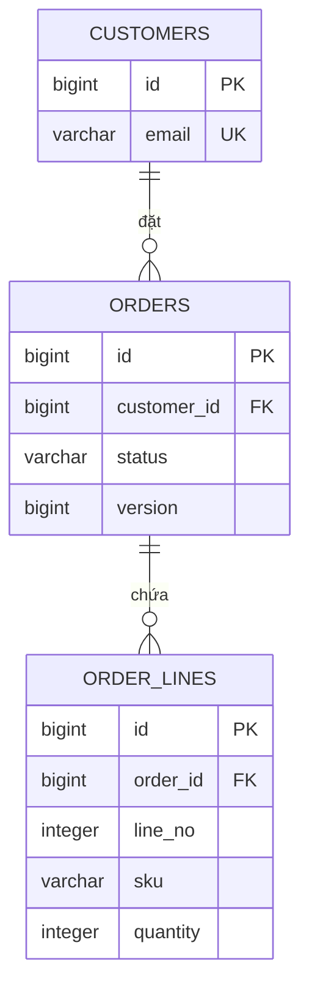
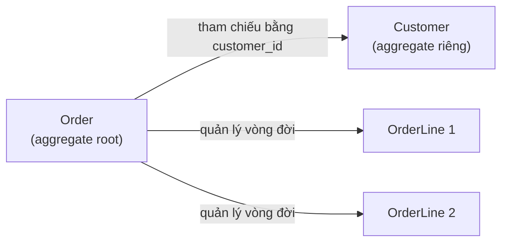

# Ánh xạ quan hệ và phân biệt bên quản lý liên kết với chủ sở hữu nghiệp vụ

Một hệ thống bán hàng có thể nói: “Đơn hàng thuộc về khách hàng” và “Đơn hàng sở hữu các dòng hàng”. Trong Java, cả hai câu đều có thể biểu diễn bằng tham chiếu đối tượng. Trong cơ sở dữ liệu quan hệ, cả hai đều có thể dùng khóa ngoại. Tuy vậy, khi ánh xạ bằng JPA, **bên quản lý liên kết** (*owning side*) và **chủ sở hữu theo nghiệp vụ** (*business owner*, *aggregate root*) là hai khái niệm khác nhau.

- **Bên quản lý liên kết trong ORM** quyết định phía ánh xạ có quyền đồng bộ thay đổi quan hệ vào khóa ngoại hoặc bảng nối. Đây là quy tắc kỹ thuật của mapping.
- **Chủ sở hữu theo nghiệp vụ** quyết định ai được tạo, thay đổi, xóa thành phần và bảo vệ bất biến trong một giao dịch. Đây là quy tắc của domain.
- **Bảng chứa khóa ngoại** là quyết định thiết kế lược đồ quan hệ. Nó xác định nơi lưu giá trị tham chiếu và nơi database kiểm tra tính toàn vẹn.

Ba khái niệm thường liên quan nhưng **không đồng nghĩa**. Nếu nhầm lẫn, lập trình viên có thể chỉ cập nhật collection phía `mappedBy` nhưng không thay đổi khóa ngoại, vô tình xóa entity dùng chung bằng `cascade`, hoặc cho phép sửa các thành phần của một aggregate mà không đi qua quy tắc nghiệp vụ.

Trong module **DATABASE_DATA_MODELING**, ta đi từ yêu cầu nghiệp vụ đến thực thể, quan hệ, bội số, khóa ngoại, ràng buộc, rồi mới chọn cấu hình JPA. Bài này tập trung vào cách biểu diễn các loại quan hệ một–một, nhiều–một, một–nhiều và nhiều–nhiều; xác định phía quản lý liên kết; và giữ cho cách ánh xạ nhất quán với vòng đời dữ liệu.

## 1. Ba lớp nghĩa của từ “sở hữu”

| Góc nhìn | Câu hỏi cần trả lời | Ví dụ |
|---|---|---|
| **Nghiệp vụ / domain** | Ai chịu trách nhiệm bảo vệ quy tắc, tạo và kết thúc vòng đời? | `Order` là aggregate root, điều phối `OrderLine` |
| **ORM / JPA mapping** | Thay đổi ở phía nào được dùng để cập nhật liên kết trong SQL? | `OrderLine.order` có `@JoinColumn` và là owning side |
| **Lược đồ quan hệ** | Khóa ngoại hoặc hàng liên kết được lưu ở đâu? | `order_lines.order_id` tham chiếu `orders.id` |

Trong quan hệ hai chiều `Order`–`OrderLine`, phía lưu FK nằm trên `order_lines`. Vì vậy `OrderLine.order` thường là owning side của JPA. Nhưng theo nghiệp vụ, `Order` mới là chủ sở hữu vòng đời của dòng hàng: người dùng thêm dòng hàng **thông qua đơn**, và đơn chịu trách nhiệm kiểm tra số lượng, giá, trạng thái đặt hàng.

Điều này tạo ra một nhận định quan trọng:

> Một entity có thể là **chủ sở hữu aggregate** dù collection của nó là **phía nghịch** (*inverse side*) trong mapping JPA.

Tương tự, `Order.customer` có thể là owning side của một quan hệ nhiều–một vì `orders.customer_id` là FK, nhưng điều đó **không** cho phép thao tác xóa đơn hàng kéo theo xóa khách hàng. Khách hàng là một entity với vòng đời riêng.

### Ví dụ dùng xuyên suốt

Yêu cầu của hệ thống đặt hàng:

1. Mỗi đơn hàng liên kết với đúng một khách hàng đã có.
2. Khách hàng có thể có nhiều đơn hàng và tồn tại ngay cả khi một đơn bị xóa.
3. Một đơn hàng chứa nhiều dòng hàng; mỗi dòng chỉ thuộc về một đơn và không có vòng đời độc lập.
4. Chỉ đơn hàng đang ở trạng thái `DRAFT` mới được thêm hoặc bỏ dòng.
5. Số lượng dòng hàng phải lớn hơn 0; thứ tự dòng hàng có ý nghĩa khi in đơn.
6. Dữ liệu phải hợp lệ cả khi được ghi qua SQL trực tiếp hoặc ứng dụng khác.

Sơ đồ quan hệ:



Mô hình đối tượng có thể thể hiện như sau:

```text
Customer                  Order (aggregate root)
  id <-------------------- customer
                              |
                              +-- lines: List<OrderLine>
                                    |
                                    +-- order: Order
```

Trong sơ đồ trên, `Order.customer` là tham chiếu đến aggregate khác, còn `Order.lines` là tập các thành phần do `Order` kiểm soát. Dù cả hai có thể dùng FK, ý nghĩa vòng đời hoàn toàn khác nhau.

## 2. Thiết kế khóa ngoại trước khi chọn annotation

Một lược đồ PostgreSQL tối giản cho yêu cầu trên:

```sql
CREATE TABLE customers (
    id BIGINT GENERATED ALWAYS AS IDENTITY PRIMARY KEY,
    email VARCHAR(255) NOT NULL UNIQUE
);

CREATE TABLE orders (
    id BIGINT GENERATED ALWAYS AS IDENTITY PRIMARY KEY,
    customer_id BIGINT NOT NULL,
    status VARCHAR(20) NOT NULL
        CHECK (status IN ('DRAFT', 'CONFIRMED', 'CANCELLED')),
    version BIGINT NOT NULL DEFAULT 0,
    CONSTRAINT fk_orders_customer
        FOREIGN KEY (customer_id) REFERENCES customers(id)
);

CREATE TABLE order_lines (
    id BIGINT GENERATED ALWAYS AS IDENTITY PRIMARY KEY,
    order_id BIGINT NOT NULL,
    line_no INTEGER NOT NULL CHECK (line_no > 0),
    sku VARCHAR(64) NOT NULL,
    quantity INTEGER NOT NULL CHECK (quantity > 0),
    CONSTRAINT fk_order_lines_order
        FOREIGN KEY (order_id) REFERENCES orders(id),
    CONSTRAINT uq_order_line_position UNIQUE (order_id, line_no)
);

CREATE INDEX idx_orders_customer_id ON orders(customer_id);
CREATE INDEX idx_order_lines_order_id ON order_lines(order_id);
```

Những gì database bảo vệ:

- `orders.customer_id NOT NULL`: đơn hàng luôn có khách hàng.
- `fk_orders_customer`: không thể tham chiếu khách hàng không tồn tại.
- `order_lines.order_id NOT NULL`: dòng hàng không thể đứng độc lập về mặt lưu trữ.
- `UNIQUE(order_id, line_no)`: không thể có hai vị trí giống nhau trong cùng đơn.
- `CHECK(quantity > 0)`: nguồn ghi ngoài Java cũng không thể đặt số lượng âm hoặc bằng 0.

Ở ví dụ này, không khai báo `ON DELETE CASCADE` trên FK để chính sách xóa được điều phối rõ qua ORM và ứng dụng. Nếu nghiệp vụ cho phép xóa cả đơn và các dòng trong database, có thể chọn cơ chế cascade ở DB sau khi cân nhắc tác động đến lịch sử, cơ chế audit và các nguồn ghi khác. **Cascade trong JPA không đồng nhất với `ON DELETE CASCADE` trong SQL**; mỗi cơ chế hoạt động ở một tầng.

Chỉ mục trên FK có ích cho những truy vấn join và lọc theo owner, nhưng không phải mọi hệ quản trị tự tạo chỉ mục phía tham chiếu. Hãy xác minh từ schema và kế hoạch truy vấn thực tế.

## 3. Owning side và inverse side trong JPA

### 3.1. Nguyên tắc cơ bản của quan hệ hai chiều

Một quan hệ hai chiều cho phép đi từ đối tượng A sang B và từ B về A. Chẳng hạn:

```java
order.getLines();       // Order -> OrderLine
line.getOrder();        // OrderLine -> Order
```

Hai tham chiếu Java là **hai cách điều hướng của cùng một quan hệ** trong database, không phải hai khóa ngoại độc lập. JPA cần biết phía nào là nguồn quản lý liên kết:

- **Owning side** chứa cấu hình quản lý FK/bảng nối. Thay đổi đúng phía này được xem là thay đổi liên kết cần đồng bộ.
- **Inverse side** dùng `mappedBy` để chỉ về thuộc tính ở phía owning; nó mô tả chiều điều hướng ngược mà không quản lý thêm một liên kết độc lập.

Trong quan hệ `@OneToMany`/`@ManyToOne` hai chiều thông dụng, `@ManyToOne` là owning side vì FK nằm trong bảng của entity con. Trong quan hệ `@ManyToMany`, owning side là phía khai báo/bảo trì join table; FK nằm ở bảng liên kết. Với ánh xạ một chiều, một phía có thể tự quản lý liên kết mà không có `mappedBy`.

**Phân biệt:** “Owning side” không có nghĩa entity đó là root của aggregate, có quyền xóa đối tượng bên kia hoặc giữ toàn bộ bất biến nghiệp vụ.

### 3.2. Một–nhiều hai chiều: `Order.lines` và `OrderLine.order`

Ví dụ Java/JPA minh họa, lược bỏ import, getter và một số constructor để tập trung vào cách ánh xạ:

```java
@Entity
@Table(name = "orders")
public class Order {

    @Id
    @GeneratedValue(strategy = GenerationType.IDENTITY)
    private Long id;

    @ManyToOne(fetch = FetchType.LAZY, optional = false)
    @JoinColumn(name = "customer_id", nullable = false)
    private Customer customer;

    @Enumerated(EnumType.STRING)
    @Column(nullable = false, length = 20)
    private OrderStatus status = OrderStatus.DRAFT;

    @OneToMany(
        mappedBy = "order",
        cascade = CascadeType.ALL,
        orphanRemoval = true
    )
    @OrderBy("lineNo ASC")
    private List<OrderLine> lines = new ArrayList<>();

    @Version
    @Column(nullable = false)
    private Long version;

    protected Order() {}

    public Order(Customer customer) {
        this.customer = Objects.requireNonNull(customer);
    }

    public void addLine(OrderLine line) {
        requireDraft();
        Objects.requireNonNull(line);
        if (line.getOrder() != null) {
            throw new IllegalStateException("Dòng hàng đã thuộc một đơn");
        }
        if (line.getQuantity() <= 0) {
            throw new IllegalArgumentException("Số lượng phải > 0");
        }

        line.attachTo(this);
        lines.add(line);
    }

    public void removeLine(OrderLine line) {
        requireDraft();
        if (lines.remove(line)) {
            line.detachFromOrder();
        }
    }

    private void requireDraft() {
        if (status != OrderStatus.DRAFT) {
            throw new IllegalStateException("Chỉ được sửa đơn nháp");
        }
    }
}

@Entity
@Table(name = "order_lines")
public class OrderLine {

    @Id
    @GeneratedValue(strategy = GenerationType.IDENTITY)
    private Long id;

    @ManyToOne(fetch = FetchType.LAZY, optional = false)
    @JoinColumn(name = "order_id", nullable = false)
    private Order order; // OWNING SIDE trong JPA

    @Column(name = "line_no", nullable = false)
    private int lineNo;

    @Column(nullable = false, length = 64)
    private String sku;

    @Column(nullable = false)
    private int quantity;

    protected OrderLine() {}

    public Order getOrder() { return order; }
    public int getQuantity() { return quantity; }

    void attachTo(Order order) {
        this.order = Objects.requireNonNull(order);
    }

    void detachFromOrder() {
        this.order = null;
    }
}
```

Giả định `Customer` được ánh xạ riêng; `OrderStatus` định nghĩa `DRAFT`, `CONFIRMED`, `CANCELLED`; và các dòng hàng được gán `lineNo > 0` hợp lệ theo logic sắp xếp trước khi lưu. Các import từ `jakarta.persistence` và `java.util` được lược bỏ. Code là **minh họa ánh xạ**, chưa phải lớp production hoàn chỉnh: constructor của dòng hàng, chính sách cấp `lineNo`, validation SKU, kiểm soát quyền truy cập và các giao dịch cần được bổ sung khi triển khai.

Điểm mấu chốt:

1. `OrderLine.order` khai báo `@JoinColumn(name = "order_id")` nên là **owning side**. Nó là nguồn thông tin để ghi `order_lines.order_id`.
2. `Order.lines` khai báo `mappedBy = "order"`. Chuỗi `"order"` là **tên thuộc tính Java ở `OrderLine`**, không phải tên cột SQL `order_id`.
3. `Order` là **aggregate root theo nghiệp vụ**. Phương thức `addLine` kiểm tra điều kiện nghiệp vụ rồi đồng bộ cả hai tham chiếu.
4. `cascade = ALL` và `orphanRemoval = true` chỉ áp dụng từ đơn hàng tới các dòng thuộc vòng đời của nó; đây là lựa chọn có lý do nghiệp vụ, không xuất phát từ việc phía `Order` có `mappedBy`.
5. `Order.customer` cũng là owning side của FK `customer_id`, nhưng **không** có `CascadeType.REMOVE`. Khách hàng được nhiều đơn sử dụng và có vòng đời độc lập.

### 3.3. Vì sao phải cập nhật cả hai đầu quan hệ?

Giả sử:

```java
order.getLines().add(line); // chỉ thay collection phía inverse
```

Nếu không gán `line.order = order`, đồ thị Java có thể mâu thuẫn:

```text
order.lines chứa line
line.order == null
```

Đối với quan hệ hai chiều nêu trên, JPA dựa vào phía owning để quản lý FK. Vì thế cập nhật riêng phía inverse **không phải cách đáng tin cậy để lưu liên kết**; provider có thể không ghi `order_id` đúng ý muốn hoặc phát sinh lỗi ràng buộc. Ngược lại, chỉ gán `line.order = order` mà không bổ sung `order.lines` có thể lưu FK nhưng khiến collection trong bộ nhớ không phản ánh trạng thái mới cho đến khi được nạp lại.

Để tránh hai chiều bị lệch, hãy:

- Đóng gói thay đổi quan hệ trong **một phương thức miền nghiệp vụ** như `Order.addLine`.
- Hạn chế cung cấp setter công khai cho cả hai phía.
- Chọn phía được phép gọi từ ứng dụng; với aggregate trên, thay đổi phải đi qua `Order`.
- Kiểm chứng sau `flush` và sau khi tải trong một persistence context mới.

**Đặc biệt khi xóa:** ở ví dụ có `orphanRemoval = true`, bỏ `line` khỏi collection có nghĩa đánh dấu xóa dòng hàng. Phương thức `detachFromOrder` chỉ để làm đồ thị trong bộ nhớ nhất quán; vì FK `order_id` là `NOT NULL`, dòng hàng **không được lưu lại** ở trạng thái `order = null`. Nếu muốn chuyển dòng sang đơn khác, không nên dùng quy trình orphan removal này; phải thiết kế lại quyền sở hữu và quy tắc chuyển.

### 3.4. Kiểm chứng SQL thực tế

Một lần tạo đơn với hai dòng có thể dẫn tới các thao tác tương đương:

```sql
INSERT INTO orders (customer_id, status, version)
VALUES (:customer_id, 'DRAFT', 0);

INSERT INTO order_lines (order_id, line_no, sku, quantity)
VALUES (:new_order_id, 1, 'BOOK-01', 2);

INSERT INTO order_lines (order_id, line_no, sku, quantity)
VALUES (:new_order_id, 2, 'PEN-02', 1);
```

ORM quyết định thứ tự và thời điểm thực thi SQL theo provider, generator và cơ chế flush; đây là mô hình kết quả mong muốn chứ không phải cam kết ORM sẽ phát ra đúng ba câu lệnh giống hệt ví dụ.

Hãy bật SQL logging trong môi trường phát triển và kiểm tra giá trị `order_id` thực tế. Đừng chỉ dựa vào việc `order.getLines().size()` trả về 2 trong cùng phiên làm việc: collection Java có thể đúng tạm thời trong khi FK chưa được đồng bộ.

## 4. Owner kỹ thuật của các kiểu quan hệ

### 4.1. Nhiều–một (`@ManyToOne`)

Đây là hướng ánh xạ thường trực tiếp nhất vì một hàng chứa FK tới một hàng khác:

```java
@ManyToOne(fetch = FetchType.LAZY, optional = false)
@JoinColumn(name = "customer_id", nullable = false)
private Customer customer;
```

Trong bảng `orders`, `customer_id` lưu ID của khách hàng. Đặt `order.customer = customerB` (thông qua phương thức nghiệp vụ phù hợp) có thể khiến ORM cập nhật FK sang khách hàng B. Việc điều này **có được phép theo nghiệp vụ hay không** là câu hỏi khác: đơn đã xác nhận có thể không được đổi khách hàng dù mapping cho phép ghi FK.

Nếu muốn `Customer.orders` để điều hướng ngược, có thể thêm:

```java
@OneToMany(mappedBy = "customer")
private List<Order> orders = new ArrayList<>();
```

Khi đó `Customer.orders` là inverse side. Không nên tự động thêm collection này chỉ vì bảng có FK: mỗi collection tạo thêm chi phí bảo trì đồ thị, nguy cơ truy vấn lớn, serialize vòng lặp và phụ thuộc không cần thiết. Truy vấn các đơn của khách qua repository cũng có thể đáp ứng use case.

### 4.2. Một–nhiều một chiều (`@OneToMany` không có `mappedBy`)

Không phải mọi collection một–nhiều đều cần tham chiếu ngược. JPA có thể ánh xạ một chiều:

```java
@OneToMany
@JoinColumn(name = "order_id")
private List<OrderLine> lines;
```

Trong trường hợp này, phía collection **quản lý liên kết** dù FK vật lý `order_id` vẫn nằm trên bảng `order_lines`. Một số chiến lược/provider có thể phải thực hiện thêm câu `UPDATE` để gán FK khi chèn phần tử. Vì vậy quy tắc “owning side luôn là entity có bảng chứa FK” **chỉ đúng cho dạng hai chiều `@OneToMany`/`@ManyToOne` phổ biến**, không phải định nghĩa chung cho mọi kiểu ánh xạ.

Với `@OneToMany` một chiều **không chỉ rõ `@JoinColumn`**, mapping JPA mặc định có thể sử dụng bảng nối. Đây là một cấu trúc lưu trữ khác cần được kiểm tra khi xem DDL và SQL. Quyết định dùng một chiều, hai chiều, FK hay join table phải xuất phát từ nhu cầu truy vấn và quyền điều chỉnh quan hệ.

### 4.3. Một–một (`@OneToOne`)

Ví dụ tài khoản có một hồ sơ thông tin bổ sung, hồ sơ không được tồn tại độc lập. Có thể dùng **khóa chính chia sẻ**:

```sql
CREATE TABLE accounts (
    id BIGINT GENERATED ALWAYS AS IDENTITY PRIMARY KEY,
    username VARCHAR(100) NOT NULL UNIQUE
);

CREATE TABLE account_profiles (
    account_id BIGINT PRIMARY KEY
        REFERENCES accounts(id),
    display_name VARCHAR(120) NOT NULL
);
```

Ánh xạ minh họa:

```java
@Entity
@Table(name = "accounts")
public class Account {
    @Id
    @GeneratedValue(strategy = GenerationType.IDENTITY)
    private Long id;

    @OneToOne(
        mappedBy = "account",
        cascade = CascadeType.ALL,
        orphanRemoval = true
    )
    private AccountProfile profile; // inverse side
}

@Entity
@Table(name = "account_profiles")
public class AccountProfile {
    @Id
    @Column(name = "account_id")
    private Long id;

    @MapsId
    @OneToOne(fetch = FetchType.LAZY, optional = false)
    @JoinColumn(name = "account_id", nullable = false)
    private Account account; // owning side

    @Column(name = "display_name", nullable = false)
    private String displayName;
}
```

Các entity trên cần constructor không tham số theo JPA, phương thức gắn hai phía và hành vi nghiệp vụ khi triển khai thực tế; ví dụ lược bỏ chúng để tập trung vào `@MapsId` và `mappedBy`.

- `AccountProfile.account` quản lý liên kết qua FK/PK `account_id`.
- `Account.profile` là chiều điều hướng ngược.
- `@MapsId` thể hiện khóa chính của profile lấy từ ID của account.
- `cascade`/`orphanRemoval` được đặt trên account vì **nghiệp vụ** quy định hồ sơ thuộc vòng đời của tài khoản.

Trường hợp một–một dùng FK riêng (không chia sẻ PK) cũng phải có ràng buộc `UNIQUE` trên cột FK để database bảo vệ bội số tối đa một. Khai báo `@OneToOne` ở Java mà schema không bảo đảm duy nhất là nguồn sai lệch dữ liệu.

### 4.4. Nhiều–nhiều (`@ManyToMany`)

Giả sử nhiều nhân viên có nhiều vai trò quyền truy cập, và một vai trò được gán cho nhiều nhân viên. Bảng nối:

```sql
CREATE TABLE employees (
    id BIGINT GENERATED ALWAYS AS IDENTITY PRIMARY KEY
);

CREATE TABLE roles (
    id BIGINT GENERATED ALWAYS AS IDENTITY PRIMARY KEY,
    code VARCHAR(64) NOT NULL UNIQUE
);

CREATE TABLE employee_roles (
    employee_id BIGINT NOT NULL REFERENCES employees(id),
    role_id BIGINT NOT NULL REFERENCES roles(id),
    PRIMARY KEY (employee_id, role_id)
);
```

Ánh xạ:

```java
@Entity
@Table(name = "employees")
public class Employee {
    @Id
    @GeneratedValue(strategy = GenerationType.IDENTITY)
    private Long id;

    @ManyToMany
    @JoinTable(
        name = "employee_roles",
        joinColumns = @JoinColumn(name = "employee_id"),
        inverseJoinColumns = @JoinColumn(name = "role_id")
    )
    private Set<Role> roles = new HashSet<>(); // owning side

    protected Employee() {}
}

@Entity
@Table(name = "roles")
public class Role {
    @Id
    @GeneratedValue(strategy = GenerationType.IDENTITY)
    private Long id;

    @ManyToMany(mappedBy = "roles")
    private Set<Employee> employees = new HashSet<>(); // inverse side

    protected Role() {}
}
```

`Employee.roles` là owning side vì nó quản lý các hàng trong `employee_roles`. Nhưng `Employee` **không sở hữu vòng đời của `Role`**: xóa một nhân viên không được xóa vai trò đang dùng chung. Vì thế không khai báo `CascadeType.REMOVE` giữa hai entity dùng chung. Trong thực tế, có thể chỉ cần ánh xạ một chiều `Employee.roles` nếu chiều `Role.employees` không phục vụ thao tác nghiệp vụ.

**Lưu ý mapping mẫu:** các import, constructor nghiệp vụ, getter và lifecycle chưa được trình bày đầy đủ ở đoạn mã. Cần bổ sung những thành phần đó và quy tắc bảo trì hai chiều khi tích hợp thực tế. Ví dụ này nhằm so sánh owning/inverse side, không phải dự án chạy độc lập.

### 4.5. Quan hệ nhiều–nhiều có thuộc tính: thay bằng entity liên kết

Khi yêu cầu bổ sung `assigned_at`, `assigned_by`, `expires_at` hoặc trạng thái phê duyệt trên việc gán vai trò, **mối liên kết đã trở thành dữ liệu nghiệp vụ**. Ánh xạ `@ManyToMany` đơn giản không cho phép xử lý tự nhiên những thuộc tính này.

Một thiết kế phù hợp hơn:

```sql
CREATE TABLE role_assignments (
    id BIGINT GENERATED ALWAYS AS IDENTITY PRIMARY KEY,
    employee_id BIGINT NOT NULL REFERENCES employees(id),
    role_id BIGINT NOT NULL REFERENCES roles(id),
    assigned_at TIMESTAMP NOT NULL,
    expires_at TIMESTAMP,
    CONSTRAINT uq_employee_role UNIQUE (employee_id, role_id),
    CONSTRAINT ck_assignment_period
        CHECK (expires_at IS NULL OR expires_at > assigned_at)
);
```

Khi đó có entity `RoleAssignment` với hai quan hệ `@ManyToOne` đến `Employee` và `Role`. Cả hai `@ManyToOne` có thể là owning side của **hai FK khác nhau**. Việc entity nào được phép thêm/thu hồi assignment là quyết định **domain**, thường đặt ở service hoặc aggregate chịu trách nhiệm phân quyền.

Nếu cần lưu lịch sử nhiều lần gán cùng một vai trò, `UNIQUE(employee_id, role_id)` không còn phù hợp; phải xác định chính sách phiên bản/lần gán và ràng buộc mới. Đây là thay đổi **định danh liên kết**, không chỉ điều chỉnh annotation.

## 5. Cascade, orphan removal và quyền sở hữu nghiệp vụ

Ba khái niệm thường xuất hiện cùng nhau nhưng hoạt động khác nhau:

| Cơ chế | Ý nghĩa chính | Không có nghĩa |
|---|---|---|
| `cascade = PERSIST/MERGE/REMOVE/...` | Lan truyền những thao tác JPA đã chọn theo quan hệ | Hai entity tự động thuộc cùng một aggregate |
| `orphanRemoval = true` | Xóa entity con khi nó bị loại khỏi quan hệ sở hữu phù hợp | Có thể di chuyển entity con tự do giữa owner |
| SQL `ON DELETE CASCADE` | DB tự xóa hàng phụ thuộc khi hàng được tham chiếu bị xóa | JPA tự biết và đồng bộ mọi object trong persistence context |

### 5.1. Khi cascade là hợp lý

Một `Order` chứa `OrderLine` không có ý nghĩa độc lập. Lúc tạo đơn, thêm ba dòng và gọi `persist(order)` có thể hợp lý để JPA tạo cả các dòng thông qua `CascadeType.PERSIST`. Lúc xóa đơn nháp, `CascadeType.REMOVE` hoặc cơ chế xóa tương ứng có thể xóa các dòng.

Tuy nhiên, trong hệ thống yêu cầu giữ đơn sau khi xác nhận, xóa vật lý có thể bị cấm. `cascade = ALL` trong ví dụ phục vụ tình huống vòng đời dòng hàng phụ thuộc đơn; nó không thay thế quy tắc “đơn đã xác nhận không được xóa”, vốn phải được kiểm soát trong phương thức nghiệp vụ/API và các chính sách dữ liệu.

### 5.2. Khi cascade gây nguy hiểm

`Order.customer` là một liên kết bắt buộc, nhưng `Customer` có thể được nhiều đơn tham chiếu. Nếu cấu hình:

```java
@ManyToOne(cascade = CascadeType.REMOVE)
private Customer customer;
```

thì khi xóa đơn, JPA có thể cố xóa luôn khách hàng. Điều này sai nghiệp vụ và có thể bị database chặn do các đơn khác đang tham chiếu. **Việc ở owning side của một quan hệ không cấp quyền xóa entity được tham chiếu**.

Quan hệ nhiều–nhiều với `Role`, `Tag`, `Category` dùng chung cũng cần tránh cascade remove theo hướng khiến xóa một owner làm mất entity đang được nhiều nơi dùng.

### 5.3. `orphanRemoval` có phù hợp khi chuyển chủ sở hữu?

Giả sử đơn A chứa dòng hàng X, sau đó cần chuyển X sang đơn B. Nếu `Order.lines` có `orphanRemoval = true`, hành vi bỏ X khỏi A có thể khiến ORM lên lịch xóa X; gán ngay X cho B không mặc nhiên hủy việc xóa đó theo cách an toàn/di động. JPA cũng không xem việc đổi owner của entity orphan như một thao tác tùy ý luôn được hỗ trợ.

Nếu nghiệp vụ thật sự cho phép chuyển thành phần giữa owner, cần thiết kế quá trình chuyển rõ ràng: có thể tạo dòng hàng mới ở B theo giá trị cần giữ, ghi nhận sự kiện di chuyển, hoặc xem lại aggregate boundary và orphan-removal policy. Đừng âm thầm sửa `line.order` trong một setter công khai.

## 6. Ranh giới aggregate không được suy ra từ FK hoặc `mappedBy`

Trong Domain-Driven Design, **aggregate** là nhóm object được xem như một ranh giới nhất quán cho các bất biến; **aggregate root** là điểm vào được phép điều phối các thay đổi của nhóm. Không phải mọi FK giữa hai bảng đều có nghĩa hai hàng nằm trong cùng aggregate.

Ở ví dụ:

- `Order` và các `OrderLine` là một aggregate theo giả định “dòng hàng không có vòng đời riêng”.
- `Customer` là aggregate khác. `Order` chỉ tham chiếu khách hàng qua FK.
- Việc tạo, xác nhận hoặc hủy đơn phải đi qua quy tắc nghiệp vụ của `Order`.
- Việc chỉnh sửa hồ sơ khách hàng không phải thao tác thuộc vòng đời của `Order`, dù `Order` giữ FK tới khách.

### Phân biệt trực quan



**Một mối quan hệ có thể có đồng thời nhiều chính sách:**

| Cặp entity | Quan hệ SQL/JPA | Quy tắc nghiệp vụ | Chính sách vòng đời gợi ý |
|---|---|---|---|
| `Order → Customer` | `orders.customer_id`; `@ManyToOne` là owning side | Đơn tham chiếu khách hàng đang tồn tại | Không cascade remove sang khách hàng |
| `Order → OrderLine` | `order_lines.order_id`; `OrderLine.order` là owning side | Dòng chỉ được sửa qua đơn nháp | Cascade phù hợp; orphan removal nếu xóa khỏi đơn thực sự là xóa dòng |
| `Employee ↔ Role` | Join table; một phía `@ManyToMany` là owning side | Gán/thu hồi quyền qua use case xác định | Không xóa `Role` dùng chung |
| `Account → AccountProfile` | Một–một, PK/FK chia sẻ | Profile thuộc vòng đời account | Có thể cascade và orphan removal qua account |

Đừng nhầm aggregate với giao dịch phân tán giữa nhiều hệ thống. Nếu một quy tắc phải phối hợp nhiều aggregate, cần thiết kế nhất quán ở cấp use case, giao dịch database hoặc điều phối bất đồng bộ phù hợp với yêu cầu; không thể giải quyết chỉ bằng `cascade`.

### Ví dụ bất biến đi qua aggregate root

Không nên cho phép:

```java
orderLine.setQuantity(-5);
```

Thay vào đó, hành vi đổi số lượng có thể đi qua `Order`:

```java
public void changeQuantity(OrderLine line, int newQuantity) {
    requireDraft();
    if (!lines.contains(line)) {
        throw new IllegalArgumentException("Dòng không thuộc đơn này");
    }
    if (newQuantity <= 0) {
        throw new IllegalArgumentException("Số lượng phải > 0");
    }
    line.changeQuantityWithinOrder(newQuantity);
}
```

Đây là minh họa phương thức trong `Order`; giả định `OrderLine` có phương thức package-private `changeQuantityWithinOrder`. Kiểm tra trong domain đem lại thông báo đúng nghĩa nghiệp vụ; constraint SQL `CHECK(quantity > 0)` cung cấp lớp bảo vệ cuối cùng khi có đường ghi khác.

## 7. Ràng buộc quan hệ và tính toàn vẹn phải được diễn đạt tại database

Annotation mô tả mapping, nhưng những điều kiện cốt lõi phải được thể hiện trong schema thật:

| Yêu cầu | Ràng buộc SQL | Gợi ý JPA |
|---|---|---|
| Mỗi đơn phải có khách hàng | `NOT NULL` + `FOREIGN KEY` | `@ManyToOne(optional = false)`, `@JoinColumn(nullable = false)` |
| Mỗi dòng phải thuộc đúng một đơn | `order_id NOT NULL` + FK | `OrderLine.order` owning side, không cho chỉnh FK tùy tiện |
| Một hồ sơ cho mỗi tài khoản | PK chia sẻ hoặc `UNIQUE(account_id)` | `@OneToOne`, cân nhắc `@MapsId` |
| Không gán trùng một vai trò cho một nhân viên | `PRIMARY KEY(employee_id, role_id)` hoặc `UNIQUE` | Quan hệ qua join table, hoặc entity liên kết |
| Một dòng không trùng vị trí trong đơn | `UNIQUE(order_id, line_no)` | `@OrderBy` hoặc `@OrderColumn` theo ngữ nghĩa |
| Không có số lượng âm | `CHECK(quantity > 0)` | Validation trong domain |
| Không tham chiếu entity khác tenant | FK ghép có đủ cột phạm vi hoặc cơ chế toàn vẹn tương đương | Mapping khóa/tenant nhất quán với schema |

### 7.1. Không nhầm quan hệ bắt buộc với cascade

`@ManyToOne(optional = false)` có nghĩa **quan hệ không được vắng mặt** theo mô hình JPA; `@JoinColumn(nullable = false)` diễn đạt mong muốn cột FK không null. Chúng không khiến entity liên quan tự động được lưu hoặc xóa.

Nếu tạo đơn với `Customer` còn transient (chưa tồn tại hàng), mà quan hệ không cascade persist đến khách, ORM có thể báo lỗi entity chưa lưu hoặc DB từ chối FK. Đây thường là kết quả đúng: use case phải tạo khách trước hoặc lấy khách đang tồn tại, thay vì biến thao tác tạo đơn thành thao tác âm thầm tạo khách.

### 7.2. Thứ tự collection cần một quyết định riêng

`Order.lines: List<OrderLine>` ngụ ý thứ tự Java, còn quan hệ SQL không có thứ tự mặc định. Hai lựa chọn thường gặp:

- Có field `lineNo` do nghiệp vụ quản lý và dùng `@OrderBy("lineNo ASC")`; schema nên ràng buộc `UNIQUE(order_id, line_no)` nếu vị trí là duy nhất.
- Dùng `@OrderColumn(name = "position")` để ORM duy trì vị trí của `List`; cần kiểm thử các thao tác chèn, xóa và sắp lại, đặc biệt khi có constraint duy nhất.

`@OrderBy` sắp theo giá trị thuộc tính đã lưu; `@OrderColumn` quản lý một cột vị trí. Chúng **không** có cùng ý nghĩa. Trong mã ví dụ chính, dùng `lineNo` và `@OrderBy`; vì vậy ứng dụng phải tự gán, đổi và ràng buộc `lineNo` đúng cách.

### 7.3. Xóa một hàng bị FK tham chiếu

Với `order_lines.order_id REFERENCES orders(id)` không có `ON DELETE CASCADE`, lệnh SQL trực tiếp:

```sql
DELETE FROM orders WHERE id = :order_id;
```

sẽ bị database từ chối nếu còn dòng hàng tham chiếu. Đây là bảo vệ toàn vẹn đúng kỳ vọng. Nếu xóa qua JPA có cascade remove được cấu hình và được phép bởi nghiệp vụ, ORM có thể xóa các dòng trước khi xóa đơn. Hai cơ chế này phải tương thích với chính sách lưu trữ thực tế.

Không nên vô điều kiện bật cả JPA cascade và DB cascade với hy vọng “an toàn gấp đôi”. Cần xác định ai thực thi việc xóa, hậu quả cho cache, audit, trigger và các lệnh thao tác trực tiếp.

## 8. Truy vấn và hiệu năng liên quan đến hướng ánh xạ

### 8.1. Có quan hệ Java không đồng nghĩa dữ liệu đã được tải

`Order.lines` và `Order.customer` có thể là lazy association. Khi một màn hình cần danh sách 200 đơn nhưng không cần chi tiết dòng, việc tải toàn bộ `lines` là lãng phí. Ngược lại, nếu vòng lặp truy cập `order.getLines()` với 200 đơn sau khi tải danh sách, ORM có thể phát sinh **N+1 queries**.

Truy vấn theo mục đích sử dụng:

```java
// Khi chỉ cần thống kê số dòng cho từng đơn:
var counts = em.createQuery("""
    select o.id, count(l.id)
    from Order o
    left join o.lines l
    where o.id in :ids
    group by o.id
    """, Object[].class)
    .setParameter("ids", orderIds)
    .getResultList();
```

Truy vấn trả dữ liệu tổng hợp, không cần khởi tạo collection `Order.lines` của từng đơn. Với màn hình chỉnh sửa một đơn, fetch join hoặc entity graph có thể phù hợp hơn. Hãy kiểm tra SQL thực tế và lưu ý fetch join collection có thể làm nhân hàng kết quả; phân trang owner cùng collection cần thiết kế cẩn thận.

### 8.2. Quan hệ hai chiều không bắt buộc

Nếu use case chỉ cần đi từ dòng hàng đến đơn, có thể chỉ ánh xạ `OrderLine.order`. Nếu màn hình cần liệt kê các đơn của một khách, repository có thể truy vấn:

```sql
SELECT id, status
FROM orders
WHERE customer_id = :customer_id
ORDER BY id DESC;
```

Không có yêu cầu nào bắt buộc `Customer` phải giữ `List<Order>`. Thêm một quan hệ hai chiều tạo thêm trách nhiệm đồng bộ, khả năng recursion trong `toString`/`equals`/JSON serialization và nguy cơ tải đồ thị dữ liệu lớn.

### 8.3. Tối ưu SQL không thay đổi quyền sở hữu nghiệp vụ

Nếu cần đổi fetch strategy, thêm chỉ mục hoặc dùng projection, biên giới aggregate vẫn do nghiệp vụ quyết định. Tương tự, chuyển một FK từ bảng này sang bảng khác hoặc dùng join table có thể làm đổi owning side JPA, nhưng không tự động thay đổi ai được quyền hủy đơn, xóa dòng hàng hay gán vai trò.

## 9. Giao dịch và cập nhật đồng thời

ORM owning side giải quyết **ghi liên kết nào**; nó không tự bảo đảm hai thao tác nghiệp vụ đồng thời luôn đúng.

Ví dụ hai nhân viên cùng tải đơn ở `DRAFT`:

```text
T1: đọc Order #42, status = DRAFT, version = 7
T2: đọc Order #42, status = DRAFT, version = 7
T1: thêm dòng A
T2: xác nhận đơn
T1/T2: cùng cố lưu thay đổi
```

Nếu bất biến là “không được thêm dòng sau khi đơn được xác nhận”, cần xác định cách phát hiện xung đột. `@Version` trên `Order` có thể hỗ trợ optimistic locking khi hàng owner được cập nhật đúng cơ chế của provider. Tuy vậy, thay đổi **chỉ ở collection/dòng con** có làm version của `Order` tăng hay không còn tùy cách ánh xạ và provider. Không được giả định mọi thao tác trên collection tự động tăng version của root.

Các hướng thiết kế cần đánh giá:

1. Thực hiện thao tác nghiệp vụ trong transaction có phạm vi rõ ràng.
2. Dùng optimistic locking và bảo đảm version/root thực sự tham gia khi bất biến của root bị ảnh hưởng.
3. Với các điều kiện tranh chấp quan trọng, có thể cần `PESSIMISTIC_WRITE`, lệnh SQL cập nhật có điều kiện hoặc cách khóa khác phù hợp với throughput.
4. Khi lỗi optimistic lock xảy ra, không tự ghi đè; nạp lại trạng thái và yêu cầu nghiệp vụ quyết định thử lại hay từ chối.

Không nên dùng `equals()` của entity hay `cascade` như cơ chế giải quyết xung đột. Chúng phục vụ nhận diện object và lan truyền lifecycle, không thay thế kiểm soát đồng thời.

### `flush` không đồng nghĩa `commit`

Khi gọi `em.flush()`, JPA đồng bộ các thay đổi cần thiết xuống database trong giao dịch hiện tại. Giao dịch vẫn có thể rollback, nên sự xuất hiện của FK hoặc hàng liên kết sau `flush` không có nghĩa thay đổi đã được commit. Khi kiểm tra ánh xạ, nên xác nhận dữ liệu sau commit bằng persistence context mới.

## 10. Các sai lầm thường gặp

**Sai lầm 1 — “Owning side là chủ sở hữu nghiệp vụ.”** `OrderLine.order` giữ `order_id` và quản lý FK trong JPA, nhưng `Order` mới là root bảo vệ bất biến thêm/xóa dòng.

**Sai lầm 2 — “Thêm vào collection `mappedBy` là đủ để lưu FK.”** Với quan hệ hai chiều, phải giữ phía owning và inverse nhất quán; chỉ đổi inverse side có thể không đồng bộ như mong muốn.

**Sai lầm 3 — “Cứ thêm `cascade = ALL` cho mọi quan hệ.”** Cascade remove trên `Order.customer` hoặc `Employee.roles` có thể tìm cách xóa entity được nhiều nơi dùng.

**Sai lầm 4 — “`orphanRemoval` là cách di chuyển phần tử giữa hai parent.”** Orphan removal biểu diễn xóa thành phần đã mất owner, không phải chuyển giao owner tùy ý.

**Sai lầm 5 — “`@ManyToMany` luôn là đủ.”** Quan hệ có thuộc tính riêng, lịch sử, trạng thái hoặc danh tính cần entity liên kết.

**Sai lầm 6 — “Có annotation một–một thì database chắc chắn không có hai bản ghi.”** Nếu schema không có PK chia sẻ/`UNIQUE` phù hợp, dữ liệu do nguồn khác ghi vẫn có thể vi phạm bội số.

**Sai lầm 7 — “Cứ ánh xạ hai chiều để code điều hướng dễ hơn.”** Mỗi chiều thêm chi phí nhất quán object graph và rủi ro lazy load, serialize vòng lặp; chỉ thêm khi use case cần.

**Sai lầm 8 — “Cấu hình ORM quyết định toàn bộ chính sách xóa.”** Chính sách xóa vật lý, soft delete, giữ lịch sử và FK `ON DELETE` cần được xác định từ yêu cầu lưu trữ dữ liệu.

**Sai lầm 9 — “Collection là `List` nên SQL đã có thứ tự.”** SQL không bảo đảm thứ tự nếu không có cột/điều kiện sắp xếp phù hợp.

**Sai lầm 10 — “Một lần `flush` thành công nghĩa là tất cả bất biến đồng thời đã được bảo vệ.”** Cần xét transaction, locking, constraint và quy tắc trên nhiều hàng/aggregate.

## 11. Quy trình thiết kế quan hệ từ yêu cầu nghiệp vụ

### Bước 1 — Viết rõ bội số và tính bắt buộc

Ví dụ “mỗi đơn có đúng một khách”, “mỗi dòng chỉ ở một đơn”, “một đơn có nhiều dòng”, “một vai trò có thể được nhiều nhân viên dùng”. Từ đó chọn bội số 1–1, 1–n hoặc n–n và `NOT NULL`/`UNIQUE` tương ứng.

### Bước 2 — Xác định vòng đời và aggregate

Hỏi “xóa A có xóa B không?”, “B có tồn tại độc lập không?”, “ai được đổi quan hệ?”, “bất biến phải giữ khi nào?”. Kết quả giúp đặt logic thêm/xóa và đánh giá cascade/orphan removal.

### Bước 3 — Thiết kế khóa và bảng nối

Chọn FK, bảng liên kết, khóa chính/khóa ứng viên, chỉ mục, chính sách xóa và ràng buộc thứ tự. Nếu association có thuộc tính riêng, cân nhắc entity liên kết ngay từ đầu.

### Bước 4 — Chọn điều hướng object

Xác định use case cần đi theo chiều nào. Chọn một chiều nếu đủ; với hai chiều, xác định rõ phía owning và inverse. `mappedBy` tham chiếu **thuộc tính Java**, không phải cột SQL.

### Bước 5 — Đóng gói thao tác liên kết

Đặt phương thức thêm/bỏ/chuyển liên kết tại thành phần chịu trách nhiệm nghiệp vụ. Cập nhật đồng bộ cả hai đầu của quan hệ hai chiều, tránh setter công khai cho mọi phía.

### Bước 6 — Chọn cascade và orphan removal từ quyền sở hữu

Chỉ cascade remove khi entity đích thật sự thuộc vòng đời owner; không xóa entity dùng chung chỉ vì ORM cho phép. Với lịch sử, thiết kế trạng thái hoặc chính sách lưu trữ trước khi cho phép xóa.

### Bước 7 — Kiểm chứng SQL và cạnh tranh đồng thời

Thử tạo, thêm, bỏ, xóa, đổi liên kết; xem FK sau khi commit trong context mới. Đo SQL để phát hiện N+1, kiểm tra FK/unique/check thực tế và thử hai giao dịch cùng thay đổi aggregate.

### Bảng kiểm quyết định

| Câu hỏi | Nếu bỏ qua sẽ xảy ra gì? |
|---|---|
| Bên nào giữ FK hoặc join table? | Mapping không đúng schema; có thể sinh bảng nối không mong muốn |
| Bên nào là owning side JPA? | Chỉ sửa phía inverse và dữ liệu lưu không đổi |
| Ai là aggregate root? | Cho phép sửa/xóa thành phần bỏ qua quy tắc nghiệp vụ |
| Quan hệ có hai chiều thực sự cần thiết không? | Dễ lệch object graph và tải thừa dữ liệu |
| Thành phần có vòng đời riêng không? | Cascade remove xóa nhầm đối tượng dùng chung |
| Xóa khỏi collection có nghĩa là gì? | Lạm dụng orphan removal hoặc giữ hàng mồ côi |
| Liên kết có thuộc tính/lịch sử không? | Ép dữ liệu nghiệp vụ vào `@ManyToMany` không đủ biểu đạt |
| Bội số được bảo vệ tại SQL không? | Dữ liệu nhiều–một/một–một sai khi nguồn khác ghi |
| Có thứ tự theo nghiệp vụ không? | `List` trả kết quả ngẫu nhiên hoặc bị sắp lại |
| Thay đổi liên kết đồng thời có an toàn không? | Ghi đè trạng thái hoặc vi phạm bất biến aggregate |

## 12. Bài tập áp dụng

**Bối cảnh:** ứng dụng học trực tuyến có `Course`, `Lesson`, `Instructor` và `Student`:

- Một khóa học có nhiều bài học được sắp theo số thứ tự. Mỗi bài học chỉ thuộc một khóa học và không có ý nghĩa độc lập nếu khóa bị xóa.
- Một giảng viên có thể phụ trách nhiều khóa học; một khóa chỉ có một giảng viên chính. Giảng viên tồn tại độc lập với khóa.
- Sinh viên đăng ký nhiều khóa, mỗi khóa có nhiều sinh viên. Việc đăng ký có thời điểm, trạng thái, điểm cuối khóa và có thể được hủy.
- Khóa đã xuất bản không được thay đổi thứ tự bài học nếu chưa mở quy trình phát hành phiên bản mới.

Hãy trả lời:

1. Bảng nào giữ FK giữa `Course` và `Lesson`? Trong quan hệ hai chiều, thuộc tính nào nên là owning side?
2. Entity nào là aggregate root bảo vệ quy tắc “khóa đã xuất bản không được xáo trộn bài học”?
3. Có nên cấu hình `CascadeType.REMOVE` từ `Course` sang `Instructor` không? Vì sao?
4. Vì sao quan hệ `Student`–`Course` không nên chỉ dùng `@ManyToMany` thuần?
5. Lược đồ SQL cần khóa/ràng buộc nào để bảo vệ bội số và thứ tự?
6. Làm thế nào để hai yêu cầu đồng thời thay đổi thứ tự bài học không gây lost update?

**Gợi ý hướng giải:**

- `lessons.course_id` là FK về `courses.id`; `Lesson.course` với `@ManyToOne` và `@JoinColumn` là owning side JPA. `Course.lessons` dùng `@OneToMany(mappedBy = "course")` nếu cần điều hướng ngược.
- `Course` là aggregate root của `Lesson` theo yêu cầu đã cho; phương thức sắp xếp bài phải kiểm tra trạng thái xuất bản và điều kiện tạo phiên bản.
- `Instructor` có vòng đời riêng nên không cascade remove từ `Course`; xóa khóa không được xóa giảng viên.
- `Enrollment` là entity liên kết có các trường `student_id`, `course_id`, `enrolled_at`, `status` và `grade`. Hai quan hệ `@ManyToOne` từ `Enrollment` về `Student`/`Course` có thể là owning side của hai FK.
- Bảng `lessons` cần FK và có thể đặt `UNIQUE(course_id, lesson_no)`, `CHECK(lesson_no > 0)`. Bảng `enrollments` cần khóa chính và `UNIQUE(student_id, course_id)` nếu mỗi sinh viên chỉ có một hồ sơ đăng ký cho mỗi khóa. Nếu được học lại, thay ràng buộc theo quy tắc kỳ học/lần đăng ký.
- Bảo vệ sắp xếp bài học bằng transaction và cơ chế locking/version trên aggregate phù hợp với provider, đồng thời để DB chặn vị trí trùng. Không mặc định thay đổi collection luôn tự tăng version của root.

### Tự kiểm chứng bằng dữ liệu

Thử lưu một khóa với ba bài học, tải lại từ persistence context khác và xác nhận:

```sql
SELECT l.id, l.course_id, l.lesson_no
FROM lessons AS l
WHERE l.course_id = :course_id
ORDER BY l.lesson_no;
```

Tiếp theo, cố tạo hai bài có cùng `(course_id, lesson_no)`; database phải từ chối nếu ràng buộc duy nhất đã được triển khai. Thử xóa một khóa nháp và đối chiếu hành vi dòng bài học theo chính sách cascade đã chọn. Thử xóa giảng viên đang được khóa tham chiếu; DB phải giữ toàn vẹn FK thay vì cho phép mất tham chiếu.

## 13. Ghi nhớ

**Owning side của JPA trả lời “bên nào quản lý liên kết trong SQL?”, còn aggregate root trả lời “ai được phép thay đổi liên kết theo nghiệp vụ?”.** Bảng chứa khóa ngoại hoặc bảng nối là cách lược đồ lưu và bảo vệ quan hệ; không thể suy ra quyền sở hữu nghiệp vụ chỉ từ vị trí FK.

Khi mô hình hóa quan hệ, hãy kết hợp **bội số, khóa và ràng buộc SQL** với **hướng điều hướng Java, owning/inverse side, cascade/orphan removal, vòng đời aggregate và giao dịch**. Một thiết kế đúng phải bảo đảm: thao tác nghiệp vụ có điểm vào rõ ràng, hai phía của quan hệ hai chiều không bị lệch, dữ liệu sau commit giữ đúng bất biến, và truy vấn vẫn hợp lý ở quy mô dự kiến.
