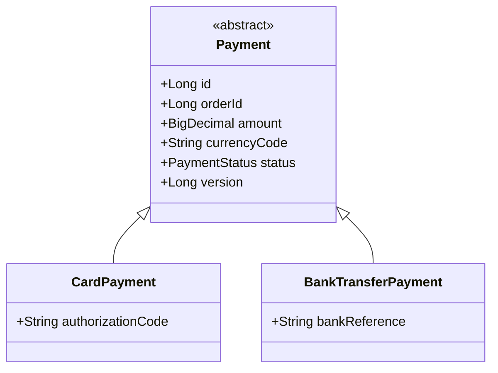
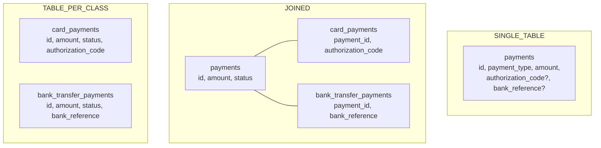
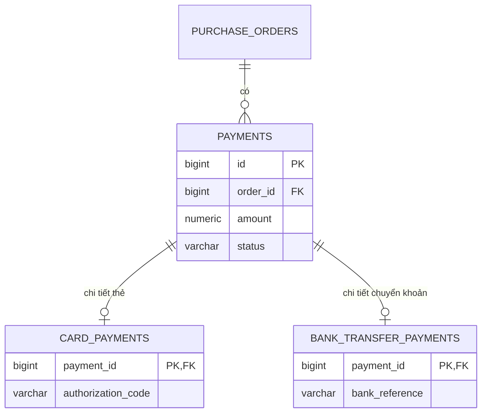
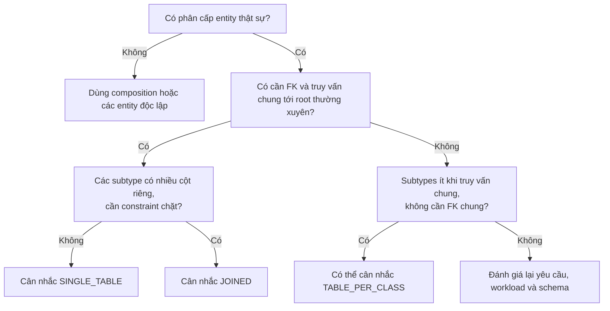

# Lựa chọn bảng cho kế thừa: một bảng, bảng nối hoặc bảng theo lớp cụ thể

Trong Java, kế thừa giúp diễn đạt rằng nhiều đối tượng có phần chung nhưng mỗi loại có dữ liệu hoặc hành vi riêng. Ví dụ, một khoản thanh toán có thể được thực hiện bằng thẻ hoặc chuyển khoản ngân hàng. Hai loại cùng có số tiền, đơn hàng, trạng thái nhưng khác thông tin xác thực giao dịch. Khi lưu vào cơ sở dữ liệu quan hệ, câu hỏi mới xuất hiện: **một phân cấp lớp sẽ được lưu trong bao nhiêu bảng, khóa chính nằm ở đâu, và truy vấn chung cho mọi loại hoạt động thế nào?**

JPA cung cấp ba chiến lược chính: **một bảng cho cả phân cấp** (`SINGLE_TABLE`), **bảng chung nối với bảng con** (`JOINED`), và **mỗi lớp cụ thể có bảng riêng** (`TABLE_PER_CLASS`). Chúng không chỉ khác annotation; mỗi lựa chọn tác động tới cấu trúc khóa, khả năng đặt ràng buộc, truy vấn đa hình, chỉ mục, tính nhất quán và chi phí thay đổi lược đồ.

Bài này thuộc chương **Ánh xạ đối tượng** của module **DATABASE_DATA_MODELING**. Mục tiêu là chuyển yêu cầu nghiệp vụ thành mô hình dữ liệu có thể kiểm chứng, rồi lựa chọn ánh xạ đối tượng phù hợp, thay vì để sơ đồ kế thừa Java tự quyết định toàn bộ thiết kế database. Các ví dụ dùng Java/JPA và SQL theo PostgreSQL; tên bảng, tên cột và cách sinh SQL của ORM cần được đối chiếu với hệ quản trị và provider đang triển khai.

## 1. Bài toán: cùng là thanh toán, nhưng có dữ liệu riêng theo loại

Giả sử hệ thống có hai hình thức thanh toán:

- **Thanh toán thẻ** (`CardPayment`): có mã xác nhận từ nhà cung cấp (`authorizationCode`).
- **Chuyển khoản** (`BankTransferPayment`): có mã giao dịch ngân hàng (`bankReference`).

Mọi khoản thanh toán đều có `id`, `orderId`, `amount`, `currencyCode`, `status` và `version` để phát hiện cập nhật đồng thời. Mỗi khoản chỉ thuộc **một** loại tại thời điểm ghi nhận. Đối tượng được lưu lâu dài để đối soát, nên loại thanh toán và dữ liệu giao dịch không được biến mất chỉ vì Java thay đổi cấu trúc lớp.



Các bất biến ban đầu:

1. Số tiền phải lớn hơn 0, mã tiền tệ phải được xác định, trạng thái thuộc tập hợp được cho phép.
2. Mỗi khoản thanh toán phải liên kết với một đơn hàng tồn tại.
3. Với thanh toán thẻ, `authorizationCode` là bắt buộc; với chuyển khoản, `bankReference` là bắt buộc.
4. Truy vấn lịch sử cần lấy được **tất cả** khoản thanh toán của một đơn, bất kể subtype.
5. Không được có hai hàng đại diện cho cùng một danh tính thanh toán khi truy vấn chung phân cấp.

Điểm 4 và 5 có thể làm thay đổi lựa chọn bảng ngay cả khi bộ lớp Java giống nhau. Cần nhớ rằng quan hệ *is-a* trong Java không có phép tương đương trực tiếp với bảng SQL: bảng không tự hiểu quan hệ kế thừa, phương thức ghi đè hay dispatch theo runtime type.

### Ba sơ đồ lưu trữ có thể có



Ba sơ đồ trên là **ba phương án thay thế**, không phải ba nhóm bảng đồng thời thuộc một thiết kế. Phần dưới sẽ dùng cùng một yêu cầu nghiệp vụ để so sánh từng phương án.

## 2. Chiến lược một bảng: `SINGLE_TABLE`

### 2.1. Cấu trúc và vai trò cột phân biệt loại

Toàn bộ entity trong phân cấp dùng **một bảng** `payments`. Các cột chung xuất hiện một lần; các thuộc tính riêng của từng subtype cũng nằm trong bảng nhưng thường có giá trị `NULL` với các loại khác.

```sql
-- Giả định purchase_orders(id) đã tồn tại.
-- Phương án A: chỉ tạo bảng này cho toàn phân cấp.
CREATE SEQUENCE payment_id_seq;

CREATE TABLE payments (
    id BIGINT PRIMARY KEY,
    order_id BIGINT NOT NULL REFERENCES purchase_orders(id),
    payment_type VARCHAR(24) NOT NULL,
    amount NUMERIC(19, 2) NOT NULL CHECK (amount > 0),
    currency_code CHAR(3) NOT NULL,
    status VARCHAR(20) NOT NULL
        CHECK (status IN ('PENDING', 'SETTLED', 'FAILED')),
    version BIGINT NOT NULL DEFAULT 0,
    authorization_code VARCHAR(100),
    bank_reference VARCHAR(100),
    CONSTRAINT ck_payment_type
        CHECK (payment_type IN ('CARD', 'BANK_TRANSFER')),
    CONSTRAINT ck_required_subtype_fields
        CHECK (
            (payment_type = 'CARD'
             AND authorization_code IS NOT NULL
             AND bank_reference IS NULL)
            OR
            (payment_type = 'BANK_TRANSFER'
             AND bank_reference IS NOT NULL
             AND authorization_code IS NULL)
        )
);

CREATE INDEX idx_payments_order_id ON payments(order_id);
CREATE INDEX idx_payments_status_type ON payments(status, payment_type);
```

Ví dụ dữ liệu:

| id | order_id | payment_type | amount | status | authorization_code | bank_reference |
|---:|---:|---|---:|---|---|---|
| 11 | 801 | CARD | 150000.00 | SETTLED | AUTH-991 | `NULL` |
| 12 | 802 | BANK_TRANSFER | 250000.00 | PENDING | `NULL` | BANK-887 |

`payment_type` là **discriminator**: dùng để nhận biết hàng thuộc subtype nào khi ORM đọc. Các cột riêng phải nullable ở mức cột vì một subtype không có giá trị cho field của subtype còn lại. Tuy nhiên, nullable **không đồng nghĩa thiếu ràng buộc nghiệp vụ**: `ck_required_subtype_fields` buộc trường tương ứng của từng loại phải có dữ liệu.

Các ràng buộc dạng `CHECK` trên một hàng có thể làm tốt nhiệm vụ “loại thẻ cần mã xác nhận” vì mọi trường nằm trong cùng hàng. Nếu nghiệp vụ có các quan hệ phức tạp hoặc trường dành riêng cho từng loại ngày càng nhiều, `CHECK` có thể dài và khó bảo trì.

### 2.2. Ánh xạ JPA

```java
import jakarta.persistence.*;
import java.math.BigDecimal;

@Entity
@Table(name = "payments")
@Inheritance(strategy = InheritanceType.SINGLE_TABLE)
@DiscriminatorColumn(
    name = "payment_type",
    discriminatorType = DiscriminatorType.STRING,
    length = 24
)
public abstract class Payment {

    @Id
    @GeneratedValue(strategy = GenerationType.SEQUENCE, generator = "payment_seq")
    @SequenceGenerator(
        name = "payment_seq",
        sequenceName = "payment_id_seq",
        allocationSize = 1
    )
    private Long id;

    @Column(name = "order_id", nullable = false)
    private Long orderId;

    @Column(nullable = false, precision = 19, scale = 2)
    private BigDecimal amount;

    @Column(name = "currency_code", nullable = false, length = 3)
    private String currencyCode;

    @Enumerated(EnumType.STRING)
    @Column(nullable = false, length = 20)
    private PaymentStatus status;

    @Version
    @Column(nullable = false)
    private Long version;

    protected Payment() {}
}

@Entity
@DiscriminatorValue("CARD")
public class CardPayment extends Payment {
    @Column(name = "authorization_code", length = 100)
    private String authorizationCode;

    protected CardPayment() {}
}

@Entity
@DiscriminatorValue("BANK_TRANSFER")
public class BankTransferPayment extends Payment {
    @Column(name = "bank_reference", length = 100)
    private String bankReference;

    protected BankTransferPayment() {}
}
```

Đây là mã minh họa các annotation: các constructor nghiệp vụ, getter, phương thức thay đổi trạng thái và kiểm tra đầu vào chưa được trình bày. `PaymentStatus` là enum gồm `PENDING`, `SETTLED`, `FAILED`. Với lược đồ tự quản lý trong ví dụ PostgreSQL, cần tạo **một sequence** `payment_id_seq` trước khi dùng chiến lược sinh ID này, ví dụ `CREATE SEQUENCE payment_id_seq`, hoặc đồng bộ generator với cơ chế tạo khóa đã chọn.

Lưu ý quan trọng: các field chỉ dành cho subtype **không nên khai báo `nullable = false` trên cột chung**. Điều đó có thể khiến DDL sinh `NOT NULL` cho một cột mà hàng của subtype khác bắt buộc để trống. Kiểm tra bắt buộc của từng subtype nên đặt ở domain validation và constraint có điều kiện tại database.

### 2.3. Đặc tính truy vấn

Truy vấn chung thường rất trực tiếp:

```sql
SELECT id, payment_type, amount, currency_code, status
FROM payments
WHERE order_id = :order_id
ORDER BY id;
```

Trong JPA:

```java
List<Payment> payments = em.createQuery("""
    select p
    from Payment p
    where p.orderId = :orderId
    order by p.id
    """, Payment.class)
    .setParameter("orderId", orderId)
    .getResultList();
```

ORM có thể tạo `CardPayment` hoặc `BankTransferPayment` tùy discriminator. Không cần `JOIN` giữa bảng gốc và bảng con vì chỉ có một bảng.

Muốn chỉ lấy thẻ:

```sql
SELECT id, authorization_code
FROM payments
WHERE payment_type = 'CARD'
  AND status = 'SETTLED';
```

Khi hệ thống có hàng triệu khoản thanh toán, có thể xem xét chỉ mục ghép theo kiểu lọc và mức độ chọn lọc thực tế. Ví dụ chỉ mục `(status, payment_type)` phù hợp một số báo cáo, còn truy vấn theo `order_id` có lợi từ chỉ mục ở trường đó. Không tự động tạo nhiều chỉ mục cho mọi cột vì mỗi chỉ mục làm tăng chi phí ghi.

### 2.4. Ưu điểm và giới hạn

**Ưu điểm:** ít bảng, truy vấn đa hình đơn giản, một không gian khóa chính, FK từ bảng khác có thể trỏ trực tiếp tới `payments(id)`; thêm subtype thường chỉ cần cột mới và điều chỉnh discriminator/ràng buộc.

**Giới hạn:** nếu subtype nhiều và mỗi loại có nhiều trường riêng, bảng sẽ có nhiều cột `NULL`; kiểm tra bắt buộc theo subtype phức tạp; thay đổi loại có thể khiến các cột cũ còn dữ liệu không hợp lệ; một schema chung gây ảnh hưởng giữa các nhóm chức năng.

**Phù hợp khi:** số subtype ít, phần lớn cột là chung, hay truy vấn đa hình, cần FK chung tới Payment và chấp nhận kiểm tra thuộc tính riêng theo discriminator.

## 3. Chiến lược bảng nối: `JOINED`

### 3.1. Phân chia phần chung và phần riêng

Mọi `Payment` có một hàng ở bảng gốc `payments`. Mỗi instance thuộc một subtype cụ thể có **thêm một hàng** ở bảng con tương ứng. Khóa chính bảng con đồng thời là khóa ngoại tới bảng gốc.

```sql
-- Phương án B: thay thế hoàn toàn phương án A.
CREATE SEQUENCE payment_id_seq;

CREATE TABLE payments (
    id BIGINT PRIMARY KEY,
    order_id BIGINT NOT NULL REFERENCES purchase_orders(id),
    amount NUMERIC(19, 2) NOT NULL CHECK (amount > 0),
    currency_code CHAR(3) NOT NULL,
    status VARCHAR(20) NOT NULL
        CHECK (status IN ('PENDING', 'SETTLED', 'FAILED')),
    version BIGINT NOT NULL DEFAULT 0
);

CREATE TABLE card_payments (
    payment_id BIGINT PRIMARY KEY
        REFERENCES payments(id) ON DELETE CASCADE,
    authorization_code VARCHAR(100) NOT NULL
);

CREATE TABLE bank_transfer_payments (
    payment_id BIGINT PRIMARY KEY
        REFERENCES payments(id) ON DELETE CASCADE,
    bank_reference VARCHAR(100) NOT NULL
);

CREATE INDEX idx_payments_order_id ON payments(order_id);
```

Sơ đồ:



Ký hiệu sơ đồ biểu diễn từ một hàng gốc đến *tối đa một* hàng trong mỗi bảng con. Quy tắc miền còn đòi **đúng một subtype** cho một khoản thanh toán hoàn chỉnh. Chỉ hai FK `card_payments.payment_id` và `bank_transfer_payments.payment_id` **chưa thể bảo đảm** một hàng gốc luôn có đúng một hàng con và không xuất hiện trong cả hai bảng con.

### 3.2. Ánh xạ JPA

Giữ nguyên các trường và generator của lớp `Payment` ở phần trước, thay annotation kế thừa như sau:

```java
@Entity
@Table(name = "payments")
@Inheritance(strategy = InheritanceType.JOINED)
public abstract class Payment {
    @Id
    @GeneratedValue(strategy = GenerationType.SEQUENCE, generator = "payment_seq")
    @SequenceGenerator(
        name = "payment_seq",
        sequenceName = "payment_id_seq",
        allocationSize = 1
    )
    private Long id;

    @Column(name = "order_id", nullable = false)
    private Long orderId;

    @Column(nullable = false, precision = 19, scale = 2)
    private BigDecimal amount;

    @Column(name = "currency_code", nullable = false, length = 3)
    private String currencyCode;

    @Enumerated(EnumType.STRING)
    @Column(nullable = false, length = 20)
    private PaymentStatus status;

    @Version
    private Long version;

    protected Payment() {}
}

@Entity
@Table(name = "card_payments")
@PrimaryKeyJoinColumn(name = "payment_id")
public class CardPayment extends Payment {
    @Column(name = "authorization_code", nullable = false, length = 100)
    private String authorizationCode;

    protected CardPayment() {}
}

@Entity
@Table(name = "bank_transfer_payments")
@PrimaryKeyJoinColumn(name = "payment_id")
public class BankTransferPayment extends Payment {
    @Column(name = "bank_reference", nullable = false, length = 100)
    private String bankReference;

    protected BankTransferPayment() {}
}
```

Lưu ý: đây là **một cấu hình thay thế** của cùng các lớp Java, không phải khai báo thêm một bộ entity trùng tên trong dự án. Các import và nghiệp vụ được lược bỏ. `@PrimaryKeyJoinColumn` cho biết tên cột trong bảng con để nối bằng khóa chính; khi không đổi tên và quy ước của provider phù hợp, annotation có thể không cần khai báo tường minh.

Trong `JOINED`, các cột subtype có thể dùng `NOT NULL` ngay trên bảng subtype vì hàng của loại khác **không xuất hiện** ở bảng này. Đây là lợi thế đáng kể so với bảng đơn khi phải ràng buộc nhiều field đặc thù.

### 3.3. Cách đọc và ghi đa hình

Thêm một thanh toán thẻ thường tương ứng với hai bước SQL trong cùng transaction:

```sql
INSERT INTO payments (id, order_id, amount, currency_code, status, version)
VALUES (nextval('payment_id_seq'), :order_id, 150000.00, 'VND', 'PENDING', 0)
RETURNING id;

INSERT INTO card_payments (payment_id, authorization_code)
VALUES (:generated_payment_id, 'AUTH-991');
```

Đoạn trên minh họa logic ghi; thời điểm lấy ID và chi tiết SQL phụ thuộc generator/provider. Nếu giao dịch rollback, không được để lại một hàng `payments` bị thiếu dòng subtype. Việc đảm bảo một thao tác nghiệp vụ gồm đủ hai hàng là trách nhiệm transaction và cách ghi.

Đọc một thanh toán thẻ có thể cần `JOIN`:

```sql
SELECT p.id, p.order_id, p.amount, p.status, c.authorization_code
FROM payments AS p
JOIN card_payments AS c ON c.payment_id = p.id
WHERE p.id = :payment_id;
```

Với truy vấn đa hình `SELECT p FROM Payment p`, ORM có thể join nhiều bảng con để xác định subtype hoặc sinh phương án SQL khác. Không được giả định nó chỉ đọc `payments` khi ứng dụng yêu cầu object subtype đầy đủ. Muốn đọc báo cáo chỉ cần dữ liệu chung, một **projection** trên bảng gốc giúp giảm chi phí:

```sql
SELECT order_id, status, SUM(amount) AS total_amount
FROM payments
WHERE currency_code = 'VND'
GROUP BY order_id, status;
```

Trong mô hình này, không cần join bảng subtype nếu báo cáo chỉ dựa vào các cột chung.

### 3.4. Tính toàn vẹn giữa các bảng

`JOINED` bảo vệ nhiều điều bằng FK và `NOT NULL`:

- Không có hàng `card_payments` khi `payments` tương ứng chưa tồn tại.
- `authorization_code` bắt buộc với hàng thẻ.
- Xóa hàng gốc có thể xóa chi tiết qua `ON DELETE CASCADE` nếu chính sách lưu trữ cho phép.

Nhưng cần chú ý trường hợp **ghi SQL trực tiếp**:

```sql
INSERT INTO payments (order_id, amount, currency_code, status)
VALUES (:order_id, 50000, 'VND', 'PENDING');
-- Quên chèn bảng con: FK thông thường không ngăn được.
```

Một hàng gốc không có hàng con, hoặc có cả hàng `card_payments` lẫn `bank_transfer_payments`, có thể tồn tại nếu chỉ dựa trên các FK ở ví dụ. JPA bình thường tạo đủ hàng cho subtype khi persist đúng cách, nhưng hệ thống có nhiều nguồn ghi nên cân nhắc giao dịch kiểm soát tập trung, discriminator với cơ chế kiểm chứng thích hợp, trigger hoặc thiết kế dữ liệu khác.

Không thể viết một `CHECK` thông thường trên riêng `payments` để đọc dữ liệu ở cả hai bảng con trong SQL chuẩn. Cũng không nên tạo ràng buộc phức tạp chỉ để bảo vệ một phân cấp không thật sự cần đa hình. Hãy so sánh với `SINGLE_TABLE` nếu tính toàn vẹn theo subtype phải do database bảo đảm đơn giản.

### 3.5. Ưu điểm và giới hạn

**Ưu điểm:** cột chung nằm một nơi, bảng subtype có ràng buộc riêng rõ ràng, thêm subtype ít ảnh hưởng bảng khác, FK từ bảng khác có thể trỏ tới `payments(id)`; truy vấn dữ liệu chung chạy trực tiếp trên bảng gốc.

**Giới hạn:** ghi một entity thường cần nhiều bảng; đọc đầy đủ subtype phải join; truy vấn đa hình có thể cần nhiều join; database cần cơ chế bổ sung nếu muốn tự bảo đảm “đúng một bảng con cho mỗi hàng gốc”.

**Phù hợp khi:** subtype có nhiều field riêng, cần ràng buộc chặt tại mỗi bảng, vẫn cần danh tính/quan hệ chung cho toàn phân cấp và tần suất truy vấn đa hình không khiến chi phí join trở thành vấn đề chính.

## 4. Chiến lược bảng cho từng lớp cụ thể: `TABLE_PER_CLASS`

### 4.1. Mỗi lớp cụ thể có bảng đầy đủ

Ở chiến lược này, một `CardPayment` nằm trong `card_payments` với **cả cột chung lẫn cột riêng**. Một `BankTransferPayment` nằm trong `bank_transfer_payments` cũng có toàn bộ cột chung. Với lớp gốc `Payment` là `abstract`, thường không cần một bảng gốc chứa mọi payment.

```sql
-- Phương án C: không có bảng payments chung.
CREATE SEQUENCE payment_id_seq;

CREATE TABLE card_payments (
    id BIGINT PRIMARY KEY,
    order_id BIGINT NOT NULL REFERENCES purchase_orders(id),
    amount NUMERIC(19, 2) NOT NULL CHECK (amount > 0),
    currency_code CHAR(3) NOT NULL,
    status VARCHAR(20) NOT NULL
        CHECK (status IN ('PENDING', 'SETTLED', 'FAILED')),
    version BIGINT NOT NULL DEFAULT 0,
    authorization_code VARCHAR(100) NOT NULL
);

CREATE TABLE bank_transfer_payments (
    id BIGINT PRIMARY KEY,
    order_id BIGINT NOT NULL REFERENCES purchase_orders(id),
    amount NUMERIC(19, 2) NOT NULL CHECK (amount > 0),
    currency_code CHAR(3) NOT NULL,
    status VARCHAR(20) NOT NULL
        CHECK (status IN ('PENDING', 'SETTLED', 'FAILED')),
    version BIGINT NOT NULL DEFAULT 0,
    bank_reference VARCHAR(100) NOT NULL
);

CREATE INDEX idx_card_payments_order_id
    ON card_payments(order_id);
CREATE INDEX idx_bank_payments_order_id
    ON bank_transfer_payments(order_id);
```

Giả sử mọi ID được cấp từ **cùng một sequence**:

```sql
INSERT INTO card_payments (
    id, order_id, amount, currency_code,
    status, authorization_code
)
VALUES (
    nextval('payment_id_seq'), :order_id, 150000, 'VND',
    'PENDING', 'AUTH-991'
);
```

Tại sao phải cấp ID từ một nguồn chung? Hai bảng có ràng buộc khóa chính **riêng**, nên `card_payments.id = 42` và `bank_transfer_payments.id = 42` đều hợp lệ với database. Nếu ứng dụng yêu cầu `Payment` được xác định duy nhất trên toàn phân cấp chỉ bằng `id`, cần **phạm vi ID chung** hoặc định danh gồm `(type, id)` được thiết kế nhất quán. Một sequence dùng chung giúp phát sinh khóa không trùng trong luồng tạo chuẩn, nhưng bản thân nó không ngăn ai đó dùng SQL trực tiếp chèn ID trùng ở hai bảng. Đây là giới hạn toàn vẹn liên bảng cần nhận biết.

### 4.2. Ánh xạ JPA

```java
@Entity
@Inheritance(strategy = InheritanceType.TABLE_PER_CLASS)
public abstract class Payment {

    @Id
    @GeneratedValue(strategy = GenerationType.SEQUENCE, generator = "payment_seq")
    @SequenceGenerator(
        name = "payment_seq",
        sequenceName = "payment_id_seq",
        allocationSize = 1
    )
    private Long id;

    @Column(name = "order_id", nullable = false)
    private Long orderId;

    @Column(nullable = false, precision = 19, scale = 2)
    private BigDecimal amount;

    @Column(name = "currency_code", nullable = false, length = 3)
    private String currencyCode;

    @Enumerated(EnumType.STRING)
    @Column(nullable = false, length = 20)
    private PaymentStatus status;

    @Version
    private Long version;

    protected Payment() {}
}

@Entity
@Table(name = "card_payments")
public class CardPayment extends Payment {
    @Column(name = "authorization_code", nullable = false, length = 100)
    private String authorizationCode;

    protected CardPayment() {}
}

@Entity
@Table(name = "bank_transfer_payments")
public class BankTransferPayment extends Payment {
    @Column(name = "bank_reference", nullable = false, length = 100)
    private String bankReference;

    protected BankTransferPayment() {}
}
```

Các lớp trên là biến thể minh họa và lược bỏ import/constructor nghiệp vụ. Trong JPA, `TABLE_PER_CLASS` được khai báo trên root entity, còn dữ liệu của root được lặp lại trong bảng concrete subclass. Nếu root là entity **không abstract**, nó cũng có thể có bảng riêng cho instance của chính root; ví dụ ở đây cố ý chọn root abstract để tránh loại “thanh toán chung” không rõ phương thức.

**Về sinh ID:** không nên mặc định sử dụng `IDENTITY` tự tăng độc lập ở mỗi bảng rồi coi `id` là duy nhất trong mọi subtype. Một sequence toàn phân cấp hoặc UUID do ứng dụng sinh thường thích hợp hơn, đồng thời phải kiểm chứng cách provider hỗ trợ chiến lược sinh khóa.

### 4.3. Truy vấn cụ thể và truy vấn đa hình

Khi báo cáo chỉ quan tâm thanh toán thẻ, query rất đơn giản:

```sql
SELECT id, order_id, amount, authorization_code
FROM card_payments
WHERE status = 'SETTLED';
```

Khi muốn xem tất cả payment, database phải ghép các nguồn:

```sql
SELECT id, order_id, amount, currency_code, status,
       'CARD' AS payment_type
FROM card_payments
WHERE order_id = :order_id
UNION ALL
SELECT id, order_id, amount, currency_code, status,
       'BANK_TRANSFER' AS payment_type
FROM bank_transfer_payments
WHERE order_id = :order_id;
```

`UNION ALL` ở đây giữ mọi hàng; dùng khi hai bảng đại diện hai nhóm subtype tách biệt. Muốn sắp xếp toàn bộ kết quả, thêm `ORDER BY` ở ngoài truy vấn hợp nhất. ORM có thể sinh dạng `UNION`/`UNION ALL` hoặc SQL khác tùy provider; không nên tự giả định query đa hình luôn rẻ như đọc một bảng.

Một báo cáo tổng tiền cần đồng nhất đơn vị tiền tệ:

```sql
SELECT currency_code, SUM(amount) AS total_amount
FROM (
    SELECT currency_code, amount
    FROM card_payments
    WHERE status = 'SETTLED'
    UNION ALL
    SELECT currency_code, amount
    FROM bank_transfer_payments
    WHERE status = 'SETTLED'
) AS all_payments
GROUP BY currency_code;
```

Không cộng gộp VND và USD vào một số duy nhất khi chưa có quy tắc quy đổi.

### 4.4. Vấn đề khóa ngoại chung

Giả sử cần lưu `refunds.payment_id` để trỏ đến **bất kỳ** khoản thanh toán nào. Với `SINGLE_TABLE` và `JOINED`, FK có thể trỏ đến `payments(id)`. Nhưng với `TABLE_PER_CLASS`, **không có bảng `payments` chung** để viết:

```sql
-- Không thể dùng khi không tồn tại bảng payments:
-- FOREIGN KEY (payment_id) REFERENCES payments(id)
```

Một FK quan hệ thông thường không thể nói “khóa này phải tồn tại trong **một trong hai** bảng”. Các lựa chọn gồm thay đổi mô hình sang bảng gốc chung, tạo cấu trúc nhận diện/bảng registry, dùng cặp `(payment_type, payment_id)` kèm cơ chế bảo đảm riêng, hoặc tách rõ FK theo từng loại. Mỗi lựa chọn có đánh đổi về tính toàn vẹn và truy vấn.

Vì vậy, nếu hệ thống có nhiều bảng phải tham chiếu tới **Payment chung**, `TABLE_PER_CLASS` thường kém phù hợp dù các truy vấn subtype đơn lẻ rất gọn. Đây là quyết định **data modeling**, không thể giải quyết chỉ bằng annotation.

### 4.5. Ưu điểm và giới hạn

**Ưu điểm:** bảng của từng loại tự chứa dữ liệu và có constraint riêng, không có những cột chỉ dùng bởi subtype khác, truy vấn trên một subtype độc lập không cần join phân cấp.

**Giới hạn:** các cột chung và constraint lặp ở nhiều bảng; truy vấn đa hình cần hợp nhất; thêm subtype buộc cập nhật báo cáo chung; không có FK đơn giản tới root; khó đảm bảo uniqueness toàn phân cấp chỉ bằng DDL thông thường.

**Phù hợp khi:** subtype hiếm khi được truy vấn chung, ít có quan hệ phải tham chiếu root, vòng đời và khối lượng truy vấn của từng loại khác nhau rõ rệt, đồng thời nhóm phát triển sẵn sàng quản lý phần schema chung bị lặp.

## 5. Bảng so sánh ba chiến lược

| Tiêu chí | `SINGLE_TABLE` | `JOINED` | `TABLE_PER_CLASS` |
|---|---|---|---|
| Bố trí bảng | Một bảng cho cả phân cấp | Bảng gốc + bảng cho từng subtype | Một bảng đầy đủ cho mỗi concrete subtype |
| Cột chung | Lưu một lần | Lưu một lần ở bảng gốc | Lặp trong mọi bảng cụ thể |
| Cột riêng của subtype | Cùng bảng, thường nullable | Bảng riêng, có thể `NOT NULL` | Bảng riêng, có thể `NOT NULL` |
| Cần discriminator | Có, để nhận biết loại | Có thể dùng, không phải luôn bắt buộc | Không cần cột chung; loại suy từ bảng |
| Ghi một subtype | Thường một hàng | Hàng gốc + hàng subtype | Một hàng ở bảng subtype |
| Truy vấn một subtype đầy đủ | Một bảng | Join bảng gốc và bảng subtype | Một bảng |
| Truy vấn toàn phân cấp | Đơn giản trên một bảng | Có thể cần join nhiều bảng con | Thường hợp nhất các bảng |
| FK tới root chung | Thuận tiện | Thuận tiện | Không có bảng đích chung |
| Ràng buộc field riêng | `CHECK` theo discriminator | `NOT NULL` và constraint trên bảng con | `NOT NULL` và constraint trên từng bảng |
| Thêm subtype | Thêm cột/constraint nếu có field riêng | Thêm bảng con | Thêm bảng cụ thể, chỉnh truy vấn/luồng tích hợp |
| Rủi ro chính | Nhiều cột trống và constraint phức tạp | Nhiều join; hàng gốc/con có thể lệch nếu ghi ngoài ORM | Trùng schema; truy vấn union; FK polymorphic khó |

Không thể xếp hạng một chiến lược là nhanh nhất trong mọi tình huống. Hiệu năng phụ thuộc cardinality, chiều rộng hàng, chỉ mục, phân bố subtype, kiểu truy vấn, cơ chế cache và query plan thực tế. Bảng so sánh giúp chọn **giả thuyết ban đầu**; cần kiểm chứng bằng dữ liệu đại diện.

### Ra quyết định theo truy vấn và bất biến



Sơ đồ là hướng dẫn hỏi đúng câu hỏi, không phải quy tắc bắt buộc. Có những phân cấp cần tính đúng tuyệt đối và khả năng tiến hóa cao hơn mức độ tối ưu của một lần truy vấn; cũng có những hệ thống chỉ cần truy vấn subtype độc lập mà không nên thêm một bảng gốc phức tạp.

## 6. Kế thừa có thật sự là mô hình miền nghiệp vụ đúng?

Trước khi chọn annotation, hãy kiểm tra quan hệ **“là một”** có tồn tại ổn định không. Nếu một khoản thanh toán có thể thay đổi phương thức xử lý nhiều lần, hoặc luôn có cùng dữ liệu nhưng khác cấu hình nhà cung cấp, việc dùng nhiều subtype có thể khiến schema khó tiến hóa mà không mang lại hành vi khác biệt thật sự.

### 6.1. Một entity với cột loại và thành phần

Khi các loại rất giống nhau, có thể chỉ cần:

```java
@Entity
public class Payment {
    @Id
    private Long id;

    @Enumerated(EnumType.STRING)
    private PaymentMethod method;

    // Các field chung; chi tiết phương thức có thể là value object.
}
```

Thiết kế này không dùng JPA inheritance: `Payment` là một entity có thuộc tính `method`, có thể giữ chi tiết theo thành phần. Nó vẫn cần quyết định lưu các field tùy loại, nhưng tránh ép mọi khác biệt nhỏ thành lớp con.

### 6.2. Dùng `@MappedSuperclass` khi chỉ cần dùng lại mapping

Một điểm dễ nhầm: `@MappedSuperclass` **không phải chiến lược kế thừa entity có truy vấn đa hình**.

```java
@MappedSuperclass
public abstract class AuditedRecord {
    @Column(name = "created_at", nullable = false)
    private Instant createdAt;
}

@Entity
@Table(name = "card_payments")
public class CardPayment extends AuditedRecord {
    @Id
    private Long id;
}
```

Trong ví dụ này, `created_at` được ánh xạ vào bảng `card_payments` nhưng `AuditedRecord` không phải entity có bảng riêng. Không thể truy vấn entity `AuditedRecord` bằng `em.find(AuditedRecord.class, id)` hay tạo quan hệ JPA tới nó như một entity polymorphic. `@MappedSuperclass` phù hợp để **dùng lại cột và cấu hình**, không biểu diễn một tập thực thể chung có danh tính truy vấn được.

Đừng đánh đồng `TABLE_PER_CLASS` với `@MappedSuperclass`. Cả hai có thể khiến field chung xuất hiện ở các bảng con, nhưng `TABLE_PER_CLASS` vẫn là **entity inheritance** có root entity và ngữ nghĩa truy vấn đa hình; `@MappedSuperclass` chỉ truyền các ánh xạ field xuống entity con.

### 6.3. Khi nào nên dùng entity liên kết hoặc composition?

Nếu thanh toán có nhiều bước xác thực, mỗi bước có trạng thái và lịch sử riêng, có thể mô hình hóa `Payment` + `PaymentAttempt` hoặc `PaymentMethodDetails` thay vì một hierarchy sâu. Nếu một phương thức xử lý được thay đổi theo cấu hình, composition thường linh hoạt hơn kế thừa.

**Quyết định chọn class hierarchy phải bắt đầu từ bất biến và vòng đời nghiệp vụ**; không nên tạo subtype chỉ để tránh các cột nullable hoặc vì có thể phân nhóm dữ liệu bằng một enum.

## 7. Khóa, discriminator và ràng buộc tham chiếu

### 7.1. Khóa chính của toàn phân cấp

Trong `SINGLE_TABLE` và `JOINED`, một hàng `payments(id)` tạo không gian danh tính chung, thuận tiện khi một `Refund` hoặc `PaymentEvent` trỏ tới bất kỳ payment nào.

```sql
CREATE TABLE payment_events (
    id BIGINT GENERATED ALWAYS AS IDENTITY PRIMARY KEY,
    payment_id BIGINT NOT NULL REFERENCES payments(id),
    event_type VARCHAR(40) NOT NULL,
    occurred_at TIMESTAMP NOT NULL
);
```

Với `JOINED`, FK chỉ xác nhận hàng gốc có tồn tại; tính đúng của hàng subtype vẫn cần được bảo vệ bằng thao tác giao dịch và quy tắc bổ sung nếu có nhiều nguồn ghi.

Trong `TABLE_PER_CLASS`, nếu không có bảng root, không thể áp dụng trực tiếp DDL này. Một giải pháp khác có thể là dùng khóa `(payment_type, payment_id)` và các bảng/thủ tục kiểm tra theo loại, nhưng nó phức tạp hơn FK thường và phải được thiết kế rõ khi tích hợp.

### 7.2. Discriminator không nhất thiết là thuộc tính nghiệp vụ

`payment_type` trong `SINGLE_TABLE` giúp ORM quyết định tạo lớp Java nào. Người dùng nghiệp vụ có thể gọi loại thanh toán là “thẻ” hoặc “chuyển khoản”, nhưng **discriminator là một quy ước lưu trữ**. Đổi tên lớp `CardPayment` không nên buộc đổi giá trị đã lưu nếu đã dùng giá trị ổn định `CARD` qua `@DiscriminatorValue`.

Nếu đổi giá trị `CARD` thành `CREDIT_CARD`, cần migration dữ liệu và chỉnh các constraint, view, báo cáo, API hoặc consumer đang dùng mã cũ. Đừng tin rằng refactor tên lớp tự động nâng cấp dữ liệu trong bảng.

### 7.3. Ràng buộc kế thừa tại database không luôn đối xứng

| Bất biến | `SINGLE_TABLE` | `JOINED` | `TABLE_PER_CLASS` |
|---|---|---|---|
| Mỗi payment có ID duy nhất | PK trên một bảng | PK trên bảng gốc, PK/FK ở con | PK mỗi bảng; cần quy tắc chung nếu ID phải duy nhất toàn hierarchy |
| Loại chỉ thuộc tập cho phép | `CHECK(payment_type IN ...)` | Dựa vào lớp con hoặc discriminator/quy tắc bổ sung | Do bảng cụ thể xác định |
| Mã xác nhận của thẻ bắt buộc | `CHECK` có điều kiện | `NOT NULL` trên `card_payments` | `NOT NULL` trên `card_payments` |
| Chỉ có một subtype mỗi entity | `CHECK` theo discriminator | FK không tự bảo đảm đúng một bảng con | Một hàng ở mỗi bảng loại; ID liên bảng cần quản lý |
| FK từ entity ngoài đến payment bất kỳ | FK đến `payments` | FK đến `payments` | Không có FK tới root nếu không có bảng chung |

Điểm cần nhớ: **annotation không thay thế constraint thực tế**. Nếu ORM tự sinh schema trong môi trường phát triển nhưng production dùng migration riêng, hãy kiểm tra schema production có các PK, FK, `CHECK` và `UNIQUE` dự kiến.

## 8. Hiệu năng: chọn từ workload, không từ số bảng

### 8.1. Truy vấn thường gặp

Giả sử workload gồm:

- 70%: lấy chi tiết một thanh toán theo ID.
- 20%: tổng hợp số tiền các loại theo ngày/trạng thái.
- 10%: lấy trường riêng theo từng phương thức.

Đây là **giả định minh họa**; tỷ lệ thực phải đo. Với workload có nhiều truy vấn chung, `SINGLE_TABLE` thường thuận tiện. `JOINED` có thể hiệu quả nếu báo cáo chỉ cần cột gốc nhưng có chi phí join khi đọc object subtype đầy đủ. `TABLE_PER_CLASS` làm báo cáo chung phức tạp hơn vì phải hợp nhất bảng.

Với hệ thống mà 95% truy vấn chỉ đọc `CardPayment` và chỉ một lần đối soát toàn phân cấp mỗi đêm, bảng theo lớp cụ thể có thể đáng cân nhắc. Nhưng nếu những bảng nghiệp vụ khác cần FK chung tới Payment, lợi ích truy vấn subtype phải được so sánh với độ phức tạp toàn vẹn tham chiếu.

### 8.2. Chỉ mục và query plan

- `SINGLE_TABLE`: cân nhắc chỉ mục theo `order_id`, trạng thái, ngày phát sinh và discriminator nếu workload hay lọc loại.
- `JOINED`: bảng gốc cần index phục vụ lọc; PK/FK ở bảng con thường hỗ trợ join bằng khóa. Tránh join tất cả subtype khi chỉ cần projection cột chung.
- `TABLE_PER_CLASS`: mỗi bảng cần chỉ mục phù hợp workload riêng; truy vấn `UNION ALL` có thể quét nhiều bảng và việc thêm subtype tăng số nhánh hợp nhất.

Đo bằng `EXPLAIN (ANALYZE, BUFFERS)` ở PostgreSQL với tập dữ liệu đại diện. Kiểm tra số truy vấn JPA, thời gian, số hàng đọc, kích thước bảng, chi phí index và thời gian ghi. Không suy ra hiệu năng chỉ từ tên chiến lược.

### 8.3. Khác biệt giữa query entity và projection

JPQL:

```java
// Truy vấn đa hình: kết quả gồm cả CardPayment và BankTransferPayment.
List<Payment> entities = em.createQuery(
    "select p from Payment p where p.status = :status",
    Payment.class
).setParameter("status", PaymentStatus.SETTLED)
 .getResultList();
```

Khi nạp entity, provider phải tái tạo đúng subtype và trạng thái của nó. Nếu màn hình chỉ cần `id`, `amount` và `status`, projection DTO hoặc SQL query chỉ lấy các cột đó có thể tiết kiệm dữ liệu, đặc biệt với `JOINED` và `TABLE_PER_CLASS`. Khả năng tối ưu projection khác nhau theo provider; hãy kiểm chứng SQL sinh ra.

### 8.4. Phân trang đa hình

Với `SINGLE_TABLE`, phân trang toàn phân cấp thường đơn giản hơn về SQL. Với `JOINED`, các join subtype có thể làm kế hoạch nặng. Với `TABLE_PER_CLASS`, lấy trang nhất quán từ nhiều bảng cần sắp xếp **toàn bộ tập hợp**, không phải lấy 20 hàng đầu của mỗi bảng rồi nối bừa.

Luôn quy định thứ tự ổn định, ví dụ `ORDER BY created_at DESC, id DESC`, và xem xét keyset pagination cho tập rất lớn nếu bài toán yêu cầu. Các trường thời gian cần được định nghĩa trong schema thực tế; `created_at` ở đây là cột gợi ý bổ sung, chưa xuất hiện trong DDL minh họa.

## 9. Tiến hóa lược đồ khi có subtype mới

Giả sử sau sáu tháng xuất hiện `WalletPayment` có `walletProvider` và `providerTransactionId`.

| Chiến lược | Các bước schema chính |
|---|---|
| `SINGLE_TABLE` | Thêm cột riêng dạng nullable; mở rộng discriminator và `CHECK`; bổ sung index nếu workload cần |
| `JOINED` | Tạo `wallet_payments(payment_id PK/FK, ...)`; cập nhật mapping và logic nghiệp vụ |
| `TABLE_PER_CLASS` | Tạo bảng `wallet_payments` đủ cột chung + riêng; cập nhật báo cáo hợp nhất, ID generator và luồng tham chiếu |

Các lựa chọn đều cần migration và kiểm thử dữ liệu cũ. Điểm khác nhau là **phạm vi tác động**: `SINGLE_TABLE` mở rộng bảng dùng chung; `JOINED` thêm bảng con; `TABLE_PER_CLASS` phải bảo trì sự nhất quán của cột chung trên tất cả bảng con và mọi truy vấn tổng hợp.

### 9.1. Chuyển từ `SINGLE_TABLE` sang `JOINED`

Ví dụ khi bảng payments đã có quá nhiều cột riêng và ràng buộc theo subtype khó bảo trì, có thể chuyển sang `JOINED` theo các bước:

1. **Lập bản đồ dữ liệu:** thống kê payment_type, các tổ hợp null bất thường, hàng không phù hợp subtype, ứng dụng hoặc báo cáo đang đọc cột riêng.
2. **Thiết kế bảng con:** tạo `card_payments` và `bank_transfer_payments` với PK/FK, chọn cột nào được di chuyển và constraint phù hợp.
3. **Backfill dữ liệu:** chèn cột riêng vào bảng con theo ID từ bảng cũ; đối chiếu số lượng theo loại, kiểm tra không mất bản ghi và không có trùng khóa.
4. **Đồng bộ các nguồn ghi trong thời gian chuyển đổi:** chọn cửa sổ bảo trì hoặc cơ chế ghi song song có kiểm soát; tránh trạng thái ứng dụng mới đọc bảng con trong khi luồng cũ chỉ ghi bảng gốc.
5. **Chuyển ánh xạ và truy vấn:** triển khai entity `JOINED`, sửa báo cáo và truy vấn riêng, kiểm tra optimistic lock, FK và thời điểm chèn/xóa.
6. **Xác minh và dọn cấu trúc cũ:** chỉ bỏ cột cũ/discriminator hoặc cơ chế tương thích khi dữ liệu và mọi consumer đã chuyển sang cách đọc mới.

Đây là khung migration, không phải lệnh có thể chạy mù. Với hệ thống cần hoạt động liên tục, cần kế hoạch chuyển đổi tương thích nhiều phiên bản, backfill theo lô, xử lý race và rollback phù hợp. Việc đổi annotation **không** tự di chuyển dữ liệu từ cột bảng gốc sang bảng subtype.

### 9.2. Refactor lớp không đồng nghĩa migration database

Một refactor Java có thể tách `Payment` thành nhiều subtype hoặc đổi tên lớp mà giữ nguyên schema nhờ cấu hình mapping. Ngược lại, thay chiến lược kế thừa có thể đòi thay cấu trúc vật lý đáng kể dù API Java trông gần như không đổi.

Vì dữ liệu tồn tại lâu hơn một lần chạy ứng dụng, hãy quản lý schema qua migration có phiên bản và kiểm tra dữ liệu thực tế. Đừng dựa vào tính năng tự động cập nhật schema để thay thế kế hoạch migration trên dữ liệu quan trọng.

## 10. Kiểm chứng mapping và tính toàn vẹn

Một chiến lược chỉ được coi là phù hợp khi **đúng nghiệp vụ, đúng constraint và đạt workload yêu cầu**. Các kiểm thử mang ý nghĩa trực tiếp:

| Kiểm thử | Kỳ vọng |
|---|---|
| Persist một `CardPayment` rồi tải lại qua `Payment` | Nhận đúng subtype và giá trị thuộc tính |
| Persist một `BankTransferPayment` | Trường đặc thù được lưu, không nhầm loại |
| Truy vấn `SELECT p FROM Payment p` | Trả đủ các subtype hợp lệ |
| Truy vấn chỉ `CardPayment` | Không kéo nhầm dữ liệu ngân hàng |
| Ghi amount `0` hoặc âm qua SQL | DB từ chối theo `CHECK` |
| Ghi thanh toán thẻ thiếu `authorization_code` | DB từ chối theo constraint đã chọn |
| Ghi order_id không tồn tại | DB từ chối FK |
| Ghi cùng ID vào nhiều bảng ở `TABLE_PER_CLASS` | Phải có chính sách phát hiện nếu toàn hierarchy cần ID duy nhất |
| Xóa hàng gốc của `JOINED` | Chi tiết con được xử lý theo đúng chính sách lưu trữ |
| Truy vấn chung hàng triệu payment | Đo query plan, latency và index thực tế |
| Thêm subtype mới | Dữ liệu cũ vẫn đọc được; truy vấn chung và constraint được cập nhật |
| Hai giao dịch sửa cùng payment | Cơ chế `@Version` hoặc locking phù hợp phát hiện xung đột |

### Một bài kiểm tra truy vấn đa hình bằng JPA

```java
// Phác thảo trong transaction kiểm thử, giả định các constructor nghiệp vụ tồn tại.
CardPayment card = createValidCardPayment(orderId, "AUTH-991");
BankTransferPayment bank = createValidBankPayment(orderId, "BANK-887");

em.persist(card);
em.persist(bank);
em.flush();
em.clear(); // Loại managed instance để kiểm tra ánh xạ đọc lại.

List<Payment> result = em.createQuery("""
    select p
    from Payment p
    where p.orderId = :orderId
    """, Payment.class)
    .setParameter("orderId", orderId)
    .getResultList();

// Kiểm tra đủ 2 payment và runtime type tương ứng.
```

Các hàm `createValidCardPayment`/`createValidBankPayment` là helper giả định của bài kiểm thử, không phải API JPA có sẵn. Khi kiểm tra database, cần chạy trong transaction phù hợp; nếu muốn xác nhận trạng thái đã commit, dùng transaction và persistence context mới.

### Những thứ cần đọc từ SQL log

**`SINGLE_TABLE`:** entity thẻ và chuyển khoản có được chèn vào cùng bảng? discriminator có đúng giá trị? Truy vấn root có lọc, sắp xếp và sử dụng chỉ mục như kỳ vọng?

**`JOINED`:** chèn một payment có ghi đủ bảng gốc và bảng con? Join đúng khóa? Sau rollback có để lại dữ liệu dở dang không? Chọn projection cột chung có tránh join cần thiết không?

**`TABLE_PER_CLASS`:** ID có dùng chung nguồn cấp? Truy vấn root có thực hiện union hợp lý? Báo cáo chung có tính đủ subtype mới? Những nơi dùng `payment_id` có đảm bảo tham chiếu hợp lệ không?

## 11. Các sai lầm thường gặp

**“Mỗi subclass chắc chắn phải có một bảng.”** `SINGLE_TABLE` cho phép mọi subtype nằm trong một bảng. Cây lớp không tự quyết định số bảng.

**“`JOINED` luôn chuẩn hóa và tốt hơn `SINGLE_TABLE`.”** Nó tách dữ liệu riêng rõ ràng hơn nhưng có thể tăng số join, số câu lệnh ghi và độ phức tạp khi enforce đúng một subtype.

**“Bảng đơn không thể có constraint cho field subtype.”** Có thể dùng `CHECK` theo discriminator và validation ở ứng dụng; chỉ là constraint sẽ phức tạp hơn khi các subtype nhiều.

**“Dùng `@Column(nullable = false)` trên mọi field con của `SINGLE_TABLE`.”** Điều này có thể tạo mâu thuẫn do subtype khác cần cột đó null.

**“`TABLE_PER_CLASS` có sẵn một FK chung tới root.”** Không có bảng gốc chung thì FK tiêu chuẩn không thể tham chiếu tất cả bảng cụ thể.

**“Mỗi bảng `TABLE_PER_CLASS` tự tăng ID độc lập cũng không sao.”** Có thể gây trùng ID trên toàn phân cấp, làm các truy vấn/association polymorphic khó phân biệt nếu thiết kế chỉ dùng ID.

**“`@MappedSuperclass` và `TABLE_PER_CLASS` là một.”** Một bên chỉ thừa kế mapping; bên còn lại là kế thừa entity và có ngữ nghĩa truy vấn đa hình.

**“Đổi annotation là đủ chuyển dữ liệu.”** Thay strategy thường phải migration bảng, chỉ mục, FK, dữ liệu cũ và báo cáo.

**“Quan hệ Java đã phân kiểu nên SQL không cần kiểm tra.”** SQL trực tiếp, job import hay ứng dụng khác có thể tạo dữ liệu sai; các invariant lưu trữ cần được bảo vệ tại DB ở mức phù hợp.

**“Số bảng ít nhất luôn là cách truy vấn nhanh nhất.”** Một bảng rất rộng cũng có chi phí; một bảng con được index tốt có thể nhanh trong truy vấn riêng. Phải đo thực tế.

## 12. Quy trình chọn chiến lược cho một phân cấp mới

**Bước 1 — Viết use case và bất biến.** Loại nào có dữ liệu riêng, chúng có cùng danh tính trong nghiệp vụ không, đối tượng có chuyển loại được không, loại nào cần lịch sử riêng?

**Bước 2 — Xác định truy vấn chính.** Truy vấn mọi loại chung nhiều hay chủ yếu theo subtype? Cần lọc/phân trang/tổng hợp trên trường nào? Dữ liệu dự kiến có bao nhiêu hàng, phân bố subtype ra sao?

**Bước 3 — Vẽ khóa và quan hệ từ bảng khác.** Có `Refund`, `PaymentEvent`, `Order` cần FK tới Payment bất kỳ không? Nếu có, ưu tiên xem xét một danh tính chung được database bảo vệ.

**Bước 4 — Liệt kê constraint theo loại.** Cột bắt buộc, quan hệ chuyên biệt, khóa ứng viên, unique theo toàn phân cấp hay theo subtype, chính sách xóa và trạng thái.

**Bước 5 — So sánh ba lược đồ vật lý.** Vẽ bảng, PK/FK, discriminator, nullable, index và câu SQL cho truy vấn chính; không chỉ so tên annotation.

**Bước 6 — Dựng mapping Java/JPA có kiểm soát.** Chọn `@Inheritance` tương ứng; kiểm tra `@DiscriminatorValue`, `@Table`, khóa và cách tạo ID, transaction và version.

**Bước 7 — Kiểm thử hai chiều.** Lưu từ Java rồi đọc lại qua root và subtype; ghi SQL hợp lệ/không hợp lệ rồi đối chiếu ORM; kiểm chứng kết quả truy vấn đa hình.

**Bước 8 — Đo hiệu năng và lập kế hoạch tiến hóa.** Benchmark với dữ liệu mô phỏng gần thực tế, kiểm tra query plan và lập kịch bản thêm subtype/đổi ràng buộc trong tương lai.

## 13. Bài tập thiết kế

Một nền tảng quản lý tài sản có ba nhóm:

- `LaptopAsset`: số serial, cấu hình CPU/RAM, bảo hành.
- `VehicleAsset`: biển số, số khung, ngày đăng kiểm.
- `SoftwareLicenseAsset`: nhà cung cấp, loại giấy phép, ngày hết hạn.

Mọi tài sản đều có `assetId`, `ownerDepartmentId`, `purchaseDate`, `purchaseCost` và `status`. Hệ thống có bảng `maintenance_tickets` tham chiếu **bất kỳ loại tài sản nào**. Báo cáo hàng tháng tổng hợp giá trị mua tài sản theo phòng ban và trạng thái. Bộ phận IT thường truy vấn riêng laptop và license; bộ phận vận hành truy vấn riêng vehicle.

Hãy trả lời:

1. Những yêu cầu nào khiến `TABLE_PER_CLASS` trở nên bất tiện?
2. Chọn `SINGLE_TABLE` hay `JOINED` nếu mỗi nhóm tài sản có 20–30 thuộc tính bắt buộc khác nhau?
3. Thiết kế PK/FK cho `maintenance_tickets` để bảo đảm ticket không tham chiếu tài sản không tồn tại.
4. Nếu chọn `SINGLE_TABLE`, cần constraint nào để laptop có serial nhưng vehicle không phải có serial?
5. Nếu chọn `JOINED`, những câu SQL nào cần kiểm tra khi lấy báo cáo chung và chi tiết asset?
6. Nếu thêm `IoTDeviceAsset` sau một năm, migration thay đổi gì với ba chiến lược?
7. Nếu không cần hành vi đa hình trong Java, có mô hình đơn giản hơn việc sử dụng kế thừa entity không?

### Hướng giải

- Vì `maintenance_tickets` phải FK tới mọi loại asset, một bảng root chung thuận tiện hơn nhiều so với việc kiểm tra tham chiếu ở nhiều bảng cụ thể. Báo cáo chung cũng tránh logic union rộng.
- Khi từng subtype có nhiều trường riêng bắt buộc, `JOINED` thường là ứng viên mạnh: các trường riêng có thể `NOT NULL` ở bảng con, trong khi `assets` giữ định danh và cột chung để lập báo cáo. Vẫn cần đo chi phí join.
- Đặt `assets(id PK)` ở root, `maintenance_tickets.asset_id NOT NULL REFERENCES assets(id)`; nếu dùng `JOINED`, mỗi bảng subtype giữ `asset_id PK/FK` về root.
- Với `SINGLE_TABLE`, dùng `asset_type` và `CHECK` có điều kiện theo loại; trường không thuộc loại hiện tại có thể null. Mã serial có thể có `UNIQUE` một phần theo subtype nếu nghiệp vụ yêu cầu và DB hỗ trợ.
- Với `JOINED`, báo cáo theo phòng ban/trạng thái có thể đọc bảng `assets`; chi tiết laptop join `assets` với `laptop_assets`. Truy vấn entity đa hình có thể join nhiều subtype tùy provider.
- Thêm subtype: bảng đơn cần thêm cột/constraint; joined cần thêm bảng subtype; table-per-class cần tạo bảng đầy đủ và mở rộng mọi truy vấn chung/quan hệ tham chiếu.
- Nếu chỉ có dữ liệu khác nhau theo một mã loại mà không có hành vi đa hình thực chất, có thể dùng một entity `Asset` với loại và các thành phần/value object hoặc thiết kế các bảng độc lập có read model chung. Cần cân nhắc tính toàn vẹn và truy vấn trước khi kết luận.

## 14. Ghi nhớ

**`SINGLE_TABLE` ưu tiên một không gian danh tính và truy vấn chung đơn giản; `JOINED` ưu tiên tách dữ liệu subtype có ràng buộc riêng nhưng cần join; `TABLE_PER_CLASS` ưu tiên bảng độc lập cho từng loại nhưng làm truy vấn đa hình và FK chung phức tạp hơn.** Cả ba đều có thể đúng trong ngữ cảnh phù hợp.

Trước khi chọn chiến lược kế thừa, hãy xác định **thực thể và danh tính**, **bất biến theo subtype**, **quan hệ tham chiếu**, **workload truy vấn** và **khả năng tiến hóa lược đồ**. Sau đó kiểm chứng bằng PK/FK/`CHECK`, SQL sinh từ ORM và dữ liệu thử nghiệm. Một ánh xạ tốt là ánh xạ giúp mô hình Java rõ nghĩa, database bảo vệ được dữ liệu và hệ thống có thể thay đổi khi nghiệp vụ phát triển.
