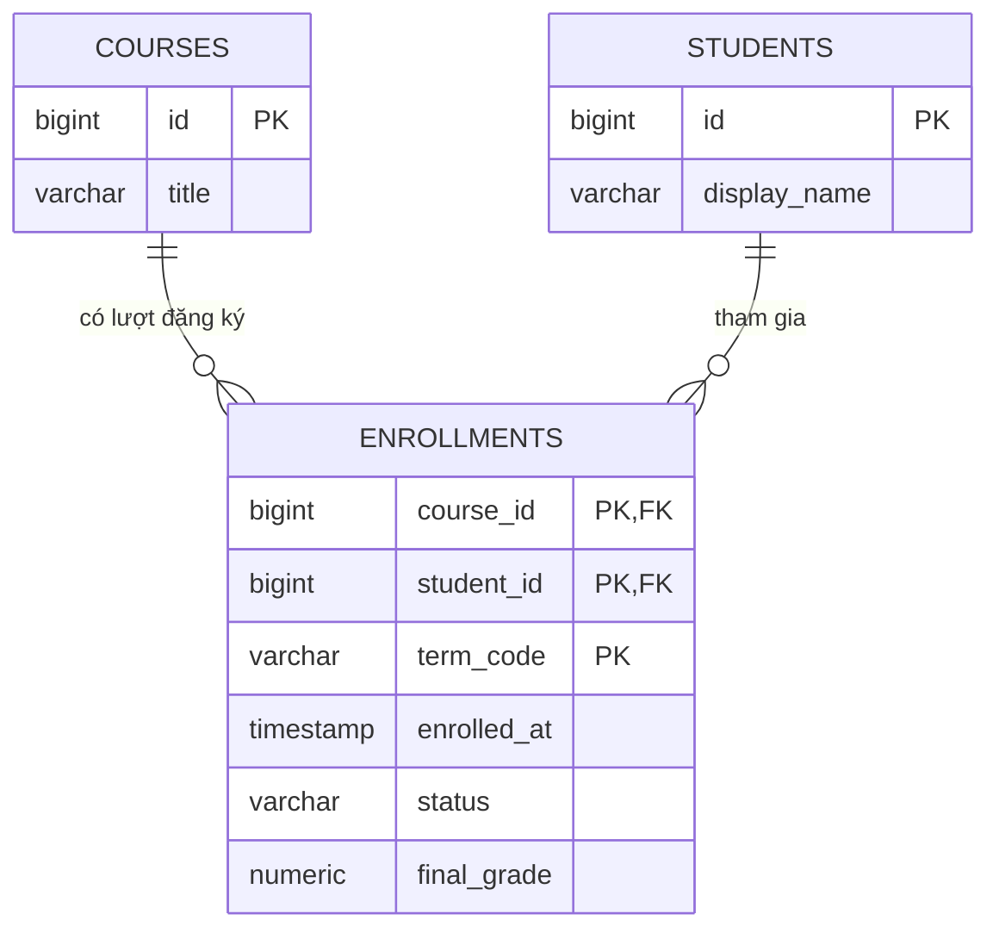
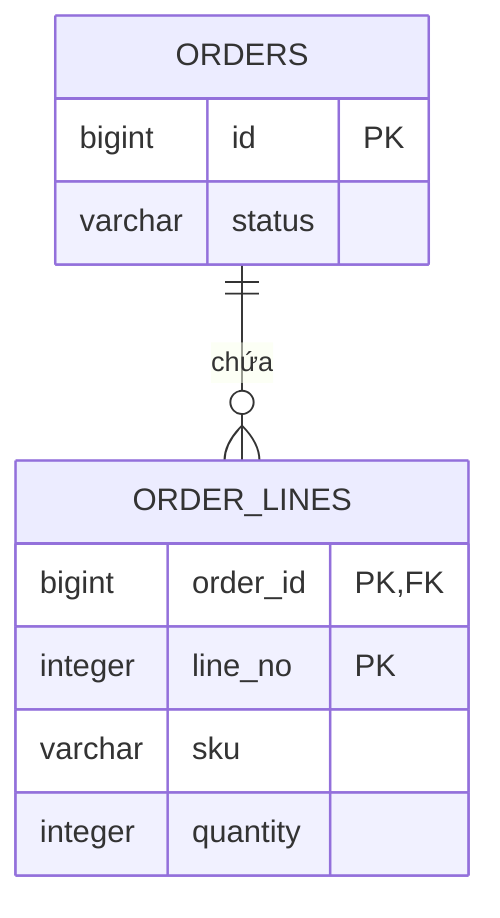
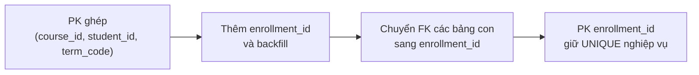

# Thiết kế khóa ghép và danh tính phụ thuộc theo yêu cầu mô hình

Trong mô hình quan hệ, một bản ghi có thể được nhận diện bằng **một cột** hoặc bằng **tổ hợp nhiều cột**. Chẳng hạn, mã `SKU-01` có thể chỉ duy nhất trong một cửa hàng; một sinh viên có thể đăng ký cùng một khóa học ở các kỳ khác nhau; dòng hàng số 3 chỉ có ý nghĩa khi biết nó thuộc đơn nào. Những trường hợp này đặt ra hai câu hỏi quan trọng:

1. **Khóa ghép** (*composite key*) có cần thiết để diễn đạt danh tính duy nhất trong phạm vi nghiệp vụ hay không?
2. **Danh tính phụ thuộc** (*dependent/derived identity*) có xuất hiện khi định danh của bản ghi con chứa khóa của bản ghi cha hay không?

Trong Java, một đối tượng `Enrollment` hoặc `OrderLine` vẫn là một instance bình thường. Trong SQL, danh tính của nó có thể là `(course_id, student_id, term_code)` hoặc `(order_id, line_no)`. Khi dùng JPA, chúng ta phải biểu diễn danh tính ghép bằng `@EmbeddedId` hoặc `@IdClass`, đồng thời xác định khi nào quan hệ với entity cha tham gia vào khóa qua `@MapsId`.

Bài này thuộc chương **Ánh xạ đối tượng** của **DATABASE_DATA_MODELING**. Mục tiêu là chuyển yêu cầu nghiệp vụ thành khóa, quan hệ, ràng buộc, chỉ mục và ánh xạ ORM nhất quán; nhận biết các đánh đổi khi chọn khóa tự nhiên, khóa ghép hoặc khóa thay thế; và kiểm chứng thiết kế bằng dữ liệu, truy vấn, giao dịch cùng kế hoạch tiến hóa schema.

## 1. Bắt đầu từ câu hỏi “điều gì làm bản ghi này là duy nhất?”

Xét ba trường hợp:

| Thực thể | Cách nhận diện theo yêu cầu | Khóa ứng viên có thể có |
|---|---|---|
| Sản phẩm của cửa hàng | Một SKU duy nhất trong **mỗi cửa hàng** | `(store_id, sku)` |
| Lượt đăng ký học | Một sinh viên đăng ký một khóa trong **mỗi kỳ** | `(course_id, student_id, term_code)` |
| Dòng trong đơn hàng | Dòng số `line_no` thuộc **một đơn cụ thể** | `(order_id, line_no)` |

Với ví dụ sản phẩm, hai cửa hàng A và B đều có thể dùng SKU `BOOK-01`. Vì vậy `sku` không đủ nhận diện toàn hệ thống. Khóa ghép `(store_id, sku)` giải thích rõ phạm vi duy nhất; khóa một cột `product_id` cũng có thể được dùng làm primary key, nhưng vẫn cần ràng buộc duy nhất cho tổ hợp nghiệp vụ.

Với lượt đăng ký học, nếu cho phép một sinh viên học lại cùng khóa ở kỳ khác, cặp `(course_id, student_id)` **không còn là khóa** của mỗi lượt. Phải bổ sung kỳ học hoặc một mã lượt đăng ký khác theo đúng yêu cầu.

Với dòng đơn hàng, `line_no = 3` không mang nghĩa độc lập; chỉ `(order_id = 91, line_no = 3)` mới xác định một vị trí cụ thể. Tuy nhiên, nếu người dùng được tự do sắp xếp lại các dòng, `line_no` có thể thay đổi. Khi đó cần cân nhắc: nó có thực sự là **danh tính ổn định** của dòng hàng hay chỉ là thuộc tính vị trí?

### Phân biệt những khái niệm dễ nhầm

| Khái niệm | Chức năng | Ví dụ |
|---|---|---|
| **Khóa ứng viên** | Tập thuộc tính tối thiểu nhận diện duy nhất một bản ghi theo quy tắc nghiệp vụ | `(store_id, sku)` |
| **Khóa chính (PK)** | Khóa ứng viên được chọn làm định danh chính trong bảng | `PRIMARY KEY (course_id, student_id, term_code)` |
| **Khóa thay thế (surrogate key)** | Định danh kỹ thuật không được suy ra từ các thuộc tính nghiệp vụ | `enrollment_id BIGINT` |
| **Khóa ngoại (FK)** | Bảo vệ tham chiếu đến khóa được phép của bảng khác | `enrollments.course_id → courses.id` |
| **Khóa ghép** | Khóa gồm nhiều cột, có thể là PK, UNIQUE hoặc FK | `(tenant_id, customer_id)` |
| **Danh tính phụ thuộc** | Danh tính của entity chứa danh tính của entity cha được tham chiếu | `OrderLineId(orderId, lineNo)` |
| **Chỉ mục ghép** | Cấu trúc truy vấn trên nhiều cột | `INDEX (course_id, term_code)` |

**Khóa ghép và chỉ mục ghép không đồng nghĩa.** Một chỉ mục không duy nhất trên `(course_id, term_code)` chỉ giúp tìm kiếm; nó không tự bảo đảm rằng một học viên chỉ đăng ký một lần. Ngược lại, `PRIMARY KEY(course_id, student_id, term_code)` là quy tắc định danh của bảng, thường được database hỗ trợ bằng một chỉ mục duy nhất.

## 2. Dùng yêu cầu đăng ký khóa học để thiết kế khóa ghép

Giả sử nền tảng học trực tuyến có các yêu cầu:

- Mỗi `Course` và `Student` tồn tại độc lập, có ID riêng.
- Một sinh viên có thể đăng ký cùng một khóa ở nhiều kỳ như `2026-FALL`, `2027-SPRING`.
- Trong một kỳ, một sinh viên chỉ có **một** hồ sơ đăng ký cho một khóa.
- Một hồ sơ có `enrolled_at`, `status` và `final_grade`.
- Khi thay đổi trạng thái từ `ACTIVE` sang `CANCELLED`, đó vẫn là **cùng hồ sơ**; không được tự tạo hàng mới.

Ở đây, `Enrollment` không chỉ là một liên kết nhiều–nhiều thuần túy: nó có trạng thái và vòng đời nghiệp vụ riêng. Danh tính ứng viên của một lượt là `(course_id, student_id, term_code)`.



### 2.1. Lược đồ SQL với composite primary key

Ví dụ PostgreSQL:

```sql
CREATE TABLE courses (
    id BIGINT GENERATED ALWAYS AS IDENTITY PRIMARY KEY,
    title VARCHAR(200) NOT NULL
);

CREATE TABLE students (
    id BIGINT GENERATED ALWAYS AS IDENTITY PRIMARY KEY,
    display_name VARCHAR(200) NOT NULL
);

CREATE TABLE enrollments (
    course_id BIGINT NOT NULL,
    student_id BIGINT NOT NULL,
    term_code VARCHAR(20) NOT NULL,
    enrolled_at TIMESTAMP NOT NULL,
    status VARCHAR(20) NOT NULL
        CHECK (status IN ('ACTIVE', 'COMPLETED', 'CANCELLED')),
    final_grade NUMERIC(5, 2),
    PRIMARY KEY (course_id, student_id, term_code),
    CONSTRAINT fk_enrollment_course
        FOREIGN KEY (course_id) REFERENCES courses(id),
    CONSTRAINT fk_enrollment_student
        FOREIGN KEY (student_id) REFERENCES students(id),
    CONSTRAINT ck_enrollment_grade
        CHECK (final_grade IS NULL
               OR (final_grade >= 0 AND final_grade <= 100))
);

CREATE INDEX idx_enrollment_student_term
    ON enrollments(student_id, term_code);
```

Lược đồ thể hiện hai điều **khác nhau**:

1. Hai FK bảo đảm khóa học và sinh viên được tham chiếu phải tồn tại.
2. PK ghép bảo đảm không có hai hồ sơ có cùng bộ `(course_id, student_id, term_code)`.

Không cần `UNIQUE(course_id, student_id, term_code)` thêm lần nữa vì primary key đã bảo vệ bộ ba này. PK cũng khiến tất cả cột tham gia phải khác `NULL`. `status` và `final_grade` là **trạng thái có thể thay đổi**, không được đưa vào khóa để nhận diện lượt đăng ký.

Ví dụ:

| course_id | student_id | term_code | status |
|---:|---:|---|---|
| 10 | 51 | 2026-FALL | ACTIVE |
| 10 | 51 | 2027-SPRING | ACTIVE |
| 10 | 52 | 2026-FALL | CANCELLED |

Hai hàng đầu hợp lệ vì cùng học viên và khóa học nhưng khác kỳ. Thêm hàng thứ tư có lại `(10, 51, 2026-FALL)` sẽ bị PK từ chối, bất kể `status` mới là gì.

### 2.2. Khi nào cặp khóa không đủ?

Giả sử một sinh viên được phép đăng ký lại **nhiều lần trong cùng kỳ** sau khi hủy. Quy tắc “một hồ sơ trên mỗi bộ ba” không còn đúng. Những phương án cần xem xét:

- Bổ sung `attempt_no` vào khóa: `(course_id, student_id, term_code, attempt_no)`.
- Gán `enrollment_id` ổn định cho mỗi lượt và đặt `UNIQUE` theo quy tắc còn hiệu lực.
- Tách `Enrollment` (quan hệ học viên–khóa–kỳ) và `EnrollmentAttempt` (từng lần đăng ký) nếu cả hai có ý nghĩa tồn tại.

Không nên tự động chọn `attempt_no` hoặc surrogate ID khi chưa hỏi rõ một lần hủy rồi đăng ký lại có được coi là **cùng hồ sơ được mở lại** hay **một lượt khác hoàn toàn**. Đó là quyết định domain ảnh hưởng đến khóa chính và lịch sử dữ liệu.

## 3. Ánh xạ khóa ghép bằng `@Embeddable` và `@EmbeddedId`

JPA cho phép gom các thành phần của composite PK vào **một lớp định danh**. Lớp này được đánh dấu `@Embeddable`, còn entity sử dụng `@EmbeddedId`.

### 3.1. Lớp định danh cần những đặc tính gì?

Một `EnrollmentId` đúng nghĩa có các thành phần `courseId`, `studentId` và `termCode`:

```java
import jakarta.persistence.Column;
import jakarta.persistence.Embeddable;
import java.io.Serializable;
import java.util.Objects;

@Embeddable
public class EnrollmentId implements Serializable {

    @Column(name = "course_id", nullable = false)
    private Long courseId;

    @Column(name = "student_id", nullable = false)
    private Long studentId;

    @Column(name = "term_code", length = 20, nullable = false)
    private String termCode;

    protected EnrollmentId() {
        // JPA cần constructor không tham số.
    }

    public EnrollmentId(Long courseId, Long studentId, String termCode) {
        this.courseId = Objects.requireNonNull(courseId);
        this.studentId = Objects.requireNonNull(studentId);
        this.termCode = Objects.requireNonNull(termCode);
        if (termCode.isBlank()) {
            throw new IllegalArgumentException("Kỳ học không được rỗng");
        }
    }

    public Long getCourseId() { return courseId; }
    public Long getStudentId() { return studentId; }
    public String getTermCode() { return termCode; }

    @Override
    public boolean equals(Object other) {
        if (this == other) return true;
        if (!(other instanceof EnrollmentId)) return false;
        EnrollmentId that = (EnrollmentId) other;
        return Objects.equals(courseId, that.courseId)
                && Objects.equals(studentId, that.studentId)
                && Objects.equals(termCode, that.termCode);
    }

    @Override
    public int hashCode() {
        return Objects.hash(courseId, studentId, termCode);
    }
}
```

Các yêu cầu quan trọng đối với lớp ID JPA:

- Là kiểu khóa có thể serial hóa (`Serializable`) theo quy tắc của JPA.
- Có constructor không tham số với khả năng truy cập phù hợp cho provider; để `protected` thường dùng được.
- Có `equals()`/`hashCode()` dựa trên **đúng các thành phần khóa**, nhất quán với ngữ nghĩa so sánh của các kiểu cột.
- Thành phần khóa phải ổn định sau khi entity được lưu. Không công khai setter tùy tiện cho `courseId`, `studentId` hay `termCode`.
- Độ dài, cách chuẩn hóa mã kỳ, chữ hoa/thường và so sánh chuỗi cần khớp quy tắc database. Ví dụ constructor ở trên không tự chuẩn hóa `termCode`; hệ thống thật cần chính sách rõ ràng.

Không nên đưa `status`, `enrolledAt` hoặc `finalGrade` vào `EnrollmentId`. Chúng thay đổi trong vòng đời hồ sơ và không tham gia PK. Một đối tượng khóa nên nhỏ, ổn định và được dùng để truyền/so sánh danh tính, không chứa một đồ thị entity lớn.

### 3.2. Entity có `@EmbeddedId`

```java
import jakarta.persistence.*;
import java.math.BigDecimal;
import java.time.LocalDateTime;
import java.util.Objects;

@Entity
@Table(name = "enrollments")
public class Enrollment {

    @EmbeddedId
    private EnrollmentId id;

    @Column(name = "enrolled_at", nullable = false)
    private LocalDateTime enrolledAt;

    @Column(nullable = false, length = 20)
    private String status;

    @Column(name = "final_grade", precision = 5, scale = 2)
    private BigDecimal finalGrade;

    protected Enrollment() {}

    public Enrollment(EnrollmentId id, LocalDateTime enrolledAt) {
        this.id = Objects.requireNonNull(id);
        this.enrolledAt = Objects.requireNonNull(enrolledAt);
        this.status = "ACTIVE";
    }

    public EnrollmentId getId() { return id; }

    public void cancel() {
        if ("COMPLETED".equals(status)) {
            throw new IllegalStateException("Không hủy hồ sơ đã hoàn tất");
        }
        this.status = "CANCELLED";
    }
}
```

Trong biến thể này, entity **chỉ lưu các giá trị FK dưới dạng ID**; nó chưa có trường Java `Course course` hoặc `Student student`. Ta vẫn có thể truy vấn bằng khóa:

```java
EnrollmentId key = new EnrollmentId(10L, 51L, "2026-FALL");
Enrollment enrollment = em.find(Enrollment.class, key);
```

JPA dùng các thành phần trong `EnrollmentId` để tạo điều kiện tìm hàng theo cả ba cột. Dù Java chỉ có một field `id`, database vẫn có PK **ba cột**. Đây là ánh xạ một đối tượng khóa thành nhiều cột, không phải một cột lưu chuỗi ghép như `"10-51-2026-FALL"`.

### 3.3. Truy vấn theo thuộc tính bên trong composite ID

JPQL có thể truy cập đường dẫn thuộc tính:

```java
List<Enrollment> enrollments = em.createQuery("""
    select e
    from Enrollment e
    where e.id.courseId = :courseId
      and e.id.termCode = :termCode
    order by e.id.studentId
    """, Enrollment.class)
    .setParameter("courseId", 10L)
    .setParameter("termCode", "2026-FALL")
    .getResultList();
```

SQL tương đương về mặt ý nghĩa:

```sql
SELECT course_id, student_id, term_code,
       enrolled_at, status, final_grade
FROM enrollments
WHERE course_id = 10
  AND term_code = '2026-FALL'
ORDER BY student_id;
```

Khả năng tận dụng chỉ mục phụ thuộc vào **thứ tự cột của chỉ mục** và đặc điểm truy vấn; không nên mặc định PK `(course_id, student_id, term_code)` tối ưu cho bộ lọc `course_id + term_code`. Điều này sẽ được phân tích ở phần chỉ mục.

## 4. Danh tính phụ thuộc: khi khóa con chứa khóa cha

Một số thực thể chỉ có ý nghĩa trong phạm vi một thực thể khác. Dòng hàng `OrderLine` là ví dụ: “dòng số 2 của đơn hàng 91” được nhận diện bởi `(order_id, line_no)`.

Quan hệ kiểu này thường gọi là **identifying relationship**: khóa ngoại đến parent cũng là **một phần hoặc toàn bộ khóa chính** của child. Trong JPA, derived identity giúp ánh xạ trường ID dựa vào ID của entity liên quan.



### 4.1. Lược đồ với FK đồng thời tham gia PK

```sql
CREATE TABLE orders (
    id BIGINT GENERATED ALWAYS AS IDENTITY PRIMARY KEY,
    status VARCHAR(20) NOT NULL
        CHECK (status IN ('DRAFT', 'CONFIRMED'))
);

CREATE TABLE order_lines (
    order_id BIGINT NOT NULL,
    line_no INTEGER NOT NULL CHECK (line_no > 0),
    sku VARCHAR(64) NOT NULL,
    quantity INTEGER NOT NULL CHECK (quantity > 0),
    PRIMARY KEY (order_id, line_no),
    CONSTRAINT fk_line_order
        FOREIGN KEY (order_id) REFERENCES orders(id)
);
```

Ở đây:

- `orders.id` là danh tính độc lập của đơn.
- `order_lines.order_id` vừa là **FK** vừa là **một phần PK**.
- `line_no` chỉ duy nhất **trong một đơn**, không phải trên toàn bảng.
- Một dòng được định danh bằng đúng cặp `(order_id, line_no)`. Không có `line_id` riêng.

Vì `order_id` tham gia PK nên không thể null. Tuy nhiên, FK/PK chỉ bảo vệ cấu trúc dữ liệu; quy tắc “chỉ được chỉnh sửa đơn `DRAFT`” vẫn cần được thực thi bởi logic nghiệp vụ, transaction và cơ chế đồng thời phù hợp.

### 4.2. Ánh xạ bằng `@MapsId("orderId")`

Định nghĩa một value object khóa:

```java
import jakarta.persistence.*;
import java.io.Serializable;
import java.util.Objects;

@Embeddable
public class OrderLineId implements Serializable {

    @Column(name = "order_id", nullable = false)
    private Long orderId;

    @Column(name = "line_no", nullable = false)
    private Integer lineNo;

    protected OrderLineId() {}

    public OrderLineId(Long orderId, Integer lineNo) {
        this.orderId = Objects.requireNonNull(orderId);
        this.lineNo = Objects.requireNonNull(lineNo);
        if (lineNo <= 0) {
            throw new IllegalArgumentException("lineNo phải > 0");
        }
    }

    public Long getOrderId() { return orderId; }
    public Integer getLineNo() { return lineNo; }

    @Override
    public boolean equals(Object other) {
        if (this == other) return true;
        if (!(other instanceof OrderLineId)) return false;
        OrderLineId that = (OrderLineId) other;
        return Objects.equals(orderId, that.orderId)
                && Objects.equals(lineNo, that.lineNo);
    }

    @Override
    public int hashCode() {
        return Objects.hash(orderId, lineNo);
    }
}
```

Entity `OrderLine`:

```java
@Entity
@Table(name = "order_lines")
public class OrderLine {

    @EmbeddedId
    private OrderLineId id;

    @MapsId("orderId")
    @ManyToOne(fetch = FetchType.LAZY, optional = false)
    @JoinColumn(name = "order_id", nullable = false)
    private Order order;

    @Column(nullable = false, length = 64)
    private String sku;

    @Column(nullable = false)
    private int quantity;

    protected OrderLine() {}

    public OrderLine(Order order, int lineNo, String sku, int quantity) {
        this.order = Objects.requireNonNull(order);
        if (order.getId() == null) {
            throw new IllegalArgumentException("Order phải có ID trước");
        }
        this.id = new OrderLineId(order.getId(), lineNo);
        this.sku = Objects.requireNonNull(sku);
        if (quantity <= 0) {
            throw new IllegalArgumentException("quantity phải > 0");
        }
        this.quantity = quantity;
    }

    public OrderLineId getId() { return id; }
}
```

Giả định `Order` là entity có `getId()` và khóa đã được gán trước khi tạo `OrderLine`. Các import của đoạn thứ hai được lược bỏ. Annotation quan trọng là:

```java
@MapsId("orderId")
@ManyToOne(fetch = FetchType.LAZY)
@JoinColumn(name = "order_id")
private Order order;
```

`@MapsId("orderId")` nói rằng thuộc tính `orderId` bên trong `OrderLineId` **được ánh xạ từ định danh của quan hệ `order`**. Nhờ vậy, ta không cần khai báo hai mapping có thể ghi độc lập cho cùng cột `order_id`.

Trong thiết kế này, việc thay `line.order` sang đơn khác sẽ làm thay đổi **chính khóa của dòng**. Thay đổi PK của một entity đang được quản lý thường không phải thao tác được JPA hỗ trợ như cập nhật field bình thường. Nếu nghiệp vụ cần chuyển dòng sang đơn khác, hãy thiết kế thao tác xóa/tạo mới hoặc chọn danh tính ổn định khác.

### 4.3. Thứ tự tạo parent và child

Đơn hàng có khóa `IDENTITY` được database phát sinh. Một luồng minh họa:

```java
Order order = new Order("DRAFT"); // constructor minh họa
em.persist(order);
em.flush();                       // đảm bảo ID đã có trong ví dụ

OrderLine line = new OrderLine(order, 1, "BOOK-01", 2);
em.persist(line);

// Commit transaction; kiểm chứng sau commit ở context mới.
```

`flush` ở đây là cách đơn giản để minh họa thời điểm khóa cha xuất hiện, **không có nghĩa mọi luồng nghiệp vụ đều phải gọi flush thủ công**. ORM với chiến lược sinh khóa khác có thể nhận được ID ngay sau `persist` hoặc tự sắp xếp thứ tự chèn parent/child khi dùng cascade. `flush` cũng **không phải `commit`**; transaction có thể rollback.

Khi ID cha chưa xác định, tránh tự tạo `OrderLineId(-1, 1)` làm giá trị tạm rồi sửa sau. Nó làm mờ ngữ nghĩa khóa và có thể phá `equals/hashCode` nếu ID đã được dùng trong `Set`/`Map`. Nên để quan hệ và generator của ORM cung cấp ID theo một quy trình nhất quán, hoặc dùng khóa được cấp trước khi tạo aggregate nếu nghiệp vụ đòi điều đó.

## 5. `@IdClass`: biểu diễn khóa ghép bằng nhiều trường `@Id`

JPA còn cung cấp `@IdClass`. Khác với `@EmbeddedId` gom toàn bộ khóa vào một field `id`, `@IdClass` đặt `@Id` lên **từng thuộc tính khóa** của entity và dùng một lớp ID để mô tả tập các thuộc tính đó.

### 5.1. Lớp ID của `@IdClass`

```java
import java.io.Serializable;
import java.util.Objects;

public class EnrollmentKey implements Serializable {
    public Long courseId;
    public Long studentId;
    public String termCode;

    public EnrollmentKey() {}

    public EnrollmentKey(Long courseId, Long studentId, String termCode) {
        this.courseId = Objects.requireNonNull(courseId);
        this.studentId = Objects.requireNonNull(studentId);
        this.termCode = Objects.requireNonNull(termCode);
    }

    @Override
    public boolean equals(Object other) {
        if (this == other) return true;
        if (!(other instanceof EnrollmentKey)) return false;
        EnrollmentKey that = (EnrollmentKey) other;
        return Objects.equals(courseId, that.courseId)
                && Objects.equals(studentId, that.studentId)
                && Objects.equals(termCode, that.termCode);
    }

    @Override
    public int hashCode() {
        return Objects.hash(courseId, studentId, termCode);
    }
}
```

Lớp `EnrollmentKey` cần tên và kiểu các thuộc tính **khớp với các thuộc tính `@Id`** của entity. Ví dụ dùng field public để minh họa ngắn gọn yêu cầu này; trong mã production có thể dùng field private cùng constructor/getter phù hợp với cách provider truy cập.

### 5.2. Ánh xạ entity với scalar ID

```java
@Entity
@Table(name = "enrollments")
@IdClass(EnrollmentKey.class)
public class Enrollment {

    @Id
    @Column(name = "course_id", nullable = false)
    private Long courseId;

    @Id
    @Column(name = "student_id", nullable = false)
    private Long studentId;

    @Id
    @Column(name = "term_code", length = 20, nullable = false)
    private String termCode;

    @Column(name = "enrolled_at", nullable = false)
    private LocalDateTime enrolledAt;

    @Column(nullable = false, length = 20)
    private String status;

    @Column(name = "final_grade", precision = 5, scale = 2)
    private BigDecimal finalGrade;

    protected Enrollment() {}
}
```

Đây là một **phiên bản thay thế** của entity `Enrollment` trước đó, dùng cùng bảng. Không khai báo cả `@EmbeddedId` và `@IdClass` đồng thời trên một entity.

Với `@IdClass`, câu truy vấn JPQL dùng `e.courseId` và `e.termCode` thay vì `e.id.courseId` và `e.id.termCode`:

```java
List<Enrollment> rows = em.createQuery("""
    select e
    from Enrollment e
    where e.courseId = :courseId
      and e.termCode = :termCode
    """, Enrollment.class)
    .setParameter("courseId", 10L)
    .setParameter("termCode", "2026-FALL")
    .getResultList();

EnrollmentKey key = new EnrollmentKey(10L, 51L, "2026-FALL");
Enrollment one = em.find(Enrollment.class, key);
```

Với entity này, nếu muốn điều hướng `Course` và `Student`, có thể bổ sung quan hệ **chỉ đọc các cột FK** để tránh hai nguồn ghi cho cùng cột:

```java
@ManyToOne(fetch = FetchType.LAZY)
@JoinColumn(name = "course_id", insertable = false, updatable = false)
private Course course;

@ManyToOne(fetch = FetchType.LAZY)
@JoinColumn(name = "student_id", insertable = false, updatable = false)
private Student student;
```

Các trường `courseId`/`studentId` vẫn quản lý giá trị FK dùng khi lưu. Do vậy việc chỉ gọi `enrollment.setCourse(otherCourse)` không nên được kỳ vọng đổi khóa trong database; thiết kế phải cố định cách khởi tạo và bảo trì liên kết. Một cách JPA khác là ánh xạ quan hệ `@Id` theo derived identity trong `@IdClass`, nhưng tên/kiểu field của lớp ID cần tuân đúng quy tắc quan hệ và provider; nên chọn một mẫu được kiểm chứng thay vì pha trộn tùy tiện.

### 5.3. So sánh hai cách biểu diễn

| Tiêu chí | `@EmbeddedId` | `@IdClass` |
|---|---|---|
| Khóa trong entity | Một field `EnrollmentId id` | Nhiều field `@Id` trực tiếp |
| Lớp ID | `@Embeddable`, `Serializable` | Lớp ID thường, `Serializable` |
| Đường dẫn JPQL | `e.id.courseId` | `e.courseId` |
| Tái sử dụng khóa như value object | Tự nhiên, truyền một object | Vẫn có class khóa nhưng field nằm trên entity |
| Derived identity với quan hệ | `@MapsId` thường trực quan | Có cách phối hợp với `@Id`/quan hệ theo quy tắc JPA |
| Rủi ro phổ biến | Đặt hai mapping ghi cùng cột; thay khóa sau persist | Tên/kiểu thuộc tính không khớp với ID class |

Việc chọn `@EmbeddedId` hay `@IdClass` chủ yếu là quyết định thiết kế API entity và độ rõ ràng của mapping. **Cả hai có thể ánh xạ cùng một PK ghép ở database**. Đừng thay toàn bộ schema chỉ vì muốn đổi cách Java biểu diễn khóa.

## 6. Danh tính phụ thuộc một–một: `@MapsId` không có tên thuộc tính

Không phải dependent identity nào cũng gồm nhiều cột. Trong quan hệ một–một **dùng chung khóa chính**, entity con có PK chính là FK tham chiếu entity cha.

Ví dụ: một `Account` có tối đa một `AccountProfile`, profile không có danh tính độc lập với account:

```sql
CREATE TABLE accounts (
    id BIGINT GENERATED ALWAYS AS IDENTITY PRIMARY KEY,
    username VARCHAR(80) NOT NULL UNIQUE
);

CREATE TABLE account_profiles (
    account_id BIGINT PRIMARY KEY
        REFERENCES accounts(id),
    display_name VARCHAR(160) NOT NULL
);
```

Với JPA:

```java
@Entity
@Table(name = "account_profiles")
public class AccountProfile {

    @Id
    @Column(name = "account_id")
    private Long id;

    @MapsId
    @OneToOne(fetch = FetchType.LAZY, optional = false)
    @JoinColumn(name = "account_id", nullable = false)
    private Account account;

    @Column(name = "display_name", nullable = false, length = 160)
    private String displayName;

    protected AccountProfile() {}
}
```

Ở đây `@MapsId` không có tham số vì **toàn bộ khóa `AccountProfile.id`** được suy ra từ `Account.id`. Nếu khóa con là `@EmbeddedId` chứa nhiều thành phần, ta dùng `@MapsId("tênThànhPhần")` để chỉ đúng phần khóa phụ thuộc.

`AccountProfile` vẫn là entity nếu nghiệp vụ cần quản lý nội dung profile riêng, nhưng danh tính của nó **phụ thuộc** vào account. FK/PK ngăn một account có hai profile khác ID. Việc profile có thể được tạo, xóa hoặc giữ lại thế nào phải dựa trên quy tắc vòng đời nghiệp vụ; `@MapsId` tự nó không cấu hình cascade hay orphan removal.

## 7. Phân biệt identifying và non-identifying relationship

Một quan hệ tồn tại không nhất thiết phải tham gia khóa chính của bảng con.

### 7.1. Identifying relationship

```sql
CREATE TABLE order_lines (
    order_id BIGINT NOT NULL REFERENCES orders(id),
    line_no INTEGER NOT NULL,
    sku VARCHAR(64) NOT NULL,
    PRIMARY KEY (order_id, line_no)
);
```

Ở đây thay `order_id` nghĩa là thay **danh tính** dòng hàng. Cấu trúc phản ánh rằng dòng “số 2” chỉ có ý nghĩa trong đúng một đơn.

### 7.2. Non-identifying relationship

```sql
CREATE TABLE order_lines (
    id BIGINT GENERATED ALWAYS AS IDENTITY PRIMARY KEY,
    order_id BIGINT NOT NULL REFERENCES orders(id),
    line_no INTEGER NOT NULL CHECK (line_no > 0),
    sku VARCHAR(64) NOT NULL,
    UNIQUE (order_id, line_no)
);
```

Ở phiên bản này, `order_lines.id` là danh tính độc lập về kỹ thuật. `order_id` và `line_no` vẫn có thể là **khóa nghiệp vụ duy nhất** nhưng không thuộc PK. Hai phiên bản thay thế nhau; không chạy cả hai lệnh `CREATE TABLE` trong cùng một database.

| Câu hỏi | PK `(order_id, line_no)` | PK `id` + `UNIQUE(order_id, line_no)` |
|---|---|---|
| Số dòng có thuộc khóa không? | Có | Không |
| Đổi `line_no` | Đổi PK; thường phải xử lý như thay danh tính | Chỉ đổi thuộc tính vị trí, vẫn giữ `id` |
| Bảng khác tham chiếu một dòng | FK gồm `(order_id, line_no)` | FK một cột `line_id` |
| Danh tính ổn định khi sắp xếp lại | Không, nếu `line_no` đổi | Có |
| Bảo vệ vị trí duy nhất trong đơn | PK tự bảo vệ | Cần `UNIQUE(order_id, line_no)` |
| Biểu đạt sự phụ thuộc vào đơn | Thể hiện ngay trong PK | Thể hiện bằng FK, lifecycle và constraint |

**Khóa thay thế không xóa bỏ ràng buộc nghiệp vụ.** Nếu chọn `line_id` nhưng quên `UNIQUE(order_id, line_no)`, hệ thống vẫn có thể ghi hai dòng có cùng vị trí. Ngược lại, PK ghép có thể quá cứng nếu số thứ tự thay đổi thường xuyên.

### 7.3. “Phụ thuộc vòng đời” không buộc PK phải phụ thuộc

Một `OrderLine` có thể bị xóa cùng `Order`, chỉ được sửa qua aggregate root, nhưng vẫn mang `id` riêng để các dòng điều chỉnh giá, kiểm toán hoặc lịch sử giao dịch tham chiếu ổn định. Vòng đời phụ thuộc và danh tính phụ thuộc là **hai quyết định khác nhau**.

Do đó:

- Chọn **identifying relationship** khi khóa cha thực sự là một phần của danh tính con theo nghiệp vụ và phần đó ổn định.
- Chọn **non-identifying relationship** khi con cần ID ổn định xuyên suốt các lần đổi thứ tự, chuyển trạng thái, hoặc khi nhiều bảng ngoài cần tham chiếu.
- Chọn cascade/orphan removal từ **quyền sở hữu nghiệp vụ**, không chỉ từ việc FK có tham gia PK.

## 8. Khóa ngoại ghép bảo vệ phạm vi tenant

Khóa ghép không chỉ áp dụng cho PK. Nó còn giúp database bảo vệ **mối quan hệ đúng phạm vi** trong hệ thống nhiều tenant.

Giả sử mỗi khách hàng có ID chỉ duy nhất **bên trong một tenant**. Cùng `customer_id = 5` có thể xuất hiện trong tenant A và B:

```sql
CREATE TABLE customers (
    tenant_id BIGINT NOT NULL,
    customer_id BIGINT NOT NULL,
    display_name VARCHAR(150) NOT NULL,
    PRIMARY KEY (tenant_id, customer_id)
);

CREATE TABLE orders (
    tenant_id BIGINT NOT NULL,
    order_id BIGINT NOT NULL,
    customer_id BIGINT NOT NULL,
    status VARCHAR(20) NOT NULL,
    PRIMARY KEY (tenant_id, order_id),
    CONSTRAINT fk_order_customer_same_tenant
        FOREIGN KEY (tenant_id, customer_id)
        REFERENCES customers(tenant_id, customer_id)
);
```

Nếu chỉ dùng FK `orders.customer_id → customers.customer_id`, tham chiếu sẽ không có đủ thông tin tenant để chọn chính xác khách hàng; trong lược đồ này, `customer_id` cũng không phải khóa duy nhất được phép tham chiếu. FK ghép `(tenant_id, customer_id)` cho phép database ngăn đơn của tenant A trỏ tới khách hàng của tenant B.

### 8.1. Điều gì xảy ra khi thiếu một phần khóa?

Giả sử ứng dụng lấy `customer_id = 5` từ request nhưng không ràng buộc `tenant_id`. SQL có thể đọc nhầm khách hàng khác nếu truy vấn chỉ dựa trên một cột. Khi PK là `(tenant_id, customer_id)`, mọi truy vấn nhận diện một khách hàng phải mang đủ phạm vi:

```sql
SELECT display_name
FROM customers
WHERE tenant_id = :tenant_id
  AND customer_id = :customer_id;
```

Ràng buộc FK ghép bảo vệ tính toàn vẹn **giữa các hàng**, nhưng không tự thay thế kiểm tra phân quyền, xác thực tenant hoặc Row Level Security. Phân tách tenant cần được thực hiện ở những tầng phù hợp của hệ thống.

### 8.2. Một khóa toàn cục và UNIQUE ghép có thể đơn giản hơn

Nếu `customers.id` đã duy nhất trên toàn database, có thể dùng:

```sql
CREATE TABLE customers (
    id BIGINT GENERATED ALWAYS AS IDENTITY PRIMARY KEY,
    tenant_id BIGINT NOT NULL,
    display_name VARCHAR(150) NOT NULL,
    UNIQUE (tenant_id, id)
);
```

Khi cần FK ghép bảo vệ tenant, ràng buộc `UNIQUE(tenant_id, id)` cho phép bảng con tham chiếu bộ cột đó, dù `id` tự nó đã là PK duy nhất. Cách này giữ PK một cột để thuận tiện cho nhiều FK khác, nhưng bổ sung ràng buộc tham chiếu cùng tenant ở nơi có yêu cầu.

Không phải mọi bảng đa tenant đều cần composite PK. Hãy cân nhắc phạm vi ID, dữ liệu chia sẻ giữa tenant, số lượng FK, chiến lược phân vùng và mức độ bảo vệ toàn vẹn ở database.

## 9. Thứ tự cột trong khóa ghép và chỉ mục

Về mặt tính duy nhất, `PRIMARY KEY (course_id, student_id, term_code)` và `PRIMARY KEY (term_code, course_id, student_id)` bảo vệ cùng tập bộ ba, giả sử các cột đều bắt buộc. Nhưng **thứ tự cột trong chỉ mục B-tree** đi kèm có thể ảnh hưởng lớn đến hiệu năng.

Ví dụ workload:

- Tìm một enrollment đầy đủ theo cả ba cột.
- Liệt kê sinh viên trong một khóa **của một kỳ**.
- Liệt kê mọi khóa mà một sinh viên tham gia trong một kỳ.

Với PK:

```sql
PRIMARY KEY (course_id, student_id, term_code)
```

chỉ mục B-tree thường thuận tiện cho điều kiện `course_id = ?` hoặc `course_id = ? AND student_id = ?`. Truy vấn chỉ lọc `student_id` khó tận dụng tiền tố đầu của chỉ mục theo cách tương tự. Truy vấn lọc `course_id` và `term_code` có thể chỉ dùng hiệu quả phần tiền tố `course_id` rồi xử lý điều kiện `term_code` bổ sung, tùy kế hoạch và tính năng DB.

Nếu truy vấn theo khóa học và kỳ rất phổ biến, có thể dùng:

```sql
CREATE INDEX idx_enrollments_course_term_student
    ON enrollments(course_id, term_code, student_id);
```

Nếu truy vấn theo sinh viên và kỳ phổ biến:

```sql
CREATE INDEX idx_enrollments_student_term
    ON enrollments(student_id, term_code);
```

Các chỉ mục minh họa được chọn **tùy workload**; không nhất thiết tạo đồng thời tất cả. Cần tránh chỉ mục trùng chức năng không cần thiết và kiểm tra `EXPLAIN (ANALYZE, BUFFERS)` trên PostgreSQL bằng dữ liệu đại diện. Mỗi chỉ mục thêm chi phí lưu trữ, cập nhật và ghi.

### Khóa ghép dài sẽ lan sang khóa ngoại

Nếu nhiều bảng tham chiếu `Enrollment`, một PK ba cột đòi các FK tương ứng cũng mang đủ ba cột:

```sql
CREATE TABLE enrollment_reviews (
    id BIGINT GENERATED ALWAYS AS IDENTITY PRIMARY KEY,
    course_id BIGINT NOT NULL,
    student_id BIGINT NOT NULL,
    term_code VARCHAR(20) NOT NULL,
    reviewed_at TIMESTAMP NOT NULL,
    FOREIGN KEY (course_id, student_id, term_code)
        REFERENCES enrollments(course_id, student_id, term_code)
);
```

Khi nhiều bảng ngoài phải tham chiếu hoặc một thành phần khóa có thể đổi, surrogate `enrollment_id` cộng với `UNIQUE(course_id, student_id, term_code)` có thể làm thiết kế dễ tiến hóa hơn. Đánh đổi là phải quản lý thêm khóa kỹ thuật và vẫn giữ unique constraint nghiệp vụ.

## 10. Cập nhật, xóa và đồng thời với composite ID

### 10.1. Không thay khóa chính như một field bình thường

Các field `courseId`, `studentId` và `termCode` nhận diện bản ghi. Nếu một enrollment đã lưu mà đổi `termCode` trực tiếp, ứng dụng đang cố thay danh tính entity. Việc thay PK của managed entity **không phải thao tác cập nhật thông thường được JPA đảm bảo**; một số provider sẽ báo lỗi hoặc có hành vi không mong đợi.

Nếu một hồ sơ phải chuyển sang kỳ mới, cần xác định về mặt nghiệp vụ đó là:

- **Một lượt đăng ký mới:** tạo `Enrollment` mới và đóng/hủy lượt cũ, giữ lịch sử.
- **Sửa lỗi dữ liệu nhập kỳ:** dùng quy trình correction/migration có kiểm soát FK, unique và các bảng tham chiếu; không trộn vào setter bình thường.
- **Cùng một lượt tồn tại qua nhiều kỳ:** thay thiết kế định danh vì kỳ học không còn là phần ổn định của danh tính.

Đây là lý do xác định **điều gì được phép thay đổi** quan trọng hơn việc khóa có tự nhiên hay không.

### 10.2. Cạnh tranh tạo cùng khóa ghép

Hai request có thể cùng kiểm tra chưa có enrollment:

```text
T1: SELECT ... WHERE course_id=10 AND student_id=51 AND term_code='2026-FALL'
    -> không thấy
T2: SELECT ... cùng điều kiện -> không thấy
T1: INSERT -> thành công
T2: INSERT -> vi phạm PRIMARY KEY
```

Kiểm tra ở Java trước khi thêm là hữu ích để trả thông báo sớm, nhưng **không thay thế ràng buộc PK** khi có nhiều giao dịch đồng thời. Ứng dụng phải xử lý lỗi vi phạm khóa thành hành vi phù hợp: trả conflict, nhận biết request lặp mang cùng mục đích, hoặc truy vấn lại trạng thái; không tự coi mọi lỗi là thành công.

### 10.3. Optimistic locking bảo vệ trạng thái

Khóa ghép nhận diện **hồ sơ nào** cần cập nhật; nó không bảo đảm hai người cập nhật trạng thái cùng lúc không ghi đè nhau. Có thể thêm một cột version:

```sql
ALTER TABLE enrollments
ADD COLUMN version BIGINT NOT NULL DEFAULT 0;
```

Và trong entity:

```java
@Version
@Column(nullable = false)
private Long version;
```

Một câu update có điều kiện tương đương:

```sql
UPDATE enrollments
SET status = 'COMPLETED',
    version = version + 1
WHERE course_id = :course_id
  AND student_id = :student_id
  AND term_code = :term_code
  AND version = :expected_version;
```

Nếu không có hàng nào được cập nhật, có thể khóa không còn tồn tại hoặc version đã thay đổi. Cần phản hồi theo nghiệp vụ. `@Version` là cơ chế độc lập với việc dùng `@EmbeddedId` hay `@IdClass`. Các lệnh bulk SQL/JPQL viết tay phải chủ động xét đến version vì không phải lúc nào cũng đi qua optimistic locking tự động.

### 10.4. Xóa parent khi PK con chứa FK

Với `order_lines(order_id, line_no)`, database không cho xóa `orders.id` khi vẫn còn dòng tham chiếu nếu FK không khai báo `ON DELETE CASCADE`. Nếu domain cho phép xóa đơn nháp cùng dòng, có thể dùng cascade phù hợp ở JPA hoặc DB theo chính sách rõ ràng.

Một PK phụ thuộc **không mặc nhiên** cho phép xóa parent; và `@MapsId` **không tự kích hoạt `CascadeType.REMOVE`**. Phải thiết kế riêng quy tắc vòng đời, giữ lịch sử và audit.

## 11. Tiến hóa từ khóa ghép sang khóa thay thế

Giả sử ban đầu `Enrollment` dùng `PRIMARY KEY(course_id, student_id, term_code)`. Sau đó có nhiều bảng như `grades`, `attendance`, `certificates` cùng tham chiếu hồ sơ, và nghiệp vụ cho phép đổi kỳ do điều chỉnh lịch học. Khi đó ID một cột có thể giảm độ phức tạp của các FK.

Phương án mới:

```sql
CREATE TABLE enrollments_v2 (
    enrollment_id BIGINT GENERATED ALWAYS AS IDENTITY PRIMARY KEY,
    course_id BIGINT NOT NULL REFERENCES courses(id),
    student_id BIGINT NOT NULL REFERENCES students(id),
    term_code VARCHAR(20) NOT NULL,
    enrolled_at TIMESTAMP NOT NULL,
    status VARCHAR(20) NOT NULL,
    UNIQUE (course_id, student_id, term_code)
);
```

Sơ đồ chuyển đổi:



Trong hệ thống thật, không nên đơn giản tạo `enrollments_v2` rồi xóa bảng cũ. Một kế hoạch **expand–migrate–contract** cần:

1. Kiểm kê mọi PK/FK, index, view, repository, API và luồng import đang phụ thuộc bộ ba cũ.
2. Bổ sung ID mới, backfill duy nhất cho dữ liệu hiện tại và kiểm tra không null/không trùng.
3. Bổ sung cột FK mới cho bảng con; backfill bằng cách join theo khóa ghép cũ.
4. Đối chiếu số lượng và tính nhất quán ở từng bảng; thiết kế cơ chế đồng bộ khi cả ứng dụng cũ và mới cùng ghi trong thời gian chuyển đổi.
5. Đưa ứng dụng và các consumer sang ID mới, kiểm tra rollback/khả năng phục hồi.
6. Chỉ bỏ PK/FK cũ và chuyển constraint cuối cùng khi không còn nguồn ghi hay truy vấn phụ thuộc.

Mục tiêu là **giữ danh tính nghiệp vụ và dữ liệu lịch sử** trong lúc thay cơ chế định danh vật lý. Nếu quy tắc duy nhất mới không còn là bộ ba, cần thay `UNIQUE` sau khi đã định nghĩa được trường hợp đăng ký lại và cách ghi lịch sử; không giữ một unique constraint mâu thuẫn nghiệp vụ.

### Khi không cần migration

Nếu bộ ba thực sự bất biến, ít bảng tham chiếu và truy vấn chủ yếu dùng toàn bộ khóa, composite PK có thể tiếp tục phù hợp lâu dài. Không có quy tắc “mọi PK ghép đều phải được thay bằng surrogate ID”.

## 12. Các sai lầm thường gặp

**“Khóa gồm nhiều cột thì cứ nối chuỗi lại.”** Lưu `"10_51_2026-FALL"` thành một cột duy nhất làm khó FK đến `courses`/`students`, validation từng phần và index truy vấn. Dùng các cột có kiểu và constraint riêng khi các thành phần có ý nghĩa quan hệ.

**“Có `UNIQUE` nghĩa là nhất thiết phải dùng composite PK.”** Có thể dùng `id` làm PK và `UNIQUE` cho khóa nghiệp vụ; hai lựa chọn phục vụ mục tiêu khác nhau.

**“Trường trong PK có thể sửa như thuộc tính thông thường.”** Đổi một phần PK là đổi danh tính; cần xem lại mô hình hoặc quy trình sửa sai dữ liệu.

**“`@EmbeddedId` tự tạo quan hệ tới các entity cha.”** Nó chỉ mô tả các cột khóa; muốn điều hướng entity và derived identity cần mapping quan hệ phù hợp, ví dụ `@MapsId`.

**“`@MapsId` có nghĩa JPA tự tạo parent.”** Nó đồng bộ định danh của quan hệ với khóa, không tự quyết định có cascade persist hay không.

**“`@IdClass` và `@EmbeddedId` cùng gắn lên một entity sẽ an toàn hơn.”** Hai kiểu là phương án thay thế nhau; pha trộn gây mapping mâu thuẫn.

**“PK ba cột thì index nào cũng dùng tốt.”** Thứ tự cột và điều kiện lọc quyết định hiệu quả chỉ mục; cần đo bằng query plan.

**“Cứ có `tenant_id` ở hai bảng là không thể tham chiếu khác tenant.”** Nếu FK chỉ theo ID không đủ phạm vi, DB vẫn có thể cho phép liên kết sai; cần FK ghép hoặc cơ chế toàn vẹn thích hợp.

**“Khóa ghép ngăn mọi lỗi đồng thời.”** PK ngăn bản ghi trùng danh tính; lost update và bất biến nhiều hàng vẫn cần version/transaction/locking.

**“Dòng hàng thuộc đơn thì buộc phải dùng `(order_id, line_no)` làm PK.”** Nếu `line_no` thường được sắp xếp lại, surrogate `line_id` cộng `UNIQUE(order_id, line_no)` có thể ổn định hơn.

## 13. Quy trình thiết kế từ yêu cầu đến mapping

**Bước 1 — Định nghĩa thực thể và ý nghĩa danh tính.** Điều gì khiến hai bản ghi là cùng một thực thể qua thời gian? Một lượt học lại là mới hay là cập nhật hồ sơ cũ?

**Bước 2 — Liệt kê khóa ứng viên, phạm vi duy nhất và khả năng thay đổi.** Kiểm tra tenant, kỳ học, mã tự nhiên, số thứ tự, giới hạn null và chính sách chuẩn hóa giá trị.

**Bước 3 — Chọn PK và giữ các unique nghiệp vụ cần thiết.** Nếu khóa ghép là bất biến và nhỏ, cân nhắc composite PK; nếu thành phần biến động hoặc có nhiều bảng tham chiếu, cân nhắc surrogate PK với `UNIQUE`.

**Bước 4 — Vẽ FK và ranh giới sở hữu.** Khi khóa của con chứa khóa cha, xác định identifying relationship; khi khóa chỉ là tham chiếu, chọn non-identifying relationship. Phân biệt điều này với aggregate/lifecycle ownership.

**Bước 5 — Chọn ánh xạ JPA.** Dùng `@EmbeddedId` hoặc `@IdClass`; dùng `@MapsId` khi danh tính phụ thuộc vào quan hệ; đảm bảo không có hai mapping cùng quyền ghi lên một cột.

**Bước 6 — Tính chỉ mục theo truy vấn.** Liệt kê các truy vấn theo khóa đầy đủ, theo tenant, theo sinh viên/kỳ, theo owner; chọn thứ tự cột và index bổ sung từ workload.

**Bước 7 — Kiểm thử các tình huống gây lỗi.** Trùng composite PK, FK sai, ID null, đổi phần PK, lưu child trước parent, đọc qua context mới, hai giao dịch tạo cùng khóa, cập nhật đồng thời và thay đổi schema.

### Bảng kiểm trước khi duyệt thiết kế

| Câu hỏi | Dấu hiệu cần xem lại |
|---|---|
| Khóa ghép có thật sự nhận diện một thực thể không? | Đưa trạng thái hoặc số thứ tự dễ đổi vào PK |
| Các thành phần khóa có bị thiếu/nullable không? | Phần ID chưa xác định nhưng vẫn được dùng như ID hoàn chỉnh |
| FK có tham chiếu **đủ bộ cột** không? | Đơn tenant A có thể trỏ khách tenant B |
| JPA ID class có `equals/hashCode` đúng không? | Hai key bằng nhau nhưng hash khác, hoặc key thay đổi sau persist |
| `@MapsId` có khớp tên thành phần ID không? | ORM tạo cột trùng hoặc không đồng bộ khóa cha |
| Có đủ constraint ngoài ứng dụng không? | Hai request đồng thời tạo trùng enrollment |
| FK từ bảng khác có quá dài không? | Nhiều bảng phải lưu bộ ba hoặc bộ bốn cột |
| Index có phù hợp query filter không? | Chủ yếu tìm theo `student_id` nhưng index bắt đầu bằng `course_id` |
| Đổi kỳ/học lại được xử lý thế nào? | Mã kỳ đổi trực tiếp trong managed primary key |
| Thay đổi lifecycle có bị gán nhầm cho PK không? | Chọn cascade chỉ vì con mang khóa ngoại trong PK |

## 14. Bài tập áp dụng: lịch trực phòng khám

**Bối cảnh:** một hệ thống có `Clinic`, `Doctor`, `Room` và `ShiftAssignment`. Trong một phòng khám, mã phòng chỉ duy nhất tại phòng khám đó. Mỗi bác sĩ có thể được phân công vào nhiều ca. Mỗi ca được xác định bởi ngày làm việc và mã ca (`MORNING`/`AFTERNOON`). Một phòng chỉ có tối đa một bác sĩ trong cùng ca, nhưng một bác sĩ có thể được phân vào nhiều phòng ở các ca khác nhau. Phân công có trạng thái xác nhận, và nhân viên có thể chuyển một phân công sang phòng khác khi đổi lịch.

Hãy trả lời:

1. Khóa nghiệp vụ của `Room` là gì nếu `roomCode` chỉ duy nhất trong mỗi clinic?
2. Khóa ứng viên cho một vị trí trực của phòng theo ngày và ca là gì?
3. Có nên dùng `(clinic_id, room_code, work_date, shift_code)` làm primary key của `ShiftAssignment` không, nếu việc chuyển phòng là thao tác thường gặp?
4. Làm thế nào để vừa dùng `assignment_id` ổn định vừa bảo đảm không có hai bác sĩ được phân công cùng một phòng/cùng một ca?
5. Nếu `ShiftAssignment` tham chiếu `Room` bằng khóa ghép, FK phải chứa các cột nào?
6. Cần các thử nghiệm nào để kiểm chứng JPA mapping, khóa ghép, cạnh tranh đồng thời và truy vấn lịch?

### Hướng giải tham khảo

- Với phòng, `(clinic_id, room_code)` là khóa nghiệp vụ. Có thể dùng composite PK trực tiếp hoặc surrogate `room_id` cùng `UNIQUE(clinic_id, room_code)`.
- Với vị trí trực, bộ `(clinic_id, room_code, work_date, shift_code)` là khóa **duy nhất về phân bổ chỗ** nếu mỗi vị trí–ngày–ca tối đa một phân công. Nhưng nó chưa chắc là danh tính lâu dài của **lượt phân công** nếu phòng thường thay đổi.
- Nếu `ShiftAssignment` cần giữ ID xuyên suốt các lần chuyển phòng và nhiều bản ghi audit trỏ đến nó, chọn `assignment_id` làm PK; đặt `UNIQUE(clinic_id, room_code, work_date, shift_code)` để ngăn hai lượt chiếm cùng một ca/phòng.
- Nếu muốn giữ lịch sử nhiều lượt đã hủy cho cùng vị trí, unique constraint toàn bộ có thể quá chặt. Khi đó cần mô hình hóa lịch sử riêng hoặc constraint có điều kiện trên phân công hiệu lực, tùy DB và quy tắc nghiệp vụ.
- Nếu bảng `rooms` có PK `(clinic_id, room_code)` thì `shift_assignments` cần FK `(clinic_id, room_code) REFERENCES rooms(clinic_id, room_code)`. Đồng thời phải kiểm tra bác sĩ được phép làm tại clinic tương ứng nếu nghiệp vụ yêu cầu.
- Kiểm thử hai request cùng đặt một phòng/ca, sửa phòng trong một assignment đang được quản lý, lưu và đọc bằng khóa ghép qua persistence context khác, đặt FK sai, thử đổi phần PK, truy vấn theo phòng/ngày và đánh giá chỉ mục.

## 15. Ghi nhớ

**Khóa ghép** giúp diễn đạt danh tính hoặc tính duy nhất phụ thuộc vào nhiều thuộc tính; **danh tính phụ thuộc** xuất hiện khi khóa của entity con bao gồm khóa của entity cha. `@EmbeddedId` và `@IdClass` là hai cách JPA biểu diễn composite ID, còn `@MapsId` liên kết một phần hoặc toàn bộ ID với khóa của quan hệ cha. Chúng là các cơ chế mapping khác nhau, giải quyết những câu hỏi khác nhau.

Quyết định quan trọng nhất vẫn thuộc về mô hình nghiệp vụ: **khóa có ổn định không, phạm vi duy nhất ở đâu, bảng nào cần tham chiếu, thay đổi và lịch sử được định nghĩa thế nào?** Sau khi trả lời, hãy chứng minh thiết kế bằng PK, UNIQUE, FK, kiểu dữ liệu, chỉ mục, giao dịch và kiểm thử cập nhật. Khi danh tính được mô hình hóa đúng, cả Java lẫn lược đồ quan hệ đều rõ ràng và có thể tiến hóa mà không đánh mất tính toàn vẹn dữ liệu.
