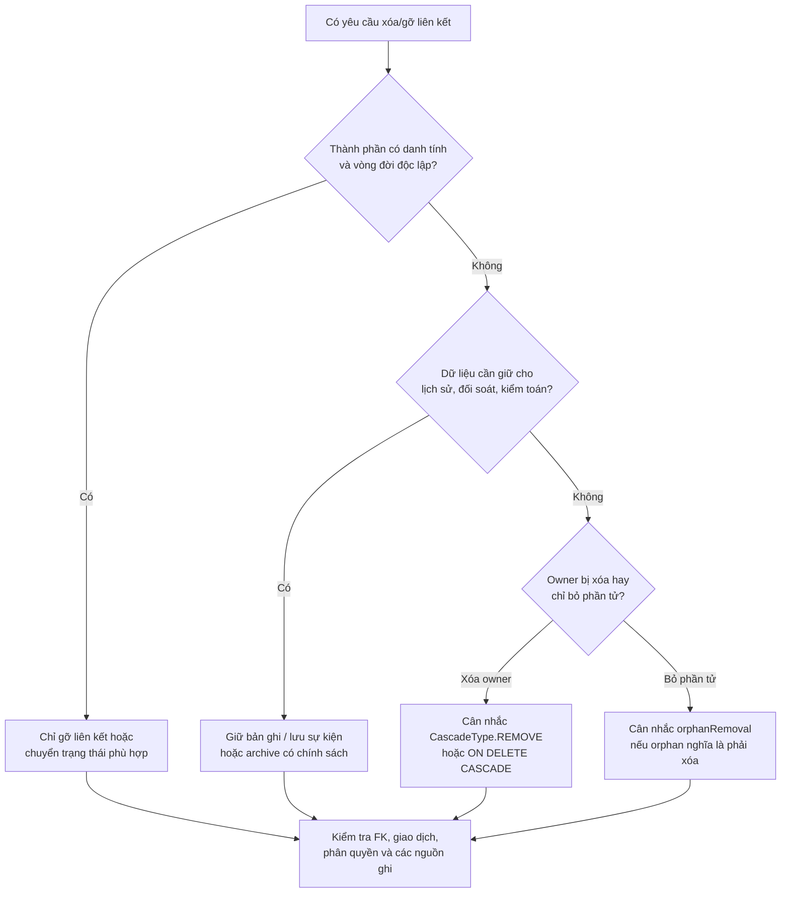
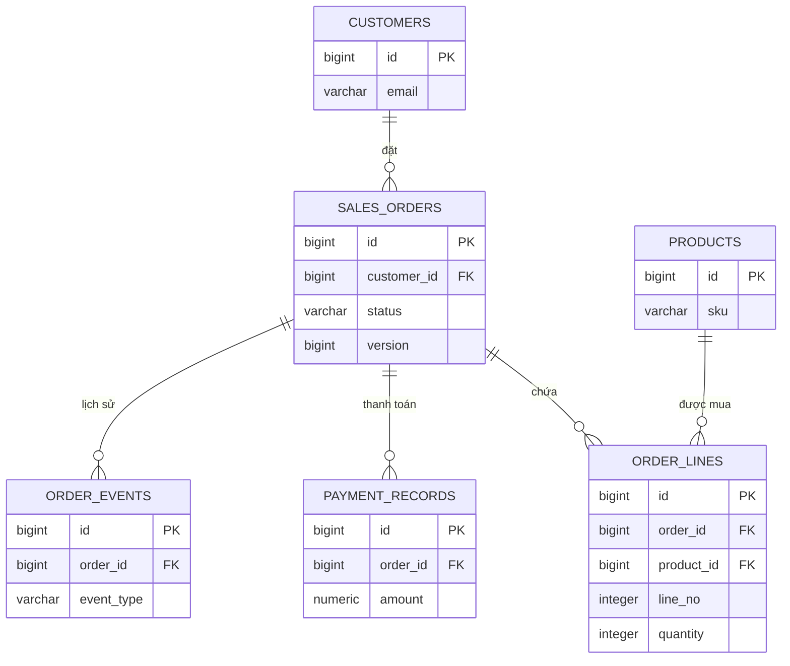
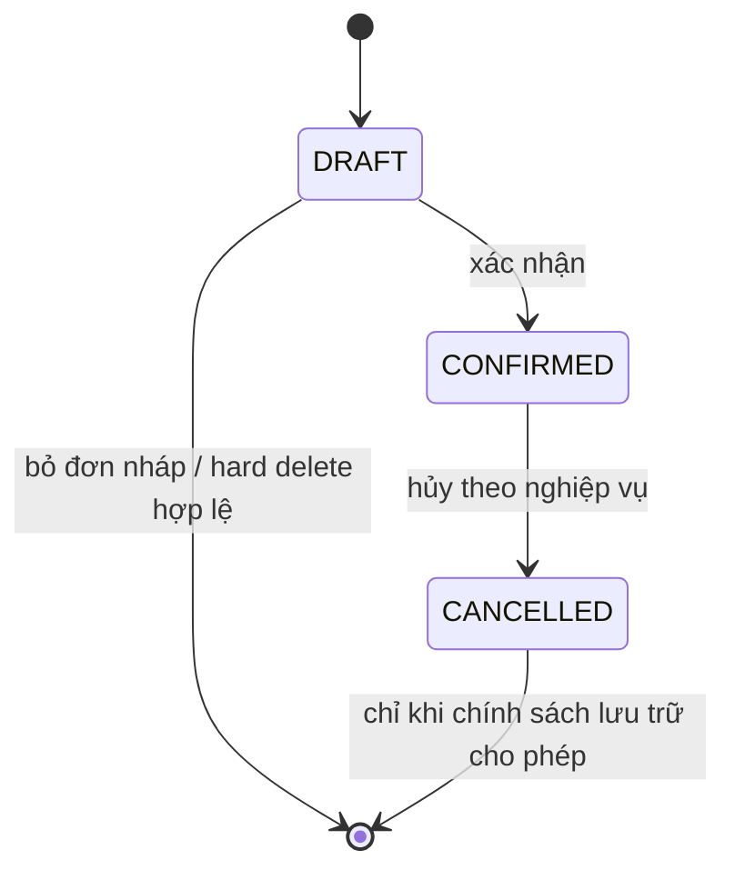

# Xóa lan truyền, phần tử mồ côi và vòng đời cần giữ lại

Khi người dùng xóa một đơn hàng, điều gì sẽ xảy ra với các dòng hàng, giao dịch thanh toán, lịch sử thay đổi và sản phẩm mà đơn đã mua? Nếu xóa một khách hàng, các hóa đơn cũ có được biến mất không? Nếu bỏ một phần tử khỏi `List<OrderLine>` trong Java, ORM phải sửa khóa ngoại, xóa hàng hay chỉ thay đổi danh sách đang nằm trong bộ nhớ?

Các câu hỏi ấy không có một đáp án chung là “bật cascade”. Trong mô hình quan hệ và Object–Relational Mapping (ORM), cần phân biệt **xóa lan truyền theo thao tác JPA**, **xóa phần tử mất chủ sở hữu**, **xóa lan truyền do ràng buộc SQL**, và **chính sách giữ lại dữ liệu qua vòng đời nghiệp vụ**. Cấu hình sai có thể gây mất bản ghi lịch sử, xóa entity đang được nhiều bên dùng chung, tạo hàng mồ côi hoặc che giấu xung đột giữa các giao dịch.

Bài học thuộc chương **Ánh xạ đối tượng** của module **DATABASE_DATA_MODELING**. Trọng tâm là biến yêu cầu nghiệp vụ thành quy tắc vòng đời, khóa ngoại, ràng buộc và lược đồ vật lý có thể kiểm chứng; sau đó lựa chọn `CascadeType.REMOVE`, `orphanRemoval`, `ON DELETE CASCADE`, soft delete, archive và giao dịch phù hợp với các quy tắc ấy.

## 1. Xác định vòng đời trước khi nói đến lệnh xóa

Trong một hệ thống bán hàng, có thể gặp các đối tượng sau:

| Dữ liệu | Mối liên hệ | Câu hỏi vòng đời | Quy tắc ví dụ |
|---|---|---|---|
| `SalesOrder` | Tham chiếu `Customer` | Xóa đơn có xóa khách không? | **Không**; khách có vòng đời độc lập |
| `OrderLine` | Thuộc một `SalesOrder` | Bỏ một dòng khỏi đơn nháp có xóa dòng không? | **Có**; dòng không tồn tại độc lập |
| `Product` | Được nhiều dòng hàng tham chiếu | Xóa dòng có xóa sản phẩm không? | **Không**; sản phẩm là dữ liệu dùng chung |
| `PaymentRecord` | Gắn với đơn hàng | Xóa đơn đã thanh toán có xóa giao dịch không? | **Không**; phải giữ chứng cứ/đối soát theo chính sách |
| `OrderEvent` | Ghi lịch sử của đơn | Hủy đơn có xóa sự kiện cũ không? | **Không**; cần giữ lịch sử đủ cho mục tiêu nghiệp vụ |

Các quy tắc trên là **giả định của ví dụ**, không phải luật cho mọi hệ thống. Một giỏ hàng tạm có thể được xóa hoàn toàn; đơn đã phát hành hóa đơn có thể phải giữ dữ liệu qua nhiều năm; dữ liệu cá nhân có thể phải được xóa hoặc ẩn danh theo chính sách và nghĩa vụ áp dụng. Cần xác định mục đích lưu giữ và xóa trước khi cấu hình ORM.

### Những từ “xóa” khác nhau

1. **Gỡ liên kết** (*unlink*): A không còn tham chiếu B; B có thể vẫn tồn tại. Ví dụ bỏ một role khỏi nhân viên.
2. **Xóa vật lý** (*hard delete*): hàng không còn trong bảng sau khi transaction commit.
3. **Xóa logic** (*soft delete*): hàng vẫn tồn tại nhưng được đánh dấu không còn hoạt động hoặc không xuất hiện trong một số truy vấn.
4. **Hủy theo nghiệp vụ** (*cancel*): chuyển trạng thái, giữ danh tính và lịch sử; không nhất thiết là soft delete.
5. **Lưu trữ/di chuyển lịch sử** (*archive*): giữ thông tin theo cấu trúc hoặc kho lưu trữ có chính sách riêng.
6. **Ẩn danh/loại dữ liệu nhạy cảm**: chỉ giữ phần dữ liệu được phép và cần thiết, đồng thời bảo vệ liên kết lịch sử theo chính sách phù hợp.

Một thao tác UI ghi “Xóa” không tự cho biết phải chọn cách nào. Thiết kế dữ liệu tốt phải định nghĩa **hiệu ứng nghiệp vụ** trước, rồi mới chọn phép biến đổi SQL.

### Phân biệt ownership kỹ thuật với ownership nghiệp vụ

Giả sử `OrderLine.order` là phía `@ManyToOne` chứa `order_id` và là *owning side* trong JPA; `SalesOrder.lines` là phía `@OneToMany(mappedBy = "order")`. Theo nghiệp vụ, `SalesOrder` lại là **aggregate root** quản lý vòng đời của các dòng hàng.

Đó là hai nghĩa sở hữu khác nhau:

- **Owning side JPA**: phía chịu trách nhiệm ghi liên kết FK/bảng nối.
- **Chủ sở hữu vòng đời/aggregate**: nơi đặt quy tắc cho phép tạo, sửa, bỏ và xóa thành phần.

Không thể chỉ nhìn `@JoinColumn` hoặc vị trí FK rồi suy ra quyền xóa dữ liệu. Một `@ManyToOne` từ Order tới Customer quản lý FK, nhưng không được vì thế mà cascade xóa Customer.

## 2. Ba cơ chế xóa thường bị đánh đồng

| Cơ chế | Kích hoạt khi nào? | Tầng thực thi | Hành vi chính |
|---|---|---|---|
| `CascadeType.REMOVE` | Gọi `EntityManager.remove(parent)` với quan hệ có cascade remove | JPA/ORM | Lan truyền thao tác remove sang entity liên quan |
| `orphanRemoval = true` | Một entity con bị loại khỏi quan hệ sở hữu `@OneToMany` hoặc `@OneToOne` được quản lý | JPA/ORM | Đánh dấu xóa entity con đã trở thành orphan |
| SQL `ON DELETE CASCADE` | DB thực thi `DELETE` trên hàng cha được FK tham chiếu | Database | Tự xóa các hàng con theo ràng buộc FK |

Điều quan trọng:

- `CascadeType.REMOVE` không đồng nghĩa với `orphanRemoval`.
- `orphanRemoval` không phải tùy chọn chung cho mọi association; trong JPA nó áp dụng cho `@OneToMany` và `@OneToOne`.
- SQL `ON DELETE CASCADE` không tương đương việc JPA gọi `remove` từng entity: callback entity, persistence context, cache và thời điểm thực thi có thể khác.
- Cả ba đều **không quyết định được** một khoản thanh toán có cần được lưu lại hay không; đó là yêu cầu nghiệp vụ.

### Sơ đồ quyết định trước khi xóa



Sơ đồ chỉ là trình tự đặt câu hỏi; hệ thống thật còn phải xét quyền thao tác, chế độ giữ dữ liệu, tình trạng đang tranh chấp, quan hệ phụ thuộc, sự kiện nghiệp vụ và tính nhất quán nhiều dịch vụ.

## 3. Mô hình SQL: giữ lịch sử nhưng cho phép sửa đơn nháp

Thiết kế sau minh họa hệ thống có khách hàng, sản phẩm, đơn, dòng hàng, giao dịch thanh toán và nhật ký sự kiện. Với **đơn nháp chưa có thanh toán/sự kiện cần giữ**, có thể xóa vật lý đơn cùng các dòng. Với đơn đã xác nhận, thanh toán hoặc có lịch sử cần giữ, chuyển trạng thái thay vì xóa toàn bộ.



### 3.1. DDL có ràng buộc chặn xóa không phù hợp

```sql
-- PostgreSQL; các lệnh dưới đây là một mô hình minh họa độc lập.
CREATE TABLE customers (
    id BIGINT GENERATED ALWAYS AS IDENTITY PRIMARY KEY,
    email VARCHAR(254) NOT NULL UNIQUE,
    is_active BOOLEAN NOT NULL DEFAULT TRUE
);

CREATE TABLE products (
    id BIGINT GENERATED ALWAYS AS IDENTITY PRIMARY KEY,
    sku VARCHAR(64) NOT NULL UNIQUE,
    display_name VARCHAR(200) NOT NULL,
    is_active BOOLEAN NOT NULL DEFAULT TRUE
);

CREATE TABLE sales_orders (
    id BIGINT GENERATED ALWAYS AS IDENTITY PRIMARY KEY,
    customer_id BIGINT NOT NULL,
    status VARCHAR(20) NOT NULL
        CHECK (status IN ('DRAFT', 'CONFIRMED', 'CANCELLED')),
    version BIGINT NOT NULL DEFAULT 0,
    created_at TIMESTAMPTZ NOT NULL DEFAULT CURRENT_TIMESTAMP,
    CONSTRAINT fk_order_customer
        FOREIGN KEY (customer_id) REFERENCES customers(id)
        ON DELETE RESTRICT
);

CREATE TABLE order_lines (
    id BIGINT GENERATED ALWAYS AS IDENTITY PRIMARY KEY,
    order_id BIGINT NOT NULL,
    product_id BIGINT NOT NULL,
    line_no INTEGER NOT NULL CHECK (line_no > 0),
    sku_snapshot VARCHAR(64) NOT NULL,
    unit_price NUMERIC(19, 2) NOT NULL CHECK (unit_price >= 0),
    quantity INTEGER NOT NULL CHECK (quantity > 0),
    CONSTRAINT fk_line_order
        FOREIGN KEY (order_id) REFERENCES sales_orders(id)
        ON DELETE RESTRICT,
    CONSTRAINT fk_line_product
        FOREIGN KEY (product_id) REFERENCES products(id)
        ON DELETE RESTRICT,
    CONSTRAINT uq_order_line_no UNIQUE (order_id, line_no)
);

CREATE TABLE payment_records (
    id BIGINT GENERATED ALWAYS AS IDENTITY PRIMARY KEY,
    order_id BIGINT NOT NULL,
    amount NUMERIC(19, 2) NOT NULL CHECK (amount > 0),
    currency_code VARCHAR(3) NOT NULL,
    provider_reference VARCHAR(120) NOT NULL UNIQUE,
    paid_at TIMESTAMPTZ,
    CONSTRAINT fk_payment_order
        FOREIGN KEY (order_id) REFERENCES sales_orders(id)
        ON DELETE RESTRICT
);

CREATE TABLE order_events (
    id BIGINT GENERATED ALWAYS AS IDENTITY PRIMARY KEY,
    order_id BIGINT NOT NULL,
    event_type VARCHAR(40) NOT NULL,
    occurred_at TIMESTAMPTZ NOT NULL DEFAULT CURRENT_TIMESTAMP,
    CONSTRAINT fk_event_order
        FOREIGN KEY (order_id) REFERENCES sales_orders(id)
        ON DELETE RESTRICT
);

CREATE INDEX idx_payment_records_order_id ON payment_records(order_id);
CREATE INDEX idx_order_events_order_id ON order_events(order_id);
```

Các quyết định đáng chú ý:

1. `order_lines.order_id` không nullable: dòng hàng phải thuộc một đơn đang tồn tại.
2. `order_lines.product_id` tham chiếu Product nhưng **không được xóa Product khi xóa dòng**. Product có vòng đời dùng chung.
3. `sku_snapshot` và `unit_price` lưu thông tin tại lúc đặt mua; việc cập nhật catalog Product không tự thay đổi nội dung giao dịch đã chốt.
4. `payment_records.order_id` và `order_events.order_id` dùng FK `RESTRICT` để ngăn xóa một đơn vẫn còn các bản ghi cần giữ.
5. FK từ `order_lines` đến `sales_orders` cũng dùng `RESTRICT`: khi xóa đơn nháp qua ORM, dòng phải được xóa **trước**; database không âm thầm thực hiện toàn bộ quy trình khi một nguồn khác xóa đơn.
6. `UNIQUE(order_id, line_no)` bảo vệ vị trí dòng; `CHECK` bảo vệ giá trị nhập sai từ các đường ghi không qua Java.

Trong PostgreSQL, `RESTRICT` và `NO ACTION` (mặc định) có khác biệt về thời điểm kiểm tra trong một số cấu hình deferrable; ví dụ chọn `RESTRICT` để diễn đạt rõ ý định chặn xóa hàng cha đang được tham chiếu. Ràng buộc FK chỉ kiểm tra tham chiếu, **không tự biết** đơn đã xác nhận có được xóa hay không.

### 3.2. Lược đồ không thay thế được chính sách xóa theo trạng thái

Nếu đơn `CONFIRMED` không có hàng thanh toán hay sự kiện, chỉ riêng các FK trên **chưa thể ngăn** một câu `DELETE FROM sales_orders` sau khi xóa các dòng. Để giữ bất biến “đơn đã xác nhận không được xóa”, cần kiểm soát ở application/service, quyền SQL, và khi cần bảo đảm trên mọi đường ghi, dùng cơ chế database như trigger, stored procedure hoặc chính sách thao tác dữ liệu được quản trị phù hợp.

Ví dụ một câu xóa có điều kiện để biểu diễn chính sách:

```sql
DELETE FROM sales_orders
WHERE id = :order_id
  AND status = 'DRAFT';
```

Câu SQL này **không tự xóa các dòng**, nên với FK `RESTRICT` nó vẫn thất bại khi còn dòng. Nó cũng không đủ để xử lý xóa nhiều bảng một cách an toàn khi có thao tác đồng thời. Hãy thực thi toàn bộ quyết định xóa trong transaction, khóa/kiểm tra trạng thái phù hợp và xác nhận không có lịch sử cần giữ.

### 3.3. Vì sao không mặc định `ON DELETE CASCADE` trên mọi FK?

Một khai báo kiểu:

```sql
-- KHÔNG nên áp dụng cho dữ liệu thanh toán cần giữ:
-- FOREIGN KEY (order_id) REFERENCES sales_orders(id) ON DELETE CASCADE
```

sẽ khiến database xóa giao dịch thanh toán khi đơn bị xóa. Kết quả có thể phá vỡ đối soát và lịch sử. Ngược lại, với một bảng cache tạm hoặc phần tử phụ thuộc hoàn toàn không cần giữ, `ON DELETE CASCADE` có thể hợp lý.

Thiết kế ràng buộc phải dựa trên **ý nghĩa vòng đời** của từng FK, không phải mong muốn tránh lỗi khi xóa parent.

## 4. `CascadeType.REMOVE`: xóa parent kéo theo child do ORM quản lý

`CascadeType.REMOVE` nằm trong `jakarta.persistence.CascadeType`. Khi gọi `EntityManager.remove` cho một entity **managed**, JPA có thể lan truyền remove đến các entity ở association được cấu hình cascade remove.

Ví dụ `SalesOrder` có các dòng hàng phụ thuộc, còn `Customer` và `Product` là các entity độc lập.

### 4.1. Mẫu ánh xạ có ranh giới rõ ràng

```java
import jakarta.persistence.*;
import java.math.BigDecimal;
import java.util.ArrayList;
import java.util.List;
import java.util.Objects;

@Entity
@Table(name = "sales_orders")
public class SalesOrder {

    @Id
    @GeneratedValue(strategy = GenerationType.IDENTITY)
    private Long id;

    @ManyToOne(fetch = FetchType.LAZY, optional = false)
    @JoinColumn(name = "customer_id", nullable = false)
    private Customer customer;  // Không cascade REMOVE tới Customer.

    @Enumerated(EnumType.STRING)
    @Column(nullable = false, length = 20)
    private OrderStatus status = OrderStatus.DRAFT;

    @OneToMany(
        mappedBy = "order",
        cascade = {
            CascadeType.PERSIST,
            CascadeType.MERGE,
            CascadeType.REMOVE
        },
        orphanRemoval = true
    )
    @OrderBy("lineNo ASC")
    private List<OrderLine> lines = new ArrayList<>();

    @Version
    @Column(nullable = false)
    private Long version;

    protected SalesOrder() {}

    public SalesOrder(Customer customer) {
        this.customer = Objects.requireNonNull(customer);
    }

    public Long getId() { return id; }

    private void ensureDraft() {
        if (status != OrderStatus.DRAFT) {
            throw new IllegalStateException("Đơn đã chốt không được sửa dòng");
        }
    }

    public void addLine(
            Product product, String skuSnapshot,
            BigDecimal unitPrice, int quantity) {
        ensureDraft();
        int next = lines.stream()
                .mapToInt(OrderLine::getLineNo)
                .max().orElse(0) + 1;
        OrderLine line = new OrderLine(
                this, product, next, skuSnapshot, unitPrice, quantity
        );
        lines.add(line);
    }

    public void removeLine(OrderLine target) {
        ensureDraft();
        for (int i = 0; i < lines.size(); i++) {
            if (lines.get(i) == target) {
                lines.remove(i);
                target.detachFromOrder();
                return;
            }
        }
        throw new IllegalArgumentException("Dòng không thuộc đơn này");
    }

    public void assertCanDelete() {
        ensureDraft();
    }

    public void cancel() {
        if (status == OrderStatus.CONFIRMED) {
            status = OrderStatus.CANCELLED;
            return;
        }
        throw new IllegalStateException(
                "Luồng hủy cần xác định riêng cho trạng thái hiện tại"
        );
    }
}
```

Enum `OrderStatus` gồm `DRAFT`, `CONFIRMED`, `CANCELLED`. `Customer` và `Product` là entity độc lập đã được định nghĩa trong hệ thống. Đây là mã minh họa chính sách vòng đời; ví dụ chưa gồm đầy đủ xác thực, quyền sử dụng, giao dịch, hoàn tiền, kiểm kê và các thao tác nghiệp vụ khác.

Lớp con:

```java
@Entity
@Table(name = "order_lines")
public class OrderLine {

    @Id
    @GeneratedValue(strategy = GenerationType.IDENTITY)
    private Long id;

    @ManyToOne(fetch = FetchType.LAZY, optional = false)
    @JoinColumn(name = "order_id", nullable = false)
    private SalesOrder order; // owning side của FK order_id

    @ManyToOne(fetch = FetchType.LAZY, optional = false)
    @JoinColumn(name = "product_id", nullable = false)
    private Product product; // KHÔNG cascade REMOVE tới Product.

    @Column(name = "line_no", nullable = false)
    private int lineNo;

    @Column(name = "sku_snapshot", nullable = false, length = 64)
    private String skuSnapshot;

    @Column(name = "unit_price", nullable = false, precision = 19, scale = 2)
    private BigDecimal unitPrice;

    @Column(nullable = false)
    private int quantity;

    protected OrderLine() {}

    OrderLine(
            SalesOrder order, Product product, int lineNo,
            String skuSnapshot, BigDecimal unitPrice, int quantity) {
        this.order = Objects.requireNonNull(order);
        this.product = Objects.requireNonNull(product);
        this.skuSnapshot = Objects.requireNonNull(skuSnapshot);
        this.unitPrice = Objects.requireNonNull(unitPrice);
        if (lineNo <= 0 || quantity <= 0 || unitPrice.signum() < 0) {
            throw new IllegalArgumentException("Dữ liệu dòng không hợp lệ");
        }
        this.lineNo = lineNo;
        this.quantity = quantity;
    }

    public int getLineNo() { return lineNo; }

    void detachFromOrder() {
        this.order = null;
    }
}
```

Các import JPA, `BigDecimal` và `Objects` của đoạn con có thể dùng chung với ví dụ trước; khi đặt thành các file Java riêng, cần bổ sung import tương ứng. Phương thức `detachFromOrder()` dùng để giữ **đồ thị hai chiều trong bộ nhớ** nhất quán. Nó chỉ được gọi như một phần của quy trình xóa orphan, không có ý nghĩa cho phép lưu một `OrderLine` với `order_id = NULL`.

### 4.2. Xóa đơn nháp

Trong một transaction, use case có thể làm:

```java
SalesOrder order = em.find(
        SalesOrder.class, orderId, LockModeType.PESSIMISTIC_WRITE
);
if (order == null) {
    throw new EntityNotFoundException("Không có đơn hàng");
}

order.assertCanDelete();
// Use case còn phải xác nhận không có payment/event cần giữ.
em.remove(order);
```

Với `CascadeType.REMOVE` trên `SalesOrder.lines`, JPA xử lý remove cho các `OrderLine` được sở hữu; nó **không** lan truyền sang `Customer` hay `Product` vì các association ấy không cấu hình cascade remove.

SQL kết quả về mặt ý nghĩa thường tương tự:

```sql
DELETE FROM order_lines WHERE order_id = :order_id;
DELETE FROM sales_orders WHERE id = :order_id;
```

Đây là **diễn giải logic**, không cam kết provider sẽ phát ra đúng hai lệnh như trên. ORM có thể xóa từng dòng theo ID, tải trước các entity hoặc dùng thứ tự khác phù hợp với ràng buộc; phải kiểm tra SQL log. Với lược đồ có `RESTRICT`, các dòng cần được xóa trước parent. Transaction chưa commit thì vẫn có thể rollback.

**Giới hạn nghiệp vụ của ví dụ:** một dòng payment/event có FK đến order vẫn chặn xóa vật lý. Điều đó tốt cho bảo toàn lịch sử, nhưng nếu use case thực sự cho phép xóa đơn chưa thanh toán đã ghi một sự kiện tạm, cần định nghĩa rõ cách lưu/di chuyển/xóa sự kiện tạm trước. Không xử lý bằng cách thêm cascade remove vô điều kiện cho bảng lịch sử.

### 4.3. `CascadeType.ALL` không phải “nút an toàn”

`CascadeType.ALL` bao gồm các thao tác cascade được JPA định nghĩa như `PERSIST`, `MERGE`, `REMOVE`, `REFRESH` và `DETACH`. Chọn `ALL` nghĩa là chấp nhận lan truyền **mọi** thao tác đó theo association.

Đối với phần tử hoàn toàn thuộc vòng đời một owner, `ALL` có thể phù hợp. Đối với `SalesOrder.customer`, `OrderLine.product`, `Employee.roles` hoặc `Invoice.taxRate` dùng chung, cascade remove thường **không phù hợp**.

Hãy khai báo rõ những cascade được dùng khi thiết kế chưa chắc chắn; không thêm `CascadeType.REMOVE` chỉ để làm cho lệnh xóa ít lỗi FK hơn.

## 5. `orphanRemoval`: bỏ khỏi quan hệ nghĩa là xóa thực thể con

`orphanRemoval = true` dành cho association `@OneToOne` và `@OneToMany` mà entity con **không còn hợp lệ khi không có owner**. Nó không đòi gọi `em.remove(child)` trực tiếp ở use case: khi entity con bị loại khỏi quan hệ của owner managed, ORM có thể đánh dấu xóa orphan khi đồng bộ.

### 5.1. Bỏ một dòng khỏi đơn nháp

```java
SalesOrder order = em.find(SalesOrder.class, orderId);
OrderLine line = findLineWithinManagedOrder(order, lineId);

order.removeLine(line);
// Khi flush/commit, ORM xóa hàng order_lines của line.
```

`findLineWithinManagedOrder` là helper minh họa, không phải API JPA. Điều quan trọng là `line` đang là thành phần của `order.lines` trong persistence context thích hợp và thao tác phải đi qua phương thức có kiểm tra `DRAFT`.

Trước thao tác:

```text
Order #91 (DRAFT)
  lines: [Line #501, Line #502, Line #503]

SQL order_lines:
  id=501, order_id=91
  id=502, order_id=91
  id=503, order_id=91
```

Sau `removeLine(Line #502)` và transaction commit thành công:

```text
Order #91 (DRAFT)
  lines: [Line #501, Line #503]

SQL order_lines:
  id=501, order_id=91
  id=503, order_id=91
```

Theo chính sách này, `Line #502` bị **xóa**, không được lưu thành một hàng với `order_id = NULL`. `OrderLine` không còn chủ sở hữu nên không còn tư cách tồn tại độc lập.

### 5.2. Khác biệt với collection không bật `orphanRemoval`

Giả sử chỉ cấu hình:

```java
@OneToMany(mappedBy = "order", cascade = CascadeType.PERSIST)
private List<OrderLine> lines = new ArrayList<>();
```

Sau đó chỉ gọi `order.getLines().remove(line)`. Trong quan hệ hai chiều, `mappedBy` là phía inverse; bỏ phần tử ở collection **không tự chứng minh** rằng FK ở owning side cần đổi hay rằng child phải bị xóa. Nếu còn gán `line.order = order` thì FK vẫn trỏ về đơn. Nếu gán `line.order = null`, ORM có thể cố cập nhật FK thành `NULL` và gặp ràng buộc `NOT NULL`.

Không nên dùng mẹo tách child ra khỏi parent khi mô hình thật sự yêu cầu xóa child. Hoặc bật orphan removal đúng ngữ nghĩa, hoặc gọi remove child qua use case/repository với giao dịch và quyền thao tác thích hợp.

### 5.3. Không dùng `orphanRemoval` để chuyển child sang owner khác

Một thao tác kiểu:

```java
orderA.getLines().remove(line);
orderB.getLines().add(line);
line.setOrder(orderB);
```

có thể xung đột với ý nghĩa `orphanRemoval`: việc bỏ khỏi owner A đã xác định child cần bị xóa. JPA không bảo đảm hành vi di chuyển một orphan được đánh dấu xóa sang owner B như một update đơn giản có tính di động giữa provider.

Nếu nghiệp vụ cần chuyển một dòng sang đơn khác, cần xác định “đó có còn là cùng dòng hàng không?”. Có thể tạo dòng mới mang dữ liệu cần thiết, giữ sự kiện chuyển và xóa dòng cũ theo transaction; hoặc thiết kế lại khóa, aggregate boundary và quy tắc ownership.

Đặc biệt không dùng `orphanRemoval = true` cho entity được nhiều parent dùng chung. Xóa một liên kết không có nghĩa toàn entity mất quyền tồn tại.

### 5.4. Những trường hợp không nên trông cậy vào orphan removal

- Entity mới chưa được persist hoặc đã detached: thời điểm và phạm vi áp dụng của orphan removal không giống trường hợp managed entity; không dựa vào hành vi ngầm với đối tượng không managed.
- Bộ sưu tập thay bằng một instance mới từ DTO một cách mù quáng: ORM có thể coi nhiều child cũ là orphan và lên lịch xóa dữ liệu thật.
- Quan hệ `@ManyToMany`: JPA không hỗ trợ thuộc tính `orphanRemoval` trên annotation này; việc xóa dòng bảng nối khác xóa entity đích.
- Bản ghi cần audit hoặc giữ lịch sử: orphan removal là **hard delete** về mặt kết quả lưu trữ thông thường, không thay thế quy trình “đóng hiệu lực nhưng giữ bản ghi”.

## 6. SQL `ON DELETE CASCADE` và các hành động khóa ngoại

Database hỗ trợ nhiều hành vi khi hàng được tham chiếu bị xóa. Cú pháp và khả năng deferrable tùy hệ quản trị, nhưng các phương án phổ biến gồm:

| Hành động FK | Kết quả khi xóa parent | Khi nào đáng cân nhắc |
|---|---|---|
| `RESTRICT` / `NO ACTION` | Từ chối xóa nếu còn hàng phụ thuộc vi phạm FK | Lịch sử, dữ liệu cần giữ, hoặc muốn use case quyết định xóa child |
| `CASCADE` | Tự xóa các hàng con liên quan | Child hoàn toàn phụ thuộc và được phép hard delete theo owner |
| `SET NULL` | Đặt FK ở child thành null | Liên kết là tùy chọn, child vẫn có ý nghĩa khi parent mất |
| `SET DEFAULT` | Đặt FK về giá trị mặc định | Chỉ khi default hợp lệ và chính sách nghiệp vụ thật sự cho phép |

Không có câu trả lời mặc định cho mọi FK.

### 6.1. Ví dụ khi `ON DELETE CASCADE` thực sự hợp lý

Giả sử bảng chứa mã xác thực tạm cho một phiên đăng nhập và không cần giữ khi phiên bị xóa:

```sql
CREATE TABLE login_sessions (
    id UUID PRIMARY KEY,
    created_at TIMESTAMPTZ NOT NULL
);

CREATE TABLE session_tokens (
    id UUID PRIMARY KEY,
    session_id UUID NOT NULL,
    token_hash VARCHAR(128) NOT NULL,
    FOREIGN KEY (session_id)
        REFERENCES login_sessions(id) ON DELETE CASCADE
);
```

Nếu nghiệp vụ xác nhận token chỉ thuộc đúng một phiên và không phải dữ liệu cần giữ, xóa phiên bằng SQL có thể xóa token cùng transaction mà không cần tải từng token vào bộ nhớ Java.

Ngược lại, đối với `payment_records` hoặc `order_events` phải giữ, không nên dùng cùng một chính sách chỉ vì chúng cũng có FK về đơn hàng.

### 6.2. `ON DELETE SET NULL` đòi FK nullable

Ví dụ lịch sử đơn cần giữ ảnh chụp SKU và giá cũ nhưng không buộc giữ reference tới Product đã bị thanh lý. Có thể cân nhắc một **phương án thay thế**:

```sql
-- Phiên bản khác của cột product_id, KHÔNG áp dụng trực tiếp
-- nếu lược đồ trước đang khai báo product_id NOT NULL:
product_id BIGINT NULL REFERENCES products(id) ON DELETE SET NULL
```

Trong phương án này, `sku_snapshot`, tên sản phẩm đã chụp và giá tại giao dịch phải đủ để giải thích đơn lịch sử. `product_id` chỉ là tham chiếu tùy chọn đến catalog hiện tại.

Nếu ORM khai báo `@ManyToOne(optional = false)` trong khi DB lại cho `product_id = NULL`, hai mô hình mâu thuẫn. Cần đổi cả mapping và nghiệp vụ khi chọn hướng `SET NULL`.

### 6.3. Database cascade có thể bỏ qua vòng đời Java

Khi chạy:

```sql
DELETE FROM login_sessions WHERE id = :session_id;
```

database có thể tự xóa hàng `session_tokens`. Nhưng các instance Java đang được quản lý trong persistence context khác không tự biết rằng hàng đã biến mất; callback `@PreRemove` của ORM cho từng token cũng không đương nhiên được gọi bởi thao tác cascade thuần SQL.

Điều này ảnh hưởng đến cache cấp hai, dữ liệu đang hiển thị, audit bằng application callback và các side effect trong code. Nếu chọn DB cascade, hãy định nghĩa cơ chế audit, cache invalidation và transaction boundary đúng tầng; đừng kỳ vọng behavior của JPA cascade được thực hiện tương tự.

### 6.4. Không cấu hình chồng chéo chỉ vì “càng nhiều cascade càng chắc”

Nếu cùng một quan hệ được cấu hình cả JPA `CascadeType.REMOVE` lẫn DB `ON DELETE CASCADE`, một số provider vẫn xóa child bằng SQL trước, rồi DB không còn child để cascade; provider khác hoặc extension riêng có thể tối ưu theo cách khác. Điều này không tự động gây lỗi, nhưng làm **trách nhiệm thực thi** khó theo dõi.

Nên chọn chiến lược có lý do: ORM thực thi khi cần callback/entity-level behavior; DB thực thi khi cần bảo vệ cho mọi nguồn ghi hoặc hard delete khối lượng lớn. Nếu phối hợp cả hai, phải thử SQL và callback/cache thực tế. Annotation `@OnDelete` thường gặp trong Hibernate là extension của provider, không phải annotation chuẩn JPA.

## 7. Đối tượng dùng chung: gỡ liên kết không phải xóa entity

Xét `Employee` và `Role`: nhiều nhân viên có thể mang cùng vai trò. Hủy quyền `ADMIN` của một nhân viên chỉ cần xóa **hàng liên kết**, không được xóa role `ADMIN`.

```sql
CREATE TABLE roles (
    id BIGINT GENERATED ALWAYS AS IDENTITY PRIMARY KEY,
    code VARCHAR(50) NOT NULL UNIQUE
);

CREATE TABLE employees (
    id BIGINT GENERATED ALWAYS AS IDENTITY PRIMARY KEY
);

CREATE TABLE employee_roles (
    employee_id BIGINT NOT NULL REFERENCES employees(id),
    role_id BIGINT NOT NULL REFERENCES roles(id),
    PRIMARY KEY (employee_id, role_id)
);
```

Trong JPA:

```java
@ManyToMany
@JoinTable(
    name = "employee_roles",
    joinColumns = @JoinColumn(name = "employee_id"),
    inverseJoinColumns = @JoinColumn(name = "role_id")
)
private Set<Role> roles = new HashSet<>();
```

Không khai báo `CascadeType.REMOVE` từ Employee sang Role. Khi gỡ một role khỏi tập hợp `employee.roles` ở owning side, thao tác hợp lý là xóa hàng `employee_roles(employee_id, role_id)`; `roles` vẫn giữ nguyên.

Tương tự:

- Xóa bài viết khỏi một chủ đề không đồng nghĩa xóa `Tag` dùng chung.
- Hủy một dòng đặt hàng không được xóa `Product`.
- Xóa cuộc hẹn không được xóa `Doctor`.
- Gỡ giảng viên khỏi khóa học không được xóa hồ sơ `Instructor`.

Nếu liên kết có trạng thái, thời gian hiệu lực hoặc lịch sử riêng, nên cân nhắc **entity liên kết** (`RoleAssignment`) với phương thức thu hồi/đóng hiệu lực thay vì hard delete một hàng trong bảng `@ManyToMany` thuần.

## 8. Giữ lại vòng đời: hủy, soft delete và archive

### 8.1. Hủy đơn hàng khác xóa đơn hàng

Với `SalesOrder` đã xác nhận, yêu cầu “hủy đơn” thường nên biểu diễn bằng **chuyển trạng thái**:

```text
DRAFT --confirm--> CONFIRMED --cancel--> CANCELLED
    \--discard--> (hard delete nếu chưa cần lưu)
```



Khi `cancel`, giữ nguyên `sales_orders.id` và các dòng lịch sử, ghi sự kiện hủy hoặc giao dịch hoàn tiền nếu cần. Trạng thái `CANCELLED` không có nghĩa dữ liệu đã bị xóa.

**Không gọi `em.remove(order)` chỉ để biểu diễn trạng thái hủy**, vì nó có thể gây xóa lan truyền dòng hàng và vi phạm FK của payment/event.

### 8.2. Soft delete chỉ giải quyết tính hiển thị, không xóa ràng buộc

Một phương án soft delete là thêm:

```sql
ALTER TABLE products
ADD COLUMN deleted_at TIMESTAMPTZ;

-- Truy vấn chỉ lấy catalog còn hiệu lực:
SELECT id, sku, display_name
FROM products
WHERE deleted_at IS NULL;
```

Hàng Product vẫn tồn tại, nên FK từ `order_lines.product_id` vẫn hợp lệ. Dữ liệu lịch sử vẫn có thể truy vấn nếu quyền truy cập và chính sách lưu trữ cho phép.

Nhưng soft delete tạo các quyết định mới:

- Mọi truy vấn nào cần loại bản ghi soft-deleted? Những truy vấn lịch sử nào vẫn cần thấy?
- Khi đối tượng bị soft delete, có được tạo FK mới tới nó không?
- Có được khôi phục không? Nếu có, xử lý xung đột khóa nghiệp vụ thế nào?
- Việc đánh dấu deleted có được audit và phát sự kiện không?
- Hệ thống có thực sự được phép giữ dữ liệu cá nhân đó, hay có yêu cầu xóa/ẩn danh theo chính sách áp dụng?

Đặc biệt, **FK chỉ biết hàng tồn tại**, không biết `deleted_at` có null hay không. Muốn ngăn một dòng đặt hàng mới trỏ tới sản phẩm đã xóa logic, cần kiểm tra ở use case và có thể cần bảo vệ ở DB hoặc cơ chế giao dịch phù hợp nếu nhiều nguồn ghi.

### 8.3. Soft delete và `UNIQUE`

Giả sử user có `email` duy nhất. Sau khi soft delete một tài khoản, doanh nghiệp muốn cho phép tài khoản mới dùng lại email đó. Một constraint `UNIQUE(email)` toàn bảng sẽ vẫn chặn trùng vì hàng cũ còn tồn tại.

Với PostgreSQL, có thể dùng **partial unique index** trong một mô hình phù hợp:

```sql
-- Minh họa một phương án lược đồ khác:
-- Không được giữ đồng thời UNIQUE(email) toàn bảng
-- nếu chính sách cho phép tái dùng email sau soft delete.
CREATE UNIQUE INDEX uq_active_user_email
ON app_users (lower(email))
WHERE deleted_at IS NULL;
```

Ví dụ giả định bảng `app_users` có `email` và `deleted_at`, **không phải DDL bổ sung chạy trực tiếp trên bảng `customers` ở mục 3**. Với chính sách này, hai tài khoản đã xóa có thể giữ cùng email nếu thỏa điều kiện chỉ mục; thao tác khôi phục phải xử lý xung đột nếu email đã được cấp cho tài khoản khác. Vấn đề liên kết danh tính, bảo mật đăng nhập và lịch sử giao dịch có thể khiến việc tái dùng email không phù hợp trong một số hệ thống.

### 8.4. Archive, audit và retention

Không nên gọi mọi bảng history là “bảng con sẽ xóa theo parent”. Một `OrderEvent` thường có mục đích **chứng minh việc đã xảy ra**; nếu xóa nó khi đơn bị xóa, audit có thể mất ý nghĩa.

Có những cách giữ lịch sử khác nhau:

| Phương án | Điểm mạnh | Điểm phải thiết kế |
|---|---|---|
| Giữ hàng transaction và đổi `status` | Dễ truy vấn FK và đối soát | Dữ liệu tăng, cần chính sách retention/quyền |
| Bảng event/audit append-only | Giữ chuỗi sự kiện nghiệp vụ | Khóa, ordering, khả năng sửa/xóa theo quy định |
| Bảng archive/kho lịch sử riêng | Tối ưu bảng vận hành hiện tại | Chuyển dữ liệu, tính toàn vẹn tham chiếu, khôi phục |
| Ẩn danh trường nhạy cảm, giữ dữ liệu tổng hợp | Giảm thông tin cá nhân còn lưu | Phải chứng minh phần còn lại đáp ứng mục đích và yêu cầu áp dụng |

**Thời hạn lưu giữ** không được đoán từ annotation hay từ thói quen dự án. Cần xác định theo loại dữ liệu, hợp đồng, quy định áp dụng và yêu cầu nghiệp vụ. Không tự động giữ mọi dữ liệu vĩnh viễn, cũng không xóa sạch history chỉ vì người dùng bấm nút hủy.

## 9. Trường hợp `@ElementCollection` và value object

Không phải mọi phần tử collection là entity có danh tính riêng. Một `Customer` có thể chứa danh sách `Address` (value object) qua `@ElementCollection`:

```java
@ElementCollection(fetch = FetchType.LAZY)
@CollectionTable(
    name = "customer_addresses",
    joinColumns = @JoinColumn(name = "customer_id")
)
private List<Address> savedAddresses = new ArrayList<>();
```

Các hàng trong `customer_addresses` lưu **giá trị thuộc owner**. Khi xóa một giá trị khỏi collection được quản lý, ORM đồng bộ thay đổi các hàng collection; không có entity `Address` độc lập để gọi `EntityManager.remove(address)`.

Điều này khác với `@OneToMany(orphanRemoval = true)`:

- `@ElementCollection`: phần tử là value, bình đẳng theo giá trị, không có lifecycle entity riêng.
- `@OneToMany`: phần tử là entity có danh tính JPA, dù vòng đời phụ thuộc vào aggregate owner.

Nếu dữ liệu địa chỉ cần được xác minh, dùng chung giữa nhiều khách hoặc tham chiếu bằng ID riêng qua API, nó có thể cần được mô hình hóa thành entity. Khi đó chính sách xóa liên kết và xóa entity phải được thiết kế lại, không đơn giản giữ `@ElementCollection` rồi thêm ID cho mỗi hàng.

## 10. Giao dịch và xung đột đồng thời khi xóa

Xóa là thao tác ghi có thể cạnh tranh với tạo, sửa hoặc xác nhận dữ liệu. Cascade và orphan removal **không thay thế** locking.

### 10.1. Race: một người xóa dòng, người khác xác nhận đơn

```text
T1: đọc Order #91 (DRAFT)
T2: đọc Order #91 (DRAFT)
T1: removeLine(Line #502)
T2: confirm Order #91
T1: flush/xóa line; T2: flush/xác nhận
```

Bất biến mong muốn: **không được xóa dòng sau khi đơn đã xác nhận**. Nếu hai transaction dựa trên trạng thái cũ mà không phối hợp, kết quả có thể không phản ánh đúng thứ tự nghiệp vụ.

Hướng kiểm soát:

1. Tất cả lệnh thay đổi các dòng qua `SalesOrder`/use case có transaction rõ ràng.
2. Dùng optimistic locking trên root và bảo đảm mọi thao tác có ảnh hưởng đến bất biến root tham gia cơ chế version; hoặc dùng pessimistic locking khi mức tranh chấp/yêu cầu cần thiết.
3. Không giả định **mọi thay đổi ở collection** tự tăng version của root trong tất cả cấu hình ORM; phải kiểm chứng.
4. Khi version xung đột, nạp lại trạng thái và trả conflict hoặc thử lại có điều kiện, không âm thầm ghi đè.

Ví dụ khi muốn ép tăng version ở thao tác ảnh hưởng aggregate:

```java
SalesOrder order = em.find(SalesOrder.class, orderId);
em.lock(order, LockModeType.OPTIMISTIC_FORCE_INCREMENT);
OrderLine line = findLineWithinManagedOrder(order, lineId);
order.removeLine(line);
```

Tính tương thích và thời điểm tăng version do provider/transaction quyết định; không dùng đoạn này thay cho kiểm thử tương tranh. Một lựa chọn khác là khóa root bằng `PESSIMISTIC_WRITE` từ đầu use case sửa/xác nhận, nhất quán ở mọi luồng tham gia.

### 10.2. Race: xóa parent trong lúc có child mới

```text
T1: kiểm tra không có payment cho Order #91
T2: tạo PaymentRecord cho Order #91
T1: cố xóa Order #91
```

Nếu có FK `payment_records.order_id REFERENCES sales_orders(id) ON DELETE RESTRICT`, database giúp ngăn trạng thái payment trỏ vào order đã biến mất. Tuy vậy, để thực hiện đúng chính sách “chỉ xóa khi chưa có payment”, use case phải đặt các kiểm tra và thao tác dưới cơ chế giao dịch/locking phù hợp; việc kiểm tra một lần trước rồi xóa không phải bảo đảm tuyệt đối khi có đồng thời.

Không được loại bỏ FK chỉ để tránh race. Ràng buộc chính là lớp bảo vệ toàn vẹn cuối cùng khi code cạnh tranh hoặc có nguồn ghi bên ngoài.

### 10.3. `flush` không phải `commit`

Khi `em.flush()`, ORM gửi các lệnh thay đổi xuống DB trong transaction hiện tại. Một `DELETE` thành công tại thời điểm đó vẫn có thể rollback. Để xác nhận kết quả cuối cùng, đọc lại bằng transaction/persistence context mới sau commit.

Nếu xóa qua SQL hoặc bulk JPQL mà vẫn giữ managed entity trong một persistence context, trạng thái object Java có thể không khớp database. Phải xác định khi nào cần `clear`/refresh và xử lý cache theo quy tắc của provider.

## 11. Xóa nhiều bản ghi: chọn đúng cơ chế thay vì tối ưu mù

Với một đơn có vài dòng, JPA cascade remove thuận tiện và dễ đọc. Với một owner có hàng trăm nghìn child, xóa từng entity có thể tạo nhiều SQL, tải đồ thị lớn, tốn bộ nhớ và làm chậm transaction.

Ba hướng phổ biến:

| Hướng | Ưu điểm | Rủi ro |
|---|---|---|
| JPA `em.remove(owner)` với cascade | Theo vòng đời entity, callback và mapping ORM | Có thể tải/xóa nhiều entity; số SQL lớn |
| Bulk SQL/JPQL theo điều kiện | Ít round-trip, dễ điều khiển thứ tự theo bảng | Bỏ qua cascade/callback entity-level tự động và có thể làm persistence context stale |
| DB `ON DELETE CASCADE` | DB tự xóa hàng phụ thuộc, hỗ trợ nhiều nguồn ghi | Không tự chạy callback Java; khó dùng với history phải giữ |

### 11.1. Bulk delete phải tôn trọng FK và nghiệp vụ

Ví dụ xóa vật lý đơn nháp không có payment/event bằng SQL, cần chạy **trong transaction** và chặn thay đổi cạnh tranh:

```sql
-- Minh họa logic; ứng dụng cần khóa/xác minh điều kiện trong transaction.
DELETE FROM order_lines
WHERE order_id = :order_id;

DELETE FROM sales_orders
WHERE id = :order_id AND status = 'DRAFT';
```

Không được coi đây là quy trình hoàn chỉnh nếu lệnh đầu xóa dòng mà lệnh sau không xóa được parent do đơn đã đổi trạng thái. Khi thao tác xóa parent không thành công, giao dịch cần rollback thay vì commit nửa kết quả. Có thể thực thi qua service kiểm soát khóa và kiểm tra row count, hoặc một stored procedure có quy tắc rõ ràng.

Với các bảng lịch sử dùng `RESTRICT`, việc xóa parent vẫn bị chặn nếu còn payment/event. Đây là hành vi bảo vệ dữ liệu cần giữ, không phải lỗi cần giải quyết bằng cascade.

### 11.2. Bulk JPQL và lifecycle callback

Một câu:

```java
int deleted = em.createQuery("""
    delete from OrderLine l
    where l.order.id = :orderId
    """)
    .setParameter("orderId", orderId)
    .executeUpdate();
```

là bulk operation. Nó **không** tương đương lặp trên từng entity rồi gọi `em.remove`: các quy tắc cascade remove và callback `@PreRemove` trên từng entity không được áp dụng giống thao tác entity-level. Những managed objects đã được tải trước đó có thể trở nên không đồng bộ. Cần xác định transaction và chính sách clear/refresh, đồng thời không dùng bulk delete để bỏ qua quyền xóa nghiệp vụ.

Với logic audit bắt buộc, đừng chỉ dựa vào callback Java nếu có những đường xóa trực tiếp trong database. Hãy thiết kế nguồn audit đáng tin cậy tương ứng với mọi đường ghi được phép.

## 12. Kiểm tra mô hình qua các câu hỏi quyết định

### 12.1. Ai có quyền xóa và điều gì phải sống sót?

Đối với mỗi quan hệ, trả lời:

1. Parent là aggregate root hay chỉ là một entity được child tham chiếu?
2. Child có được nhiều parent dùng chung hoặc có API riêng không?
3. Nếu bỏ liên kết, child có còn ý nghĩa độc lập không?
4. Nếu xóa parent, có cần giữ hóa đơn, giao dịch, log, snapshot hoặc dữ liệu đối soát không?
5. Các dữ liệu cần giữ có chứa thông tin cá nhân, có chính sách retention/ẩn danh riêng không?
6. Có những nguồn ghi nào ngoài ORM: SQL job, import, dịch vụ khác, trigger, ETL?

Từ đó mới quyết định JPA cascade, orphan removal và hành vi FK.

### 12.2. Ma trận chính sách mẫu

| Quan hệ | Khi bỏ liên kết | Khi xóa owner | FK đề xuất ban đầu |
|---|---|---|---|
| `SalesOrder → OrderLine` khi DRAFT | Hard delete dòng bằng orphan removal | Cascade remove dòng nếu đơn được phép xóa | `RESTRICT`, để ORM điều phối |
| `SalesOrder → Customer` | Thường không cho vắng Customer; điều chỉnh quan hệ bằng use case | Không xóa Customer | `RESTRICT` |
| `OrderLine → Product` | Thông thường không đổi Product của dòng đã chốt | Không xóa Product | `RESTRICT`, giữ snapshot |
| `SalesOrder → PaymentRecord` | Không xóa payment để “gỡ” khỏi đơn | Giữ payment; từ chối hard delete order | `RESTRICT` |
| `SalesOrder → OrderEvent` | Giữ event theo retention | Giữ event; từ chối/điều phối archive | `RESTRICT` |
| `Employee ↔ Role` | Xóa hàng bảng nối | Không xóa Role dùng chung | FK của bảng nối, tùy chính sách dọn liên kết |
| `LoginSession → SessionToken` tạm | Xóa token theo session | Có thể cascade xóa token | `ON DELETE CASCADE` nếu đúng lifecycle |

Đây là **đề xuất cho mô hình minh họa**, không phải cấu hình mẫu áp dụng đại trà. Nếu một bản ghi lịch sử cần được xóa theo yêu cầu hợp lệ, phải thiết kế tác động lên các tham chiếu khác, quyền thao tác và dữ liệu liên quan.

### 12.3. Checklist an toàn trước khi đưa vào production

- [ ] Đã xác định rõ hard delete, cancel, soft delete và archive cho từng entity.
- [ ] Không có cascade remove từ entity con sang Customer, Product, Role hay dữ liệu dùng chung.
- [ ] `orphanRemoval` chỉ dùng khi orphan thực sự phải bị hard delete.
- [ ] Mỗi FK có chính sách `RESTRICT`/`CASCADE`/`SET NULL` phù hợp với nullability và lịch sử.
- [ ] Các bảng transaction/audit không bị xóa ngầm vì xóa một owner.
- [ ] Mọi thao tác xóa được kiểm tra phân quyền và trạng thái nghiệp vụ.
- [ ] Đã kiểm thử concurrent delete với insert/update liên quan.
- [ ] Đã kiểm chứng SQL sinh từ ORM, callback, cache và transaction rollback.
- [ ] Bulk delete không vô tình bỏ qua validation, locking hoặc audit bắt buộc.
- [ ] Có kế hoạch backup, migration, retention và xử lý dữ liệu nhạy cảm phù hợp.

## 13. Các sai lầm thường gặp

**Sai lầm 1 — “Quan hệ có FK thì phải cascade xóa.”** FK mô tả liên kết và tính toàn vẹn; không định nghĩa vòng đời. FK đến Product không có nghĩa xóa đơn sẽ xóa Product.

**Sai lầm 2 — “`cascade = ALL` cho tiện.”** ALL chứa REMOVE; một thao tác xóa owner có thể lan tới entity được nhiều owner tham chiếu.

**Sai lầm 3 — “`CascadeType.REMOVE` và `orphanRemoval` giống nhau.”** REMOVE lan truyền khi xóa parent; orphan removal phát sinh khi một child bị loại khỏi quan hệ sở hữu.

**Sai lầm 4 — “Bỏ child khỏi collection inverse chắc chắn sửa FK.”** Với quan hệ hai chiều, cần đồng bộ phía owning; nếu orphan removal không có, việc bỏ collection không tự diễn đạt xóa child.

**Sai lầm 5 — “Thay `List` từ DTO là cập nhật bình thường.”** Bỏ thiếu một phần tử có thể khiến ORM xóa orphan thật, kể cả dữ liệu mà DTO không được phép sửa.

**Sai lầm 6 — “`ON DELETE CASCADE` gọi callback JPA trên từng child.”** DB cascade hoạt động trong database, không đồng nghĩa vòng đời entity Java được gọi.

**Sai lầm 7 — “Soft delete đã xóa dữ liệu.”** Hàng và FK vẫn tồn tại; cần chính sách truy vấn, khôi phục, ràng buộc duy nhất và retention.

**Sai lầm 8 — “Đơn `CANCELLED` có thể hard delete.”** Hủy là trạng thái nghiệp vụ; payment và chứng cứ đối soát có thể phải giữ theo chính sách.

**Sai lầm 9 — “`@Version` trên root tự động bảo vệ mọi xóa child.”** Hành vi tăng version khi collection thay đổi phụ thuộc mapping/provider; cần xác minh hoặc chủ động khóa root.

**Sai lầm 10 — “Bulk delete nhanh nên có thể dùng thay `remove` mọi nơi.”** Bulk operation có thể bỏ qua cascade/callback của entity và làm object trong persistence context stale.

**Sai lầm 11 — “Xóa parent khi còn child là lỗi database.”** Nhiều khi đó là database đang thực hiện đúng nhiệm vụ bảo vệ dữ liệu và ngăn mất lịch sử.

**Sai lầm 12 — “Giữ tất cả dữ liệu mãi mãi là an toàn nhất.”** Dữ liệu cá nhân và dữ liệu nhạy cảm có thể chịu chính sách xóa, ẩn danh hoặc giới hạn thời hạn lưu; retention phải có căn cứ.

## 14. Bài tập thực hành: nền tảng đặt phòng khám

**Bối cảnh:** hệ thống quản lý `Patient`, `Appointment`, `AppointmentNote`, `Invoice`, `Doctor`, `Department` và `DoctorDepartmentAssignment`.

- Mỗi cuộc hẹn thuộc một bệnh nhân và một bác sĩ; cả Patient và Doctor tồn tại độc lập.
- Một cuộc hẹn chưa diễn ra có thể bị hủy. Cuộc hẹn đã khám phải giữ kết quả theo chính sách dữ liệu áp dụng.
- `AppointmentNote` gồm nội dung ghi chú trong quá trình chuẩn bị; một số ghi chú nháp được phép bỏ, nhưng ghi chú đã ký xác nhận phải giữ.
- `Invoice` liên quan cuộc hẹn đã thu tiền phải được giữ phục vụ đối soát.
- Bác sĩ có thể thuộc nhiều khoa; một khoa có nhiều bác sĩ. Phân công bác sĩ–khoa có thời điểm bắt đầu và kết thúc.
- Một nhân viên có thể bấm “xóa cuộc hẹn” trong khi nhân viên khác đang xác nhận hoàn thành và phát hành hóa đơn.

### Câu hỏi

1. Vì sao không được cascade remove từ `Appointment` sang `Patient` hoặc `Doctor`?
2. Có thể dùng `orphanRemoval = true` cho toàn bộ `AppointmentNote` không? Điều gì thay đổi khi ghi chú đã ký phải giữ?
3. `Appointment`–`Invoice` nên đặt FK và hành vi `ON DELETE` nào để không xóa nhầm hóa đơn?
4. Gỡ bác sĩ khỏi một khoa có được xóa `Doctor` hoặc `Department` không? Khi quan hệ có ngày hiệu lực, nên dùng entity liên kết nào?
5. Lệnh hủy cuộc hẹn có nên thực hiện `EntityManager.remove(appointment)` không? Hãy định nghĩa điều kiện.
6. Thiết kế ít nhất ba kiểm thử transaction/concurrency để chống việc xóa ghi chú/hóa đơn nhầm lúc cuộc hẹn chuyển trạng thái.
7. Khi một bệnh nhân yêu cầu xử lý dữ liệu cá nhân, cần xem xét sự khác nhau giữa xóa vật lý, ẩn danh và giữ những tài liệu thuộc chính sách retention như thế nào?

### Hướng giải tham khảo

- `Patient` và `Doctor` là entity dùng chung, có vòng đời độc lập. Không cấu hình cascade remove tới chúng chỉ vì Appointment giữ FK.
- Với **ghi chú nháp thực sự thuộc vòng đời cuộc hẹn nháp**, orphan removal có thể phù hợp. Với **ghi chú đã ký**, cần entity/history có quy tắc không xóa hoặc chuyển sang lưu trữ bất biến. Không nên bật orphan removal vô điều kiện trên một collection trộn cả ghi chú nháp và đã ký.
- `Invoice.appointment_id` cần FK bảo vệ tính toàn vẹn, thông thường `RESTRICT`/`NO ACTION` nếu không cho xóa cuộc hẹn có hóa đơn. Bản thân quy tắc “đã hoàn tất không hard delete” phải được bảo vệ trong use case và khi cần ở DB.
- `DoctorDepartmentAssignment` là entity liên kết có `doctor_id`, `department_id`, `start_at` và `end_at`. Kết thúc phân công bằng cách đặt `end_at`, không xóa Doctor hay Department. Nếu cần lịch sử nhiều lần phân công, thiết kế khóa/UNIQUE tương ứng.
- Hủy cuộc hẹn thường là thay đổi trạng thái `CANCELLED`, có thể ghi sự kiện và lý do. Chỉ hard delete bản ghi tạm chưa có giá trị lịch sử khi được phép theo chính sách rõ ràng.
- Kiểm thử: (a) hai transaction hủy và hoàn tất cùng cuộc hẹn; (b) xóa parent khi transaction khác tạo Invoice; (c) gỡ ghi chú cùng lúc ghi chú được ký; (d) rollback sau khi ORM xóa orphan; (e) bulk delete không được vượt quyền và phải bị FK chặn khi có hóa đơn.
- Với dữ liệu cá nhân, phân loại từng trường và tài liệu, quy định căn cứ/mục tiêu lưu giữ, quyền truy cập, thời hạn và cách thực hiện yêu cầu hợp lệ. Không mặc định xóa cả Invoice hoặc giữ mọi dữ liệu vô thời hạn.

### Ví dụ tình huống kiểm tra SQL

Với FK `invoices.appointment_id REFERENCES appointments(id) ON DELETE RESTRICT`:

```sql
-- Giả định invoice của appointment #7001 đang tồn tại:
DELETE FROM appointments WHERE id = 7001;
-- Kỳ vọng: database từ chối nếu có invoice còn tham chiếu.
```

Với quan hệ bác sĩ–khoa:

```sql
-- Đóng hiệu lực phân công, không xóa bác sĩ hoặc khoa:
UPDATE doctor_department_assignments
SET end_at = :ended_at
WHERE id = :assignment_id
  AND end_at IS NULL;
```

Hai ví dụ cho thấy “ngừng tham gia” thường là **sửa trạng thái hoặc thời gian hiệu lực**, không nhất thiết hard delete entity.

## 15. Quy trình tổng hợp từ yêu cầu đến ánh xạ

**Bước 1 — Vẽ aggregate và các quan hệ độc lập.** Phân biệt thành phần phụ thuộc, entity dùng chung và transaction/history. Một FK không đủ chứng minh quan hệ sở hữu vòng đời.

**Bước 2 — Định nghĩa chính sách xóa cho từng trạng thái.** Bản ghi nháp, đã xác nhận, đã thanh toán, bị hủy, đã lưu trữ có cùng quyền xóa không?

**Bước 3 — Chọn ràng buộc SQL trước.** Với mỗi FK, chọn nullability và hành vi `RESTRICT`/`CASCADE`/`SET NULL` theo chính sách, thêm `UNIQUE` và `CHECK` để chống dữ liệu mâu thuẫn.

**Bước 4 — Cấu hình JPA theo quyền sở hữu.** `CascadeType.REMOVE` cho child phải chết cùng parent; `orphanRemoval` khi bỏ child khỏi quan hệ có nghĩa xóa; không cascade remove sang entity dùng chung hoặc history cần giữ.

**Bước 5 — Đóng gói thao tác trong domain/use case.** `removeLine` kiểm tra `DRAFT`; `cancel` chuyển trạng thái; xóa parent phải kiểm tra history/permission và chạy trong transaction.

**Bước 6 — Xem xét lịch sử, soft delete và privacy.** Chọn snapshot, audit, retention, archive hay ẩn danh theo mục tiêu lưu trữ thực tế; không lấy hành vi xóa mặc định từ ORM làm chính sách.

**Bước 7 — Kiểm chứng bằng dữ liệu và cạnh tranh đồng thời.** Thử parent có/không có child, orphan, shared entity, thanh toán, race delete/insert, rollback, bulk delete và stale persistence context.

**Bước 8 — Đo vận hành.** Kiểm tra số SQL, thời gian lock, chỉ mục FK, transaction dài, audit và ảnh hưởng cache. Chọn bulk/DB cascade chỉ khi tương thích vòng đời và được kiểm chứng.

## 16. Ghi nhớ

**Xóa lan truyền không phải một quy tắc thuần kỹ thuật.** `CascadeType.REMOVE` lan truyền thao tác remove trong JPA; `orphanRemoval` xóa entity con khi mất quan hệ sở hữu; `ON DELETE CASCADE` để database xóa hàng phụ thuộc. Cả ba chỉ nên được bật khi **vòng đời dữ liệu thực sự cho phép xóa vật lý**.

Khi thiết kế mô hình, hãy hỏi **ai là chủ sở hữu nghiệp vụ, phần tử có tồn tại độc lập không, dữ liệu nào phải giữ, FK phải chặn điều gì, và các giao dịch đồng thời có thể làm sai trạng thái ra sao**. Với dữ liệu dùng chung, thường gỡ liên kết thay vì xóa entity; với đơn đã chốt, thường hủy theo trạng thái thay vì xóa hàng; với lịch sử thanh toán và sự kiện, giữ dữ liệu theo chính sách; với thành phần nháp phụ thuộc hoàn toàn, cascade hoặc orphan removal có thể phù hợp.

Một thiết kế đúng phải khớp giữa **quy tắc nghiệp vụ, biểu diễn Java/JPA, ràng buộc SQL, giao dịch, audit và chính sách retention**. Chỉ khi những tầng ấy cùng nói một ngôn ngữ, thao tác “xóa” mới an toàn, có thể kiểm chứng và không vô tình làm mất dữ liệu quan trọng.
