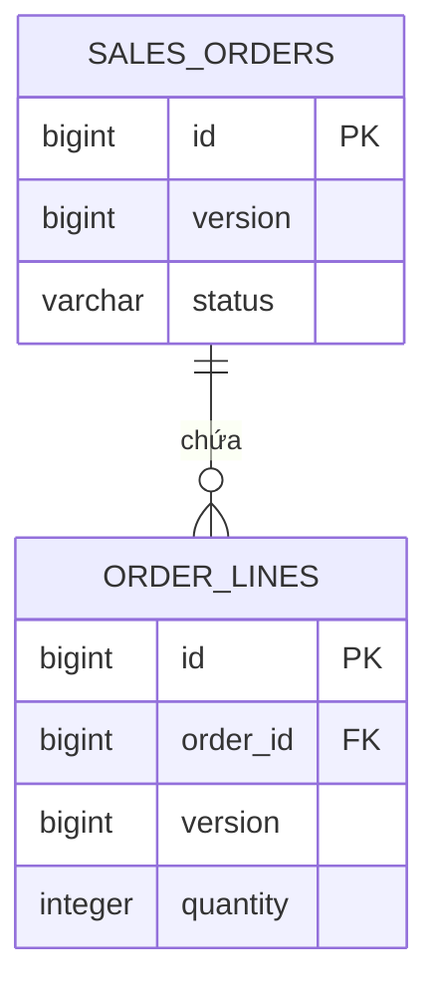

# Trường phiên bản cho kiểm soát cập nhật đồng thời

Một đơn hàng có thể được mở đồng thời ở hai màn hình: nhân viên A chỉnh số tiền, còn nhân viên B xác nhận đơn. Cả hai đều đọc bản ghi ở trạng thái `DRAFT` rồi lưu kết quả sau vài giây. Nếu ứng dụng chỉ dùng `UPDATE ... WHERE id = ?`, giao dịch ghi sau có thể **ghi đè thay đổi hợp lệ của giao dịch ghi trước** mà không ai biết.

Trong mô hình dữ liệu quan hệ, một cách phổ biến để phát hiện tình huống này là thêm **trường phiên bản** (*version column*) vào hàng. Mỗi lần cập nhật hợp lệ, phiên bản tăng; câu lệnh ghi chỉ thành công nếu phiên bản đang lưu vẫn bằng phiên bản mà người sửa đã đọc. Đây là nền tảng của **optimistic concurrency control** hay **optimistic locking**. Trong JPA, annotation `@Version` giúp ORM tự động thực hiện phần lớn cơ chế này cho entity được quản lý.

Bài học thuộc chương **Ánh xạ đối tượng** của module **DATABASE_DATA_MODELING**. Mục tiêu không chỉ biết đặt `@Version` vào lớp Java, mà còn thiết kế được PK, cột phiên bản, ràng buộc SQL, ranh giới giao dịch, bất biến liên quan đến nhiều hàng và luồng xử lý xung đột có thể kiểm chứng. Đặc biệt cần hiểu **trường hợp nào version bảo vệ được và trường hợp nào không**.

## 1. Vì sao cần trường phiên bản?

### 1.1. Lost update: hai người cùng sửa một trạng thái cũ

Giả sử đơn `#42` đang có:

```text
id = 42
status = DRAFT
total_amount = 500000.00
version = 7
```

Hai nhân viên đồng thời đọc đơn này:

```mermaid
sequenceDiagram
    participant A as Nhân viên A
    participant DB as Database
    participant B as Nhân viên B
    A->>DB: SELECT Order #42 (amount=500000, version=7)
    B->>DB: SELECT Order #42 (amount=500000, version=7)
    A->>DB: UPDATE amount=450000 WHERE id=42
    DB-->>A: Ghi thành công
    B->>DB: UPDATE amount=480000 WHERE id=42
    DB-->>B: Ghi thành công
    Note over DB: Kết quả = 480000; thay đổi của A bị ghi đè
```

Hai yêu cầu đều có thể hợp lệ *riêng lẻ*, nhưng cách ghi chỉ dựa trên khóa chính không phát hiện rằng dữ liệu B xem đã cũ. Nếu A và B cùng sửa thuộc tính `total_amount`, kết quả cuối cùng là **last writer wins**; nếu B gửi toàn bộ entity chứa giá trị cũ ở các field khác, B còn có thể ghi đè nhiều thay đổi ngoài ý định.

### 1.2. Thêm version để phát hiện việc đọc từ quá khứ

Thay vì chỉ kiểm tra `id`, mỗi transaction phải ghi kèm phiên bản nó đã đọc:

```sql
UPDATE sales_orders
SET total_amount = :new_amount,
    version = version + 1
WHERE id = :order_id
  AND version = :expected_version;
```

Khi A cập nhật với `expected_version = 7`, database đổi `version` thành 8. B vẫn dùng phiên bản 7 nên câu cập nhật **không khớp hàng nào**. Ứng dụng phát hiện xung đột và yêu cầu xử lý thay vì im lặng ghi đè.

```mermaid
sequenceDiagram
    participant A as Giao dịch A
    participant DB as Database
    participant B as Giao dịch B
    A->>DB: SELECT #42, version=7
    B->>DB: SELECT #42, version=7
    A->>DB: UPDATE ... WHERE id=42 AND version=7
    DB-->>A: 1 hàng; version=8
    B->>DB: UPDATE ... WHERE id=42 AND version=7
    DB-->>B: 0 hàng; version không còn là 7
    Note over B: Xung đột, không tự ghi đè A
```

Trường phiên bản không phải đồng hồ thời gian, không phải thứ tự toàn hệ thống và không phải mã nghiệp vụ. Nó là **mốc phát hiện tính mới của trạng thái được bảo vệ**, thường được quản lý trong phạm vi từng hàng/entity.

### 1.3. Các thuật ngữ cần phân biệt

| Thuật ngữ | Ý nghĩa |
|---|---|
| **Optimistic locking** | Cho phép nhiều giao dịch đọc không khóa dài, kiểm tra xung đột khi ghi hoặc khi transaction kết thúc |
| **Version column** | Cột lưu giá trị thay đổi khi trạng thái được cập nhật thành công |
| **Compare-and-swap (CAS)** | Chỉ cập nhật nếu giá trị điều kiện vẫn bằng giá trị mong đợi |
| **Lost update** | Một thay đổi bị ghi đè bởi thay đổi khác dựa trên trạng thái cũ |
| **Pessimistic locking** | Khóa dữ liệu lúc đọc/sửa để hạn chế giao dịch khác thay đổi đồng thời |
| **Isolation level** | Quy định những thay đổi của transaction khác có thể được quan sát và các bảo đảm đồng thời của database |

Version giúp **phát hiện xung đột theo entity/hàng**. Nó không tự thay thế mọi mức cô lập giao dịch hoặc toàn bộ constraint của lược đồ.

## 2. Thiết kế cột version từ yêu cầu nghiệp vụ

Giả sử hệ thống bán hàng có các quy tắc:

1. Đơn hàng có ID ổn định; trạng thái chỉ thuộc `DRAFT`, `CONFIRMED`, `CANCELLED`.
2. Số tiền phải không âm và mã đơn là duy nhất.
3. Chỉ được chỉnh số tiền khi đơn ở trạng thái `DRAFT`.
4. Nếu đơn đã bị người khác cập nhật sau khi màn hình tải, thao tác ghi phải phát hiện xung đột.
5. Sự thay đổi thành công phải có thể kiểm tra từ database, kể cả khi ứng dụng chạy nhiều instance.

Một lược đồ PostgreSQL minh họa:

```sql
CREATE TABLE sales_orders (
    id BIGINT GENERATED ALWAYS AS IDENTITY PRIMARY KEY,
    order_code VARCHAR(40) NOT NULL UNIQUE,
    status VARCHAR(20) NOT NULL
        CHECK (status IN ('DRAFT', 'CONFIRMED', 'CANCELLED')),
    total_amount NUMERIC(19, 2) NOT NULL
        CHECK (total_amount >= 0),
    currency_code VARCHAR(3) NOT NULL,
    version BIGINT NOT NULL DEFAULT 0
        CHECK (version >= 0),
    updated_at TIMESTAMPTZ NOT NULL DEFAULT CURRENT_TIMESTAMP
);
```

Vai trò từng trường:

- `id` là **khóa chính**, xác định **hàng nào** cần sửa.
- `order_code` là mã duy nhất có ý nghĩa nghiệp vụ để tra cứu.
- `status` và `total_amount` là **trạng thái có thể thay đổi** theo quy tắc.
- `version` là **mốc kiểm tra cạnh tranh**, bắt đầu từ 0 trong ví dụ và tăng sau các lần ghi được kiểm soát.
- `updated_at` là **thời điểm cập nhật**, phục vụ hiển thị và audit sơ bộ. Nó không thay thế an toàn cho version nếu độ phân giải, đồng hồ hay đường ghi không được thiết kế nhất quán.

### Vì sao cần `NOT NULL` và giá trị khởi tạo?

Một điều kiện `WHERE version = :expected` không khớp với hàng có `version = NULL` khi dùng phép so sánh thông thường. Tránh trạng thái không xác định bằng `NOT NULL` và đặt giá trị ban đầu nhất quán với ORM. Khi ứng dụng mới sử dụng `@Version` mà dữ liệu cũ không có giá trị version, phải có bước backfill/migration trước.

`BIGINT` phù hợp cho ví dụ có số phiên bản tăng dần, nhưng lựa chọn kiểu phải nhất quán giữa database và Java. Không có yêu cầu nghiệp vụ phải công khai version dưới dạng con số cho người dùng; đây là metadata về tính nhất quán, không phải khóa.

### Tại sao không thêm chỉ mục riêng trên version?

Câu CAS điển hình tìm hàng theo `PRIMARY KEY(id)` rồi so sánh `version`. Chỉ mục PK đã giúp tìm đúng một hàng. Một index riêng trên `version` thường không cải thiện đường ghi này mà làm tăng chi phí cập nhật, bởi version thay đổi thường xuyên. Chỉ tạo chỉ mục bổ sung khi một **truy vấn thực tế** cần nó và kế hoạch truy vấn chứng minh có lợi.

## 3. Ví dụ JPA: `@Version` trên entity

Một entity dùng cùng lược đồ:

```java
import jakarta.persistence.*;
import java.math.BigDecimal;
import java.util.Objects;

enum OrderStatus {
    DRAFT, CONFIRMED, CANCELLED
}

@Entity
@Table(name = "sales_orders")
public class SalesOrder {

    @Id
    @GeneratedValue(strategy = GenerationType.IDENTITY)
    private Long id;

    @Column(name = "order_code", nullable = false, length = 40, unique = true)
    private String orderCode;

    @Enumerated(EnumType.STRING)
    @Column(nullable = false, length = 20)
    private OrderStatus status = OrderStatus.DRAFT;

    @Column(name = "total_amount", nullable = false,
            precision = 19, scale = 2)
    private BigDecimal totalAmount;

    @Column(name = "currency_code", nullable = false, length = 3)
    private String currencyCode;

    @Version
    @Column(nullable = false)
    private Long version;

    @Column(name = "updated_at", nullable = false)
    private java.time.OffsetDateTime updatedAt;

    protected SalesOrder() {
        // Constructor cho JPA.
    }

    public SalesOrder(
            String orderCode, BigDecimal totalAmount,
            String currencyCode) {
        this.orderCode = Objects.requireNonNull(orderCode);
        this.totalAmount = Objects.requireNonNull(totalAmount);
        this.currencyCode = Objects.requireNonNull(currencyCode);
        if (totalAmount.signum() < 0) {
            throw new IllegalArgumentException("Số tiền phải >= 0");
        }
        this.updatedAt = java.time.OffsetDateTime.now();
    }

    public Long getId() { return id; }
    public Long getVersion() { return version; }
    public BigDecimal getTotalAmount() { return totalAmount; }
    public OrderStatus getStatus() { return status; }

    public void changeAmount(BigDecimal nextAmount) {
        requireDraft();
        Objects.requireNonNull(nextAmount);
        if (nextAmount.signum() < 0) {
            throw new IllegalArgumentException("Số tiền phải >= 0");
        }
        this.totalAmount = nextAmount;
        this.updatedAt = java.time.OffsetDateTime.now();
    }

    public void confirm() {
        requireDraft();
        this.status = OrderStatus.CONFIRMED;
        this.updatedAt = java.time.OffsetDateTime.now();
    }

    private void requireDraft() {
        if (status != OrderStatus.DRAFT) {
            throw new IllegalStateException("Đơn không còn là bản nháp");
        }
    }
}
```

**Giả định của ví dụ:** mã đơn là duy nhất, giá trị `totalAmount` đã được tính đúng ở miền nghiệp vụ, phần thời gian dùng `OffsetDateTime` và cột `TIMESTAMPTZ` theo khả năng ORM/database đang sử dụng. Ví dụ lược bỏ validation mã tiền tệ, mã đơn, kiểm soát quyền, quy tắc làm tròn tiền và migration thực tế. Tên trường và annotation phải được kiểm tra khi tích hợp với provider cụ thể.

### 3.1. Điều gì xảy ra khi một entity managed bị sửa?

Trong transaction:

```java
SalesOrder order = em.find(SalesOrder.class, 42L);
order.changeAmount(new BigDecimal("450000.00"));
// Không cần em.update(); entity managed được theo dõi bởi dirty checking.
// Khi flush/commit, ORM thực hiện cập nhật có điều kiện theo version.
```

Về ý nghĩa, một provider JPA có thể tạo SQL giống:

```sql
UPDATE sales_orders
SET total_amount = :next_amount,
    updated_at = :next_updated_at,
    version = :new_version
WHERE id = :id
  AND version = :old_version;
```

`:new_version` thường tương ứng phiên bản kế tiếp với kiểu số. Danh sách cột `SET` thực tế phụ thuộc ORM, dirty checking, cấu hình cập nhật động và các trường đã thay đổi. **Không phụ thuộc vào hình dạng chính xác của SQL**; điều cần kiểm chứng là điều kiện version cũ và việc phát hiện không có hàng nào được cập nhật.

### 3.2. Quy tắc quản lý trường `@Version`

- Với một entity versioned, provider quản lý trường phiên bản và dùng nó để phát hiện trạng thái cũ.
- Dùng **một thuộc tính `@Version`** cho mỗi entity hierarchy theo quy tắc JPA; đặt nhất quán với ánh xạ entity và bảng chính.
- Trong ứng dụng, **không tự gọi `setVersion(...)`** để “đánh lừa” kiểm tra. Cập nhật version phải là một phần của quy trình ghi đồng bộ.
- Với tính di động JPA, các kiểu version thường dùng là `int`/`Integer`, `long`/`Long`, `short`/`Short` hoặc `java.sql.Timestamp`. `Long` là lựa chọn phổ biến, dễ giải thích và không phụ thuộc độ phân giải đồng hồ.
- Version có thể chưa có giá trị cuối cùng trước khi persist; cách phát sinh phiên bản ban đầu tùy provider. Không dùng `version != null` làm bằng chứng transaction đã commit.

Nếu entity có kế thừa, cần đối chiếu nơi lưu cột version với chiến lược `SINGLE_TABLE`, `JOINED` hoặc `TABLE_PER_CLASS`. Với các phương án dùng bảng gốc, trường version ở entity root và bảng chính thường dễ kiểm soát hơn. Đừng gắn version độc lập lên từng lớp con rồi mặc định mọi cập nhật thuộc hierarchy đều được bảo vệ chính xác.

### 3.3. Khi nào JPA phát hiện xung đột?

Một `OptimisticLockException` có thể xuất hiện khi `flush` hoặc khi `commit`. Provider tích hợp transaction có thể bọc lỗi trong một exception cấp cao hơn; ví dụ các framework transaction có thể chuyển đổi sang loại exception riêng. Không nên xây dựng logic phụ thuộc vào việc lỗi **luôn** được ném tại dòng `em.flush()`.

Khi optimistic conflict xảy ra, transaction hiện tại thường phải rollback. Không tiếp tục dùng một persistence context đã lỗi để thử cập nhật lại bằng cách thay `version`. Cần mở transaction mới, nạp lại dữ liệu và quyết định lại thao tác.

## 4. Quy trình hai transaction thật: ai thắng, ai phải làm lại?

Giả sử hai `EntityManager` độc lập làm việc trên cùng đơn `#42` có version 7.

| Bước | Transaction A | Transaction B | Database |
|---|---|---|---|
| 1 | Đọc ID 42, version 7 | | Version 7 |
| 2 | | Đọc ID 42, version 7 | Version 7 |
| 3 | Chỉnh amount → 450000 | | Version 7 |
| 4 | Commit với điều kiện version 7 | | Version 8 |
| 5 | | Chỉnh amount → 480000 | Version 8 |
| 6 | | Commit với điều kiện version 7 → xung đột | Version 8, amount 450000 |

Với PostgreSQL ở mức cô lập phù hợp và lệnh cập nhật có điều kiện nguyên tử, chỉ một transaction dùng phiên bản 7 có thể cập nhật thành công. Transaction còn lại phải xử lý xung đột. Nếu cùng một transaction đang chờ row lock, database sẽ giải quyết theo mức cô lập và có thể trả lỗi khác trong một số tình huống, nhưng không được âm thầm bỏ điều kiện version.

### 4.1. SQL kiểm chứng CAS độc lập với ORM

Một cách xem tận mắt:

```sql
-- Người A đã đọc version = 7:
UPDATE sales_orders
SET total_amount = 450000.00,
    version = version + 1,
    updated_at = CURRENT_TIMESTAMP
WHERE id = 42 AND version = 7
RETURNING id, total_amount, version;
-- Trả về 1 hàng: (42, 450000.00, 8)

-- Người B vẫn nghĩ version = 7:
UPDATE sales_orders
SET total_amount = 480000.00,
    version = version + 1,
    updated_at = CURRENT_TIMESTAMP
WHERE id = 42 AND version = 7
RETURNING id, total_amount, version;
-- Không trả hàng nào: điều kiện version không còn đúng.
```

`RETURNING` là cú pháp PostgreSQL. Với hệ quản trị khác, cần kiểm tra **số hàng được cập nhật** bằng API phù hợp. Số hàng bằng 0 có thể do hàng bị xóa, version khác hoặc điều kiện nghiệp vụ không còn đúng — không được luôn kết luận chỉ có xung đột phiên bản khi câu `WHERE` còn chứa điều kiện khác.

### 4.2. So sánh thao tác ghi đúng và sai

Không an toàn khi mục tiêu là phát hiện stale write:

```sql
UPDATE sales_orders
SET status = 'CONFIRMED'
WHERE id = 42;
```

Có điều kiện phiên bản:

```sql
UPDATE sales_orders
SET status = 'CONFIRMED',
    version = version + 1,
    updated_at = CURRENT_TIMESTAMP
WHERE id = 42
  AND version = :expected_version
  AND status = 'DRAFT'
RETURNING id, status, version;
```

Trong câu thứ hai, `status = 'DRAFT'` là **bất biến nghiệp vụ**; `version = :expected_version` là **kiểm tra cạnh tranh**. Hai điều kiện bổ sung cho nhau và giải quyết các vấn đề khác nhau. Nếu không có hàng nào được cập nhật, tầng ứng dụng cần xác định nên trả lỗi “đơn đã chốt”, “đơn không tồn tại” hay “dữ liệu đã thay đổi”.

### 4.3. Mức cô lập của database vẫn có vai trò

Versioned update là thao tác **có điều kiện nguyên tử** ở database. Tuy nhiên, các mức cô lập như `READ COMMITTED`, `REPEATABLE READ` và `SERIALIZABLE` có những bảo đảm, chi phí và loại lỗi cạnh tranh khác nhau tùy hệ quản trị. `@Version` không tự nâng transaction lên `SERIALIZABLE`.

Chẳng hạn, optimistic locking theo một hàng không tự bảo vệ ràng buộc “không có hai bác sĩ cùng trực một ca” nếu hai transaction cùng **chèn hai hàng khác nhau**. Khi đó cần khóa ứng viên/`UNIQUE`, exclusion constraint, locking theo phạm vi hoặc chiến lược transaction phù hợp với invariant. Một version không thể thay thế mọi ràng buộc đa hàng.

## 5. Xử lý xung đột là quyết định nghiệp vụ, không chỉ là catch exception

Khi B lưu thất bại vì version đã thay đổi, có vài cách xử lý:

| Chính sách | Phù hợp khi | Điều cần tránh |
|---|---|---|
| **Từ chối và yêu cầu tải lại** | Hành vi có hậu quả rõ rệt, ví dụ xác nhận đơn | Không âm thầm ghi đè thay đổi của người khác |
| **Tải lại rồi cho người dùng so sánh** | Có thể dung hòa hai chỉnh sửa nội dung | Không hứa tự merge nếu không biết ý nghĩa từng field |
| **Thử lại có điều kiện** | Phép toán có thể lặp an toàn và bất biến vẫn đúng | Không retry vô hạn hoặc lặp side effect bên ngoài |
| **Đồng bộ bằng phép toán nguyên tử** | Tăng bộ đếm, điều chỉnh số lượng có quy tắc chính xác | Không chuyển từ “đặt giá trị” sang “cộng thêm” khi nghiệp vụ không cho phép |
| **Pessimistic lock** | Tranh chấp cao, cần điều phối một bước quyết định | Không giữ khóa DB trong suốt thời gian người dùng chỉnh form |

Ví dụ hai người sửa `shippingAddress` và `internalNote` có thể gộp được nếu chúng là các field độc lập và domain cho phép. Nhưng hai người đổi số tiền thanh toán hoặc trạng thái xác nhận không nên tự gộp chỉ vì mỗi người sửa một trường khác nhau: bất biến có thể liên quan tới **tổng trạng thái của đơn**.

### 5.1. Retry phải chạy lại trong một transaction mới

Một quy trình logic:

```text
1. Người dùng gửi thao tác và phiên bản mà họ đã xem.
2. Server mở transaction, tải entity hiện tại.
3. Kiểm tra quyền, trạng thái và phiên bản mong đợi.
4. Áp dụng hành vi nghiệp vụ trên managed entity.
5. Commit. Nếu optimistic conflict:
   - rollback transaction đang lỗi;
   - thông báo xung đột hoặc mở transaction mới để nạp lại;
   - chỉ retry nếu thao tác an toàn và các quy tắc vẫn đúng.
```

Không có nghĩa mọi conflict đều nên retry: một giao dịch xác nhận đơn, phát hành hóa đơn, gửi tiền hay gọi cổng thanh toán có **side effect không được phép lặp**. Nếu cần retry, thiết kế idempotency key, outbox hoặc cơ chế đảm bảo hành vi bên ngoài không phát sinh hai lần.

### 5.2. Đồng bộ dữ liệu lại với người sửa

Thông báo hữu ích thường gồm:

- Đơn đã được ai đó thay đổi sau khi màn hình được tải.
- Giá trị hiện tại quan trọng để người dùng quyết định, ví dụ trạng thái đã `CONFIRMED`.
- Lựa chọn: tải lại, so sánh nội dung, hủy thao tác hoặc tạo một yêu cầu chỉnh sửa mới.

Đừng hiển thị lỗi SQL hoặc chuỗi exception nhạy cảm ra giao diện. Một conflict là **tình huống sử dụng bình thường** trong hệ thống nhiều người thao tác, cần được thiết kế như một luồng nghiệp vụ có thể dự đoán.

## 6. Optimistic locking với entity detached và `merge()`

Web application thường tải entity trong transaction A, chuyển dữ liệu lên màn hình, rồi vài giây/phút sau nhận yêu cầu cập nhật ở transaction B. Object Java từ transaction trước đã **detached** và có thể chứa version cũ.

```text
Tải lúc 09:00:
  Order {id=42, version=7, amount=500000}

Người khác ghi lúc 09:01:
  Database {id=42, version=8, amount=450000}

Form cũ gửi lúc 09:03:
  {id=42, version=7, amount=480000}
```

Nếu đưa một entity detached đúng phiên bản vào `merge`, ORM có thể phát hiện stale state khi merge/flush/commit. Nhưng không nên tạo một entity mới từ DTO, bỏ qua version rồi gọi `merge` một cách mù quáng: cách đó có thể không bảo vệ ý định “chỉ sửa dựa trên version người dùng đã thấy”, thậm chí ghi đè các field không có trong form tùy cách dựng object.

### 6.1. Dùng ID và expected version của form

Một phương án an toàn, dễ hiểu:

```java
public void changeAmount(
        EntityManager em,
        long id,
        long expectedVersion,
        BigDecimal requestedAmount) {

    SalesOrder managed = em.find(SalesOrder.class, id);
    if (managed == null) {
        throw new EntityNotFoundException("Không tìm thấy đơn");
    }
    if (!Objects.equals(managed.getVersion(), expectedVersion)) {
        throw new StaleOrderException("Đơn đã thay đổi");
    }

    managed.changeAmount(requestedAmount);
    // Transaction của use case sẽ commit; JPA vẫn kiểm tra @Version
    // để bắt race xảy ra sau lần so sánh trong Java.
}
```

`StaleOrderException` là exception nghiệp vụ giả định do ứng dụng định nghĩa; `Objects` cần import từ `java.util`. Phương thức chạy **bên trong transaction** và chỉ thay những field mà use case cho phép. Kiểm tra `expectedVersion` trước giúp trả thông báo dễ hiểu khi form quá cũ; kiểm tra `@Version` lúc commit mới bắt race giữa hai thời điểm đọc và ghi.

Nếu không gửi expected version từ form, `em.find` sẽ nạp phiên bản mới nhất mà transaction có thể thấy, rồi một lệnh đặt giá trị dựa trên **ý định cũ** vẫn có thể ghi thành công. `@Version` chỉ bảo vệ mốc đọc *của transaction hiện tại*; nó không tự biết người dùng đã nhìn thấy bản nào từ nhiều phút trước.

### 6.2. Version không thuộc `equals()` của entity

Hai object:

```text
SalesOrder {id=42, version=7}
SalesOrder {id=42, version=8}
```

vẫn biểu diễn **cùng một đơn** ở hai thời điểm khác nhau. Không đưa `version` vào `equals()` và `hashCode()` chỉ để nhận diện entity: phiên bản là trạng thái có thể thay đổi, còn định danh lưu trữ dựa trên khóa chính và loại entity phù hợp.

## 7. Trường phiên bản trong API: ETag và `If-Match`

Ở tầng HTTP, optimistic concurrency có thể được biểu diễn qua **ETag** và request header `If-Match`. Đây là cách truyền điều kiện cập nhật từ client tới server khi người dùng đã xem một representation trước đó.

Ví dụ server trả:

```http
GET /orders/42 HTTP/1.1

HTTP/1.1 200 OK
ETag: "order-42-v7"
Content-Type: application/json

{"id":42,"status":"DRAFT","totalAmount":"500000.00"}
```

Khi người dùng lưu:

```http
PATCH /orders/42 HTTP/1.1
If-Match: "order-42-v7"
Content-Type: application/json

{"totalAmount":"450000.00"}
```

Nếu representation hiện tại đã đổi và ETag không còn khớp, server có thể trả `412 Precondition Failed`. Nếu API yêu cầu mọi request cập nhật đều phải có điều kiện mà client không gửi, có thể trả `428 Precondition Required` theo hợp đồng API. `409 Conflict` cũng được dùng cho xung đột nghiệp vụ khác, chẳng hạn đơn không còn ở trạng thái có thể sửa.

### 7.1. ETag không nhất thiết là số version lộ trực tiếp

ETag là một **opaque validator** ở giao thức HTTP; ứng dụng có thể xây dựng từ ID và version, hoặc từ cơ chế khác, miễn việc so sánh phản ánh đúng representation được bảo vệ. Ví dụ `"order-42-v7"` chỉ là một mẫu minh họa. Khi phản hồi thay đổi do các dữ liệu liên quan, tính toán ETag phải xét cả những thay đổi đó nếu client kỳ vọng validator bảo vệ toàn representation.

Không coi ETag hay version là thông tin xác thực hoặc bằng chứng phân quyền. Bất cứ thao tác cập nhật nào vẫn phải kiểm tra quyền người gọi và điều kiện trạng thái.

### 7.2. `If-Match` vẫn phải đi với ghi nguyên tử

Quy trình không an toàn:

```text
1. Server so sánh If-Match với version=7.
2. Một request khác sửa hàng thành version=8.
3. Server UPDATE ... WHERE id=42, không có version.
```

Đã có race giữa bước 1 và 3. Vì vậy kiểm tra header chỉ là **điều kiện ở cấp giao thức**; thao tác lưu cần dùng CAS hoặc `@Version` trong transaction để bảo đảm không ghi đè nếu hàng thay đổi sau lúc kiểm tra.

### 7.3. Định dạng và hành vi API phải nhất quán

Không cần buộc frontend dùng kiểu Java `Long`. Server có thể trả metadata `version` trong JSON theo hợp đồng API, hoặc dùng ETag trong header. Điều quan trọng là client gửi lại **phiên bản mà nó đã thấy**, server kiểm tra trong transaction và trả lỗi có ý nghĩa khi stale.

Khi dùng HTTP ETag, cần tuân thủ quy tắc so sánh của `If-Match` (strong comparison theo HTTP); không giả định weak ETag có thể thay thế tùy ý. Nếu API có nhiều representation khác nhau của cùng một tài nguyên, cần định nghĩa validator cho từng representation và điều kiện cập nhật một cách nhất quán.

## 8. Version bảo vệ hàng nào? Bẫy với collection và aggregate

Một đơn có thể chứa nhiều dòng hàng:



Giả sử `SalesOrder` mang `@Version` và `OrderLine` là entity khác có `quantity`. Nếu transaction chỉ cập nhật một `OrderLine`, **không được mặc định** version của hàng `sales_orders` chắc chắn tăng trong mọi ORM và cấu hình. Điều đó có nghĩa:

- `@Version` trên `SalesOrder` bảo vệ những thay đổi mà provider thực sự kiểm soát qua version của **root**.
- Nếu `OrderLine` có `@Version` riêng, một thay đổi trên **cùng dòng** có thể được kiểm tra theo version của dòng.
- Bất biến aggregate như “không sửa dòng sau khi đơn xác nhận” cần có cơ chế kiểm soát **cả trạng thái root và thay đổi dòng**, chứ không chỉ kiểm tra số version của dòng.

### 8.1. Một mô hình đơn giản

```sql
CREATE TABLE order_lines (
    id BIGINT GENERATED ALWAYS AS IDENTITY PRIMARY KEY,
    order_id BIGINT NOT NULL REFERENCES sales_orders(id),
    quantity INTEGER NOT NULL CHECK (quantity > 0),
    version BIGINT NOT NULL DEFAULT 0 CHECK (version >= 0)
);
```

`OrderLine` có thể có `@Version private Long version;` riêng nếu các thao tác cập nhật dòng diễn ra độc lập theo mô hình. Nhưng nếu nghiệp vụ coi Order là aggregate root và mọi thay đổi dòng phải có sự đồng ý của Order, kiểm soát cạnh tranh phải được đặt phù hợp với **ranh giới aggregate**, không chỉ từng hàng.

### 8.2. Force-increment version của root

Trong JPA, một use case thay đổi dòng có thể chủ động yêu cầu tăng version của root:

```java
SalesOrder order = em.find(SalesOrder.class, orderId);
if (order == null) {
    throw new EntityNotFoundException("Không tìm thấy đơn");
}

em.lock(order, LockModeType.OPTIMISTIC_FORCE_INCREMENT);
// Gọi phương thức nghiệp vụ trên root, kiểm tra trạng thái DRAFT,
// rồi mới thay đổi các OrderLine do root quản lý.
```

`OPTIMISTIC_FORCE_INCREMENT` yêu cầu kiểm tra và tăng version của entity theo cơ chế JPA; thời điểm câu SQL thực hiện tùy provider. Cách này giúp biểu diễn rằng thay đổi bên trong aggregate phải làm thay đổi mốc version của root. Tuy nhiên, nó không tự tạo khóa trên toàn collection, không tự giải quyết mọi invariant nhiều hàng và có thể làm tăng xung đột khi nhiều thao tác độc lập cùng đụng root.

**Quan trọng:** mọi đường ghi ảnh hưởng cùng invariant phải phối hợp nhất quán — một service cập nhật line mà không tham gia version root có thể phá quy tắc so với service khác đang confirm Order.

### 8.3. Truy vấn đối với collection cũng có thể gây race

Ví dụ hai nhân viên cùng đọc số dòng của đơn và quyết định thêm dòng ở vị trí cuối:

```text
A: SELECT MAX(line_no) -> 3
B: SELECT MAX(line_no) -> 3
A: INSERT line_no=4
B: INSERT line_no=4
```

Version của hàng Order **không đương nhiên** ngăn hai INSERT nếu không có cơ chế đồng bộ thích hợp. Database nên bảo vệ `UNIQUE(order_id, line_no)`. Sau đó application có thể khóa root, cấp số thứ tự nguyên tử, hoặc retry có kiểm soát khi unique conflict xảy ra.

Đây là ví dụ rõ ràng rằng **version và constraint nghiệp vụ bổ sung cho nhau**, không thay thế nhau.

## 9. `@Version` không bảo vệ các đường ghi bỏ qua ORM

### 9.1. Native SQL không tự biết version

Một câu SQL bên ngoài JPA:

```sql
UPDATE sales_orders
SET status = 'CONFIRMED'
WHERE id = :id;
```

có thể thay trạng thái **mà không tăng version**. Khi đó một entity đã được nạp trước có thể tiếp tục cập nhật với version cũ và không phát hiện rằng trạng thái đã bị chỉnh sửa từ nguồn khác.

Muốn giữ cơ chế nhất quán, mọi đường ghi phải tuân thủ hợp đồng:

```sql
UPDATE sales_orders
SET status = :new_status,
    version = version + 1,
    updated_at = CURRENT_TIMESTAMP
WHERE id = :id
  AND version = :expected_version
  AND status = 'DRAFT'
RETURNING version;
```

Đường ghi nào không nắm expected version phải được thiết kế riêng với locking hoặc quy trình ghi độc quyền thích hợp; chỉ tăng version mà không kiểm tra version cũ có thể phát hiện stale state cho ORM đọc trước, nhưng không tự bảo vệ chính thao tác của writer đó khỏi ghi đè dựa trên dữ liệu đã cũ.

### 9.2. Bulk JPQL update/delete cũng cần xử lý riêng

Ví dụ:

```java
int updated = em.createQuery("""
    update SalesOrder o
    set o.status = :status
    where o.id = :id
    """)
    .setParameter("status", OrderStatus.CONFIRMED)
    .setParameter("id", orderId)
    .executeUpdate();
```

Đây là **bulk update**, không tương đương sửa một managed entity rồi commit. Theo JPA, các thao tác bulk update/delete không tự thực hiện optimistic version checking và đồng bộ persistence context như thao tác entity-level. Nếu cần bảo vệ cạnh tranh, phải dùng câu lệnh có version condition và cập nhật version đúng cách, hoặc tránh bulk operation cho use case yêu cầu nhiều invariant.

Sau bulk update, các entity đã được nạp trong persistence context có thể **stale**. Cần quy định khi nào `clear`/refresh hoặc dùng persistence context mới, và đối chiếu ảnh hưởng đến cache, callback, audit.

### 9.3. Không dùng đồng thời nhiều “chủ quản lý version”

Nếu database trigger tự tăng `version` trên mọi `UPDATE`, trong khi ORM cũng tăng version trong câu update, một lần ghi có thể tăng **hai lần** hoặc giá trị ORM đang giữ không khớp database, tùy cơ chế. Có thể có thiết kế dùng DB-generated version, nhưng phải cấu hình provider và cách lấy giá trị mới một cách có chủ đích.

Chọn một **hợp đồng thống nhất cho tất cả nguồn ghi**: bên nào tạo phiên bản, khi nào tăng, cách writer so sánh phiên bản cũ và cách entity làm mới phiên bản sau commit.

## 10. Chọn optimistic hay pessimistic locking?

### 10.1. Khi optimistic phù hợp

Optimistic locking thường phù hợp khi:

- Nhiều người xem dữ liệu nhưng **ít người cập nhật đúng cùng một hàng** tại cùng thời điểm.
- Giao dịch ngắn và xung đột có thể được trả về để người dùng quyết định.
- Không muốn giữ khóa database trong suốt thời gian người dùng sửa màn hình.
- Hành vi ghi có thể được kiểm tra lại sau khi phát hiện conflict.

Với đơn hàng, chỉnh địa chỉ, trạng thái hồ sơ và cấu hình ít tranh chấp, `@Version` thường là điểm bắt đầu hợp lý.

### 10.2. Khi cần pessimistic locking

Nếu nhiều thao tác tranh chấp cùng một nguồn lực, ví dụ nhiều worker phân phối kho còn rất ít hoặc cùng nhận một công việc, có thể cần khóa dữ liệu sớm trong transaction:

```java
SalesOrder order = em.find(
    SalesOrder.class,
    orderId,
    LockModeType.PESSIMISTIC_WRITE
);
// Thao tác nghiệp vụ và commit trong transaction ngắn.
```

Hoặc SQL PostgreSQL:

```sql
SELECT id, status, total_amount, version
FROM sales_orders
WHERE id = :id
FOR UPDATE;
```

Pessimistic locking có thể giảm một số xung đột ghi nhưng tăng chờ khóa, deadlock và ảnh hưởng throughput. Không giữ transaction/row lock trong lúc chờ thao tác từ người dùng hoặc gọi dịch vụ bên ngoài lâu.

### 10.3. Các lựa chọn có thể kết hợp

Một hệ thống có thể sử dụng `@Version` cho cập nhật thông thường và `PESSIMISTIC_WRITE` trong một số bước đặc biệt. Database vẫn phải giữ PK, FK, `UNIQUE`, `CHECK` và các ràng buộc khác. Mục tiêu là **tối ưu cho invariant và workload thực tế**, không phải bắt buộc chọn một kiểu lock cho toàn ứng dụng.

| Tiêu chí | Optimistic | Pessimistic |
|---|---|---|
| Chiến lược | Đọc đồng thời, phát hiện conflict lúc ghi | Khóa sớm dữ liệu cần sửa |
| Chi phí khi ít tranh chấp | Thường thấp | Vẫn có chi phí lock |
| Khi tranh chấp cao | Có thể nhiều conflict/retry | Có thể nhiều chờ khóa/deadlock |
| Thời gian transaction | Thường ngắn | Càng cần ngắn vì giữ khóa |
| Thao tác người dùng kéo dài | Phù hợp khi gửi lại version | Không nên khóa xuyên suốt thời gian người dùng chỉnh form |
| Bất biến nhiều hàng | Cần constraint/giải pháp bổ sung | Vẫn phải xác định phạm vi khóa và isolation |

## 11. Giới hạn của version: nhiều hàng và nhiều aggregate

### 11.1. Tránh nhầm mất cập nhật với write skew

Hai bác sĩ có thể được phép nghỉ nếu **ít nhất một bác sĩ trong nhóm vẫn trực**. Giao dịch A đọc “B đang trực” rồi cho A nghỉ; giao dịch B cùng lúc đọc “A đang trực” rồi cho B nghỉ. Hai giao dịch thay **hai hàng khác nhau**, mỗi hàng có version riêng, nên cả hai có thể thành công dù quy tắc cuối cùng bị vi phạm.

Đây là một dạng **write skew**: optimistic versioning trên từng hàng không phát hiện xung đột khi hai transaction thay các hàng khác nhau nhưng cùng phụ thuộc một invariant đa hàng.

Giải pháp cần xét từ thiết kế dữ liệu:

- Dồn invariant vào một hàng/aggregate có version chung nếu phù hợp.
- Dùng constraint SQL (unique, exclusion hoặc cấu trúc bảng khác) khi biểu diễn được.
- Khóa một hàng điều phối chung hoặc đặt transaction ở mức cô lập phù hợp.
- Thử nghiệm thực sự với hai transaction đồng thời để xác minh, không chỉ unit test chạy tuần tự.

### 11.2. Version không thay thế khóa duy nhất

Hai transaction cùng tạo khách hàng với `email` giống nhau không có một hàng cũ để kiểm tra version. `@Version` trên entity mới không thể ngăn hai INSERT của hai ID khác nhau. Database cần `UNIQUE(email)` (hoặc unique theo phạm vi nghiệp vụ) và ứng dụng phải xử lý lỗi cạnh tranh.

### 11.3. Version không chứng minh giao dịch đã commit

Một phiên bản mới có thể đã được gán hoặc quan sát trong persistence context khi `flush`, nhưng transaction vẫn có thể rollback. Khi cần xác nhận trạng thái bền vững, kiểm tra kết quả sau commit trong transaction/context khác.

## 12. Thiết kế migration khi thêm version cho bảng đang hoạt động

Giả sử hệ thống hiện có `sales_orders` nhưng chưa có cột `version`. Một migration cơ bản ở PostgreSQL:

```sql
ALTER TABLE sales_orders
ADD COLUMN version BIGINT NOT NULL DEFAULT 0;

ALTER TABLE sales_orders
ADD CONSTRAINT ck_sales_orders_version_nonnegative
CHECK (version >= 0);
```

**Không chạy lệnh thêm cột hai lần**: đoạn này là phiên bản migration cho bảng chưa có version, trong khi DDL khởi tạo ở mục 2 đã bao gồm cột đó. Khi quản lý schema có phiên bản, đưa migration này vào bước mở rộng của đúng môi trường.

### 12.1. Vấn đề lớn không phải chỉ là thêm cột

Nếu ứng dụng cũ vẫn chạy và thực hiện:

```sql
UPDATE sales_orders SET total_amount = :amount WHERE id = :id;
```

thì nó có thể thay đổi dữ liệu **mà không tăng version**, trong khi ứng dụng mới nghĩ rằng version đã bảo vệ tất cả writer. Một kế hoạch rollout phải:

1. Kiểm kê mọi nguồn ghi: service, batch job, import, SQL thủ công và tích hợp.
2. Bổ sung cột, giá trị mặc định và ràng buộc ở database.
3. Điều chỉnh mọi writer sang hợp đồng version/CAS hoặc một chính sách ghi tương thích rõ ràng.
4. Triển khai ORM `@Version` và các đường xử lý conflict.
5. Kiểm tra chạy song song phiên bản ứng dụng cũ/mới: trong giai đoạn chuyển tiếp cần chặn hoặc bảo vệ những nguồn ghi chưa tuân hợp đồng.
6. Đo conflict rate, lỗi transaction, latency và các ảnh hưởng đến quy trình người dùng.

Không coi việc thêm `@Version` vào một class là đủ cho hệ thống có nhiều điểm ghi.

### 12.2. Chuyển từ timestamp sang numeric version

Một số schema cũ dùng `updated_at` như version. Nó có thể gặp vấn đề độ phân giải thời gian, cách làm tròn timestamp giữa Java/DB, đồng hồ khác nhau hoặc nhiều update trong cùng một đơn vị thời gian. Khi cần cơ chế CAS rõ ràng, một **counter số nguyên** thường dễ bảo đảm tính khác biệt giữa hai lần ghi hơn.

Nếu chuyển sang số nguyên, cần lập kế hoạch migration sao cho các client đang gửi timestamp validator và các client mới gửi numeric validator không gây hiểu nhầm hoặc bỏ qua conflict. Version dùng trong API phải được chuyển đổi có kế hoạch, không thay âm thầm.

## 13. Kiểm thử thực sự với hai transaction

### 13.1. Bài kiểm tra tối thiểu

Một đơn có ID 42, version ban đầu 7. Dùng hai `EntityManager` độc lập:

```java
EntityManager emA = emf.createEntityManager();
EntityManager emB = emf.createEntityManager();

try {
    emA.getTransaction().begin();
    emB.getTransaction().begin();

    SalesOrder a = emA.find(SalesOrder.class, 42L);
    SalesOrder b = emB.find(SalesOrder.class, 42L);

    a.changeAmount(new BigDecimal("450000.00"));
    b.changeAmount(new BigDecimal("480000.00"));

    emA.getTransaction().commit(); // Ghi phiên bản mới.

    try {
        emB.getTransaction().commit();
        throw new AssertionError("Phải phát hiện stale update");
    } catch (OptimisticLockException | RollbackException expected) {
        // Kiểm tra nguyên nhân thực tế theo JPA provider.
    }
} finally {
    if (emA.getTransaction().isActive()) emA.getTransaction().rollback();
    if (emB.getTransaction().isActive()) emB.getTransaction().rollback();
    emA.close();
    emB.close();
}
```

Đây là **phác thảo kiểm thử JPA resource-local transaction**. Giả định `emf` có sẵn, đơn 42 tồn tại và đang `DRAFT`; cần import JPA/`BigDecimal`. Với transaction do Spring/Jakarta EE quản lý, cách bắt exception và rollback sẽ khác. Một số lỗi có thể được ném khi `flush` hoặc bọc trong lỗi transaction; bài kiểm thử production cần bắt/kiểm tra nguyên nhân đúng theo provider, sau đó đọc lại từ một context mới.

**Lưu ý:** kiểu exception cụ thể và cách provider phát hiện xung đột có thể thay đổi; mục tiêu kiểm thử là chỉ một transaction được commit thành công, không phải phụ thuộc máy móc vào một stack trace.

### 13.2. Bộ tình huống bắt buộc kiểm chứng

| Tình huống | Kết quả kỳ vọng |
|---|---|
| Hai transaction đọc cùng version rồi sửa cùng hàng | Một ghi thành công, ghi còn lại bị phát hiện xung đột |
| Hai transaction cập nhật **hai hàng độc lập** | Có thể cùng thành công nếu không có invariant chung khác |
| Client gửi version cũ từ form | Bị từ chối trước khi ghi hoặc ở kiểm tra optimistic khi commit |
| User sửa đơn từ `DRAFT` sau khi người khác `CONFIRMED` | Thao tác không được ghi đè trạng thái xác nhận |
| Thao tác từ SQL ngoài ORM | Phải tăng/check version theo hợp đồng hoặc được kiểm soát bằng cơ chế khác |
| Bulk JPQL update | Không được giả định tự xử lý version; kiểm tra SQL, cache và context |
| Transaction ghi bị rollback | Trạng thái và version bền vững không đổi theo transaction đã rollback |
| Đổi số lượng một dòng nhưng không đổi root | Kiểm tra invariant/root version có được bảo vệ theo chính sách không |
| Hai request cùng tạo một mã nghiệp vụ | `UNIQUE` ngăn trùng, không trông cậy `@Version` |
| Hai thay đổi ở hai hàng làm vi phạm quy tắc tổng thể | Cần thêm constraint/locking/isolation cho invariant đa hàng |
| API `If-Match` không khớp | Trả 412 và không âm thầm ghi đè |
| Retry sau conflict | Chạy trong transaction mới; không lặp side effect ngoài ý muốn |

### 13.3. Quan sát những gì?

Trong môi trường thử nghiệm, bật log SQL và thống kê transaction để kiểm tra:

- Điều kiện `WHERE id = ? AND version = ?` hoặc cơ chế tương đương có tồn tại không.
- Số hàng thực sự được cập nhật khi phiên bản cũ không còn đúng.
- Giá trị version tăng sau mỗi thay đổi được quản lý.
- Trạng thái entity trong context mới sau commit.
- Hành vi ngoại lệ, rollback, retry và nội dung phản hồi API.
- Số conflict theo loại thao tác; nếu quá nhiều, xem lại ranh giới aggregate hoặc chiến lược khóa.

Đừng chỉ kiểm tra `order.getVersion()` trong cùng entity đang managed. Cần xác minh database và hành vi giữa **hai transaction thật**.

## 14. Những sai lầm thường gặp

**Sai lầm 1 — “Chỉ cần có cột version, DB tự ngăn lost update.”** Nếu câu SQL không so sánh phiên bản cũ và không cập nhật phiên bản mới, cột đơn thuần không cung cấp optimistic locking.

**Sai lầm 2 — “`@Version` kiểm tra ngay lúc `em.find`.”** Việc phát hiện stale write thường xuất hiện khi flush/commit hoặc trong quy trình lock/merge phù hợp.

**Sai lầm 3 — “Version thay cho PK hoặc unique key.”** Version không xác định hàng và không ngăn hai transaction INSERT hai hàng trùng khóa nghiệp vụ.

**Sai lầm 4 — “Thấy `getVersion() = 8` là đã commit.”** Transaction còn có thể rollback.

**Sai lầm 5 — “Lỗi optimistic chỉ cần sửa version từ 7 thành 8 rồi commit lại.”** Làm vậy bỏ qua thay đổi của người khác; phải nạp lại và chạy lại quyết định nghiệp vụ.

**Sai lầm 6 — “`@Version` bảo vệ toàn bộ collection và các aggregate liên quan.”** Phạm vi version phụ thuộc các thao tác ORM thực sự bảo vệ; invariant nhiều hàng cần cơ chế bổ sung.

**Sai lầm 7 — “Bulk JPQL update có cùng semantics với dirty checking.”** Bulk update bỏ qua cơ chế entity-level thông thường, có thể khiến persistence context stale.

**Sai lầm 8 — “Updated timestamp luôn là version an toàn.”** Độ phân giải, đồng hồ và cách ghi có thể khiến hai lần update không có validator khác biệt đáng tin cậy.

**Sai lầm 9 — “Có `If-Match` là xong, câu UPDATE không cần version.”** Vẫn tồn tại race từ lúc so sánh header đến lúc ghi.

**Sai lầm 10 — “Mọi conflict phải được retry tự động.”** Một số hành vi chỉ được thực hiện một lần; retry cần idempotency và điều kiện nghiệp vụ.

**Sai lầm 11 — “Cứ thêm index trên version để tăng tốc cập nhật.”** Thường truy vấn tìm hàng theo PK; index version riêng có thể chỉ làm tăng chi phí ghi.

**Sai lầm 12 — “Thêm `@Version` vào ứng dụng mới bảo vệ mọi writer.”** SQL cũ, job và dịch vụ khác không tuân hợp đồng có thể làm version mất ý nghĩa.

## 15. Quy trình thiết kế kiểm soát cập nhật đồng thời

**Bước 1 — Xác định trạng thái nào cần bảo vệ.** Một đơn, một dòng hàng hay toàn aggregate? Nếu invariant liên quan nhiều hàng, xác định đâu là điểm đồng bộ chung.

**Bước 2 — Chọn khóa và cột version.** Đặt PK ổn định, cột `version BIGINT NOT NULL DEFAULT 0` hoặc cơ chế tương đương; không thay khóa bằng version.

**Bước 3 — Viết ràng buộc SQL.** `NOT NULL`, `CHECK`, `UNIQUE`, `FOREIGN KEY` bảo vệ invariant có thể diễn đạt tại database. Version xử lý một lớp xung đột khác.

**Bước 4 — Ánh xạ `@Version` nhất quán.** Chọn kiểu Java tương ứng, tránh setter trực tiếp, kiểm chứng câu SQL có điều kiện và việc cập nhật phiên bản.

**Bước 5 — Thiết kế giao dịch/use case.** Tải managed entity, kiểm tra quyền, trạng thái và phiên bản client đã thấy, áp dụng phương thức domain rồi commit.

**Bước 6 — Định nghĩa xử lý conflict.** Trả lỗi rõ ràng, cho người dùng tải lại hoặc retry có điều kiện trong transaction mới. Không lặp side effect không idempotent.

**Bước 7 — Đồng bộ mọi writer và API.** Native SQL, batch job, bulk update, webhook và các phiên bản ứng dụng phải dùng cùng hợp đồng hoặc được kiểm soát bằng chiến lược tương thích.

**Bước 8 — Kiểm thử concurrency thực tế.** Hai transaction cùng sửa một hàng, nhiều transaction chèn hàng liên quan, thay đổi collection và root, rollback, lỗi mạng và thao tác lặp.

**Bước 9 — Quan sát sau triển khai.** Theo dõi conflict rate, latency, retry rate, lock contention và dấu hiệu stale update; điều chỉnh ranh giới aggregate và cách điều phối dựa trên dữ liệu.

## 16. Bài tập thực hành

**Bối cảnh:** hệ thống quản lý kho có `StockBalance` với `warehouse_id`, `product_id`, `available_quantity` và `version`. Hai nhân viên đồng thời điều chỉnh tồn kho; một tiến trình khác tạo phiếu xuất. Doanh nghiệp yêu cầu không bao giờ để số lượng khả dụng âm, ngăn ghi đè khi người dùng chỉnh số lượng thủ công, và không phát hành hai phiếu cùng mã.

Hãy trả lời:

1. Khóa nào nhận diện một bản ghi tồn kho? Khi nào dùng `PRIMARY KEY(warehouse_id, product_id)`, khi nào dùng `stock_balance_id` và `UNIQUE`?
2. `@Version` ngăn loại lost update nào nếu hai nhân viên cùng sửa một `StockBalance`?
3. Viết câu SQL CAS để **giảm số lượng tồn** 5 đơn vị, chỉ khi tồn đủ và version vẫn đúng.
4. Vì sao `@Version` trên `StockBalance` không đủ ngăn hai tiến trình tạo phiếu xuất có cùng mã?
5. Nếu phiếu xuất gồm nhiều dòng và cập nhật nhiều kho, phiên bản một hàng duy nhất có bảo đảm toàn bộ yêu cầu không âm không?
6. Trong REST API, client nên gửi thông tin nào để server biết người dùng đang sửa trạng thái đã xem?
7. Nếu một batch job cập nhật `available_quantity` mà không tăng version, điều gì xảy ra?
8. Khi nào nên dùng row locking hoặc câu UPDATE nguyên tử thay vì load–modify–save thông thường?

### Hướng giải tham khảo

**1.** Nếu mỗi cặp kho–sản phẩm có một số dư, `(warehouse_id, product_id)` là khóa ứng viên. Có thể dùng trực tiếp làm composite PK hoặc dùng surrogate PK và `UNIQUE(warehouse_id, product_id)`; lựa chọn phụ thuộc phạm vi FK, tính ổn định và nhu cầu tiến hóa.

**2.** Hai nhân viên cùng đọc version 9 và cùng đặt số lượng mới: chỉ transaction đầu cập nhật `WHERE version = 9` được thành công; transaction sau phải xử lý stale state. Version không tự ngăn một giá trị âm nếu câu cập nhật không kiểm tra bất biến.

**3.** Ví dụ PostgreSQL:

```sql
UPDATE stock_balances
SET available_quantity = available_quantity - 5,
    version = version + 1
WHERE warehouse_id = :warehouse_id
  AND product_id = :product_id
  AND version = :expected_version
  AND available_quantity >= 5
RETURNING available_quantity, version;
```

Giả định `stock_balances` đã tồn tại với PK/`UNIQUE` phù hợp và `CHECK(available_quantity >= 0)`. Nếu không trả hàng nào, có thể hết hàng, version đã đổi hoặc không tìm thấy cặp kho–sản phẩm. Database phải bảo vệ invariant không âm và ứng dụng cần xử lý kết quả.

**4.** Version gắn vào hàng tồn kho không thay thế `UNIQUE(dispatch_code)` trên bảng phiếu xuất. Hai phiếu mới có thể mang hai ID khác nhau nhưng cùng mã nghiệp vụ.

**5.** Cập nhật nhiều kho/dòng là invariant nhiều hàng; cần một transaction, khóa hoặc update có điều kiện cho từng hàng, cùng ràng buộc SQL và quy tắc phát hành phiếu. Nếu có yêu cầu không bán quá tổng số tồn xuyên nhiều bảng, phải thiết kế ranh giới nhất quán rộng hơn.

**6.** Client gửi `expectedVersion` hoặc ETag cùng `If-Match`; server so sánh validator và dùng ghi nguyên tử có kiểm tra version.

**7.** Batch job có thể thay dữ liệu nhưng giữ nguyên version, khiến phiên đọc cũ được coi là mới. Cần đưa batch job vào hợp đồng kiểm tra/tăng version hoặc bảo vệ bằng cơ chế khác nhất quán.

**8.** Khi tranh chấp cao hoặc thao tác giảm tồn có điều kiện đơn giản, một `UPDATE ... SET quantity = quantity - n WHERE quantity >= n` nguyên tử (kèm version theo hợp đồng) có thể phù hợp. Khi quyết định liên quan nhiều hàng hoặc cần điều phối các lệnh tạo phiếu, đánh giá pessimistic lock, isolation và transaction ngắn phù hợp.

## 17. Ghi nhớ

**Trường phiên bản giúp phát hiện thao tác ghi dựa trên trạng thái cũ:** một entity được đọc ở version `v` chỉ được cập nhật khi database vẫn còn đúng version `v`; cập nhật thành công phải tạo mốc version mới. Trong JPA, `@Version` hỗ trợ cơ chế này cho entity managed, nhưng các nguồn ghi khác và bulk SQL/JPQL phải được thiết kế nhất quán.

Để kiểm soát đồng thời đúng, hãy phân biệt **khóa chính xác định hàng**, **version kiểm tra tính mới**, **constraint SQL bảo vệ toàn vẹn**, **transaction/isolation điều phối thay đổi**, và **quy tắc nghiệp vụ quyết định khi nào được sửa hoặc retry**. Version không thay thế unique key, không tự bảo vệ mọi collection hay invariant nhiều hàng và không chứng minh commit thành công. Khi từng tầng có trách nhiệm rõ ràng và được thử bằng các giao dịch đồng thời thực tế, dữ liệu có thể tiến hóa mà không âm thầm đánh mất thay đổi của người dùng.
