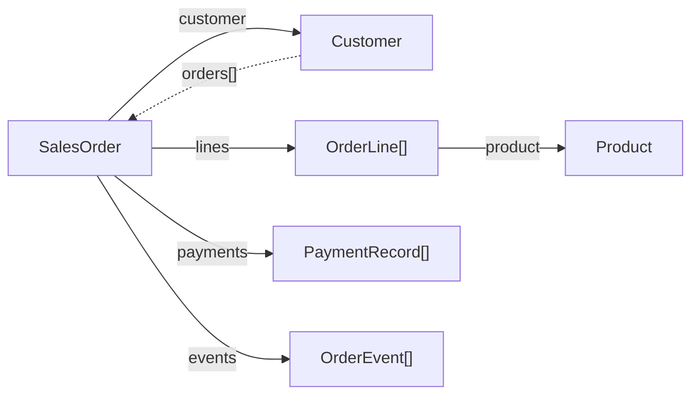

# Lựa chọn dữ liệu cần nạp và nguy cơ đồ thị đối tượng quá lớn

Trong ứng dụng Java dùng ORM, một câu lệnh “lấy danh sách đơn hàng” có thể chỉ đọc vài chục hàng, nhưng cũng có thể vô tình kéo theo khách hàng, dòng hàng, sản phẩm, giao dịch, lịch sử sự kiện và nhiều tầng quan hệ khác. Ngược lại, một trang chi tiết cần hiển thị đầy đủ dòng hàng có thể chạy **hàng trăm câu SQL** nếu từng collection chỉ được tải khi vòng lặp chạm tới nó. Cả hai đều là hệ quả của việc **chọn dữ liệu cần nạp** (*fetch plan*) không khớp với nhu cầu sử dụng.

Trong chương **Ánh xạ đối tượng** của module **DATABASE_DATA_MODELING**, chúng ta không chỉ chuyển entity và quan hệ Java thành bảng cùng khóa ngoại, mà còn phải lựa chọn cách đọc dữ liệu hợp lý. Một mô hình dữ liệu đúng về PK/FK vẫn có thể vận hành kém nếu mọi màn hình đều tải toàn bộ *object graph*, trong khi một thiết kế đọc dữ liệu tốt thường chỉ nạp đúng trường, đúng số hàng, đúng quan hệ cần cho **một use case cụ thể**.

Bài này tập trung vào `LAZY`, `EAGER`, bài toán `N+1`, `JOIN FETCH`, entity graph, batch loading, DTO/projection, phân trang, nguy cơ nhân hàng khi join nhiều collection, ranh giới transaction và cách đo/kiểm chứng. Các ví dụ dùng JPA/Jakarta Persistence, một số tính năng Hibernate được ghi rõ là **đặc thù provider**, và SQL minh họa theo PostgreSQL.

## 1. Bắt đầu bằng yêu cầu màn hình, không bắt đầu bằng annotation

Giả sử hệ thống thương mại có `Customer`, `SalesOrder`, `OrderLine`, `Product`, `PaymentRecord` và `OrderEvent`. Một đơn có một khách, nhiều dòng, nhiều giao dịch thanh toán và nhiều sự kiện xử lý.

Ba nhu cầu rất khác nhau:

| Use case | Dữ liệu thực sự cần | Không nên mặc định tải |
|---|---|---|
| **Trang danh sách 25 đơn mới nhất** | Mã đơn, ngày, trạng thái, tổng tiền, tên khách | Toàn bộ dòng, sản phẩm, payment, event |
| **Trang chi tiết một đơn** | Thông tin đơn, khách, 10–30 dòng, tên sản phẩm đã chụp tại lúc mua | Tất cả lịch sử giao dịch và log kỹ thuật nếu đang đóng tab |
| **Xuất báo cáo hàng triệu dòng** | Những cột báo cáo và phép tổng hợp cụ thể | Hàng triệu entity managed với toàn bộ association |

Sự khác biệt ở đây không phải cách định nghĩa entity. **Cùng một lược đồ vật lý** có thể phục vụ ba yêu cầu bằng ba truy vấn hoặc chiến lược fetch khác nhau.

### 1.1. Đồ thị đối tượng là gì?

Một entity có thể có tham chiếu tới những entity khác; khi đi theo các association từ một điểm bắt đầu, ta có một *object graph*.



Trong Java, đoạn mã `order.getCustomer().getOrders()` có thể đi ngược về nhiều đơn; mỗi đơn lại có các dòng, thanh toán và sự kiện. **Có đường đi trong mô hình đối tượng không có nghĩa use case nên tải toàn bộ đường đi ấy.** Đặc biệt, các quan hệ hai chiều có thể tạo chu trình khi serialize JSON hoặc trong `toString()`.

### 1.2. Kích thước đồ thị tăng nhanh theo bội số quan hệ

Giả sử mỗi đơn trung bình có:

- 12 dòng hàng.
- 3 giao dịch hoặc lần thử thanh toán.
- 15 sự kiện xử lý.

Nếu câu SQL join đồng thời cả ba collection, **mỗi đơn có thể sinh** `12 × 3 × 15 = 540` hàng trung gian. Với 100 đơn, ta có thể phải truyền khoảng **54.000 hàng SQL** chỉ để tái tạo khoảng vài nghìn object cần hiển thị. Đây là *Cartesian multiplication* khi join các quan hệ một–nhiều độc lập, không phải 54.000 đơn hàng khác nhau.

Nhân hàng không phải lúc nào đúng tích trên: phụ thuộc điều kiện lọc, loại join, số phần tử thực tế và dữ liệu null. Tuy nhiên, tích các bội số là cách ước lượng **nguy cơ nổ kích thước** trước khi viết một câu fetch join “lấy hết”.

## 2. Lược đồ quan hệ mẫu và bội số dữ liệu

Một thiết kế SQL đơn giản:

```sql
CREATE TABLE customers (
    id BIGINT GENERATED ALWAYS AS IDENTITY PRIMARY KEY,
    display_name VARCHAR(180) NOT NULL
);

CREATE TABLE sales_orders (
    id BIGINT GENERATED ALWAYS AS IDENTITY PRIMARY KEY,
    customer_id BIGINT NOT NULL REFERENCES customers(id),
    order_code VARCHAR(50) NOT NULL UNIQUE,
    placed_at TIMESTAMPTZ NOT NULL,
    status VARCHAR(20) NOT NULL
        CHECK (status IN ('DRAFT', 'CONFIRMED', 'CANCELLED')),
    total_amount NUMERIC(19, 2) NOT NULL CHECK (total_amount >= 0),
    currency_code CHAR(3) NOT NULL,
    version BIGINT NOT NULL DEFAULT 0
);

CREATE TABLE products (
    id BIGINT GENERATED ALWAYS AS IDENTITY PRIMARY KEY,
    sku VARCHAR(64) NOT NULL UNIQUE,
    display_name VARCHAR(200) NOT NULL
);

CREATE TABLE order_lines (
    id BIGINT GENERATED ALWAYS AS IDENTITY PRIMARY KEY,
    order_id BIGINT NOT NULL REFERENCES sales_orders(id),
    product_id BIGINT NOT NULL REFERENCES products(id),
    line_no INTEGER NOT NULL CHECK (line_no > 0),
    quantity INTEGER NOT NULL CHECK (quantity > 0),
    product_name_snapshot VARCHAR(200) NOT NULL,
    UNIQUE (order_id, line_no)
);

CREATE TABLE payment_records (
    id BIGINT GENERATED ALWAYS AS IDENTITY PRIMARY KEY,
    order_id BIGINT NOT NULL REFERENCES sales_orders(id),
    amount NUMERIC(19, 2) NOT NULL CHECK (amount > 0),
    status VARCHAR(20) NOT NULL
);

CREATE TABLE order_events (
    id BIGINT GENERATED ALWAYS AS IDENTITY PRIMARY KEY,
    order_id BIGINT NOT NULL REFERENCES sales_orders(id),
    occurred_at TIMESTAMPTZ NOT NULL,
    event_type VARCHAR(40) NOT NULL
);

CREATE INDEX idx_orders_customer_placed
    ON sales_orders(customer_id, placed_at DESC, id DESC);
CREATE INDEX idx_orders_placed_id
    ON sales_orders(placed_at DESC, id DESC);
CREATE INDEX idx_order_lines_product ON order_lines(product_id);
CREATE INDEX idx_payment_records_order ON payment_records(order_id);
CREATE INDEX idx_order_events_order_time
    ON order_events(order_id, occurred_at DESC);
```

Lược đồ bảo vệ **số hàng và quan hệ** bằng PK, FK, `UNIQUE`, `CHECK`. Nhưng nó không bắt JPA phải luôn tải `order_lines` khi đọc `sales_orders`; đó là quyết định ở tầng truy vấn.

Các chỉ mục trên được chọn để minh họa truy vấn theo khách/ngày và tải collection theo FK. `UNIQUE(order_id, line_no)` có thể tạo chỉ mục hữu ích khi tìm dòng theo `order_id`; không cần thêm một chỉ mục giống hệt nếu database đã có. Chỉ mục nào thực sự có lợi phải xác minh qua workload và `EXPLAIN`.

### 2.1. Phạm vi dữ liệu của một use case

Trước khi chọn fetch plan, viết một bảng “đọc gì, tối đa bao nhiêu”:

| Thuộc tính/quan hệ | Danh sách đơn | Chi tiết đơn | Báo cáo tổng hợp |
|---|---|---|---|
| `SalesOrder`: ID, mã, trạng thái, ngày | Có, tối đa 25 | Có, 1 | Chỉ cột thống kê |
| `Customer.displayName` | Có | Có | Có thể chỉ cần mã khách |
| `OrderLine` | Không | Có, giới hạn nghiệp vụ | Thường tổng hợp SQL |
| `Product` | Không | Có thể không cần vì có snapshot | Không |
| `PaymentRecord` | Chỉ số đã thanh toán nếu cần | Có khi mở tab thanh toán | Tùy báo cáo |
| `OrderEvent` | Không | Nạp riêng khi mở timeline | Không |

Đây là **hợp đồng đọc dữ liệu**, không phải giới hạn do JPA tự áp đặt. Nếu một đơn có thể chứa 100.000 dòng, yêu cầu “trang chi tiết tải mọi dòng” cần được xem lại và phân trang collection.

## 3. `LAZY` và `EAGER` thực sự có ý nghĩa gì?

JPA hỗ trợ thuộc tính `fetch` cho association:

- `FetchType.LAZY`: yêu cầu/định hướng trì hoãn tải liên kết tới khi cần; với một số loại mapping, khả năng trì hoãn phụ thuộc provider, proxy và bytecode enhancement.
- `FetchType.EAGER`: yêu cầu dữ liệu liên quan được nạp theo hợp đồng eager; **không đồng nghĩa nhất thiết dùng một câu SQL JOIN**. ORM có thể sinh các câu SELECT riêng.

Các mặc định JPA thường gặp:

| Mapping | Mặc định `fetch` theo JPA |
|---|---|
| `@ManyToOne` | `EAGER` |
| `@OneToOne` | `EAGER` |
| `@OneToMany` | `LAZY` |
| `@ManyToMany` | `LAZY` |
| `@ElementCollection` | `LAZY` |

Đây là mặc định **mapping**, không nói chính xác số query. Một association eager được truy cập trong màn hình danh sách có thể buộc ORM lấy dữ liệu dù trang không hiển thị. Vì thế nhiều hệ thống chọn `LAZY` cho quan hệ to-one rồi quyết định fetch rõ ràng theo từng use case.

### 3.1. Ví dụ entity với tải quan hệ có chủ đích

```java
import jakarta.persistence.*;
import java.math.BigDecimal;
import java.time.OffsetDateTime;
import java.util.ArrayList;
import java.util.List;

@Entity
@Table(name = "sales_orders")
public class SalesOrder {

    @Id
    @GeneratedValue(strategy = GenerationType.IDENTITY)
    private Long id;

    @Column(name = "order_code", nullable = false, length = 50)
    private String orderCode;

    @Column(name = "placed_at", nullable = false)
    private OffsetDateTime placedAt;

    @Column(nullable = false, length = 20)
    private String status;

    @Column(name = "total_amount", precision = 19,
            scale = 2, nullable = false)
    private BigDecimal totalAmount;

    @Column(name = "currency_code", length = 3, nullable = false)
    private String currencyCode;

    @Version
    @Column(nullable = false)
    private Long version;

    @ManyToOne(fetch = FetchType.LAZY, optional = false)
    @JoinColumn(name = "customer_id", nullable = false)
    private Customer customer;

    @OneToMany(mappedBy = "order", fetch = FetchType.LAZY)
    @OrderBy("lineNo ASC")
    private List<OrderLine> lines = new ArrayList<>();

    @OneToMany(mappedBy = "order", fetch = FetchType.LAZY)
    private List<PaymentRecord> payments = new ArrayList<>();

    @OneToMany(mappedBy = "order", fetch = FetchType.LAZY)
    private List<OrderEvent> events = new ArrayList<>();

    protected SalesOrder() {}

    public Long getId() { return id; }
    public String getOrderCode() { return orderCode; }
    public List<OrderLine> getLines() { return lines; }
    public Customer getCustomer() { return customer; }
}
```

Các lớp `Customer`, `OrderLine`, `PaymentRecord` và `OrderEvent` cần được ánh xạ tương ứng với DDL, bao gồm to-one `OrderLine.order`, `OrderLine.product` và FK của hai collection khác. Ví dụ lược bỏ constructor nghiệp vụ/setter và cascade vì chủ đề chính là **tải dữ liệu**, không phải vòng đời ghi. Trong hệ thống thật, không nên trả collection có thể sửa tùy ý nếu domain không cho phép.

### 3.2. `LAZY` không có nghĩa “không bao giờ tải”

Khi transaction còn mở:

```java
SalesOrder order = em.find(SalesOrder.class, 42L);
String code = order.getOrderCode(); // Dữ liệu cột của order.

int lineCount = order.getLines().size();
// Có thể kích hoạt truy vấn tải collection nếu chưa được khởi tạo.
```

Một lần truy cập `getLines()` không phải luôn là một SQL mới: collection có thể đã được fetch trước, nằm trong persistence context/cache hoặc provider sử dụng cơ chế đặc biệt. Nhưng **không nên giả định** `size()` trên collection lazy là phép `SELECT COUNT(*)` rẻ. Trong mapping JPA phổ biến, thao tác này có thể làm khởi tạo cả collection.

`LAZY` là cơ hội **tránh** tải dữ liệu không dùng; còn nơi nào thật sự truy cập association sẽ quyết định thời điểm có chi phí.

### 3.3. `EAGER` cũng có thể tạo N+1

Nếu `SalesOrder.customer` dùng mặc định `EAGER` và truy vấn 100 đơn mà ORM không join customer trong câu chính, nó có thể nạp customers bằng nhiều câu SELECT phụ. Thay vì giải quyết N+1 bằng cách đổi mọi quan hệ thành `EAGER`, hãy chọn một query phục vụ đúng màn hình và xác minh SQL.

Đặc biệt, to-one có thể dùng proxy khi LAZY, nhưng điều này phụ thuộc mapping, loại đối tượng và khả năng enhancement. Không được lấy một cấu hình LAZY chưa kiểm thử làm cam kết tất cả trường hợp đều không tải entity liên quan.

## 4. Bẫy `N+1`: một truy vấn danh sách, nhiều truy vấn con

Truy vấn ORM:

```java
List<SalesOrder> orders = em.createQuery("""
    select o
    from SalesOrder o
    order by o.placedAt desc, o.id desc
    """, SalesOrder.class)
    .setMaxResults(100)
    .getResultList();

for (SalesOrder order : orders) {
    // Nếu lines chưa khởi tạo, mỗi lần lặp có thể phát sinh SELECT riêng.
    System.out.println(order.getLines().size());
}
```

Một kịch bản SQL thường gặp:

```sql
SELECT *
FROM sales_orders
ORDER BY placed_at DESC, id DESC
LIMIT 100;

SELECT * FROM order_lines WHERE order_id = 101;
SELECT * FROM order_lines WHERE order_id = 102;
-- ... thêm các SELECT cho từng đơn chưa tải ...
SELECT * FROM order_lines WHERE order_id = 200;
```

Thay vì 1 query, ứng dụng có thể phát ra **1 + 100 = 101 query**. Nếu trong mỗi dòng còn truy cập `line.getProduct().getDisplayName()`, có thể phát sinh thêm các query to-one tùy cache và fetch plan. Khi trang lớn lên từ 20 đến 200 phần tử, số round-trip đến database tăng theo kích thước danh sách.

### 4.1. Vì sao N+1 nguy hiểm?

- Mỗi round-trip có chi phí mạng, phân tích câu SQL, xử lý transaction và lập kế hoạch thực thi.
- Nhiều truy vấn nhỏ có thể chiếm thời gian tổng lớn dù từng truy vấn đều dùng index.
- Ở môi trường phát triển ít dữ liệu, vấn đề có thể bị che bởi cache, database ở localhost và số lượng đơn ít.
- Khi số query tăng theo số bản ghi, latency thường không ổn định với tải thực tế.

`N+1` là **mẫu truy cập**, không phải lỗi của một annotation duy nhất. Việc đổi `LAZY` thành `EAGER` không tự bảo đảm giảm query; có thể làm hệ thống tải nhiều dữ liệu hơn ở mọi use case.

### 4.2. Đo, không suy đoán

Trong kiểm thử tích hợp, tạo một tập dữ liệu đủ để thấy xu hướng: ví dụ 50 đơn, mỗi đơn có vài dòng; làm rỗng persistence context rồi chạy truy vấn màn hình. Ghi lại:

1. Số câu SQL.
2. Số dòng trả về từ database.
3. Thời gian truy vấn, số round-trip và kích thước payload.
4. Số entity/collection được khởi tạo và bộ nhớ sử dụng.
5. Hành vi khi đổi 10 lên 50 hoặc 100 đơn.

Mục tiêu không nhất thiết là **một query cho mọi màn hình**. Hai hoặc ba query có giới hạn số hàng rõ ràng thường tốt hơn một query join tạo hàng chục nghìn dòng trùng lặp.

## 5. `JOIN FETCH`: hữu ích khi chọn đúng bội số

JPQL `JOIN FETCH` cho biết association nào nên được tải cùng truy vấn entity. Phân biệt **join lọc dữ liệu** với **fetch join để khởi tạo association**.

### 5.1. Fetch to-one cho trang danh sách

Trang danh sách cần tên khách, mỗi đơn có đúng một khách:

```java
List<SalesOrder> orders = em.createQuery("""
    select o
    from SalesOrder o
    join fetch o.customer
    where o.status = :status
    order by o.placedAt desc, o.id desc
    """, SalesOrder.class)
    .setParameter("status", "CONFIRMED")
    .setMaxResults(25)
    .getResultList();
```

Tải một quan hệ to-one không tự nhân một đơn thành nhiều hàng vì mỗi đơn chỉ trỏ tới một customer. `join fetch` phù hợp khi danh sách cần sử dụng entity `Customer` chứ không chỉ một trường. Nếu chỉ cần tên và mã đơn, **DTO projection** ở phần sau còn có thể tiết kiệm hơn.

Trong ví dụ này, dùng `join fetch` vì quan hệ bắt buộc. Với quan hệ tùy chọn có thể null, dùng `left join fetch` nếu muốn giữ những parent chưa có association.

### 5.2. Fetch một collection cho trang chi tiết

Với một đơn duy nhất:

```java
SalesOrder order = em.createQuery("""
    select distinct o
    from SalesOrder o
    left join fetch o.lines
    where o.id = :orderId
    """, SalesOrder.class)
    .setParameter("orderId", orderId)
    .getSingleResult();
```

Về mặt SQL, một đơn có 12 dòng tạo khoảng 12 hàng trong kết quả join; ORM gom lại thành một entity Order cùng collection Line. `distinct` ở JPQL giúp diễn đạt kết quả root không trùng; cách provider đẩy `DISTINCT` xuống SQL và xử lý khử trùng có thể khác theo phiên bản. **`DISTINCT` không làm mất chi phí truyền các hàng nhân bởi join** khi chúng khác nhau ở cột dòng hàng.

Đây là lựa chọn hợp lý khi biết trước `Order.lines` **không quá lớn**. Nếu mỗi đơn có thể có hàng chục nghìn dòng, hãy phân trang dòng hàng hoặc dùng query riêng có giới hạn.

### 5.3. To-one của collection cần được cân nhắc tiếp

Nếu màn hình chi tiết cần tên sản phẩm hiện tại, một cách biểu đạt **di động theo JPA** là tạo entity graph lồng nhau: tải `lines` và yêu cầu thêm `product` của từng `OrderLine`.

```java
EntityGraph<SalesOrder> graph = em.createEntityGraph(SalesOrder.class);
Subgraph<OrderLine> lineGraph = graph.addSubgraph("lines");
lineGraph.addAttributeNodes("product");

SalesOrder order = em.find(
    SalesOrder.class,
    orderId,
    java.util.Map.of("jakarta.persistence.fetchgraph", graph)
);
```

Đoạn mã cần import `EntityGraph` và `Subgraph` từ `jakarta.persistence`. Tùy provider, graph có thể được thực thi bằng join hoặc nhiều SQL; vẫn phải đo số hàng và số query. Một số provider như Hibernate cho phép viết JPQL fetch join với alias ở collection để fetch sâu hơn, nhưng **alias trong fetch join không phải cú pháp di động theo đặc tả JPQL** nên không nên dùng như ví dụ JPA chuẩn.

Vì mỗi dòng chỉ tham chiếu một Product, tải thêm to-one `line.product` không làm bội số collection lớn hơn theo kiểu nhân hai to-many, nhưng mở rộng chiều rộng dữ liệu và số entity cần tái tạo. Nếu đơn đã lưu `product_name_snapshot` và UI chỉ cần tên tại lúc mua, **không cần fetch Product**. Nhiều truy vấn được tiết kiệm nhờ mô hình dữ liệu có snapshot phù hợp, không phải vì một mẹo ORM.

### 5.4. Fetch join có thể thay đổi bội số kết quả

Join một collection làm root xuất hiện nhiều lần ở cấp SQL, và một parent không có child chỉ được giữ khi dùng `LEFT JOIN`. Nếu dùng `JOIN FETCH` (inner join) trên collection trống, parent có thể biến mất khỏi kết quả. Cần chọn loại join theo ý nghĩa nghiệp vụ.

Đừng đặt `JOIN FETCH` lên mọi association có sẵn. Nó nên được dùng khi **một use case** cần một phần đồ thị nhỏ, có bội số và giới hạn rõ ràng.

## 6. Nguy cơ lớn: fetch nhiều collection cùng lúc

Giả sử một `SalesOrder` có:

- 12 `OrderLine`.
- 3 `PaymentRecord`.
- 15 `OrderEvent`.

Truy vấn:

```java
List<SalesOrder> orders = em.createQuery("""
    select distinct o
    from SalesOrder o
    left join fetch o.lines
    left join fetch o.payments
    left join fetch o.events
    where o.id = :id
    """, SalesOrder.class)
    .setParameter("id", orderId)
    .getResultList();
```

Câu này là **mẫu cần tránh**, không phải khuyến nghị triển khai. Dù kết quả Java chỉ có một đơn, SQL có thể sinh hàng trăm tổ hợp `line × payment × event`. Trong Hibernate, fetch đồng thời nhiều bag collection (ví dụ nhiều `List` không có chỉ mục vị trí) còn có thể dẫn đến lỗi `MultipleBagFetchException` tùy mapping/provider. Đổi một `List` sang `Set` để né exception **không loại bỏ bản chất nhân hàng**.

### 6.1. Tại sao tình huống này không chỉ làm chậm query?

Một câu SQL trả 540 hàng lặp lại cột của cùng Order và Customer hàng trăm lần. Sau đó ORM phải:

- Ánh xạ từng hàng về entity/collection phù hợp.
- Kiểm tra identity map để tránh tạo nhiều managed instance cho cùng PK.
- Khử trùng thành phần collection theo ngữ nghĩa mapping.
- Giữ các đối tượng đó trong persistence context tới khi được clear/close.

Với nhiều đơn, kết quả trung gian có thể gây tăng dùng RAM, CPU giải mã kết quả, độ trễ truyền mạng và áp lực garbage collection. Một database có thể xử lý join tương đối nhanh nhưng ứng dụng vẫn chậm vì **hydration** và quản lý đồ thị đối tượng.

### 6.2. Thay bằng các truy vấn có giới hạn rõ ràng

Với màn hình chi tiết một đơn, có thể chọn:

```text
Query 1: Order + Customer
Query 2: OrderLine của Order, sắp theo lineNo
Query 3: 10 PaymentRecord mới nhất khi mở tab thanh toán
Query 4: 30 OrderEvent mới nhất khi mở timeline
```

Số query có thể nhiều hơn một, nhưng mỗi query chỉ truyền những hàng cần dùng. Quan hệ `events` không cần tải chỉ vì màn hình vừa mở. Bài toán là **tổng chi phí và payload cần thiết**, không phải cuộc thi giảm số query về 1.

```sql
SELECT id, event_type, occurred_at
FROM order_events
WHERE order_id = :order_id
ORDER BY occurred_at DESC, id DESC
LIMIT 30;
```

Nếu cần một trang sự kiện ổn định trên dữ liệu mới được ghi liên tục, bổ sung chiến lược phân trang và chỉ mục phù hợp; điều kiện truy vấn cần tính cả cột `id` khi định nghĩa thứ tự.

## 7. Phân trang root trước khi tải collection

Một lỗi đặc biệt nghiêm trọng xuất hiện khi kết hợp **fetch join collection** với `setFirstResult`/`setMaxResults`.

### 7.1. Vì sao phân trang kết quả join dễ sai?

Giả sử Order A có 30 dòng và Order B có 2 dòng. Câu SQL join rồi `LIMIT 20` giới hạn **20 hàng join**, không phải 20 đơn. Nó có thể chỉ lấy một phần dòng của A, khiến collection bị thiếu. Do đó nhiều provider phải xử lý khác: cảnh báo, phân trang trong bộ nhớ, hoặc từ chối tùy cấu hình.

Ví dụ nên tránh cho trang danh sách:

```java
em.createQuery("""
    select distinct o
    from SalesOrder o
    left join fetch o.lines
    order by o.placedAt desc, o.id desc
    """, SalesOrder.class)
    .setFirstResult(0)
    .setMaxResults(25)
    .getResultList();
```

Đừng giả định `DISTINCT` sửa được vấn đề. Nếu ORM buộc kéo cả danh sách lớn vào bộ nhớ rồi mới phân trang, latency và memory có thể tăng mạnh khi bảng lớn.

### 7.2. Cách hai bước: chọn ID, rồi tải chi tiết theo tập ID

**Bước 1:** chọn 25 Order ID với thứ tự ổn định:

```java
List<Long> ids = em.createQuery("""
    select o.id
    from SalesOrder o
    where o.status = :status
    order by o.placedAt desc, o.id desc
    """, Long.class)
    .setParameter("status", "CONFIRMED")
    .setMaxResults(25)
    .getResultList();
```

**Bước 2:** nếu trang này thật sự cần các dòng, fetch collection chỉ của tập ID:

```java
List<SalesOrder> pageWithLines = ids.isEmpty()
    ? List.of()
    : em.createQuery("""
        select distinct o
        from SalesOrder o
        left join fetch o.lines
        where o.id in :ids
        """, SalesOrder.class)
        .setParameter("ids", ids)
        .getResultList();
```

Lưu ý:

1. SQL `IN (:ids)` **không bảo đảm giữ thứ tự** của `ids`. Nếu cần thứ tự trang như bước 1, hãy sắp kết quả theo thứ tự ID đã lấy ở application hoặc dùng câu SQL có thứ tự tường minh.
2. Chỉ fetch collection nếu UI thực sự cần. Trang danh sách thường chỉ cần projection.
3. Danh sách ID cần được giới hạn; với rất nhiều ID phải tính giới hạn tham số/cách batching.
4. Giữa hai câu query, dữ liệu có thể thay đổi. Nếu yêu cầu snapshot nhất quán, xem xét transaction/isolation và chính sách phù hợp.

### 7.3. Phân trang keyset để tránh trang sâu

`OFFSET` lớn có thể khiến database phải duyệt nhiều hàng rồi bỏ qua. Với danh sách đơn sắp giảm theo `placed_at` và `id`, keyset pagination có thể dùng cặp giá trị cuối trang trước:

```sql
SELECT id, order_code, placed_at, status
FROM sales_orders
WHERE status = 'CONFIRMED'
  AND (placed_at, id) < (:last_placed_at, :last_id)
ORDER BY placed_at DESC, id DESC
LIMIT 25;
```

Đây là ví dụ PostgreSQL với so sánh hàng tuple; các DB khác có thể dùng điều kiện:

```sql
WHERE placed_at < :last_placed_at
   OR (placed_at = :last_placed_at AND id < :last_id)
```

Khi thêm bộ lọc `status`, điều kiện thay thế cần giữ luôn phần lọc đó. Với keyset, thứ tự phải ổn định và định nghĩa cách xử lý null/timestamp trùng. **Keyset giảm chi phí phân trang**, nhưng không tự giải quyết việc tải collection: vẫn phải tránh join nhân hàng.

## 8. Entity graph: khai báo tập association theo use case

JPA hỗ trợ **entity graph** để chỉ định association cần nạp cho một thao tác, mà không sửa mặc định của entity ở mọi nơi.

### 8.1. `@NamedEntityGraph`

```java
@Entity
@NamedEntityGraph(
    name = "SalesOrder.withCustomer",
    attributeNodes = @NamedAttributeNode("customer")
)
public class SalesOrder {
    // Các trường và mapping được minh họa ở trên.
}
```

Đây là ví dụ annotation độc lập; khi triển khai thực tế, thêm `@NamedEntityGraph` vào **cùng lớp SalesOrder**, không tạo entity thứ hai trùng tên.

Dùng graph khi đọc:

```java
EntityGraph<?> graph = em.getEntityGraph("SalesOrder.withCustomer");
SalesOrder order = em.find(
    SalesOrder.class,
    42L,
    java.util.Map.of("jakarta.persistence.fetchgraph", graph)
);
```

Định nghĩa graph có thể thay theo màn hình. Một graph dành cho chi tiết đơn có thể gồm `customer` và `lines`, nhưng không gồm `events`; một graph báo cáo lại có thể không cần association nào.

### 8.2. `fetchgraph` và `loadgraph`

Theo ngữ nghĩa JPA:

- `jakarta.persistence.fetchgraph`: các thuộc tính chỉ định trong graph được yêu cầu tải eager; các thuộc tính không liệt kê được xem theo ngữ nghĩa lazy trong fetch graph, trong phạm vi quy tắc và hỗ trợ provider.
- `jakarta.persistence.loadgraph`: các thuộc tính trong graph được yêu cầu tải eager; phần còn lại dùng fetch strategy mặc định theo mapping.

Graph **mô tả cái gì cần tải**, không cam kết ORM sẽ dùng một câu SQL hoặc tránh mọi SELECT phụ. Provider vẫn có quyền chọn SQL phù hợp. Cần kiểm tra hành vi thực tế, nhất là với to-one eager mặc định, kế thừa, subgraph và khả năng enhancement.

### 8.3. Graph động cho một query

```java
EntityGraph<SalesOrder> graph = em.createEntityGraph(SalesOrder.class);
graph.addAttributeNodes("customer");

List<SalesOrder> orders = em.createQuery("""
    select o
    from SalesOrder o
    where o.status = :status
    order by o.placedAt desc, o.id desc
    """, SalesOrder.class)
    .setParameter("status", "CONFIRMED")
    .setHint("jakarta.persistence.fetchgraph", graph)
    .setMaxResults(25)
    .getResultList();
```

Graph có thể có subgraph để yêu cầu một số thuộc tính của entity liên quan. Nhưng nếu thêm nhiều collection lớn vào cùng graph, **nguy cơ nhân hàng và tràn bộ nhớ vẫn còn**. Entity graph là công cụ diễn đạt fetch plan, không phải phép tối ưu tự động cho mọi quan hệ.

## 9. DTO projection: không cần entity nếu chỉ dùng dữ liệu đọc

Đối với bảng danh sách, người dùng chỉ nhìn một vài cột. Tạo hàng chục entity rồi nạp association để lấy tên khách thường thừa chi phí so với trả một **read model**.

### 9.1. DTO cho danh sách đơn

```java
public record OrderSummary(
    Long id,
    String orderCode,
    String customerName,
    String status,
    BigDecimal totalAmount
) {}
```

Một JPQL constructor expression:

```java
List<OrderSummary> summaries = em.createQuery("""
    select new com.example.read.OrderSummary(
        o.id,
        o.orderCode,
        c.displayName,
        o.status,
        o.totalAmount
    )
    from SalesOrder o
    join o.customer c
    where o.status = :status
    order by o.placedAt desc, o.id desc
    """, OrderSummary.class)
    .setParameter("status", "CONFIRMED")
    .setMaxResults(25)
    .getResultList();
```

Giả định `OrderSummary` ở package `com.example.read` và `Customer` có thuộc tính `displayName` được ánh xạ; cần đặt package đúng khi triển khai. DTO không phải managed entity, nên không đem theo collection lazy, dirty checking hay nhiều field không hiển thị.

**Phân biệt `join` và `join fetch`:** câu trên chỉ join để lấy `customerName` vào DTO, không yêu cầu ORM tạo cả entity Customer rồi gắn vào SaleOrder. Đây thường là lựa chọn tự nhiên cho danh sách hoặc API đọc.

### 9.2. Lấy số lượng dòng bằng aggregate, không tải collection

Để hiện “Đơn này có 12 dòng”, không cần gọi `order.getLines().size()` trên 25 đơn:

```sql
SELECT o.id,
       o.order_code,
       o.total_amount,
       COUNT(l.id) AS line_count
FROM sales_orders AS o
LEFT JOIN order_lines AS l ON l.order_id = o.id
WHERE o.id = ANY(:selected_order_ids)
GROUP BY o.id, o.order_code, o.total_amount;
```

`ANY(:selected_order_ids)` là cú pháp PostgreSQL khi tham số có kiểu mảng thích hợp; phương thức binding phụ thuộc API. Có thể dùng `IN` với danh sách tham số được quản lý phù hợp. Đối với trang đã xác định ID, truy vấn aggregate theo chính các ID đó giúp tránh group trên toàn bộ bảng.

Nếu cần đếm dòng cho nhiều đơn, lưu ý join cả payments và lines rồi `COUNT(l.id)` có thể **đếm thừa** vì nhân hàng. Khi có nhiều collection, nên tổng hợp từng nguồn riêng hoặc dùng chiến lược query tách biệt.

### 9.3. Tránh lấy toàn bộ entity chỉ để xuất CSV

Khi xuất hàng triệu bản ghi, việc `SELECT o FROM SalesOrder o` rồi biến từng object thành CSV có thể khiến hàng triệu entity nằm trong persistence context. Projection scalar/DTO, truy vấn cursor/stream, phân lô với `clear` khi cần, hoặc cơ chế export SQL phù hợp giúp kiểm soát memory.

Để xuất dữ liệu theo thời gian, phải định nghĩa thứ tự ổn định và chiến lược snapshot/độ nhất quán. “Dùng stream” không tự bảo đảm database không materialize toàn bộ kết quả; tùy driver, fetch size, transaction và cách ORM triển khai.

## 10. Batch fetching và nạp collection theo lô

Khi thực sự cần collection của nhiều parent, lựa chọn giữa N+1 và một join khổng lồ không chỉ có hai cực. Có thể tải collection **theo nhóm owner**.

### 10.1. Batch explicit bằng truy vấn `IN`

Sau khi đã chọn trang 25 đơn, lấy tất cả dòng của trang bằng một truy vấn:

```java
List<OrderLine> lines = em.createQuery("""
    select l
    from OrderLine l
    where l.order.id in :orderIds
    order by l.order.id, l.lineNo
    """, OrderLine.class)
    .setParameter("orderIds", orderIds)
    .getResultList();
```

Với kết quả này, service có thể gom `OrderLine` theo `orderId` thành một cấu trúc đọc DTO. Không cần trông chờ Hibernate tự khởi tạo `SalesOrder.lines` cho mọi owner; một truy vấn entity con riêng **không được mặc định hiểu là đã đánh dấu collection của từng SalesOrder là initialized**. Hãy thiết kế rõ read model hoặc dùng cơ chế fetch được provider hỗ trợ.

Một truy vấn có `IN` thường hiệu quả hơn 25 truy vấn riêng, nhưng cần giới hạn số tham số, chú ý số dòng con trả về và index `order_lines(order_id, line_no)`.

### 10.2. Hibernate batch fetching

Nếu dùng Hibernate, có thể cấu hình ví dụ:

```java
@OneToMany(mappedBy = "order", fetch = FetchType.LAZY)
@org.hibernate.annotations.BatchSize(size = 32)
private List<OrderLine> lines = new ArrayList<>();
```

Hoặc cấu hình Hibernate `hibernate.default_batch_fetch_size` theo nhu cầu. Khi nhiều collection lazy chưa được khởi tạo, Hibernate có thể gom khóa owner vào các câu truy vấn theo lô, giảm số round-trip so với N+1 thuần túy.

**`@BatchSize` và `hibernate.default_batch_fetch_size` là tính năng Hibernate**, không phải annotation/cấu hình chuẩn JPA. Cách tạo SQL, giới hạn batch, chiến lược tải to-one và to-many có thể thay đổi theo phiên bản, cache và dialect. Đừng hứa rằng `size = 32` bảo đảm mọi trang 32 đơn luôn được nạp trong đúng một câu SQL.

### 10.3. So sánh phương án fetch

| Cách | Mạnh ở đâu? | Rủi ro |
|---|---|---|
| `JOIN FETCH` to-one | Một root có một association; ít nhân hàng | Trả cột rộng nếu entity liên quan lớn |
| `JOIN FETCH` một to-many nhỏ | Chi tiết một owner; cần toàn bộ collection | Nhân hàng, không phù hợp phân trang root |
| Entity graph | Fetch plan theo use case, ít phụ thuộc sửa mapping | Không cam kết số query, graph rộng vẫn nặng |
| Batch fetching | Nhiều owner cần các lazy collection | Phụ thuộc provider/cấu hình, có thể vẫn tải thừa |
| Query theo tập ID + DTO | Kiểm soát chính xác hàng/cột cần lấy | Cần code gom dữ liệu, quy tắc thứ tự rõ |
| Projection/aggregate SQL | Danh sách, thống kê, export | Không có entity managed để cập nhật trực tiếp |

Chọn theo **hình dạng dữ liệu** và **đường truy cập của use case**, không theo một “best practice” duy nhất cho mọi màn hình.

## 11. Transaction, lazy loading và API serialization

### 11.1. `LazyInitializationException` và giới hạn persistence context

Với Hibernate, một tình huống phổ biến:

```java
SalesOrder order = repository.findById(42L).orElseThrow();
// Transaction/persistence context đã kết thúc.
return order.getLines().size(); // Có thể lỗi lazy initialization.
```

Nếu `lines` chưa được khởi tạo và entity đã detached, Hibernate có thể ném `LazyInitializationException`. Đây không phải dấu hiệu mọi association nên chuyển thành `EAGER`; vấn đề là **use case chưa xác định rõ dữ liệu nào phải được đọc trong transaction**.

Giải pháp thường hợp lý:

1. Service mở transaction đọc ở phạm vi ngắn, xác định fetch plan.
2. Lấy entity/DTO cần thiết trong transaction.
3. Chuyển thành DTO/response model đã có đủ dữ liệu cần hiển thị.
4. Đóng transaction trước khi truyền response tới lớp giao diện.

### 11.2. Không lấy Open Session in View làm chiến lược fetch

**Open Session in View (OSIV)** cho phép persistence context còn tồn tại trong một phần quá trình dựng HTTP response; nó có thể che lỗi lazy loading, nhưng cũng khiến view/serializer vô tình kích hoạt nhiều truy vấn database ngoài luồng đọc dữ liệu đã thiết kế.

Tùy framework, OSIV có thể được bật theo mặc định hoặc cấu hình riêng. Bật/tắt là quyết định kiến trúc; dù dùng lựa chọn nào, **không để JSON serializer tự quyết định fetch plan**. Những dữ liệu response cần có nên được xác định ngay ở service/read model.

### 11.3. Trả entity JPA trực tiếp qua JSON có thể nổ đồ thị

Nếu `SalesOrder` có `customer` và `Customer` có `orders`:

```text
SalesOrder.customer.orders[0].customer.orders[0]...
```

Serializer có thể chạy vòng qua hai phía quan hệ, gặp vòng lặp, phát sinh query lazy hoặc vô tình lộ dữ liệu không thuộc API. Annotation chặn serialize có thể giảm một số vấn đề, nhưng **DTO cho API là ranh giới rõ ràng hơn** về dữ liệu và quyền truy cập.

Những phương thức tưởng như vô hại như `toString()`, `equals()`, `hashCode()` hoặc debugger hiển thị object cũng có thể truy cập association. Không đưa collection lớn vào `toString()` và không mặc định so sánh entity bằng toàn bộ đồ thị quan hệ.

### 11.4. Độ nhất quán giữa nhiều query

Hai query “lấy Order trước, lấy Line sau” có thể quan sát hai thời điểm khác nhau nếu có transaction khác đang sửa dữ liệu. Với trang xem thông thường, điều này có thể chấp nhận; với quyết định tài chính hoặc báo cáo đối soát, cần xác định mức nhất quán.

Các lựa chọn bao gồm transaction đọc với isolation phù hợp, snapshot thời điểm báo cáo hoặc đọc một read model đã được cập nhật nhất quán. **Ít query hơn không tự đồng nghĩa dữ liệu nhất quán hơn**; một query lớn có thể tạo chi phí lớn, còn nhiều query trong snapshot phù hợp vẫn có thể nhất quán.

## 12. Quản lý bộ nhớ của persistence context

JPA `EntityManager` giữ **identity map** của những entity managed đã tải, giúp cùng một PK trong context thường ánh xạ về cùng một instance Java. Lợi ích là identity consistency và dirty checking, nhưng cái giá là memory tăng khi nạp rất nhiều entity.

### 12.1. Đồ thị lớn có hai chi phí khác nhau

**Chi phí database:** đọc nhiều hàng, join, sort, group, quét chỉ mục và truyền payload.

**Chi phí JVM:** tạo/proxy các object, collection, snapshot phục vụ dirty checking, identity map, lazy initialization, bộ nhớ giữ lại đến khi kết thúc context và garbage collection.

Một fetch plan “giảm query từ 100 xuống 1” vẫn có thể tệ hơn nếu query duy nhất tạo hàng trăm nghìn hàng và hàng chục nghìn object không cần thiết.

### 12.2. Export theo lô

Một cách tổng quát cho báo cáo lớn:

```text
for each page of 1_000 source rows:
    read only report columns with a stable sort key
    transform to export rows
    write batch to output
    release references
    advance cursor
```

Với entity managed bắt buộc phải tải trong xử lý lô, `em.clear()` có thể giúp giải phóng reference do persistence context giữ **sau khi công việc của batch đã hoàn tất**. Nhưng `clear()` làm các managed entity trở thành detached và có thể làm mất thay đổi chưa được flush; không gọi nó tùy tiện giữa một transaction đang ghi.

Đối với báo cáo chỉ đọc, projection/SQL cursor thường phù hợp hơn việc tạo managed entity. Tùy hệ thống, cần xác định kích thước batch, transaction, timeout, cách khôi phục khi thất bại và nhất quán giữa các trang.

### 12.3. Cache không phải phương án sửa fetch plan

Cache cấp một của JPA chính là persistence context; cache cấp hai hoặc query cache là tính năng tùy provider/cấu hình. Cache có thể giảm một số lần truy vấn lặp, nhưng không sửa nhu cầu trả dữ liệu thừa, không ngăn join nhân hàng và không bảo đảm một collection lớn trở nên rẻ.

Khi benchmark, cần thử cả **cache lạnh** và **cache ấm**. Một bài đo với cache ấm có thể che N+1 trong khi production chạy phân bố khóa rộng và cache hit thấp.

## 13. Thiết kế mô hình quan hệ giúp giảm nhu cầu fetch

Một số tối ưu chỉ làm được sau khi hiểu **ngữ nghĩa dữ liệu**, không phải sau khi chọn annotation:

### 13.1. Snapshot dữ liệu giao dịch

`OrderLine.product_name_snapshot` cho phép trang chi tiết hiện đúng tên lúc mua mà không phải tải `Product` hiện tại. Nó vừa tiết kiệm association, vừa giữ lịch sử giao dịch nếu tên catalog thay đổi.

Đổi lại, snapshot là **dữ liệu được sao chép có chủ đích**. Cần quy định thời điểm chụp, tính bất biến và các trường nào phải giữ (SKU, tên, giá, thuế). Không sao chép tùy tiện mọi cột của Product rồi gọi đó là tối ưu.

### 13.2. Chỉ số tổng hợp

`sales_orders.total_amount` có thể lưu tổng đã tính và kiểm soát ở root, thay vì mỗi trang danh sách tải mọi `OrderLine` rồi cộng trong Java. Đây là lựa chọn denormalization có lý do; phải định nghĩa nguồn chân lý và đồng bộ khi dòng hàng đổi.

Nếu total được lưu nhưng các đường ghi ngoài aggregate không cập nhật nó, dữ liệu sẽ lệch. Tùy yêu cầu, có thể chọn tính tổng bằng SQL ở query đọc thay vì lưu giá trị dư thừa.

### 13.3. Định nghĩa bội số thực tế

Nếu OrderEvent tăng vô hạn theo thời gian, collection `Order.events` trả toàn bộ lịch sử có thể là một API nguy hiểm. Một repository/query cho 30 sự kiện gần nhất với phân trang và index phù hợp thường phản ánh nhu cầu tốt hơn.

Một collection to-many không giới hạn trong domain không đồng nghĩa mọi use case nên cho phép `order.getEvents()` khởi tạo toàn bộ hàng. Việc tách truy vấn lịch sử riêng cũng làm rõ quyền truy cập và retention.

### 13.4. Tránh phụ thuộc ngược không cần thiết

Không phải lúc nào cũng cần `Customer.orders` hoặc `Product.orderLines`. Nếu use case chỉ cần truy vấn đơn theo khách bằng repository, có thể bỏ chiều collection ngược ở Java để giảm nguy cơ serialize vòng lặp và tải nhầm.

FK trong SQL vẫn tồn tại đầy đủ; **không khai báo association hai chiều ở Java không làm mất quan hệ trong database**. Cách này thường giúp mô hình object tập trung vào hành vi mà ứng dụng thật sự sử dụng.

## 14. Chẩn đoán bằng query plan, số query và độ lớn kết quả

Khi một màn hình chậm, cần phân biệt ít nhất ba kiểu vấn đề:

| Triệu chứng | Nguyên nhân có thể | Hướng kiểm chứng |
|---|---|---|
| Query count tăng gần tuyến tính với số Order | N+1 lazy/eager secondary select | Log SQL, statistics Hibernate/JPA provider |
| Query count thấp nhưng response rất nặng | Join nhân hàng, trả quá nhiều cột, object graph rộng | Số hàng trả về, payload, heap/GC |
| SQL ít nhưng từng query chậm | Thiếu index, scan/sort lớn, plan không phù hợp | `EXPLAIN (ANALYZE, BUFFERS)`, cardinality |
| Chỉ chậm lúc trang cuối sâu | OFFSET lớn, fetch join collection với pagination | Query plan, thời gian qua nhiều page |
| Lỗi ở serializer khi transaction đóng | Lazy association chưa tải | Stack trace, fetch plan DTO |
| Sau bulk read JVM tăng RAM liên tục | Persistence context giữ nhiều entity | Heap profile, context lifetime, batch size |

### 14.1. Dùng `EXPLAIN` theo đúng truy vấn

```sql
EXPLAIN (ANALYZE, BUFFERS)
SELECT o.id, o.order_code, c.display_name
FROM sales_orders AS o
JOIN customers AS c ON c.id = o.customer_id
WHERE o.status = 'CONFIRMED'
ORDER BY o.placed_at DESC, o.id DESC
LIMIT 25;
```

Đây là ví dụ PostgreSQL. Hãy xem số dòng thực tế, kiểu join, sort, thời gian và buffer, chứ không chỉ nhìn câu SQL có một `JOIN` rồi kết luận chậm. Với dữ liệu nhỏ, planner có thể chọn sequential scan hợp lý; không có nghĩa index vô dụng ở quy mô lớn.

### 14.2. Đặt ngân sách hiệu năng theo use case

Một “fetch budget” minh họa (cần điều chỉnh bằng đo thực tế):

| Use case | Giới hạn dữ liệu theo thiết kế | Chỉ số cần quan sát |
|---|---|---|
| Danh sách đơn | 25 Order DTO, mỗi DTO vài cột | Query count ổn định, p95 latency |
| Chi tiết một đơn | 1 Order, 1 Customer, số Line trong giới hạn cho phép | Hàng SQL, memory, số query |
| Tab lịch sử | 30 Event/trang | Query theo FK + thời gian, không tải mọi event |
| Báo cáo | Batch 1.000 hàng đọc | Heap tăng không tuyến tính theo tổng số hàng, throughput |

Đây là các con số **giả định để thiết kế và test**, không phải ngưỡng chung cho mọi sản phẩm. Nếu một màn hình hợp pháp cần nhiều dữ liệu hơn, phải điều chỉnh UX/phân trang/kiến trúc đọc phù hợp.

### 14.3. Kiểm thử tăng quy mô

Không chỉ tạo một đơn có một dòng. Hãy thử các bộ dữ liệu:

```text
S1: 10 Order × 2 Line, 0 Event
S2: 100 Order × 10 Line, 5 Event
S3: 100 Order × 100 Line, 20 Event
S4: 1 Order × 10_000 Event
```

Quan sát query count khi tăng số Order, số hàng join khi tăng collection, memory khi nạp một parent có collection rất lớn và kết quả phân trang. Nếu query count tăng theo số Order thì nghi N+1; nếu query count thấp mà hàng trả về tăng theo tích các collection thì nghi Cartesian explosion.

## 15. Các sai lầm thường gặp

**Sai lầm 1 — “`EAGER` luôn chỉ cần một câu JOIN.”** ORM có thể dùng nhiều SELECT; eager cũng có thể gây N+1 và tải dữ liệu màn hình không dùng.

**Sai lầm 2 — “Đổi tất cả thành `LAZY` là xong.”** Truy cập lazy collection trong vòng lặp vẫn gây N+1; không tải trước dữ liệu cần thiết còn có thể gây lỗi khi context đóng.

**Sai lầm 3 — “Một câu SQL luôn nhanh hơn năm câu SQL.”** Một join 3 collection có thể trả hàng nghìn tổ hợp trùng lặp; vài truy vấn nhỏ theo mục đích sử dụng có thể tốt hơn.

**Sai lầm 4 — “`DISTINCT` loại bỏ toàn bộ chi phí join to-many.”** SQL vẫn phải xử lý các hàng con khác nhau; ORM còn phải tái tạo object graph.

**Sai lầm 5 — “Fetch join collection và `setMaxResults` hoạt động như phân trang Order.”** Giới hạn SQL có thể áp trên hàng join và làm collection thiếu, hoặc ORM phân trang trong bộ nhớ.

**Sai lầm 6 — “`@EntityGraph` tự chọn kế hoạch SQL tối ưu.”** Graph cho biết association cần tải, không bảo đảm số query, giới hạn hàng hay tránh Cartesian multiplication.

**Sai lầm 7 — “Thêm `@BatchSize` là luôn hết N+1.”** Đây là extension Hibernate, phụ thuộc cấu hình, dữ liệu và loại association; vẫn phải đo.

**Sai lầm 8 — “Cần số dòng thì gọi `getLines().size()`.”** Nó có thể khởi tạo cả collection; câu `COUNT`/projection thường rõ ràng hơn cho danh sách.

**Sai lầm 9 — “Bật OSIV để serializer thích đọc gì thì đọc.”** Điều đó che việc thiếu fetch plan và làm SQL phát sinh tại tầng response.

**Sai lầm 10 — “Entity có association thì có thể trả JSON trực tiếp.”** Dễ vòng lặp serialize, lộ thông tin, phát sinh query hoặc phụ thuộc proxy; DTO định nghĩa hợp đồng API rõ hơn.

**Sai lầm 11 — “Cache chữa mọi truy vấn chậm.”** Cache không giảm payload join quá rộng và có thể che vấn đề trong test.

**Sai lầm 12 — “Xuất hàng triệu entity rồi để GC dọn.”** Persistence context có thể giữ object/snapshot và làm RAM tăng; nên dùng projection/streaming/batching có kiểm soát.

**Sai lầm 13 — “Không khai báo `Customer.orders` thì mất quan hệ DB.”** FK ở SQL vẫn bảo đảm quan hệ; chiều Java chỉ cần khai báo khi phục vụ use case.

**Sai lầm 14 — “Fetch plan là một setting chung cho entity.”** Nhu cầu trang danh sách, trang chi tiết và báo cáo khác nhau; chiến lược nên chọn theo từng đường đọc.

## 16. Quy trình lựa chọn dữ liệu cần nạp

**Bước 1 — Liệt kê các màn hình và truy vấn.** Với từng use case, ghi rõ cột, association, số owner tối đa, số child dự kiến, thứ tự và yêu cầu phân trang.

**Bước 2 — Vẽ quan hệ và ước lượng bội số.** Đánh dấu to-one, to-many, collection không có giới hạn, quan hệ hai chiều và đường đi có thể tạo chu trình.

**Bước 3 — Chọn read model trước.** Danh sách và báo cáo thường dùng DTO/projection; màn hình chỉnh sửa cần entity managed cùng các association thực sự cần cho invariant.

**Bước 4 — Đặt `LAZY` có chủ đích.** Tránh eager không cần thiết, nhất là to-one mặc định. Xác minh hỗ trợ lazy của provider và đường truy cập thực tế.

**Bước 5 — Chọn chiến lược fetch theo phạm vi.** Fetch join to-one hoặc một collection nhỏ; dùng entity graph cho các đường đọc có cấu trúc rõ; dùng batch/query theo tập ID khi nhiều parent cần collection.

**Bước 6 — Phân trang đúng cấp.** Với danh sách root, chọn ID/DTO của root trước; không dùng fetch join collection để phân trang owner. Với collection lớn, truy vấn/pagination riêng.

**Bước 7 — Đóng transaction tại ranh giới service.** Trả DTO chứa dữ liệu đã chọn; không để serializer/debugger vô tình điều khiển việc tải association.

**Bước 8 — Thiết kế index theo truy vấn.** Xác minh cột FK, điều kiện lọc, order-by và index bằng query plan; tránh tạo index trùng chỉ vì thấy một association.

**Bước 9 — Kiểm thử các cực trị.** Tăng số owner, số child, số collection join; đo SQL, latency, memory, lỗi lazy loading, dữ liệu thiếu do pagination.

**Bước 10 — Theo dõi production.** Quan sát p95/p99 latency, query count theo endpoint, RAM/GC, phân bố số child và tốc độ tăng dữ liệu. Thay fetch plan khi workload thay đổi.

### Bảng kiểm trước khi chốt fetch plan

| Câu hỏi | Dấu hiệu cần xem lại |
|---|---|
| Trang này cần entity hay chỉ vài cột? | Dùng `SELECT o FROM SalesOrder` cho màn hình chỉ hiển thị ID/mã |
| Có association eager mặc định không? | Truy vấn danh sách vô tình lấy Customer/Product không dùng |
| Có vòng lặp truy cập collection lazy không? | SQL tăng gần 1 query trên mỗi parent |
| Có join nhiều collection không? | Kết quả SQL tăng theo tích các bội số |
| Có phân trang root cùng fetch join collection không? | Trang thiếu dòng, ORM cảnh báo phân trang trong bộ nhớ |
| Có quan hệ to-many vô hạn không? | Trang chi tiết tải toàn bộ event lịch sử |
| Có return entity qua JSON không? | Serializer lặp hoặc truy cập DB ngoài service |
| Có transaction và read consistency rõ không? | Tải root và collection từ hai trạng thái không mong muốn |
| Có đo số hàng, memory cùng query count không? | Chỉ tối ưu số query nhưng RAM tăng mạnh |
| Chỉ mục có khớp `WHERE` và `ORDER BY` không? | Scan/sort lớn dù đã “giảm N+1” |

## 17. Bài tập thực hành: hệ thống quản lý khóa học

**Bối cảnh:** nền tảng học tập có các entity `Course`, `Instructor`, `Lesson`, `Enrollment`, `Student` và `LessonProgress`.

- Mỗi khóa có một giảng viên và trung bình 30 bài học.
- Một khóa phổ biến có 15.000 lượt đăng ký.
- Mỗi học viên có một bản ghi tiến độ cho nhiều bài học.
- Trang danh sách 20 khóa chỉ hiển thị tên, giảng viên, số bài học và số học viên đăng ký.
- Trang chi tiết một khóa hiển thị 30 bài học, nhưng danh sách học viên được mở trong tab riêng với phân trang 50 người/trang.
- Báo cáo tháng cần tổng số lượt học hoàn tất, không cần object Course/Student đầy đủ.

### Câu hỏi

1. Nếu `Course.enrollments` dùng `@OneToMany(fetch = EAGER)`, trang danh sách 20 khóa có thể gặp rủi ro gì?
2. Vì sao `JOIN FETCH course.lessons` cùng `course.enrollments` không thích hợp cho khóa có 15.000 lượt đăng ký?
3. Thiết kế DTO cho danh sách khóa với tên giảng viên và các chỉ số đếm; có cần tải 15.000 Enrollment không?
4. Trang chi tiết nên tải `lessons` và `enrollments` theo kế hoạch nào? Trình bày số query dự kiến và giới hạn số hàng.
5. Một danh sách Course phân trang 20 phần tử có nên dùng `JOIN FETCH lessons` trực tiếp trên query root không?
6. Nếu service trả entity trực tiếp, serializer có thể gây N+1 hoặc vòng lặp ở đâu?
7. Đặt chỉ mục nào cho truy vấn `Enrollment` theo `course_id` và ngày đăng ký? Giải thích cần đo workload.
8. Viết một kiểm thử có dữ liệu lớn để phân biệt N+1 với Cartesian explosion.

### Hướng giải tham khảo

- `EAGER` trên `Course.enrollments` có thể tải hàng trăm nghìn enrollment khi chỉ cần một con số, gây chi phí truy vấn, mạng và heap; cũng có thể phát sinh nhiều SELECT phụ.
- Một Course có 30 Lesson và 15.000 Enrollment: join cả hai collection có thể tạo tới khoảng **450.000 hàng trung gian** cho một Course nếu không có điều kiện lọc; đây là lý do cần tách truy vấn.
- Danh sách Course nên dùng DTO cho `courseId`, `title`, `instructorName` và những số đếm tính bằng SQL tổng hợp hoặc read model. Nếu cần hai số đếm từ hai collection, nên aggregate riêng hoặc dùng subquery/chiến lược được kiểm chứng để tránh đếm thừa do nhân hàng.
- Trang chi tiết: query một Course + Instructor; query tối đa 30 Lesson; chỉ khi mở tab enrollment mới query 50 Enrollment DTO/trang. Báo cáo dùng aggregate SQL theo điều kiện tháng, không khởi tạo toàn bộ đối tượng liên quan.
- Root pagination cần áp cho tập Course trước; dùng projection hoặc hai bước ID rồi fetch phần cần thiết. Không trông cậy fetch join to-many kèm `LIMIT 20`.
- Tránh trả entity Course với collection `enrollments`, `lessons`, `instructor.courses` hoặc `student.enrollments` trực tiếp qua JSON vì serializer có thể đi sâu và tạo vòng lặp.
- Cân nhắc index `enrollments(course_id, enrolled_at DESC, id DESC)` khi trang học viên lọc theo course và sắp theo thời điểm. Kiểm tra `EXPLAIN`, số hàng, chỉ mục sẵn có và chi phí ghi.
- Kiểm thử: tạo 20 Course với 30 Lesson/cái và nhiều Enrollment; đo query count khi lặp truy cập từng collection. Sau đó thử fetch join cả hai collection và đo **số hàng SQL**, memory, latency, không chỉ số entity kết quả. Dùng cấu hình provider cho phép quan sát/chặn truy vấn không mong muốn.

### Ví dụ SQL chỉ đếm theo course

```sql
SELECT e.course_id, COUNT(*) AS enrollment_count
FROM enrollments AS e
WHERE e.course_id IN (:course_ids)
GROUP BY e.course_id;
```

`:course_ids` trong ví dụ biểu diễn tập tham số được binding đúng cách bởi thư viện truy vấn. Với PostgreSQL, có thể dùng `= ANY(:course_ids)` cho mảng tham số thích hợp. Đây là dữ liệu tổng hợp theo course, không bắt Java tạo entity Enrollment chỉ để gọi `size()`.

## 18. Ghi nhớ

**Không có một fetch plan tối ưu cho mọi use case.** `LAZY` giúp trì hoãn nhưng có thể gây N+1 khi truy cập trong vòng lặp; `EAGER` đáp ứng việc tải liên kết nhưng có thể tải thừa hoặc tạo nhiều SELECT; `JOIN FETCH` phù hợp với quan hệ to-one và một số collection nhỏ, nhưng join nhiều collection hoặc phân trang root có thể làm đồ thị phình lớn.

Hãy bắt đầu từ **số hàng và trường thực sự cần**, rồi chọn DTO/projection, fetch join, entity graph hoặc batch loading có giới hạn. Với hệ thống cần tải dữ liệu lớn, phải quan sát **cả số query, số hàng SQL, CPU, heap/GC và thời gian phản hồi**, không tối ưu một chỉ số riêng lẻ. Khóa ngoại, chỉ mục, snapshot nghiệp vụ, ranh giới transaction và chính sách phân trang phải phối hợp với ORM để dữ liệu được nạp **đủ dùng, không thiếu, không thừa và có thể kiểm chứng khi quy mô tăng lên**.
