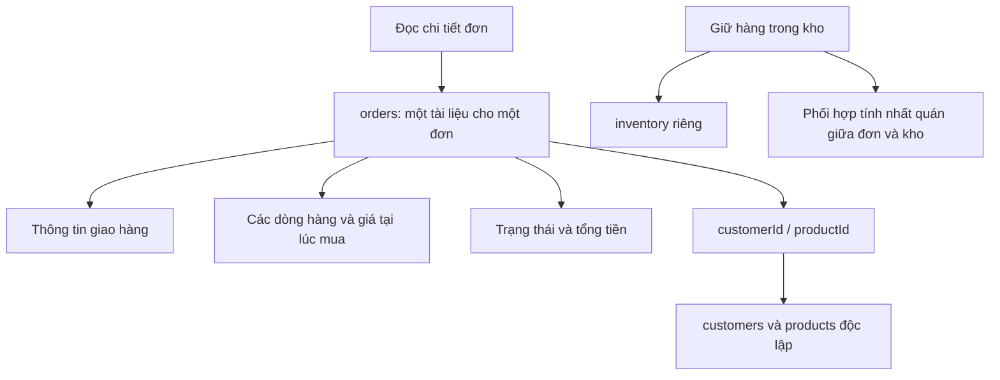

# Mô hình tài liệu và cách tổ chức dữ liệu theo đơn vị đọc hoặc ghi

## 1. Vì sao cần mô hình tài liệu?

Khi thiết kế cơ sở dữ liệu, câu hỏi đầu tiên không chỉ là **“có những thực thể nào?”** mà còn là **“người dùng cần đọc những dữ liệu nào cùng lúc, và nghiệp vụ thường thay đổi những dữ liệu nào cùng nhau?”**. Một ứng dụng bán hàng, chẳng hạn, thường hiển thị chi tiết đơn hàng gồm thông tin giao nhận và các dòng hàng trong một lần đọc. Khi xác nhận đơn, hệ thống cũng cần thay đổi trạng thái đơn và lưu thời điểm xác nhận một cách nhất quán.

**Mô hình tài liệu (document model)** tổ chức dữ liệu thành các tài liệu tự mô tả, thường có cấu trúc tương tự JSON: đối tượng chứa trường, đối tượng lồng nhau và mảng. Các tài liệu cùng loại thường được lưu trong một *collection* hoặc cấu trúc tương đương, tùy hệ quản trị. Thay vì buộc mọi quan hệ phải được thể hiện bằng nhiều bảng rồi kết hợp ở thời điểm truy vấn, mô hình tài liệu cho phép đặt những dữ liệu hay đi cùng nhau vào một tài liệu.

Mục tiêu của cách mô hình hóa này không phải “nhét càng nhiều dữ liệu càng tốt”, mà là **chọn ranh giới tài liệu phù hợp với thao tác đọc, ghi, quy tắc nhất quán và khả năng tăng trưởng**. Đó là một quyết định thiết kế dữ liệu, không đơn thuần là quyết định định dạng lưu trữ.

Sau bài này, người học có thể:

- Xác định tài liệu, collection, trường lồng nhau, mảng và tham chiếu từ yêu cầu nghiệp vụ.
- Chọn **nhúng (embed)** hoặc **tham chiếu (reference)** theo đơn vị đọc/ghi, số lượng phần tử và vòng đời dữ liệu.
- Nhận diện ranh giới cập nhật nguyên tử, sự đánh đổi giữa phi chuẩn hóa và tính nhất quán.
- Thiết kế khóa định danh, chỉ mục, kiểm tra hợp lệ, phiên bản lược đồ và phép truy vấn phù hợp.
- So sánh mô hình tài liệu với mô hình quan hệ, đồ thị và phân tích trước khi lựa chọn.

## 2. Tài liệu là một cấu trúc dữ liệu có ranh giới

Một tài liệu thường có các thành phần sau:

| Thành phần | Vai trò | Ví dụ |
| --- | --- | --- |
| Khóa định danh | Xác định duy nhất tài liệu trong phạm vi quy định | `orderId` |
| Trường vô hướng | Lưu giá trị đơn | `status`, `createdAt`, `currency` |
| Đối tượng lồng nhau | Gom thuộc tính cùng ngữ nghĩa | `shippingAddress` |
| Mảng | Biểu diễn nhiều phần tử thuộc tài liệu | `items` |
| Tham chiếu | Chỉ sang thực thể có vòng đời độc lập | `customerId`, `productId` |
| Phiên bản | Hỗ trợ thay đổi cấu trúc hoặc kiểm soát cập nhật | `schemaVersion`, `version` |

Ví dụ một đơn hàng (JSON minh họa, không phụ thuộc hệ quản trị):

```json
{
  "orderId": "ORD-0042",
  "customerId": "CUS-081",
  "customerSnapshot": {
    "displayName": "Nguyen An",
    "phoneAtPurchase": "0900000000"
  },
  "shippingAddress": {
    "city": "Da Nang",
    "district": "Hai Chau",
    "street": "12 Duong Mau"
  },
  "items": [
    {
      "productId": "PRD-101",
      "sku": "BK-101",
      "nameAtPurchase": "Sach thiet ke du lieu",
      "quantity": 2,
      "unitPriceMinor": 120000,
      "lineTotalMinor": 240000
    },
    {
      "productId": "PRD-205",
      "sku": "NT-011",
      "nameAtPurchase": "So tay",
      "quantity": 1,
      "unitPriceMinor": 85000,
      "lineTotalMinor": 85000
    }
  ],
  "currency": "VND",
  "itemsTotalMinor": 325000,
  "shippingFeeMinor": 25000,
  "grandTotalMinor": 350000,
  "status": "PENDING",
  "createdAt": "2026-11-01T08:30:00Z",
  "schemaVersion": 1,
  "version": 1
}
```

Trong ví dụ, `items`, `shippingAddress` và ảnh chụp thông tin khách hàng tại thời điểm mua được **nhúng** vì chúng góp phần tạo nên nội dung của chính đơn hàng. `customerId` và `productId` là **tham chiếu** vì khách hàng và sản phẩm còn tồn tại, được sử dụng và thay đổi bên ngoài đơn hàng.

Các giá trị `*Minor` trong ví dụ biểu diễn số tiền bằng đơn vị nguyên đã thống nhất cho tiền tệ đó. Với VND, ở đây chúng là số đồng. Cách lưu số nguyên hoặc kiểu decimal chính xác giúp tránh sai số của số thực dấu phẩy động khi tính tiền. Tên người mua, địa chỉ và số điện thoại chỉ là dữ liệu ví dụ; khi triển khai phải hạn chế truy cập và lưu dữ liệu cá nhân theo nhu cầu thực sự.

> **Phân biệt quan trọng:** *Tài liệu* là ranh giới lưu trữ. *Aggregate* trong thiết kế hướng miền nghiệp vụ là nhóm dữ liệu có các bất biến cần được bảo vệ cùng nhau. Một tài liệu có thể là cách triển khai tốt cho một aggregate, nhưng hai khái niệm không mặc nhiên đồng nhất.

## 3. Thiết kế theo đơn vị đọc và đơn vị ghi

### 3.1. Đơn vị đọc: màn hình hoặc thao tác cần dữ liệu gì?

Giả sử hệ thống bán hàng có các thao tác phổ biến:

| Truy vấn / thao tác đọc | Dữ liệu cần | Gợi ý mô hình |
| --- | --- | --- |
| Xem chi tiết một đơn | Trạng thái, địa chỉ, dòng hàng, tổng tiền | Gộp thông tin ổn định theo đơn vào một tài liệu `orders` |
| Xem lịch sử đơn của một khách | Mã đơn, ngày, tổng tiền, trạng thái | Mỗi đơn là tài liệu riêng; lọc `customerId`, sắp xếp `createdAt`, chỉ lấy trường tóm tắt |
| Xem giá và mô tả sản phẩm hiện hành | Thông tin sản phẩm mới nhất | Đọc tài liệu `products` độc lập |
| Tìm các đánh giá gần đây của sản phẩm | Danh sách đánh giá phân trang | Tài liệu `reviews` riêng, truy vấn theo `productId` |
| Tổng hợp doanh thu theo tháng | Số liệu nhiều đơn qua thời gian | Truy vấn tổng hợp hoặc hệ lưu trữ phân tích chuyên dụng khi tải lớn |

Chọn ranh giới tài liệu theo **một đường truy cập quan trọng**, sau đó kiểm tra các đường truy cập còn lại. Nếu tối ưu toàn bộ vào một màn hình mà làm chậm hoặc phức tạp mọi thao tác khác, mô hình đó chưa cân bằng.

### 3.2. Đơn vị ghi: dữ liệu nào phải thay đổi cùng nhau?

Một thay đổi nghiệp vụ có thể có nhiều mức nhất quán:

- **Trong cùng đơn:** Chuyển `PENDING` sang `PAID`, cập nhật thời điểm thanh toán và tăng phiên bản. Đây là các trường thuộc một đơn hàng, thích hợp cập nhật cùng tài liệu.
- **Giữa các thực thể:** Đặt hàng phải tạo đơn và giữ tồn kho. Đơn hàng và số dư tồn kho thường có vòng đời, tải ghi khác nhau; việc bảo toàn đồng thời có thể cần giao dịch nhiều tài liệu, cập nhật có điều kiện hoặc cơ chế giữ hàng được thiết kế rõ.
- **Dữ liệu có thể cập nhật trễ:** Tổng số đánh giá của sản phẩm có thể được tính lại hoặc đồng bộ bất đồng bộ, nếu giao diện chấp nhận độ trễ.

Nhiều cơ sở dữ liệu tài liệu cung cấp cập nhật nguyên tử cho **một tài liệu**, nhưng hỗ trợ giao dịch nhiều tài liệu và mức cô lập cụ thể khác nhau giữa các hệ thống. Không nên suy diễn rằng nhúng hai thực thể luôn giải quyết được mọi quy tắc nghiệp vụ, hoặc rằng tham chiếu thì không thể giao dịch.

Sơ đồ tư duy cho một đơn hàng:



### 3.3. Câu hỏi để xác định ranh giới

Trước khi quyết định nhúng, hãy trả lời: **(1)** dữ liệu có thường được đọc cùng nhau không; **(2)** có cần ghi nguyên tử cùng nhau không; **(3)** số phần tử lồng nhau có bị giới hạn tự nhiên không; **(4)** các phần có vòng đời và quyền truy cập riêng không; **(5)** trường hợp tải lớn nhất có khiến tài liệu phình to hoặc xảy ra tranh chấp ghi không. Câu trả lời thường quan trọng hơn sơ đồ thực thể ban đầu.

## 4. Nhúng hay tham chiếu?

### 4.1. Nhúng (embedding)

Nhúng dữ liệu khi nó là thành phần phụ thuộc vào tài liệu cha, có kích thước được kiểm soát và thường được đọc hoặc cập nhật trong cùng thao tác. Ví dụ: địa chỉ giao hàng tại lúc đặt đơn, vài phương thức liên hệ, các dòng hàng của một đơn hàng có giới hạn số dòng hợp lý.

**Lợi ích:** có thể lấy dữ liệu liên quan trong ít lượt đọc; cấu trúc sát với nội dung giao diện; một số bất biến có thể giữ trong cập nhật của một tài liệu. **Chi phí:** dữ liệu lặp có thể khó đồng bộ; tài liệu lớn gây tốn đọc/ghi; mảng tăng vô hạn làm khó phân trang, chỉ mục và cập nhật đồng thời.

### 4.2. Tham chiếu (referencing)

Tham chiếu khi dữ liệu có danh tính riêng, được chia sẻ ở nhiều nơi, cập nhật độc lập, có quyền truy cập riêng hoặc có số bản ghi con tăng không giới hạn. Ví dụ: `orders.customerId`, `orders.items[*].productId`, các đánh giá của sản phẩm, lịch sử hoạt động của tài khoản.

**Lợi ích:** tránh sao chép dữ liệu nguồn không cần thiết; mỗi tập dữ liệu có vòng đời, quy tắc và quy mô riêng; dễ truy vấn/phân trang phần lớn. **Chi phí:** có thể phải đọc thêm, kết hợp trên ứng dụng hoặc dùng phép nối/lookup nếu hệ quản trị hỗ trợ; việc kiểm tra tham chiếu và nhất quán liên thực thể cần thiết kế cụ thể.

| Tình huống | Thường ưu tiên | Lý do chính |
| --- | --- | --- |
| Địa chỉ giao nhận tại thời điểm mua | Nhúng vào đơn | Cần đọc cùng đơn và phải giữ nguyên lịch sử |
| Danh sách dòng hàng giới hạn của một đơn | Nhúng vào đơn | Cùng vòng đời, cùng ranh giới nghiệp vụ |
| Hồ sơ khách hàng sử dụng ở nhiều đơn | Tham chiếu | Danh tính và cập nhật độc lập |
| Bình luận của bài viết có thể tăng mãi | Tài liệu riêng và tham chiếu `postId` | Tăng trưởng, tải ghi và phân trang |
| Các thuộc tính nhỏ của sản phẩm | Nhúng vào sản phẩm | Luôn được hiển thị cùng sản phẩm |
| Hàng tồn kho thay đổi liên tục | Tài liệu/bản ghi tồn kho riêng | Tải ghi, ràng buộc và vòng đời khác mô tả sản phẩm |
| Sự kiện kiểm toán kéo dài nhiều năm | Tài liệu sự kiện riêng | Truy xuất theo thời gian, lưu trữ và dung lượng |

Không có quy tắc “một-nhiều thì luôn nhúng” hay “dữ liệu lặp thì luôn sai”. **Số lượng phần tử, tần suất thay đổi và ngữ nghĩa dữ liệu** quyết định phương án.

### 4.3. Cách làm dễ sai: nhúng mọi đơn vào khách hàng

Thiết kế ban đầu có thể trông tiện:

```json
{
  "customerId": "CUS-081",
  "name": "Nguyen An",
  "orders": [
    { "orderId": "ORD-0041", "status": "PAID" },
    { "orderId": "ORD-0042", "status": "PENDING" }
  ]
}
```

Nhưng mảng `orders` có thể tăng theo nhiều năm; mỗi lần thêm đơn đều ghi vào tài liệu khách hàng, các đơn độc lập lại cạnh tranh cùng một ranh giới ghi, và danh sách trở nên khó phân trang. Phương án phù hợp hơn là mỗi đơn một tài liệu trong `orders`, có `customerId` để truy vấn lịch sử theo khách. Nếu cần vài đơn gần đây ở hồ sơ khách, có thể xây dựng một *bản tóm tắt có giới hạn* và cơ chế đồng bộ rõ ràng.

## 5. Phi chuẩn hóa: sao chép có chủ đích, không bỏ qua nhất quán

Trong mô hình quan hệ chuẩn hóa, mỗi dữ kiện thường có một nơi lưu chính và quan hệ được kết hợp qua khóa. Mô hình tài liệu cho phép **phi chuẩn hóa (denormalization)** để giảm chi phí truy vấn trên đường đọc quan trọng. Tuy vậy, cần phân biệt hai loại bản sao:

1. **Ảnh chụp lịch sử:** `nameAtPurchase` và `unitPriceMinor` trong đơn giữ thông tin tại thời điểm chốt mua. Sản phẩm đổi tên hoặc giá sau đó **không nên** làm thay đổi đơn cũ. Bản sao này có ngữ nghĩa độc lập với giá hiện hành.
2. **Bản sao phục vụ đọc:** `reviewCount` trong sản phẩm là dữ liệu tính từ collection `reviews`. Nó có một nguồn sự thật và phải được cập nhật đồng bộ, cập nhật trễ có kiểm soát hoặc tính lại định kỳ.

Với mỗi trường sao chép, hãy viết rõ: **nguồn sự thật ở đâu, bản sao được tạo khi nào, điều gì làm nó đổi, ai chịu trách nhiệm cập nhật, có chấp nhận trễ không và xử lý lệch dữ liệu ra sao**.

Ví dụ bất biến của đơn hàng:

```text
lineTotalMinor = quantity * unitPriceMinor (cho từng dòng)
itemsTotalMinor = tổng lineTotalMinor
grandTotalMinor = itemsTotalMinor + shippingFeeMinor - discountMinor + taxMinor
```

Nếu dùng thêm `discountMinor` và `taxMinor`, cần quy định giá trị mặc định, cách làm tròn và thứ tự áp dụng. Các trường tổng tiền có thể lưu để đọc nhanh hoặc phục vụ chứng từ, nhưng thao tác ghi phải cập nhật chúng nhất quán với các dòng hàng.

## 6. Truy vấn, chỉ mục và cập nhật vật lý

Một lược đồ có vẻ hợp lý trên giấy có thể vẫn không hoạt động tốt nếu không hỗ trợ các truy vấn thực tế. Với collection `orders` ở ví dụ, giả sử ứng dụng thường đọc đơn bằng mã và đọc lịch sử đơn theo khách hàng, mới nhất trước.

Ví dụ bằng cú pháp MongoDB (chỉ để minh họa một cách triển khai; các hệ tài liệu khác có API và khả năng khác):

```javascript
// Mã đơn phải là duy nhất theo quy tắc nghiệp vụ.
db.orders.createIndex({ orderId: 1 }, { unique: true });

// Hỗ trợ lịch sử đơn của một khách theo thời gian.
db.orders.createIndex({ customerId: 1, createdAt: -1 });

// Lấy chi tiết một đơn.
db.orders.findOne({ orderId: "ORD-0042" });

// Lấy trang đầu lịch sử, chỉ chọn trường phục vụ danh sách.
db.orders.find(
  { customerId: "CUS-081" },
  { _id: 0, orderId: 1, createdAt: 1, grandTotalMinor: 1, status: 1 }
).sort({ createdAt: -1 }).limit(20);
```

Trong ứng dụng nhiều đơn vị sử dụng (*multi-tenant*), cần đưa khóa phân vùng logic như `tenantId` vào điều kiện truy vấn và thiết kế tính duy nhất/chỉ mục theo đúng phạm vi, thay vì mặc định `orderId` là duy nhất toàn hệ thống. Không đưa một bộ lọc an toàn như `tenantId` vào mô hình rồi quên áp dụng tại mọi đường đọc/ghi.

**Chỉ mục cần đi theo truy vấn**, không đi theo mọi trường có mặt trong tài liệu. Khi lập danh sách chỉ mục, cân nhắc bộ lọc, thứ tự sắp xếp, độ chọn lọc, lượng dữ liệu, ảnh hưởng đến ghi và chi phí bộ nhớ. Trường nằm trong mảng hoặc đối tượng lồng nhau có thể dùng chỉ mục đường dẫn/multikey ở một số hệ quản trị, nhưng có giới hạn và chi phí riêng. Dùng công cụ xem kế hoạch thực thi (`explain` hoặc tương đương) và đo trên dữ liệu đại diện để kiểm chứng.

### 6.1. Cập nhật an toàn khi có cạnh tranh ghi

Giả sử hai tiến trình cùng đọc đơn phiên bản `1`, rồi lần lượt cập nhật trạng thái. Nếu chỉ ghi đè theo `orderId`, cập nhật đến sau có thể vô tình che mất cập nhật trước. Một cách giảm rủi ro là **optimistic concurrency control**: cập nhật chỉ thành công khi phiên bản và trạng thái trước vẫn đúng.

```javascript
const result = db.orders.updateOne(
  { orderId: "ORD-0042", version: 1, status: "PENDING" },
  {
    $set: { status: "PAID" },
    $inc: { version: 1 },
    $currentDate: { updatedAt: true }
  }
);

// matchedCount === 0: trạng thái hoặc phiên bản đã khác;
// phải đọc lại và quyết định xử lý nghiệp vụ, không ghi đè mù.
```

Khi cập nhật mảng, chỉ thay đổi phần tử/trường cần thiết thay vì đọc cả tài liệu rồi ghi đè toàn bộ. Tuy nhiên, ngay cả cập nhật theo trường cũng phải kiểm tra các bất biến như tồn kho không âm, trạng thái chuyển hợp lệ, tổng tiền đúng và tính idempotent của sự kiện thanh toán. **Một cập nhật nguyên tử không tự động chứng minh toàn bộ quy trình nghiệp vụ là đúng.**

### 6.2. Giới hạn kích thước, tranh chấp và phân trang

Tùy hệ quản trị, một tài liệu có thể có giới hạn kích thước, ngưỡng hiệu quả ghi/đọc và giới hạn độ sâu lồng nhau. Các mảng tăng không giới hạn như lịch sử nhấp chuột, bình luận, sự kiện thanh toán, log thay đổi thường cần tách thành tài liệu riêng. Những dữ liệu lớn như ảnh, video, bản đính kèm thường nên lưu bằng hệ lưu trữ phù hợp, để tài liệu chỉ chứa metadata, quyền truy cập và định danh tài nguyên.

Phân trang bằng `skip/offset` có thể đắt khi đi sâu; với danh sách dài, cân nhắc phân trang theo cursor bằng khóa sắp xếp ổn định, ví dụ cặp `(createdAt, orderId)`, cùng chỉ mục phù hợp. Cách chọn phải phù hợp semantics của dữ liệu và tình huống bản ghi được chèn trong lúc người dùng chuyển trang.

## 7. Lược đồ linh hoạt vẫn cần hợp đồng dữ liệu

Tài liệu có thể cho phép các bản ghi có trường khác nhau, nhưng **schema linh hoạt không có nghĩa là không có schema**. Nếu mỗi phiên bản ứng dụng tự hiểu kiểu `status`, `price`, `address` khác nhau, lỗi sẽ chuyển từ lúc ghi sang lúc đọc hoặc sang báo cáo.

Một hợp đồng dữ liệu tối thiểu cho `orders` nên quy định:

| Nội dung | Ví dụ quy tắc |
| --- | --- |
| Định danh | `orderId` bắt buộc, duy nhất trong phạm vi đã chọn |
| Kiểu dữ liệu | `quantity` là số nguyên dương; giá là số nguyên/decimal chính xác |
| Trạng thái | Chỉ cho phép tập giá trị và chuyển trạng thái nghiệp vụ đã định |
| Dữ liệu lồng nhau | `items` có ít nhất một dòng, trường bắt buộc được xác định |
| Bất biến | Tổng tiền khớp dòng hàng và các điều chỉnh |
| Thời gian | Thống nhất múi giờ, định dạng lưu và cách hiển thị |
| Phiên bản | `schemaVersion` mô tả hình dạng tài liệu; `version` theo dõi sửa đổi cạnh tranh |
| Quyền riêng tư | Chỉ lưu thông tin cần thiết, phân quyền đọc/ghi, quy định thời hạn lưu |

Kiểm tra dữ liệu có thể tồn tại ở cả API/domain layer và database layer (ví dụ JSON Schema validator nếu hệ quản trị hỗ trợ). Kiểm tra ở ứng dụng diễn đạt quy tắc nghiệp vụ phong phú; kiểm tra ở cơ sở dữ liệu giúp ngăn bản ghi sai cấu trúc từ nhiều đường ghi. Các kiểm tra trải qua nhiều tài liệu cần cơ chế riêng.

### 7.1. Thay đổi lược đồ theo thời gian

Giả sử phiên bản đầu lưu `shippingAddress` là chuỗi; phiên bản mới cần `city`, `district`, `street` để tính vùng giao hàng. Quy trình nâng cấp an toàn có thể là:

1. Xác định dữ liệu cũ còn tồn tại, các ứng dụng đang đọc và phiên bản dịch vụ đang ghi.
2. Triển khai bộ đọc tương thích cả dạng cũ lẫn dạng mới (hoặc chuyển đổi tại lớp truy cập dữ liệu).
3. Bắt đầu ghi dạng mới với `schemaVersion` mới; kiểm soát dữ liệu hỗn hợp trong giai đoạn chuyển tiếp.
4. Di trú dần bản ghi cũ theo lô có khả năng chạy lại, quan sát lỗi và tổng số bản ghi còn lại.
5. Chỉ bỏ nhánh đọc cũ sau khi dữ liệu và các phiên bản ứng dụng liên quan đã được chuyển đổi.

Không nên dựa vào một lần quét cập nhật toàn bộ dữ liệu trong thời gian ngắn nếu tập tài liệu lớn hoặc nhiều dịch vụ đang sử dụng song song. Cần xác định khả năng tương thích ngược, xử lý trường vắng mặt và cách khôi phục khi di trú bị gián đoạn.

## 8. Đặt mô hình tài liệu cạnh các mô hình dữ liệu khác

| Cách mô hình hóa | Điểm mạnh điển hình | Cần cân nhắc |
| --- | --- | --- |
| **Quan hệ** | Ràng buộc khóa ngoại, truy vấn kết hợp linh hoạt, giao dịch và mô hình dữ liệu có quan hệ phức tạp | Nhiều phép nối có thể phát sinh khi màn hình luôn cần một cấu trúc tổng hợp |
| **Tài liệu** | Cấu trúc lồng nhau, dữ liệu được truy xuất theo aggregate, schema tiến hóa có kiểm soát | Trùng lặp dữ liệu, quan hệ chéo và mảng tăng lớn cần thiết kế cẩn thận |
| **Đồ thị** | Duyệt nhiều bước qua nút và cạnh, tìm đường đi/mối liên hệ | Có thể không tối ưu cho ghi giao dịch hoặc màn hình chỉ cần một tài liệu đơn giản |
| **Phân tích / cột** | Quét, nhóm, tổng hợp số lượng lớn dữ liệu lịch sử | Không nhất thiết phù hợp làm nơi ghi giao dịch từng đơn hàng với độ trễ thấp |

Những điểm trên là định hướng theo bài toán, không phải giới hạn tuyệt đối của sản phẩm. Cơ sở dữ liệu quan hệ có thể lưu JSON; cơ sở dữ liệu tài liệu có thể hỗ trợ phép nối và giao dịch; công cụ phân tích có thể nhận dữ liệu gần thời gian thực. Kiến trúc thực tế có thể kết hợp nhiều mô hình khi chi phí vận hành, đồng bộ dữ liệu và nhu cầu truy vấn biện minh được.

Ví dụ: ghi đơn hàng vào hệ giao dịch, phát sự kiện đáng tin cậy để đưa dữ liệu đã chuẩn hóa theo mục đích vào kho phân tích doanh thu. Việc này giúp tránh làm báo cáo tổng hợp nặng ảnh hưởng đến truy vấn đơn hàng trực tuyến, nhưng phải quy định độ trễ và cách đối soát giữa hai nơi.

## 9. Quy trình chuyển yêu cầu nghiệp vụ thành mô hình tài liệu

Có thể áp dụng quy trình sau cho đơn hàng, hồ sơ học tập, nội dung CMS hoặc quản lý kho:

1. **Viết tình huống nghiệp vụ và bất biến:** “Xem đơn theo mã”, “không bán quá tồn”, “giá tại lúc mua không đổi”, “một đơn chỉ được thanh toán thành công một lần”. Xác định ranh giới nào cần nhất quán chặt.
2. **Lập bảng đường truy cập:** Mỗi thao tác đọc/ghi gồm bộ lọc, dữ liệu trả về, tần suất tương đối, độ trễ mong muốn, giới hạn tải và kiểu sắp xếp/phân trang.
3. **Xác định thực thể và vòng đời:** Khách hàng, sản phẩm, đơn hàng, tồn kho, đánh giá; xem dữ liệu nào sống độc lập hoặc được nhiều thực thể tham chiếu.
4. **Chọn ranh giới tài liệu:** Nhúng cấu phần hữu hạn hay đi cùng nhau; tham chiếu quan hệ chia sẻ, thay đổi riêng hoặc phát triển không giới hạn. Nêu rõ các bản sao chủ đích.
5. **Thiết kế logic và vật lý:** Khóa, trường, kiểu dữ liệu, validation, chỉ mục, phân vùng logic, giới hạn kích thước, quy tắc ghi và phiên bản schema.
6. **Kiểm chứng bằng tình huống khó:** Hai người cùng sửa, thêm bản ghi mới khi đang phân trang, đơn có số dòng lớn bất thường, sản phẩm đổi giá, tài khoản bị xóa, retry thanh toán.
7. **Đo và cải tiến:** Tạo dữ liệu đại diện, thử các truy vấn/ghi trọng yếu, xem execution plan, độ trễ p95/p99, số lượt đọc/ghi, dung lượng, số lần xung đột và khả năng phục hồi.

Đầu ra nên là **bản thiết kế có thể kiểm tra**: ví dụ tài liệu, danh sách collection/tham chiếu, các bất biến nghiệp vụ, bảng đường truy cập, chỉ mục, chiến lược đồng bộ và giả định về tăng trưởng. Chỉ sơ đồ đẹp hoặc một JSON minh họa chưa đủ để kết luận thiết kế tốt.

## 10. Bài tập thiết kế: khóa học và bài học

Một nền tảng học tập cần hiển thị tên khóa học, tác giả, mô tả, danh sách bài học; giáo viên chỉnh sửa nội dung từng bài; học viên ghi tiến độ từng bài; số bài và số học viên có thể tăng đáng kể.

**Phương án A: một tài liệu khóa học chứa toàn bộ bài học, nội dung và tiến độ mọi học viên.** Ưu điểm là xem khóa học chỉ cần đọc một tài liệu. Nhưng việc cập nhật tiến độ liên tục của hàng nghìn học viên tạo tranh chấp trên tài liệu; nội dung và tiến độ có vòng đời khác nhau; kích thước có thể tăng vô hạn.

**Phương án B: tách theo vòng đời và đường truy cập:**

```text
courses
  { courseId, title, authorId, summary, lessonOutline: [
      { lessonId, title, position }  // chỉ mục lục có giới hạn phù hợp
  ] }

lessons
  { lessonId, courseId, content, publicationStatus, version }

lessonProgress
  { learnerId, lessonId, state, completedAt, version }
```

Phương án B cho phép màn hình giới thiệu khóa học lấy tài liệu `courses`; mở nội dung một bài thì đọc `lessons`; cập nhật tiến độ một học viên thì ghi `lessonProgress` tương ứng. Có thể đặt tính duy nhất trên `(learnerId, lessonId)` và chỉ mục theo `courseId` hoặc `learnerId` tùy đường truy cập. Nếu mục lục cũng lớn hoặc thay đổi độc lập liên tục, cần cân nhắc tách tiếp mục lục thành tập bản ghi riêng.

Hãy tự trả lời trước khi chốt thiết kế: *Có cần phát hành toàn bộ khóa học theo một phiên bản nhất quán? Giáo viên có thể sửa bài khi học viên đang học không? Khi xóa khóa học thì xử lý tiến độ ra sao? Nhu cầu tải báo cáo kết quả của nhiều học viên có nên chạy trực tiếp trên các tài liệu giao dịch không?* Những câu hỏi này quyết định ranh giới nhất quán, chính sách giữ dữ liệu và kiến trúc đọc nhiều hơn việc chọn định dạng JSON.

## 11. Checklist tự rà soát

- Mỗi tài liệu đại diện cho một đơn vị nghiệp vụ có ranh giới rõ ràng; không có mảng tăng vô hạn mà chưa có phương án quản lý.
- Các đường đọc/ghi quan trọng đã được liệt kê, có bộ lọc, sắp xếp, phân trang và chỉ mục dự kiến.
- Mỗi dữ kiện được nhúng hoặc tham chiếu có lý do theo vòng đời, kích thước, tần suất đọc/ghi và nhất quán.
- Mỗi bản sao dữ liệu có nguồn sự thật và chính sách cập nhật; ảnh chụp lịch sử được phân biệt với bản sao phục vụ đọc.
- Quy tắc giao dịch, chuyển trạng thái, kiểm soát ghi đồng thời và xử lý retry đã được nêu rõ.
- Khóa, kiểu dữ liệu, trường bắt buộc, giá trị mặc định, quyền truy cập và thời hạn lưu được xác định.
- Có kế hoạch tương thích phiên bản, di trú schema và đo hiệu năng trên dữ liệu đại diện.

**Điểm cần nhớ:** Tổ chức dữ liệu theo đơn vị đọc hoặc ghi nghĩa là tìm ranh giới tài liệu giúp thao tác thường gặp đơn giản và đáng tin cậy, đồng thời kiểm soát trùng lặp, cập nhật đồng thời, tăng trưởng và thay đổi về sau. Mô hình tốt được chứng minh bằng yêu cầu nghiệp vụ và truy vấn thực tế, chứ không bởi việc mọi thông tin đều nằm trong một JSON.
