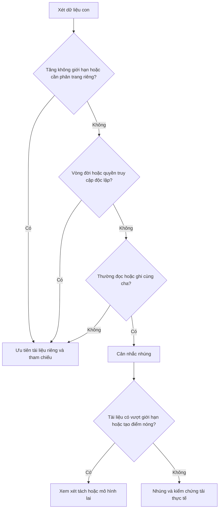

# Nhúng dữ liệu hay tham chiếu sang tài liệu khác

## 1. Bài toán thiết kế: dữ liệu nào nên nằm cùng một tài liệu?

Trong **mô hình tài liệu** (*document model*), một tài liệu có thể chứa trường đơn, đối tượng lồng nhau và mảng. Khi chuyển yêu cầu nghiệp vụ thành cấu trúc lưu trữ, người thiết kế thường phải chọn giữa hai cách biểu diễn mối liên hệ:

- **Nhúng (embedding):** đặt dữ liệu liên quan trực tiếp bên trong tài liệu đang xét.
- **Tham chiếu (referencing):** lưu định danh của tài liệu khác; khi cần, ứng dụng hoặc cơ sở dữ liệu truy xuất thêm tài liệu được tham chiếu.

Chọn sai ranh giới sẽ gây khó khăn về hiệu năng, nhất quán và khả năng tiến hóa. Nhúng quá nhiều có thể khiến tài liệu lớn, khó phân trang và trở thành điểm nóng khi nhiều người cùng ghi. Tham chiếu quá mức có thể biến một màn hình đơn giản thành chuỗi truy vấn chồng chéo, gây độ trễ và tăng chi phí kết hợp dữ liệu.

Trong phạm vi **DATABASE_DATA_MODELING**, đây là một quyết định mô hình hóa dựa trên yêu cầu nghiệp vụ, quan hệ, ràng buộc, khóa và chỉ mục. Mục tiêu là tạo ra cấu trúc phù hợp với kiểu truy cập dữ liệu và dễ kiểm chứng, đồng thời biết khi nào giải pháp quan hệ, đồ thị hoặc phân tích phù hợp hơn.

**Mục tiêu học tập:** Sau bài này, người học có thể xác định trường hợp nên nhúng, nên tham chiếu hoặc phối hợp hai cách; giải thích quyết định bằng tần suất đọc/ghi, số lượng phần tử, vòng đời dữ liệu và ràng buộc nhất quán; thiết kế ví dụ tài liệu, khóa, chỉ mục và kế hoạch thay đổi mô hình.

## 2. Hai cách biểu diễn cùng một mối quan hệ

Giả sử ứng dụng bán hàng có một đơn hàng và các dòng hàng.

### 2.1. Nhúng các dòng hàng vào đơn hàng

```json
{
  "orderId": "ORD-2026-042",
  "customerId": "CUS-017",
  "status": "PENDING",
  "currency": "VND",
  "items": [
    {
      "productId": "PRD-101",
      "skuAtPurchase": "BOOK-101",
      "nameAtPurchase": "Sổ tay kỹ thuật",
      "quantity": 2,
      "unitPriceMinor": 120000
    },
    {
      "productId": "PRD-220",
      "skuAtPurchase": "PEN-220",
      "nameAtPurchase": "Bút mực",
      "quantity": 1,
      "unitPriceMinor": 35000
    }
  ],
  "itemsTotalMinor": 275000
}
```

Mỗi lần xem chi tiết đơn, ứng dụng lấy một tài liệu có sẵn danh sách dòng hàng. Các dòng hàng thường được hình thành và chốt cùng đơn; số lượng dòng hàng trên một đơn thường có giới hạn theo nghiệp vụ. Đây là ứng viên tốt cho **nhúng**.

Các trường `productId` là tham chiếu đến danh mục sản phẩm hiện hành. `nameAtPurchase` và `unitPriceMinor` là **ảnh chụp lịch sử**: giá hoặc tên sản phẩm hôm nay thay đổi không được làm thay đổi giá đã chốt khi mua. Ví dụ sử dụng số tiền dạng số nguyên, với đơn vị đã thống nhất cho VND; hệ thống thực tế cần quy định chính xác đơn vị tiền tệ, thuế, giảm giá và cách làm tròn.

### 2.2. Lưu các dòng hàng ở tài liệu riêng

```jsonc
// orders
{
  "orderId": "ORD-2026-042",
  "customerId": "CUS-017",
  "status": "PENDING",
  "itemsTotalMinor": 275000
}

// orderItems — mỗi phần tử dưới đây là một tài liệu
{
  "orderItemId": "OI-001",
  "orderId": "ORD-2026-042",
  "productId": "PRD-101",
  "quantity": 2,
  "unitPriceMinor": 120000
}
{
  "orderItemId": "OI-002",
  "orderId": "ORD-2026-042",
  "productId": "PRD-220",
  "quantity": 1,
  "unitPriceMinor": 35000
}
```

Cách này cho phép truy vấn, phân trang và cập nhật từng dòng hàng độc lập. Đổi lại, xem đầy đủ một đơn phải lấy thêm các tài liệu `orderItems`; nếu tổng tiền phụ thuộc vào mọi dòng, ứng dụng cần cơ chế bảo vệ bất biến giữa nhiều tài liệu.

Cả hai cách đều có thể đúng. Phải chọn bằng các yêu cầu thực tế: đơn có thể chứa bao nhiêu dòng; có bao nhiêu lượt xem; dòng hàng có được sửa độc lập sau khi tạo không; cần cập nhật nguyên tử những gì; và hệ quản trị có những giới hạn nào.

### 2.3. Quan hệ trong mô hình nghiệp vụ không bắt buộc ánh xạ một kiểu lưu trữ

Sơ đồ thực thể có thể ghi `Order 1—N OrderItem`, nhưng quan hệ một-nhiều **không tự quyết định** việc nhúng hay tách tài liệu. Mô hình tài liệu ưu tiên **ranh giới truy cập và nhất quán**; mô hình quan hệ thường biểu diễn bằng bảng và khóa ngoại. Ngay trong một mô hình tài liệu, có thể vừa nhúng `items`, vừa tham chiếu `customerId` và `productId`.

## 3. Sáu tiêu chí chính để ra quyết định

### 3.1. Dữ liệu có được đọc cùng nhau thường xuyên không?

Hỏi: một thao tác người dùng cần đọc những trường nào để hoàn tất? Nếu phần con gần như luôn xuất hiện cùng phần cha, nhúng có thể giảm số lượt đọc và số phép kết hợp.

**Ví dụ:** Màn hình hóa đơn hiển thị địa chỉ giao hàng tại thời điểm mua cùng danh sách sản phẩm. Những thông tin ấy có thể nằm trong đơn hàng.

**Phản ví dụ:** Danh sách sản phẩm hiển thị 20 sản phẩm nhưng không cần hàng nghìn bình luận cho từng sản phẩm. Nhúng toàn bộ bình luận vào mỗi sản phẩm sẽ làm dữ liệu tải về thừa và phức tạp hóa việc phân trang.

### 3.2. Dữ liệu có cần thay đổi nguyên tử cùng nhau không?

Nếu nhiều trường phải cùng thay đổi để giữ một bất biến, lưu trong cùng tài liệu thường giúp một thao tác ghi nguyên tử đơn giản hơn, **khi hệ quản trị bảo đảm nguyên tử ở cấp tài liệu**.

Ví dụ khi thay đổi dòng hàng, số lượng, đơn giá áp dụng và tổng tiền cần phù hợp với nhau. Nếu chúng đều ở một tài liệu, có thể áp dụng cập nhật có điều kiện trong một ranh giới ghi.

Tuy nhiên, việc đặt dữ liệu trong một tài liệu không tự giải quyết mọi ràng buộc nghiệp vụ. Giữ hàng trong kho, thu tiền và tạo phiếu giao vẫn có thể liên quan đến các tài liệu hoặc hệ thống khác; cần giao dịch nhiều tài liệu, giao thức phối hợp, cập nhật có điều kiện hoặc mô hình nhất quán cuối cùng tùy nghiệp vụ và sản phẩm cơ sở dữ liệu.

### 3.3. Phần con có vòng đời độc lập không?

Một đối tượng có danh tính riêng, được nhiều nơi dùng đến và có quyền quản lý độc lập thường nên được tham chiếu.

Ví dụ: hồ sơ khách hàng thay đổi số điện thoại, tên hiển thị hoặc lựa chọn bảo mật mà không làm phát sinh sửa đổi cho từng đơn hàng lịch sử. Đơn nên giữ `customerId`, đồng thời lưu *snapshot* thông tin nào thực sự cần bảo toàn tại thời điểm mua.

Ngược lại, địa chỉ giao hàng đã chốt trong một đơn có vòng đời gắn với chính đơn hàng; nhúng phù hợp hơn một tham chiếu đến “địa chỉ hiện tại” vốn có thể thay đổi.

### 3.4. Số lượng phần tử có giới hạn tự nhiên không?

Một mảng có số phần tử hữu hạn và nhỏ thường có thể nhúng: một vài tùy chọn thanh toán, nhiều dòng hàng trong phạm vi giới hạn, các thuộc tính kỹ thuật của sản phẩm.

Nếu phần con tăng theo thời gian và khó dự đoán trần số lượng — bình luận, sự kiện, lượt xem, tiến độ học của hàng triệu học viên — tách thành tài liệu riêng giúp kiểm soát kích thước, phân trang và lưu trữ.

**Cẩn trọng:** “Hiện tại chỉ có 10 phần tử” không chứng minh tương lai vẫn nhỏ. Cần nêu giới hạn bằng quy tắc nghiệp vụ hoặc dự báo tăng trưởng đủ tin cậy.

### 3.5. Phần con có tần suất ghi và mức cạnh tranh riêng không?

Nhúng dữ liệu biến cha và con thành cùng một đơn vị ghi vật lý ở nhiều hệ quản trị. Nếu hàng nghìn người liên tục cập nhật những phần khác nhau của một mảng nằm trong cùng tài liệu, có thể phát sinh tranh chấp, thử lại giao dịch và điểm nóng.

Ví dụ hàng nghìn học viên đánh dấu hoàn thành bài học không nên cùng ghi vào một tài liệu `course` chứa mảng tiến độ của tất cả học viên. Tài liệu `lessonProgress` hoặc `enrollments` theo học viên/bài học thường có ranh giới ghi thích hợp hơn.

Không phải mọi trường nhúng đều gây tranh chấp như nhau; cần đo bằng cơ chế khóa/cập nhật và kiểu tải thực tế.

### 3.6. Dữ liệu có cần được truy vấn, phân trang, phân quyền hoặc lưu trữ riêng không?

Nếu phần con có bộ lọc, thứ tự, hạn lưu, quyền truy cập hay chính sách xóa khác phần cha, việc tách ra giúp thực thi quy tắc rõ ràng hơn.

Ví dụ bình luận cần lọc theo tác giả, trạng thái kiểm duyệt và thời gian; có thể bị xóa độc lập; hiển thị theo từng trang. Đặt chúng vào collection riêng và lưu `postId` thường dễ vận hành hơn.

Tương tự, thông tin nhạy cảm không nên bị nhúng vào một tài liệu được sử dụng rộng rãi nếu nhiều truy vấn chỉ cần phần dữ liệu công khai. Phân quyền theo tài liệu hay theo trường phụ thuộc khả năng của hệ quản trị và lớp ứng dụng.

## 4. Bảng quyết định nhanh và những trường hợp trung gian

| Đặc điểm của dữ liệu con | Nghiêng về nhúng | Nghiêng về tham chiếu |
| --- | --- | --- |
| Đọc cùng tài liệu cha | Gần như mọi lần đọc | Chỉ cần ở một số màn hình hoặc truy vấn |
| Cập nhật | Thường cần cập nhật cùng cha | Được sửa độc lập, ghi thường xuyên |
| Kích thước | Nhỏ và có giới hạn rõ | Lớn hoặc tăng không giới hạn |
| Vòng đời | Phụ thuộc vào cha | Có danh tính và vòng đời riêng |
| Quan hệ | Một-ít hoặc một-nhiều giới hạn | Một-nhiều lớn, nhiều-nhiều |
| Tính chia sẻ | Chủ yếu thuộc một cha | Nhiều cha cùng sử dụng |
| Phân trang/tìm kiếm | Ít cần truy vấn riêng | Cần lọc, phân trang hoặc tìm kiếm sâu |
| Ràng buộc | Bất biến chủ yếu nằm trong một tài liệu | Quy tắc trải qua nhiều thực thể độc lập |
| Quyền truy cập | Cùng chính sách với cha | Chính sách khác cha |
| Thay đổi lược đồ | Cùng triển khai và phiên bản với cha | Dịch vụ hoặc đội sở hữu thay đổi độc lập |

Bảng trên là **khung suy luận**, không phải bộ quy tắc áp dụng máy móc. Khi các tiêu chí mâu thuẫn, cần đo và ưu tiên thao tác quan trọng nhất cùng những bất biến không được vi phạm.

Sơ đồ lựa chọn tham khảo:



## 5. Mẫu thiết kế: nhúng, tham chiếu và mô hình lai

### 5.1. Nhúng đối tượng phụ thuộc

Phù hợp với địa chỉ giao hàng đã chốt, tùy chọn hiển thị cố định và các trường nhỏ thuộc một aggregate:

```json
{
  "orderId": "ORD-2026-042",
  "shippingAddress": {
    "recipientName": "Nguyen A",
    "city": "Da Nang",
    "postalCode": "550000"
  }
}
```

Địa chỉ trong đơn là giá trị đã dùng để giao hàng, không phải “địa chỉ mặc định hiện tại” của người mua. Điều này tránh thay đổi lịch sử khi khách cập nhật tài khoản.

### 5.2. Tham chiếu một đối tượng dùng chung

Sản phẩm và đơn hàng có vòng đời khác nhau:

```jsonc
// products
{
  "productId": "PRD-101",
  "name": "Sổ tay kỹ thuật - bản mới",
  "currentPriceMinor": 135000,
  "active": true
}

// orders
{
  "orderId": "ORD-2026-042",
  "items": [
    {
      "productId": "PRD-101",
      "nameAtPurchase": "Sổ tay kỹ thuật",
      "unitPriceMinor": 120000,
      "quantity": 2
    }
  ]
}
```

Đơn hàng giữ bản chụp giá/nhãn hàng, còn `productId` hỗ trợ điều hướng tới sản phẩm hiện hành. Nếu sản phẩm ngừng bán hoặc bị xóa, chính sách lưu lịch sử đơn không nên phụ thuộc vào việc tài liệu `products` còn tồn tại; cần xác định cách xử lý tham chiếu “mồ côi” theo yêu cầu nghiệp vụ.

### 5.3. Tách tập dữ liệu lớn, nhúng phần tóm tắt có giới hạn

Một bài đăng có thể có hàng chục nghìn bình luận. Phương án thường gặp:

```jsonc
// posts
{
  "postId": "POST-077",
  "title": "Thiết kế dữ liệu",
  "commentCount": 6823,
  "recentCommentIds": ["CMT-888", "CMT-887"]
}

// comments
{
  "commentId": "CMT-888",
  "postId": "POST-077",
  "authorId": "USR-013",
  "text": "Bài viết hữu ích.",
  "createdAt": "2026-11-18T09:15:00Z",
  "moderationStatus": "VISIBLE"
}
```

`comments` là nguồn dữ liệu chính để lọc/phân trang. `commentCount` và `recentCommentIds` trong `posts` là **dữ liệu dẫn xuất**, cần quy tắc cập nhật rõ ràng:

- Có yêu cầu đếm chính xác tức thời hay chấp nhận cập nhật trễ?
- Bình luận bị ẩn hoặc xóa có được tính hay không?
- Nếu sự kiện cập nhật bản đếm được gửi lại, xử lý trùng thế nào?
- Khi phát hiện lệch, có thể tính lại từ nguồn chính không?

Đừng lưu cả mảng bình luận tăng mãi chỉ để tránh một lần truy vấn khác.

### 5.4. Tài liệu con có khóa tham chiếu đến cha

Trong mô hình khóa học, mỗi khóa có nhiều bài học; nội dung từng bài được xuất bản, sửa và phiên bản hóa riêng:

```text
courses
  { courseId, title, description, publishedLessonCount }

lessons
  { lessonId, courseId, title, body, status, version, position }

lessonProgress
  { learnerId, lessonId, state, completedAt }
```

Trong trường hợp này, các tài liệu `lessons` tham chiếu `courseId`; `lessonProgress` tham chiếu `lessonId`. Một mục lục rút gọn có thể được nhúng vào `courses` nếu giới hạn dung lượng và có cơ chế cập nhật. Cần xác định ai là nguồn sự thật cho thứ tự bài học để tránh hai nơi cùng được phép sửa độc lập.

### 5.5. Phân nhóm theo khoảng thời gian hoặc giới hạn kích thước (bucketing)

Khi cần đọc các sự kiện theo khoảng thời gian nhưng lượng sự kiện quá lớn cho một tài liệu, có thể chia thành các “bucket” như theo ngày, tài khoản và khoảng số thứ tự:

```text
deviceEvents
  { deviceId, bucketDay, shardOrBucketId, events: [ ...bounded... ] }
```

Cách này chỉ thích hợp nếu giới hạn kích thước/mức ghi có thể kiểm soát. Bucket có thể trở thành điểm nóng nếu thiết bị gửi dữ liệu với tốc độ quá cao; khi đó mỗi sự kiện một tài liệu hoặc giải pháp log/time-series chuyên dụng có thể phù hợp hơn.

## 6. Từ lựa chọn logic đến truy vấn và chỉ mục

Để lựa chọn có thể kiểm chứng, hãy lập bảng **đường truy cập** trước khi chốt schema.

| Thao tác | Dữ liệu cần | Hướng tổ chức | Chỉ mục/truy cập cần xem xét |
| --- | --- | --- | --- |
| Xem một đơn | Tổng tiền, trạng thái, dòng hàng, địa chỉ | Nhúng thông tin đơn ổn định | Định danh đơn duy nhất |
| Lịch sử đơn theo khách | Mã, ngày, tổng, trạng thái | Các đơn riêng, tham chiếu `customerId` | `customerId` + `createdAt` |
| Bình luận theo bài đăng | Bình luận hiển thị, theo thời gian | `comments` riêng | `postId` + `createdAt` + khóa phân trang |
| Truy cập sản phẩm hiện hành | Tên, giá, tình trạng | `products` riêng | `productId` |
| Tiến độ học từng học viên | Trạng thái theo bài | `lessonProgress` riêng | Định danh ghép `learnerId` + `lessonId` |

Ví dụ chỉ mục và truy vấn dùng cú pháp MongoDB, là **một ví dụ triển khai**, không phải cú pháp chung của mọi cơ sở dữ liệu tài liệu:

```javascript
// Mỗi đơn có một định danh duy nhất trong phạm vi được quy định.
db.orders.createIndex({ orderId: 1 }, { unique: true });

// Truy vấn danh sách đơn theo khách, mới nhất trước.
db.orders.createIndex({ customerId: 1, createdAt: -1 });

db.orders.find(
  { customerId: "CUS-017" },
  { _id: 0, orderId: 1, createdAt: 1, status: 1, itemsTotalMinor: 1 }
).sort({ createdAt: -1 }).limit(20);

// Bình luận riêng, lọc theo bài và thời gian.
db.comments.createIndex({
  postId: 1,
  moderationStatus: 1,
  createdAt: -1,
  _id: -1
});

db.comments.find(
  { postId: "POST-077", moderationStatus: "VISIBLE" }
).sort({ createdAt: -1, _id: -1 }).limit(30);
```

Khi dữ liệu lớn, nên phân trang theo **cursor/khóa sắp xếp ổn định** thay cho `skip` rất sâu. Nếu nhiều bình luận có cùng `createdAt`, dùng thêm `_id` hoặc một khóa định danh ổn định để tạo thứ tự xác định. Chỉ mục phải khớp với điều kiện lọc, hướng sắp xếp và nhu cầu thực tế; đừng tạo chỉ mục cho mọi trường chỉ vì trường đó có trong schema.

Ở hệ thống nhiều tổ chức (*multi-tenant*), định nghĩa khóa duy nhất và truy vấn thường cần thêm `tenantId`. Ví dụ, nếu `orderId` chỉ duy nhất trong mỗi tổ chức thì chỉ mục duy nhất phải bao gồm `tenantId`, và mọi truy vấn phải giới hạn đúng tổ chức. Đó là ràng buộc thiết kế, không chỉ là tối ưu truy vấn.

### 6.1. Chi phí đọc so với chi phí ghi

Một mô hình đơn giản có thể lượng hóa các đánh đổi:

- **Nhúng:** có thể giảm số lần truy cập để đọc một aggregate, nhưng tài liệu có thể lớn hơn và tốn chi phí khi truyền/truy cập các trường không cần thiết.
- **Tham chiếu:** mỗi tài liệu nhỏ hơn, dễ cập nhật độc lập, nhưng một giao diện có thể cần nhiều truy vấn, thao tác kết hợp hoặc `lookup` (nếu hệ quản trị hỗ trợ).
- **Phi chuẩn hóa để phục vụ đọc:** giảm truy vấn nhưng thêm các bước duy trì bản sao và xử lý dữ liệu chưa đồng bộ.

Không thể kết luận từ số lượng truy vấn trên giấy. Cần đo độ trễ p95/p99, kích thước dữ liệu truyền, số lần ghi, tỷ lệ xung đột cập nhật, dung lượng chỉ mục và tình huống dữ liệu lớn bất thường. Mục tiêu nghiệp vụ đôi khi là giữ p99 ổn định hoặc bảo vệ tính đúng đắn, không phải tối thiểu hóa mọi lượt truy vấn.

## 7. Nhất quán dữ liệu khi dùng nhúng hoặc tham chiếu

### 7.1. Cập nhật trong một tài liệu

Giả sử đơn chỉ được chuyển từ `PENDING` sang `PAID` một lần. Để tránh việc hai tiến trình cùng ghi đè, có thể kết hợp điều kiện trạng thái và phiên bản:

```javascript
const result = db.orders.updateOne(
  {
    orderId: "ORD-2026-042",
    status: "PENDING",
    version: 3
  },
  {
    $set: { status: "PAID" },
    $inc: { version: 1 },
    $currentDate: { paidAt: true }
  }
);

if (result.matchedCount === 0) {
  // Trạng thái hoặc phiên bản đã đổi: đọc lại và xử lý theo nghiệp vụ.
}
```

Ví dụ này minh họa cập nhật có điều kiện ở cấp tài liệu. Trong thực tế, việc xác thực giao dịch thanh toán còn cần chống xử lý trùng, xác minh với bên thanh toán và phối hợp trạng thái ngoài cơ sở dữ liệu. Không coi câu lệnh trên là toàn bộ quy trình thanh toán.

### 7.2. Cập nhật giữa nhiều tài liệu

Giả sử khi tạo đơn, hệ thống cần giữ 3 sản phẩm trong kho:

```text
orders[ORD-2026-042]
     |
     +---- references ----> inventory[PRD-101]
     |
     +---- references ----> customer[CUS-017]
```

Nếu đơn và tồn kho là hai tài liệu riêng, ghi thành công một phía nhưng thất bại phía còn lại có thể khiến dữ liệu lệch. Các hướng xử lý tùy mức nhất quán và hỗ trợ của hệ quản trị:

1. **Giao dịch nhiều tài liệu:** dùng khi hệ quản trị hỗ trợ và tính nhất quán mạnh là bắt buộc; cân nhắc chi phí, xung đột và phạm vi giao dịch.
2. **Cập nhật tồn kho có điều kiện:** bảo đảm tồn kho không âm tại điểm ghi; kết hợp cơ chế giữ hàng, hết hạn và bù trừ khi cần.
3. **Quy trình bất đồng bộ:** lưu trạng thái chuyển tiếp, phát sự kiện có thể xử lý lại, áp dụng tính idempotent và đối soát khi có lỗi.

Không nên nhúng toàn bộ tồn kho của mọi sản phẩm vào đơn chỉ để biến giao dịch này thành “một lần ghi”. Kho là tài nguyên chia sẻ có vòng đời và tần suất cập nhật riêng.

### 7.3. Phân biệt hai dạng dữ liệu sao chép

**Ảnh chụp lịch sử:** giá, tên và địa chỉ ở thời điểm đặt hàng là dữ liệu của chính đơn; chúng không cần đồng bộ với hồ sơ hiện hành.

**Bản sao để tăng tốc đọc:** `commentCount`, `lastCommentAt` hoặc `authorDisplayName` sao chép từ nguồn khác có thể cần cập nhật khi nguồn đổi. Phải xác định:

- Nguồn sự thật và chủ thể được phép thay đổi nó.
- Mức độ chấp nhận cập nhật trễ.
- Cách xử lý sự kiện lặp, thất lạc hoặc sai thứ tự.
- Cách kiểm tra và sửa lệch dữ liệu.
- Chính sách xóa dữ liệu và quyền riêng tư áp dụng cho mọi bản sao.

Một trường sao chép không phải lỗi thiết kế nếu có ngữ nghĩa và cơ chế duy trì rõ ràng; lỗi thường nằm ở chỗ **không ai chịu trách nhiệm tính nhất quán của nó**.

## 8. Các bẫy thiết kế dễ gặp

### Bẫy 1: Nhúng mọi bình luận vào bài viết

```json
{
  "postId": "POST-077",
  "comments": [
    { "commentId": "CMT-1", "text": "..." }
  ]
}
```

Mô hình trông thuận tiện khi mới có vài bình luận. Khi số lượng tăng lớn, tài liệu phình ra, lọc bình luận riêng khó, mọi lượt gửi bình luận đều tác động đến cùng tài liệu. Cách xử lý: đưa bình luận vào collection riêng, giữ `postId` và thiết kế chỉ mục, phân trang; chỉ nhúng phần xem trước có giới hạn nếu thực sự cần.

### Bẫy 2: Lưu mỗi thuộc tính nhỏ thành một tài liệu

Nếu tên, màu sắc, kích thước và mô tả của sản phẩm đều nằm ở các tài liệu riêng dù luôn được đọc/ghi chung, thao tác xem sản phẩm sẽ phải kết hợp nhiều phần. Cách xử lý: nhúng các thuộc tính nhỏ cùng vòng đời vào sản phẩm; chỉ tách khi có lý do cụ thể như tải ghi, quyền truy cập hoặc truy vấn độc lập.

### Bẫy 3: Tham chiếu đến dữ liệu đang thay đổi để tái tạo lịch sử

Nếu đơn chỉ lưu `productId` rồi mỗi lần hiển thị lấy giá hiện tại từ `products`, hệ thống có thể hiển thị sai số tiền đã chốt. Cách xử lý: lưu snapshot giá, mô tả cần thiết tại thời điểm mua và chỉ dùng tham chiếu cho dữ liệu hiện hành.

### Bẫy 4: Sao chép cùng một danh sách quan hệ ở hai phía

Ví dụ vừa lưu `customer.orderIds`, vừa lưu `orders.customerId` và cho phép cả hai được chỉnh sửa riêng. Khi một đơn được tạo hoặc hủy, hai phía có thể lệch nhau. Cách xử lý: chọn **một hướng làm nguồn chính**; nếu duy trì hướng ngược để tăng tốc, ghi rõ cơ chế đồng bộ và đối soát.

### Bẫy 5: Coi schema tài liệu linh hoạt là không cần ràng buộc

Trường `quantity` có lúc là chuỗi, có lúc là số; `status` có giá trị tùy ý; mảng `items` rỗng nhưng `itemsTotalMinor` vẫn dương. Cách xử lý: dùng validation ở lớp nghiệp vụ và ở cơ sở dữ liệu khi được hỗ trợ, quy định kiểu, trường bắt buộc, giá trị hợp lệ và bất biến. Phải phân biệt validation **một tài liệu** với ràng buộc liên tài liệu.

### Bẫy 6: Chỉ dựa vào quan hệ một-nhiều

“Khách hàng có nhiều đơn” và “Đơn hàng có nhiều dòng” đều là một-nhiều, nhưng quyết định lưu trữ khác nhau: đơn của khách có thể tăng rất lớn và có vòng đời độc lập; dòng hàng của một đơn thường giới hạn và được đọc cùng đơn. Quan hệ là đầu vào, không phải đáp án.

## 9. Thay đổi mô hình khi ứng dụng phát triển

Giả sử ban đầu hệ thống nhúng bình luận vào tài liệu bài viết. Sau khi lượng bình luận tăng, cần tách sang collection `comments`. Một lộ trình chuyển đổi có kiểm soát:

1. **Xác nhận mô hình đích:** một bình luận có `commentId` duy nhất, `postId`, tác giả, nội dung, thời gian; đặt chỉ mục cho đường truy cập mới.
2. **Xác định nguồn sự thật trong thời gian chuyển tiếp:** tránh hai nơi độc lập cùng nhận thay đổi mà không có cơ chế đồng bộ.
3. **Bổ sung đường đọc tương thích:** ứng dụng có thể đọc mô hình mới, đồng thời xử lý tài liệu cũ chưa di trú trong giai đoạn được kiểm soát.
4. **Di trú dữ liệu cũ theo lô có thể chạy lại:** dùng định danh ổn định để tránh tạo bản sao trùng, kiểm tra số lượng và nội dung.
5. **Chuyển đường ghi:** bảo đảm các bình luận mới được lưu đúng mô hình đích, xử lý sự kiện đến trong lúc di trú.
6. **Đối soát và loại bỏ trường cũ:** chỉ sau khi xác minh không mất dữ liệu và tất cả phiên bản ứng dụng liên quan đã tương thích.

Có thể thêm `schemaVersion` để nhận diện dạng tài liệu, nhưng chỉ thêm trường phiên bản không tự động xử lý tương thích. Cần quy định cách đọc trường thiếu, trường cũ và dữ liệu không hợp lệ.

Trường hợp chuyển ngược — từ tham chiếu sang nhúng để tăng tốc đọc — cũng cần tính giới hạn kích thước, độ trễ đồng bộ và quyền sở hữu nguồn dữ liệu trước khi bắt đầu.

## 10. Khi nào nên cân nhắc mô hình dữ liệu khác?

Quyết định nhúng/tham chiếu nằm trong phạm vi mô hình tài liệu; trước đó vẫn phải chọn đúng **họ mô hình**:

| Bài toán | Lựa chọn đáng cân nhắc | Lý do |
| --- | --- | --- |
| Nhiều quan hệ và ràng buộc toàn vẹn, truy vấn kết hợp thay đổi thường xuyên | Quan hệ | Khóa ngoại và phép nối linh hoạt; giao dịch mạnh tùy hệ |
| Dữ liệu lồng nhau, đọc theo aggregate, cấu trúc biến đổi có kiểm soát | Tài liệu | Tự nhiên cho đối tượng và mảng; tối ưu theo đường đọc/ghi |
| Truy vấn đường đi và nhiều bước quan hệ giữa đối tượng | Đồ thị | Truy xuất nút/cạnh theo dạng quan hệ |
| Quét và tổng hợp lượng lớn dữ liệu lịch sử | Phân tích/cột | Tối ưu truy vấn tập lớn và nhóm dữ liệu |

Đây là định hướng chọn công cụ, không phải giới hạn cứng: nhiều hệ quan hệ hỗ trợ JSON, nhiều hệ tài liệu hỗ trợ giao dịch nhiều tài liệu và phép nối. Nếu hệ thống cần cả giao dịch và báo cáo phân tích nặng, có thể tách đường ghi vận hành và đường đọc phân tích với chính sách đồng bộ, độ trễ và đối soát rõ ràng.

## 11. Tình huống luyện tập có lời giải gợi ý

**Yêu cầu:** Một nền tảng học trực tuyến có khóa học, bài học, đánh giá khóa học và tiến độ học viên. Trang khóa học hiển thị tiêu đề, tác giả, mô tả, vài bài học đầu tiên và tổng số đánh giá. Học viên xem nội dung một bài riêng, ghi tiến độ sau mỗi bài. Mỗi khóa học có thể có hàng nghìn bài và hàng trăm nghìn lượt đánh giá; học viên cập nhật tiến độ cùng lúc.

Hãy chọn nơi nhúng hay tham chiếu đối với: (a) thông tin tác giả; (b) danh sách bài học; (c) đánh giá; (d) tiến độ học viên; (e) số lượng đánh giá.

**Một phương án có thể bảo vệ được:**

```text
authors
  { authorId, displayName, ... }

courses
  {
    courseId, authorId, title, description,
    featuredLessons: [{ lessonId, title, position }], // giới hạn ít phần tử
    reviewCount
  }

lessons
  { lessonId, courseId, title, content, position, publishedVersion }

reviews
  { reviewId, courseId, learnerId, rating, text, createdAt }

lessonProgress
  { learnerId, lessonId, state, completedAt, version }
```

**Giải thích:**

- `authorId` tham chiếu tác giả có danh tính và vòng đời độc lập. Có thể nhúng tên hiển thị như bản sao nếu trang khóa học cần và có chính sách cập nhật.
- `featuredLessons` chỉ là danh sách xem trước **được giới hạn**. Nội dung bài học riêng vì số lượng lớn, được mở và cập nhật độc lập.
- `reviews` riêng vì tăng không giới hạn, cần tìm kiếm/phân trang/kiểm duyệt; `reviewCount` là bản đếm dẫn xuất có quy tắc đối soát.
- `lessonProgress` riêng để nhiều học viên không tranh chấp cùng tài liệu khóa học; khóa hợp lý có thể là `(learnerId, lessonId)`.
- Có thể dùng chỉ mục `lessons(courseId, position)`, `reviews(courseId, createdAt)`, `lessonProgress(learnerId, lessonId)` theo cách biểu diễn và khả năng của hệ quản trị.

**Câu hỏi mở:** Nếu giáo viên cần xuất bản *đồng thời* một tập bài học theo phiên bản khóa học, bạn sẽ đảm bảo học viên không nhìn thấy hỗn hợp bài cũ và mới bằng cách nào? Hãy cân nhắc xuất bản theo `releaseId`, snapshot danh sách phiên bản bài học hoặc cơ chế giao dịch thích hợp. Việc đơn giản nhúng tất cả nội dung bài vào khóa học chưa chắc là lời giải tốt khi khóa có hàng nghìn bài và nhiều người đang đọc/ghi.

## 12. Checklist trước khi chốt thiết kế

- Tôi đã xác định những màn hình, truy vấn và lệnh ghi quan trọng nhất chưa?
- Từng phần con có danh tính, vòng đời, chủ sở hữu và quyền truy cập riêng không?
- Số lượng phần tử lồng nhau có giới hạn đáng tin cậy không, kể cả sau nhiều năm?
- Những bất biến nào phải giữ nguyên tử; ranh giới tài liệu có phù hợp không?
- Có điểm nóng ghi hoặc nguy cơ ghi đè khi nhiều người cập nhật cùng tài liệu không?
- Mọi bản sao dữ liệu có nguồn sự thật, quy tắc đồng bộ và cách đối soát không?
- Chỉ mục đã đi theo bộ lọc, thứ tự và khóa phân trang thực tế chưa?
- Xóa thực thể, thay đổi schema và phục hồi khi chuyển đổi có được tính tới không?
- Tôi đã thử dữ liệu đại diện và đo độ trễ, kích thước tài liệu, chi phí ghi, xung đột chưa?

**Ghi nhớ:** **Nhúng** thường thích hợp với dữ liệu phụ thuộc, hữu hạn và được đọc/ghi cùng nhau. **Tham chiếu** thường thích hợp với dữ liệu có vòng đời độc lập, được chia sẻ, tăng trưởng lớn hoặc cần truy vấn và cập nhật riêng. Thiết kế tốt kết hợp cả hai theo đặc điểm nghiệp vụ, có ranh giới nhất quán rõ ràng và được kiểm chứng bằng các đường truy cập thực tế.
