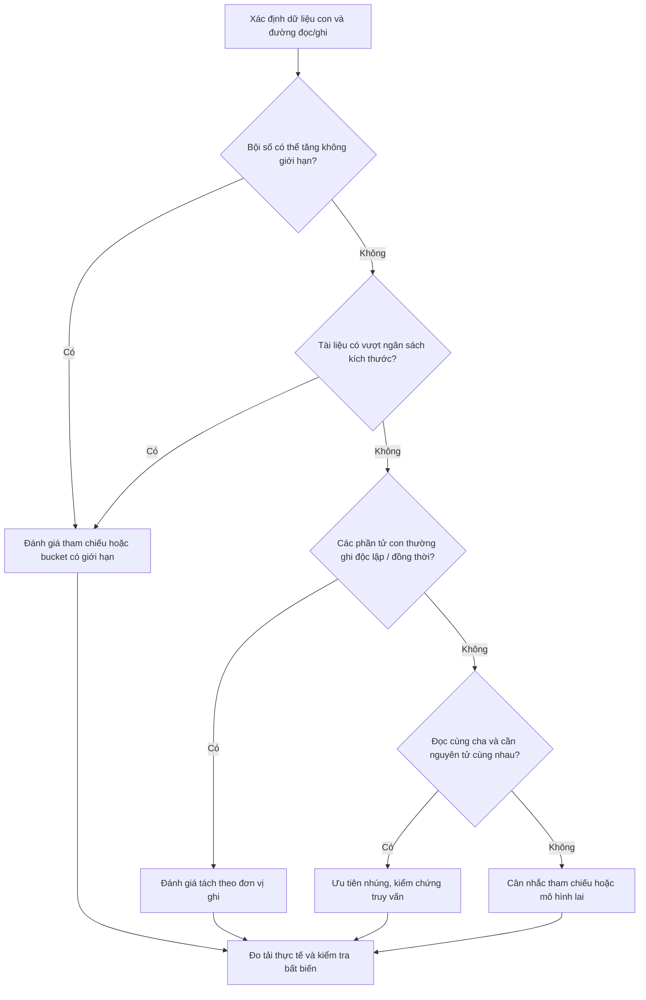

# Bội số, kích thước và tần suất thay đổi khi chọn ranh giới tài liệu

## 1. Vì sao ba biến này quyết định cách mô hình hóa?

Trong cơ sở dữ liệu tài liệu, một đối tượng có thể chứa đối tượng con, mảng và các khóa tham chiếu. Vì vậy, khi chuyển yêu cầu nghiệp vụ thành mô hình dữ liệu, người thiết kế phải trả lời **một tài liệu nên bao gồm bao nhiêu dữ liệu, lớn đến đâu và có bao nhiêu tiến trình sẽ thay đổi nó**.

Ba biến thường dẫn đến quyết định khác nhau:

1. **Bội số (cardinality):** một thực thể cha liên quan với bao nhiêu thực thể con? Số lượng có giới hạn hay tiếp tục tăng?
2. **Kích thước (size):** một phần tử chiếm bao nhiêu dung lượng? Tài liệu và các chỉ mục lớn đến đâu ở hiện tại và trong tương lai?
3. **Tần suất thay đổi (mutation frequency):** dữ liệu cha và con được thêm, sửa, xóa bao lâu một lần? Có nhiều người hoặc tiến trình ghi đồng thời không?

Ví dụ, một khóa học có thể có 30 bài học nhưng 100.000 học viên. Nhúng danh sách tóm tắt 30 bài học vào tài liệu khóa học có thể hợp lý. Nhúng tiến độ của 100.000 học viên vào cùng tài liệu sẽ rất khó mở rộng, dù cả hai đều là quan hệ một-nhiều.

Đây là nội dung của chương **Mô hình tài liệu** trong phạm vi **DATABASE_DATA_MODELING**: rèn kỹ năng biến yêu cầu nghiệp vụ thành mô hình dữ liệu có thực thể, quan hệ, ràng buộc, khóa, chỉ mục và cấu trúc vật lý rõ ràng; biết so sánh với mô hình quan hệ, đồ thị và phân tích khi cần.

**Sau bài này, bạn có thể:**

- Phân biệt bội số theo sơ đồ quan hệ và **phân phối số phần tử con trên từng tài liệu cha**.
- Ước lượng kích thước tài liệu theo dữ liệu thực tế và tốc độ tăng trưởng.
- Phân tích thay đổi đồng thời, điểm nóng ghi và tính nguyên tử tại ranh giới tài liệu.
- Chọn nhúng, tham chiếu, mô hình lai hoặc chia nhóm (*bucket*) bằng lập luận định lượng.
- Tạo bản thiết kế có thể kiểm chứng bằng truy vấn, chỉ mục, phép đo và tình huống biên.

## 2. Ranh giới tài liệu là một quyết định về đơn vị đọc và đơn vị ghi

Một **tài liệu** (*document*) là đơn vị lưu trữ logic có thể gồm trường đơn, đối tượng lồng nhau và mảng, chẳng hạn một bản ghi JSON/BSON. Nó thường được đặt trong một *collection* hoặc cấu trúc tương đương của hệ quản trị.

Một **ranh giới tài liệu** chỉ ra những dữ liệu được đặt cùng nhau:

- **Nhúng (embed):** đặt các dòng hàng trong `order.items` hoặc địa chỉ nhận hàng trong `order.shippingAddress`.
- **Tham chiếu (reference):** đặt mỗi bình luận trong `comments` với trường `postId` trỏ tới bài viết; đặt mỗi đơn trong `orders` với `customerId`.
- **Mô hình lai:** nhúng bản tóm tắt giới hạn trong tài liệu cha, đồng thời lưu bộ dữ liệu đầy đủ ở collection riêng.

Ví dụ thiết kế lai:

```json
{
  "courseId": "CRS-008",
  "title": "Nhập môn cơ sở dữ liệu",
  "featuredLessons": [
    { "lessonId": "L-01", "title": "Thực thể và thuộc tính" },
    { "lessonId": "L-02", "title": "Quan hệ và khóa" }
  ],
  "lessonCount": 30,
  "reviewCount": 1386
}
```

Mô hình này không ngụ ý nhúng toàn bộ nội dung bài học, mọi đánh giá hay tiến độ của từng học viên. Những dữ liệu đó có thể có bội số, kích thước và tải ghi hoàn toàn khác với tài liệu khóa học.

Cũng cần phân biệt **aggregate** trong mô hình miền nghiệp vụ và **tài liệu** trong hệ lưu trữ. Aggregate thể hiện ranh giới duy trì bất biến nghiệp vụ; tài liệu là một cách triển khai khả dĩ. Chúng có thể trùng nhau khi phù hợp, nhưng không mặc nhiên đồng nhất.

## 3. Bội số: đếm đúng thứ đang tăng

### 3.1. Các kiểu quan hệ và ý nghĩa lưu trữ

| Bội số nghiệp vụ | Ví dụ | Câu hỏi mô hình hóa |
| --- | --- | --- |
| Một–một (1–1) | Đơn hàng và địa chỉ giao nhận tại thời điểm mua | Hai phần có cùng vòng đời, quyền truy cập và tần suất đổi không? |
| Một–ít (1–few) | Một hồ sơ có tối đa ba liên hệ khẩn cấp | Có giới hạn rõ ràng và thường đọc cùng nhau không? |
| Một–nhiều có giới hạn (1–many bounded) | Đơn hàng có tối đa 100 dòng | Kích thước lớn nhất và thao tác cập nhật toàn đơn ra sao? |
| Một–nhiều tăng liên tục | Bài viết và bình luận | Mảng sẽ lớn tới đâu, cần phân trang hoặc ghi đồng thời thế nào? |
| Nhiều–nhiều (many–many) | Người dùng tham gia nhiều dự án, dự án có nhiều người | Có cần tài liệu liên kết và ràng buộc duy nhất cho từng cặp không? |

**Bội số không tự quyết định nhúng hay tham chiếu.** Hai quan hệ đều 1–N có thể có thiết kế khác nhau do N, kích thước mỗi phần tử, tốc độ ghi và đường truy vấn khác nhau.

Một ví dụ quan trọng:

- `Order → OrderItem`: 1–N nhưng N thường có giới hạn nghiệp vụ, các dòng thường đọc cùng đơn; nhúng có thể hợp lý.
- `Post → Comment`: 1–N và N có thể tăng không giới hạn, có lọc và phân trang; tham chiếu tới các bình luận riêng thường phù hợp hơn.

### 3.2. Đo bội số **trên mỗi cha**, không chỉ tổng số bản ghi

Giả sử có 1.000 bài viết và 100.000 bình luận. Trung bình là 100 bình luận/bài, nhưng phân phối có thể rất lệch:

| Chỉ số ví dụ | Số bình luận/bài |
| --- | ---: |
| Trung vị (p50) | 8 |
| Phân vị p95 | 420 |
| Phân vị p99 | 3.000 |
| Lớn nhất | 25.000 |

Một bài trung bình không đại diện cho bài phổ biến nhất. Nếu thiết kế chỉ dựa vào trung bình, các bài có lượng tương tác cao có thể tạo tài liệu rất lớn hoặc điểm nóng ghi.

Khi khảo sát bội số, cần ghi lại **trung vị, p95, p99, giá trị lớn nhất**, tốc độ tăng và trường hợp ngoại lệ. Với dữ liệu mới chưa có sản phẩm thật, sử dụng giả định có nguồn gốc từ quy tắc nghiệp vụ và xây các kịch bản tải để kiểm tra.

> **Không có ngưỡng phổ quát** kiểu “dưới 100 phần tử thì nhúng”. Một mảng 100 chuỗi ngắn và một mảng 100 tệp văn bản dài có kích thước rất khác; ngay cả một phần tử lớn cũng có thể là vấn đề.

### 3.3. Bội số theo chiều nào?

Với quan hệ nhiều–nhiều, cần xem hai phía:

- Một người tham gia bao nhiêu dự án?
- Một dự án có bao nhiêu thành viên?
- Thuộc tính quan hệ như `role`, `joinedAt`, `status` được thay đổi ở đâu?
- Có cần duy nhất một tư cách thành viên cho cặp `(userId, projectId)` không?

Ví dụ lưu liên kết riêng:

```json
{
  "userId": "USR-045",
  "projectId": "PRJ-012",
  "role": "EDITOR",
  "joinedAt": "2026-11-04T08:00:00Z",
  "status": "ACTIVE"
}
```

Collection `memberships` có thể định nghĩa khóa duy nhất trên cặp `(userId, projectId)` và chỉ mục phục vụ hai chiều truy vấn. Tránh mặc định duy trì cả `user.projectIds` lẫn `project.memberIds` như hai nguồn sự thật độc lập khi chúng lớn và thường xuyên thay đổi.

## 4. Kích thước: từ một phần tử đến ngân sách tăng trưởng

### 4.1. Ước lượng cấu trúc tài liệu

Một ước lượng sơ bộ có ích:

```text
B_document ≈ B_fixed + Σ(N_i × B_child_i) + B_structure

Trong đó:
B_fixed      = kích thước các trường cố định của cha
N_i          = số phần tử con của nhóm i
B_child_i    = kích thước trung bình mỗi phần tử nhóm i
B_structure  = overhead của tên trường, kiểu, mảng, định danh, v.v.
```

Đây là **mô hình dự báo**, không thay thế đo kích thước theo định dạng thực tế. JSON được truyền qua mạng, BSON lưu trữ, nén trên đĩa, số byte của chuỗi UTF-8, tên khóa lặp lại và metadata có thể tạo kết quả khác nhau. Dung lượng chỉ mục cũng là chi phí riêng; không cộng mọi kích thước chỉ mục vào giới hạn kích thước **một tài liệu**.

Khi thiết kế, cần phân biệt:

1. **Kích thước logic của tài liệu:** chịu các giới hạn định dạng/hệ quản trị.
2. **Kích thước dữ liệu đọc/trả về:** phụ thuộc truy vấn, phép chiếu (*projection*) và API.
3. **Chi phí lưu trữ vật lý:** phụ thuộc bộ máy lưu, nén và chỉ mục.
4. **Chi phí khi ghi:** phụ thuộc trường thay đổi, cách máy lưu xử lý cập nhật và cơ chế cạnh tranh.

Không nên khẳng định rằng sửa một trường luôn truyền hoặc ghi lại toàn bộ tài liệu: hành vi cụ thể phụ thuộc hệ quản trị, trình điều khiển và kiểu cập nhật. Tuy vậy, một tài liệu quá lớn vẫn có thể làm đọc, cache, tái ghi, nhân bản và cập nhật đồng thời phức tạp hơn.

### 4.2. Ví dụ tính ngân sách cho sự kiện thiết bị

Giả sử một tài liệu thiết bị lưu danh sách sự kiện:

- Thông tin thiết bị cố định: khoảng **4 KiB**.
- Mỗi sự kiện sau khi mã hóa: khoảng **800 byte**.
- Mỗi ngày thêm **500 sự kiện**.
- Đội vận hành đặt **ngân sách nội bộ 4 MiB cho một tài liệu sự kiện**, để chừa dư địa so với các giới hạn hệ thống và chi phí vận hành.

Với một ngày, dữ liệu con tăng khoảng `500 × 800 = 400.000 byte`, tức xấp xỉ **391 KiB/ngày**. Nếu giữ một mảng tăng liên tục, tài liệu sẽ chạm ngân sách 4 MiB sau khoảng **10 ngày**, chưa tính overhead và dữ liệu ban đầu.

Số liệu trên là **giả định minh họa**, không phải giới hạn của một sản phẩm cơ sở dữ liệu cụ thể. Kết luận thiết kế: **không** giữ toàn bộ lịch sử sự kiện trong một mảng duy nhất; cân nhắc tài liệu sự kiện riêng hoặc bucket có giới hạn theo ngày, giờ hay số lượng.

Để dự báo theo thời gian, có thể dùng:

```text
B_at_T ≈ B_now + growth_events_per_day × bytes_per_event × T_days

T_budget ≈ (B_budget - B_now) /
           (growth_events_per_day × bytes_per_event)
```

Nếu số sự kiện/ngày tăng theo mùa, theo quy mô khách hàng hoặc có những đợt đột biến, cần tính thêm kịch bản cao điểm; đường tăng không nhất thiết tuyến tính.

### 4.3. Kích thước theo p95/p99 và trường hợp lớn nhất

Ước lượng với kích thước trung bình chỉ là bước đầu. Một bình luận ngắn có thể vài trăm byte; bình luận có markdown, metadata hoặc danh sách đính kèm có thể lớn hơn nhiều. Tài liệu chứa mảng nên được kiểm chứng ít nhất với:

- **N trung bình** và **kích thước phần tử trung bình**;
- **N p95/p99** và kích thước phần tử ở trường hợp lớn;
- **N tối đa theo nghiệp vụ**, nếu có;
- dữ liệu nhiều byte UTF-8, trường tùy chọn dài và bản ghi bất thường;
- mức tăng dự kiến trong kỳ giữ dữ liệu.

Đừng lấy p99 của N nhân p99 của kích thước phần tử rồi gọi đó là p99 kích thước tài liệu; tương quan giữa các biến và phân phối thực có thể khác. Cách tốt hơn là tính kích thước từng tài liệu từ dữ liệu mẫu đại diện, sau đó lấy các phân vị của **kích thước tài liệu**.

### 4.4. Giới hạn phải lấy từ sản phẩm triển khai

Mỗi hệ quản trị có quy tắc riêng về kích thước tài liệu, độ sâu lồng nhau, chỉ mục trên mảng, giao dịch và phân vùng. Khi chuyển từ mô hình logic sang vật lý, cần kiểm tra tài liệu chính thức của **phiên bản cơ sở dữ liệu thực tế** rồi đặt ngưỡng an toàn nội bộ thấp hơn mức gây rủi ro vận hành.

Một tài liệu chưa chạm giới hạn kỹ thuật vẫn có thể quá lớn cho truy vấn phổ biến hoặc tạo nhiều xung đột ghi.

## 5. Tần suất thay đổi: ai ghi, ghi gì và ghi cùng lúc không?

### 5.1. Đừng chỉ đo tổng lượt ghi

Hai tập dữ liệu cùng nhận 10.000 cập nhật/phút có thể có độ khó khác nhau:

- 10.000 cập nhật trải đều trên 10.000 tài liệu riêng: mỗi tài liệu khoảng một cập nhật/phút.
- 10.000 cập nhật tập trung vào một tài liệu “bài viết nổi bật” hoặc “thống kê toàn hệ thống”: tài liệu đó trở thành **điểm nóng ghi** (*hot document*).

Cần đo hoặc dự báo:

- **Tần suất sửa cha:** bao nhiêu lần mỗi giờ/ngày?
- **Tần suất thêm/sửa/xóa phần tử con:** bao nhiêu lần, trên bao nhiêu tài liệu cha?
- **Phân phối tải:** có 1% tài liệu nhận phần lớn cập nhật không?
- **Độ đồng thời và đột biến:** bao nhiêu tiến trình có thể ghi cùng một cha trong một khoảng ngắn?
- **Phạm vi cập nhật:** chỉ một trường, một phần tử mảng, nhiều phần tử hay toàn tài liệu?
- **Bất biến nghiệp vụ:** cập nhật nào bắt buộc xảy ra cùng nhau?

Bội số làm tăng rủi ro khi mỗi phần tử con đều có thể thay đổi độc lập. Nếu một cha có N phần tử và trung bình mỗi phần tử nhận r thay đổi trong một đơn vị thời gian, số thay đổi nhắm vào cùng một tài liệu cha có thể xấp xỉ `N × r`, bên cạnh các cập nhật vào cha. Đây là ước lượng lưu lượng, **không trực tiếp dự đoán số xung đột**, vì xung đột còn tùy cách tổ chức thao tác và cơ chế của hệ lưu trữ.

### 5.2. Điểm nóng ở mô hình nhúng

Ví dụ một tài liệu `course` chứa mảng tiến độ của 50.000 học viên. Mỗi khi học viên hoàn thành một bài, hệ thống ghi vào cùng tài liệu khóa học. Dù mỗi tiến độ chỉ vài byte, hàng trăm lượt hoàn thành đồng thời có thể tác động tới cùng một ranh giới cập nhật.

Thiết kế thay thế:

```text
courses
  { courseId, title, ... }

lessonProgress
  { learnerId, courseId, lessonId, state, updatedAt, version }
```

Nếu mỗi học viên có ít bài trong một khóa và giao diện thường đọc toàn bộ tiến độ của **một học viên**, một phương án khác là **một tài liệu trên cặp (learnerId, courseId)** chứa mảng tiến độ nhỏ, giới hạn theo số bài:

```json
{
  "learnerId": "USR-045",
  "courseId": "CRS-008",
  "progress": [
    { "lessonId": "L-01", "state": "DONE" },
    { "lessonId": "L-02", "state": "IN_PROGRESS" }
  ],
  "version": 8
}
```

Hai phương án đều tránh đặt tiến độ của **mọi học viên** vào một tài liệu khóa học. Lựa chọn giữa chúng dựa trên số bài mỗi khóa, đường đọc theo học viên hoặc theo bài, nhu cầu cập nhật đồng thời và ranh giới nhất quán.

### 5.3. Ghi cùng nhau có thể là lý do chính đáng để nhúng

Giả sử trong một đơn hàng, các dòng hàng và tổng tiền phải phù hợp với nhau khi người mua xác nhận giỏ hàng. Nếu số dòng có giới hạn, việc nhúng có thể giúp thực hiện một cập nhật nguyên tử trong một tài liệu:

```json
{
  "orderId": "ORD-042",
  "status": "DRAFT",
  "items": [
    { "productId": "P-01", "quantity": 2, "unitPriceMinor": 100000 }
  ],
  "itemsTotalMinor": 200000,
  "version": 4
}
```

Cần thêm quy tắc để tránh ghi đè khi hai thiết bị cùng sửa đơn, chẳng hạn dùng `version` và điều kiện trạng thái. Nếu thông tin nằm ở nhiều tài liệu, bất biến trải qua nhiều tài liệu cần giao dịch phù hợp hoặc quy trình phối hợp rõ ràng.

**Cập nhật nguyên tử một tài liệu không chứng minh toàn bộ nghiệp vụ nhất quán.** Tồn kho, thanh toán và giao hàng thường là các thực thể khác với đơn hàng.

## 6. Ma trận ba chiều: khi nào nhúng, tham chiếu hoặc dùng mô hình lai?

| Bội số trên mỗi cha | Kích thước con/tổng | Tần suất thay đổi | Hướng thường phù hợp |
| --- | --- | --- | --- |
| Ít, có trần rõ | Nhỏ | Thấp; đọc/ghi cùng cha | **Nhúng** |
| Ít, có trần rõ | Nhỏ | Cao nhưng độc lập, nhiều người cùng ghi cha | **Cân nhắc tách** theo đơn vị ghi |
| Ít | Rất lớn | Thấp | **Tham chiếu** hoặc lưu nội dung lớn bên ngoài, nhúng metadata |
| Nhiều nhưng có trần | Nhỏ/tổng vẫn vừa | Thấp, thường đọc trọn bộ | **Nhúng có kiểm soát**, đo kích thước |
| Nhiều, tăng liên tục | Trung bình/lớn | Thấp | **Tham chiếu**, có thể dùng bucket |
| Nhiều, tăng liên tục | Nhỏ | Cao, đồng thời | **Tham chiếu**; tránh tài liệu nóng |
| Nhiều–nhiều | Bất kỳ | Có thay đổi quan hệ | **Tài liệu liên kết** có khóa riêng |
| Rất nhiều | Cha cần đọc thống kê nhỏ | Phần con thay đổi thường xuyên | **Mô hình lai**: dữ liệu nguồn riêng + tóm tắt có giới hạn |

Ma trận là điểm khởi đầu, **không phải thuật toán cứng**. Quyết định cuối phải tính thêm quyền truy cập, khả năng phân trang, ràng buộc xóa, độ trễ, ngân sách truy vấn, phiên bản lược đồ và hỗ trợ giao dịch của hệ quản trị.

Một sơ đồ quyết định:



## 7. Ví dụ thực tế: cùng là 1–N nhưng ranh giới khác nhau

### 7.1. Đơn hàng và dòng hàng: N có trần, đọc chung

**Bối cảnh:** mỗi đơn tối đa 80 dòng; thông tin mỗi dòng dưới một vài trăm byte; sửa số lượng/gỡ dòng trong giai đoạn nháp, sau khi chốt chỉ một số trạng thái nghiệp vụ được đổi. Trang chi tiết đơn luôn cần các dòng hàng.

**Hướng thiết kế:** nhúng `items` vào `orders`, giữ `productId` để tham chiếu danh mục và snapshot giá/tên tại thời điểm mua. Cần giới hạn số dòng hợp lệ, kiểm tra tổng tiền và dùng cập nhật có điều kiện khi nhiều thiết bị sửa cùng đơn.

**Điểm phải kiểm chứng:** đơn có dòng mô tả dài hoặc thuộc tính tùy biến có vượt ngân sách không? Trường hợp hiếm hàng nghìn dòng B2B có cần thiết kế khác?

### 7.2. Bài viết và bình luận: N lớn, tăng đều, lọc riêng

**Bối cảnh:** 90% bài viết ít bình luận nhưng bài nổi bật có hàng chục nghìn bình luận; bình luận liên tục được thêm, kiểm duyệt, xóa và đọc theo trang.

**Hướng thiết kế:**

```text
posts
  { postId, title, commentCount, recentCommentIds: [giới hạn] }

comments
  { commentId, postId, authorId, text, createdAt, moderationStatus }
```

Lưu bình luận riêng với `postId`; chỉ mục theo bài viết, trạng thái hiển thị, thời gian và khóa phân trang. `commentCount` là dữ liệu dẫn xuất cần xử lý cập nhật trùng, xóa, chậm hoặc sai thứ tự.

**Điểm phải kiểm chứng:** bài nổi bật có tạo nút thắt nếu mỗi lượt bình luận cũng cập nhật trực tiếp `posts.commentCount` không? Có cần đếm theo bucket và tổng hợp bất đồng bộ không?

### 7.3. Sản phẩm và ảnh: ít phần tử nhưng byte lớn

**Bối cảnh:** một sản phẩm có 8 ảnh, mỗi ảnh vài MB; metadata ảnh được hiển thị cùng sản phẩm nhưng nội dung nhị phân chỉ tải khi cần.

**Hướng thiết kế:** nhúng **metadata nhỏ** như id, thứ tự, văn bản thay thế và tham chiếu tới nơi lưu tệp; đặt nội dung ảnh tại kho đối tượng hoặc cơ chế lưu tệp phù hợp. Bội số chỉ 8 không có nghĩa nên nhúng vài chục MB nội dung nhị phân vào tài liệu sản phẩm.

**Điểm phải kiểm chứng:** quyền truy cập tệp, vòng đời xóa, URL truy cập có hết hạn hay không, cập nhật danh sách ảnh và xử lý tệp không còn được tham chiếu.

### 7.4. Thiết bị và sự kiện: phần tử nhỏ nhưng tăng liên tục

**Bối cảnh:** 500 sự kiện/ngày mỗi thiết bị, giữ 12 tháng; truy vấn thường theo thiết bị và khoảng thời gian.

**Hướng thiết kế:** sự kiện là tài liệu riêng hoặc bucket **có giới hạn kích thước và thời gian**. Không nhúng toàn bộ sự kiện của thiết bị vào một tài liệu tăng mãi. Nếu dùng bucket, phải đo kích thước và tốc độ ghi ở thiết bị hoạt động mạnh nhất.

**Điểm phải kiểm chứng:** truy vấn chuỗi thời gian, dữ liệu đến trễ, lưu trữ theo thời hạn, số lần ghi trên bucket hiện tại, giới hạn bucket và chi phí tổng hợp.

### 7.5. Dự án và thành viên: nhiều–nhiều và phân quyền

**Bối cảnh:** một nhân viên có thể tham gia nhiều dự án; mỗi dự án có thể có vài nghìn thành viên; thành viên đổi vai trò hoặc rời dự án độc lập.

**Hướng thiết kế:** lưu `memberships` riêng với `userId`, `projectId`, `role`, `status`; tạo khóa duy nhất theo cặp và chỉ mục cho truy vấn thành viên dự án hoặc dự án của người dùng.

**Điểm phải kiểm chứng:** đổi vai trò phải có hiệu lực tức thời ở đường phân quyền nào? Cache hoặc bản sao danh sách thành viên có thể gây truy cập sai nếu chưa được vô hiệu hóa?

## 8. Chia nhóm có giới hạn: phương án giữa nhúng tất cả và một tài liệu cho mỗi phần tử

**Bucket pattern** gom một số phần tử liên quan vào các tài liệu nhỏ có ranh giới định trước, chẳng hạn theo ngày, giờ, hoặc tối đa N sự kiện.

Ví dụ bucket theo thiết bị và giờ:

```json
{
  "deviceId": "DEV-17",
  "bucketStart": "2026-11-22T08:00:00Z",
  "part": 0,
  "eventCount": 2,
  "events": [
    { "at": "2026-11-22T08:00:05Z", "type": "ONLINE" },
    { "at": "2026-11-22T08:00:07Z", "type": "SENSOR", "value": 31.2 }
  ]
}
```

Các lợi ích tiềm năng: đọc một khoảng sự kiện với ít tài liệu hơn, kiểm soát kích thước bucket, tránh mảng toàn lịch sử trong một tài liệu. Nhưng đây **không phải giải pháp phổ quát**:

- Sự kiện dồn vào một bucket hiện tại có thể tạo điểm nóng ghi.
- Các phần tử đến trễ cần được ghi đúng bucket hoặc có quy tắc sửa.
- Giới hạn theo thời gian **chưa chắc** giới hạn dung lượng nếu có đột biến; có thể cần thêm `part` hoặc quy định số byte/số phần tử tối đa.
- Việc lọc sâu từng sự kiện có thể khó hơn một tài liệu/sự kiện, tùy khả năng lập chỉ mục và truy vấn.
- Xóa theo thời hạn và tổng hợp giữa nhiều bucket cần được xác định.

Có thể dùng nguyên tắc: **một bucket phải có giới hạn về thời gian lẫn kích thước hoặc số phần tử, và ranh giới ghi không trở thành điểm nóng không thể chấp nhận**.

## 9. Tác động lên khóa, chỉ mục và truy vấn

Sau khi quyết định tách tài liệu, cần thiết kế lối truy cập rõ ràng. Ví dụ `comments` của bài viết:

```javascript
// Ví dụ với cú pháp MongoDB; hệ quản trị khác có API riêng.
db.comments.createIndex({
  postId: 1,
  moderationStatus: 1,
  createdAt: -1,
  _id: -1
});

// Truy vấn trang đầu: chỉ lấy trường cần hiển thị.
db.comments.find(
  { postId: "POST-077", moderationStatus: "VISIBLE" },
  { _id: 1, authorId: 1, text: 1, createdAt: 1 }
).sort({ createdAt: -1, _id: -1 }).limit(30);
```

Thứ tự `createdAt`, `_id` giúp kết quả xác định khi nhiều bình luận có cùng thời gian. Trang tiếp theo có thể dùng cursor dựa trên cặp khóa này; cần xây điều kiện theo hướng sắp xếp và chính sách cho bản ghi vừa được thêm/xóa.

Chỉ mục cần phù hợp **bộ lọc và thứ tự truy vấn**; mỗi chỉ mục thêm chi phí lưu trữ và cập nhật. Mảng nhúng có thể được lập chỉ mục theo đường dẫn hoặc multikey ở một số hệ quản trị, nhưng cần kiểm tra giới hạn và rủi ro tài liệu tăng kích thước. Đo kế hoạch thực thi trên dữ liệu gần với tải thật.

Nếu có phân tách tổ chức (*multi-tenancy*), cần đưa `tenantId` vào điều kiện, phạm vi khóa duy nhất và thiết kế chỉ mục phù hợp. Một `commentId` hay `orderId` duy nhất theo từng tổ chức không tự động duy nhất toàn hệ thống.

### 9.1. Kiểm soát cập nhật đồng thời

Khi nhúng dữ liệu vào một tài liệu, hai tác nhân có thể cập nhật cùng tài liệu gần như đồng thời. Một cách kiểm soát là dùng phiên bản:

```javascript
const result = db.orders.updateOne(
  { orderId: "ORD-042", version: 4, status: "DRAFT" },
  {
    $set: { status: "CONFIRMED" },
    $inc: { version: 1 },
    $currentDate: { confirmedAt: true }
  }
);

if (result.matchedCount === 0) {
  // Trạng thái/phiên bản đã thay đổi: đọc lại và xử lý theo nghiệp vụ.
}
```

Đây là ví dụ **optimistic concurrency control** trên một tài liệu, không thay thế cho giao dịch hoặc quy trình nghiệp vụ liên quan đến tồn kho, thanh toán và các hệ thống ngoài.

Nếu tách dữ liệu ra nhiều tài liệu, một bất biến như “tổng đơn phải khớp các dòng hàng” có thể khó bảo vệ hơn; cần giao dịch đa tài liệu (nếu có và phù hợp), mô hình hóa lại ranh giới hoặc cơ chế phối hợp được kiểm chứng. Đừng hy sinh tính đúng đắn chỉ để giảm kích thước.

## 10. Phương pháp ước lượng và kiểm chứng trước khi triển khai

### 10.1. Lập bảng tải công việc (workload)

Với mỗi quan hệ cha–con, ghi ít nhất:

| Thuộc tính | Cách thu thập |
| --- | --- |
| Bội số trên cha | Trung vị, p95, p99, lớn nhất; dự báo sau 12–24 tháng |
| Kích thước phần tử con | Kích thước đo theo mã hóa thực, p95/p99; độ biến thiên |
| Ngân sách tài liệu | Giới hạn sản phẩm/phiên bản và ngưỡng an toàn vận hành |
| Tăng trưởng | Số phần tử mới theo ngày; mùa vụ, đột biến; thời gian lưu |
| Tần suất ghi | Thêm/sửa/xóa trên cha và con; phân phối theo khóa nóng |
| Độ đồng thời | Số tiến trình cùng thao tác trên cha; tỷ lệ retry/xung đột |
| Đường đọc | Chi tiết, danh sách, phân trang, báo cáo, lọc theo con |
| Nhất quán | Những trường phải ghi nguyên tử; nguồn sự thật |
| Bảo mật/vòng đời | Quyền truy cập, chính sách xóa, chủ thể sở hữu |
| Khả năng tiến hóa | Thêm trường, di trú, tương thích ứng dụng cũ |

Thông số có thể là giả định ban đầu, nhưng phải đánh dấu rõ **giả định** để sau này kiểm chứng bằng số liệu.

### 10.2. Lập ba mô hình ứng viên

Với cùng dữ liệu, có thể thử:

- **A — Nhúng hoàn toàn:** cha chứa toàn bộ phần tử con; xác định kích thước theo phân vị và số thao tác ghi vào cha.
- **B — Tham chiếu hoàn toàn:** con thành tài liệu riêng; xác định các truy vấn bổ sung, chỉ mục và ràng buộc liên tài liệu.
- **C — Lai/bucket:** cha chứa metadata/tóm tắt có giới hạn; dữ liệu con đầy đủ được tách hoặc gom theo khoảng.

Không cần làm ba bản thiết kế cho mọi trường hợp đơn giản; mục đích là có phương án so sánh khi quyết định ảnh hưởng lớn đến hiệu năng hoặc tính đúng đắn.

### 10.3. Kiểm tra bằng dữ liệu đại diện

Tạo dữ liệu có phân phối thực tế, gồm:

1. Cha thông thường và cha rất lớn ở p99/max.
2. Phần tử nhỏ và phần tử có nội dung dài bất thường.
3. Tải đọc chi tiết và tải đọc danh sách có phân trang.
4. Nhiều tiến trình đồng thời sửa **cùng một cha** và sửa **các cha khác nhau**.
5. Tình huống thêm phần tử khiến tài liệu tăng vượt ngân sách.
6. Ghi lỗi, retry, thay đổi schema và xóa dữ liệu trong lúc đồng bộ.

Đo **p95/p99 latency**, dữ liệu truyền, kích thước tài liệu/index, số truy vấn, xung đột ghi, số lượt retry, thời gian xử lý và độ lệch dữ liệu dẫn xuất. Những số đo này trực tiếp trả lời mô hình nào phục vụ yêu cầu nghiệp vụ tốt hơn.

## 11. Bài tập thực hành: thiết kế dữ liệu cho nền tảng học tập

Một hệ thống học trực tuyến có yêu cầu:

- Mỗi khóa học có 20–60 bài; nội dung bài trung bình 25 KiB, chỉnh sửa độc lập khoảng 1–2 lần/tuần.
- Một khóa học có thể có 80.000 học viên.
- Mỗi học viên phát sinh một trạng thái tiến độ cho mỗi bài; thời điểm cao điểm có nhiều học viên ghi tiến độ cùng lúc.
- Mỗi khóa học có thể có 10.000 đánh giá; đánh giá được thêm và kiểm duyệt độc lập.
- Trang giới thiệu khóa học cần tiêu đề, tác giả, 5 bài đầu và điểm đánh giá trung bình.
- Trang học bài chỉ cần nội dung **một bài** và tiến độ của học viên đang đăng nhập.

**Yêu cầu:** Phân loại các nhóm dữ liệu theo bội số, kích thước, tần suất thay đổi; quyết định ranh giới tài liệu và đề xuất chỉ mục.

### 11.1. Phân tích

| Nhóm dữ liệu | Bội số | Kích thước | Tần suất thay đổi | Quyết định gợi ý |
| --- | --- | --- | --- | --- |
| Metadata khóa học | Một bộ/khóa | Nhỏ | Thấp | Tài liệu `courses` |
| Danh sách xem trước 5 bài | Tối đa 5 phần tử | Nhỏ | Khi xuất bản/sắp xếp | Nhúng bản xem trước có giới hạn |
| Nội dung bài học | 20–60 bài/khóa | ~25 KiB/bài | Sửa độc lập | Tài liệu `lessons` riêng |
| Tiến độ | Tới 80.000 × 60 trạng thái/khóa | Mỗi trạng thái nhỏ, tổng cực lớn | Nhiều ghi đồng thời | Phân theo học viên/bài hoặc học viên/khóa |
| Đánh giá | Tới 10.000/khóa | Biến thiên, có văn bản | Thêm/kiểm duyệt riêng | Tài liệu `reviews` riêng |
| Điểm/số đánh giá tóm tắt | Một bộ/khóa | Nhỏ | Thay đổi khi đánh giá đổi | Dữ liệu dẫn xuất, đồng bộ/đối soát |

Ước lượng **nội dung bài học**: nếu nhúng toàn bộ 60 bài × 25 KiB vào một tài liệu khóa học, riêng phần thân bài đã khoảng **1,5 MiB**, chưa kể metadata. Màn hình giới thiệu chỉ cần 5 tiêu đề bài sẽ phải xử lý cấu trúc dư thừa nếu thiết kế truy vấn không tối ưu. Tách nội dung bài còn hỗ trợ sửa và tải từng bài độc lập.

Ước lượng **số trạng thái tiến độ**: 80.000 học viên × 60 bài = **4.800.000 trạng thái** ở trường hợp nhiều nhất. Đây là bội số không phù hợp để nhúng vào tài liệu khóa học, dù một trạng thái chỉ vài chục byte. Có thể dùng một tài liệu trên từng cặp `(learnerId, courseId)` nếu 60 trạng thái nhỏ, thường đọc cùng nhau và tải ghi **trên mỗi học viên** thấp. Khi một học viên có thể cập nhật từ nhiều thiết bị đồng thời hoặc số bài tăng rất lớn, cân nhắc một tài liệu trên `(learnerId, lessonId)`.

### 11.2. Lược đồ gợi ý

```text
courses
  {
    courseId, title, authorId,
    featuredLessons: [{ lessonId, title, position }], // có giới hạn
    reviewCount, ratingAverage, schemaVersion
  }

lessons
  { lessonId, courseId, title, body, position, publishedVersion }

reviews
  { reviewId, courseId, learnerId, rating, text, status, createdAt }

courseProgress
  {
    learnerId, courseId,
    lessons: [{ lessonId, state, completedAt }], // giới hạn theo số bài
    version
  }
```

**Chỉ mục dự kiến:** `lessons(courseId, position)`; `reviews(courseId, status, createdAt)`; khóa duy nhất `(learnerId, courseId)` cho `courseProgress`. Trong hệ nhiều tổ chức, cần thêm `tenantId` vào phạm vi phù hợp.

**Giả định cần xác nhận:** một học viên có thể ghi tiến độ đồng thời từ bao nhiêu thiết bị? Trạng thái có được khôi phục sau khi xóa bài học? Điểm trung bình phải cập nhật tức thời hay chấp nhận trễ? Số bài có thật sự bị giới hạn ở 60 không? Những câu hỏi này có thể làm thay đổi ranh giới tài liệu.

### 11.3. Câu hỏi mở tự kiểm tra

1. Nếu một khóa học tăng lên 10.000 bài, mô hình `courseProgress` theo học viên/khóa có còn phù hợp không?
2. Nếu giáo viên cần xuất bản **đồng thời** 20 bài thành một bản phát hành, cần mô hình hóa phiên bản xuất bản thế nào để người học không thấy trộn bản cũ/mới?
3. Nếu mỗi đánh giá mới cập nhật `ratingAverage` ở `courses`, khóa học rất nổi tiếng có tạo điểm nóng ghi không?
4. Nếu một học viên cần xem báo cáo tổng hợp tiến độ của mọi khóa học, bạn chọn chỉ mục và cấu trúc truy vấn nào?
5. Nếu dữ liệu tiến độ cần lưu 5 năm nhưng khóa học có thể bị xóa sớm, bạn sẽ thiết kế chính sách lưu/xóa và tham chiếu ra sao?

Các câu hỏi không có đáp án cố định; người học cần nêu giả định, bất biến, đường truy cập và kế hoạch đo để bảo vệ lựa chọn.

## 12. Những sai lầm dễ mắc và cách tránh

**Sai lầm 1: Chọn nhúng vì hiện tại ít dữ liệu.**  
Dữ liệu khởi đầu ít không bảo đảm bội số có giới hạn. Hãy tìm trần theo nghiệp vụ hoặc dự báo tăng trưởng có tính đến p99 và đột biến.

**Sai lầm 2: Chỉ xét số phần tử, bỏ qua byte/phần tử.**  
Tám ảnh vài MB khác hẳn tám chuỗi định danh. Đo kích thước thực, tách nội dung nhị phân khi thích hợp.

**Sai lầm 3: Chỉ xét kích thước, bỏ qua tốc độ ghi.**  
Một tài liệu nhỏ vẫn có thể là điểm nóng nếu hàng nghìn tác nhân cùng cập nhật. Đo phân phối ghi theo khóa, không chỉ tổng lưu lượng.

**Sai lầm 4: Tách mọi thứ để tránh tài liệu lớn.**  
Làm vậy có thể làm mất ranh giới nguyên tử và tăng số lượt truy vấn. Dữ liệu hữu hạn, thường đọc/ghi cùng nhau có thể nên nhúng.

**Sai lầm 5: Nhúng bản sao mà không có nguồn sự thật.**  
`reviewCount` và `ratingAverage` cần quy tắc cập nhật, idempotency và đối soát. Phân biệt dữ liệu snapshot lịch sử với cache/bản sao phục vụ đọc.

**Sai lầm 6: Đồng nhất giới hạn kỹ thuật với ngưỡng an toàn.**  
Tài liệu chưa vượt giới hạn sản phẩm vẫn có thể khiến p99 cao, cache kém hoặc khó di trú. Đặt ngân sách dựa trên truy vấn và tải thực tế.

**Sai lầm 7: Di trú khi đã quá muộn.**  
Khi dữ liệu tăng mạnh, chuyển mảng nhúng thành tài liệu riêng phức tạp do phải đọc/ghi tương thích và tránh mất dữ liệu. Theo dõi ngưỡng dung lượng, tốc độ tăng và tỷ lệ retry sớm.

## 13. Checklist hoàn tất bản thiết kế

- [ ] Đã xác định quan hệ và **bội số trên mỗi cha**, gồm p95, p99, cực đại và tăng trưởng.
- [ ] Đã đo/ước lượng kích thước phần tử, kích thước tài liệu và ngân sách an toàn.
- [ ] Đã phân tích tần suất thêm/sửa/xóa, độ đồng thời và các khóa nóng.
- [ ] Đã ghi rõ dữ liệu nào phải đọc cùng nhau, dữ liệu nào phải ghi nguyên tử.
- [ ] Đã chọn nhúng/tham chiếu/lai/bucket cho từng quan hệ và nêu lý do cụ thể.
- [ ] Đã có khóa định danh, khóa tham chiếu, chỉ mục, thứ tự và cách phân trang.
- [ ] Đã chỉ ra dữ liệu dẫn xuất, nguồn sự thật, cách đồng bộ và đối soát.
- [ ] Đã xem xét giới hạn sản phẩm, quyền truy cập, thời hạn lưu và cách xóa.
- [ ] Đã có mẫu kiểm thử với tài liệu lớn, ghi đồng thời và tăng trưởng bất thường.
- [ ] Đã xác định dấu hiệu cần tái cấu trúc và phương án tiến hóa schema.

**Kết luận:** Chọn ranh giới tài liệu là bài toán cân bằng **số lượng phần tử**, **kích thước dữ liệu** và **mức độ thay đổi** dưới các bất biến nghiệp vụ. Mô hình tốt được xác nhận bằng số liệu theo từng cha, giới hạn vận hành và truy vấn/ghi điển hình; không thể quyết định chỉ từ việc quan hệ là một–nhiều hoặc dữ liệu đang được biểu diễn dưới dạng JSON.
