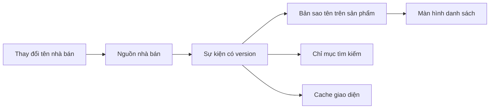
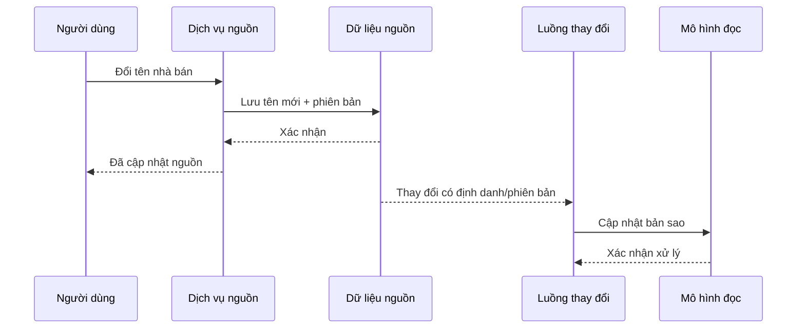

# Trùng lặp có chủ đích và nguồn chịu trách nhiệm cập nhật

## 1. Vì sao mô hình tài liệu đôi khi cố ý lưu trùng dữ liệu?

Khi chuyển yêu cầu nghiệp vụ thành mô hình dữ liệu, quy tắc “mỗi thông tin chỉ lưu ở một nơi” là điểm xuất phát hữu ích, nhưng không phải mục tiêu tuyệt đối. Trong **mô hình tài liệu** (*document model*), các màn hình và thao tác thường cần một nhóm dữ liệu có sẵn trong cùng một tài liệu: tên sản phẩm, giá tại thời điểm mua, tên người bán, địa chỉ giao hàng, số lượt đánh giá hoặc một vài bình luận gần đây.

Nếu mỗi lượt hiển thị phải đi qua nhiều tài liệu hay nhiều dịch vụ để ghép lại, đường đọc có thể phức tạp, chậm hoặc phụ thuộc vào các hệ thống khác. Vì vậy, ta có thể **sao chép có chủ đích** một phần dữ liệu từ nơi gốc sang nơi phục vụ truy vấn.

Câu hỏi quan trọng không chỉ là **“có được sao chép dữ liệu không?”**, mà là:

1. Bản sao đó có **ý nghĩa nghiệp vụ** gì?
2. **Nguồn nào có quyền quyết định giá trị đúng?**
3. **Ai chịu trách nhiệm cập nhật** từng nơi chứa dữ liệu?
4. Khi giá trị thay đổi, **bản sao nào cần thay đổi theo**, bản sao nào phải giữ nguyên?
5. Nếu cập nhật thất bại, trễ, gửi trùng hoặc sai thứ tự, hệ thống phát hiện và sửa thế nào?

Đây là nội dung thuộc chương **Mô hình tài liệu**, trong phạm vi **DATABASE_DATA_MODELING**: rèn khả năng mô hình hóa thực thể, quan hệ, ràng buộc, khóa, chỉ mục và lược đồ vật lý từ yêu cầu nghiệp vụ; đánh giá tính đúng đắn và khả năng tiến hóa của cấu trúc trước khi chọn mô hình tài liệu, quan hệ, đồ thị hay phân tích.

**Mục tiêu học tập:** Sau bài này, bạn có thể phân loại bản sao dữ liệu, xác định nguồn sự thật và chủ sở hữu cập nhật ở cấp trường hoặc loại sự kiện, thiết kế luồng đồng bộ một chiều, lựa chọn mức nhất quán, xây kế hoạch đối soát và kiểm chứng mô hình bằng tình huống thực tế.

## 2. Trùng lặp có chủ đích không đồng nghĩa với dữ liệu dư thừa vô kiểm soát

**Phi chuẩn hóa (denormalization)** là quyết định lưu thêm dữ liệu nhằm hỗ trợ một kiểu truy cập cụ thể, chẳng hạn thêm `sellerName` vào tài liệu hiển thị sản phẩm, hoặc thêm `reviewCount` vào tài liệu khóa học.

Trong mô hình quan hệ chuẩn hóa, hệ thống có thể kết hợp các bảng theo khóa ngoại. Trong mô hình tài liệu, dữ liệu thường được tập hợp theo **đơn vị đọc/ghi**, nên các bản sao có thể giúp giảm số bước kết hợp. Tuy nhiên, cả cơ sở dữ liệu quan hệ lẫn tài liệu đều có thể dùng phi chuẩn hóa; đây không phải đặc quyền của một loại cơ sở dữ liệu.

Một bản sao chỉ được coi là **có chủ đích** khi thiết kế xác định được:

- **Lý do tồn tại:** giảm số lần truy vấn, giữ lịch sử, phục vụ tìm kiếm, tính tổng hợp hay đáp ứng một giao diện.
- **Phạm vi sao chép:** trường nào, có nhúng trong tài liệu nào, số lượng có giới hạn không.
- **Nguồn gốc:** dữ kiện nào là chuẩn, quy tắc chuyển đổi nào tạo ra bản sao.
- **Trách nhiệm:** dịch vụ/tác vụ nào được quyền cập nhật bản sao và trên cơ sở tín hiệu nào.
- **Hợp đồng nhất quán:** cần đúng tức thời hay chấp nhận độ trễ bao lâu.
- **Khả năng sửa lỗi:** có thể tính lại, phát lại sự kiện hay đối soát với nguồn không.
- **Vòng đời:** bản sao được sửa, xóa, lưu lịch sử và di trú như thế nào.

Nếu không trả lời được các câu hỏi trên, trùng lặp có nguy cơ tạo ra **nhiều nguồn sự thật cạnh tranh**.

## 3. Ba loại bản sao thường bị nhầm lẫn

Phân loại trước khi quyết định đồng bộ là bước quan trọng nhất.

### 3.1. Ảnh chụp lịch sử: bản sao trở thành sự kiện nghiệp vụ riêng

Ví dụ khi khách đặt một sản phẩm, đơn hàng lưu tên và đơn giá tại thời điểm mua:

```json
{
  "orderId": "ORD-042",
  "customerId": "CUS-008",
  "items": [
    {
      "productId": "PRD-101",
      "nameAtPurchase": "Sách thiết kế dữ liệu",
      "unitPriceMinor": 180000,
      "quantity": 2
    }
  ],
  "currency": "VND",
  "status": "CONFIRMED"
}
```

Cùng thời điểm, sản phẩm đang được quản lý ở danh mục:

```json
{
  "productId": "PRD-101",
  "name": "Sách thiết kế dữ liệu",
  "currentPriceMinor": 180000,
  "priceVersion": 7
}
```

Sau đó, chủ cửa hàng đổi giá hiện hành thành 195.000 VND. **Không được tự động ghi đè** `unitPriceMinor` trong đơn đã chốt thành giá mới. Giá hiện hành và giá lúc mua là **hai dữ kiện khác nhau**, dù ban đầu có cùng con số.

Tương tự:

- Địa chỉ giao hàng của một đơn là địa chỉ đã được khách xác nhận lúc mua.
- Tỷ giá áp dụng cho một giao dịch là tỷ giá tại thời điểm định giá theo quy tắc nghiệp vụ.
- Tên sản phẩm trên hóa đơn có thể phải giữ đúng thông tin đã phát hành.

Chính **nghiệp vụ đơn hàng/hóa đơn** chịu trách nhiệm bảo vệ giá trị lịch sử, chứ không phải một luồng đồng bộ theo giá hiện hành. Vẫn phải xử lý các yêu cầu hiệu chỉnh, hủy hoặc quyền riêng tư theo quy trình phù hợp; “snapshot” không có nghĩa là dữ liệu bất biến trong mọi hoàn cảnh pháp lý và nghiệp vụ.

### 3.2. Bản sao phản ánh dữ liệu hiện hành: phải theo nguồn chính

Giả sử màn hình danh sách sản phẩm cần tên nhà bán nhưng không muốn tra cứu `sellers` cho từng sản phẩm:

```json
{
  "productId": "PRD-101",
  "name": "Sách thiết kế dữ liệu",
  "sellerId": "SEL-017",
  "sellerDisplayName": "Tiệm Sách Mở",
  "sellerNameSourceVersion": 12
}
```

`sellerDisplayName` là bản sao của tên hiển thị hiện hành ở tài liệu/dịch vụ nhà bán. Khi nhà bán đổi tên, bản sao **nên được đồng bộ**, nếu hợp đồng sản phẩm muốn hiển thị tên mới.

Thiết kế cần quy định:

- `sellers.displayName` là nguồn chuẩn cho tên hiện hành.
- Dịch vụ quản lý nhà bán cho phép sửa giá trị chuẩn.
- Một luồng cập nhật sản phẩm hoặc materialized view chịu trách nhiệm cập nhật bản sao.
- Màn hình có thể chấp nhận hiển thị tên cũ trong một khoảng thời gian xác định hay không.
- Nếu cần bảo đảm hiển thị đúng ngay, phải thay đổi chiến lược đọc hoặc đồng bộ.

### 3.3. Dữ liệu dẫn xuất: giá trị được tính từ các bản ghi khác

Ví dụ:

```json
{
  "courseId": "CRS-021",
  "title": "Mô hình hóa dữ liệu",
  "visibleReviewCount": 124,
  "ratingSum": 577,
  "averageRating": 4.6532258065
}
```

Giả sử nguồn gốc là collection `reviews`; chỉ các đánh giá ở trạng thái `VISIBLE` mới được tính. Khi một đánh giá bị ẩn, bị sửa số sao hoặc bị xóa, các trường tổng hợp phải thay đổi theo quy tắc đó.

Ở đây nguồn sự thật không phải một trường đơn, mà là **tập bản ghi đánh giá hợp lệ cộng với định nghĩa phép tính**. Bộ đếm và trung bình là dữ liệu dẫn xuất, có thể xây lại từ nguồn khi cần.

**Lưu ý số học:** Giá trị `averageRating` ở ví dụ bằng `577 / 124` theo dữ liệu minh họa. Khi cần độ chính xác và khả năng tái tính, có thể lưu `ratingSum` và `visibleReviewCount`, rồi tính trung bình hoặc lưu bản làm tròn theo quy tắc hiển thị. Phải quyết định cách xử lý tổng bằng không và các đánh giá thay đổi trạng thái.

### 3.4. Bảng phân biệt nhanh

| Loại bản sao | Ví dụ | Có cập nhật khi nguồn hiện hành đổi? | Ai giữ giá trị đúng? |
| --- | --- | --- | --- |
| **Snapshot lịch sử** | `unitPriceMinor` khi mua | **Không**, trừ quy trình hiệu chỉnh hợp lệ | Nghiệp vụ giao dịch đã chốt |
| **Bản sao hiện hành** | `sellerDisplayName` trên sản phẩm | **Có**, theo hợp đồng đồng bộ | Nguồn nhà bán, luồng chiếu bản sao |
| **Dữ liệu dẫn xuất** | `reviewCount`, `ratingAverage` | **Có**, khi các bản ghi đầu vào liên quan đổi | Nguồn đánh giá và quy tắc tổng hợp |
| **Bản xem trước giới hạn** | 3 bình luận mới nhất | **Có**, khi tập kết quả thay đổi | Collection bình luận và bộ xây bản xem trước |
| **Dữ liệu phân tích** | Doanh thu theo tháng | **Có**, theo lịch hoặc sự kiện ETL | Sự kiện giao dịch và định nghĩa chỉ số |

Không nên dùng một cơ chế “đồng bộ mọi trường trùng tên” cho tất cả các loại trên.

## 4. “Nguồn sự thật” và “người cập nhật” là hai khái niệm liên quan nhưng khác nhau

**Nguồn sự thật** (*source of truth* hoặc *authoritative source*) là nơi hoặc quy tắc được chấp nhận là có thẩm quyền cho **một dữ kiện cụ thể**. Không nhất thiết toàn hệ thống chỉ có một cơ sở dữ liệu duy nhất làm nguồn sự thật cho mọi dữ kiện.

**Chủ thể chịu trách nhiệm cập nhật** (*write owner / responsible service*) là dịch vụ, thành phần hoặc quy trình có trách nhiệm thay đổi dữ kiện đó theo các điều kiện nghiệp vụ.

Ví dụ:

- Dịch vụ nhà bán là bên có quyền đổi `sellers.displayName`.
- Dịch vụ sản phẩm có thể duy trì `products.sellerDisplayName` như bản sao để đọc nhanh, nhưng không được tự ý coi bản sao đó là tên chính thức.
- Dịch vụ đơn hàng tạo `orders.items[].unitPriceMinor` khi đơn được chốt. Sau khi chốt, giá đó thuộc nghiệp vụ đơn hàng, không còn là bản sao cần theo giá hiện hành.
- Dịch vụ đánh giá quản lý `reviews`; thành phần tổng hợp có nhiệm vụ tính lại `visibleReviewCount` và `ratingAverage` trên mô hình đọc.

Một hệ thống có thể có **nhiều nguồn sự thật theo từng loại dữ kiện**, miễn mỗi dữ kiện có quy tắc sở hữu không mâu thuẫn.

### 4.1. Hợp đồng sở hữu nên xác định ở cấp trường hoặc dữ kiện

Chỉ ghi “collection `products` do Product Service sở hữu” có thể chưa đủ. Trong một tài liệu sản phẩm, `name`, `currentPriceMinor`, `sellerDisplayName`, `reviewCount` có thể có nguồn hoặc luồng cập nhật khác nhau.

Một bảng sở hữu minh họa:

| Dữ kiện | Nguồn có thẩm quyền | Ai được sửa nguồn? | Bản sao/đích | Ai cập nhật đích? |
| --- | --- | --- | --- | --- |
| Tên sản phẩm hiện hành | `products.name` | Dịch vụ sản phẩm | Thẻ tìm kiếm, chỉ mục tìm kiếm | Bộ lập chỉ mục |
| Giá bán hiện hành | Chính sách/giá đã phê duyệt | Dịch vụ định giá | Mô hình đọc sản phẩm | Luồng đồng bộ giá |
| Giá lúc đặt hàng | Đơn đã chốt và chứng từ liên quan | Nghiệp vụ đơn hàng theo quy tắc hiệu chỉnh | `orders.items[].unitPriceMinor` | Bộ chốt đơn; không đồng bộ giá mới |
| Tên nhà bán hiện hành | `sellers.displayName` | Dịch vụ nhà bán | `products.sellerDisplayName` | Bộ cập nhật bản sao |
| Số đánh giá hiển thị | Các `reviews` hợp lệ | Dịch vụ đánh giá | `products.visibleReviewCount` | Bộ tổng hợp |
| Tiến độ học hiện hành | `lessonProgress` | Nghiệp vụ học tập | Dashboard học viên | Bộ tổng hợp tiến độ |

Một trường có thể do nhiều thành phần **tính toán, truyền hoặc lưu lại**, nhưng **thẩm quyền quyết định giá trị** phải được diễn đạt rõ. Đặc biệt, hai ứng dụng không nên được phép cùng sửa hai bản sao như hai nơi chuẩn mà không có quy tắc giải quyết xung đột.

### 4.2. Ranh giới sở hữu giúp ngăn vòng cập nhật

Phản mẫu:

```text
A.sellerName  ---- đồng bộ ----> B.sellerName
A.sellerName  <--- đồng bộ ----- B.sellerName

Cả A và B đều cho người dùng sửa trực tiếp.
```

Nếu hai bên cập nhật khác nhau gần cùng thời điểm, hệ thống không rõ phải lấy giá trị nào và có thể tạo vòng lặp đồng bộ.

Thay bằng luồng một chiều:



Chỉ nguồn nhà bán quyết định tên hiện hành. Các bản sao có thể được tạo lại từ nguồn, và phần hiển thị không được ghi ngược vào nguồn một cách ngầm định.

## 5. Khi nào trùng lặp tạo lợi ích thực tế?

Không phải cứ giảm một truy vấn là đáng sao chép. Lựa chọn nên dựa trên **đường truy cập dữ liệu** và chi phí vận hành.

### 5.1. Đọc nhiều, ghi ít

Một trang sản phẩm được xem hàng chục nghìn lần/ngày, còn tên nhà bán chỉ đổi vài lần/năm. Sao chép tên vào mô hình đọc có thể giảm các lượt truy vấn bổ sung, với chi phí cập nhật tương đối nhỏ.

Tuy nhiên, phải đo tác động của cache, phép chiếu, kết hợp dữ liệu và các chỉ mục mà cơ sở dữ liệu đang hỗ trợ. Nếu một phép nối đã đủ nhanh và đơn giản, sao chép có thể chỉ tạo thêm gánh nặng đồng bộ.

### 5.2. Cần một ảnh chụp nghiệp vụ ổn định

Đơn hàng, hóa đơn, bảng kê chốt kỳ hoặc hợp đồng thường cần giữ nguyên thông tin đã có hiệu lực tại một thời điểm. Lưu snapshot là một yêu cầu **đúng đắn nghiệp vụ**, không chỉ là tối ưu hiệu năng.

### 5.3. Tối ưu danh sách hoặc màn hình tóm tắt

Trang danh sách khóa học có thể cần tên khóa, tên tác giả, số bài, số học viên và điểm đánh giá. Một tài liệu tóm tắt sẵn giúp trả nhanh danh sách, thay vì tổng hợp nhiều collection cho từng hàng.

Ngược lại, vì người dùng chỉ xem danh sách, không nên nhúng toàn bộ đánh giá hoặc tiến độ của tất cả học viên vào mỗi khóa học. Bản sao nên **đủ dùng và có giới hạn**.

### 5.4. Phục vụ hệ thống tìm kiếm hoặc báo cáo phân tích

Một chỉ mục tìm kiếm hoặc mô hình phân tích có thể lưu thông tin được biến đổi từ nhiều nguồn. Đây là dạng **materialized view** hoặc dữ liệu dẫn xuất. Nguồn ghi giao dịch và nơi phục vụ tìm kiếm/báo cáo có thể có mục đích khác nhau; cần hợp đồng về độ trễ và đối soát.

### 5.5. Ma trận quyết định ban đầu

| Câu hỏi | Nếu câu trả lời là “có” | Ý nghĩa |
| --- | --- | --- |
| Có cần giữ giá trị ở một thời điểm lịch sử? | Có | Tạo snapshot theo nghiệp vụ |
| Một đường đọc quan trọng đang ghép nhiều nguồn tốn kém? | Có | Cân nhắc bản sao phục vụ đọc |
| Giá trị có tính được từ dữ liệu chuẩn? | Có | Xem như dữ liệu dẫn xuất, có thể tái tạo |
| Dữ liệu gốc đổi thường xuyên hoặc yêu cầu nhất quán tức thời? | Có | Cẩn trọng với đồng bộ trễ |
| Có nhiều nơi cùng cho phép ghi dữ kiện giống nhau? | Có | Phải xác định lại nguồn thẩm quyền |
| Bản sao có thể phình to không giới hạn? | Có | Cần giới hạn, tham chiếu hoặc lưu riêng |
| Có thể kiểm tra và sửa sai lệch tự động? | Có | Mô hình sao chép dễ vận hành hơn |

## 6. Thiết kế một hợp đồng sao chép dữ liệu

Trước khi thêm bản sao, lập một **bản mô tả ngắn** cho từng nhóm trường trùng lặp.

Ví dụ với tên nhà bán xuất hiện trên trang sản phẩm:

```yaml
# Ví dụ hợp đồng thiết kế, không phải tệp cấu hình của hệ thống.
fact: seller.displayName
authority: sellers.displayName
sourceOwner: SellerService
copyTarget: products.sellerDisplayName
copyUpdater: ProductProjection
trigger: SellerDisplayNameChanged
sourceVersionField: sellerVersion
consistency: eventual
targetLagObjective: "p99 dưới 60 giây (giả định minh họa)"
onFailure: "retry, dead-letter, cảnh báo, đối soát"
onDelete: "theo chính sách xóa/ẩn nhà bán"
rebuild: "tái tạo từ dữ liệu nhà bán có thẩm quyền"
```

Trong thực tế, một hợp đồng tốt nên trả lời được:

1. **Dữ kiện:** chính xác điều gì được sao chép, đơn vị và quy tắc làm tròn là gì?
2. **Nguồn:** định danh tài liệu/khóa và hệ thống có thẩm quyền.
3. **Đích:** collection/tài liệu/trường hoặc chỉ mục nhận bản sao.
4. **Bên ghi:** một thành phần chịu trách nhiệm hoặc quy tắc phối hợp có xác định.
5. **Kích hoạt:** yêu cầu đồng bộ, sự kiện, CDC, lịch chạy hoặc truy vấn khi đọc.
6. **Phiên bản:** cách nhận biết bản sao đã xử lý nguồn đến phiên bản nào.
7. **Mức nhất quán:** tức thời, cùng giao dịch, hoặc chấp nhận trễ có đo lường.
8. **Xử lý lỗi:** retry, idempotency, thứ tự, cảnh báo và đối soát.
9. **Thay đổi/xóa:** cách xử lý nguồn đổi schema, mất hiệu lực hoặc bị xóa.
10. **Tái tạo:** cách xây lại đích từ dữ liệu có thẩm quyền khi bị lỗi.

Hợp đồng không nhất thiết tồn tại dưới dạng YAML. Điều cần thiết là **quy tắc đủ rõ để người khác triển khai, vận hành và kiểm thử**.

## 7. Ba chiến lược nhất quán thường dùng

### 7.1. Đọc dữ liệu gốc khi cần

Không lưu bản sao; khi hiển thị sản phẩm, đọc thêm dữ liệu nhà bán.

**Phù hợp khi:** cần giá trị mới nhất, số lượt đọc thấp hoặc phép kết hợp đủ nhanh và đơn giản.  
**Đánh đổi:** tăng phụ thuộc lúc đọc, có thể nhiều lượt truy vấn và độ trễ cao nếu nguồn ở dịch vụ khác.

Đọc nhiều nguồn tuần tự cũng không mặc nhiên tạo một snapshot nhất quán tại cùng thời điểm. Nếu cần ảnh chụp nguyên tử xuyên nhiều thực thể, phải xem hỗ trợ giao dịch/cô lập và yêu cầu nghiệp vụ.

### 7.2. Cập nhật nguồn và bản sao trong cùng ranh giới giao dịch

Có thể dùng cập nhật nguyên tử khi dữ kiện và bản sao nằm trong cùng tài liệu; với nhiều tài liệu, một số hệ quản trị hỗ trợ giao dịch nhiều tài liệu.

**Phù hợp khi:** bất biến đòi hỏi nhất quán mạnh, số bên tham gia đủ nhỏ và hệ quản trị hỗ trợ.  
**Đánh đổi:** chi phí giao dịch, tranh chấp và độ phức tạp tăng; giao dịch giữa nhiều dịch vụ hay kho lưu trữ có thể không khả thi.

Không nên đặt tất cả các tài liệu của hệ thống vào một tài liệu khổng lồ chỉ để đạt một lần ghi nguyên tử: ranh giới giao dịch còn phải cân bằng bội số, kích thước và tải ghi.

### 7.3. Đồng bộ bất đồng bộ và nhất quán cuối cùng

Nguồn được cập nhật trước; sự kiện/luồng thay đổi sẽ điều khiển việc cập nhật các mô hình đọc.



**Phù hợp khi:** chấp nhận bản sao trễ và cần giảm phụ thuộc khi đọc.  
**Đánh đổi:** hệ thống phải xử lý sự kiện trùng, trễ, sai thứ tự và thất bại một phần; cần đo và đối soát.

Điều cần nói rõ trong yêu cầu sản phẩm là **“cập nhật thành công” nghĩa là gì**: đã thay đổi nguồn hay đã bảo đảm mọi mô hình đọc đều nhìn thấy giá trị mới? Hai cam kết đó khác nhau.

### 7.4. Bảng so sánh

| Tiêu chí | Đọc trực tiếp nguồn | Cùng giao dịch | Đồng bộ bất đồng bộ |
| --- | --- | --- | --- |
| Dữ liệu trùng lặp | Ít hoặc không | Có thể có | Thường có |
| Giá trị hiển thị mới nhất | Theo kết quả đọc nguồn | Có thể bảo đảm trong ranh giới giao dịch | Có thể trễ |
| Phụ thuộc trên đường đọc | Có | Thường thấp hơn khi đã có bản sao | Thường thấp hơn |
| Chi phí ở đường ghi | Không cần cập nhật bản sao | Tăng theo số bản sao trong giao dịch | Ghi nguồn và phát thay đổi |
| Lỗi cần xử lý | Nguồn không sẵn sàng | Giao dịch lỗi/xung đột | Trễ, trùng, mất thứ tự, thất bại một phần |
| Đối soát bản sao | Không áp dụng nếu không sao chép | Có thể vẫn cần | Thiết yếu |

## 8. Phát sự kiện đáng tin cậy: tránh mất thay đổi giữa hai bước

Một cách làm thiếu an toàn:

```text
1. Ghi tên mới vào cơ sở dữ liệu nguồn.
2. Gửi một message "SellerDisplayNameChanged".
3. Nếu bước 2 thất bại sau khi bước 1 thành công, bản sao không được cập nhật.
```

Retry của ứng dụng có thể giúp trong vài trường hợp nhưng không đủ bảo đảm, nhất là khi tiến trình chết giữa hai bước.

Hai hướng thiết kế phổ biến:

- **Transactional outbox:** ghi dữ liệu nghiệp vụ và bản ghi sự kiện cần phát trong **cùng giao dịch** của nguồn; một bộ phát đọc outbox và chuyển sự kiện đến nơi nhận. Cách này yêu cầu ranh giới giao dịch thích hợp và xử lý gửi lại; bản thân outbox không loại bỏ sự kiện trùng.
- **Change Data Capture (CDC)/change stream:** quan sát thay đổi đã được lưu ở nguồn, chuyển sang mô hình đọc. Cần hiểu cơ chế ghi nhận, thứ tự, khả năng tiếp tục sau lỗi và thời gian giữ lịch sử thay đổi của sản phẩm đang sử dụng.

Không thể suy ra tính đáng tin cậy từ tên công nghệ. Phải kiểm thử tình huống tiến trình chết, kết nối bị ngắt, dữ liệu đến lại, nhiều consumer cùng xử lý và đích tạm thời không sẵn sàng.

### 8.1. Một thông điệp thay đổi nên chứa gì?

Một ví dụ khái niệm:

```json
{
  "eventId": "EVT-90018",
  "eventType": "SellerDisplayNameChanged",
  "sellerId": "SEL-017",
  "sourceVersion": 13,
  "newDisplayName": "Nhà Sách Mở",
  "occurredAt": "2026-11-22T08:30:00Z",
  "schemaVersion": 1
}
```

Trong đó:

- `eventId` hỗ trợ nhận diện sự kiện đã xử lý.
- `sellerId` xác định thực thể nguồn.
- `sourceVersion` hỗ trợ áp dụng phiên bản mới hơn, tránh một sự kiện cũ ghi đè dữ liệu mới.
- `schemaVersion` cho phép mở rộng hợp đồng thông điệp theo thời gian.
- `occurredAt` hữu ích cho theo dõi và đối soát, **không nên dùng thay thế hoàn toàn một cơ chế thứ tự đáng tin cậy**, vì đồng hồ và thời điểm gửi có thể khác nhau.

Có thể phát toàn bộ trạng thái cần thiết hoặc chỉ định danh để bộ cập nhật tự đọc nguồn; hai cách có đánh đổi riêng về dữ liệu truyền, độ trễ, phân quyền và rủi ro đọc giá trị đã thay đổi thêm lần nữa.

## 9. Sự kiện trùng, sai thứ tự và việc cập nhật lại bản sao

### 9.1. Phân biệt “gửi ít nhất một lần” và “xử lý nghiệp vụ đúng một lần”

Nhiều hệ thống thông điệp có thể gửi lại cùng sự kiện khi chưa nhận được xác nhận. Ví dụ một đánh giá được thêm và sự kiện `ReviewCreated` được xử lý hai lần.

Nếu consumer chỉ làm:

```javascript
// Minh họa lỗi: cùng sự kiện đến hai lần sẽ tăng đếm hai lần.
db.courses.updateOne(
  { courseId: "CRS-021" },
  { $inc: { visibleReviewCount: 1 } }
);
```

thì bộ đếm sẽ sai. Lỗi này tồn tại ngay cả khi từng câu lệnh `$inc` là nguyên tử: **nguyên tử không đồng nghĩa với idempotent**.

Một phương án cần thiết kế là lưu nhận diện sự kiện đã xử lý và thay đổi bản sao **trong cùng ranh giới nguyên tử** khi có thể. Nếu consumer chỉ kiểm tra rồi mới tăng ở hai thao tác rời rạc, hai tiến trình vẫn có thể cùng vượt qua bước kiểm tra.

Một phương án khác là không cộng dồn mù theo sự kiện, mà tính lại toàn bộ bộ đếm từ nguồn chuẩn khi tần suất và chi phí cho phép. Điều này vẫn cần bảo vệ khi nhiều lần tính chạy chồng lấn hoặc kết quả cũ được ghi sau kết quả mới.

### 9.2. Cập nhật theo phiên bản để tránh sự kiện cũ ghi đè

Giả sử nhà bán đổi tên ở phiên bản 13, sau đó 14. Do mạng hoặc hàng đợi, sự kiện 14 có thể đến trước 13.

Nếu consumer ghi giá trị đến sau bất kể phiên bản, bản sao sẽ bị **lùi** từ tên phiên bản 14 về phiên bản 13.

Quy tắc khái niệm:

```text
Khi nhận sự kiện của seller S với sourceVersion = v:

  current = phiên bản nguồn đã áp dụng trên bản sao

  nếu v < current:
      bỏ qua sự kiện cũ
  nếu v == current:
      xử lý như gửi trùng hoặc kiểm tra idempotency
  nếu v > current:
      cập nhật giá trị bản sao và phiên bản đã áp dụng
      bằng một thao tác có điều kiện/nguyên tử thích hợp
```

Với mô hình đọc dùng MongoDB, có thể minh họa **một tình huống bản sao đã tồn tại**:

```javascript
const result = db.productCards.updateOne(
  {
    productId: "PRD-101",
    sellerNameSourceVersion: { $lt: 14 }
  },
  {
    $set: {
      sellerDisplayName: "Nhà Sách Mở",
      sellerNameSourceVersion: 14
    }
  }
);

// matchedCount === 0 có thể nghĩa là bản sao đã ở bản mới hơn,
// bằng phiên bản hiện tại, hoặc bản sao chưa tồn tại.
// Các trường hợp đó cần xử lý theo quy trình cụ thể.
```

Câu lệnh minh họa **chưa bao gồm cách tạo bản sao mới** và không áp dụng nguyên xi cho mọi hệ thống. Khi thêm *upsert*, cần tránh hai tiến trình tạo trùng bằng khóa duy nhất, xử lý xung đột và retry. Phiên bản cũng cần có ngữ nghĩa đúng theo **mỗi thực thể nguồn hoặc mỗi dòng thay đổi**; không mặc định phiên bản của hai thực thể khác nhau có thể so sánh trực tiếp.

### 9.3. Xử lý bản sao được tính từ nhiều nguồn

Trường `ratingAverage` chịu tác động từ nhiều bản ghi `reviews`. Một `sourceVersion` ở cấp khóa học chưa chắc có sẵn khi sự kiện đến từ nhiều đánh giá riêng.

Các lựa chọn có thể gồm:

- Cập nhật bộ đếm/tổng trong một giao dịch với thao tác đánh giá khi cùng hệ lưu trữ và phù hợp.
- Ghi một bảng/tài liệu tổng hợp có cơ chế khử trùng và điều kiện cập nhật đúng theo mỗi thay đổi.
- Tính lại tổng hợp từ nguồn theo lịch hoặc theo sự kiện, sau đó đối soát.
- Duy trì bảng sự kiện đã áp dụng hoặc checkpoint theo luồng có thứ tự, với ranh giới ghi được bảo vệ.

Phương án phụ thuộc số đánh giá, mức ghi đồng thời, nhu cầu hiển thị tức thời và chi phí tính lại. Không có một lệnh `$inc` duy nhất giải quyết mọi bài toán dẫn xuất.

## 10. Đối soát: một bản sao phải có cách được kiểm chứng và xây lại

Nếu dữ liệu được sao chép, cần chấp nhận rằng có thể xảy ra lệch và đặt cơ chế **phát hiện, giải thích, sửa sai**.

### 10.1. Các chỉ số nên theo dõi

| Chỉ số | Ý nghĩa | Phản ứng khi vượt ngưỡng |
| --- | --- | --- |
| Độ trễ cập nhật bản sao | Thời gian từ khi nguồn thay đổi đến khi bản sao phản ánh | Kiểm tra hàng đợi, consumer và lỗi |
| Checkpoint/phiên bản nguồn đã áp dụng | Bản sao đang theo kịp tới đâu | Xác định thực thể bị chậm hoặc mất cập nhật |
| Sự kiện lỗi và số lần retry | Luồng cập nhật có đang bị kẹt | Cảnh báo, xử lý dead-letter |
| Số lượng bản sao thiếu | Khóa ở nguồn nhưng không có đích cần thiết | Bổ sung hoặc xây lại |
| Số lượng bản sao sai giá trị | Bản sao không khớp nguồn sau cửa sổ trễ | Đối soát và sửa |
| Thời gian tái tạo toàn bộ | Mất bao lâu để phục hồi projection | Đánh giá mục tiêu khôi phục |

Các con số như “p99 cập nhật dưới 60 giây” là **mục tiêu giả định** cho từng sản phẩm, không phải quy chuẩn chung. Nghiệp vụ phải quyết định dữ liệu nào có thể trễ một phút, dữ liệu nào không thể trễ.

### 10.2. Cách đối soát

Một quy trình thông thường:

1. Chọn phạm vi dữ liệu, phiên bản hoặc thời điểm để so sánh, tránh so sánh hai ảnh chụp chưa đồng bộ.
2. Đọc dữ liệu có thẩm quyền hoặc tính lại kết quả theo định nghĩa chính thức.
3. So sánh bản sao bằng định danh và quy tắc chuẩn hóa kiểu dữ liệu/đơn vị.
4. Ghi nhận sai lệch: thiếu, thừa, khác giá trị, khác phiên bản, dữ liệu đã bị xóa.
5. Sửa một cách **có điều kiện** để không ghi đè bản cập nhật mới hơn.
6. Đo lại độ lệch và phân tích nguyên nhân gốc nếu lỗi tái diễn.

Đối với `visibleReviewCount`, có thể tính lại số đánh giá có trạng thái `VISIBLE` từ collection `reviews`. Với chỉ mục tìm kiếm, có thể dựng lại toàn bộ từ nguồn chính nếu thiết kế cho phép.

### 10.3. Khả năng rebuild là tiêu chí chất lượng thiết kế

Một projection tốt cần có đường **rebuild** được mô tả và thử nghiệm: từ snapshot nguồn, từ lịch sử sự kiện đủ đầy hoặc từ nguồn kết hợp với thay đổi trong giai đoạn tái tạo.

Nếu một bản sao là nơi duy nhất còn giữ thông tin gốc mà không thể tái tạo, nó đã trở thành **nguồn dữ liệu thực sự**, không thể tiếp tục được đối xử như cache có thể xóa tùy ý.

## 11. Các ràng buộc riêng của mô hình tài liệu

### 11.1. Chọn ranh giới lưu bản sao theo đơn vị đọc

Ví dụ `productCards` có thể chỉ chứa các trường cần cho trang danh sách:

```json
{
  "productId": "PRD-101",
  "title": "Sách thiết kế dữ liệu",
  "sellerId": "SEL-017",
  "sellerDisplayName": "Nhà Sách Mở",
  "currentPriceMinor": 195000,
  "currency": "VND",
  "visibleReviewCount": 124,
  "updatedAt": "2026-11-22T08:31:00Z"
}
```

Đây là một **mô hình đọc** có thể được dựng từ sản phẩm, nhà bán, giá và đánh giá. Nó không tự động có quyền sửa các nguồn này.

Khi thiết kế, tránh nhúng **mọi bình luận**, **mọi lịch sử giá** hoặc **mọi lượt xem** vào `productCards`. Dữ liệu dẫn xuất nên có **kích thước được giới hạn** và phù hợp với màn hình.

### 11.2. Khóa định danh và phiên bản là một phần của hợp đồng

Bản sao phải xác định được nguồn và thứ tự cập nhật:

- `productId` để tìm sản phẩm tương ứng.
- `sellerId` để nhận các sự kiện đổi tên nhà bán liên quan.
- `sellerNameSourceVersion` để không áp dụng sự kiện đổi tên cũ.
- `updatedAt` hoặc `projectedAt` để đo thời điểm cập nhật, với định nghĩa rõ ràng.

Nếu hệ thống nhiều tổ chức (*multi-tenant*), khóa có thể phải bao gồm `tenantId` để không gộp dữ liệu từ các tổ chức khác nhau. Phạm vi tính duy nhất cần được áp dụng nhất quán trong chỉ mục và mọi đường đọc/ghi.

### 11.3. Sao chép làm tăng tải ghi và chỉ mục

Nếu một tên nhà bán được nhúng vào 30.000 sản phẩm, một lần đổi tên có thể buộc cập nhật tối đa 30.000 bản sao. Đây là **write amplification**: một thay đổi logic tạo ra nhiều thao tác lưu trữ.

Ước lượng sơ bộ:

```text
số_lần_ghi_đích ≈ số_bản_sao_cần_đổi × số_thao_tác_ghi_mỗi_bản_sao

tổng_chi_phí ≈ chi_phí_đọc_tiết_kiệm
              - chi_phí_duy_trì_bản_sao
              - chi_phí_lưu_trữ/chỉ_mục
              - chi_phí_độ_trễ/sửa_lỗi
```

Công thức là khung suy luận, chưa phải phép đo định lượng. Với dữ liệu có số bản sao lớn và tần suất đổi cao, truy vấn tham chiếu, cache ở ranh giới đọc hoặc materialized view theo nhóm có thể tốt hơn nhúng trực tiếp vào từng bản ghi.

### 11.4. Chỉ mục nên phục vụ truy vấn, không phải từng bản sao

Ví dụ người dùng lọc sản phẩm theo mã nhà bán và sắp xếp theo thời gian:

```javascript
// Ví dụ cú pháp MongoDB; không áp dụng nguyên xi cho mọi hệ tài liệu.
db.productCards.createIndex({ sellerId: 1, updatedAt: -1 });

db.productCards.find(
  { sellerId: "SEL-017" },
  { _id: 0, productId: 1, title: 1, sellerDisplayName: 1 }
).sort({ updatedAt: -1 }).limit(20);
```

Chỉ mục phải dựa trên bộ lọc, thứ tự và tần suất truy vấn thật. Bản sao có trong tài liệu không có nghĩa phải được lập chỉ mục riêng. Một chỉ mục bổ sung cũng tăng chi phí ghi khi cập nhật dữ liệu.

## 12. Những lỗi thiết kế phổ biến

### Lỗi 1: Đồng bộ giá hiện hành vào đơn đã chốt

**Hậu quả:** lịch sử đơn hàng, hóa đơn hoặc tổng tiền thay đổi theo giá mới.  
**Cách sửa:** phân biệt giá hiện hành và snapshot giá áp dụng lúc mua; sở hữu và quy tắc cập nhật riêng.

### Lỗi 2: Hai bản sao cùng cho phép chỉnh sửa

**Hậu quả:** mất nguồn có thẩm quyền, ghi đè lẫn nhau hoặc vòng đồng bộ.  
**Cách sửa:** quy định nguồn chính cho từng dữ kiện; mọi chỉnh sửa giá trị chính thức đi qua chủ sở hữu đó.

### Lỗi 3: Tăng bộ đếm mỗi khi nhận sự kiện mà không khử trùng

**Hậu quả:** một đánh giá bị tính hai lần sau retry.  
**Cách sửa:** áp dụng idempotency với trạng thái xử lý bền vững trong cùng ranh giới ghi thích hợp, hoặc cơ chế tính lại/đối soát.

### Lỗi 4: Chỉ dùng thời điểm để quyết định sự kiện nào mới hơn

**Hậu quả:** đồng hồ khác nhau, thời điểm đến trễ hoặc sự kiện xử lý sai thứ tự làm bản sao lùi phiên bản.  
**Cách sửa:** dùng phiên bản hoặc thứ tự có ngữ nghĩa theo thực thể/luồng, kết hợp cập nhật có điều kiện.

### Lỗi 5: Sao chép tất cả trường cho “tiện về sau”

**Hậu quả:** tài liệu lớn, lộ dữ liệu không cần thiết, nhiều đường đồng bộ và chi phí xóa/di trú tăng.  
**Cách sửa:** chỉ sao chép trường mà một đường đọc cụ thể cần, có phạm vi và giới hạn rõ.

### Lỗi 6: Chấp nhận eventual consistency nhưng không đặt mục tiêu

**Hậu quả:** bản sao trễ hàng giờ vẫn bị xem là bình thường; người dùng báo dữ liệu sai nhưng không có chỉ số theo dõi.  
**Cách sửa:** thỏa thuận cửa sổ trễ theo nghiệp vụ, theo dõi độ trễ và cảnh báo khi vượt ngưỡng.

### Lỗi 7: Xóa nguồn nhưng quên bản sao

**Hậu quả:** thông tin nhạy cảm hoặc không còn hợp lệ vẫn xuất hiện trong chỉ mục, cache, bản xuất hoặc báo cáo.  
**Cách sửa:** thiết kế luồng xóa/ẩn/đổi quyền cho mọi nơi lưu bản sao; xác định yêu cầu giữ lịch sử hợp lệ và khả năng đối soát xóa.

### Lỗi 8: Không có đường rebuild

**Hậu quả:** một lần lỗi consumer khiến sai lệch kéo dài; phải sửa tay từng tài liệu.  
**Cách sửa:** duy trì nguồn dữ liệu có thẩm quyền, quy trình tính lại, checkpoint và kế hoạch phục hồi.

## 13. Thay đổi schema, quyền riêng tư và vòng đời bản sao

### 13.1. Thay đổi cấu trúc nguồn

Giả sử nhà bán trước đây có `displayName`, nay tách thành `legalName` và `publicName`. Bản sao `sellerDisplayName` ở sản phẩm phải biết dùng trường nào.

Một quá trình tiến hóa cần:

1. Định nghĩa ngữ nghĩa trường mới và nguồn có thẩm quyền.
2. Bổ sung bộ đọc/consumer tương thích dữ liệu và sự kiện cũ.
3. Triển khai đường ghi mới với phiên bản schema rõ ràng.
4. Di trú hoặc xây lại bản sao theo lô có thể chạy lại.
5. Theo dõi số bản sao chưa chuyển và tình trạng độ trễ.
6. Gỡ tương thích cũ khi nguồn và các consumer liên quan đã được kiểm chứng.

Không nên sửa định nghĩa dữ kiện mà giữ nguyên tên trường khiến các bên dùng hiểu khác nhau.

### 13.2. Quyền riêng tư và dữ liệu nhạy cảm

Dữ liệu cá nhân được sao chép càng nhiều nơi, càng khó áp dụng thay đổi quyền, giới hạn lưu trữ và yêu cầu xóa. Khi muốn đưa số điện thoại khách hàng vào bản sao sản phẩm, danh sách đơn hoặc chỉ mục tìm kiếm, cần chứng minh **mục đích sử dụng** và giới hạn truy cập.

Snapshot lịch sử có thể phải được giữ vì yêu cầu chứng từ; đồng thời dữ liệu khác có thể phải xóa, che hoặc hạn chế truy cập. Quyết định dựa trên quy định và chính sách cụ thể, không theo quy tắc “snapshot luôn bất biến” hay “mọi bản sao luôn phải xóa ngay” áp dụng mọi nơi.

### 13.3. Chu kỳ sống của bản sao

Nên làm rõ khi nào bản sao được:

- **Tạo:** khi nguồn có mặt hoặc khi đối tượng được đưa vào mô hình đọc.
- **Cập nhật:** theo trường/sự kiện hoặc tác vụ xây lại.
- **Ẩn:** khi nguồn không còn được phép hiển thị.
- **Xóa:** khi nguồn hết hiệu lực hoặc có chính sách lưu giữ cụ thể.
- **Tái tạo:** khi logic tính toán hoặc schema đích đổi.

Cách xử lý các sự kiện “xóa” cũng phải tránh sự kiện cũ đến muộn **hồi sinh** dữ liệu đã bị xóa. Có thể cần phiên bản hoặc dấu vết xóa (*tombstone*) theo chính sách lưu giữ, đặc biệt với đồng bộ bất đồng bộ.

## 14. Tình huống thực tế: thương mại điện tử

### 14.1. Yêu cầu

Một hệ bán hàng có:

- Trang danh sách sản phẩm hiển thị tên sản phẩm, tên nhà bán, giá hiện hành, số đánh giá.
- Một nhà bán quản lý nhiều sản phẩm và có thể đổi tên.
- Người mua đặt đơn theo giá đã được chốt; đơn phải giữ lịch sử.
- Đánh giá được thêm, sửa, ẩn hoặc xóa độc lập.
- Có các chiến dịch khuyến mại làm giá đổi thường xuyên.

### 14.2. Tách nguồn và bản sao

```text
sellers
  { sellerId, displayName, version }

products
  { productId, sellerId, title, version }

prices
  { productId, currentPriceMinor, currency, priceVersion }

reviews
  { reviewId, productId, rating, moderationStatus, version }

productCards (mô hình đọc)
  {
    productId, sellerId, title,
    sellerDisplayName, currentPriceMinor,
    visibleReviewCount, averageRating,
    sellerVersionApplied, priceVersionApplied,
    projectedAt
  }

orders
  {
    orderId, customerId, confirmedAt,
    items: [{
      productId, titleAtPurchase,
      unitPriceMinor, quantity
    }]
  }
```

Các collection chỉ là minh họa; tùy nghiệp vụ, `prices` có thể là phần của tài liệu `products` nếu ranh giới giao dịch, quyền sở hữu và tải ghi phù hợp. Điều quan trọng là **nguồn thẩm quyền của từng dữ kiện** đã được ghi rõ.

### 14.3. Luồng cập nhật giá

1. Dịch vụ định giá xác thực và áp dụng giá mới tại nguồn, tăng `priceVersion`.
2. Thay đổi được chuyển đáng tin cậy tới bộ xây `productCards`.
3. Bộ xây chỉ áp dụng giá nếu phiên bản nguồn mới hơn phiên bản đang có.
4. Trang danh sách đọc bản sao; theo dõi độ trễ cập nhật giá.
5. Khi xác nhận đơn, nghiệp vụ đặt hàng phải sử dụng một giá đã được **xác nhận theo chính sách chốt giá**, rồi lưu snapshot vào đơn. Không mặc định lấy giá có thể trễ trên thẻ sản phẩm làm giá giao dịch hợp lệ.

Điểm cuối là một ranh giới nghiệp vụ quan trọng: mô hình đọc được phép trễ không thể tự động làm nguồn chuẩn cho thao tác thanh toán có yêu cầu chính xác.

### 14.4. Luồng cập nhật tên nhà bán

1. Dịch vụ nhà bán đổi tên và ghi phiên bản nguồn.
2. Một luồng thay đổi tìm các bản sao có `sellerId` liên quan.
3. Các bản sao được cập nhật theo phiên bản, có retry và đối soát.
4. Các đơn đã chốt **không cần** đổi tên nhà bán lịch sử nếu thông tin đó là snapshot bắt buộc giữ theo nghiệp vụ.

Nếu nhà bán có hàng trăm nghìn sản phẩm, cần đo chi phí cập nhật hàng loạt. Có thể cân nhắc bỏ bản sao tên trên từng sản phẩm, dùng cache/tài liệu nhà bán chung hoặc thay đổi mô hình đọc tùy hiệu năng.

### 14.5. Luồng đánh giá

1. `reviews` là nguồn chuẩn, có `rating` và `moderationStatus`.
2. Bộ tổng hợp xác định tập đánh giá hợp lệ; cộng/tính lại số lượng, tổng điểm.
3. Kết quả được ghi vào `productCards` với cơ chế chống ghi trùng/lùi và có đối soát.
4. Khi đánh giá bị ẩn, bộ tổng hợp phải trừ ảnh hưởng của nó hoặc tính lại theo nguồn.

Để giảm rủi ro sai lệch, có thể lưu quy tắc chính thức: “đánh giá hiển thị là đánh giá có `moderationStatus = VISIBLE`, mỗi `reviewId` chỉ đóng góp đúng một lần, sửa số sao phải phản ánh chênh lệch mới trừ cũ”. Nếu luật tính đổi, có thể tái tạo mô hình đọc từ nguồn.

### 14.6. Bảng kiểm chứng

| Thao tác | Kỳ vọng phải đúng | Bản sao được phép trễ? |
| --- | --- | --- |
| Đổi tên nhà bán | Nguồn nhận giá trị mới, có phiên bản | Có thể, trong cửa sổ được chấp thuận |
| Hiển thị danh sách sản phẩm | Tên/giá/bộ đếm theo hợp đồng độ trễ | Có thể, nếu sản phẩm quy định rõ |
| Xác nhận giá khi đặt đơn | Giá chốt đúng theo quy tắc định giá | Không được dựa tùy tiện vào cache trễ |
| Xem đơn lịch sử | Giá, tên, thông tin giao dịch đã chốt | Không cập nhật theo giá mới |
| Ẩn một đánh giá | Đánh giá không được hiển thị theo chính sách kiểm duyệt | Tóm tắt có thể trễ nếu được chấp thuận, nhưng quyền hiển thị phải được bảo vệ |
| Xóa dữ liệu theo yêu cầu hợp lệ | Các bản sao trong phạm vi phải được xử lý | Theo thời hạn và quy trình đã xác định |

## 15. Bài tập áp dụng: nền tảng học tập

Một nền tảng có `users`, `courses`, `lessons`, `enrollments` và `lessonProgress`. Trang danh sách khóa học cần tên giảng viên, số lượng bài, số học viên và điểm đánh giá trung bình. Học viên xem bài học và được ghi nhận tiến độ sau mỗi bài; giảng viên có thể đổi tên hiển thị; khóa học có thể bị ẩn hoặc ngừng tuyển sinh.

**Yêu cầu:** Với từng dữ kiện sau, hãy chỉ rõ nguồn sự thật, nơi có thể sao chép, người/tác vụ cập nhật, mức nhất quán và cách đối soát:

1. Tên giảng viên trên thẻ khóa học.
2. Số bài đã xuất bản.
3. Số học viên đang ghi danh.
4. Tiến độ của một học viên.
5. Tên khóa học thể hiện trên chứng chỉ đã cấp.

### 15.1. Một lời giải có thể bảo vệ

| Dữ kiện | Nguồn chuẩn | Bản sao hoặc snapshot | Cập nhật |
| --- | --- | --- | --- |
| Tên giảng viên hiện hành | Hồ sơ giảng viên | `courseCards.instructorName` | Đồng bộ khi hồ sơ đổi |
| Số bài đã xuất bản | Các bài/phiên bản bài hợp lệ | `courseCards.publishedLessonCount` | Tính lại hoặc cập nhật có kiểm soát khi xuất bản/thu hồi |
| Số học viên đang ghi danh | `enrollments` theo trạng thái định nghĩa | `courseCards.activeEnrollmentCount` | Tổng hợp có idempotency, đối soát |
| Tiến độ hiện hành của học viên | `lessonProgress` | Dashboard hoặc thống kê học tập | Nghiệp vụ học tập ghi nguồn; dashboard đồng bộ |
| Tên khóa trên chứng chỉ đã cấp | Thông tin chứng chỉ tại thời điểm cấp | `certificates.courseNameAtIssue` | Snapshot lúc cấp; không tự chạy theo tên khóa hiện hành |

**Câu hỏi mở:**

- Nếu giảng viên đổi tên nhưng chứng chỉ đã cấp cần giữ nguyên tên lúc phát hành, hai trường này có còn là “bản sao cùng nghĩa” không?
- Nếu sự kiện `EnrollmentActivated` được gửi hai lần, tổng số học viên có bị tăng đôi không? Thiết kế điểm kiểm soát nào?
- Nếu hai cập nhật số bài đến sai thứ tự, làm sao tránh một bộ đếm cũ ghi đè kết quả mới?
- Nếu màn hình tuyển sinh buộc phải thể hiện trạng thái ngừng tuyển ngay, có nên đọc trạng thái từ một bản sao chậm không?
- Nếu một yêu cầu xóa dữ liệu cá nhân đến sau khi dữ liệu đã có trong báo cáo, chỉ mục tìm kiếm và cache, ai sở hữu quy trình xử lý đầy đủ?

Những câu hỏi trên cho thấy **nghĩa nghiệp vụ, nguồn thẩm quyền và độ trễ chấp nhận** quan trọng hơn hình thức nhúng hay tham chiếu ban đầu.

## 16. Quy trình ra quyết định và bàn giao thiết kế

Một quy trình đủ cụ thể để áp dụng trong dự án:

1. **Liệt kê dữ kiện**, không chỉ các collection: tên hiện hành, giá hiện hành, giá chốt đơn, bộ đếm, snapshot, thông tin công khai và dữ liệu nhạy cảm.
2. **Đọc yêu cầu nghiệp vụ** để phân biệt dữ kiện phải giữ lịch sử với bản sao phải thay đổi khi nguồn đổi.
3. **Gán nguồn thẩm quyền** và bên được phép thay đổi nguồn cho từng dữ kiện.
4. **Lập bảng đường đọc**: màn hình nào cần dữ liệu, tần suất và độ trễ; kiểm tra liệu tham chiếu hoặc phép nối hiện tại đã đáp ứng chưa.
5. **Chọn nơi sao chép có giới hạn**, chỉ những trường thực sự cần để phục vụ đường đọc hoặc snapshot nghiệp vụ.
6. **Chọn chiến lược nhất quán**: đọc nguồn, giao dịch hoặc đồng bộ bất đồng bộ; ghi rõ cam kết “thành công” và cửa sổ trễ.
7. **Thiết kế vòng cập nhật** gồm định danh, phiên bản, idempotency, thứ tự, retry, xóa và khả năng rebuild.
8. **Đo chi phí vận hành**: lượt đọc tiết kiệm, số bản sao cập nhật trên một thay đổi, kích thước tài liệu, chỉ mục, độ trễ và xung đột.
9. **Viết kịch bản kiểm thử và đối soát**: gửi trùng, đến muộn, mất kết nối, nguồn bị xóa, schema đổi, bộ đếm lệch.
10. **Ghi lại hợp đồng dữ liệu** để người duy trì sau biết rõ nguồn chuẩn, bên sửa, quy tắc biến đổi và đường phục hồi.

Bản thiết kế đầu ra nên có **bảng sở hữu dữ kiện**, **sơ đồ luồng thay đổi**, **ví dụ cấu trúc tài liệu**, **đường truy vấn và chỉ mục**, **cam kết nhất quán**, **kế hoạch kiểm tra/đối soát**. Một sơ đồ có nhiều mũi tên mà thiếu nguồn thẩm quyền và trách nhiệm cập nhật chưa đủ để vận hành.

## 17. Checklist tự rà soát

- [ ] Tôi biết bản sao nào là **snapshot lịch sử**, bản sao hiện hành hay dữ liệu dẫn xuất.
- [ ] Mỗi dữ kiện có **nguồn sự thật** và quy tắc chỉnh sửa rõ ràng.
- [ ] Mỗi bản sao có **bên/tác vụ chịu trách nhiệm cập nhật**; không có vòng đồng bộ mơ hồ.
- [ ] Tôi có thể giải thích **vì sao** cần lưu trùng và đã đo lợi ích đường đọc.
- [ ] Dữ liệu sao chép chỉ gồm trường cần thiết và có giới hạn kích thước phù hợp.
- [ ] Quy tắc đồng bộ ghi rõ sự kiện kích hoạt, điều kiện ghi và mức trễ được phép.
- [ ] Retry không làm bộ đếm tăng đôi; sự kiện cũ không thể ghi đè phiên bản mới.
- [ ] Nếu một bước đồng bộ thất bại, có cơ chế phát hiện, cảnh báo và xử lý lại.
- [ ] Có quy trình **đối soát và rebuild** từ dữ liệu có thẩm quyền.
- [ ] Đã tính chi phí write amplification, chỉ mục và cập nhật hàng loạt.
- [ ] Chính sách sửa/xóa/ẩn dữ liệu được áp dụng tới mọi bản sao liên quan.
- [ ] Có kế hoạch tương thích khi schema hoặc ý nghĩa nghiệp vụ thay đổi.
- [ ] Các tình huống giá/đơn/chứng chỉ lịch sử không bị cập nhật sai theo giá trị hiện hành.
- [ ] Đã kiểm chứng dữ liệu ở tải đọc/ghi lớn, khi thông điệp trùng/trễ và khi nguồn mất kết nối.

**Điểm cần nhớ:** **Trùng lặp có chủ đích chỉ bền vững khi quyền quyết định giá trị và trách nhiệm cập nhật được xác định rõ.** Snapshot lịch sử lưu một sự thật của thời điểm đã qua; bản sao hiện hành theo một nguồn có thẩm quyền; dữ liệu dẫn xuất theo nguồn và quy tắc tính toán. Một mô hình tài liệu tốt phải biết **khi nào sao chép, ai được ghi, đồng bộ đến đâu và sửa sai bằng cách nào**.
