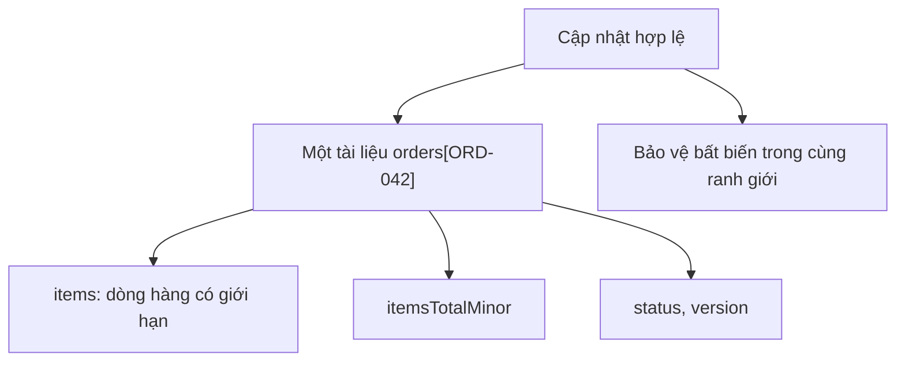
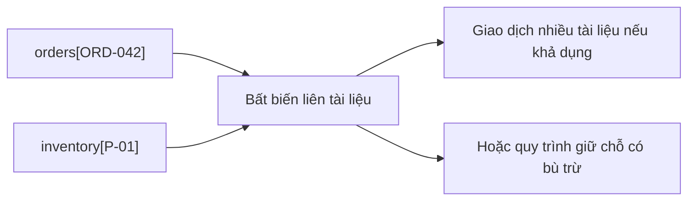
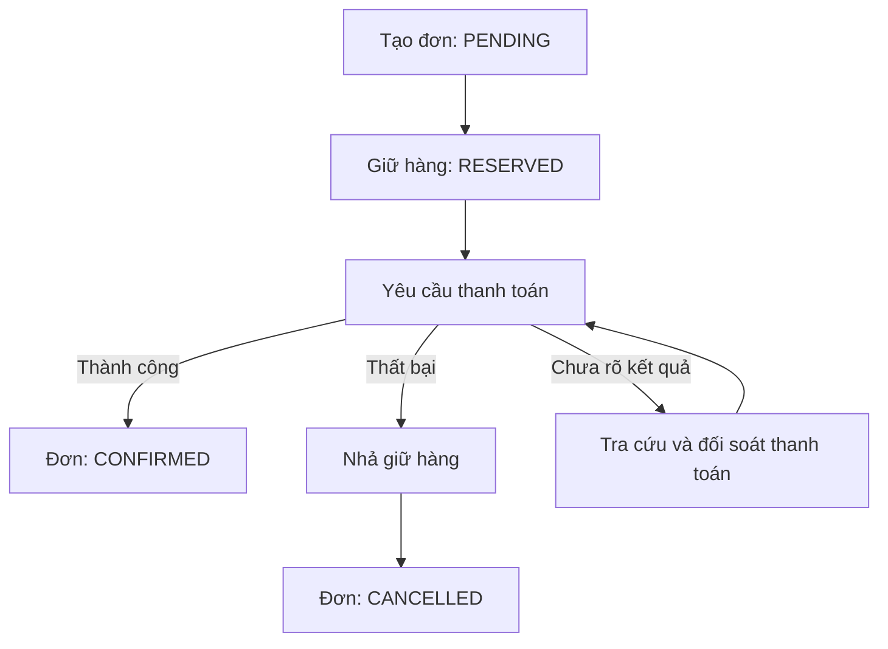
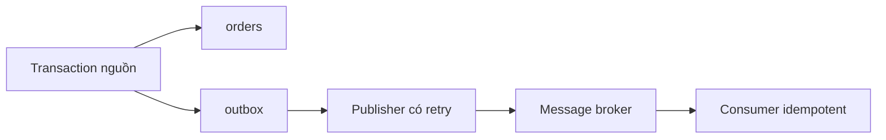

# Tính nguyên tử của thao tác và giới hạn giao dịch theo hệ lưu trữ

## 1. Vì sao ranh giới giao dịch quyết định mô hình tài liệu?

Một nghiệp vụ hiếm khi chỉ gồm một phép gán. Khi người dùng xác nhận đơn hàng, hệ thống có thể phải đổi trạng thái đơn, chốt các dòng hàng, tính tổng tiền, giữ tồn kho và ghi nhận yêu cầu thanh toán. Nếu thao tác thành công một nửa rồi dừng, dữ liệu có thể mâu thuẫn: đơn được xác nhận nhưng hàng chưa giữ, hoặc tồn kho đã trừ nhưng đơn không được tạo.

Trong **mô hình tài liệu (document model)**, lựa chọn đặt dữ liệu **trong cùng một tài liệu**, **ở nhiều tài liệu cùng cơ sở dữ liệu** hay **trải qua nhiều dịch vụ/hệ lưu trữ** ảnh hưởng trực tiếp tới những gì có thể thay đổi một cách nguyên tử.

**Tính nguyên tử (atomicity)** nghĩa là thao tác được xem như **một đơn vị không thể hoàn thành một phần** trong phạm vi mà hệ lưu trữ cam kết: hoặc toàn bộ thay đổi thuộc đơn vị đó được áp dụng, hoặc không thay đổi nào được áp dụng. Ranh giới của cam kết ấy phải được nêu rõ.

Bài này thuộc chương **Mô hình tài liệu** của **DATABASE_DATA_MODELING**. Mục tiêu của mô-đun là chuyển yêu cầu nghiệp vụ thành cấu trúc dữ liệu rõ ràng từ thực thể, quan hệ, ràng buộc, khóa, chỉ mục tới lược đồ vật lý; từ đó so sánh mô hình quan hệ, tài liệu, đồ thị và phân tích, chọn cấu trúc có thể tiến hóa và kiểm chứng.

Sau bài này, người học có thể:

- Phân biệt **một lệnh nguyên tử**, **giao dịch nhiều lệnh**, **mức cô lập**, **độ bền** và **tính nhất quán nghiệp vụ**.
- Xác định những bất biến nào cần nằm trong một tài liệu, một giao dịch hay một quy trình phối hợp.
- Đọc và kiểm chứng giới hạn giao dịch theo **sản phẩm, phiên bản, cấu hình và phạm vi dữ liệu**.
- Viết cập nhật có điều kiện, kiểm soát ghi đồng thời và xử lý giao dịch bị xung đột hoặc không rõ kết quả.
- Thiết kế phù hợp khi tác vụ trải qua nhiều tài liệu, phân vùng, dịch vụ hoặc hệ thống ngoài.
- Phân tích đánh đổi giữa **nhúng**, **tham chiếu**, giao dịch đa tài liệu, **giữ chỗ (reservation)** và **saga**.

## 2. Nguyên tử không đồng nghĩa với ACID hoàn chỉnh

### 2.1. Bốn thuộc tính ACID

| Thuộc tính | Câu hỏi | Ví dụ cần kiểm tra |
| --- | --- | --- |
| **Atomicity (nguyên tử)** | Những thay đổi nào hoặc cùng thành công, hoặc cùng hủy? | Đổi trạng thái đơn và cập nhật tổng tiền trong cùng ranh giới |
| **Consistency (nhất quán)** | Giao dịch được thiết kế để bảo vệ những ràng buộc nào? | Tổng tiền đúng, mã đơn duy nhất, không bán quá tồn |
| **Isolation (cô lập)** | Các giao dịch đồng thời nhìn thấy và ảnh hưởng lẫn nhau như thế nào? | Hai người cùng mua sản phẩm cuối |
| **Durability (bền vững)** | Khi xác nhận thành công, dữ liệu được giữ qua những loại lỗi nào? | Máy chủ lỗi hoặc chuyển nút sau khi xác nhận ghi |

**Lưu ý về chữ C trong ACID:** hệ lưu trữ cung cấp một số cơ chế giúp giữ ràng buộc; việc định nghĩa bất biến nghiệp vụ và đặt các bước kiểm tra đúng vị trí vẫn là trách nhiệm của người thiết kế. Một giao dịch có tính nguyên tử chưa chắc ngăn lỗi nghiệp vụ nếu kiểm tra sai hoặc các quy tắc trải ra ngoài phạm vi giao dịch.

Tương tự, hệ thống “hỗ trợ giao dịch” không đủ để suy ra mức cô lập **serializable**. Có thể gặp các mức như *read committed*, *snapshot isolation* hoặc cấu hình khác. Các mức này có cách xử lý đọc lặp, phantom, lost update và write skew khác nhau.

### 2.2. Bốn phạm vi thường bị gộp chung

1. **Thao tác trên một trường:** tăng một bộ đếm hoặc đặt một trạng thái.
2. **Thao tác trên một tài liệu:** thay nhiều trường và phần tử lồng nhau của cùng tài liệu.
3. **Giao dịch nhiều tài liệu:** thay đơn hàng, tồn kho và bản ghi khác trong cùng hệ quản trị nếu được hỗ trợ.
4. **Quy trình liên hệ thống:** ghi cơ sở dữ liệu, gọi cổng thanh toán, gửi thông báo, đặt lịch vận chuyển.

Tính nguyên tử ở phạm vi (2) **không suy ra** phạm vi (3) hay (4). Đặc biệt, một HTTP request gọi hai cơ sở dữ liệu không tự trở thành giao dịch chung.

### 2.3. Ví dụ một bản cập nhật chưa đủ

Giả sử `orders` có:

```json
{
  "orderId": "ORD-042",
  "status": "DRAFT",
  "items": [
    { "productId": "P-01", "quantity": 2, "unitPriceMinor": 150000 }
  ],
  "itemsTotalMinor": 300000,
  "version": 4
}
```

Nếu cập nhật `status` thành `CONFIRMED` bằng một lệnh nguyên tử, điều đó chỉ bảo đảm những thay đổi trong **chính lệnh** tuân theo cam kết của hệ quản trị. Nó chưa chứng minh rằng `itemsTotalMinor` đúng, hàng tồn kho đã được giữ, hay thanh toán đã thành công.

Mỗi bất biến cần được ánh xạ tới **đúng ranh giới ghi và cơ chế thực thi**.

## 3. Thiết kế bắt đầu từ bất biến, không bắt đầu từ cú pháp transaction

Bất biến (*invariant*) là điều kiện nghiệp vụ phải giữ đúng tại những thời điểm được quy định. Ví dụ:

| Bất biến | Phạm vi dữ liệu | Câu hỏi thiết kế |
| --- | --- | --- |
| Số lượng mỗi dòng hàng là số nguyên dương | Một dòng trong đơn | Validation có nằm ở đường ghi không? |
| Tổng tiền khớp các dòng và điều chỉnh | Thường một đơn hàng | Có cập nhật cùng ranh giới với dòng hàng? |
| Không xác nhận lại đơn đã xác nhận | Một đơn | Có điều kiện trạng thái hoặc phiên bản? |
| Tồn kho khả dụng không âm | Một mã hàng/kho hoặc nhiều phân bổ | Có cập nhật có điều kiện đúng bản ghi gốc? |
| Một yêu cầu thanh toán chỉ tạo một kết quả nghiệp vụ | Đơn + bản ghi thanh toán + nhà cung cấp | Có khóa idempotency và quy tắc trạng thái? |
| Một người chỉ đăng ký một lần vào khóa | Quan hệ học viên–khóa | Khóa duy nhất theo cặp có được áp đặt? |
| Tổng điểm đã công bố không lẫn phiên bản chưa phát hành | Nhiều bài kiểm tra/khóa | Ranh giới phát hành và đọc snapshot là gì? |

Không phải mọi điều kiện cần đúng **mọi mili giây**. Một bộ đếm lượt xem có thể cập nhật trễ, trong khi việc hai người cùng lấy sản phẩm cuối thường cần kiểm soát mạnh tại thời điểm giữ hàng. Cần ghi rõ **thời điểm phải đúng**, **hệ nào quyết định đúng/sai** và **hành vi khi thao tác thất bại**.

Mẫu phân tích ngắn:

```text
Nghiệp vụ: Giữ 1 sản phẩm khi tạo đơn
Bất biến cứng: available >= 0
Nguồn thẩm quyền: inventory[sku, warehouse]
Điểm kiểm tra: thao tác giữ hàng
Cơ chế: cập nhật có điều kiện + kiểm tra kết quả
Liên hệ với đơn: một transaction nếu cùng phạm vi được hỗ trợ,
                 hoặc workflow reservation với trạng thái bù trừ
Khi lỗi/timeout: tra trạng thái bằng idempotency key, xử lý lại an toàn
```

Nếu không xác định bất biến trước, việc nhúng tất cả dữ liệu vào một tài liệu chỉ vì “một tài liệu được ghi nguyên tử” có thể làm sai ranh giới nghiệp vụ.

## 4. Một tài liệu làm ranh giới nguyên tử: thuận lợi và giới hạn

### 4.1. Khi nhúng giúp bảo vệ một bất biến

Với đơn hàng có **số dòng hữu hạn**, việc nhúng dòng hàng và tổng tiền cho phép cập nhật các giá trị phụ thuộc trong cùng một tài liệu. Ví dụ thao tác sửa giỏ hàng có thể được thực hiện bằng một câu lệnh cập nhật thích hợp hoặc một transaction trong phạm vi tài liệu, theo khả năng cụ thể của hệ quản trị.



Những trường có liên hệ chặt chẽ và thường đọc/ghi cùng nhau là ứng viên tốt cho nhúng.

Nhưng **nhúng không bảo đảm tính đúng đắn tự động**. Nếu ứng dụng sửa `items` ở một lệnh rồi sửa `itemsTotalMinor` ở lệnh khác, có thể tồn tại khoảng thời gian không nhất quán; nếu một lệnh thất bại, hai trường có thể lệch. Cần cập nhật cùng một thao tác phù hợp hoặc bảo vệ bằng quy trình khác.

### 4.2. Cập nhật có điều kiện và phiên bản

Ví dụ MongoDB (minh họa một hệ quản trị cụ thể; không phải cú pháp phổ quát):

```javascript
const result = db.orders.updateOne(
  {
    orderId: "ORD-042",
    status: "DRAFT",
    version: 4
  },
  {
    $set: { status: "CONFIRMED" },
    $inc: { version: 1 },
    $currentDate: { confirmedAt: true }
  }
);

if (result.matchedCount === 0) {
  // Đơn không còn ở DRAFT, hoặc phiên bản đã thay đổi,
  // hoặc không tìm thấy đơn. Cần đọc lại trước khi quyết định.
}
```

Bộ lọc và các thay đổi được áp dụng trong một thao tác cập nhật tài liệu theo cam kết nguyên tử của MongoDB. Điều kiện `status` + `version` giúp phát hiện cạnh tranh ghi (*optimistic concurrency control*).

Tuy nhiên, **xác nhận đơn trong ví dụ vẫn chưa chứng minh** rằng tồn kho được giữ hay tiền đã thu. Hơn nữa, khi điều kiện không khớp, cần phân biệt “đã xử lý trước đó”, “dữ liệu đã đổi”, “không tồn tại” và các lỗi nghiệp vụ thay vì thử ghi đè mù.

### 4.3. Nguyên tử một tài liệu còn phụ thuộc đúng thao tác

Các hệ quản trị có thể hỗ trợ cập nhật một trường, một phần tử mảng, câu lệnh cập nhật theo biểu thức hoặc thao tác so sánh–và–đổi (*compare-and-swap*). Khi dùng chúng:

- Kiểm tra **điều kiện lọc** có bảo vệ bất biến hay không.
- Kiểm tra **số bản ghi được khớp/sửa**, thay vì chỉ tin lệnh không báo lỗi.
- Xác định kiểu thao tác nào bảo đảm một tài liệu được sửa nguyên tử.
- Không viết lại toàn bộ tài liệu từ bản đọc cũ nếu những thay đổi khác có thể bị mất.
- Xem giới hạn kích thước tài liệu, mảng tăng vô hạn và tranh chấp ghi.

Nếu hàng nghìn tiến trình cùng thay đổi một mảng lồng vào **một** tài liệu, ranh giới nguyên tử có thể biến thành **điểm nóng**. Khi đó, tách thành nhiều tài liệu với khóa tham chiếu có thể phù hợp hơn dù đòi hỏi cơ chế khác cho các bất biến liên tài liệu.

## 5. Giao dịch nhiều tài liệu: có ích nhưng phải kiểm tra phạm vi

### 5.1. Khi nào cần transaction nhiều tài liệu?

Giả sử `orders[ORD-042]` và `inventory[P-01]` nằm ở hai tài liệu riêng. Nghiệp vụ yêu cầu tạo đơn và giữ hàng như một thao tác logic.



Transaction nhiều tài liệu có thể giúp đảm bảo nhóm thao tác cùng commit/rollback **trong phạm vi được hỗ trợ**. Nhưng giá trị thực tế phụ thuộc:

- Triển khai có hỗ trợ transactions ở phiên bản/cấu hình đang dùng không?
- Có giới hạn một partition/shard, collection, database hoặc cluster nào không?
- Có mức cô lập nào và còn hiện tượng cạnh tranh nào?
- Thời gian tối đa, kích thước thao tác, mức retry và chi phí giao dịch là bao nhiêu?
- Dữ liệu nằm cùng hệ quản trị hay trải qua dịch vụ khác?

### 5.2. Minh họa transaction cùng một hệ MongoDB

Ví dụ Node.js sử dụng MongoDB driver; **chỉ minh họa ranh giới**, cần kiểm tra hỗ trợ giao dịch, phiên bản driver, xử lý retry và cấu hình triển khai khi áp dụng:

```javascript
const session = client.startSession();

try {
  await session.withTransaction(async () => {
    const stock = await db.collection("inventory").updateOne(
      { sku: "P-01", available: { $gte: 2 } },
      { $inc: { available: -2, reserved: 2 } },
      { session }
    );

    if (stock.matchedCount !== 1) {
      throw new Error("INSUFFICIENT_STOCK");
    }

    await db.collection("orders").insertOne(
      {
        orderId: "ORD-042",
        status: "RESERVED",
        items: [{ sku: "P-01", quantity: 2, unitPriceMinor: 150000 }],
        totalMinor: 300000
      },
      { session }
    );
  });
} finally {
  await session.endSession();
}
```

Trong phạm vi transaction được hệ quản trị hỗ trợ, thay đổi tồn kho và tạo đơn được commit/abort như một đơn vị. Ví dụ vẫn cần:

- Chỉ mục duy nhất cho `orderId` và khóa định danh tồn kho phù hợp.
- Quy tắc tính tổng tiền từ dữ liệu giá được xác nhận.
- Xử lý trường hợp kết quả commit **không rõ** do lỗi mạng: tra cứu theo khóa idempotency/đơn, không tự động tạo một đơn mới với khóa khác.
- Chính sách retry cho lỗi nhất thời; callback giao dịch có thể được thực thi lại tùy driver và tình huống, nên tránh gọi dịch vụ ngoài hoặc tạo side effect không idempotent ở trong callback.
- Kiểm tra phiên bản, mức cô lập, write concern và các giới hạn transaction trong môi trường thực tế.

Nếu cần giữ hàng ở nhiều kho, quy tắc như tổng số lượng, thứ tự cấp phát, chuyển kho và khả năng deadlock/xung đột cần được phân tích riêng.

### 5.3. Không phải mọi transaction đều cho serializable isolation

Một transaction có thể cho cái nhìn nhất quán ở mức snapshot nhưng vẫn có nguy cơ **write skew** nếu hai giao dịch đọc một điều kiện chung rồi ghi **hai bản ghi khác nhau**. Ví dụ hai bác sĩ cùng kiểm tra “còn ít nhất một người trực” và mỗi người tự bỏ ca trực trên bản ghi riêng; sau cả hai giao dịch, có thể không còn ai trực nếu mức cô lập và cơ chế ràng buộc không ngăn được.

Cách bảo vệ phụ thuộc hệ quản trị và bất biến:

- Chọn mức cô lập đủ mạnh nếu có và chi phí chấp nhận được.
- Biểu diễn bất biến bằng khóa/ràng buộc hoặc một điểm ghi chung được bảo vệ.
- Dùng khóa logic, cập nhật có điều kiện hoặc kiểm tra xung đột có ngữ nghĩa phù hợp.
- Thử lịch chạy đồng thời có thể gây write skew, chứ không chỉ thử tuần tự.

**Đã đặt nhiều lệnh trong transaction** chưa đủ để kết luận mọi ràng buộc liên bản ghi sẽ được tự động bảo vệ.

## 6. Bảng câu hỏi so sánh giới hạn giao dịch theo hệ lưu trữ

Mỗi hệ lưu trữ có phạm vi nguyên tử khác nhau. Không nên dựa vào một câu như “NoSQL không có giao dịch” hoặc “database có ACID nên mọi thao tác liên hệ thống đều nguyên tử”.

| Hệ hoặc nhóm hệ thống | Phạm vi cần xác minh | Ví dụ giới hạn/câu hỏi quan trọng |
| --- | --- | --- |
| **MongoDB** | Ghi một tài liệu; giao dịch nhiều tài liệu khi cấu hình/triển khai hỗ trợ | Kiểm tra transaction trên replica set/sharded cluster, thời gian và retry, write concern/read concern, tranh chấp, thao tác được hỗ trợ |
| **DynamoDB** | Ghi từng item; các API giao dịch có điều kiện cho nhiều item | Kiểm tra số item/kích thước giới hạn mỗi transaction, phạm vi region/account, yêu cầu idempotency và điều kiện chống cạnh tranh |
| **Cloud Firestore** | Giao dịch và batch write trên nhiều document trong phạm vi sản phẩm | Kiểm tra giới hạn số thao tác/dữ liệu/thời gian, retry callback, quy tắc đọc–ghi và transaction có thể bị chạy lại |
| **Azure Cosmos DB (API for NoSQL)** | Phạm vi hỗ trợ transaction trong logical partition; transactional batch | Kiểm tra partition key, stored procedure/batch, isolation, giới hạn và chi phí qua nhiều partition |
| **CouchDB** | Cam kết nguyên tử chủ yếu ở từng document | Kiểm tra MVCC, revision conflicts, batch semantics, việc nhiều document có được giao dịch cùng nhau không |
| **Elasticsearch/OpenSearch** | Cập nhật theo document và cơ chế phiên bản | Không coi bulk API như giao dịch ACID nhiều document; kiểm tra khả năng nhìn thấy dữ liệu sau refresh và xử lý xung đột |
| **PostgreSQL và RDBMS tương tự** | Giao dịch nhiều bảng/bản ghi trong phạm vi database đã hỗ trợ | Kiểm tra mức cô lập, khóa, ràng buộc, deadlock, replication/độ bền; transaction không tự bao trùm cổng thanh toán |
| **Object storage/message broker** | Theo API đối tượng/thông điệp, không mặc nhiên chung transaction với database | Kiểm tra tính nguyên tử từng đối tượng, ack, gửi lại và cách phối hợp với giao dịch dữ liệu |

**Bảng là bản đồ câu hỏi, không phải cam kết khả năng cố định.** Những sản phẩm trên thay đổi theo phiên bản, cấu hình, region, loại API và hạ tầng. Trước khi dùng một khả năng để bảo vệ bất biến, cần đọc tài liệu chính thức đúng môi trường triển khai, xác định rõ giới hạn và viết thử nghiệm lỗi.

### 6.1. Các loại giới hạn phải ghi vào tài liệu thiết kế

Không chỉ hỏi “có transaction hay không”, mà cần trả lời:

1. **Ranh giới địa lý/logical:** cùng database, collection, shard, logical partition hay region?
2. **Giới hạn số thực thể:** một transaction được chạm tối đa bao nhiêu item/document hoặc thao tác?
3. **Giới hạn dữ liệu:** kích thước document, request, transaction log hoặc payload có bị khống chế?
4. **Thời gian:** transaction có timeout hoặc giới hạn thời lượng không? Khi callback được retry thì sao?
5. **Cô lập:** đọc dữ liệu đã commit, snapshot hay serializable? Có hiện tượng write skew/phantom nào?
6. **Độ bền và nhân bản:** commit thành công có bảo đảm gì khi node/region lỗi? Cần write concern nào?
7. **Xung đột:** hệ quản trị trả lỗi nào khi concurrent write, cần retry loại nào?
8. **Tác động vận hành:** throughput, độ trễ, contention, chi phí lock và tài nguyên bị giữ.
9. **Side effect ngoài database:** gửi email, thanh toán, queue, object storage có nằm trong cùng cam kết không?
10. **Khả năng mở rộng:** sau khi phân vùng/shard hoặc chuyển vùng, phạm vi giao dịch và chi phí thay đổi thế nào?

### 6.2. Ví dụ partition ảnh hưởng thiết kế

Giả sử một nền tảng nhiều tổ chức lưu tài liệu theo `tenantId`. Nếu hệ quản trị hỗ trợ giao dịch hiệu quả **trong một partition logic**, hai tài liệu cùng `tenantId` có thể được xử lý trong một phạm vi; nhưng một phép chuyển tài nguyên giữa hai tenant có thể vượt ranh giới này. Cần kiểm tra khả năng của sản phẩm và quyết định mô hình dữ liệu, thay vì giả định mọi transaction xuyên partition là như nhau.

Khi chọn partition key, phải cân bằng đường truy vấn, phân bố tải và **những bất biến thường cần giao dịch**. Chọn khóa phân vùng chỉ theo một trường dễ truy vấn có thể đẩy nhiều nghiệp vụ quan trọng ra khỏi phạm vi giao dịch có thể dùng.

## 7. Tranh chấp ghi: nguyên tử nhưng vẫn có thể mất cập nhật nghiệp vụ

### 7.1. Lost update do đọc–sửa–ghi

Hai thiết bị cùng sửa đơn:

```text
Ban đầu order.version = 8, quantity = 1

Thiết bị A đọc version 8
Thiết bị B đọc version 8
A đổi quantity thành 2 và lưu
B đổi quantity thành 3 từ dữ liệu version 8 và lưu

Nếu ghi đè không điều kiện, thay đổi A có thể mất.
```

Dùng `version` làm bộ lọc điều kiện có thể phát hiện bản đọc đã cũ. Khi `matchedCount = 0`, ứng dụng cần **đọc lại và giải quyết xung đột theo nghiệp vụ**, không mặc nhiên tăng phiên bản rồi gửi lại bản ghi cũ.

### 7.2. Check-then-act không nguyên tử

Mẫu nguy hiểm:

```text
1. Đọc inventory.available = 1
2. Nếu > 0, cho phép bán
3. Ghi available = available - 1
```

Hai tiến trình có thể cùng đọc `1` và cùng cho phép bán trước khi ghi.

Cần đưa **điều kiện và thay đổi vào cùng thao tác**:

```javascript
const result = db.inventory.updateOne(
  { sku: "P-01", available: { $gte: 1 } },
  { $inc: { available: -1, reserved: 1 } }
);

if (result.matchedCount !== 1) {
  // Hết hàng, không tìm thấy SKU hoặc điều kiện đã đổi.
}
```

Câu lệnh bảo vệ bất biến số hàng khả dụng **trên một tài liệu tồn kho** theo semantics cập nhật có điều kiện. Nhưng việc “đã giữ hàng cho đơn nào” còn cần định danh giữ chỗ để xử lý timeout, retry, hết hạn và hoàn hàng.

### 7.3. Atomic increment không đồng nghĩa cập nhật nghiệp vụ đúng một lần

Một lệnh `$inc` có thể nguyên tử, nhưng nếu nhận cùng sự kiện hai lần rồi chạy hai lệnh tăng, bộ đếm vẫn sai.

Vì vậy cần phân biệt:

- **Atomicity:** một lệnh tăng không bị thực hiện dở dang.
- **Idempotency:** cùng yêu cầu được gửi lại không tạo thêm tác động ngoài ý muốn.
- **Ordering:** sự kiện cũ không ghi đè trạng thái mới.
- **Deduplication:** nhận diện thay đổi đã áp dụng.

Một thao tác nghiệp vụ có thể cần cả bốn đặc tính; không đặc tính nào tự động suy ra ba đặc tính còn lại.

## 8. Khi dữ liệu vượt một hệ lưu trữ: giao dịch không bao trùm dịch vụ ngoài

### 8.1. Ví dụ đặt hàng và cổng thanh toán

Quy trình có thể gồm:

1. Lưu đơn hàng trong cơ sở dữ liệu.
2. Gọi cổng thanh toán để ủy quyền hoặc thu tiền.
3. Thay đổi trạng thái đơn.
4. Gửi xác nhận cho khách.

Một transaction của cơ sở dữ liệu **không tự bao gồm HTTP call tới cổng thanh toán hoặc việc gửi email**. Nếu thanh toán thành công nhưng bước 3 lỗi, hệ thống phải có cách khôi phục.

Giữ transaction database mở trong lúc chờ dịch vụ ngoài có thể gây tranh chấp và vẫn **không biến dịch vụ ngoài thành bên tham gia giao dịch**.

### 8.2. Quy trình saga và trạng thái trung gian

**Saga** chia một quy trình thành nhiều bước có trạng thái riêng, có thể gồm bước bù trừ khi bước sau thất bại:



Một bước bù trừ **không phải rollback kỹ thuật tức thời**. Ví dụ, hoàn tiền có thể mất thời gian, phát sinh phí hoặc thất bại; gửi email rồi không thể “thu hồi” hoàn toàn. Cần thiết kế hành vi bù trừ có ý nghĩa nghiệp vụ, kiểm soát thứ tự và trạng thái hiển thị cho người dùng.

### 8.3. Giữ chỗ (reservation) với định danh và hết hạn

Một bản ghi giữ chỗ có thể có:

```json
{
  "reservationId": "RES-009",
  "orderId": "ORD-042",
  "sku": "P-01",
  "quantity": 2,
  "status": "ACTIVE",
  "expiresAt": "2026-11-22T09:00:00Z",
  "version": 1
}
```

Thiết kế phải trả lời:

- Một đơn có thể tạo tối đa bao nhiêu reservation cho cùng mục đích?
- Đâu là **nguồn thẩm quyền** xác định số tồn khả dụng?
- Nếu tạo reservation và giảm `available` là hai tài liệu, hai bước được phối hợp ra sao?
- Khi hết hạn, nhả hàng có thể xảy ra trùng hoặc cạnh tranh với bước xác nhận thanh toán không?
- Khi kết quả thanh toán không rõ, có được tự động hủy reservation không hay cần đối soát trước?

Nếu cập nhật tồn kho và tạo reservation cần luôn đồng nhất, có thể cân nhắc transaction trong phạm vi hỗ trợ hoặc thiết kế lại để hai dữ kiện cùng ranh giới ghi. Không nên giả định một timestamp hết hạn tự giải quyết mọi xung đột nghiệp vụ.

## 9. Transactional outbox, idempotency và kết quả không rõ

### 9.1. Dual-write: cập nhật database rồi phát sự kiện

Mẫu dễ lỗi:

```text
1. Ghi orders.status = CONFIRMED
2. Gửi message "OrderConfirmed"

Nếu bước 1 thành công, bước 2 thất bại:
đơn đã xác nhận nhưng các hệ thống downstream không nhận được sự kiện.
```

Một cách khắc phục phổ biến là **transactional outbox**: lưu thay đổi nghiệp vụ và bản ghi sự kiện trong **cùng ranh giới giao dịch** nếu có thể. Một bộ phát riêng lấy sự kiện từ outbox và chuyển đi.



Outbox làm giảm nguy cơ mất sự kiện giữa ghi nguồn và phát đi, nhưng **không tự bảo đảm chính xác một lần** ở consumer. Bộ phát có thể gửi lại nếu không nhận được xác nhận; consumer phải xử lý trùng an toàn.

Nếu hệ quản trị chỉ bảo đảm nguyên tử một tài liệu, đặt outbox ở một tài liệu khác không tự tạo giao dịch chung. Có thể cần lưu thông tin thay đổi trong cùng tài liệu nguồn, dùng change stream/CDC được hỗ trợ hoặc chọn cơ chế khác; mỗi cách có giới hạn về kích thước, sự kiện, thứ tự và độ bền.

### 9.2. Khóa idempotency bảo vệ lệnh nghiệp vụ

Ví dụ một request thanh toán có `requestId = PAYREQ-077`. Khi client timeout rồi gửi lại, API nên trả kết quả của **cùng tác vụ** nếu trước đó đã được tiếp nhận, hoặc tiếp tục từ trạng thái đã lưu, thay vì thu thêm tiền.

Mô hình logic:

```text
paymentRequests
  { requestId, orderId, status, providerReference, result }

Bất biến:
  một requestId chỉ đại diện cho một mục đích thanh toán
  trạng thái chuyển theo quy tắc
  retry không tạo khoản thu thứ hai ngoài ý muốn
```

Cần có khóa duy nhất và cơ chế phối hợp với nhà cung cấp thanh toán, bao gồm khả năng truy vấn kết quả từ provider. Khóa idempotency chỉ hữu ích khi **ngữ nghĩa tái sử dụng và thời hạn lưu** được quy định.

### 9.3. Timeout sau commit: đừng suy ra “chưa ghi”

Trong hệ phân tán, phía ứng dụng có thể không nhận được phản hồi commit dù máy chủ đã ghi thành công. Khi đó kết quả là **unknown**, không chắc là failed.

Quy trình đúng có thể gồm:

1. Lưu hoặc biết trước khóa nghiệp vụ/idempotency ổn định.
2. Khi nhận timeout, tra cứu trạng thái theo khóa ấy.
3. Nếu đã commit, tiếp tục theo kết quả đã lưu.
4. Nếu chưa có và có thể gửi lại an toàn, retry theo chính sách.
5. Nếu trạng thái chưa thể quyết định, chuyển sang đối soát thay vì tạo nghiệp vụ mới với khóa khác.

Điều này áp dụng cho cả giao dịch nhiều tài liệu, xử lý message và tác vụ liên hệ thống.

## 10. Những giới hạn thực tế khi lạm dụng giao dịch dài

Transaction nhiều tài liệu mang lại tiện ích, nhưng không phải lời giải mặc định cho mọi quan hệ.

### 10.1. Thời gian và phạm vi khóa/xung đột

Một transaction đọc/ghi nhiều bản ghi và chờ lâu có thể:

- Làm tăng khả năng xung đột hoặc retry.
- Giữ tài nguyên lâu, tăng độ trễ của các yêu cầu khác.
- Chạm timeout hoặc giới hạn tài nguyên.
- Bị ảnh hưởng mạnh khi mạng hoặc dịch vụ chậm.
- Tăng chi phí khi trải qua nhiều shard/partition.

Thời gian chính xác, số thao tác và phạm vi khóa phải được xác minh ở sản phẩm/phiên bản cụ thể.

### 10.2. Ghi nhiều tài liệu không đồng nghĩa dễ mở rộng

Giả sử mọi đơn phải cập nhật một tài liệu `dailySalesSummary` duy nhất trong cùng transaction. Khi lượng đơn tăng, tài liệu tổng kết có thể trở thành điểm nóng ghi dù các đơn ở những tài liệu khác nhau.

Có thể tách bản tổng hợp thành nhiều phần, tổng hợp theo lô hoặc cập nhật bất đồng bộ nếu nghiệp vụ cho phép. Nếu bộ đếm phải chính xác tức thời vì quyết định hạn mức, phải giữ bất biến đó ở một điểm ghi phù hợp hoặc dùng cơ chế giao dịch đủ mạnh.

### 10.3. Kéo dài transaction để đợi quyết định của người dùng

Không nên giữ một transaction mở trong nhiều phút chỉ để chờ người dùng bấm “Xác nhận”, hoàn tất OTP hay chờ phản hồi của đối tác. Thay vào đó có thể dùng trạng thái `PENDING`, reservation có thời hạn, bất biến và quy trình hoàn tất/hủy rõ ràng.

Trạng thái chuyển tiếp là một phần bình thường của mô hình nghiệp vụ; không cần cố biến toàn bộ vòng đời nhiều phút thành một transaction kéo dài.

## 11. Từ mô hình logic đến mô hình vật lý: chọn ranh giới phù hợp

Một quan hệ 1–N không tự quyết định nhúng hay tham chiếu. Cần kết hợp **bội số, kích thước, tải ghi, đường đọc và phạm vi nguyên tử cần thiết**.

| Tình huống | Hướng mô hình hóa ban đầu | Lý do |
| --- | --- | --- |
| Đơn hàng và 5–50 dòng hàng, luôn đọc/ghi cùng nhau | Nhúng dòng hàng vào đơn | Dễ giữ bất biến của một đơn trong một ranh giới |
| Bài viết có hàng trăm nghìn bình luận | Bình luận riêng, tham chiếu `postId` | Mảng tăng vô hạn; mỗi bình luận được ghi/truy vấn độc lập |
| Khóa học và tiến độ của 80.000 học viên | Tiến độ thành tài liệu riêng | Tránh nhiều người ghi vào một tài liệu khóa học |
| Tồn kho cho nhiều đơn cùng mua | Tài liệu tồn kho có điều kiện hoặc reservation | Tồn kho là tài nguyên chia sẻ có tải ghi cao |
| Tổng doanh thu theo tháng | Tổng hợp riêng có đối soát | Tránh ép transaction đơn hàng cập nhật một tài liệu nóng |
| Đơn và thanh toán ngoài hệ thống | Transaction nội bộ + workflow/idempotency | Hệ thanh toán không nằm trong transaction DB |
| Một người tham gia nhiều dự án | Tài liệu membership, khóa ghép duy nhất | Quan hệ độc lập, ràng buộc và truy vấn hai chiều |

Một **aggregate** trong thiết kế miền nghiệp vụ mô tả ranh giới những bất biến cần bảo vệ. Khi aggregate nhỏ, nhúng trong một tài liệu có thể rất phù hợp. Khi một bất biến liên quan các aggregate khác nhau, cần quyết định chỗ có thẩm quyền, mức nhất quán và cơ chế phối hợp thay vì tự động gom chúng vào một tài liệu khổng lồ.

### 11.1. Phân vùng dữ liệu và khóa nghiệp vụ

Nếu hệ thống dùng partition/shard, hãy ghi rõ:

- Bất biến có nằm trong một partition không?
- Partition key có được đưa vào mọi truy vấn và ràng buộc duy nhất?
- Một tài liệu “nóng” có tập trung quá nhiều ghi vào một partition không?
- Khi chuyển dữ liệu giữa partition, có thay đổi phạm vi giao dịch không?
- Có tác vụ nhiều khách hàng/tổ chức phải bảo vệ ranh giới truy cập không?

Không nên chọn `tenantId`, `orderId` hay `sku` chỉ theo hiệu năng đọc mà bỏ qua những giao dịch thường gặp và mức phân bố tải.

### 11.2. Mô hình quan hệ, tài liệu, đồ thị và phân tích

| Kiểu bài toán | Mô hình đáng cân nhắc | Khía cạnh giao dịch |
| --- | --- | --- |
| Nhiều bảng liên quan, ràng buộc khóa ngoại và báo cáo truy vấn linh hoạt | Quan hệ | Thường có cơ chế giao dịch đa bảng mạnh; vẫn cần chọn isolation phù hợp |
| Cấu trúc lồng nhau, đọc theo một đơn vị nghiệp vụ | Tài liệu | Ghi một tài liệu thuận tiện; đa tài liệu tùy sản phẩm/cấu hình |
| Mối quan hệ nhiều bước, duyệt nút/cạnh | Đồ thị | Kiểm tra phạm vi giao dịch và ràng buộc khi thay nhiều nút/cạnh |
| Tổng hợp dữ liệu khối lượng lớn | Kho phân tích / cột | Tối ưu quét/tổng hợp; không mặc nhiên phù hợp làm nguồn giao dịch đơn lẻ |
| Tác vụ trải qua các hệ thống khác nhau | Kiến trúc phối hợp | Saga, outbox, idempotency và đối soát là thiết kế nghiệp vụ |

Không có nhãn “NoSQL”, “document” hay “relational” nào đủ để kết luận mọi loại ACID sẽ hoặc sẽ không có. Cần so sánh **sản phẩm thực, phiên bản, cấu hình, dữ liệu và ràng buộc cụ thể**.

## 12. Luyện tập: hệ thống bán vé với một ghế cuối

### 12.1. Yêu cầu

Một nền tảng bán vé có:

- Một buổi diễn có nhiều ghế, mỗi ghế chỉ được bán cho tối đa một người.
- Người mua chọn ghế, có 5 phút thanh toán.
- Có thể hàng nghìn người cùng thử đặt một ghế phổ biến.
- Hệ thanh toán là dịch vụ ngoài.
- Khi thanh toán thất bại hoặc hết hạn, ghế cần được giải phóng.
- Người dùng có thể nhấn nút thanh toán nhiều lần hoặc mất mạng sau khi gửi yêu cầu.

**Câu hỏi:** Bạn đặt những dữ kiện nào trong một ranh giới nguyên tử? Phần nào cần transaction, phần nào cần reservation và idempotency?

### 12.2. Phương án mô hình gợi ý

```text
seats
  { showId, seatId, status, reservationId, version }

reservations
  { reservationId, showId, seatId, userId, status, expiresAt, version }

orders
  { orderId, reservationId, totalMinor, status }

paymentRequests
  { requestId, orderId, providerReference, status }

outbox
  { eventId, aggregateId, eventType, payload, status }
```

**Các bất biến cần thiết:**

1. Một ghế chỉ có tối đa **một reservation đang có hiệu lực** hoặc vé đã chốt.
2. Một `reservationId` chỉ gắn với một yêu cầu giữ ghế theo quy tắc.
3. Không xác nhận bán ghế khi reservation không còn hợp lệ.
4. Cùng `requestId` thanh toán không tạo hai tác động độc lập.
5. Ghế hết hạn chỉ được nhả nếu vẫn do reservation tương ứng sở hữu.

### 12.3. Luồng xử lý một cách có thể kiểm chứng

1. **Giữ ghế:** cập nhật có điều kiện trên tài liệu ghế, chỉ thành công nếu ghế đang `AVAILABLE` hoặc trạng thái hết hạn được xử lý đúng theo quy tắc. Gắn `reservationId` và phiên bản.
2. **Ghi reservation:** nếu cùng cơ sở dữ liệu có transaction nhiều tài liệu khả dụng, có thể gộp cập nhật ghế và tạo reservation; nếu không, thiết kế quy trình có thể phục hồi trạng thái dở dang, không thả lỏng bất biến một ghế.
3. **Thanh toán:** dùng `requestId` ổn định, gọi cổng thanh toán ngoài transaction DB. Khi timeout, hỏi lại trạng thái nhà cung cấp; tránh tạo yêu cầu thu tiền mới tùy tiện.
4. **Xác nhận:** chỉ chuyển reservation/ghế/đơn về trạng thái cuối khi các điều kiện hiệu lực vẫn đúng; khi cần bảo vệ nhiều tài liệu thì dùng transaction trong phạm vi được hỗ trợ hoặc một quy trình phối hợp có bất biến rõ.
5. **Hết hạn/hủy:** thao tác nhả ghế phải kiểm tra `reservationId` khớp và trạng thái chưa được chốt; tránh tác vụ hết hạn đến muộn nhả ghế đã bán.
6. **Phát thông báo:** dùng outbox/luồng thay đổi đáng tin cậy; consumer xử lý gửi lại và trùng lặp.

Với tải cao, cần đo xung đột trên tài liệu ghế “nóng”, thời gian giữ chỗ, độ trễ xác nhận thanh toán và thời gian phục hồi sau sự cố. Cần đặc biệt kiểm thử các thứ tự sự kiện cạnh tranh, ví dụ thanh toán thành công ngay lúc một reservation hết hạn.

### 12.4. Các thử nghiệm quan trọng

| Tình huống | Kết quả cần bảo vệ |
| --- | --- |
| Hai người giữ cùng một ghế đồng thời | Chỉ một người giữ thành công |
| Người dùng nhấn thanh toán hai lần | Không thu tiền hai lần ngoài ý muốn |
| Mất mạng sau khi database commit | Đọc lại theo khóa để biết trạng thái thật |
| Thanh toán thành công nhưng cập nhật đơn thất bại | Có quy trình đối soát và xác nhận/bù trừ |
| Tác vụ hết hạn chạy sau khi ghế đã được bán | Không giải phóng ghế đã chốt |
| Sự kiện `SeatConfirmed` được gửi lại | Consumer không xử lý tác động nghiệp vụ trùng |
| Một phân vùng bị tải cao | Không vi phạm bất biến, có cơ chế retry/giảm tải |
| Dịch vụ thanh toán chậm vài phút | Không giữ transaction database mở suốt thời gian chờ |

## 13. Quy trình phân tích giao dịch theo hệ lưu trữ

Có thể dùng quy trình sau cho đặt hàng, kiểm kê, học tập, thanh toán, đặt lịch hoặc phân bổ tài nguyên:

1. **Viết sự kiện nghiệp vụ và bất biến:** cái gì phải đúng, chính xác từ thời điểm nào?
2. **Xác định nguồn có thẩm quyền:** mỗi dữ kiện được phép thay đổi ở đâu?
3. **Đánh dấu nhóm cần nguyên tử:** trong một trường, một tài liệu, nhiều tài liệu hay nhiều hệ thống.
4. **Đối chiếu khả năng sản phẩm:** phiên bản, partition, transaction API, isolation, durability, giới hạn kích thước/thời gian.
5. **Thiết kế ranh giới dữ liệu:** nhúng nếu phần dữ liệu hữu hạn và cần cùng nguyên tử; tham chiếu khi có vòng đời/tải ghi riêng.
6. **Viết điều kiện ghi:** khóa duy nhất, trạng thái trước hợp lệ, phiên bản, điều kiện tồn kho hoặc hạn mức.
7. **Thiết kế hành vi lỗi:** xung đột, timeout, unknown commit, gửi lại, dữ liệu cũ và bù trừ.
8. **Thiết kế side effect:** outbox, thông điệp có định danh, idempotency, saga và đối soát khi vượt ranh giới DB.
9. **Kiểm thử concurrent workload:** nhiều tiến trình cùng bản ghi, nhiều bản ghi, lỗi giữa các bước và đột biến tải.
10. **Đo vận hành:** p95/p99 latency, số retry, số giao dịch abort, điểm nóng, thời gian hoàn tất và lượng dữ liệu cần bù trừ.

Đầu ra không chỉ là một sơ đồ JSON, mà là **bảng bất biến–ranh giới–cơ chế**, các thao tác mẫu, khóa/chỉ mục, giới hạn sản phẩm đã xác minh và kịch bản kiểm thử có thể lặp lại.

## 14. Các hiểu nhầm thường gặp

**“Một tài liệu được ghi nguyên tử, vậy mọi thứ nên nhúng vào một tài liệu.”**  
Sai vì tài liệu còn có giới hạn kích thước, bội số, tải ghi và vòng đời. Nhúng quá nhiều có thể tạo điểm nóng hoặc mảng tăng không giới hạn.

**“Database hỗ trợ transaction nghĩa là gọi API ngoài cũng rollback được.”**  
Không đúng nếu API ngoài không là bên tham gia một cơ chế giao dịch phân tán được thiết kế rõ. Thường cần saga/idempotency/đối soát.

**“Một lần tăng bộ đếm nguyên tử thì sự kiện trùng không thành vấn đề.”**  
Không đúng: hai lần tăng đều có thể nguyên tử nhưng tổng bị đếm đôi.

**“Đã dùng snapshot isolation thì mọi ràng buộc toàn cục đều an toàn.”**  
Không mặc nhiên đúng; cần phân tích write skew, khóa và ràng buộc.

**“Nếu transaction timeout thì chắc chưa commit.”**  
Không đúng: mất phản hồi sau commit có thể tạo kết quả chưa rõ, phải tra cứu theo khóa ổn định.

**“Cập nhật có điều kiện thất bại thì cứ retry mãi.”**  
Không đúng: điều kiện thất bại có thể phản ánh thay đổi nghiệp vụ hợp lệ, hết hàng hoặc đơn đã xác nhận; cần đọc lại và ra quyết định.

**“NoSQL không hỗ trợ ACID.”**  
Khẳng định tổng quát như vậy không chính xác; phạm vi và mức cam kết khác nhau tùy hệ lưu trữ, API, phiên bản và triển khai.

**“Tăng isolation bao nhiêu cũng tốt.”**  
Cô lập mạnh hơn có thể tốn chi phí và xung đột hơn. Cần chọn mức phù hợp bất biến, đồng thời có thử nghiệm tải.

## 15. Checklist trước khi duyệt thiết kế

- [ ] Đã nêu rõ các **bất biến nghiệp vụ** và thời điểm phải được bảo vệ.
- [ ] Mỗi bất biến được ánh xạ đến **một tài liệu, transaction nhiều tài liệu, hoặc workflow** có trách nhiệm rõ.
- [ ] Đã kiểm tra khả năng và giới hạn transaction của **hệ lưu trữ/phiên bản/cấu hình thực tế**.
- [ ] Không nhầm atomicity với isolation, durability, idempotency hoặc consistency nghiệp vụ.
- [ ] Các cập nhật cạnh tranh có điều kiện trạng thái/phiên bản hoặc ràng buộc duy nhất phù hợp.
- [ ] Không có kiểm tra–rồi–ghi tách rời làm thủng bất biến quan trọng.
- [ ] Các mảng nhúng có giới hạn kích thước và không tạo điểm nóng không thể chấp nhận.
- [ ] Các giao dịch dài không chờ người dùng hay dịch vụ ngoài.
- [ ] Có chiến lược cho **timeout sau commit**, retry có kiểm soát và kiểm tra kết quả.
- [ ] Các tác động ngoài database dùng khóa idempotency, outbox/saga hoặc cơ chế tương đương khi cần.
- [ ] Có kiểm thử cạnh tranh ghi, sự kiện trùng/sai thứ tự, mất kết nối và phục hồi.
- [ ] Có chỉ số quan sát: abort/retry, latency p95/p99, thời gian reservation, lỗi đối soát.
- [ ] Giới hạn partition, định danh, chỉ mục và quyền truy cập được ghi lại trong mô hình vật lý.
- [ ] Đã so sánh ít nhất một phương án nhúng và tham chiếu nếu ranh giới dữ liệu ảnh hưởng lớn đến tính đúng đắn.

**Điểm cần nhớ:** **Tính nguyên tử luôn có phạm vi.** Một thao tác có thể nguyên tử ở cấp tài liệu nhưng không bao trùm các tài liệu khác hoặc dịch vụ thanh toán. Thiết kế mô hình tài liệu tốt bắt đầu từ bất biến nghiệp vụ, xác nhận đúng cam kết giao dịch của hệ lưu trữ và dùng phối hợp có trạng thái, idempotency, đối soát ở những nơi ranh giới nguyên tử kết thúc.
