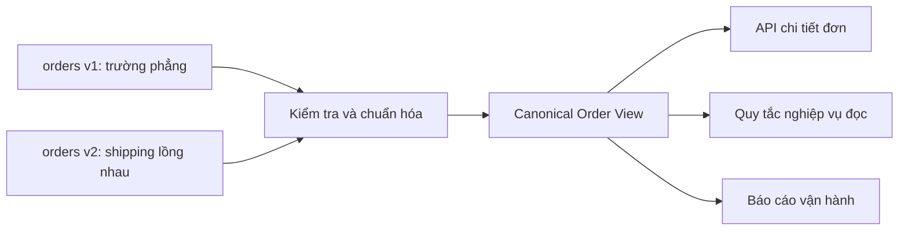

# Tài liệu nhiều phiên bản và quy tắc đọc dữ liệu có cấu trúc khác nhau

## 1. Vì sao một collection lại chứa nhiều cấu trúc tài liệu?

Trong cơ sở dữ liệu tài liệu (*document database*), các bản ghi cùng một collection không nhất thiết phải có mọi trường và kiểu dữ liệu giống nhau. Đây là ưu điểm khi nghiệp vụ thay đổi: một phiên bản phần mềm có thể lưu địa chỉ bằng nhiều trường phẳng, phiên bản mới có thể gom chúng vào đối tượng lồng nhau. Tuy nhiên, dữ liệu cũ không tự biến đổi khi ứng dụng được triển khai.

Ví dụ, hệ thống đơn hàng từng lưu `shippingCity`, sau đó chuyển sang `shipping.city`. Sau đợt phát hành, collection có thể đồng thời chứa **hai hình dạng tài liệu**. Nếu API chỉ biết cấu trúc mới, đơn cũ có thể không hiển thị địa chỉ; nếu tác vụ báo cáo chỉ lọc trường cũ, đơn mới có thể bị bỏ sót.

Bài này thuộc chương **Mô hình tài liệu** trong phạm vi **DATABASE_DATA_MODELING**. Mục tiêu là rèn kỹ năng biến yêu cầu nghiệp vụ thành mô hình dữ liệu có thực thể, quan hệ, ràng buộc, khóa, chỉ mục và lược đồ vật lý rõ ràng; lựa chọn cấu trúc có khả năng tiến hóa và kiểm chứng, đồng thời hiểu sự khác biệt với mô hình quan hệ, đồ thị và phân tích.

Để sử dụng tính linh hoạt một cách có kiểm soát, cần thiết kế hai thứ song song:

- **Hợp đồng cấu trúc:** tài liệu có thể có những phiên bản nào, ý nghĩa của từng trường, những trường bắt buộc hoặc tùy chọn.
- **Hợp đồng đọc:** khi gặp từng phiên bản, ứng dụng nhận diện, kiểm tra, chuyển đổi và trả dữ liệu theo cách nào; nếu không hiểu dữ liệu thì xử lý ra sao.

Sau bài học, bạn có thể:

1. Phân biệt phiên bản schema, phiên bản chỉnh sửa dữ liệu, phiên bản nội dung nghiệp vụ và phiên bản API.
2. Thiết kế bộ đọc hỗ trợ đồng thời tài liệu cũ/mới mà không suy diễn sai dữ kiện.
3. Chuẩn hóa dữ liệu sau đọc vào một mô hình thống nhất cho nghiệp vụ.
4. Truy vấn, đánh chỉ mục và xác thực khi collection chứa nhiều hình dạng dữ liệu.
5. Triển khai nâng cấp theo giai đoạn, di trú có điều kiện, phát hiện bản ghi lỗi và đối soát.
6. Xác định khi nào có thể bỏ hỗ trợ cấu trúc cũ một cách an toàn.

## 2. Ví dụ xuyên suốt: hai phiên bản của tài liệu đơn hàng

Giả sử ứng dụng có collection `orders`. Phiên bản 1 lưu tên người nhận và thành phố bằng trường phẳng:

```json
{
  "_id": "ORD-042",
  "tenantId": "ORG-07",
  "schemaVersion": 1,
  "revision": 4,
  "shippingRecipient": "Nguyen An",
  "shippingCity": "Da Nang",
  "status": "PENDING",
  "totalMinor": 235000,
  "createdAt": "2026-11-18T09:00:00Z"
}
```

Phiên bản 2 gom dữ liệu giao nhận vào một đối tượng:

```json
{
  "_id": "ORD-099",
  "tenantId": "ORG-07",
  "schemaVersion": 2,
  "revision": 1,
  "shipping": {
    "recipientName": "Nguyen B",
    "city": "Ha Noi"
  },
  "status": "PENDING",
  "totalMinor": 89000,
  "createdAt": "2026-11-21T09:00:00Z"
}
```

Các ví dụ dùng mã và tên giả. `totalMinor` biểu diễn số tiền theo đơn vị nguyên đã quy định; ở đây giả định đơn vị là đồng Việt Nam. Dữ liệu minh họa chứa thời gian UTC dạng chuỗi ISO 8601 để dễ đọc. Khi triển khai, cần thống nhất kiểu lưu ngày giờ thực tế mà hệ quản trị hỗ trợ.

Cả hai tài liệu đều hợp lệ **theo hợp đồng tại thời điểm chúng được ghi**. Nhưng trường `shipping.city` không tồn tại ở v1, còn `shippingCity` không tồn tại ở v2. Bộ đọc chỉ dùng:

```javascript
// Ví dụ chưa tương thích với tài liệu v1:
const city = order.shipping.city;
```

sẽ lỗi hoặc thiếu dữ liệu khi đọc đơn v1.

Nếu chương trình chỉ thêm:

```javascript
const city = order.shipping?.city ?? order.shippingCity;
```

thì xử lý được hai trường hợp đơn giản, nhưng **chưa đủ là một hợp đồng đọc**. Nó chưa kiểm tra phiên bản, kiểu dữ liệu, tính hợp lệ, sự mâu thuẫn nếu cả hai trường cùng xuất hiện hay trường hợp tài liệu do phiên bản tương lai tạo ra.

### 2.1. Vì sao không nhất thiết di trú mọi tài liệu ngay?

Hệ thống có thể có hàng triệu đơn, nhiều dịch vụ được triển khai không đồng thời, hoặc dữ liệu lịch sử phải giữ nguyên ngữ nghĩa. Một đợt cập nhật toàn collection có thể tốn tài nguyên, gây xung đột ghi, và khó khôi phục nếu gián đoạn.

Vì vậy, trong một giai đoạn chuyển tiếp:

- Tài liệu v1 tiếp tục tồn tại và **được đọc đúng**.
- Tài liệu mới được ghi ở v2.
- Tài liệu v1 có thể được chuyển dần sang v2 theo chiến lược có kiểm soát.
- Chỉ khi không còn đường đọc/ghi phụ thuộc v1 mới loại bỏ mã tương thích.

Đây là **tiến hóa lược đồ (schema evolution)**, cần thiết kế như một quy trình vận hành thực sự.

## 3. “Phiên bản tài liệu” có nhiều nghĩa khác nhau

Không nên đặt mọi dạng phiên bản vào một trường `version` chung.

| Khái niệm | Mục đích | Ví dụ |
| --- | --- | --- |
| **`schemaVersion`** | Nhận diện hình dạng và ngữ nghĩa của cấu trúc lưu | `1`: địa chỉ phẳng, `2`: địa chỉ lồng nhau |
| **`revision` / `rowVersion`** | Phát hiện ghi cạnh tranh lên một tài liệu | Tăng từ `4` lên `5` sau cập nhật |
| **Phiên bản nội dung nghiệp vụ** | Lưu các bản phát hành/snapshot có ý nghĩa riêng | Bài học phát hành bản 2026.11 |
| **Phiên bản hợp đồng API** | Xác định cấu trúc đầu vào/đầu ra cung cấp cho client | `/api/v1/orders`, `/api/v2/orders` |
| **Phiên bản thông điệp/sự kiện** | Giúp consumer hiểu sự kiện cũ/mới | `OrderConfirmed` schema v1/v2 |
| **Phiên bản tiến trình di trú** | Theo dõi lượt chuyển đổi hoặc checkpoint | Batch số 15 đã xử lý 50.000 đơn |

Một tài liệu có thể mang đồng thời:

```json
{
  "_id": "ORD-099",
  "schemaVersion": 2,
  "revision": 8,
  "status": "CONFIRMED"
}
```

Nếu người dùng sửa `status` trong cùng cấu trúc, `revision` có thể tăng lên 9 trong khi `schemaVersion` **vẫn bằng 2**. Ngược lại, khi chuyển cấu trúc từ v1 sang v2, `schemaVersion` tăng; `revision` cũng có thể cần tăng để các cập nhật dựa trên bản cũ bị phát hiện.

Phiên bản phát hành một bài học hoặc chứng từ lịch sử không phải phiên bản cấu trúc lưu. Có thể có nhiều bản nội dung của cùng một bài **đều dùng schemaVersion 2**.

## 4. Hợp đồng dữ liệu cho từng phiên bản

### 4.1. Ghi rõ trường, kiểu và ngữ nghĩa

Một bản mô tả tối thiểu của `orders`:

| Đặc điểm | Schema v1 | Schema v2 |
| --- | --- | --- |
| `schemaVersion` | `1`, hoặc thiếu ở một tập legacy được xác nhận | Bắt buộc bằng `2` |
| Định danh | `_id` là mã đơn ổn định | Giữ nguyên `_id` |
| Phạm vi truy cập | `tenantId` | Giữ nguyên `tenantId` |
| Tên người nhận | `shippingRecipient`: chuỗi bắt buộc | `shipping.recipientName`: chuỗi bắt buộc |
| Thành phố | `shippingCity`: chuỗi bắt buộc | `shipping.city`: chuỗi bắt buộc |
| Tổng tiền | `totalMinor`: số nguyên không âm | Giữ nguyên ý nghĩa |
| Trạng thái | `status` theo tập hợp quy định | Giữ nguyên ý nghĩa |
| Chỉnh sửa đồng thời | `revision`: số nguyên | Giữ nguyên, tăng khi cập nhật |
| Ngày tạo | `createdAt` theo hợp đồng thời gian | Giữ nguyên ý nghĩa |

Đặt phiên bản cấu trúc theo **nghĩa thực tế** của dữ liệu. Không nhất thiết tăng `schemaVersion` cho mọi lần thêm một trường tùy chọn tương thích; nhưng nếu đổi kiểu, đổi nghĩa hoặc khiến bộ đọc cũ hiểu sai, cần cơ chế phân biệt rõ, có thể là phiên bản mới.

### 4.2. Kiểu dữ liệu quan trọng không kém tên trường

Thay đổi nguy hiểm không chỉ là đổi:

```text
shippingCity         -> shipping.city
```

mà còn có thể là:

```text
total: 235000.0      -> totalMinor: 235000
createdAt: "..."     -> createdAt: kiểu Date thực
completed: true      -> state: "COMPLETED"
userIds: ["..."]     -> members: [{ userId, role }]
```

Chuyển kiểu có thể **không bảo toàn thông tin**. Ví dụ, `completed: true` không nói chính xác bài học được hoàn tất lúc nào; không được mặc định `completedAt = updatedAt` khi `updatedAt` chỉ là thời điểm sửa hồ sơ lần cuối.

Khi không thể suy ra dữ kiện mới từ dữ kiện cũ, phải chọn một trong các cách rõ ràng:

- Cho phép trường mới vắng mặt hoặc giá trị “chưa biết” theo hợp đồng.
- Lấy thông tin từ một nguồn có thẩm quyền khác.
- Yêu cầu nghiệp vụ bổ sung hoặc xác nhận thủ công.
- Giữ một nhánh xử lý dữ liệu lịch sử với ngữ nghĩa riêng.

**Không được bịa dữ liệu** chỉ để mọi bản ghi khớp hình dạng mới.

### 4.3. Vắng mặt, null, rỗng và không hợp lệ là bốn trường hợp khác nhau

```jsonc
{}                          // Không có trường shipping
{"shipping": null}          // Có trường nhưng giá trị null
{"shipping": {}}            // Đối tượng rỗng
{"shipping": {"city": 42}}  // Sai kiểu theo hợp đồng
```

Bộ đọc không nên xử lý tất cả bằng một giá trị mặc định giống nhau. Có những trường hợp được phép vắng mặt, chẳng hạn `deliveryInstructions` tùy chọn; nhưng `tenantId` hoặc số tiền giao dịch thường không được tự điền để tránh đọc sai hoặc vượt quyền.

Khi dữ liệu được phép `null`, phải định nghĩa nó là **chưa biết**, **không áp dụng** hay **đã bị xóa**. Các ý nghĩa đó khác nhau và có thể ảnh hưởng báo cáo, quyền riêng tư và API.

## 5. Tương thích ngược, tương thích xuôi và ma trận reader/writer

**Tương thích ngược (backward compatibility)** trong bối cảnh này thường nghĩa là **bộ đọc mới có thể hiểu tài liệu do bộ ghi cũ tạo ra**. **Tương thích xuôi (forward compatibility)** nghĩa là **bộ đọc cũ có thể xử lý tài liệu từ bộ ghi mới**, ít nhất trong phạm vi đã thỏa thuận. Hai khả năng không tự xuất hiện cùng nhau.

| Bộ đọc | Tài liệu v1 | Tài liệu v2 |
| --- | --- | --- |
| Reader v1 chỉ biết trường phẳng | Đọc được | Có thể lỗi hoặc thiếu địa chỉ |
| Reader v2 chỉ biết đối tượng `shipping` | Có thể lỗi hoặc thiếu địa chỉ | Đọc được |
| Reader chuyển tiếp hỗ trợ v1 + v2 | Đọc và chuẩn hóa v1 | Đọc và chuẩn hóa v2 |

Một chuỗi triển khai an toàn thường theo nguyên tắc **mở rộng khả năng đọc trước khi thay đổi đường ghi**:

1. Đưa reader hiểu cả v1 và v2 vào các dịch vụ có liên quan.
2. Xác minh các phiên bản ứng dụng cũ còn chạy ở đâu.
3. Chuyển writer sang tạo v2.
4. Di trú dữ liệu cũ khi phù hợp.
5. Chỉ loại bỏ khả năng đọc v1 sau khi không còn dữ liệu/đường truy cập v1.

Nếu một ứng dụng cũ vẫn ghi v1 sau khi di trú, số tài liệu v1 có thể tăng trở lại. Do đó **thứ tự triển khai writer và reader quan trọng ngang với mã di trú**.

### 5.1. Thay đổi thường dễ tương thích và thay đổi phá vỡ

| Thay đổi | Rủi ro đối với reader cũ | Biện pháp |
| --- | --- | --- |
| Thêm trường tùy chọn có ngữ nghĩa rõ | Thường thấp nếu reader bỏ qua trường lạ | Kiểm tra validator và serializer |
| Đổi tên trường | Cao | Dual-read hoặc chuyển đổi khi đọc |
| Đổi kiểu trường | Cao | Phiên bản hóa và chuyển đổi kiểu có kiểm chứng |
| Đổi ý nghĩa giá trị enum | Cao, có thể nguy hiểm | Bảng mapping nghiệp vụ, không suy diễn theo tên |
| Chia một tài liệu thành nhiều tài liệu | Cao | Thiết kế adapter truy cập và di trú khóa |
| Đổi từ mảng sang đối tượng khóa động | Cao | Xác định rõ trùng lặp/thứ tự và index |
| Đổi đơn vị tiền hoặc thời gian | Rất cao | Quy tắc chuyển đổi có thẩm quyền và kiểm thử |
| Thêm trường bắt buộc | Cao với tài liệu cũ | Backfill, schema mới hoặc nullable có điều kiện |

Sự tương thích cũng phụ thuộc cơ chế deserialize của ứng dụng: một số thư viện bỏ qua trường chưa biết; một số chế độ strict sẽ báo lỗi. Cần kiểm thử **thư viện và cấu hình thực tế**, không suy đoán.

## 6. Đọc nhiều phiên bản bằng bộ chuẩn hóa có kiểm soát

### 6.1. Ý tưởng: một đầu vào nhiều dạng, một đầu ra nhất quán

Nên tập trung logic tương thích ở **lớp truy cập dữ liệu (repository/adapter)** hoặc một lớp chuyển đổi chuyên trách. Các phần nghiệp vụ phía trên nhận một mô hình thống nhất.



Đích chuẩn hóa có thể là một DTO/API model. **Nó không bắt buộc là hình dạng ghi vật lý**. Chuyển dữ liệu cho việc đọc không đồng nghĩa tự sửa tài liệu trong cơ sở dữ liệu.

### 6.2. Ví dụ JavaScript: phát hiện phiên bản, kiểm tra rồi chuyển đổi

Ví dụ sau trình bày nguyên tắc, không phụ thuộc framework hay driver. Chỉ suy ra v1 khi `schemaVersion` **vắng mặt thật sự** và quy định lịch sử đã xác nhận các tài liệu legacy không có trường này đều thuộc v1.

```javascript
class SchemaReadError extends Error {}

function requiredNonEmptyString(value, field) {
  if (typeof value !== "string" || value.trim() === "") {
    throw new SchemaReadError("Invalid " + field);
  }
  return value;
}

function requiredMinorAmount(value) {
  if (!Number.isSafeInteger(value) || value < 0) {
    throw new SchemaReadError("Invalid totalMinor");
  }
  return value;
}

function getSchemaVersion(raw) {
  if (raw.schemaVersion === undefined) {
    // Chỉ hợp lệ khi dữ liệu legacy thiếu trường đã được xác minh là v1.
    return 1;
  }
  if (!Number.isInteger(raw.schemaVersion)) {
    throw new SchemaReadError("Invalid schemaVersion");
  }
  return raw.schemaVersion;
}

function normalizeOrderForRead(raw) {
  if (raw === null || typeof raw !== "object" || Array.isArray(raw)) {
    throw new SchemaReadError("Invalid document");
  }

  const version = getSchemaVersion(raw);
  let shipping;

  if (version === 1) {
    shipping = {
      recipientName: requiredNonEmptyString(
        raw.shippingRecipient, "shippingRecipient"
      ),
      city: requiredNonEmptyString(raw.shippingCity, "shippingCity")
    };
  } else if (version === 2) {
    if (
      raw.shipping === null ||
      typeof raw.shipping !== "object" ||
      Array.isArray(raw.shipping)
    ) {
      throw new SchemaReadError("Invalid shipping");
    }
    shipping = {
      recipientName: requiredNonEmptyString(
        raw.shipping.recipientName, "shipping.recipientName"
      ),
      city: requiredNonEmptyString(
        raw.shipping.city, "shipping.city"
      )
    };
  } else {
    // Không tự giả định phiên bản tương lai có cấu trúc giống v2.
    throw new SchemaReadError("Unsupported schemaVersion " + version);
  }

  return {
    orderId: requiredNonEmptyString(raw._id, "_id"),
    tenantId: requiredNonEmptyString(raw.tenantId, "tenantId"),
    shipping,
    status: requiredNonEmptyString(raw.status, "status"),
    totalMinor: requiredMinorAmount(raw.totalMinor),
    createdAt: requiredNonEmptyString(raw.createdAt, "createdAt"),
    sourceSchemaVersion: version
  };
}
```

Ví dụ cố ý **không bịa địa chỉ, tiền hoặc trạng thái** khi trường bắt buộc sai. Trong sản phẩm thật còn cần kiểm tra:

- Tập trạng thái hợp lệ và chuyển trạng thái nghiệp vụ.
- Định dạng/kiểu `createdAt` và quy ước múi giờ.
- Kiểu `_id` thực tế (không phải collection nào cũng dùng chuỗi).
- Quyền tenant/role được kiểm tra trước khi trả dữ liệu.
- Trường bổ sung bắt buộc theo hợp đồng của từng phiên bản.
- Lỗi dữ liệu: có cảnh báo, metric, xử lý đối soát và thông báo lỗi phù hợp hay không.

### 6.3. Ví dụ khi gọi repository

```javascript
async function getOrderDetail(db, tenantId, orderId) {
  // Bộ lọc tenant được áp dụng ở nguồn đọc.
  const raw = await db.collection("orders").findOne({
    _id: orderId,
    tenantId
  });

  if (!raw) return null;

  const normalized = normalizeOrderForRead(raw);
  // Cần kiểm tra quyền thực tế theo ngữ cảnh người gọi.
  return normalized;
}
```

Bộ chuẩn hóa trả cùng cấu trúc `shipping.recipientName` và `shipping.city` cho cả hai phiên bản. Controller không cần rải các câu `if (schemaVersion === 1)` ở nhiều màn hình.

**Giới hạn:** đây chỉ là minh họa xử lý kiểu chuỗi. Nếu triển khai dùng `ObjectId`, kiểu `Date`, decimal hoặc tiền tệ nhiều đơn vị, cần chuyển đổi với validation đúng. Không nên tùy tiện dùng `Number(...)` để ép tiền ở dạng chuỗi hoặc kiểu số không chính xác.

### 6.4. Cần xử lý mâu thuẫn khi tài liệu có cả hai dạng

Giả sử một tài liệu v2 vô tình chứa:

```json
{
  "schemaVersion": 2,
  "shippingCity": "Da Nang",
  "shipping": { "city": "Ha Noi", "recipientName": "Nguyen An" }
}
```

Nếu reader dùng toán tử “lấy trường nào không rỗng trước”, giá trị có thể phụ thuộc thứ tự lập trình và che giấu dữ liệu hỏng.

Hợp đồng nên chỉ rõ:

- Với v2, `shipping.city` là trường có thẩm quyền; trường legacy không được dùng.
- Nếu hai trường cùng tồn tại, có thể ghi cảnh báo/đưa vào danh sách đối soát.
- Nếu mức rủi ro cao, từ chối thao tác thay đổi quan trọng cho tới khi dữ liệu được làm sạch.
- Không tự chọn giá trị tùy tiện đối với địa chỉ, tiền hoặc quyền truy cập.

## 7. Thiết kế quy tắc đọc: fallback có điều kiện, không “đoán cho chạy”

Một bộ đọc tốt có quy tắc tường minh cho mỗi loại tình huống:

| Tình huống | Hành vi nên quy định |
| --- | --- |
| Phiên bản được hỗ trợ và dữ liệu hợp lệ | Chuẩn hóa, trả kết quả |
| Phiên bản legacy được xác nhận nhưng thiếu `schemaVersion` | Áp dụng đúng bộ chuyển đổi legacy, có theo dõi |
| `schemaVersion: null` hoặc kiểu sai | Báo dữ liệu không hợp lệ; không mặc nhiên gán v1 |
| Phiên bản tương lai chưa hỗ trợ | Báo không tương thích hoặc chuyển đường xử lý được thiết kế |
| Trường tùy chọn bị thiếu | Dùng ngữ nghĩa “không có” theo hợp đồng, không tự bịa giá trị |
| Trường bắt buộc bị thiếu/sai kiểu | Không trả dữ liệu giả; báo lỗi/đối soát |
| Hai trường cũ và mới mâu thuẫn | Ưu tiên nguồn quy định bởi schema; ghi nhận sai lệch |
| Dữ liệu nhạy cảm bị chuyển đổi | Bảo vệ phân quyền và quy định giữ/xóa bản sao |
| Trường thời gian hoặc tiền đổi đơn vị | Chuyển đổi theo quy tắc có thẩm quyền; kiểm tra tính toàn vẹn |

### 7.1. Khi nào được đặt giá trị mặc định?

Giá trị mặc định phù hợp nếu **ngữ nghĩa đã được định nghĩa**. Ví dụ một trường tùy chọn như `tags` có thể mặc định thành mảng rỗng nếu cả yêu cầu nghiệp vụ và dữ liệu legacy đều xác nhận “không có thẻ” tương đương mảng rỗng.

Ngược lại:

- `discountMinor` vắng mặt không chắc luôn bằng 0 nếu hệ cũ từng lưu giảm giá ở nơi khác.
- `completedAt` vắng mặt không thể suy ra từ `updatedAt`.
- `tenantId` vắng mặt không được tự suy ra từ client đang đăng nhập để đọc một tài liệu không rõ chủ sở hữu.
- Trạng thái `UNKNOWN` không nên âm thầm được coi là `APPROVED`.

**Giá trị mặc định là một quyết định nghiệp vụ và hợp đồng dữ liệu**, không phải mẹo tránh lỗi `null`.

### 7.2. Không nhầm cấu trúc được hỗ trợ với dữ liệu có thể tin cậy

Một tài liệu có `schemaVersion: 2` nhưng thiếu `shipping.city` vẫn không hợp lệ theo hợp đồng v2. Không nên xem số phiên bản như bằng chứng rằng mọi trường đã đúng; validation phải dựa trên **nội dung thực**.

## 8. Truy vấn khi tên trường thay đổi qua phiên bản

Chuẩn hóa trong ứng dụng chỉ có ích **sau khi truy vấn đã tìm được tài liệu**. Nếu truy vấn chỉ lọc theo đường dẫn mới, một phần tài liệu cũ sẽ bị loại ngay tại database.

Ví dụ cần tìm đơn giao tới thành phố `Da Nang` của tổ chức `ORG-07`.

Truy vấn chỉ phù hợp v2:

```javascript
db.orders.find({
  tenantId: "ORG-07",
  "shipping.city": "Da Nang"
});
```

Tài liệu v1 có `shippingCity` sẽ không khớp. Trong giai đoạn hai schema cùng tồn tại, cần xử lý hình dạng truy vấn ở **mức cơ sở dữ liệu** hoặc một mô hình đọc đã chuẩn hóa.

### 8.1. Dual-query theo phiên bản

Ví dụ MongoDB, với hợp đồng cho phép v1 có `schemaVersion: 1` hoặc thiếu trường:

```javascript
db.orders.find({
  tenantId: "ORG-07",
  $or: [
    { schemaVersion: 1, shippingCity: "Da Nang" },
    { schemaVersion: { $exists: false }, shippingCity: "Da Nang" },
    { schemaVersion: 2, "shipping.city": "Da Nang" }
  ]
});
```

Đây là chiến lược **chuyển tiếp**; nên có kế hoạch bỏ các nhánh legacy sau di trú. Khi có nhiều phiên bản và nhiều trường đổi, số nhánh truy vấn có thể tăng nhanh và khó tối ưu.

Quan trọng: **không lấy 20 tài liệu rồi mới lọc thành phố trong ứng dụng** nếu mong muốn phân trang chính xác trên toàn tập. Khi lọc sau limit, trang kết quả có thể thiếu hoặc bỏ sót các tài liệu đáng lẽ phải xuất hiện.

### 8.2. Chỉ mục trong giai đoạn hỗn hợp

Hai đường lọc khác nhau có thể cần hai chỉ mục khác nhau:

```javascript
// Đường lọc cho tài liệu v1.
db.orders.createIndex({ tenantId: 1, shippingCity: 1 });

// Đường lọc cho tài liệu v2.
db.orders.createIndex({ tenantId: 1, "shipping.city": 1 });
```

Hệ quản trị có thể có cơ chế chỉ mục có điều kiện hoặc tối ưu khác, nhưng lựa chọn cụ thể cần đo bằng kế hoạch thực thi. Chỉ mục legacy có thể gỡ **sau** khi không còn truy vấn và tài liệu cần dùng nó.

Các chỉ mục phát sinh trong giai đoạn chuyển tiếp gây thêm chi phí lưu trữ/ghi. Đây là một trong các lý do để hoàn tất di trú thay vì giữ mọi hình dạng mãi mãi.

### 8.3. Một projection chuẩn hóa có thể đơn giản hóa truy vấn

Nếu các truy vấn phức tạp đòi lọc/sắp xếp trên nhiều trường đã đổi, có thể cân nhắc:

- Di trú tài liệu vật lý sớm hơn.
- Dựng mô hình đọc/materialized view chỉ dùng một schema hiện hành.
- Tạo trường dẫn xuất thống nhất để tìm kiếm, có nguồn và quy tắc cập nhật rõ.
- Tách báo cáo phân tích khỏi đường truy vấn giao dịch khi tải lớn.

Nhưng tạo bản sao đọc mới mang theo nghĩa vụ đồng bộ, idempotency, đối soát và phân quyền. Không chỉ thêm bản sao rồi cho rằng mọi vấn đề đã biến mất.

## 9. Chọn chiến lược tiến hóa: đọc tương thích, di trú ngay hay chuyển lười

| Chiến lược | Mô tả | Ưu điểm | Rủi ro / điều kiện |
| --- | --- | --- | --- |
| **Dual-read, single-write** | Reader hiểu v1/v2, writer chỉ tạo v2 | Triển khai theo từng giai đoạn, giới hạn biến thể mới | Phải duy trì mã tương thích và query logic |
| **Eager migration** | Chuyển một lượng lớn dữ liệu cũ theo lô | Có thể sớm thống nhất schema | Tải di trú, xung đột ghi, khó chạy lại nếu thiếu điều kiện |
| **Lazy migration** | Khi gặp tài liệu cũ, chuyển đổi có kiểm soát | Phân bổ công việc theo nhu cầu đọc | Tài liệu hiếm được đọc có thể vẫn cũ; tác dụng phụ khi đọc |
| **Read repair** | Đọc xong mới ghi lại cấu trúc mới | Có thể giảm dần dữ liệu cũ | Cần quyền, CAS, xử lý lỗi; đọc không còn thuần read-only |
| **Dual-write** | Ghi cả hai dạng một thời gian | Hỗ trợ reader cũ trong chuyển tiếp | Có thể lệch, nhân đôi đường ghi, cần nguồn thẩm quyền |
| **Projection/adapter** | Dùng lớp chuyển đổi hoặc mô hình đọc thống nhất | Tách ứng dụng khỏi cấu trúc vật lý | Thêm chi phí đồng bộ, vận hành hoặc truy vấn |
| **Versioned immutable records** | Giữ nhiều bản nội dung lịch sử có schema riêng | Bảo toàn chứng từ/bản phát hành | Tăng dữ liệu và cần quy tắc chọn phiên bản hiệu lực |

**Dual-read, single-write** thường là điểm xuất phát dễ kiểm soát: mã đọc chấp nhận các phiên bản đã biết, còn dữ liệu mới chỉ được ghi theo một cấu trúc chính thức. Nếu bắt buộc tiếp tục hỗ trợ writer cũ, phải mô tả rõ thời hạn và cơ chế bảo vệ khỏi việc v1 quay trở lại sau di trú.

### 9.1. Khi nào không nên tự động nâng schema lúc đọc?

Một API đọc chỉ được cấp quyền xem, nhưng nếu tự “repair” tài liệu ngay khi `findOne`, nó trở thành đường ghi với các hệ quả:

- Có thể gây xung đột với một tiến trình đang cập nhật đơn.
- Làm thay đổi chỉ mục hoặc tăng phiên bản một cách không mong đợi.
- Tăng độ trễ của yêu cầu đọc và gây lỗi dù việc đọc dữ liệu cũ vẫn hợp lệ.
- Yêu cầu quyền ghi mà lớp đọc không nên có.
- Có thể phá tính toàn vẹn chứng từ cần giữ nguyên dạng lưu lịch sử.

Nếu dùng read repair, cần biến nó thành một cơ chế **được thiết kế chủ động**, có cập nhật có điều kiện, quan sát và lộ trình xử lý lỗi. Đối với dữ liệu lịch sử nhạy cảm, có thể chọn chỉ chuẩn hóa trong bộ nhớ và để một tác vụ di trú riêng xử lý.

## 10. Quy trình chuyển đổi nhiều giai đoạn không gián đoạn

Giả sử mục tiêu là chuyển toàn bộ `orders` từ v1 sang v2.

### Giai đoạn 1 — Kiểm kê dữ liệu và rủi ro

- Xác định số lượng tài liệu từng phiên bản, tài liệu thiếu trường phiên bản và trường hợp không hợp lệ.
- Kiểm tra truy vấn/ứng dụng/job nào vẫn sử dụng `shippingCity` hoặc `shippingRecipient`.
- Xác định liệu các trường cũ có thể chuyển đổi **đầy đủ, không mất nghĩa** hay không.
- Đo kích thước collection, tải ghi, index hiện tại và dự báo chi phí backfill.
- Xác định các bản ghi cần giữ nguyên dữ liệu gốc vì yêu cầu lịch sử/chứng từ.

Ví dụ MongoDB để thống kê sơ bộ:

```javascript
db.orders.aggregate([
  {
    $group: {
      _id: "$schemaVersion",
      count: { $sum: 1 }
    }
  }
]);
```

Kết quả cần được diễn giải cẩn thận: tài liệu không có trường và tài liệu có `null` có thể cùng hiển thị dưới một nhóm tùy biểu thức; để đo dữ liệu sai/thiếu phải có truy vấn kiểm tra riêng. Không coi “thiếu phiên bản” là v1 nếu dữ liệu lịch sử chưa xác nhận điều đó.

### Giai đoạn 2 — Mở rộng bộ đọc

Triển khai code đọc và chuẩn hóa v1/v2 trước. Chạy kiểm tra với tài liệu v1 thường gặp, tài liệu thiếu trường, `null`, sai kiểu và phiên bản chưa hỗ trợ.

Trong giai đoạn này, **đừng đổi đột ngột ý nghĩa của trường cũ** nếu còn reader chưa được nâng cấp.

### Giai đoạn 3 — Chuyển writer sang schema v2

Mọi thao tác tạo đơn mới phải ghi v2. Mọi thao tác cập nhật đơn cũ phải dùng một trong hai quy tắc rõ ràng:

- Cập nhật trường giữ nguyên ở schema cũ, để job di trú chuyển về sau.
- Hoặc chuyển v1 sang v2 **nguyên tử trong chính lần ghi** nếu ngữ nghĩa và hỗ trợ hệ lưu trữ cho phép.

Không nên để một số writer tạo v1, số khác tạo v2 mà không có kế hoạch kết thúc giai đoạn chuyển tiếp.

### Giai đoạn 4 — Backfill v1 thành v2 theo lô

Đọc một batch nhỏ, chuyển đổi theo hợp đồng và cập nhật có điều kiện. Dừng hoặc giảm tốc nếu độ trễ/độ tranh chấp tăng.

Nên dùng checkpoint hoặc danh sách khóa để theo dõi tiến độ, nhưng **checkpoint không phải bằng chứng toàn bộ batch đã đúng**; cần kiểm tra kết quả ghi và đối soát.

### Giai đoạn 5 — Đối soát, quan sát và khóa đường ghi cũ

- Kiểm tra còn bao nhiêu v1 và vì sao.
- Kiểm tra các trường có giá trị tương đương trước/sau di trú.
- Đảm bảo không còn phiên bản ứng dụng cũ tạo v1.
- Kiểm tra truy vấn trên bộ dữ liệu hỗn hợp và sau di trú.
- Xác nhận lỗi đọc và thời gian đáp ứng ổn định.
- Chuyển dần validation sang ghi v2, có ngoại lệ được kiểm soát nếu cần.

### Giai đoạn 6 — Thu gọn hỗ trợ legacy

Chỉ khi có bằng chứng rằng tất cả nguồn tạo tài liệu và các đường đọc cần thiết đã tương thích:

- Bỏ nhánh dual-read v1 theo lịch phát hành.
- Gỡ truy vấn và chỉ mục phụ thuộc trường v1.
- Loại bỏ mã serializer/adapter cũ không còn dùng.
- Cập nhật hợp đồng dữ liệu và tài liệu kiến trúc.

Không nên xóa nhánh đọc cũ chỉ vì **một lần** thống kê thấy số tài liệu v1 bằng 0; phải kiểm tra dữ liệu được phục hồi từ backup, job định kỳ, client cũ hoặc luồng nhập dữ liệu ngoài.

## 11. Backfill an toàn: ghi có điều kiện, idempotency và bảo toàn dữ liệu

### 11.1. Ví dụ chuyển v1 thành v2 trên một tài liệu

Giả sử `revision` tồn tại ở v1. Để chuyển một tài liệu v1, tác vụ đọc tài liệu và áp dụng:

```javascript
function migrateV1Order(db, oldOrder) {
  if (oldOrder.schemaVersion !== 1) {
    throw new Error("Expected schemaVersion 1");
  }

  // Validation trước khi thay đổi dữ liệu.
  const normalized = normalizeOrderForRead(oldOrder);

  // MongoDB: thay đổi các trường trong một tài liệu.
  // Chỉ cập nhật nếu tài liệu vẫn ở schema và revision đã đọc.
  return db.collection("orders").updateOne(
    {
      _id: oldOrder._id,
      tenantId: oldOrder.tenantId,
      schemaVersion: 1,
      revision: oldOrder.revision
    },
    {
      $set: {
        schemaVersion: 2,
        shipping: normalized.shipping
      },
      $unset: {
        shippingRecipient: "",
        shippingCity: ""
      },
      $inc: { revision: 1 }
    }
  );
}
```

**Phân tích:**

- Tên/địa chỉ được chuyển đổi theo quy tắc rõ, không biến đổi tổng tiền hay trạng thái.
- Bộ lọc `schemaVersion` và `revision` phát hiện tài liệu đã được thay đổi bởi tiến trình khác.
- Một thao tác cập nhật tài liệu chứa việc đặt schema mới, ghi trường mới, bỏ trường cũ và tăng `revision` theo semantics nguyên tử cấp tài liệu của MongoDB.
- Nếu kết quả không khớp tài liệu, job phải đọc lại và phân loại; không tự ghi đè từ snapshot cũ.
- Nếu job chạy lại khi tài liệu đã ở v2, cần bỏ qua hoặc xác nhận trạng thái, không chuyển đổi lần nữa.
- Nếu có legacy v1 **thiếu** `schemaVersion`, phải có nhánh backfill riêng với điều kiện `{$exists: false}` đã được xác thực. Đừng sửa ngầm điều kiện cập nhật cho mọi bản ghi.

Mẫu trên là **ví dụ logic**, chưa bao gồm cơ chế phân lô, thống kê, đóng/khởi động lại job, kiểm soát tốc độ hay quyền truy cập. Bộ chuẩn hóa ví dụ ở phần 6 yêu cầu `_id` là chuỗi; hệ thống dùng kiểu khác phải điều chỉnh.

### 11.2. Vì sao không chỉ dùng “update mọi tài liệu”?

Nếu lệnh chuyển đổi giả định mọi bản ghi đều có `shippingCity`, nó có thể ghi giá trị rỗng hoặc làm mất thông tin với bản ghi không hợp lệ. Nếu chạy nhiều giờ trong lúc hệ thống vẫn ghi, kết quả đọc trước và ghi sau có thể đã lỗi thời.

Cần xác định rõ:

- Batch size và giới hạn tài nguyên/độ trễ.
- Định danh tập bản ghi cần di trú.
- Điều kiện cập nhật chống ghi đè.
- Cơ chế retry cho lỗi tạm thời.
- Nhật ký bản ghi không thể chuyển đổi tự động.
- Checkpoint đủ an toàn khi chạy lại.
- Cách đo và dừng khi xuất hiện nhiều xung đột.
- Kế hoạch sao lưu/phục hồi phù hợp dữ liệu quan trọng.

### 11.3. Idempotency trong di trú

Một job có thể bị khởi chạy lại sau khi mất mạng. Một bước di trú được xem là an toàn khi lặp lại theo cùng dữ liệu đầu vào không tạo thêm tác động sai như tăng tổng tiền, thêm dòng hàng hai lần hoặc phát lại thông báo thanh toán.

Cách làm thường là đặt **phiên bản đích**, dùng cập nhật có điều kiện và kiểm tra kết quả. Không tăng `revision` vô hạn với mỗi lần job được chạy lại trên tài liệu đã chuyển xong.

**Di trú schema không được thực thi side effect nghiệp vụ** như gửi lại email xác nhận đơn, trừ khi đó là một tác vụ được thiết kế riêng với idempotency thích hợp.

## 12. Validation và chỉ mục khi nhiều phiên bản cùng tồn tại

### 12.1. Validation cần biết giai đoạn chuyển tiếp

Nếu ngày đầu lập tức đổi validator của collection thành “mọi tài liệu bắt buộc có `shipping.recipientName`”, các tài liệu v1 đang được cập nhật trạng thái có thể không còn hợp lệ với bộ validator đó.

Một chiến lược có thể gồm:

1. Cho phép các schema cũ/mới **đã được liệt kê** trong giai đoạn chuyển tiếp, với ràng buộc tương ứng từng phiên bản.
2. Buộc writer mới tạo v2 ở lớp ứng dụng và đường ghi được kiểm soát.
3. Di trú v1, xử lý bản ghi không hợp lệ.
4. Siết validator khi không còn đường ghi/đọc bắt buộc hỗ trợ v1.

Một số hệ quản trị có validation mức collection và tùy chọn áp dụng khác nhau cho insert/update; cần kiểm tra chính xác sản phẩm/phiên bản. **Validator ở database** không thay thế kiểm tra bất biến nghiệp vụ hoặc xác thực quyền truy cập.

### 12.2. Chỉ mục có vòng đời riêng

Trong giai đoạn chuyển `shippingCity` sang `shipping.city`, có thể cần duy trì cả hai chỉ mục, nhưng không nhất thiết mãi mãi. Việc xây và bỏ chỉ mục trên collection lớn có thể ảnh hưởng tài nguyên, nên đưa vào kế hoạch phát hành và đo workload.

Cũng cần xét trường lồng nhau và mảng:

- V1 lưu `tags` là chuỗi phân tách dấu phẩy, v2 thành mảng chuỗi: không thể luôn truy vấn như một tập giá trị.
- V1 lưu địa chỉ dạng chuỗi, v2 thành đối tượng: không phải mọi dữ liệu cũ đều có thể phân tách chính xác.
- V1 lưu `members` là mảng ID, v2 thành mảng đối tượng: điều kiện trên nhiều thuộc tính có thể cần semantics “cùng phần tử”.

Không nên cho rằng “chỉ cần chỉ mục trên trường mới” là bộ lọc sẽ bao phủ mọi phiên bản.

### 12.3. Thêm phiên bản cấu trúc không thay thế chỉ mục

`schemaVersion` giúp định tuyến chuyển đổi nhưng không tự giúp truy vấn theo `tenantId`, thời gian, trạng thái hoặc địa chỉ nhanh hơn. Thiết kế chỉ mục vẫn phải xuất phát từ **query shape**, dữ liệu thật và sắp xếp.

## 13. Những vấn đề về nhất quán, hiệu năng và bảo mật

### 13.1. Dữ liệu đã chuẩn hóa có thể tạo ra bất biến mới

Giả sử v1 cho phép `status` bất kỳ, còn v2 chỉ cho phép `PENDING`, `CONFIRMED`, `CANCELLED`. Nếu dữ liệu cũ có `PAID_AND_SHIPPED`, không được tự chọn ngẫu nhiên một trạng thái mới.

Cần quy tắc chuyển trạng thái có thẩm quyền, có thể phụ thuộc bản ghi thanh toán và giao hàng. Nếu không chuyển được, lưu lại để xử lý ngoại lệ hoặc giữ nhánh legacy rõ ràng.

Khi đọc dữ liệu lịch sử phục vụ chứng từ, bộ chuẩn hóa phải **bảo toàn ngữ nghĩa gốc**, không chỉ “làm đẹp” cấu trúc.

### 13.2. Chi phí đọc nhiều phiên bản

Bộ chuyển đổi khi đọc có thể tốn CPU/độ trễ; dual-query và chỉ mục tạm tăng công việc của database. Nếu tỷ lệ tài liệu v1 rất nhỏ, chi phí có thể chấp nhận được. Nếu mỗi yêu cầu cần phối hợp hàng nghìn tài liệu nhiều phiên bản, cần đo và cân nhắc backfill hoặc mô hình đọc thống nhất.

Theo dõi:

- Tỷ lệ đọc mỗi phiên bản.
- Độ trễ p95/p99 của đường đọc.
- Số lần chuyển đổi thất bại, thiếu trường, sai kiểu.
- Số lượng tài liệu cũ theo thời gian và theo tenant.
- Query plan của từng nhánh schema.
- Dung lượng/chí phí duy trì chỉ mục chuyển tiếp.
- Xung đột cập nhật của job di trú với traffic thật.

### 13.3. Phân quyền và dữ liệu nhạy cảm không được “đoán”

Đặc biệt nguy hiểm khi một phiên bản cũ thiếu `tenantId`, `visibility` hoặc thông tin xác định quyền sở hữu. Nếu bộ đọc tự điền tenant hiện tại cho tài liệu chưa rõ nguồn, có thể dẫn đến lộ dữ liệu.

Quy tắc an toàn:

- Áp dụng phạm vi truy cập trước hoặc trong truy vấn tới nguồn dữ liệu có thẩm quyền.
- Không coi tài liệu thiếu thông tin phân quyền là công khai.
- Phân biệt trường vắng mặt do schema cũ đã được xác nhận với dữ liệu bị hỏng.
- Khi di trú, không tự phát sinh quyền truy cập rộng hơn.
- Bảo vệ bản sao tạm, log lỗi và dữ liệu trong quá trình backfill theo chính sách tương ứng.

### 13.4. Xóa và giữ dữ liệu lịch sử

Một tài liệu nhiều phiên bản vẫn phải tuân theo chính sách lưu trữ, xóa và kiểm toán. Nếu trường nhạy cảm được đổi từ `customerPhone` sang `shipping.phone`, việc chỉ xóa trường mới trên v2 sẽ bỏ sót bản sao v1.

Cần kiểm kê cả tên trường và đường dẫn cũ, dữ liệu dẫn xuất, backup hoặc hệ phân tích nếu thuộc phạm vi xử lý. Không nên cho phép schema evolution tạo “lỗ hổng” trong chính sách quản trị dữ liệu.

## 14. Kiểm thử reader/writer theo ma trận phiên bản

Một bộ kiểm thử chỉ tạo tài liệu v2 rồi đọc lại v2 **không kiểm chứng được** khả năng tương thích.

Ma trận kiểm thử tối thiểu:

| Dữ liệu đầu vào | Kỳ vọng |
| --- | --- |
| V1 hợp lệ, `schemaVersion: 1` | Chuẩn hóa sang canonical view |
| V1 hợp lệ, thiếu version theo hợp đồng legacy | Chuẩn hóa có kiểm soát |
| V2 hợp lệ | Đọc trực tiếp và chuẩn hóa nhất quán |
| `schemaVersion: null` | Báo dữ liệu sai, không tự xem là v1 |
| `schemaVersion: 99` | Báo phiên bản chưa hỗ trợ |
| V1 thiếu `shippingCity` | Báo lỗi/đối soát, không điền thành phố giả |
| V2 `shipping: null` | Báo dữ liệu sai |
| V2 có cả trường cũ và mới mâu thuẫn | Theo nguồn chuẩn v2, ghi nhận sai lệch |
| `totalMinor` là chuỗi hoặc số không hợp lệ | Không ép kiểu âm thầm |
| V1 đang được sửa trong lúc backfill | CAS thất bại an toàn, đọc lại |
| Job di trú chạy lại | Không nhân đôi tác động |
| Writer cũ ghi v1 sau khi bật v2 | Bị chặn hoặc phát hiện bằng metric |
| Dữ liệu thiếu tenant/visibility bắt buộc | Không trả dữ liệu ngoài quyền |

### 14.1. Kiểm thử về đặc tính nghiệp vụ

Ngoài kiểm thử chuyển đổi trường, cần đảm bảo:

- Tổng tiền và trạng thái của đơn trước/sau migration tương đương.
- Địa chỉ được trả chính xác dù tên trường khác nhau.
- API không vô tình thay giá trị `null`/rỗng thành dữ kiện giả.
- Danh sách tìm kiếm/trang kết quả vẫn chứa cả v1/v2.
- Phân trang ổn định khi dữ liệu cũ/mới xen kẽ.
- Ràng buộc định danh/khóa không thay đổi ngoài ý muốn.
- Người dùng không thấy dữ liệu của tenant khác.

### 14.2. Kiểm thử hiệu năng và lỗi vận hành

Tạo dữ liệu v1/v2 trộn theo tỷ lệ đại diện, không chỉ 50/50 theo ý thích. Tải thử tenant lớn, tenant nhỏ, document có trường dài, job backfill đồng thời với thao tác cập nhật và tình huống lỗi mạng.

Đo độ trễ, số tài liệu/index phải duyệt, tỷ lệ lỗi chuyển đổi, số cập nhật CAS thất bại, tốc độ backfill và thời gian xử lý lại. Các số đo này giúp quyết định có cần chuyển toàn bộ dữ liệu trước khi gỡ mã tương thích.

## 15. Bài tập: tiến độ học viên có ba cấu trúc qua thời gian

Một nền tảng học tập có dữ liệu tiến độ từ nhiều năm trước. Ba giai đoạn lưu trữ:

**Phiên bản 1 — hoàn thành dưới dạng boolean:**

```json
{
  "_id": "LP-101",
  "schemaVersion": 1,
  "learnerId": "USR-09",
  "lessonId": "L-03",
  "completed": true
}
```

**Phiên bản 2 — trạng thái rõ ràng hơn:**

```json
{
  "_id": "LP-102",
  "schemaVersion": 2,
  "learnerId": "USR-09",
  "lessonId": "L-04",
  "state": "IN_PROGRESS"
}
```

**Phiên bản 3 — thêm số lần làm và mốc hoàn thành:**

```json
{
  "_id": "LP-103",
  "schemaVersion": 3,
  "learnerId": "USR-09",
  "lessonId": "L-05",
  "state": "COMPLETED",
  "attemptCount": 2,
  "completedAt": "2026-11-21T03:00:00Z"
}
```

**Yêu cầu:** Thiết kế một canonical read model, quy tắc chuyển đổi ba phiên bản, các trường không thể suy ra và chiến lược di trú.

### 15.1. Một phương án có thể bảo vệ

Mô hình đọc:

```text
LessonProgressView
  learnerId
  lessonId
  state: NOT_STARTED | IN_PROGRESS | COMPLETED
  attemptCount: number | unknown
  completedAt: timestamp | unknown
  sourceSchemaVersion
```

Quy tắc:

- **V1:** `completed: true` có thể map sang `COMPLETED`; `completed: false` **chưa chắc** bằng `NOT_STARTED` vì hệ cũ có thể không phân biệt đã bắt đầu/chưa bắt đầu. Cần xác nhận nghĩa legacy, hoặc có trạng thái `UNKNOWN_INCOMPLETE` trong canonical model thay vì bịa nghĩa.
- **V2:** map trực tiếp `state` nếu thuộc tập trạng thái hợp lệ; `attemptCount` và `completedAt` có thể chưa biết.
- **V3:** validate `state` và các trường mới; nếu `state = COMPLETED` mà `completedAt` thiếu, xác định có được phép hay cần báo lỗi.
- **Mọi phiên bản:** không tự gán `attemptCount = 0` khi dữ liệu cũ không hề ghi số lần làm bài.
- **Dữ liệu không hợp lệ:** báo lỗi và đối soát, không để hệ thống chứng nhận học viên đã hoàn thành dựa trên giá trị suy đoán.

Ở ví dụ này, canonical model cần biểu diễn **thiếu thông tin có ý nghĩa**. Khi nghiệp vụ yêu cầu chứng chỉ chỉ cấp nếu có `COMPLETED` hợp lệ, lớp cấp chứng chỉ phải kiểm tra điều kiện đó, không dựa vào việc mọi phiên bản đã được ép cùng một enum.

### 15.2. Thiết kế đường đọc và chỉ mục

Giả sử cần tìm tiến độ của một học viên theo bài, một cặp `(learnerId, lessonId)` có tối đa một bản trạng thái hiện hành. Có thể dùng khóa duy nhất theo cặp trong phạm vi tenant nếu dữ liệu có trường tenant nhất quán; nếu legacy thiếu tenant cần giải quyết nguồn sở hữu trước.

Truy vấn theo định danh thường không phụ thuộc việc `completed` hay `state` được lưu ở đâu. Nhưng báo cáo “mọi bài đã hoàn thành” **có phụ thuộc schema**:

```javascript
// Minh họa truy vấn giai đoạn chuyển tiếp.
db.lessonProgress.find({
  $or: [
    { schemaVersion: 1, completed: true },
    { schemaVersion: 2, state: "COMPLETED" },
    { schemaVersion: 3, state: "COMPLETED" }
  ]
});
```

Nếu có v1 thiếu `schemaVersion` theo hợp đồng, cần nhánh riêng đã xác thực. Nếu collection chứa nhiều tenant, điều kiện bắt buộc về tenant/quyền phải áp dụng tại nguồn truy vấn.

**Bài tập tự làm:** Nếu báo cáo cần phân nhóm theo thời gian hoàn thành, những phiên bản nào có `completedAt`? Phải làm gì với tiến độ v1/v2 đã hoàn thành nhưng không lưu thời điểm? Có thể tính chính xác ngày hoàn thành từ dữ liệu khác không, và nguồn đó có độ tin cậy nào?

## 16. Những hiểu nhầm cần tránh

**“Cơ sở dữ liệu document không có schema nên ứng dụng tự xử lý được.”**  
Trong thực tế luôn có một hợp đồng cấu trúc, dù nằm ở code, JSON Schema, validator hay tài liệu thiết kế. Schema không được quản lý chỉ làm lỗi chuyển sang lúc đọc.

**“Có `schemaVersion` nghĩa là dữ liệu đúng.”**  
Trường phiên bản chỉ giúp nhận diện cấu trúc dự kiến; vẫn phải validation theo nội dung thực.

**“Cứ gặp trường mới thiếu thì đặt giá trị mặc định.”**  
Chỉ dùng mặc định nếu nghiệp vụ cho phép. Trạng thái hoàn thành, tiền, quyền truy cập và thời điểm lịch sử không được bịa.

**“Reader đọc được cả hai dạng, vậy truy vấn database tự tìm đủ dữ liệu.”**  
Không đúng: bộ lọc chạy trước chuyển đổi có thể bỏ sót phiên bản cũ. Cần dual-query hoặc mô hình đọc chung.

**“Đã đổi writer sang v2 là mọi dữ liệu đều ở v2.”**  
Tài liệu cũ và tác vụ/ứng dụng cũ vẫn có thể tạo hoặc duy trì v1; phải đo và khóa đường ghi legacy.

**“Backfill chỉ là đổi tên trường nên chạy `updateMany` một lần là xong.”**  
Bản ghi không hợp lệ, ghi đồng thời, lỗi mạng và khác biệt ngữ nghĩa có thể khiến di trú cần validation, CAS, checkpoint và đối soát.

**“Schema version và optimistic concurrency version là một.”**  
Một tài liệu có thể đổi trạng thái nhiều lần mà không đổi schema. Hai mục tiêu cần trường/ràng buộc riêng.

**“Không có tài liệu v1 trong thống kê hôm nay thì có thể xóa mã cũ ngay.”**  
Cần kiểm tra backup, import, phiên bản ứng dụng cũ và các đường ghi chưa được loại bỏ.

**“Đọc dữ liệu legacy trong bộ nhớ tức là đã di trú.”**  
Đó chỉ là chuyển đổi khi đọc. Cấu trúc vật lý vẫn cũ trừ khi có thao tác ghi được kiểm soát.

## 17. Checklist thiết kế tài liệu nhiều phiên bản

- [ ] Đã phân biệt `schemaVersion`, `revision`, phiên bản nội dung và phiên bản API/sự kiện.
- [ ] Có hợp đồng trường/kiểu/ý nghĩa cho mỗi schema còn được hỗ trợ.
- [ ] Quy tắc nhận diện tài liệu thiếu `schemaVersion` dựa trên bằng chứng lịch sử.
- [ ] Bộ đọc phát hiện phiên bản **trước khi** chuyển đổi, không dùng fallback tùy ý.
- [ ] Các trường bắt buộc bị thiếu/sai kiểu được báo rõ, không sinh giá trị giả.
- [ ] Có canonical read model nhất quán cho tầng nghiệp vụ.
- [ ] Không đánh đồng trường vắng mặt, `null`, chuỗi rỗng và giá trị mặc định.
- [ ] Các bộ lọc ở database bao phủ mọi schema cần đọc, kể cả phân trang/sắp xếp.
- [ ] Chỉ mục cho đường cũ/mới có kế hoạch tạo, đo và gỡ khi hết sử dụng.
- [ ] Writer mới chỉ tạo schema chính thức; các writer cũ được phát hiện hoặc chặn.
- [ ] Di trú theo lô có validation, cập nhật có điều kiện, checkpoint và khả năng retry.
- [ ] Không thay đổi dữ liệu lịch sử có ý nghĩa nghiệp vụ khi chỉ đổi cấu trúc.
- [ ] Có quy tắc tương thích giữa các dịch vụ và thứ tự phát hành reader/writer.
- [ ] Validation, tenant/role và chính sách xóa dữ liệu được áp dụng xuyên phiên bản.
- [ ] Có ma trận kiểm thử cho v1/v2, trường sai/thiếu, phiên bản tương lai và cạnh tranh ghi.
- [ ] Theo dõi số lượng phiên bản, lỗi chuẩn hóa, độ trễ và tiến độ backfill.
- [ ] Có tiêu chí khách quan trước khi xóa hỗ trợ legacy.

**Điểm cần nhớ:** Tài liệu nhiều phiên bản là trạng thái bình thường của một hệ thống đang tiến hóa. Mô hình tốt không dựa vào giả định mọi bản ghi đã có hình dạng mới; nó **nhận diện đúng phiên bản, bảo toàn ngữ nghĩa, đọc nhất quán, truy vấn đủ dữ liệu và di trú có kiểm soát**. Một `schemaVersion` chỉ có giá trị khi đi kèm hợp đồng chuyển đổi, quy tắc xử lý lỗi và bằng chứng kiểm chứng từ dữ liệu thực.
