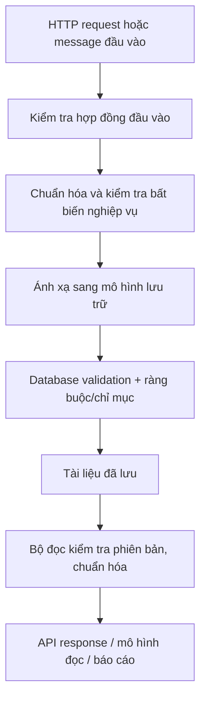
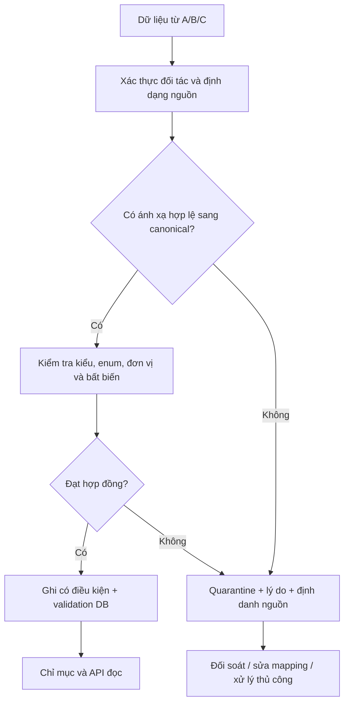

# Cấu trúc linh hoạt không có nghĩa là dữ liệu không cần lược đồ

## 1. “Schema linh hoạt” thực sự có nghĩa gì?

Một cơ sở dữ liệu tài liệu (*document database*) cho phép lưu các tài liệu có đối tượng lồng nhau, mảng và những tập trường không hoàn toàn giống nhau. Chẳng hạn, một khóa học có thể có `subtitle`, khóa khác không có; một phiên bản cũ lưu người giảng dạy dưới dạng chuỗi, phiên bản mới lưu `instructorId` và thông tin hiển thị riêng.

Khả năng đó thường được gọi là **cấu trúc linh hoạt** (*flexible schema*). Nhưng **linh hoạt không đồng nghĩa với dữ liệu không có cấu trúc, không có quy tắc hoặc không cần lược đồ**.

Nếu một tài liệu có `status = "PUBLISHED"`, tài liệu khác có `status = "published"` và tài liệu thứ ba có `status = true`, truy vấn “khóa đã xuất bản” rất dễ bỏ sót dữ liệu. Nếu `price` lúc là chuỗi, lúc là số, phép tính có thể sai. Nếu tài liệu thiếu `tenantId`, hệ thống có thể không xác định được quyền truy cập.

Vì thế, dù hệ lưu trữ không bắt buộc khai báo mọi cột trước khi ghi, **ứng dụng và nghiệp vụ luôn cần một hợp đồng dữ liệu (data contract)**: dữ liệu gồm những trường gì, ý nghĩa gì, kiểu nào, giá trị nào hợp lệ và thay đổi qua các phiên bản ra sao.

Bài học thuộc chương **Mô hình tài liệu**, trong phạm vi **DATABASE_DATA_MODELING**. Mục tiêu là luyện cách chuyển yêu cầu nghiệp vụ thành mô hình dữ liệu rõ ràng, từ thực thể, quan hệ, ràng buộc, khóa và chỉ mục đến lược đồ vật lý; đồng thời biết khi nào mô hình quan hệ, tài liệu, đồ thị hoặc phân tích là lựa chọn phù hợp hơn.

**Sau khi học, bạn có thể:**

1. Phân biệt **schema được thực thi ở nơi ghi**, **schema được diễn giải khi đọc** và **ràng buộc nghiệp vụ**.
2. Định nghĩa một hợp đồng tài liệu có trường bắt buộc/tùy chọn, kiểu, ngữ nghĩa, giới hạn và phiên bản.
3. Chọn các lớp validation phù hợp từ API, dịch vụ Java tới cơ sở dữ liệu.
4. Thiết kế cách xử lý trường thiếu, `null`, đối tượng lồng nhau, mảng và giá trị enum.
5. Hiểu những gì JSON Schema/database validator kiểm tra được và những gì cần giao dịch hoặc ràng buộc khác.
6. Tiến hóa cấu trúc theo từng giai đoạn mà không làm sai dữ liệu cũ hay truy vấn.
7. Kiểm chứng lược đồ bằng tài liệu hợp lệ, tài liệu bất thường, tải ghi và truy vấn thực tế.

## 2. Không có lược đồ khai báo sẵn khác với không có lược đồ

Một tài liệu JSON hợp cú pháp chỉ chứng minh **nó có thể được phân tích cú pháp**. Điều đó không bảo đảm nội dung đúng nghiệp vụ.

Ví dụ ba tài liệu sau đều có thể biểu diễn dưới dạng JSON:

```json
{
  "courseId": "CRS-101",
  "title": "Thiết kế dữ liệu",
  "status": "PUBLISHED",
  "priceMinor": 250000
}
```

```json
{
  "courseId": "CRS-102",
  "title": 42,
  "status": "published",
  "priceMinor": "250000"
}
```

```json
{
  "courseId": "CRS-103",
  "title": "",
  "status": "PUBLISHED",
  "priceMinor": -50
}
```

Tài liệu đầu *có vẻ* đúng với hợp đồng giả định. Tài liệu thứ hai sai kiểu tiêu đề, sai cách viết trạng thái và lưu tiền thành chuỗi; tài liệu thứ ba có tiêu đề rỗng và giá âm. Nếu bộ đọc tin rằng tất cả tài liệu đều tuân theo cấu trúc đầu tiên, lỗi sẽ xuất hiện ở nhiều nơi: API, báo cáo, truy vấn chỉ mục hoặc các phép tính.

Có ít nhất ba nơi lược đồ tồn tại, dù được viết thành tệp riêng hay không:

- **Trong yêu cầu nghiệp vụ:** giá không âm; mã khóa học là duy nhất trong tổ chức; chỉ khóa đã xuất bản mới được công khai.
- **Trong mã ứng dụng:** DTO, kiểu Java, parser, serializer, logic cập nhật và validation.
- **Trong dữ liệu thực tế:** kiểu trường, các giá trị đang lưu, những biến thể do phiên bản cũ hoặc import tạo ra.

Nếu ba nơi này không nhất quán, hệ thống có **schema ngầm và không được quản trị**, chứ không phải “schema-free”.

### 2.1. Schema-on-write và schema-on-read

- **Schema-on-write:** kiểm tra hoặc chuyển đổi dữ liệu **trước khi chấp nhận ghi**. Ví dụ từ chối một khóa học có `priceMinor < 0` hoặc `status` không thuộc tập cho phép.
- **Schema-on-read:** khi đọc, kiểm tra, diễn giải và nếu cần thì chuẩn hóa tài liệu theo phiên bản. Ví dụ đọc tài liệu cũ có `instructorName` và tài liệu mới có `instructor.id` thành một mô hình thống nhất.

Hai chiến lược có thể **bổ sung** cho nhau. Trong ứng dụng tài liệu thực tế, dữ liệu mới thường được kiểm tra chặt ở đường ghi, trong khi bộ đọc vẫn hiểu các cấu trúc cũ đã được công nhận.

**Schema-on-read không phải giấy phép đoán giá trị.** Nếu bản cũ không lưu thời điểm hoàn thành bài học, bộ đọc không được tự bịa `completedAt`.

## 3. Các lớp lược đồ cần phân biệt

Một hệ thống có thể có nhiều hợp đồng cấu trúc cho cùng một nghiệp vụ:

| Lớp | Ví dụ | Trách nhiệm chính |
| --- | --- | --- |
| **Hợp đồng API** | Request tạo khóa học, response danh sách khóa | Chấp nhận/định dạng đầu vào, kết quả công khai, quyền truy cập |
| **Mô hình miền nghiệp vụ** | `Course`, `Money`, `Enrollment` và bất biến | Diễn đạt các điều kiện nghiệp vụ phải đúng |
| **Schema lưu trữ** | Tài liệu `courses`, các trường BSON, `schemaVersion` | Cách ghi/đọc, validation, chỉ mục, vòng đời dữ liệu |
| **Hợp đồng sự kiện** | `CoursePublished` có định danh và phiên bản | Các hệ tiêu thụ hiểu đúng thay đổi |
| **Mô hình đọc/phân tích** | Thẻ khóa học, báo cáo học viên theo tháng | Trường và dữ liệu dẫn xuất phục vụ truy vấn cụ thể |

Những lớp này **không cần có cùng hình dạng**. Ví dụ API có thể trả:

```json
{
  "courseId": "CRS-101",
  "title": "Thiết kế dữ liệu",
  "formattedPrice": "250.000 ₫"
}
```

trong khi cơ sở dữ liệu lưu số tiền ở dạng nguyên cùng mã tiền tệ, và mô hình miền dùng một đối tượng `Money` có validation riêng. `formattedPrice` là chuỗi để hiển thị, **không phải kiểu lưu thích hợp để tính toán**.

Không nên lưu trực tiếp mọi request JSON như tài liệu dữ liệu nguồn chỉ vì cơ sở dữ liệu chấp nhận JSON. Request có thể chứa trường thừa, dữ liệu không đáng tin hoặc chỉ những thuộc tính phục vụ một màn hình.

### 3.1. Mối quan hệ giữa các lớp



Mỗi lớp có thể chặn một nhóm lỗi khác nhau. Lớp API thuận tiện để trả lỗi có ý nghĩa cho người dùng; lớp cơ sở dữ liệu tạo thêm hàng rào với các đường ghi khác như job nền hoặc import. Không lớp nào một mình bảo vệ mọi bất biến hoặc quyền truy cập.

## 4. Xây hợp đồng cho một tài liệu khóa học

### 4.1. Đặt câu hỏi trước khi viết JSON

Một hệ đào tạo có các yêu cầu:

- Mỗi tổ chức quản lý nhiều khóa học; mã khóa chỉ cần duy nhất **trong tổ chức**.
- Khóa học có tiêu đề, trạng thái, tác giả, danh sách thẻ và học phí.
- Tiêu đề phải có nội dung; trạng thái chỉ nhận `DRAFT`, `PUBLISHED` hoặc `ARCHIVED`.
- Học phí không âm và được biểu diễn bằng mã tiền tệ cộng số tiền ở đơn vị nhỏ nhất đã quy định.
- Khóa học xuất bản cần có thời điểm xuất bản hợp lệ.
- Danh sách thẻ có giới hạn; danh sách đánh giá và tiến độ học viên có thể lớn nên được lưu riêng.
- Dữ liệu phải được truy vấn theo `tenantId` và trạng thái, phân trang theo thời gian.

Một mô hình lưu trữ minh họa:

```json
{
  "_id": "CRS-101",
  "tenantId": "ORG-07",
  "courseCode": "DB-101",
  "schemaVersion": 2,
  "title": "Thiết kế dữ liệu",
  "status": "PUBLISHED",
  "instructorId": "USR-013",
  "price": {
    "currency": "VND",
    "amountMinor": 250000
  },
  "tags": ["database", "modeling"],
  "publishedAt": "2026-11-21T08:00:00Z",
  "revision": 3
}
```

Đây là JSON để diễn giải; khi triển khai bằng MongoDB/BSON, trường thời gian nên lưu dưới kiểu ngày giờ phù hợp, và số tiền phải được mã hóa bằng kiểu số đáp ứng phạm vi giá trị mong muốn. Với VND, ví dụ coi đơn vị nhỏ nhất được hỗ trợ là **một đồng**; nếu dùng tiền tệ khác, quy tắc đơn vị và làm tròn phải được định nghĩa rõ.

### 4.2. Bảng hợp đồng trường

| Trường | Kiểu/ngữ nghĩa | Bắt buộc? | Quy tắc |
| --- | --- | --- | --- |
| `_id` | Định danh khóa học ổn định | Có | Duy nhất theo phạm vi lưu trữ |
| `tenantId` | Chủ thể sở hữu dữ liệu | Có | Không được tự suy diễn từ client |
| `courseCode` | Mã nghiệp vụ | Có | Duy nhất theo `(tenantId, courseCode)` |
| `schemaVersion` | Phiên bản cấu trúc lưu | Có với writer mới | Giá trị được hỗ trợ; không dùng thay `revision` |
| `title` | Tiêu đề | Có | Chuỗi không rỗng sau quy tắc chuẩn hóa đã chọn |
| `status` | Trạng thái | Có | Thuộc enum đã phê duyệt |
| `instructorId` | Tham chiếu giảng viên | Có khi nghiệp vụ yêu cầu | Kiểm tra quyền và tính hợp lệ theo nguồn |
| `price.currency` | Mã tiền tệ | Có | Tập mã được hệ thống hỗ trợ |
| `price.amountMinor` | Số tiền nguyên | Có | Không âm, có giới hạn và quy tắc làm tròn |
| `tags` | Danh sách nhãn | Tùy chọn | Mảng chuỗi, có giới hạn; quy tắc không trùng |
| `publishedAt` | Thời điểm xuất bản | Có điều kiện | Bắt buộc khi `status=PUBLISHED`, theo chính sách |
| `revision` | Phiên bản ghi cạnh tranh | Có | Tăng khi cập nhật, dùng cho điều kiện ghi |

Bảng trên vừa mô tả **hình dạng dữ liệu** vừa diễn đạt **ngữ nghĩa**. Hai phần này khác nhau: “`status` là chuỗi” chưa đủ, vì chuỗi tùy ý vẫn có thể sai nghiệp vụ.

### 4.3. Những câu hỏi thường bị bỏ qua

- `title` có được chỉ gồm khoảng trắng hoặc dài một triệu ký tự không?
- `tags` có phân biệt chữ hoa/thường không; có cho phép lặp không?
- `publishedAt` khi chuyển sang `ARCHIVED` có được giữ để lưu lịch sử không?
- Ai được phép chuyển `ARCHIVED` về `PUBLISHED`?
- `price.currency` có được thay đổi sau khi mở đăng ký không?
- Một giảng viên bị xóa/tạm khóa thì các khóa học đang xuất bản ra sao?
- Trường nào có quyền cập nhật độc lập và trường nào phải đổi nguyên tử?
- Quy tắc nào cần đúng ở mọi tài liệu, quy tắc nào có thể tạm thời chưa đúng khi di trú?

Một schema tốt phải trả lời được các câu hỏi này hoặc **ghi rõ chúng chưa được xác định**, thay vì giả định từ cấu trúc JSON.

## 5. Trường bắt buộc, tùy chọn, null và giá trị mặc định

Những biểu diễn sau không nhất thiết mang cùng ý nghĩa:

```jsonc
{ "courseId": "CRS-1" }               // Không có trường subtitle
{ "courseId": "CRS-1", "subtitle": null } // Có trường, giá trị null
{ "courseId": "CRS-1", "subtitle": "" }   // Chuỗi rỗng
{ "courseId": "CRS-1", "subtitle": "Cơ sở dữ liệu" }
```

Một hợp đồng có thể quy định `subtitle` tùy chọn, không có nghĩa “chưa được cung cấp”; `null` có thể bị cấm hoặc mang nghĩa khác. Nếu ứng dụng tùy tiện dùng `?? ""`, nó có thể làm mất sự khác biệt giữa “không biết” và “đã xác nhận rỗng”.

### 5.1. Mặc định chỉ hợp lệ khi nghiệp vụ cho phép

Ví dụ:

- `tags` thiếu ở tài liệu legacy **có thể** được xem là `[]` nếu “không có thẻ” là ngữ nghĩa đã xác nhận.
- `publishedAt` thiếu **không thể** tự gán bằng thời điểm hiện tại để giả làm ngày xuất bản lịch sử.
- `discountMinor` thiếu chưa chắc bằng 0 nếu bản cũ lưu giảm giá ở một nguồn khác.
- `tenantId` thiếu không thể được gán theo người đang đọc, vì có thể làm sai quyền sở hữu.
- `completedAt` không thể suy ra từ `updatedAt` nếu lần sửa gần nhất không phải sự kiện hoàn thành.

Đặt giá trị mặc định là một **quy tắc dữ liệu**, cần được kiểm thử và ghi trong hợp đồng. Không nên dùng mặc định chỉ để tránh `NullPointerException`.

### 5.2. Nullable không giống optional

- **Optional:** trường có thể vắng mặt.
- **Nullable:** trường có mặt nhưng giá trị được phép là `null`.
- **Required non-null:** trường phải có và phải chứa giá trị thuộc kiểu hợp lệ.

Hệ quản trị và thư viện khác nhau về cách biểu diễn; cần kiểm tra chính xác semantics của JSON Schema/BSON và serializer được dùng.

## 6. Kiểu dữ liệu: đúng kiểu kỹ thuật và đúng nghĩa nghiệp vụ

### 6.1. Tiền tệ

Lưu giá tiền dưới dạng chuỗi định dạng hiển thị như `"250.000 ₫"` làm việc so sánh, sắp xếp và tính toán khó và dễ sai theo locale.

Cách hợp lý thường là lưu:

```json
{
  "price": {
    "currency": "VND",
    "amountMinor": 250000
  }
}
```

Hợp đồng phải định nghĩa đơn vị, phạm vi, cách làm tròn, thuế và trường hợp nhiều tiền tệ. Trong Java có thể dùng `long` cho số đơn vị nguyên trong phạm vi đã kiểm chứng, hoặc `BigDecimal` khi nghiệp vụ yêu cầu thập phân chính xác. Trong MongoDB cần chọn BSON `int`, `long` hoặc `decimal` phù hợp với phạm vi và cách dùng, không để các writer tùy tiện xen kẽ số chuỗi/số thực.

**Cảnh báo:** Chỉ đổi `"250000"` thành `250000` bằng ép kiểu không bảo đảm dữ liệu đúng. Có thể tồn tại chuỗi chứa ký hiệu tiền tệ, số thập phân hoặc giá đã gồm thuế khác quy tắc.

### 6.2. Ngày giờ

Nên phân biệt:

- **Thời điểm tuyệt đối:** `publishedAt`, `createdAt` hoặc một sự kiện xảy ra tại UTC.
- **Ngày địa phương:** ngày khai giảng, ngày nghỉ của địa phương.
- **Khoảng thời gian/duration:** học trong 90 phút.
- **Giờ theo múi giờ:** lịch lớp 19:00 ở một múi giờ xác định.

Không lưu một chuỗi `"21/11/2026"` rồi giả định mọi môi trường hiểu theo cùng quy tắc. Kiểu lưu, múi giờ, lịch và cách hiển thị phải được thống nhất. Tìm kiếm theo khoảng thời gian cũng phụ thuộc kiểu trường nhất quán.

### 6.3. Enum và tên trạng thái

Trạng thái `PUBLISHED`, `published`, `Live` có thể bị người viết code coi là giống nhau, nhưng truy vấn cơ sở dữ liệu có thể không tự làm điều đó. Hãy định nghĩa một tập giá trị chuẩn, thêm mapping cho nguồn legacy khi cần và từ chối giá trị mới chưa được hỗ trợ.

Không nên chuyển các giá trị enum cũ bằng quy tắc “gần giống tên”. Ví dụ `PAID` và `CONFIRMED` có thể liên quan nhưng không nhất thiết tương đương.

### 6.4. ID và dữ liệu nhạy cảm

Không dùng email, số điện thoại hoặc tên người làm khóa chính chỉ vì chúng có vẻ duy nhất tại một thời điểm. Các giá trị ấy có thể đổi, được tái sử dụng hoặc cần xóa/ẩn. Một ID ổn định riêng thường làm tham chiếu và di trú dễ hơn.

## 7. Validation ở đâu? Dùng nhiều lớp với trách nhiệm rõ ràng

Một ứng dụng vững chắc thường có **nhiều điểm kiểm tra bổ sung**, không phải lặp lại mọi quy tắc ở mọi nơi.

| Lớp | Phù hợp để kiểm tra | Không nên trông đợi |
| --- | --- | --- |
| **HTTP/API boundary** | Kiểu đầu vào, kích thước, trường lạ, cấu trúc request, lỗi dễ hiểu | Bảo vệ đường ghi nền không đi qua API |
| **Mô hình miền nghiệp vụ** | Bất biến, phép chuyển trạng thái, quyền cập nhật, đơn vị tiền, giới hạn nghiệp vụ | Tự áp đặt khóa duy nhất toàn collection khi có concurrent write |
| **Database validator** | Trường bắt buộc, kiểu BSON, enum, giới hạn đơn giản, lồng nhau | Tất cả ràng buộc liên tài liệu hoặc quyền người dùng |
| **Unique index** | Tính duy nhất của định danh/khóa nghiệp vụ trong phạm vi hỗ trợ | Bất biến như “hai khoảng lịch không chồng nhau” nếu khóa chỉ chứa giờ bắt đầu |
| **Transaction/cập nhật điều kiện** | Bất biến khi nhiều tác vụ cùng ghi, trạng thái/phiên bản | Đồng bộ nguyên tử với mọi API bên ngoài |
| **Batch kiểm tra/đối soát** | Dữ liệu legacy, bản sao dẫn xuất, sai lệch kéo dài | Thay thế validation tức thời cho nghiệp vụ rủi ro cao |

Mục đích không phải tạo quá nhiều lớp có thể mâu thuẫn nhau. Hợp đồng chuẩn phải thống nhất; các lớp chỉ thực thi phần phù hợp với khả năng và bối cảnh của mình.

### 7.1. Ví dụ Java: một value object bảo vệ bất biến cục bộ

Trong ứng dụng Java, có thể gom các thuộc tính có ngữ nghĩa vào một kiểu. Ví dụ hai `record` trong cùng tệp `CourseDraft.java` (yêu cầu phiên bản Java hỗ trợ `record`):

```java
import java.util.Objects;

record Money(String currency, long amountMinor) {
    public Money {
        Objects.requireNonNull(currency, "currency");
        if (!currency.equals("VND") && !currency.equals("USD")) {
            throw new IllegalArgumentException("Unsupported currency");
        }
        if (amountMinor < 0) {
            throw new IllegalArgumentException("Amount cannot be negative");
        }
    }
}

public record CourseDraft(String tenantId, String title, Money price) {
    public CourseDraft {
        if (tenantId == null || tenantId.isBlank()) {
            throw new IllegalArgumentException("tenantId is required");
        }
        if (title == null || title.isBlank()) {
            throw new IllegalArgumentException("title is required");
        }
        Objects.requireNonNull(price, "price");
    }
}
```

Đoạn mã minh họa kiểm tra ở tầng mô hình. Khi triển khai thật, cần chuẩn hóa chuỗi, kiểm tra độ dài, mã tiền tệ, mã tenant có hợp lệ và chủ thể có quyền tạo khóa học hay không; đồng thời quyết định nơi phản hồi lỗi cho client.

`Money` không thể tự ngăn hai khóa học trùng `courseCode`. Tính duy nhất phải được bảo vệ ở phạm vi phù hợp, thường bằng ràng buộc/chỉ mục của database kết hợp xử lý lỗi khi ghi.

## 8. MongoDB: minh họa validator cho một collection tài liệu

MongoDB hỗ trợ quy tắc validation cho collection, trong đó có cú pháp `$jsonSchema` dựa trên cách biểu diễn kiểu BSON. Đây là **một ví dụ triển khai**, không phải cú pháp phổ quát cho mọi cơ sở dữ liệu tài liệu.

Ví dụ tạo collection mới:

```javascript
db.createCollection("courses", {
  validator: {
    $jsonSchema: {
      bsonType: "object",
      required: [
        "_id", "tenantId", "courseCode", "schemaVersion",
        "title", "status", "instructorId", "price"
      ],
      properties: {
        _id: { bsonType: "string" },
        tenantId: { bsonType: "string", minLength: 1 },
        courseCode: { bsonType: "string", minLength: 1 },
        schemaVersion: { bsonType: "int", enum: [2] },
        title: { bsonType: "string", minLength: 1, maxLength: 200 },
        status: {
          bsonType: "string",
          enum: ["DRAFT", "PUBLISHED", "ARCHIVED"]
        },
        instructorId: { bsonType: "string", minLength: 1 },
        price: {
          bsonType: "object",
          required: ["currency", "amountMinor"],
          properties: {
            currency: { enum: ["VND", "USD"] },
            amountMinor: {
              bsonType: ["int", "long"],
              minimum: 0
            }
          }
        },
        tags: {
          bsonType: "array",
          maxItems: 20,
          items: { bsonType: "string" }
        },
        publishedAt: { bsonType: "date" },
        revision: { bsonType: ["int", "long"], minimum: 0 }
      }
    }
  },
  validationLevel: "strict",
  validationAction: "error"
});
```

### 8.1. Đoạn validator bảo vệ được gì?

- Tài liệu ghi vào collection phải có các trường nằm trong `required` theo chính sách validation.
- `status` phải thuộc các giá trị trong `enum`.
- `price.amountMinor` phải là loại số nguyên BSON đã cho phép và không âm.
- `tags` nếu xuất hiện phải là một mảng tối đa 20 phần tử, mỗi phần tử là chuỗi.
- `publishedAt` nếu xuất hiện phải theo kiểu BSON Date phù hợp.
- `title` có giới hạn độ dài và không thể là chuỗi **rỗng chính xác**.

### 8.2. Đoạn validator chưa bảo vệ được gì?

- Nó chưa chặn `title = "   "`: chuỗi chỉ có khoảng trắng vẫn có độ dài lớn hơn 0.
- Nó chưa yêu cầu `publishedAt` khi `status = PUBLISHED`.
- Nó chưa chứng minh `instructorId` thực sự tồn tại, đang có hiệu lực hoặc thuộc đúng tenant.
- Nó chưa bảo vệ tính duy nhất của `(tenantId, courseCode)`.
- Nó chưa bảo vệ quyền người dùng được phép đổi `DRAFT` sang `PUBLISHED`.
- Nó chưa cấm hai phần tử `tags` trùng theo quy tắc không phân biệt hoa/thường.
- Nó chưa giới hạn mọi trường lạ; ví dụ không đặt `additionalProperties: false` ở đây để tránh vô tình cản các trường hiện có. Nếu cần chặn trường lạ, phải liệt kê/thiết kế có chủ đích, bao gồm `_id` và các trường hệ thống.

Các quy tắc trên cần được đặt ở lớp nghiệp vụ, một validator phức tạp hơn nếu được hệ quản trị hỗ trợ, unique index hoặc giao dịch tùy từng trường hợp.

**Chi tiết kiểu BSON:** dữ liệu JSON có con số `250000` không nói rõ nó được driver ghi thành BSON `int`, `long` hay `double`. Nếu dùng validator chỉ chấp nhận `int`/`long`, cần bảo đảm mọi đường ghi (Java service, job import, script) mã hóa đúng kiểu. Tương tự, chuỗi ISO 8601 không tự trở thành BSON Date.

### 8.3. Validation level không sửa ngược dữ liệu cũ

Thêm hoặc thay đổi validator không đồng nghĩa hệ quản trị tự chuyển đổi mọi tài liệu đã tồn tại. Trong một collection đang hoạt động, dữ liệu legacy có thể không phù hợp với hợp đồng mới. Trước khi siết quy tắc, cần kiểm kê dữ liệu và tính tới những cập nhật vào tài liệu cũ.

Trong MongoDB, cơ chế như `validationLevel` và `validationAction` ảnh hưởng cách áp dụng validation; một số thao tác/đường ghi có quyền phù hợp có thể được cấu hình bỏ qua validation. Vì vậy, validator là **một hàng rào**, không phải lý do bỏ validation ở service và quy trình quản trị nhập dữ liệu.

Không sao chép lệnh tạo collection trên vào nơi đã có collection mà không lập kế hoạch chuyển đổi. Việc thay đổi validator của collection đang tồn tại có thao tác quản trị riêng, cần thử nghiệm đúng phiên bản và môi trường.

## 9. Ràng buộc vượt khỏi phạm vi một tài liệu

### 9.1. Duy nhất trong phạm vi tổ chức

Nếu mỗi tenant chỉ được có một khóa học với mã `DB-101`, dùng ràng buộc/chỉ mục duy nhất phù hợp:

```javascript
db.courses.createIndex(
  { tenantId: 1, courseCode: 1 },
  { unique: true }
);
```

Chỉ mục này bổ sung cho validator, vì kiểm tra `courseCode` là chuỗi chưa bảo vệ tính duy nhất. Khi dùng sharding/partition, phải kiểm tra khả năng unique index và phạm vi của khóa trong hệ lưu trữ thực tế.

Nếu mã cần được so sánh không phân biệt hoa/thường, phải thống nhất quy tắc chuẩn hóa hoặc collation. Hai yêu cầu đồng thời vẫn có thể cùng vượt qua bước “kiểm tra trước khi insert”; cơ sở dữ liệu phải là nơi bảo vệ ràng buộc duy nhất ở phạm vi được hỗ trợ.

### 9.2. Bất biến theo trạng thái

Một quy tắc nghiệp vụ: “Chỉ khóa đã có giảng viên hợp lệ, ít nhất một bài đã xuất bản và thời điểm xuất bản mới được chuyển sang `PUBLISHED`”.

Validator cho hình dạng tài liệu **không chứng minh được** bài học có tồn tại ở collection khác hoặc giảng viên được phép dạy. Nghiệp vụ cần kiểm tra các nguồn có thẩm quyền, bảo vệ cập nhật đồng thời và quyết định khi nào được chuyển trạng thái.

Ví dụ cập nhật có điều kiện trên một tài liệu:

```javascript
const result = db.courses.updateOne(
  {
    _id: "CRS-101",
    tenantId: "ORG-07",
    status: "DRAFT",
    revision: 3
  },
  {
    $set: {
      status: "PUBLISHED",
      publishedAt: new Date()
    },
    $inc: { revision: 1 }
  }
);

if (result.matchedCount === 0) {
  // Không còn ở trạng thái/phiên bản mong đợi,
  // không tìm thấy bản ghi, hoặc thiếu quyền theo logic ứng dụng.
}
```

Lệnh trên chỉ bảo vệ **bước chuyển trạng thái trên tài liệu**, với điều kiện đã chỉ định. Nó không tự kiểm tra tồn tại giảng viên, có bài học hay quyền người gọi. Những điều kiện đó phải được xử lý ở nơi phù hợp, và nếu có bất biến liên tài liệu cần thiết, phải xem giao dịch hoặc cách phối hợp khác theo khả năng hệ quản trị.

### 9.3. Kiểu chính xác không bảo vệ phép tính sai

Giả sử đơn hàng có `items` và `totalMinor`. Mọi trường đều đúng kiểu nhưng tổng tiền lại không bằng tổng các dòng. Đây là lỗi nghiệp vụ.

Để tránh, có thể thiết kế một thao tác cập nhật nguyên tử trong ranh giới thích hợp, tính tổng từ nguồn đáng tin và kiểm thử đồng thời. Nếu các dòng và tổng ở nhiều tài liệu, phải xác định cơ chế transaction hoặc quy trình cập nhật/đối soát.

**Lược đồ hợp lệ về cấu trúc vẫn có thể là dữ liệu sai về nghiệp vụ.**

## 10. Đối tượng lồng nhau và mảng cũng cần hợp đồng

Các trường lồng nhau làm schema linh hoạt trở nên hữu ích, nhưng càng nhiều cấp càng cần chỉ rõ ngữ nghĩa.

Ví dụ phần giới thiệu của khóa học:

```json
{
  "courseId": "CRS-101",
  "modulesPreview": [
    {
      "moduleId": "M-01",
      "title": "Nền tảng",
      "lessons": [
        { "lessonId": "L-01", "title": "Thực thể" },
        { "lessonId": "L-02", "title": "Khóa" }
      ]
    }
  ]
}
```

Cần xác định:

- Mảng `modulesPreview` chỉ chứa bao nhiêu mục? Có **giới hạn** không?
- Thứ tự các mục có ý nghĩa nghiệp vụ không?
- Hai phần tử có được dùng cùng `moduleId` hoặc `lessonId` không?
- Một phần tử có thể thiếu `title` không?
- Nội dung bài học đầy đủ được lưu ở đây hay trong tài liệu `lessons` riêng?
- Khi tiêu đề bài học thay đổi, bản xem trước có được cập nhật cùng lúc không?
- Nếu một bài học bị xóa, bản xem trước cần xử lý thế nào?

Với những mảng tăng không giới hạn như `comments`, `activityEvents` hoặc tiến độ của hàng trăm nghìn học viên, chỉ thêm quy tắc kiểu phần tử là **chưa đủ**. Cần xem lại **ranh giới tài liệu**: tách tài liệu con, giới hạn bản xem trước hoặc chia bucket có kiểm soát theo đặc điểm đọc/ghi.

### 10.1. Tính duy nhất trong mảng không nhất thiết là tính duy nhất theo khóa nghiệp vụ

Ngay cả khi có cơ chế kiểm tra phần tử mảng không trùng hoàn toàn, nó chưa chắc bảo vệ điều kiện “không có hai đối tượng cùng `lessonId` nhưng khác `title`”. Nếu `lessonId` phải duy nhất theo khóa học, hãy định nghĩa và kiểm tra **trùng theo định danh**, không chỉ theo giá trị toàn bộ đối tượng.

### 10.2. Truy vấn mảng cần đúng cùng phần tử

Ví dụ:

```json
{
  "attemptId": "ATT-01",
  "answers": [
    { "questionId": "Q-01", "isCorrect": false },
    { "questionId": "Q-02", "isCorrect": true }
  ]
}
```

Trong MongoDB, hai điều kiện đường dẫn:

```javascript
db.attempts.find({
  "answers.questionId": "Q-01",
  "answers.isCorrect": true
});
```

có thể được thỏa bởi **hai phần tử khác nhau** trong cùng mảng. Nếu muốn tìm một phần tử `Q-01` **và** `isCorrect=true`:

```javascript
db.attempts.find({
  answers: {
    $elemMatch: { questionId: "Q-01", isCorrect: true }
  }
});
```

Dữ liệu ví dụ sẽ không khớp truy vấn đúng này. Schema chỉ mô tả `answers` là mảng đối tượng **không tự bảo đảm mọi câu truy vấn dùng đúng ngữ nghĩa phần tử**.

## 11. Truy vấn và chỉ mục chỉ đúng khi kiểu và giá trị nhất quán

Giả sử có hai tài liệu:

```json
{
  "courseId": "CRS-101",
  "status": "PUBLISHED",
  "publishedAt": "2026-11-21T08:00:00Z"
}
```

```json
{
  "courseId": "CRS-102",
  "status": "published",
  "publishedAt": "21/11/2026 15:00"
}
```

Truy vấn `status = "PUBLISHED"` có thể bỏ sót tài liệu thứ hai. Sắp xếp theo `publishedAt` khi trộn nhiều kiểu hoặc nhiều định dạng chuỗi ngày có thể không phản ánh thứ tự thời gian mong muốn.

Đây không phải vấn đề có thể giải quyết chỉ bằng một chỉ mục tốt hơn. Trước hết phải thống nhất **hợp đồng kiểu và giá trị**, sau đó mới tối ưu truy vấn.

### 11.1. Đường truy cập từ nghiệp vụ

Một số truy vấn mẫu:

| Nhu cầu | Điều kiện | Kiểu dữ liệu phải ổn định |
| --- | --- | --- |
| Khóa đã xuất bản của tenant | `tenantId`, `status=PUBLISHED` | `tenantId` là ID đúng phạm vi, `status` theo enum |
| Khóa mới nhất | Sắp xếp `publishedAt DESC` | Kiểu ngày giờ thống nhất, khóa phụ để phân trang |
| Khóa trong khoảng học phí | `price.amountMinor` và `price.currency` | Số nguyên/decimal nhất quán, đơn vị tiền rõ |
| Khóa có nhãn chỉ định | `tags` chứa giá trị | Mảng chuỗi được chuẩn hóa, quy tắc hoa/thường |
| Ghi danh theo học viên | `learnerId`, `courseId` | Định danh ổn định, khóa duy nhất khi cần |

Gợi ý MongoDB cho danh sách khóa học:

```javascript
db.courses.createIndex({
  tenantId: 1,
  status: 1,
  publishedAt: -1,
  _id: -1
});

db.courses.find(
  { tenantId: "ORG-07", status: "PUBLISHED" },
  { _id: 1, title: 1, publishedAt: 1 }
).sort({ publishedAt: -1, _id: -1 }).limit(20);
```

Một số cơ sở dữ liệu yêu cầu `publishedAt` là kiểu BSON Date để so sánh ngày theo semantics tương ứng. Đoạn JSON minh họa đầu bài dùng chuỗi để dễ đọc; khi lưu dữ liệu thực, hãy bảo đảm cách mã hóa phù hợp với validator và chỉ mục.

### 11.2. Chỉ mục không làm sạch dữ liệu sai

Nếu tài liệu cũ vẫn có `status="published"`, chỉ mục trên `status` sẽ **lập chỉ mục giá trị đó như dữ liệu được lưu**, không tự chuyển thành `PUBLISHED`. Nếu `price.amountMinor` có lúc là chuỗi và lúc là số, chỉ mục không tự biến chúng thành một tập số có thể so sánh an toàn.

Trước khi tối ưu chỉ mục, cần đo số tài liệu không phù hợp schema, phân loại các biến thể lịch sử và chọn chiến lược chuyển đổi/đọc tương thích.

## 12. Tiến hóa lược đồ: linh hoạt nhưng có kiểm soát

Giả sử `courses` phiên bản đầu chỉ có `instructorName`. Phiên bản mới chuyển sang `instructorId` và tên giảng viên được lấy từ một nguồn riêng.

Phiên bản cũ:

```json
{
  "courseId": "CRS-050",
  "schemaVersion": 1,
  "instructorName": "Giảng viên A",
  "title": "Nhập môn SQL"
}
```

Phiên bản mới:

```json
{
  "courseId": "CRS-051",
  "schemaVersion": 2,
  "instructorId": "USR-013",
  "title": "Nhập môn SQL"
}
```

Việc đặt `schemaVersion` có ích, nhưng không tự tìm được `instructorId` từ một tên hiển thị có thể trùng. Chuyển đổi cần một nguồn có thẩm quyền hoặc quy trình xác nhận. Khi thiếu mapping đáng tin cậy, cần đánh dấu dữ liệu **chưa thể di trú** thay vì gán ID tùy tiện.

### 12.1. Phân biệt schemaVersion và revision

- `schemaVersion` nhận diện hình dạng và ngữ nghĩa lưu trữ.
- `revision` hoặc version cho cạnh tranh ghi giúp tránh cập nhật đè dữ liệu mới.
- Phiên bản nội dung bài học (bản phát hành) là một mục đích khác.
- Phiên bản API hay sự kiện cũng có vòng đời riêng.

Một tài liệu có thể thay đổi `status` nhiều lần, tăng `revision` từ 1 lên 4 nhưng vẫn giữ `schemaVersion = 2`.

### 12.2. Quy trình mở rộng rồi thu gọn (expand–migrate–contract)

Một lộ trình điển hình:

1. **Kiểm kê:** thống kê cấu trúc/kiểu/giá trị đang tồn tại; phân biệt dữ liệu legacy hợp lệ và dữ liệu lỗi.
2. **Định nghĩa hợp đồng mới:** trường nào đổi tên, đổi kiểu hoặc ngữ nghĩa; cách chuyển không mất thông tin.
3. **Mở rộng reader:** hỗ trợ cấu trúc cũ/mới và chuẩn hóa dữ liệu cho nghiệp vụ.
4. **Chuyển writer:** dữ liệu mới được ghi theo schema chính thức; các writer cũ được theo dõi hoặc chặn.
5. **Di trú theo lô:** chuyển dữ liệu cũ khi có mapping đúng; kiểm tra điều kiện ghi để không ghi đè cập nhật đồng thời.
6. **Đối soát:** thống kê tài liệu cũ, tài liệu lỗi, dữ kiện mất nghĩa hoặc sai kiểu.
7. **Siết validation:** khi dữ liệu và đường ghi đã đáp ứng, tăng mức kiểm soát ở database.
8. **Thu gọn:** xóa nhánh đọc legacy/chỉ mục tạm khi chứng minh không còn phụ thuộc.

Không nên xóa hỗ trợ schema cũ chỉ vì đã triển khai mã mới. Backup, job định kỳ, client ngoài và luồng import có thể vẫn đưa dữ liệu cũ trở lại.

### 12.3. Dual-read không đồng nghĩa tự động di trú

Một bộ đọc có thể hỗ trợ:

```javascript
function instructorReference(course) {
  if (course.schemaVersion === 2) {
    if (typeof course.instructorId !== "string") {
      throw new Error("Invalid instructorId");
    }
    return { type: "ID", value: course.instructorId };
  }

  if (course.schemaVersion === 1) {
    if (typeof course.instructorName !== "string") {
      throw new Error("Invalid legacy instructorName");
    }
    // Đây chỉ là tên lịch sử, KHÔNG phải userId.
    return { type: "LEGACY_NAME", value: course.instructorName };
  }

  throw new Error("Unsupported schemaVersion");
}
```

Đoạn mã **bảo toàn sự khác biệt** giữa tên legacy và ID mới, thay vì coi chúng là cùng một khóa. Khi nghiệp vụ cần xác định một giảng viên cụ thể để phân quyền hoặc thanh toán, giá trị `LEGACY_NAME` không đủ và phải được xử lý theo quy trình xác minh riêng.

## 13. Schema linh hoạt và mô hình dữ liệu động: dùng có giới hạn

Một số nghiệp vụ có thuộc tính khác nhau theo loại sản phẩm hoặc loại sự kiện. Ví dụ giày có cỡ chân, sách có ISBN, thiết bị có công suất. Không cần tạo một schema cứng chứa mọi thuộc tính của mọi loại sản phẩm.

Một phương án là tách **trường lõi ổn định** và **khối thuộc tính theo loại**:

```json
{
  "productId": "PRD-501",
  "tenantId": "ORG-07",
  "category": "BOOK",
  "title": "Thiết kế cơ sở dữ liệu",
  "attributes": {
    "isbn": "9780000000001",
    "pageCount": 320
  },
  "schemaVersion": 2
}
```

Tuy vậy, `attributes` không nên là nơi muốn ghi gì cũng được. Cần có **hợp đồng theo category**:

| Loại | Trường thuộc tính | Validation |
| --- | --- | --- |
| `BOOK` | `isbn`, `pageCount` | Mã hợp lệ theo quy tắc; số trang nguyên dương |
| `SHOE` | `size`, `material` | Cỡ thuộc hệ kích cỡ cho phép; loại vật liệu hợp lệ |
| `DEVICE` | `powerWatt`, `voltage` | Kiểu số và đơn vị rõ ràng |

Có thể dùng một registry schema theo loại, bộ parser riêng hoặc validation có điều kiện nếu hệ lưu trữ và quy mô nghiệp vụ phù hợp. Phải theo dõi phiên bản của hợp đồng theo loại khi thuộc tính thay đổi.

### 13.1. Khóa động có thể gây vấn đề

Ví dụ không nên mặc định:

```json
{
  "postId": "POST-1",
  "likesByUserId": {
    "USR-1": true,
    "USR-2": true
  }
}
```

Nếu mỗi lượt thích thêm một khóa động, tài liệu có thể tăng không giới hạn, khó kiểm soát index, phân quyền và tần suất ghi. Quan hệ lượt thích có thể được biểu diễn bằng các tài liệu riêng, với khóa duy nhất `(postId, userId)`.

**“Cho phép trường động” không phải lý do bỏ qua bội số, kích thước và tải ghi.**

### 13.2. Cấu trúc quá tự do khiến hợp đồng truy vấn bất khả thi

Nếu trường giá được lưu trong một cấu trúc động với các tên tùy nhà bán như `cost`, `sellingPrice`, `amount`, việc lọc sản phẩm có giá trong một khoảng sẽ khó đảm bảo đúng và khó tối ưu.

Những trường **được truy vấn thường xuyên** nên có tên, kiểu và ngữ nghĩa ổn định, ngay cả khi khối thuộc tính phụ được phép biến đổi có kiểm soát.

## 14. Bảo mật và chất lượng dữ liệu là một phần của hợp đồng

Một schema đúng về kiểu có thể vẫn chứa thông tin không nên có:

```json
{
  "courseId": "CRS-101",
  "title": "Thiết kế dữ liệu",
  "internalNotes": "Thông tin chỉ dành cho quản trị"
}
```

Nếu API trả nguyên tài liệu từ database cho học viên, trường `internalNotes` có thể bị lộ dù nó hợp lệ về schema.

Vì vậy:

- **Hợp đồng API output** phải xác định trường nào được trả cho từng vai trò.
- **Quyền truy cập** phải được kiểm tra theo tenant, người dùng và trạng thái nghiệp vụ.
- **Nguồn dữ liệu** phải xác định trường nào nhạy cảm, được giữ bao lâu và phải xóa/ẩn theo chính sách nào.
- **Tác vụ import và job nền** cũng phải kiểm tra quyền/scope cần thiết, không chỉ endpoint công khai.
- **Dữ liệu bản sao** như chỉ mục tìm kiếm, cache hoặc báo cáo phải chịu chính sách tương ứng.

Không được coi trường thiếu `tenantId` là “dữ liệu chung” trừ khi có quy tắc rõ và chứng minh an toàn. Đặc biệt, không để bộ đọc tự gán `tenantId` theo người dùng đang xem cho một tài liệu legacy không có nguồn sở hữu xác thực.

### 14.1. Trường lạ và mass assignment

Một request có thể gửi:

```json
{
  "title": "Khóa học thử",
  "status": "PUBLISHED",
  "isAdminApproved": true
}
```

Nếu server tùy tiện ghi toàn bộ trường request xuống tài liệu nguồn, người gọi có thể điều chỉnh những trường mà họ không được phép sửa. Nên dùng mô hình request được phép chứa **chỉ các trường cụ thể**, sau đó nghiệp vụ quyết định trạng thái và dữ liệu hệ thống.

Việc database chấp nhận trường lạ không có nghĩa người dùng được phép ghi trường ấy.

## 15. Khi nào cần so sánh mô hình tài liệu với mô hình khác?

Schema linh hoạt không phải tiêu chí duy nhất khi lựa chọn hệ lưu trữ.

| Bài toán | Mô hình đáng cân nhắc | Điểm cần kiểm chứng |
| --- | --- | --- |
| Đọc/ghi một aggregate có đối tượng lồng, phần con hữu hạn | **Tài liệu** | Cấu trúc, versioning, giới hạn kích thước, ranh giới nguyên tử |
| Nhiều quan hệ liên bảng và ràng buộc khóa ngoại mạnh | **Quan hệ** | Chuẩn hóa, join, transaction và khả năng dùng JSON nếu cần |
| Quan hệ nhiều bước giữa thực thể, truy vấn đường đi | **Đồ thị** | Bảo toàn tính đúng đắn của nút/cạnh và tải duyệt |
| Tổng hợp hàng triệu sự kiện theo thời gian | **Phân tích/cột** | Mô hình dữ kiện và chiều, schema ingest, chất lượng lịch sử |
| Dữ liệu phần lớn linh hoạt nhưng vài trường cần truy vấn ổn định | **Lai** | Trường lõi chuẩn + khối thuộc tính theo loại có hợp đồng |

Hệ quản trị quan hệ cũng có thể lưu JSON và cơ sở dữ liệu tài liệu cũng có thể hỗ trợ validation, giao dịch và phép kết hợp. Cần so sánh khả năng của **sản phẩm cụ thể** và yêu cầu vận hành, không kết luận chỉ dựa trên nhãn công nghệ.

Dù chọn mô hình nào, **định nghĩa dữ liệu hợp lệ và các bất biến** vẫn không biến mất.

## 16. Tình huống thực hành: import khóa học từ nhiều đối tác

### 16.1. Đề bài

Một nền tảng nhập danh mục khóa học từ ba nguồn:

- **Đối tác A:** `title`, `price` dạng số đồng VND, `status` là `active` hoặc `inactive`.
- **Đối tác B:** `name`, `fee` dạng chuỗi, `currency`, `published` dạng boolean.
- **Đối tác C:** gửi sự kiện theo từng bản phát hành, có `courseCode`, `title` và `startDate` theo ngày địa phương.
- Nền tảng muốn một mô hình chung để lọc theo trạng thái, giá, tổ chức và thời gian xuất bản.
- Chỉ dữ liệu đủ hợp lệ mới được hiển thị công khai; thông tin không chuyển đổi được phải được lưu để đối soát, không được tự bịa.

**Yêu cầu:** Xây hợp đồng dữ liệu nguồn, quy tắc chuyển đổi, validator và chiến lược xử lý lỗi.

### 16.2. Mô hình canonical gợi ý

```text
CourseCatalogEntry
  tenantId: string                     // xác định từ cấu hình nguồn đáng tin
  courseId: stable id
  partnerId: stable id
  partnerCourseCode: string
  title: non-empty string
  status: DRAFT | PUBLISHED | ARCHIVED
  price:
    currency: supported currency
    amountMinor: integer >= 0
  publishedAt: instant | unknown
  schemaVersion: integer
  sourceRevision: version/checkpoint
```

**Điểm quan trọng:** `tenantId` không nên lấy từ một trường bất kỳ do đối tác tự gửi nếu không có xác thực/ánh xạ tin cậy. `sourceRevision` giúp xác định độ mới và tránh sự kiện cũ ghi đè dữ liệu mới khi nguồn có cơ chế phiên bản.

### 16.3. Luồng xử lý



Cần phân biệt **lỗi không tương thích có thể xử lý** với **lỗi không thể chuyển đổi mà không mất nghĩa**.

Ví dụ:

- A gửi `status = active`: nếu hợp đồng xác nhận nó có nghĩa “được bán công khai”, có thể map thành `PUBLISHED`; nếu `active` chỉ có nghĩa “chưa xóa”, phải định nghĩa mapping khác.
- B gửi `fee = "250000"`: có thể phân tích thành số nếu quy tắc nguồn xác nhận định dạng, đơn vị và miền giá trị. Không mặc định mọi chuỗi có dấu phẩy/chấm đều diễn giải như nhau.
- B không gửi `currency`: không đoán VND chỉ vì ứng dụng chủ yếu phục vụ khách Việt; cần hợp đồng đối tác hoặc nguồn đáng tin.
- C gửi `startDate` địa phương: không tự coi đó là `publishedAt`. Ngày khai giảng và thời điểm xuất bản là hai dữ kiện khác.
- Một đối tác gửi hai bản ghi cùng mã: cần xác định quy tắc identity, sự kiện sửa đổi và khóa duy nhất ở phạm vi đúng.

### 16.4. Quy tắc xử lý dữ liệu bị cách ly (quarantine)

Khi một bản ghi không hợp lệ:

1. Ghi nhận **định danh nguồn**, loại lỗi, phiên bản hợp đồng và thời điểm nhận.
2. Bảo vệ payload lỗi theo chính sách bảo mật; tránh để thông tin nhạy cảm vào log công khai.
3. Không đưa tài liệu lỗi vào danh sách khóa học được phép bán.
4. Cho phép **reprocess** sau khi sửa mapping hoặc nhận dữ liệu bổ sung.
5. Đảm bảo gửi lại cùng bản ghi không tạo hai khóa học trùng.
6. Theo dõi số lượng lỗi theo đối tác và loại lỗi để cải thiện hợp đồng.

### 16.5. Câu hỏi tự kiểm tra

1. Có thể coi `published: true` từ B tương đương `PUBLISHED` của nền tảng không? Cần bằng chứng gì?
2. Nếu `fee` có giá trị `"1,200"`, đó là một nghìn hai trăm hay một phẩy hai? Quy tắc nào quyết định?
3. Nếu C phát bản cập nhật cũ sau bản mới, cần kiểm tra phiên bản ở đâu?
4. Nếu một đối tác có khóa học không có giá (khóa miễn phí), dùng `price.amountMinor=0` hay “không biết giá”? Hai nghĩa có khác nhau không?
5. Nếu hệ thống đổi enum từ `DRAFT/PUBLISHED/ARCHIVED` sang tập mới, triển khai reader/writer và di trú theo thứ tự nào?
6. Nếu cần phân quyền theo tenant mà nguồn không có `tenantId`, cách ánh xạ đáng tin cậy nên nằm ở đâu?

Một câu trả lời tốt phải chỉ ra **hợp đồng chuyển đổi**, dữ liệu nào không thể suy ra, ai quyết định giá trị đúng và cách kiểm chứng.

## 17. Những sai lầm thường gặp

**Sai lầm 1: “NoSQL schema-free nên không cần validation.”**  
Hệ lưu trữ chấp nhận tài liệu không đồng nghĩa ứng dụng hiểu và xử lý dữ liệu đúng. Phải có hợp đồng kiểu và nghiệp vụ.

**Sai lầm 2: Để mỗi nhóm tự đặt tên và kiểu trường.**  
Một nơi viết `price`, nơi khác `fee`, nơi khác `amount`; báo cáo và truy vấn phải xử lý nhiều biến thể. Chuẩn hóa ở boundary hoặc định nghĩa schema theo nguồn.

**Sai lầm 3: Dùng một trường `version` cho mọi mục đích.**  
Schema version, concurrency revision và phiên bản nội dung giải quyết các vấn đề khác nhau.

**Sai lầm 4: Chỉ kiểm tra kiểu, bỏ qua ý nghĩa.**  
Một `status` là chuỗi vẫn có thể chứa giá trị không hợp lệ; một tổng tiền kiểu số vẫn có thể sai.

**Sai lầm 5: Dùng mặc định để che dữ liệu lịch sử bị thiếu.**  
Không được bịa ngày hoàn thành, quyền sở hữu hay tiền tệ khi không có nguồn đáng tin.

**Sai lầm 6: Chỉ validator ở API, bỏ qua import và job nền.**  
Các đường ghi khác có thể tạo tài liệu sai. Cần áp dụng hợp đồng thống nhất và validation DB khi phù hợp.

**Sai lầm 7: Chỉ thêm validator DB rồi cho rằng tất cả tài liệu cũ đã đúng.**  
Validator không tự sửa dữ liệu legacy. Phải kiểm kê, di trú và theo dõi.

**Sai lầm 8: Coi chỉ mục là công cụ làm sạch dữ liệu.**  
Chỉ mục hỗ trợ tìm/duy nhất theo phạm vi được định nghĩa; nó không tự chuẩn hóa chuỗi trạng thái, ngày giờ hay đơn vị tiền.

**Sai lầm 9: Nhúng mọi dữ liệu vì JSON hỗ trợ mảng.**  
Mảng bình luận, lịch sử và tiến độ tăng liên tục có thể gây tài liệu lớn và điểm nóng ghi. Ranh giới tài liệu cần được mô hình hóa riêng.

**Sai lầm 10: Lưu nguyên request từ client vào database.**  
Trường thừa hoặc không có quyền sửa có thể bị ghi nhầm; dùng allowlist và domain validation.

**Sai lầm 11: Không đo tỷ lệ dữ liệu sai theo thời gian.**  
Chỉ xử lý lỗi khi API hỏng làm sai lệch tích lũy; cần thống kê validation failure và backfill.

**Sai lầm 12: Đổi schema ngay ở writer khi reader cũ vẫn đang chạy.**  
Các ứng dụng chưa cập nhật có thể không đọc được dữ liệu mới. Cần ma trận tương thích và lộ trình phát hành.

## 18. Quy trình thiết kế lược đồ và checklist

### 18.1. Quy trình mười bước

1. **Thu thập yêu cầu:** xác định thực thể, thuộc tính, quan hệ, truy vấn, ghi và các bất biến.
2. **Chọn ranh giới tài liệu:** nhúng phần con hữu hạn, được đọc/ghi cùng nhau; tách dữ liệu có vòng đời/tải ghi riêng.
3. **Định nghĩa định danh và phạm vi:** khóa ổn định, `tenantId`, khóa nghiệp vụ và quy tắc duy nhất.
4. **Viết hợp đồng trường:** tên, kiểu, bắt buộc/tùy chọn, `null`, đơn vị, enum, độ dài và giới hạn mảng.
5. **Phân loại kiểm tra:** điều nào ở API, miền nghiệp vụ, DB validator, unique index hay giao dịch?
6. **Thiết kế đường đọc:** trường nào lọc/sắp xếp/chiếu, chỉ mục nào cần và kiểu nào phải nhất quán?
7. **Thiết kế tiến hóa:** phiên bản schema, compatibility matrix, dữ liệu legacy và chiến lược di trú.
8. **Tạo bộ dữ liệu kiểm thử:** hợp lệ, thiếu trường, sai kiểu, trùng khóa, dữ liệu rất lớn, cạnh tranh ghi.
9. **Đo kết quả:** lỗi validation, truy vấn p95/p99, keys/docs examined, kích thước index và tải ghi.
10. **Ghi lại trách nhiệm:** ai sở hữu hợp đồng, ai được đổi, ai triển khai mapping và ai đối soát dữ liệu sai?

### 18.2. Checklist duyệt thiết kế

- [ ] Đã mô tả **ngữ nghĩa** của các trường quan trọng, không chỉ tên và kiểu.
- [ ] Mỗi trường xác định rõ required/optional/nullable và giá trị mặc định (nếu có).
- [ ] Số tiền, ngày giờ, định danh và enum có quy tắc thống nhất.
- [ ] Các đối tượng lồng nhau/mảng có giới hạn và validation phần tử phù hợp.
- [ ] Bất biến liên tài liệu không bị nhầm là có thể giải quyết chỉ bằng JSON Schema.
- [ ] Có ràng buộc duy nhất và điều kiện cập nhật đồng thời ở phạm vi cần thiết.
- [ ] Validation được thực thi trên mọi đường ghi được phép, kể cả job/import.
- [ ] Không ghi tự do những trường client không có quyền điều khiển.
- [ ] Các tài liệu legacy được kiểm kê, đọc tương thích hoặc di trú theo kế hoạch.
- [ ] Có phân biệt `schemaVersion` với `revision` và phiên bản API/sự kiện.
- [ ] Reader không suy diễn dữ liệu nhạy cảm hoặc lịch sử không có nguồn.
- [ ] Truy vấn/chỉ mục dựa trên kiểu và giá trị nhất quán, thử bằng dữ liệu thực tế.
- [ ] Mô hình đọc/nhân bản có nguồn chịu trách nhiệm và cơ chế đối soát.
- [ ] Có kiểm thử dữ liệu hợp lệ, lỗi, không xác định và concurrent writes.
- [ ] Có thước đo dữ liệu không hợp lệ và quy trình sửa lỗi lâu dài.
- [ ] Quyền truy cập, xóa/lưu giữ dữ liệu áp dụng cho cả schema cũ và mới.

**Điểm cần nhớ:** **Schema linh hoạt là khả năng tiến hóa cấu trúc, không phải quyền bỏ qua hợp đồng dữ liệu.** Một mô hình tài liệu có thể cho phép các biến thể được kiểm soát, nhưng vẫn phải định nghĩa trường, kiểu, ngữ nghĩa, bất biến, quyền truy cập và cách đọc/ghi qua các phiên bản. Dữ liệu đáng tin cậy không đến từ việc JSON hợp cú pháp, mà đến từ **quy tắc rõ ràng, kiểm tra đúng lớp và khả năng kiểm chứng/đối soát**.
