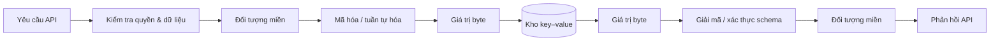
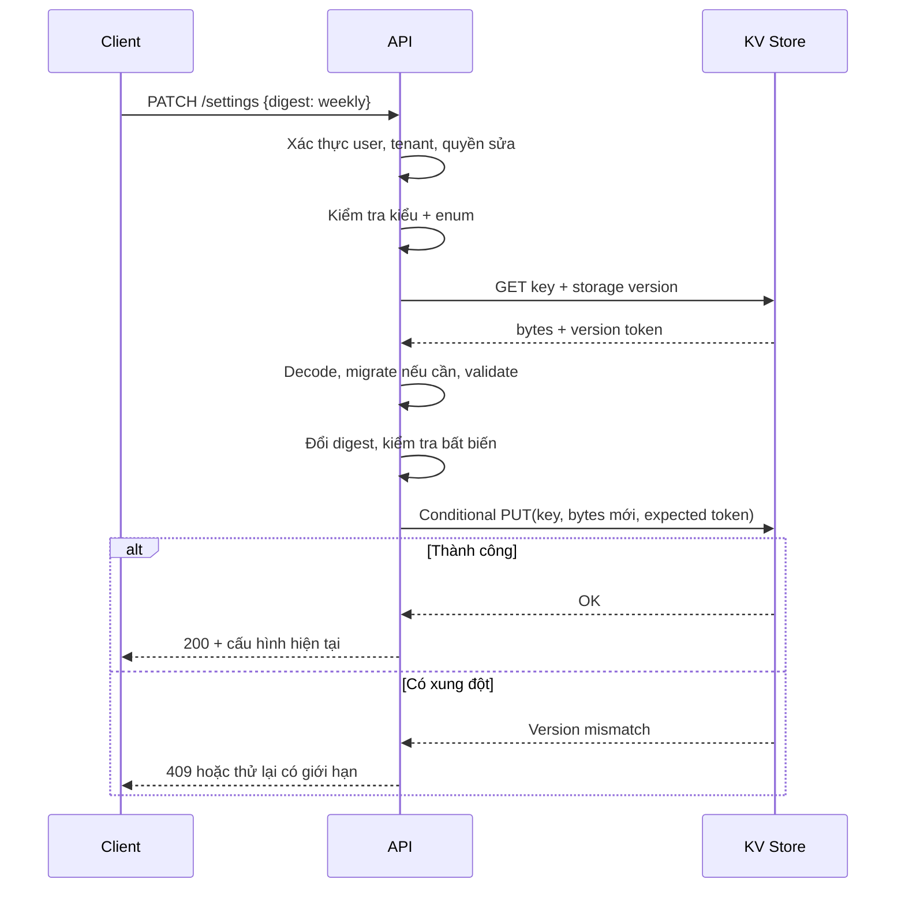

# Biểu diễn cấu trúc bên trong giá trị và trách nhiệm của ứng dụng

## Mục tiêu học tập

Sau bài này, bạn có thể:

- Phân biệt **khóa tra cứu**, **giá trị được lưu**, **cấu trúc logic** của giá trị và **biểu diễn byte** sau tuần tự hóa.
- Lựa chọn giữa giá trị vô cấu trúc, JSON, kiểu dữ liệu có cấu trúc và định dạng nhị phân theo nhu cầu truy cập, tính tương thích, dung lượng và vận hành.
- Viết hợp đồng dữ liệu rõ ràng về kiểu, trường bắt buộc, mặc định, trường tùy chọn, ràng buộc và quy tắc chuyển trạng thái.
- Xác định những việc ứng dụng phải chịu trách nhiệm khi kho khóa–giá trị không hiểu nội dung value: mã hóa/giải mã, xác thực, kiểm tra tính đúng đắn, cập nhật đồng thời, tiến hóa schema và bảo vệ dữ liệu.
- Giải thích vì sao **đọc/ghi một value như một đơn vị logic** không đồng nghĩa với an toàn của cả chuỗi đọc–sửa–ghi hoặc giao dịch trên nhiều key.
- Phân tích cách biểu diễn giá trị ảnh hưởng đến kích thước, hiệu năng, chỉ mục và khả năng tiến hóa của lược đồ vật lý.

Trong **DATABASE_DATA_MODELING**, việc chuyển yêu cầu nghiệp vụ thành mô hình dữ liệu rõ ràng bao gồm thực thể, quan hệ, ràng buộc, khóa, chỉ mục, chuẩn hóa và cấu trúc lưu trữ. Chủ đề **Khóa giá trị và cột rộng** đặt ra một câu hỏi thực tế: khi hệ lưu trữ biết cách tìm dữ liệu bằng khóa, **ai chịu trách nhiệm hiểu, kiểm tra và thay đổi cấu trúc bên trong giá trị?**

Câu trả lời phụ thuộc sản phẩm, nhưng với mô hình key–value cơ bản, trách nhiệm này chủ yếu nằm ở ứng dụng và các thư viện hợp đồng dữ liệu.

---

## 1. Giá trị có cấu trúc, dù kho lưu trữ không hiểu cấu trúc

Quan sát một cặp khóa–giá trị:

```text
key   = notification-settings:v1:tenant_7:user_42
value = {
  "schemaVersion": 2,
  "email": {"enabled": true, "digest": "daily"},
  "push":  {"enabled": false},
  "quietHours": {"from": "22:00", "to": "07:00", "timeZone": "Asia/Ho_Chi_Minh"}
}
```

Về mặt nghiệp vụ, value chứa các trường, đối tượng lồng nhau và quy tắc: chỉ chấp nhận `digest` thuộc một số giá trị; `quietHours` phải có giờ hợp lệ và múi giờ rõ ràng.

Nhưng một kho key–value tối giản có thể chỉ nhìn thấy:

```text
GET(key) -> byte[]
PUT(key, byte[])
DELETE(key)
```

Trong trường hợp đó, kho dữ liệu không tự biết `email.enabled` là boolean, `digest` phải theo enum, hay `quietHours` có hợp lệ về nghiệp vụ. Ứng dụng phải chuyển đổi giữa **mô hình logic** và **dạng lưu trữ vật lý**.



**Ba lớp không nên nhầm:**

| Lớp | Ví dụ | Ai định nghĩa? |
| --- | --- | --- |
| **Miền nghiệp vụ** | Người dùng có quyền bật email, cấu hình giờ yên tĩnh, không được có giá trị `digest` sai | Quy tắc nghiệp vụ của ứng dụng |
| **Hợp đồng dữ liệu** | `schemaVersion`, tên trường, kiểu, bắt buộc/tùy chọn, quy tắc chuyển đổi phiên bản | Nhóm phát triển và hợp đồng giữa các dịch vụ |
| **Biểu diễn vật lý** | JSON UTF-8, MessagePack, Protocol Buffers, bytes nén/mã hóa | Thiết kế lưu trữ và khả năng của công nghệ được chọn |

Một số hệ lưu trữ key–value cung cấp các kiểu như hash/map, list, sorted set hoặc thao tác trên trường. Những khả năng này bổ sung ngữ nghĩa cho một số lệnh; không nên suy ra rằng **mọi** cơ sở dữ liệu key–value đều chỉ lưu byte mờ đục hoặc **đều** hỗ trợ cập nhật từng thuộc tính.

### 1.1. Giá trị nguyên khối là đơn vị truy cập logic

Nếu màn hình cài đặt cần hiển thị tất cả lựa chọn thông báo, việc lưu chung giúp ứng dụng lấy một lần theo `(tenantId, userId)`. Nếu chỉ đổi `push.enabled`, cách lưu nguyên khối có thể phải ghi lại toàn value.

Cần tách bốn tính chất:

- **Đọc một value:** lấy một đơn vị dữ liệu theo khóa đã biết.
- **Ghi thay một value:** lưu ảnh chụp mới thay toàn bộ giá trị cũ, nếu API có ngữ nghĩa này.
- **Cập nhật nguyên tử:** người đọc không nhìn thấy trạng thái giữa chừng của một lệnh, nếu sản phẩm và lệnh cụ thể bảo đảm.
- **Đọc–sửa–ghi an toàn khi đồng thời:** cần cơ chế điều kiện phiên bản, giao dịch hoặc thao tác cập nhật nguyên tử; không tự có chỉ vì value được đọc nguyên khối.

Khi nhiều tác nhân viết chung một khóa, phân biệt các tính chất trên là điều kiện để không làm mất thay đổi của nhau.

## 2. Lựa chọn biểu diễn value theo nhu cầu

Biểu diễn bên trong value không nhất thiết luôn là JSON. Cần cân nhắc các yếu tố: đọc/ghi thủ công, kích thước, schema, khả năng tương thích, thư viện có sẵn, chi phí mã hóa và yêu cầu truy vấn.

| Biểu diễn | Ví dụ / đặc điểm | Phù hợp khi | Điều cần lưu ý |
| --- | --- | --- | --- |
| **Chuỗi/bytes đơn giản** | `"vi"`, `42`, token dạng byte | Giá trị vô hướng, bộ đếm, cờ cấu hình | Kiểu logic không hiển nhiên nếu không ghi hợp đồng |
| **JSON UTF-8** | Object/list, số, chuỗi, boolean, null | Cần quan sát thủ công, liên thông nhiều ngôn ngữ, dữ liệu nhỏ/vừa | Không có kiểu decimal/binary nguyên sinh; kích thước và kiểm tra schema do ứng dụng quyết định |
| **MessagePack/CBOR** | Dạng nhị phân biểu diễn object và các kiểu dữ liệu theo định dạng cụ thể | Muốn payload gọn hoặc biểu diễn kiểu phong phú hơn JSON | Khó đọc trực tiếp; cần thống nhất encoder, decoder và version |
| **Protocol Buffers/Avro** | Biểu diễn dữ liệu dựa trên schema/định nghĩa kiểu | Có nhiều producer/consumer, cần quản lý tương thích schema nghiêm túc | Tiến hóa schema phải tuân quy tắc tương thích; không tự động giải quyết logic nghiệp vụ |
| **Kiểu dữ liệu native của hệ quản trị** | Hash/map, list, set, counter, sorted collection | Cần thao tác riêng lên phần dữ liệu mà sản phẩm hỗ trợ | Ngữ nghĩa, tính nguyên tử, TTL, giới hạn và transaction phụ thuộc sản phẩm |
| **Giá trị nén hoặc mã hóa** | Bytes đã compress/encrypt | Payload lớn hoặc yêu cầu bảo mật cụ thể | Cần metadata, quản lý khóa, codec, phiên bản và công cụ đọc/khôi phục |

Không có một lựa chọn thắng trên mọi trục. JSON thuận tiện cho ví dụ học tập, nhưng khi lưu hàng triệu value hoặc cập nhật thường xuyên, **đo** kích thước payload và chi phí CPU/IO quan trọng hơn kết luận cảm tính “binary luôn nhanh hơn”.

### 2.1. Giá trị vô hướng cũng cần hợp đồng

```text
limits:tenant_7:max-users -> "250"
```

Câu hỏi vẫn tồn tại: `"250"` là chuỗi hay số nguyên? Số âm có hợp lệ không? Giá trị tối đa là bao nhiêu? Khi key chưa có, default là 0, 250 hay lỗi? Khi dữ liệu lỗi `"unlimited"` thì xử lý thế nào?

Một byte string ngắn không loại bỏ trách nhiệm xác định **kiểu, khoảng giá trị, đơn vị đo, trường hợp không tồn tại và nguồn dữ liệu có thẩm quyền**.

### 2.2. Cấu trúc lồng nhau phải phục vụ đường truy cập

Xét hai dạng cùng thể hiện danh sách tùy chọn:

```json
{
  "channels": [
    {"type": "email", "enabled": true},
    {"type": "push", "enabled": false}
  ]
}
```

```json
{
  "channels": {
    "email": {"enabled": true},
    "push": {"enabled": false}
  }
}
```

Dạng danh sách có thể hợp lý nếu thứ tự hiển thị và số phần tử linh hoạt là nghiệp vụ; dạng map có thể đơn giản hơn nếu mỗi `type` là duy nhất và ứng dụng thường tra cứu theo loại. Nhưng map có thể gây khó khăn khi kiểu khóa động và cần kiểm soát danh sách loại kênh được phép.

Thiết kế phải định rõ:

- **Tập hợp có thứ tự hay không?** Danh sách giữ thứ tự; map không nên được dùng để suy ra thứ tự nghiệp vụ nếu hợp đồng không quy định.
- **Được trùng khóa nghiệp vụ không?** Hai entry `type=email` có hợp lệ không?
- **Phần tử có định danh ổn định không?** Nếu cập nhật một phần tử, nên xác định bằng ID, loại hay vị trí mảng?
- **Cấu trúc có thể tăng vô hạn không?** Không nhồi lịch sử sự kiện vô hạn vào một value chỉ vì object lồng nhau biểu diễn được.

## 3. Thiết kế hợp đồng dữ liệu từ bất biến nghiệp vụ

Chọn một tình huống xuyên suốt: người dùng trong một tenant cấu hình thông báo. Giao diện thường đọc toàn bộ cài đặt, còn thay đổi diễn ra tương đối ít.

### 3.1. Mô hình logic đề xuất

```json
{
  "schemaVersion": 2,
  "revision": 17,
  "userId": "user_42",
  "channels": {
    "email": {
      "enabled": true,
      "digest": "daily"
    },
    "push": {
      "enabled": false
    }
  },
  "quietHours": {
    "enabled": true,
    "start": "22:00",
    "end": "07:00",
    "timeZone": "Asia/Ho_Chi_Minh"
  },
  "updatedAt": "2026-11-22T02:30:00Z"
}
```

Khóa tra cứu:

```text
notification-settings:v1:tenant_7:user_42
```

Định nghĩa rõ **key format version** (`v1` trong key) và **value schema version** (`schemaVersion: 2` trong JSON). Đổi cấu trúc value không nhất thiết phải đổi key. Ngược lại, nếu đổi cách định danh người dùng hoặc phân vùng, có thể cần thay key mà không đổi tất cả trường value.

### 3.2. Bảng thuộc tính và quy tắc

| Trường | Kiểu logic | Quy tắc |
| --- | --- | --- |
| `schemaVersion` | Số nguyên | Bắt buộc, nhận các phiên bản mà reader hỗ trợ |
| `revision` | Số nguyên không âm | Tham chiếu cho kiểm soát cập nhật nếu cơ chế lưu trữ hỗ trợ ghi có điều kiện |
| `userId` | ID nội bộ | Bắt buộc, ổn định; nếu lưu lặp trong value phải khớp thành phần user của key |
| `channels.email.enabled` | Boolean | Bắt buộc sau khi chuyển sang schema v2 |
| `channels.email.digest` | Enum | `immediate`, `daily` hoặc `weekly` khi email được bật |
| `channels.push.enabled` | Boolean | Bắt buộc; không đồng nghĩa thiết bị có push token hợp lệ |
| `quietHours.enabled` | Boolean | Bắt buộc |
| `quietHours.start/end` | Giờ trong ngày | Định dạng `HH:mm`, giá trị trong 00:00–23:59; chỉ áp dụng khi quiet hours được bật |
| `quietHours.timeZone` | IANA time zone | Ví dụ `Asia/Ho_Chi_Minh`, cần được kiểm tra bằng thư viện múi giờ tin cậy |
| `updatedAt` | Instant UTC | Ghi theo định dạng ISO 8601 có timezone thống nhất |

Trong ví dụ, `quietHours.start = "22:00"` và `end = "07:00"` nghĩa là khoảng yên tĩnh **qua nửa đêm** theo múi giờ người dùng. Không được mặc định `start < end`. Cần định nghĩa riêng khi hai giờ bằng nhau: không có khoảng yên tĩnh, cả ngày, hay dữ liệu không hợp lệ. Ví dụ này quy định **hai giờ bằng nhau là không hợp lệ khi bật**.

Trường `channels.email.digest` không cần xuất hiện nếu email tắt, hoặc có thể vẫn được lưu để khôi phục sở thích cũ. Phải chọn một quy ước; ở đây chọn **giữ sở thích đã chọn khi tắt** và chấp nhận `digest` hợp lệ dù `enabled=false`. Khi hiển thị hoặc gửi email, bộ xử lý phải áp dụng `enabled` trước.

### 3.3. Trường nào là dữ liệu thực, trường nào có thể suy ra?

Không nên lưu mọi dữ liệu tiện hiển thị vào cùng value:

- `userId` và cấu hình là thông tin của giá trị (có thể chỉ giữ `userId` trong key nếu mọi nơi đều tái dựng được).
- `updatedAt` là metadata phục vụ truy vết và kiểm tra thay đổi.
- Địa chỉ email, push token đã xác minh, trạng thái nhận thiết bị và quyền gửi thực tế thường nằm ở nguồn dữ liệu có thẩm quyền khác.
- Một trường như `canReceivePush` có thể **được suy ra** từ bật push, trạng thái thiết bị và quy tắc giao hàng; lưu song song dễ gây lệch.

Nếu phải lưu bản sao dữ liệu dẫn xuất để đọc nhanh, cần ghi rõ **nguồn chân lý**, độ trễ đồng bộ chấp nhận được và cơ chế tái tạo.

## 4. Schema kiểm tra hình dạng và giới hạn của nó

Với JSON, có thể dùng JSON Schema hoặc một thư viện validation để kiểm tra hình dạng và kiểu. Ví dụ schema rút gọn:

```json
{
  "$schema": "https://json-schema.org/draft/2020-12/schema",
  "type": "object",
  "required": ["schemaVersion", "revision", "userId", "channels", "quietHours", "updatedAt"],
  "properties": {
    "schemaVersion": {"const": 2},
    "revision": {"type": "integer", "minimum": 0},
    "userId": {"type": "string", "minLength": 1},
    "channels": {
      "type": "object",
      "required": ["email", "push"],
      "properties": {
        "email": {
          "type": "object",
          "required": ["enabled", "digest"],
          "properties": {
            "enabled": {"type": "boolean"},
            "digest": {"enum": ["immediate", "daily", "weekly"]}
          },
          "additionalProperties": false
        },
        "push": {
          "type": "object",
          "required": ["enabled"],
          "properties": {"enabled": {"type": "boolean"}},
          "additionalProperties": false
        }
      },
      "additionalProperties": false
    },
    "quietHours": {
      "type": "object",
      "required": ["enabled", "start", "end", "timeZone"],
      "properties": {
        "enabled": {"type": "boolean"},
        "start": {"type": "string", "pattern": "^([01][0-9]|2[0-3]):[0-5][0-9]$"},
        "end": {"type": "string", "pattern": "^([01][0-9]|2[0-3]):[0-5][0-9]$"},
        "timeZone": {"type": "string", "minLength": 1}
      },
      "additionalProperties": false
    },
    "updatedAt": {"type": "string", "format": "date-time"}
  },
  "additionalProperties": false
}
```

Đây là ví dụ cho **hợp đồng chặt của schema v2**, không phải schema đầy đủ của sản phẩm. Với JSON Schema, tùy thư viện, `format` có thể chỉ là chú thích nếu chưa bật từ vựng/validator định dạng; không được cho rằng `format: "date-time"` luôn được kiểm tra. `timeZone` là chuỗi nên schema rút gọn chưa xác nhận tên múi giờ IANA tồn tại.

**Validation có ít nhất ba tầng:**

1. **Cú pháp:** JSON giải mã được, byte hợp lệ, giới hạn kích thước/độ sâu.
2. **Schema:** trường bắt buộc, kiểu, enum, độ dài, điều kiện cơ bản.
3. **Bất biến miền:** giờ bắt đầu khác giờ kết thúc khi bật, người dùng có quyền cập nhật, `userId` khớp key, chuyển trạng thái được cho phép.

Ví dụ quy tắc nghiệp vụ bổ sung:

```text
validateSettings(settings, keyUserId):
    require settings.userId == keyUserId
    require validTimeZone(settings.quietHours.timeZone)
    if settings.quietHours.enabled:
        require settings.quietHours.start != settings.quietHours.end
    require settings.revision >= 0
```

Một schema tĩnh không thay thế được kiểm tra quyền, tra cứu nguồn dữ liệu khác hoặc quy tắc chuyển trạng thái dựa vào giá trị cũ.

### 4.1. Sai kiểu không phải tự động được sửa

Nếu client gửi:

```json
{"enabled": "false"}
```

Đây là **chuỗi**, không phải boolean `false`. Thư viện có thể tự ép kiểu khi parse, nhưng sự nới lỏng đó cần là quyết định có chủ đích. Ép kiểu ngầm dễ gây lệch giữa Java, JavaScript và những dịch vụ khác khi một bên xem chuỗi `"false"` là truthy. Hợp đồng API nên yêu cầu boolean thật và trả lỗi dữ liệu nếu sai.

Tương tự, JSON không có kiểu decimal có độ chính xác cố định. Với dữ liệu tiền tệ, tránh mặc định dùng số dấu phẩy động nhị phân khi cần so sánh chính xác; thường chọn **số nguyên theo đơn vị nhỏ nhất** hoặc **chuỗi decimal có quy tắc parse/scale rõ**. Bài này dùng cấu hình thông báo nên không có trường tiền; nguyên tắc vẫn áp dụng khi mở rộng sang giá cả hay điểm số.

## 5. Các quyết định thường bị bỏ sót trong hợp đồng value

### 5.1. Thiếu trường, null và giá trị mặc định

Ba bản ghi sau có ý nghĩa tiềm ẩn khác nhau:

```json
{}
```

```json
{"quietHours": null}
```

```json
{"quietHours": {"enabled": false, "start": "22:00", "end": "07:00", "timeZone": "Asia/Ho_Chi_Minh"}}
```

- **Thiếu trường:** writer cũ chưa biết trường này, hoặc client gửi yêu cầu chỉ cập nhật một phần.
- **Null:** client muốn xóa/đặt lại, hoặc dữ liệu thực sự chưa biết.
- **Đối tượng có `enabled=false`:** người dùng đã cấu hình nhưng tạm tắt tính năng.

Nếu API nhận bản vá `PATCH`, cần định nghĩa `null` nghĩa là “xóa” hay “đặt giá trị null” và trường không xuất hiện nghĩa là “giữ nguyên” hay “đặt mặc định”. Không lấy một quy ước của framework làm quy tắc nghiệp vụ mà không ghi hợp đồng.

**Default có thể đổi theo phiên bản.** Reader thấy trường v1 thiếu `push.enabled` và cho mặc định `false`; sau này sản phẩm đổi mặc định thành `true`. Nếu ứng dụng áp default theo phiên bản hiện tại thay vì phiên bản dữ liệu, cùng một bản ghi cũ sẽ đổi nghĩa. Vì vậy quy tắc mặc định cần gắn với schema version hoặc được materialize trong quá trình migrate có kiểm soát.

### 5.2. Thứ tự, tập hợp và đối tượng map

Dãy `["email", "push"]` giữ thứ tự phần tử theo hợp đồng JSON, nhưng object `{"email": ..., "push": ...}` không nên được dùng làm nguồn của **thứ tự hiển thị nghiệp vụ** khi giao diện phụ thuộc thứ tự ổn định. Nếu thứ tự là dữ liệu nghiệp vụ, lưu `displayOrder` hoặc mảng riêng có quy tắc.

Khi JSON có **tên thuộc tính trùng nhau** trong cùng một object, các parser có thể xử lý khác nhau. Writer phải bảo đảm key thuộc tính không lặp và decoder nên phát hiện/loại bỏ input mơ hồ tại biên đáng tin cậy.

### 5.3. Time zone, thời gian và số học

Phân biệt:

| Kiểu logic | Ví dụ | Quy tắc |
| --- | --- | --- |
| Instant | `2026-11-22T02:30:00Z` | Một thời điểm tuyệt đối |
| Local time | `22:00` | Giờ trong ngày; không gắn một ngày/offset |
| Time zone | `Asia/Ho_Chi_Minh` | Tên vùng để tính quy tắc theo lịch và giờ mùa hè nếu có |
| Local date | `2026-11-22` | Ngày theo lịch; không tự là một instant |

Để xác định giờ yên tĩnh đang hiệu lực hay không, ứng dụng lấy instant hiện tại, chuyển sang giờ địa phương theo `timeZone` rồi so sánh theo quy tắc khoảng qua nửa đêm. Không coi `"22:00"` là một instant UTC. Khi triển khai với vùng có đổi giờ mùa hè, các thời điểm không tồn tại hoặc lặp lại cần một quy tắc xử lý rõ.

### 5.4. Dữ liệu không biết trước và khả năng tương thích

Một reader cũ có thể gặp trường mới `sms`. Có hai lựa chọn đều có lý do:

- **Chặt:** từ chối trường không biết, phù hợp đầu vào API chỉ được phép gồm trường đã định nghĩa.
- **Khoan dung khi đọc:** giữ hoặc bỏ qua trường mới, hỗ trợ triển khai nhiều phiên bản ứng dụng.

Nhưng reader cũ **đọc rồi ghi đè toàn bộ JSON** có thể xóa trường mới dù lúc đọc đã bỏ qua nó. Vì vậy chính sách “bỏ qua trường không biết” phải đi kèm quy tắc **giữ nguyên trường khi ghi**, cập nhật có chọn lọc hoặc ngăn writer cũ ghi dữ liệu phiên bản cao.

## 6. Tuần tự hóa và giải tuần tự hóa: đường ghi và đọc

Một pipeline cơ bản:

```text
INPUT API
    |
    v
[Authentication / authorization]
    |
    v
[Validate request + domain invariants]
    |
    v
[Construct canonical value + schemaVersion]
    |
    v
[Serialize to bytes] -> [optional compress] -> [optional encrypt]
    |
    v
[Store PUT / conditional update]

[Store GET]
    |
    v
[Decrypt] -> [decompress] -> [decode]
    |
    v
[Check version, schema, invariant]
    |
    v
[Map to domain/API response]
```

Đây là **thứ tự khái niệm**, còn chi tiết thực tế phụ thuộc codec và cách mã hóa. Nếu mã hóa dữ liệu, cần xác định rõ metadata như thuật toán, khóa/phiên bản khóa, nonce và authentication tag; dùng thư viện được kiểm chứng thay vì tự thiết kế mật mã.

### 6.1. Tách đối tượng miền khỏi DTO lưu trữ

Một ứng dụng có thể dùng ba loại đối tượng:

- **API DTO:** các trường người dùng được phép gửi, thường là một phần của cấu hình; không được tin client gửi `revision` hay `userId` tùy ý.
- **Domain model:** đối tượng có bất biến và hành vi nghiệp vụ, ví dụ `setEmailDigest()`.
- **Storage DTO:** biểu diễn có `schemaVersion`, metadata và cách mã hóa ổn định để đọc/ghi.

Ví dụ, client gửi:

```json
{
  "emailDigest": "weekly",
  "pushEnabled": true
}
```

Ứng dụng ánh xạ request hợp lệ vào model có chủ quyền cập nhật và lưu storage DTO với `schemaVersion` mới. **Không đưa toàn bộ request JSON của client trực tiếp vào kho** như một document đáng tin cậy; làm vậy có thể cho phép sửa trường nội bộ như `revision`, `userId` hoặc `roles`.

### 6.2. Đảm bảo encode/decode nhất quán

Bộ kiểm thử tối thiểu cho codec nên kiểm tra:

- `decode(encode(model))` giữ nguyên **ý nghĩa nghiệp vụ**; không nhất thiết giữ nguyên thứ tự thuộc tính JSON hoặc từng byte.
- Không thay đổi kiểu của các trường bắt buộc, số lớn, decimal, Unicode hay thời gian.
- Trường không có/giá trị null/default được diễn giải đúng.
- Reader hiện tại đọc được các fixture lưu từ những phiên bản phải còn được hỗ trợ.
- Dữ liệu sai, bị cắt cụt, quá lớn, quá sâu hoặc dùng schema chưa hỗ trợ được từ chối có kiểm soát.

Nếu hệ thống dùng chữ ký, hash nội dung hoặc cache key dựa trên bytes, hai JSON tương đương về nghĩa vẫn có thể có byte khác nhau do thứ tự trường, khoảng trắng hoặc Unicode normalization. Khi cần đối sánh byte, phải xác định **canonical encoding** riêng; không mặc định JSON thông thường tự chuẩn hóa.

## 7. Cập nhật giá trị: ghi toàn phần, cập nhật từng trường và đồng thời

Giả sử có value ở revision 17:

```json
{
  "revision": 17,
  "channels": {
    "email": {"enabled": true, "digest": "daily"},
    "push": {"enabled": false}
  }
}
```

Hai thiết bị cùng đọc revision 17:

1. Thiết bị A đổi `email.digest` thành `weekly`.
2. Thiết bị B bật `push.enabled`.
3. Cả hai gửi cả object cũ đã sửa một trường và gọi `PUT` thông thường.

Nếu B ghi sau A, dữ liệu cuối có thể là email `daily`, push `true`: thay đổi của A bị mất. Đây là lỗi **lost update**.

### 7.1. Ba chiến lược cập nhật

| Chiến lược | Cách hoạt động | Điều kiện áp dụng |
| --- | --- | --- |
| **Ghi đè toàn value** | `PUT(key, newValue)` | Chấp nhận last-write-wins hoặc chỉ có một writer; phải hiểu nguy cơ mất cập nhật |
| **Compare-and-swap (CAS) / ghi có điều kiện** | Ghi khi phiên bản ở kho còn khớp bản vừa đọc | Cần lệnh so sánh + ghi **nguyên tử** theo bảo đảm của kho |
| **Cập nhật trường hoặc thao tác phía máy chủ** | `SET field`, `INCR`, script/giao dịch một key tùy sản phẩm | Phải xác minh thao tác thật sự nguyên tử và ràng buộc còn đúng |

Giả mã CAS độc lập sản phẩm:

```text
function changeDigest(key, newDigest):
    validateDigest(newDigest)

    for attempt in 1..MAX_RETRIES:
        bytes, storageToken = store.readWithVersion(key)
        doc = decodeAndValidate(bytes)
        next = deepCopy(doc)
        next.channels.email.digest = newDigest
        next.revision = doc.revision + 1
        next.updatedAt = clock.nowUtc()

        validateDomain(next)
        if store.putIfVersionMatches(key, storageToken, encode(next)):
            return next

    raise ConcurrentModification
```

Ở đây `storageToken` là token/ETag/version do **kho dữ liệu** dùng để so sánh nguyên tử. `revision` nằm bên trong JSON chỉ là metadata; tự tăng số này rồi `PUT` vô điều kiện **không** ngăn lost update. Một số kho hỗ trợ điều kiện trực tiếp theo một thuộc tính thay vì token; cách diễn đạt phải phù hợp API thực tế.

Với yêu cầu cần cập nhật một trường duy nhất mà không thay đổi các trường khác, nên xem xét thao tác partial update nếu sản phẩm cung cấp. Tuy nhiên, patch chỉ loại bỏ lost update **trên các trường độc lập** trong những điều kiện nhất định; nếu hai trường có bất biến liên quan, cập nhật riêng lẻ vẫn có thể tạo trạng thái sai. Lúc đó cần một đơn vị giao dịch bao trùm ràng buộc.

### 7.2. Phân biệt idempotency với cập nhật đồng thời

Một request bị retry do mạng chập chờn có thể gửi hai lần. Nếu thao tác là “đặt `push.enabled = true`”, lặp lại thường cho cùng kết quả. Nhưng thao tác “tăng số ngày dùng thử thêm 1” sẽ gây sai nếu áp dụng hai lần.

- **Idempotent update:** lặp lại yêu cầu có cùng ý nghĩa.
- **CAS:** ngăn ghi đè dựa trên trạng thái cũ.
- **Idempotency key:** giúp nhận diện lại **cùng một yêu cầu nghiệp vụ** trong một khoảng thời gian/quy trình có kiểm soát.

Ba ý này giải quyết các vấn đề khác nhau, có thể cần phối hợp. Chỉ lưu `requestId` bên trong value nhưng không có cơ chế kiểm tra và ghi nguyên tử cũng không tự chống xử lý lặp.

## 8. Ràng buộc bên trong value và ràng buộc liên giá trị

### 8.1. Ràng buộc bên trong một value

Với cấu hình thông báo, các bất biến như `digest` thuộc enum hoặc giờ hợp lệ có thể kiểm tra khi encode/ghi. Nếu hệ lưu trữ hỗ trợ điều kiện giao dịch trên một bản ghi/khóa, ứng dụng có thể bảo vệ việc chuyển trạng thái như một đơn vị.

Nhưng nếu một dịch vụ khác cũng có quyền ghi value mà bỏ qua bộ validation chung, dữ liệu vẫn có thể sai. Cần xác định **tất cả writer**, đặt hợp đồng tại ranh giới ghi đáng tin cậy, thiết lập kiểm thử tương thích và cơ chế quan sát dữ liệu không hợp lệ.

### 8.2. Ràng buộc giữa nhiều value hoặc nguồn dữ liệu

Ví dụ: “chỉ bật kênh push khi thiết bị còn token hợp lệ và người dùng đã cấp quyền”. Token có thể nằm ở khóa khác hoặc dịch vụ khác. Cập nhật cấu hình một value **không tự giao dịch** với việc đăng ký thiết bị.

Các hướng thiết kế:

- Nếu điều kiện phải đúng tức thời, đặt thao tác ở một nguồn dữ liệu có thể kiểm tra và ghi theo giao dịch phù hợp, hoặc thiết kế lại ranh giới dữ liệu.
- Nếu chấp nhận chậm, lưu sở thích `push.enabled` và khi gửi mới kiểm tra token/quyền theo nguồn có thẩm quyền. Cần công bố rõ sự khác biệt giữa **sở thích** và **khả năng gửi thực tế**.
- Nếu dùng sự kiện đồng bộ nhiều read model, cần xử lý sự kiện trùng, mất thứ tự và có quy trình đối soát.

Không nên ép mọi dữ liệu phụ thuộc vào cùng một JSON chỉ để “được nguyên tử”, vì còn phải xét vòng đời, sở hữu, kích thước, khả năng cập nhật độc lập và các giới hạn của hệ lưu trữ.

## 9. Tiến hóa schema khi dữ liệu và ứng dụng cùng thay đổi

Giả sử bản v1:

```json
{
  "schemaVersion": 1,
  "emailEnabled": true,
  "digest": "daily",
  "updatedAt": "2026-10-01T01:00:00Z"
}
```

Bản v2:

```json
{
  "schemaVersion": 2,
  "channels": {
    "email": {"enabled": true, "digest": "daily"},
    "push": {"enabled": false}
  },
  "quietHours": {
    "enabled": false,
    "start": "22:00",
    "end": "07:00",
    "timeZone": "Asia/Ho_Chi_Minh"
  },
  "updatedAt": "2026-10-01T01:00:00Z"
}
```

Ở đây v2 đổi cấu trúc, thêm kênh push và giờ yên tĩnh. Không được đọc v1 rồi tự suy `push.enabled=true` từ lựa chọn mặc định mới nếu việc bật push cần sự đồng ý của người dùng.

### 9.1. Migrate thành đối tượng miền hiện tại khi đọc

Giả mã:

```text
function decodeToCurrent(bytes):
    raw = safeDecode(bytes)

    switch raw.schemaVersion:
        case 1:
            old = validateV1(raw)
            current = migrateV1ToV2(old)
        case 2:
            current = validateV2(raw)
        default:
            raise UnsupportedSchemaVersion

    validateDomain(current)
    return current
```

Một phép migrate tốt cần có tính xác định và quy tắc cụ thể cho trường thiếu, thông tin bị đổi tên và dữ liệu bất thường. Không mặc định rằng một mảng có thể đổi thành map mà không mất ý nghĩa nếu mảng cũ cho phép phần tử trùng hoặc thứ tự có giá trị nghiệp vụ.

**Lưu ý:** đọc v1 rồi trả object v2 **không đồng nghĩa** đã ghi v2 xuống kho. Nếu ứng dụng có cơ chế ghi lại khi đọc (*lazy migration*), việc ghi phải bảo vệ thay đổi đồng thời và số lần retry; đọc đơn thuần không nên âm thầm làm biến mất dữ liệu hoặc phá chính sách lưu trữ.

### 9.2. Triển khai nhiều phiên bản ứng dụng

Trong lúc rollout, writer v1 có thể vẫn chạy khi reader/writer v2 đã triển khai. Nếu writer v1 ghi đè value v2, trường `push` và `quietHours` có thể bị xóa.

Cần một chiến lược cụ thể:

| Cách tiếp cận | Ý tưởng | Điều kiện / đánh đổi |
| --- | --- | --- |
| **Read-old/write-new** | Bản mới hiểu v1/v2 và chỉ ghi v2 | Phải ngăn writer cũ ghi vào đối tượng đã nâng phiên bản |
| **Expand–migrate–contract** | Trước tiên mở rộng khả năng đọc, sau đó di trú dữ liệu, cuối cùng bỏ đường cũ | Nhiều giai đoạn triển khai, cần theo dõi tương thích |
| **Giữ trường không biết** | Reader/writer cũ round-trip trường mới | Cần codec thực sự giữ unknown fields, tránh thay đổi ngoài ý muốn |
| **Tách key namespace khi đổi định danh** | Dùng key mới và đường đọc/di trú có kế hoạch | Tốn công đồng bộ; chỉ đáng dùng khi định tuyến/định danh đổi |

Một hệ có nhiều phiên bản value cần **fixtures** cho từng phiên bản còn được hỗ trợ và thử nghiệm nâng cấp–hạ cấp theo đúng chính sách. Rollback ứng dụng về bản cũ có thể không an toàn nếu dữ liệu mới đã được ghi theo schema mà bản cũ không hiểu.

### 9.3. Version nội dung khác version khóa và version mã hóa

Có thể tồn tại đồng thời:

```text
key = notification-settings:v1:tenant_7:user_42
envelope = {
  "codec": "json",
  "codecVersion": 1,
  "schemaVersion": 2,
  "payload": { ... },
  "encryptionKeyId": "key-2026-11"
}
```

Đây là ví dụ envelope minh họa, không phải cấu trúc bắt buộc. Mỗi version giải quyết một vấn đề:

- `v1` trong key nói về **định danh/đường truy cập**.
- `schemaVersion` nói về **cấu trúc và ý nghĩa các trường của payload**.
- `codecVersion` nói về **quy tắc biểu diễn byte**.
- `encryptionKeyId` giúp lựa chọn **khóa giải mã** nếu dữ liệu được mã hóa.

Thay JSON bằng binary mà không thay nội dung nghiệp vụ có thể cần đổi codec version, không nhất thiết cần đổi tất cả business ID.

## 10. Kích thước value, giới hạn và chi phí vận hành

Khi value được lưu nguyên khối, kích thước và tần suất cập nhật ảnh hưởng trực tiếp tới băng thông, bộ nhớ, serialization, replication và độ trễ.

Giả sử mỗi cấu hình nhỏ khoảng vài KiB: đọc toàn bộ có thể tiện lợi. Nếu người dùng có 100.000 quy tắc thông báo, nhét tất cả vào cùng value tạo ra vấn đề:

- Mỗi lần bật một quy tắc có thể phải đọc và ghi lại toàn bộ khối dữ liệu.
- Một số request đọc chỉ cần 1 quy tắc nhưng vẫn phải truyền hàng nghìn mục.
- Nhiều writer cùng tranh chấp một value, tăng số lần retry CAS.
- Value có thể chạm giới hạn kích thước tối đa của hệ quản trị.
- Migrate schema đòi hỏi parse/serialize dữ liệu lớn và dễ tăng đỉnh bộ nhớ.

### 10.1. Quy tắc chọn ranh giới value

| Câu hỏi | Gợi ý quyết định |
| --- | --- |
| Các trường có thường xuyên được đọc cùng nhau không? | Gộp khi phần lớn đường đọc cần toàn bộ. |
| Các trường có bị sửa độc lập ở tần suất cao không? | Cân nhắc tách hoặc dùng cập nhật từng trường có bảo đảm phù hợp. |
| Tăng trưởng value có giới hạn cứng không? | Đặt cap rõ; dữ liệu vô hạn nên có cấu trúc phân đoạn/chỉ mục. |
| Các trường có cùng TTL/quyền truy cập/vòng đời không? | Khác nhau rõ rệt là tín hiệu cân nhắc tách. |
| Cần lọc/sắp xếp theo thuộc tính con không? | Key–value thuần thường cần index/read model khác. |
| Các trường cần giao dịch cùng nhau không? | Gộp có thể giúp đơn giản nếu kho hỗ trợ bảo đảm cần thiết trong một đơn vị, nhưng phải kiểm tra sản phẩm. |

Giá trị dưới 1 KiB không mặc nhiên tối ưu; giá trị 100 KiB không mặc nhiên sai. Hãy đo phân bố **p50/p95/p99 kích thước**, số lượt GET/PUT, byte chuyển, độ trễ serialize, tỉ lệ CAS thất bại và đuôi độ trễ khi có contention. Giới hạn vật lý, cơ chế compress và chi phí tính theo đơn vị đọc/ghi khác nhau theo từng sản phẩm.

### 10.2. Nén, mã hóa và index

- **Nén:** có thể giảm byte lưu/truyền nhưng tăng CPU và làm mất khả năng đọc trực tiếp trường con trừ khi sản phẩm tích hợp giải nén.
- **Mã hóa:** bảo vệ tính bí mật khi được triển khai đúng, nhưng cần quản lý key, quay vòng key, xác thực tính toàn vẹn và phân quyền.
- **Chỉ mục:** nếu kho chỉ lưu value bytes, việc đặt `userId` hoặc `digest` trong JSON không tự sinh index. Index phụ hoặc kho document/quan hệ có thể cần thiết.
- **Logging:** không log toàn bộ payload cấu hình nếu có dữ liệu nhạy cảm; log ID nội bộ, schema version và mã lỗi có kiểm soát.

Độ bảo mật không chỉ nằm trong value: **khóa lưu trữ** thường xuất hiện ở trace, metrics và log, nên tránh cho email, token, số điện thoại thô xuất hiện trong key.

## 11. So sánh key–value và wide-column khi biểu diễn cấu trúc

Ở key–value đơn giản, value thường là một đơn vị được ứng dụng giải mã. Ở mô hình **wide-column**, một hàng có thể gồm nhiều cột/cell và có thể hỗ trợ cập nhật hoặc đọc một phần theo cột, trong khi partition/clustering key chi phối nhóm và thứ tự truy cập.

Ví dụ hai cách biểu diễn cùng dữ liệu cấu hình:

**A. Một value trong key–value**

```text
key = settings:tenant_7:user_42

value = {
  "emailEnabled": true,
  "digest": "daily",
  "pushEnabled": false
}
```

**B. Các cột logic trong một hàng**

```text
partition key: (tenantId = tenant_7, userId = user_42)
columns:
  email_enabled = true
  digest        = "daily"
  push_enabled  = false
```

Sự khác biệt thực tế:

| Tiêu chí | Key–value với blob JSON | Wide-column với cột typed / cell |
| --- | --- | --- |
| Đọc toàn bộ cấu hình | Thường một GET và giải mã value | Đọc một hàng hoặc các cột cần thiết, tùy API |
| Đổi `digest` | Có thể phải thay cả value; hoặc partial update nếu sản phẩm hỗ trợ | Có thể cập nhật cột riêng nếu sản phẩm hỗ trợ |
| Validation cấu trúc | Thường do ứng dụng thực hiện | Một số kiểu và schema cột được DB kiểm tra; ràng buộc nghiệp vụ vẫn cần ứng dụng |
| Versioning | Thường `schemaVersion` trong payload | Schema cột và quy tắc thêm/đổi cột phụ thuộc hệ quản trị |
| Truy vấn theo `digest` | Không tự có nếu chỉ GET theo key | Không tự có chỉ vì là cột; cần thiết kế partition, index hoặc bảng truy vấn phù hợp |
| Nguyên tử nhiều cột/hàng | Phụ thuộc lệnh và phạm vi giao dịch | Phụ thuộc mức bảo đảm của sản phẩm, loại thao tác và phạm vi partition |

**Không khái quát mọi hệ wide-column là “cập nhật một hàng có ACID đầy đủ”.** Một số hệ cho bảo đảm trên một hàng hoặc partition, một số thao tác có điều kiện; phạm vi và đặc tính nhất quán thay đổi theo cơ sở dữ liệu. Khi triển khai, xem tài liệu của sản phẩm cụ thể, kiểm tra cách đọc nhiều cột, xử lý null/tombstone và cách TTL tác động lên cell/hàng.

Cũng cần phân biệt **wide-column phục vụ dữ liệu vận hành** với **columnar analytics lưu theo cột để quét phân tích**. Chúng có thể cùng từ “column” nhưng mô hình truy cập, lược đồ và tối ưu hóa rất khác.

## 12. Tính đúng đắn khi dữ liệu bị lỗi hoặc đọc không được

Đừng coi việc decode thành công là hiển nhiên. Sự cố có thể đến từ bản ghi legacy, deploy nửa chừng, writer khác phiên bản, thao tác vận hành sai hoặc payload bị cắt hỏng.

### 12.1. Phân loại lỗi

| Tình huống | Phản ứng hợp lý |
| --- | --- |
| Key không tồn tại | Trả giá trị mặc định **theo hợp đồng** hoặc trạng thái “chưa có”; không suy ra mọi trường đều null |
| Payload không decode được | Báo lỗi/telemetry an toàn, bảo vệ value gốc để phục hồi, không tự overwrite bằng mặc định |
| `schemaVersion` chưa hỗ trợ | Từ chối đọc/ghi hoặc tuyến qua phiên bản phù hợp, tránh writer cũ xóa trường mới |
| Value sai enum hoặc bất biến | Đánh dấu dữ liệu không hợp lệ và khởi động quy trình sửa có kiểm soát |
| CAS thất bại | Đọc lại, merge theo nghiệp vụ hoặc trả xung đột với retry có giới hạn |
| Giá trị vượt hạn mức | Từ chối ghi rõ ràng, đánh giá ranh giới lưu trữ, không âm thầm cắt dữ liệu |
| Khóa giải mã không còn khả dụng | Phân biệt lỗi hạ tầng/khóa khỏi “key không tồn tại”; không xóa value |

Cần có bộ mã lỗi nhất quán giữa dịch vụ, đủ thông tin để điều tra nhưng không rò rỉ payload hoặc bí mật. Khi lỗi chỉ ở một user, tránh thao tác tự động phá hủy dữ liệu của user đó.

### 12.2. Không “tự chữa lỗi” bằng ghi đè bừa bãi

Một pattern nguy hiểm:

```text
try:
    doc = parse(store.get(key))
catch:
    doc = defaultSettings()
store.put(key, doc)
```

Nếu bản ghi là schema v3 nhưng ứng dụng chỉ hiểu v2, đoạn trên có thể làm mất toàn bộ dữ liệu mới. Chiến lược an toàn hơn là **phân biệt absent với corrupt/unsupported**:

```text
bytes = store.get(key)
if bytes is absent:
    return businessDefault()

doc = decodeSupportedVersion(bytes)
validate(doc)
return doc
```

Chỉ ghi một giá trị mặc định khi **nghiệp vụ thực sự yêu cầu tạo mới** và có cơ chế ghi-if-absent để tránh đè lên một giá trị vừa được tạo đồng thời.

## 13. Thiết kế chi tiết một luồng cập nhật hoàn chỉnh

Xét yêu cầu: “người dùng `user_42` trong `tenant_7` đổi email digest thành `weekly`”. Luồng xử lý được đề xuất:



Một số chi tiết dễ bỏ sót:

- `tenantId` phải được xác minh từ danh tính/quyền, không chỉ lấy từ URL rồi tạo key.
- Client chỉ gửi các trường nó được phép cập nhật; không chấp nhận `userId`, `schemaVersion`, `revision` tùy ý từ request.
- Sau khi decode, áp quy tắc migrate và default **đúng phiên bản** trước khi sửa.
- Ghi có điều kiện phải dựa trên cơ chế nguyên tử của kho lưu trữ; cách dùng token/ETag khác nhau theo sản phẩm.
- Nếu migrate từ v1 sang v2 trong cùng lần ghi, chỉ nâng schema khi điều kiện ghi thành công; nếu có xung đột phải đọc lại bản mới.
- Trả lỗi xung đột hoặc retry phù hợp với API. Không retry vô hạn và không hứa rằng hai cập nhật cùng trường sẽ tự merge đúng ý định người dùng.
- Nếu có phát sự kiện `SettingsChanged` để cập nhật cache, cần cơ chế phát sau/đồng bộ với commit có tính đến lỗi, tránh sự kiện báo thay đổi chưa ghi thành công.

## 14. Bộ kiểm thử hợp đồng giá trị

Một tài liệu mô hình dữ liệu nên đi kèm các phép kiểm chứng có thể chạy lặp lại.

| Nhóm kiểm thử | Đầu vào | Kết quả cần chứng minh |
| --- | --- | --- |
| **Round-trip** | Value hợp lệ v2 | Encode rồi decode không đổi ý nghĩa nghiệp vụ |
| **Legacy** | Fixture v1 | Migrate sang v2 đúng default, không tự bật tính năng mới |
| **Unknown version** | `schemaVersion: 99` | Không overwrite, báo không hỗ trợ rõ ràng |
| **Kiểu sai** | `enabled: "false"` | Từ chối, không tự ép kiểu thiếu quy ước |
| **Enum sai** | `digest: "hourly"` | Từ chối theo hợp đồng |
| **Thiếu và null** | Trường bị xóa, hoặc `quietHours: null` | Thực hiện đúng quy tắc PATCH/replace, không đoán nghĩa |
| **Giờ qua nửa đêm** | 22:00–07:00 | Hoạt động đúng theo múi giờ và khoảng qua ngày |
| **Giờ trùng nhau** | 22:00–22:00 khi bật | Từ chối theo quyết định nghiệp vụ |
| **Dữ liệu lớn** | Mảng quá dài, object lồng sâu | Không cạn tài nguyên; trả lỗi/hạn mức phù hợp |
| **Lost update** | Hai writer đọc cùng token | Một ghi được bảo vệ; writer còn lại nhận xung đột/retry đúng |
| **Writer cũ** | v1 writer gặp v2 value | Không xóa các trường mới khi ghi |
| **Sai tenant** | Request A truy cập key tenant B | Bị từ chối tại tầng quyền |
| **Key absent** | Chưa lưu setting | Trả default hợp lệ theo hợp đồng mà không làm mất concurrent create |
| **Dữ liệu lỗi** | Bytes sai codec | Không âm thầm ghi đè thành default |

Ngoài test chức năng, đo số byte mỗi bản ghi, thời gian codec, p95/p99 độ trễ và tỉ lệ xung đột dưới tải đồng thời. Chỉ benchmark với workload mô phỏng đúng mô hình truy cập mới phản ánh được việc chọn JSON blob hay chia cột/cell.

## 15. Bài tập vận dụng

### Bài tập A — Phân biệt dạng dữ liệu và nghiệp vụ

Một ứng dụng lưu:

```json
{
  "productId": "p_10",
  "price": 10.1,
  "currency": "USD"
}
```

Hãy xác định: `price` nên dùng kiểu nào nếu cần tính tổng tiền chính xác? Có thể để `currency` tùy ý không? Nếu hệ key–value chỉ chứa bytes, ai bảo đảm hai trường hợp lệ?

**Gợi ý:** Có thể lưu số nguyên theo đơn vị nhỏ nhất với quy ước đồng tiền/scale, hoặc decimal dạng chuỗi và parser chính xác. `currency` cần enum/mã theo hợp đồng nghiệp vụ và được kiểm tra khi ghi. Kho bytes thuần không tự kiểm tra ràng buộc.

### Bài tập B — Mặc định khi nâng cấp

Bản v1 chỉ có `emailEnabled`, bản v2 thêm `pushEnabled`. Sản phẩm muốn bật push theo mặc định cho user mới. Khi đọc v1, ứng dụng có nên tự đặt `pushEnabled=true` không?

**Gợi ý:** Không nên suy diễn nếu việc bật push với user cũ có tác động mới và cần sự đồng ý. Mặc định cho user mới và quy tắc migrate user cũ là **hai hợp đồng khác nhau**; ghi rõ chính sách tương thích.

### Bài tập C — Hai thiết bị cùng cập nhật

Giả sử cả A và B đọc cấu hình revision 20. A đổi `digest`, B đổi `quietHours`. Hãy mô tả cách lost update xảy ra khi cả hai `PUT` toàn value và cách CAS xử lý.

**Gợi ý:** Nếu cả hai ghi không điều kiện, writer cuối có thể đảo thay đổi của writer đầu về giá trị cũ. Với conditional write, một writer thành công, writer còn lại thấy version mismatch và phải đọc lại, áp dụng thay đổi trên bản mới hoặc yêu cầu người dùng giải quyết xung đột. Chỉ tăng trường `revision` trong JSON mà không có CAS nguyên tử là chưa đủ.

### Bài tập D — Chọn cách biểu diễn

Một thiết bị gửi hàng nghìn phép đo mỗi phút. Giao diện muốn xem phép đo trong khoảng thời gian, có phân trang. Có nên gộp toàn bộ lịch sử của thiết bị vào một JSON value không?

**Gợi ý:** Không. Dữ liệu tăng không giới hạn, đọc range khó và ghi đè thường xuyên. Cân nhắc mô hình chuỗi thời gian, wide-column với partition/clustering key phù hợp, hoặc phân khúc theo bucket có giới hạn và đường truy cập rõ ràng.

### Bài tập E — Chuẩn bị hợp đồng dữ liệu

Cho feature mới “người dùng chọn mức độ thông báo”: `all`, `mentions`, `none`. Hãy lập bản mô tả gồm tên trường, enum, giá trị mặc định cho user mới, quy tắc migrate user cũ, quyền được sửa, hành vi khi thiếu/null, và cách reader cũ xử lý value mới.

**Gợi ý:** Hợp đồng hoàn chỉnh phải quy định **cả khi ghi và khi đọc**, cùng cách ứng dụng nhiều phiên bản hoạt động đồng thời. Chỉ thêm trường `notificationLevel` vào JSON chưa đủ.

## Tổng kết kiến thức

Trong mô hình khóa–giá trị, một value có thể chứa nhiều cấu trúc nghiệp vụ phức tạp dù kho lưu trữ chỉ quản lý một khối bytes theo khóa. Người thiết kế dữ liệu phải xác định **hợp đồng bên trong giá trị**: kiểu, trường, ràng buộc, thứ tự/định danh phần tử, codec, version, mặc định, giới hạn kích thước và quy tắc cập nhật.

**Trách nhiệm của ứng dụng** gồm xác thực người ghi, kiểm tra schema và bất biến, mã hóa/giải mã nhất quán, xử lý dữ liệu lỗi, bảo vệ cập nhật đồng thời và đảm bảo việc nâng cấp không xóa mất thông tin. Khi yêu cầu truy vấn hoặc cập nhật thường xuyên theo trường con trở thành cốt lõi, hãy so sánh blob key–value với kiểu dữ liệu native, document, wide-column hoặc quan hệ dựa trên mẫu truy cập và bảo đảm thực tế của sản phẩm.

Một value “trông giống JSON đúng” mới là bước đầu. Mô hình dữ liệu thực sự hoàn chỉnh khi **mọi phiên bản ứng dụng đều biết cách hiểu, kiểm tra, cập nhật và phục hồi dữ liệu một cách có thể kiểm chứng**.
