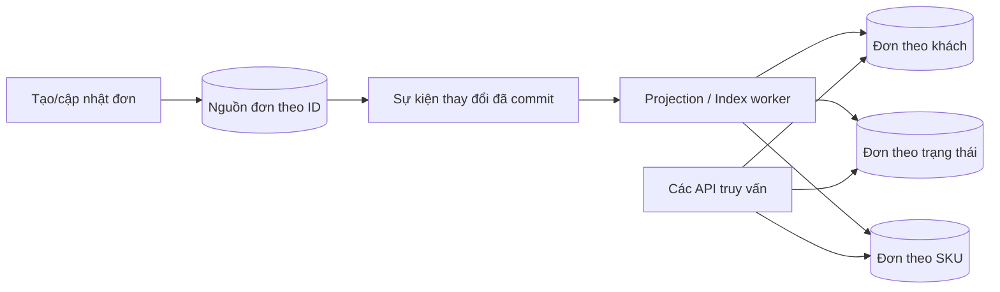

# Giới hạn truy vấn khi thông tin cần tìm không nằm trong khóa

## Mục tiêu học tập

Sau bài học, bạn có thể:

- Giải thích vì sao một kho **khóa–giá trị (key–value)** truy cập hiệu quả bằng khóa đã biết nhưng không đương nhiên tìm được bản ghi theo một trường chỉ nằm trong **giá trị**.
- Phân biệt đọc theo khóa, truy vấn theo tiền tố/khoảng, lọc sau khi đọc, quét toàn bộ và truy vấn qua chỉ mục; chỉ ra năng lực nào phụ thuộc hệ quản trị.
- Chuyển câu hỏi nghiệp vụ thành **mẫu truy cập**, xác định dữ liệu nào phải nằm trong khóa hoặc một **read model** riêng.
- Thiết kế chỉ mục đảo, khóa tra cứu phụ và bảng theo truy vấn; đánh giá số bản sao, chi phí ghi, phân trang và độ nhất quán.
- Nhận biết giới hạn của **khóa phân vùng và khóa sắp xếp** trong các hệ lưu trữ cột rộng (wide-column), đặc biệt với lọc xuyên phân vùng.
- Chọn giải pháp phù hợp giữa key–value, wide-column, document, quan hệ, công cụ tìm kiếm và hệ phân tích theo đặc điểm truy vấn thực tế.

Trong module **DATABASE_DATA_MODELING**, kỹ năng quan trọng là chuyển yêu cầu nghiệp vụ thành thực thể, quan hệ, ràng buộc, khóa, chỉ mục và lược đồ vật lý có thể kiểm chứng. Chương **Khóa giá trị và cột rộng** minh họa một nguyên tắc trung tâm: **có dữ liệu trong một value không có nghĩa hệ lưu trữ biết cách tìm value đó theo mọi thuộc tính bên trong**.

---

## 1. Vấn đề gốc: biết dữ liệu cần tìm nhưng không biết khóa

Giả sử kho dữ liệu bán hàng lưu mỗi đơn hàng theo khóa:

```text
order:v1:shop_17:ord_908
    -> {
         "customerId": "user_42",
         "status": "PAID",
         "createdAt": "2026-11-21T10:00:00Z",
         "items": [
           {"sku": "A17", "quantity": 2},
           {"sku": "B03", "quantity": 1}
         ],
         "totalMinor": 219000,
         "currency": "VND"
       }
```

Nếu API nhận `shopId = shop_17` và `orderId = ord_908` thì ứng dụng dựng được chính xác khóa:

```text
GET("order:v1:shop_17:ord_908")
```

Đây là mẫu truy cập tự nhiên của key–value. Nhưng thử hỏi:

- “20 đơn gần đây nhất của `user_42` là những đơn nào?”
- “Những đơn đang ở trạng thái `PAID` trong 7 ngày qua?”
- “Có bao nhiêu đơn chứa SKU `A17`?”
- “Tổng doanh thu tháng này theo từng nhóm sản phẩm?”
- “Tìm đơn có ghi chú chứa cụm từ ‘giao cuối tuần’?”

Những thuộc tính `customerId`, `status`, `items.sku` hay `note` có thể có **bên trong value**, nhưng truy vấn không cung cấp `orderId`. Nếu API kho lưu trữ chỉ hỗ trợ `GET(key)` và `PUT(key, value)`, kho không có một phép toán trực tiếp để trả về những khóa khớp điều kiện trên.

**Hai câu hỏi cần tách:**

1. **Value có mang thông tin đó không?** Có: thông tin nằm trong JSON.
2. **Có đường truy cập để xác định nhanh những value chứa thông tin đó không?** Chưa chắc: cần khóa phù hợp, chỉ mục, hoặc mô hình đọc khác.

Chỉ “thêm trường `status` vào JSON” thay đổi **cấu trúc dữ liệu**, không tự tạo **đường truy vấn** theo status.

> Trong bài này, “key–value thuần” chỉ mô hình có truy cập cơ bản bằng khóa đã biết. Nhiều sản phẩm thực tế bổ sung sorted set, secondary index, JSON query, scan hoặc giao dịch. Cần kiểm tra khả năng cụ thể thay vì khái quát mọi sản phẩm có cùng giới hạn.

## 2. Mô tả truy vấn trước khi chọn khóa

Một yêu cầu “tìm đơn hàng” quá mơ hồ để chọn lược đồ. Hãy viết truy vấn dưới dạng **đầu vào, điều kiện, sắp xếp, giới hạn và độ mới của dữ liệu**.

| Câu hỏi nghiệp vụ | Thông tin ứng dụng đã biết | Cần lọc / sắp xếp | Đầu ra | Đường truy cập cần có |
| --- | --- | --- | --- | --- |
| Chi tiết một đơn | `shopId, orderId` | Không | Một đơn | Tra cứu khóa chính |
| Đơn mới của một khách | `shopId, customerId` | `createdAt DESC`; lấy 20 | Danh sách | Chỉ mục theo khách và thời gian |
| Đơn PAID trong 7 ngày | `shopId, status, from, to` | Thời gian giảm dần | Danh sách | Chỉ mục theo trạng thái và thời gian |
| Đơn chứa một SKU | `shopId, sku` | Có thể thêm khoảng ngày | Danh sách ID | Chỉ mục đảo hoặc search/read model |
| Tìm trong ghi chú | Cụm từ tự do | Điểm phù hợp, có thể lọc tenant | Danh sách phù hợp | Bộ máy tìm kiếm toàn văn |
| Doanh thu theo tháng | Tháng, shop hoặc vùng | `SUM`, `GROUP BY` | Bảng tổng hợp | Mô hình phân tích / aggregate |
| Khách theo email | Email nhập vào | So khớp chính xác | Một user | Khóa tra cứu phụ hoặc unique index |

Các câu hỏi tiếp theo giúp xác định giải pháp:

- Điều kiện lọc là **equality**, **range**, **prefix**, **full-text** hay tổ hợp nhiều điều kiện?
- Cần **một bản ghi**, **top N**, **tất cả bản ghi**, hay **một giá trị tổng hợp**?
- Độ mới bắt buộc là **tức thời** hay chấp nhận độ trễ cập nhật chỉ mục?
- Có phân trang, sort ổn định và giới hạn số kết quả không?
- Dữ liệu thuộc một tenant hay xuyên tenant? Ai được phép xem?
- Truy vấn chạy bao nhiêu lần mỗi giây? Có phát sinh thêm điều kiện lọc tùy ý không?

Một mô hình có thể tốt cho truy vấn A nhưng không đáp ứng được truy vấn B nếu không thêm đường truy cập.

## 3. Vì sao quét rồi lọc có giới hạn?

Cách đơn giản nhất về mặt ý tưởng là đọc **mọi value**, giải mã JSON rồi chọn những value có `status = "PAID"`:

```text
results = []
for key in store.iterateAllKeys():
    order = decode(store.get(key))
    if order.shopId == "shop_17" and order.status == "PAID":
        results.append(order)
return results
```

Đây là **giả mã minh họa sự tốn kém**, không phải gợi ý triển khai endpoint nghiệp vụ. Không phải kho key–value nào cũng có API liệt kê tất cả khóa. Nhiều sản phẩm có thao tác scan từng trang nhưng **không bảo đảm ảnh chụp nhất quán**, không duy trì thứ tự nghiệp vụ hoặc không tự truy vấn theo thuộc tính value.

### 3.1. Chi phí tăng theo tập dữ liệu phải xem xét

Nếu có `N` đơn hàng, mỗi value có kích thước trung bình `S` byte, thì quét để xét điều kiện có thể phải đọc lượng dữ liệu cỡ:

\[
\text{Dữ liệu đọc} \approx N \times S
\]

Ví dụ:

- Có 10 triệu đơn hàng.
- Mỗi value trung bình 2 KiB.
- Màn hình chỉ cần 20 đơn PAID gần nhất của một shop.

Nếu phải đọc hết value, payload ước tính là **19,1 GiB** (10 triệu × 2 KiB), chưa tính metadata, các lượt request, replication và chi phí giải mã. Dù chỉ trả về 20 đơn, **chi phí lọc** vẫn gắn với số bản ghi phải đọc, không gắn với số kết quả.

Ngược lại, một chỉ mục phù hợp có thể xác định khoảng 20–vài chục ứng viên rồi chỉ đọc những đơn cần thiết. Chi phí cụ thể tùy kiểu chỉ mục và sản phẩm, nhưng khác biệt về mô hình truy cập là rất lớn.

### 3.2. “Phân trang scan” không đồng nghĩa “phân trang kết quả truy vấn”

Giả sử scan trả 1.000 key/lần. Sau khi lọc, mỗi trang chỉ có 0–5 đơn phù hợp. Để tìm đủ 20 kết quả, ứng dụng có thể cần đọc rất nhiều trang; nếu dữ liệu đang được ghi/xóa, kết quả qua các trang có thể thay đổi và không tương ứng với một snapshot.

Do đó, **`LIMIT 20` đặt sau bước lọc** không tự giảm lượng dữ liệu phải quét. Một query tối ưu phải có khả năng **giới hạn tập ứng viên trước khi đọc nhiều value**.

Quét toàn bộ vẫn có chỗ dùng: kiểm kê, đối soát, backfill, tái tạo chỉ mục, kiểm thử trên tập nhỏ hoặc tác vụ nền được kiểm soát. Nó thường không phù hợp cho màn hình trực tuyến có yêu cầu độ trễ thấp và tập dữ liệu tăng liên tục.

### 3.3. Lọc sau khi lấy khác với dùng chỉ mục

Một số API nhận biểu thức lọc nhưng vẫn phải đọc nhiều hàng rồi mới loại bản ghi không khớp.

| Cơ chế | Hệ thống phải đọc cái gì? | Hệ quả |
| --- | --- | --- |
| **Tra cứu khóa trực tiếp** | Một khóa đã biết | Phù hợp đọc một đối tượng |
| **Index lookup** | Các mục chỉ mục khớp điều kiện | Giảm tập ứng viên nếu chỉ mục chọn lọc |
| **Range scan trong partition** | Một dải khóa đã được tổ chức sẵn | Hữu ích khi điều kiện khớp đường sort |
| **Filter sau khi scan/query** | Các hàng/entry trong phạm vi đọc trước đó | Tiết kiệm dữ liệu trả về nhưng có thể không giảm tương ứng chi phí đọc |
| **Full scan** | Toàn bộ hoặc phần lớn tập dữ liệu | Chi phí phụ thuộc kích thước tập lưu trữ |

Cần đọc mô tả thực thi của sản phẩm: hai câu lệnh có cùng cú pháp `WHERE status = 'PAID'` không có nghĩa chúng sử dụng chỉ mục giống nhau.

## 4. Tiền tố của key có thể giúp tới đâu?

Một suy luận phổ biến là nếu khóa có dạng:

```text
order:shop_17:ord_908
order:shop_17:ord_909
order:shop_18:ord_910
```

thì có thể đọc mọi key bắt đầu bằng `order:shop_17:`. Điều này **chỉ đúng khi hệ lưu trữ cung cấp truy vấn theo prefix hoặc thứ tự key phù hợp**.

- Với hệ **hash key–value**, các khóa có cùng tiền tố có thể được phân phối tới các vị trí hoàn toàn khác nhau.
- Với hệ **ordered key–value** lưu khóa theo thứ tự byte, range scan bằng tiền tố có thể hiệu quả nếu encoding được thiết kế tương thích.
- Với dịch vụ có **index trên partition key/sort key**, việc đọc một nhóm key phải tuân theo cấu trúc partition/sort thực sự, không dựa vào vị trí dấu hai chấm trong một chuỗi.

**Ví dụ phân biệt:**

```text
A. GET("order:shop_17:ord_908")
   -> Truy cập bằng khóa đã biết.

B. SCAN prefix "order:shop_17:"
   -> Cần năng lực duyệt prefix và chi phí được công bố.

C. QUERY partition = shop_17, sort between t1 and t2
   -> Cần lược đồ hỗ trợ partition và sort theo thời gian.
```

Ngay cả khi có prefix scan, mẫu `order:shopId:orderId` chưa phục vụ tốt câu hỏi “20 đơn mới nhất” nếu `orderId` không có thứ tự theo thời gian. Có thể phải thêm một đường truy cập sắp theo `createdAt`. Không nên coi một key string “trông có tổ chức” là một chỉ mục tổng quát.

## 5. Cách giải quyết: chủ động tạo đường truy cập theo truy vấn

Khi thông tin cần tìm không nằm trong khóa chính, có một số hướng giải quyết:

1. **Thay/thiết kế thêm khóa tra cứu** để truy cập trực tiếp theo thông tin đã biết.
2. **Tạo chỉ mục phụ hoặc chỉ mục đảo** ánh xạ điều kiện lọc sang khóa chính.
3. **Tạo read model/bảng riêng** tổ chức dữ liệu theo partition và sort mà truy vấn cần.
4. **Dùng hệ lưu trữ có truy vấn thuộc tính**: document, quan hệ hoặc tính năng secondary index của sản phẩm.
5. **Đưa yêu cầu tìm kiếm/đọc phân tích sang hệ phù hợp**: full-text search engine, columnar analytics, data warehouse.

Không có lựa chọn miễn phí: thêm đường đọc thường tăng số lần ghi, dung lượng và yêu cầu đồng bộ.

### 5.1. Một thực thể, nhiều đường truy cập

Đơn hàng được lưu chính theo ID:

```text
order:v1:shop_17:ord_908
    -> {customerId: user_42, status: PAID, createdAt: t1, ...}
```

Có thể thêm chỉ mục theo khách:

```text
customer-orders:v1:shop_17:user_42:202611
    -> [ord_908, ord_905, ord_901, ...]
```

Đây chỉ là cấu trúc khái niệm. Nếu value là danh sách ID, phải quy định cách sắp xếp, kích thước tối đa, thao tác thêm/xóa nguyên tử, xử lý ghi đồng thời và phân trang. Một danh sách đơn tăng vô hạn trong một value sẽ tạo ra chính vấn đề kích thước/ghi đè mà ta đang giải quyết.

Với kho hỗ trợ kiểu dữ liệu danh sách có thứ tự hay sorted set, có thể dùng thao tác native phù hợp. Với wide-column, thường tổ chức dữ liệu trực tiếp thành nhiều hàng có cùng partition key và clustering key để đọc theo khoảng. Với hệ quan hệ, có thể tạo chỉ mục trên `(shop_id, customer_id, created_at, order_id)`.

### 5.2. Phân biệt dữ liệu gốc và dữ liệu dẫn xuất

Có thể coi:

- **Bản ghi đơn hàng chính** là nguồn dữ liệu có thẩm quyền cho trạng thái, số tiền, khách và lịch sử của một đơn.
- **Bảng đơn theo khách** là bản sao/đường đọc nhằm tối ưu màn hình lịch sử.
- **Chỉ mục đơn theo trạng thái** là đường đọc cho bảng điều hành.
- **Tổng hợp doanh thu** là kết quả phân tích được tính theo quy tắc nghiệp vụ.

Cần chỉ rõ nguồn nào có thẩm quyền quyết định khi chúng lệch nhau. Một read model bị chậm không được tự ý trở thành nguồn chân lý nếu điều đó gây ghi đè trạng thái đơn mới hơn.

## 6. Minh họa mô hình wide-column theo mẫu truy cập

Một số cơ sở dữ liệu cột rộng vận hành bằng **partition key** kết hợp **clustering key**; cấu trúc này hỗ trợ truy vấn theo nhóm và thứ tự đã thiết kế. Ví dụ bên dưới mang phong cách Cassandra/CQL để minh họa, **không phải cú pháp áp dụng cho mọi sản phẩm wide-column**.

### 6.1. Bảng chính theo ID đơn hàng

```sql
CREATE TABLE orders_by_id (
    shop_id text,
    order_id text,
    customer_id text,
    status text,
    created_at timestamp,
    total_minor bigint,
    currency text,
    PRIMARY KEY ((shop_id, order_id))
);
```

Đường đọc:

```sql
SELECT *
FROM orders_by_id
WHERE shop_id = 'shop_17'
  AND order_id = 'ord_908';
```

Đây là đường tìm chính xác một đơn theo đủ khóa phân vùng. **Không** có nghĩa bảng này đọc nhanh những đơn của `user_42` chỉ vì nó có cột `customer_id`.

### 6.2. Bảng theo khách và thời gian

Để đọc lịch sử một khách, tạo read model:

```sql
CREATE TABLE orders_by_customer (
    shop_id text,
    customer_id text,
    month_bucket text,
    created_at timestamp,
    order_id text,
    status text,
    total_minor bigint,
    PRIMARY KEY (
        (shop_id, customer_id, month_bucket),
        created_at,
        order_id
    )
) WITH CLUSTERING ORDER BY (created_at DESC, order_id ASC);
```

Ví dụ truy vấn một tháng:

```sql
SELECT order_id, created_at, status, total_minor
FROM orders_by_customer
WHERE shop_id = 'shop_17'
  AND customer_id = 'user_42'
  AND month_bucket = '202611'
LIMIT 20;
```

Kết quả nằm trong **partition của một khách trong một tháng**, sắp theo thời gian và ID. Nếu chưa đủ 20 đơn thì ứng dụng có thể đọc tháng trước rồi gộp kết quả theo quy tắc phân trang. Việc dùng `month_bucket` tránh một partition tăng vô hạn trong nhiều năm, nhưng làm tăng số partition phải đọc khi truy vấn xuyên nhiều tháng.

**Vì sao phải có `order_id` trong clustering key?** Hai đơn có thể có cùng timestamp; thêm ID phân định để mỗi hàng khác nhau. Thứ tự mới nhất chỉ có ý nghĩa rõ nếu thời gian, độ chính xác và quy tắc xử lý sự kiện cùng thời điểm được định nghĩa.

### 6.3. Bảng theo status và khoảng thời gian

Nếu dashboard cần “đơn PAID phát sinh trong bảy ngày gần nhất”, có thể tổ chức thêm:

```sql
CREATE TABLE orders_by_status_day (
    shop_id text,
    status text,
    day_bucket date,
    created_at timestamp,
    order_id text,
    customer_id text,
    PRIMARY KEY (
        (shop_id, status, day_bucket),
        created_at,
        order_id
    )
) WITH CLUSTERING ORDER BY (created_at DESC, order_id ASC);
```

Ứng dụng xác định những ngày giao với khoảng truy vấn và đọc partition của từng ngày cho đúng status. Dữ liệu nhiều ngày cần được **hợp nhất/sắp xếp** ở lớp gọi nếu API yêu cầu một danh sách thời gian thống nhất. Chi phí đọc tăng theo số ngày, không tự động chỉ là một query.

Khi status đơn thay đổi từ `PAID` sang `SHIPPED`, hàng trong read model status **phải rời nhóm PAID và xuất hiện trong nhóm SHIPPED** theo chính sách cập nhật. Chỉ sửa trường `status` trong bảng chính không tự làm hàng chuyển partition ở bảng phụ.

Cũng cần hỏi liệu dashboard cần “đơn tạo trong 7 ngày gần nhất hiện đang PAID” hay “đơn chuyển sang PAID trong 7 ngày gần nhất”. Hai câu này dùng hai loại thời gian khác nhau:

- **`createdAt`:** thời điểm tạo đơn.
- **`statusChangedAt`:** thời điểm trạng thái chuyển đổi.

Chọn nhầm thời gian trong khóa sắp xếp sẽ trả kết quả sai dù câu truy vấn chạy rất nhanh.

### 6.4. Những giới hạn quan trọng của wide-column

Với họ cơ sở dữ liệu dùng partition/clustering:

- Truy vấn thường phải xác định **đúng partition key hoặc tập partition được hỗ trợ** để tránh quét rộng.
- Clustering key cho phép truy vấn theo thứ tự/phạm vi **trong partition**, nhưng không đương nhiên tìm trên toàn bộ dữ liệu.
- Lọc theo cột thường không phải khóa có thể bị giới hạn hoặc đòi thêm chỉ mục.
- Chỉ mục phụ và tính năng lọc có thể tồn tại nhưng **không luôn phù hợp dữ liệu cardinality thấp, hot partition hoặc truy vấn xuyên tập lớn**.
- Phân vùng quá lớn, quá nhỏ hoặc quá nóng đều tác động tới hiệu năng; bucket thời gian và phân phối tải phải dựa trên ước lượng thực tế.

Vì vậy, “có cột `status`” không đủ để bảo đảm query theo status hiệu quả. Cần biết cột đó có tham gia đường truy cập, chỉ mục hay read model nào không.

## 7. Thiết kế chỉ mục đảo khi điều kiện nằm trong tập con

Một câu hỏi khác: “Những đơn nào có sản phẩm SKU `A17`?” Mỗi đơn chứa danh sách `items` trong value, và SKU không nằm trong key chính.

**Chỉ mục đảo (inverted index)** đổi hướng ánh xạ:

```text
Đường chính:
orderId -> Order{items: [A17, B03], ...}

Đường đảo:
SKU A17 -> [orderId_1, orderId_2, ...]
SKU B03 -> [orderId_1, orderId_9, ...]
```

Nếu cần phân chia theo shop:

```text
orders-by-sku:v1:shop_17:A17:<bucket> -> tập ID đơn trong bucket
```

Một thiết kế wide-column có thể biểu diễn mỗi quan hệ SKU–đơn thành một hàng, với partition theo `(shopId, sku, monthBucket)` và sort theo `(createdAt, orderId)`. Khi truy vấn, ứng dụng tìm candidate IDs rồi lấy chi tiết từ bản ghi đơn chính nếu cần.

**Những câu hỏi phải giải quyết trước khi tạo chỉ mục:**

- Một đơn có nhiều item cùng SKU không? Chỉ mục thường cần một quan hệ **(SKU, orderId)** duy nhất.
- Khi đơn bị hủy/xóa, entry trong chỉ mục được xóa ngay, đánh dấu hay giữ vì mục đích lịch sử?
- Truy vấn yêu cầu đơn “có SKU trong 7 ngày” hay “còn đang xử lý và có SKU”? Nếu thêm điều kiện status, chỉ mục có thể vẫn trả nhiều ứng viên phải lọc thêm.
- SKU nổi tiếng có thể liên quan hàng triệu đơn. Một value chứa toàn bộ ID có thể trở nên quá lớn; nên phân đoạn/bucket hoặc chọn index chuyên dụng.
- Index chứa ID và thời gian hay lưu cả chi tiết? Lưu thêm trường tiện hiển thị làm tăng chi phí đồng bộ khi giá trị thay đổi.

### 7.1. Truy vấn nhiều điều kiện là một bài toán khác

“Đơn PAID có SKU A17 trong tháng 11, sắp theo số tiền giảm dần” không tự trở nên nhanh khi có riêng index theo status và index theo SKU.

Có thể cần:

1. Lấy tập ứng viên từ một index rồi kiểm tra những điều kiện còn lại trên bản ghi chính.
2. Giao tập ứng viên của nhiều index, nếu sản phẩm hỗ trợ và tập đủ nhỏ.
3. Tạo read model cho một nhóm truy vấn phổ biến với bộ khóa/sort phù hợp.
4. Dùng công cụ tìm kiếm hoặc quan hệ có optimizer/index theo điều kiện thực tế.

Tạo mọi tổ hợp chỉ mục cho mọi trường sẽ làm số index tăng mạnh, tăng write amplification, dung lượng, chi phí bảo trì và rủi ro sai lệch. **Chỉ số cần có** không được quyết định chỉ bằng số trường trong JSON mà bằng tập truy vấn có giá trị và tần suất đủ lớn.

## 8. Chỉ mục phụ, lọc sau đọc và khác biệt giữa sản phẩm

Các nhóm cơ sở dữ liệu cung cấp khả năng khác nhau. Bảng sau là định hướng mô hình, **không thay thế việc kiểm tra phiên bản/cấu hình của sản phẩm**.

| Hướng lưu trữ | Đường truy cập thường mạnh | Khi thông tin không nằm trong khóa |
| --- | --- | --- |
| **Key–value thuần** | `GET` theo khóa đầy đủ | Tạo ánh xạ phụ/read model hoặc chọn công nghệ có index |
| **Ordered key–value** | Đọc key và range theo thứ tự byte | Mã hóa key để nhóm và sắp thứ tự; điều kiện trên value vẫn có thể cần index |
| **Wide-column** | Partition key + clustering/sort key | Thiết kế bảng theo truy vấn; tính năng secondary index tùy sản phẩm |
| **Document database** | Truy vấn field trong document khi có index phù hợp | Tạo index trên path/thuộc tính; kiểm tra selectivity, sort, giới hạn và transaction |
| **RDBMS** | Truy vấn SQL, join, constraint và optimizer | Dùng B-tree/kiểu index khác phù hợp, đánh giá execution plan |
| **Search engine** | Full-text, scoring, tokenization, filter | Lập chỉ mục văn bản và cấu hình analyzer; thường cần nguồn chân lý riêng |
| **Kho phân tích/columnar OLAP** | Scan cột, lọc và tổng hợp trên tập lớn | Thiết kế partition/sort/aggregate theo batch hoặc streaming analytics |

Một secondary index có thể là công cụ rất tốt khi truy vấn đơn giản, selectivity cao và hệ quản trị bảo đảm mức nhất quán cần thiết. Nhưng index không phải “miễn phí”: hệ thống phải duy trì chúng khi ghi, xóa hoặc cập nhật giá trị, và có thể cần đọc bảng chính để trả đủ trường.

### 8.1. Chỉ mục có độ chọn lọc khác nhau

Giả sử có 10 triệu đơn:

- `orderId` có gần 10 triệu giá trị khác nhau: lọc theo một ID chọn rất ít bản ghi.
- `status` có 5 giá trị: lọc riêng `status=PAID` có thể trả hàng triệu đơn.
- `(shopId, status, createdAt)` có thể phục vụ một truy vấn được giới hạn theo shop và thời gian tốt hơn tùy phân bố dữ liệu.

**Độ chọn lọc (selectivity)** chỉ là một yếu tố. Cần thêm **cardinality**, phân bố lệch, thứ tự sort, phạm vi dữ liệu và kích thước kết quả. Một index status có thể hợp lý cho màn hình “PAID mới phát sinh trong 5 phút” nhưng không hợp lý nếu câu hỏi luôn yêu cầu quét toàn bộ `PAID` trong lịch sử nhiều năm.

### 8.2. Khi nào không nên tạo chỉ mục cho từng thuộc tính?

Không phải mọi trường đều cần chỉ mục:

- Trường chỉ dùng để hiển thị sau khi đã biết `orderId`.
- Trường hiếm khi lọc, và scan ngoại tuyến theo lịch đã đủ phục vụ nghiệp vụ.
- Trường có thay đổi liên tục nhưng không tạo giá trị đáng kể cho đọc.
- Trường chứa văn bản tự do cần khả năng tách từ/điểm phù hợp thay vì so sánh bằng.
- Trường chứa dữ liệu nhạy cảm mà việc lập chỉ mục cần đánh giá riêng về quyền truy cập, mã hóa và vòng đời.

Một **chỉ mục hữu ích** phải phục vụ ít nhất một mẫu truy cập đã xác định, có cách bảo trì đáng tin cậy và chi phí phù hợp SLA.

## 9. Cái giá của read model: đồng bộ và nhất quán

Để đọc “đơn PAID theo shop” nhanh, ta có thể duy trì hai cấu trúc:



Sơ đồ thể hiện một kiến trúc **cập nhật read model theo sự kiện**, không mặc định rằng sự kiện được gửi an toàn chỉ bằng cách gọi hai dịch vụ lần lượt. Hệ thống phải bảo đảm thay đổi nguồn được ghi và sự kiện cần thiết không bị thất lạc theo kiến trúc đã chọn (ví dụ thông qua outbox khi công nghệ nguồn và workflow hỗ trợ).

### 9.1. Trạng thái chuyển đổi có thể làm lệch index

Giả sử:

```text
Order ord_908:
  version 7: status = PAID
  version 8: status = SHIPPED
```

Projection phải loại bản ghi khỏi index PAID và thêm vào index SHIPPED. Nếu worker thực hiện thao tác thứ hai rồi lỗi trước thao tác thứ nhất, một thời gian đơn có thể xuất hiện ở cả hai nhóm. Nếu làm theo thứ tự ngược, có thể tạm thời không xuất hiện ở nhóm nào.

Do đó phải chọn mô hình nhất quán:

- **Mạnh/tức thời:** cập nhật bản ghi và các index trong giao dịch được sản phẩm hỗ trợ, hoặc dùng cơ sở dữ liệu có index do engine quản lý đáp ứng yêu cầu.
- **Cuối cùng (eventual consistency):** chấp nhận read model chậm; API hiển thị hoặc xử lý nghiệp vụ cần hiểu giới hạn này.
- **Kết hợp:** đọc danh sách bằng index rồi kiểm tra lại trạng thái từ nguồn chính khi hành động nhạy cảm cần đúng tại thời điểm xử lý.

Không được dùng index đã chậm làm bằng chứng duy nhất cho nghiệp vụ cần bảo đảm mạnh như “đơn này đã thanh toán chưa?” hoặc “có thể hoàn tiền không?” nếu trạng thái có thể thay đổi.

### 9.2. Xử lý sự kiện trùng và đến sai thứ tự

Một hệ thống sự kiện thực tế có thể giao lại sự kiện hoặc gửi lệch thứ tự. Ví dụ event `version=8, SHIPPED` tới trước event `version=7, PAID`. Nếu projection áp dụng event 7 sau cùng, index sẽ bị tua ngược về trạng thái cũ.

Giải pháp thường cần:

1. Định danh event và `orderId` ổn định.
2. Phiên bản đơn tăng theo quy tắc đơn điệu **trên từng đơn**.
3. Projection lưu phiên bản đã áp dụng và chỉ chấp nhận cập nhật mới hơn với thao tác có điều kiện đủ nguyên tử.
4. Cập nhật entry cũ/mới theo cơ chế chống lặp; lưu thông tin để xóa entry chỉ mục cũ.
5. Cơ chế retry, dead-letter/quarantine và **đối soát định kỳ** với nguồn chân lý.

Giả mã định hướng:

```text
onOrderChanged(event):
    identity = (event.shopId, event.orderId)
    projection = indexState.get(identity)

    if projection.exists and event.version <= projection.version:
        return  # Trùng hoặc cũ hơn

    # Cần một cơ chế commit/projection phù hợp:
    # loại entry của trạng thái cũ, thêm entry mới,
    # và lưu appliedVersion một cách idempotent.
    projectChangeWithConsistencyRule(projection, event)
```

Đây là **giả mã diễn đạt yêu cầu**, không phải giao dịch có thể triển khai nguyên xi. Nếu index thay đổi trên nhiều partition mà hệ lưu trữ không hỗ trợ giao dịch, cần thiết kế workflow khôi phục và đối soát; chỉ kiểm tra `version` ngoài thao tác ghi không ngăn tranh chấp giữa các worker.

### 9.3. Độ trễ đồng bộ phải là một hợp đồng

Nếu dashboard cho phép trễ 10 giây, hãy công bố rõ ý nghĩa và đo **index lag**. Nếu khách vừa tạo đơn và cần thấy ngay trong “Đơn của tôi”, có thể áp dụng đọc từ nguồn chính theo ID cho đơn mới, hoặc chọn chiến lược đồng bộ đáp ứng yêu cầu *read-your-writes*.

Không nên nói chung chung rằng dữ liệu “real-time” khi thực tế chỉ là read model được cập nhật cuối cùng.

### 9.4. TTL, xóa và vòng đời chỉ mục

Khi bản ghi gốc hết hạn hoặc bị xóa, entry index tương ứng có thể không tự biến mất. Điều này tạo ra **orphan index entries**: query trả ID không còn bản ghi.

Cần thống nhất:

- TTL của nguồn và TTL/chính sách xóa của index.
- Cơ chế nhận biết delete, tombstone hoặc thay đổi vòng đời.
- Cách bỏ qua ứng viên không còn dữ liệu và thống kê mức lệch.
- Quy trình rebuild từ dữ liệu còn hiệu lực.
- Cách xử lý xóa vì yêu cầu riêng tư trên **tất cả** bản sao đọc, cache và hệ tìm kiếm theo chính sách áp dụng.

Với hệ wide-column, TTL/tombstone là cơ chế riêng có hệ quả vận hành; không nên đặt TTL ở nhiều bản sao rồi giả định mọi bản sao hết hạn đồng bộ chính xác cùng thời điểm.

## 10. Phân trang và sắp xếp không được thêm sau cùng

Một câu truy vấn thường không dừng ở “tìm được bản ghi”; người dùng cần danh sách ổn định, sắp mới nhất và cuộn trang. Nếu chỉ mục theo khách lưu theo `(createdAt DESC, orderId)`, hai trường này cũng có thể làm **cursor** để phân trang theo khóa.

Ví dụ:

```text
Request:
  shopId=shop_17
  customerId=user_42
  limit=20
  cursor=(createdAt=2026-11-15T08:30:00Z, orderId=ord_850)

Meaning:
  tiếp tục sau phần tử có tuple sắp xếp đã trả cuối trang trước
```

Cần xác định **điều kiện so sánh tuple tương ứng với chiều sort**. Chỉ dùng timestamp làm cursor có thể bỏ sót/hai lần đọc các đơn có cùng thời gian. Dùng `OFFSET` lớn có thể tốn kém, không phù hợp với nhiều hệ lưu trữ phân tán.

Cũng phải xét:

- **Dữ liệu đến mới giữa hai trang:** danh sách trực tiếp có thể dịch chuyển; cursor giúp tránh một số lỗi so với offset nhưng không tự tạo snapshot bất biến.
- **Dữ liệu đổi trạng thái:** một đơn có thể rời tập kết quả ngay giữa các lần request.
- **Nhiều partition/bucket:** cần lưu trạng thái cursor phù hợp để hợp nhất các luồng dữ liệu đã sắp thứ tự.
- **Bảo mật:** cursor cần gắn với tenant, bộ lọc và sắp xếp; không dùng cursor để bỏ qua kiểm tra quyền.
- **Giới hạn:** áp `limit` tối đa để tránh truy vấn rộng không kiểm soát.

Nếu nghiệp vụ yêu cầu một **snapshot chính xác** trong nhiều trang, phải có cơ chế snapshot/PIT/phiên bản truy vấn do sản phẩm hỗ trợ hoặc chấp nhận mô hình dữ liệu/chi phí khác. Cursor của read model cuối cùng không bảo đảm ảnh chụp nhất quán.

## 11. Quan hệ, tìm kiếm văn bản và phân tích: khi nào nên đổi mô hình?

Một phần giới hạn không giải quyết tốt bằng việc thêm nhiều key phụ. Mỗi loại truy vấn có mô hình phù hợp hơn.

### 11.1. Truy vấn quan hệ và ràng buộc giao dịch

Ví dụ: “Tìm tất cả đơn của các khách thuộc nhóm doanh nghiệp, có sản phẩm thuộc danh mục X, đã thanh toán, nhưng chưa xuất hóa đơn.” Truy vấn đi qua nhiều thực thể, quan hệ và điều kiện thay đổi.

Nếu đây là truy vấn nghiệp vụ quan trọng, mô hình quan hệ với **khóa chính, khóa ngoại, index, join và transaction** thường là hướng tự nhiên. Vẫn có thể tối ưu bằng materialized view hoặc denormalization, nhưng trước hết cần đánh giá khả năng diễn đạt ràng buộc và kế hoạch thực thi.

Một read model NoSQL chứa nhiều trường lặp có thể phục vụ **một dashboard cụ thể** nhanh, song phải cập nhật lại khi khách đổi phân loại, sản phẩm đổi danh mục hay trạng thái hóa đơn đổi. Nhiều quan hệ thay đổi độc lập khiến chi phí đồng bộ tăng đáng kể.

### 11.2. Tìm kiếm toàn văn

Điều kiện “ghi chú chứa từ khóa giống ‘giao cuối tuần’” không giống equality trên một trường.

Bộ máy full-text cần xử lý:

- Tokenization và chuẩn hóa ngôn ngữ.
- Truy vấn từ/cụm từ, ranking, lỗi chính tả hoặc synonym nếu có.
- Bộ lọc tenant, thời gian và quyền truy cập.
- Cập nhật index khi ghi chú đổi hoặc bị xóa.

Kho key–value không tự có các khả năng này vì value là chuỗi JSON. Nếu dùng search engine bên ngoài, cần xác định mức nhất quán, cách build lại index và quy tắc **không trả tài liệu mà người gọi không có quyền**.

### 11.3. Phân tích và tổng hợp

“Doanh thu theo tháng và danh mục sản phẩm trong 3 năm” là một workload khác với “mở chi tiết đơn hàng”.

Phân tích thường đọc nhiều bản ghi, nhóm, tổng hợp và quét một số cột. Có thể dùng:

- Hệ quan hệ/OLAP với index và partition thích hợp ở quy mô vừa.
- Kho phân tích lưu theo cột và xử lý batch/stream.
- Bảng tổng hợp `(shopId, month, category) → revenue`, được duy trì từ giao dịch/sự kiện với quy tắc đối soát.

Không nên tạo một key `revenue:global` cập nhật liên tục mà không giải quyết tranh chấp, idempotency, hoàn tiền, điều chỉnh và nguồn dữ liệu có thẩm quyền. Tổng hợp tài chính đòi hỏi định nghĩa rõ thời điểm ghi nhận, tiền tệ, thuế, hoàn tiền và điều kiện chỉnh sửa.

## 12. Quy trình chọn hướng xử lý cho một truy vấn mới

Có thể áp dụng quy trình bảy bước:

1. **Viết query contract:** đầu vào, lọc, sort, giới hạn, phân trang, tenant, tần suất và yêu cầu nhất quán.
2. **Xem đường truy cập đang có:** có đủ key để `GET` không? Có partition/range index phù hợp không? Lệnh lọc có thật sự giảm số hàng đọc không?
3. **Ước lượng tập ứng viên:** bao nhiêu dữ liệu phải đọc để tìm đủ kết quả? Có hot tenant và phân bố lệch không?
4. **Chọn giải pháp nhỏ nhất đáp ứng yêu cầu:** key trực tiếp, secondary index, read model, search, quan hệ hay phân tích.
5. **Thiết kế ghi và đồng bộ:** ai cập nhật index, khi nào, bảo đảm nào, xử lý event trùng, out-of-order và rebuild ra sao?
6. **Xác định vòng đời và bảo mật:** giữ/xóa entry, TTL, quyền tenant, phạm vi log/PII, backup và di trú.
7. **Kiểm chứng bằng workload:** đo latency p95/p99, số key/cell được đọc, byte đọc/ghi, tỉ lệ bỏ lọc, index lag và chi phí fan-out.

Bảng định hướng:

| Nếu nhu cầu chủ yếu là… | Thử hướng này trước | Kiểm tra điểm yếu |
| --- | --- | --- |
| Lấy một object theo ID đã biết | Key–value theo khóa chính | Key ổn định, đồng thời, TTL, kích thước value |
| Liệt kê theo một nhóm và thứ tự | Partition + sort, hoặc index ghép | Partition lớn/nóng, query xuyên bucket |
| Lọc theo một thuộc tính ngoài khóa | Secondary index hoặc read model | Selectivity, cập nhật index, tính nhất quán |
| Tìm từ khóa/ngữ nghĩa trong văn bản | Search engine/index văn bản | Analyzer, quyền truy cập, index lag |
| Truy vấn quan hệ nhiều bảng linh hoạt | Cơ sở dữ liệu quan hệ | Execution plan, index, khóa/ràng buộc |
| Tổng hợp nhiều năm/nhiều thuộc tính | OLAP/warehouse/aggregate | Độ mới, chi phí ingest, đối soát |
| Truy vấn phát sinh tùy ý của người dùng | Kho hỗ trợ query planner/index phù hợp | Chi phí chỉ mục và hiệu năng truy vấn ngoài dự kiến |

Cẩn thận với xu hướng “cứ cần tìm theo thuộc tính nào thì tạo một bảng sao chép”. Khi nhu cầu truy vấn thay đổi liên tục, việc duy trì hàng chục read model có thể tốn hơn dùng một hệ truy vấn có chỉ mục và optimizer phù hợp ngay từ đầu.

## 13. Kiểm thử để chứng minh truy vấn đáp ứng nghiệp vụ

Một thiết kế khóa/đường đọc chỉ được coi là đầy đủ khi **kết quả đúng và chi phí chấp nhận được** dưới dữ liệu thực tế.

| Kiểm thử | Câu hỏi cần chứng minh |
| --- | --- |
| Tra cứu theo ID | Không đọc nhầm tenant hoặc trả đơn khác khi key trùng phần ID |
| Danh sách theo khách | Kết quả đúng khách, đúng thời gian, sắp ổn định khi timestamp trùng |
| Query theo status | Đơn thay status không còn được báo ở status cũ sau khi đạt mức nhất quán đã cam kết |
| Điều kiện liên hợp | Kết quả đáp ứng **tất cả** filter, không chỉ filter của index được chọn |
| Phân trang | Không bỏ sót hoặc trùng bất hợp lý giữa các trang theo hợp đồng snapshot/live đã định |
| Backfill chỉ mục | Có thể xây lại từ nguồn mà không bỏ sót cập nhật phát sinh trong lúc rebuild |
| Sự kiện gửi trùng | Projection không nhân đôi entry hoặc cộng tổng hợp hai lần |
| Sự kiện sai thứ tự | Phiên bản cũ không ghi đè trạng thái mới hơn |
| Xóa/TTL | Không còn trả đối tượng đã hết vòng đời; entry index mồ côi được phát hiện/xử lý |
| Tải lệch | Tenant lớn, SKU phổ biến hoặc status phổ biến không tạo phân vùng/index nóng vượt SLA |
| Sai quyền | User tenant A không tìm thấy hoặc tải chi tiết đơn của tenant B qua index/cursor |
| Dữ liệu lớn | Không phải scan hầu hết kho để trả vài kết quả; giới hạn fan-out và byte đọc được đo |

**Bộ chỉ số nên quan sát:**

- Số hàng/key/index entry phải đọc trên mỗi kết quả thực sự trả.
- Phân vị thời gian phản hồi p50/p95/p99 theo loại truy vấn.
- Số partition hoặc bucket phải đọc, nhất là truy vấn xuyên thời gian.
- Chỉ mục chậm bao lâu so với nguồn chính; tỉ lệ bản ghi mồ côi hoặc thiếu.
- Số lần ghi thêm trên mỗi thay đổi nguồn; dung lượng index và chi phí rebuild.
- Tỉ lệ query phải fallback sang scan, số truy vấn bị giới hạn/thất bại.

Các phép đo giúp phát hiện tình huống “demo vài trăm bản ghi chạy rất nhanh” nhưng workload hàng triệu bản ghi lại không đáp ứng mục tiêu.

## 14. Bài tập vận dụng

### Bài tập A — Giá trị có field nhưng chưa có đường truy cập

Kho lưu:

```text
product:v1:<productId> -> {
    "brand": "BrandX",
    "category": "coffee",
    "priceMinor": 129000
}
```

Yêu cầu mới: “Hiển thị 30 sản phẩm cà phê có giá trong khoảng 100.000–200.000 đồng, sắp giá tăng dần.”

**Câu hỏi:** Vì sao không thể suy ra truy vấn hiệu quả từ cấu trúc JSON? Nêu hai hướng thiết kế khác nhau và các chi phí cần kiểm tra.

**Gợi ý:** Có thể dùng hệ document/quan hệ với index phù hợp trên `(category, priceMinor, productId)`, hoặc read model được nhóm theo category và sắp theo giá. Read model phải xử lý đổi giá/đổi danh mục và phân trang; nếu dùng key–value thuần cần phương pháp xác định ứng viên theo range.

### Bài tập B — Tên key có tiền tố đẹp

Kho lưu:

```text
order:shop_17:ord_01
order:shop_17:ord_02
order:shop_18:ord_03
```

Một đồng nghiệp đề xuất “quét prefix `order:shop_17:` là lấy được mọi đơn của shop nhanh như GET”.

**Câu hỏi:** Điều gì phải xác minh trước khi chấp nhận? Nếu cần “20 đơn mới nhất”, còn thiếu thông tin gì?

**Gợi ý:** Xem sản phẩm có prefix/range scan, cách key phân vùng và chi phí scan. Thứ tự `ord_01`/`ord_02` không đương nhiên tương ứng `createdAt`; cần đường sort theo thời gian hoặc index khác.

### Bài tập C — Chỉ mục status bị sai sau cập nhật

Đơn `ord_908` chuyển `PAID → SHIPPED`. Đơn chính đã được ghi nhưng bảng `orders_by_status` vẫn chứa entry PAID.

**Câu hỏi:** API tra cứu sẽ sai như thế nào? Nếu yêu cầu dashboard chấp nhận độ trễ 5 giây, nên định nghĩa và giám sát những gì?

**Gợi ý:** Index có thể trả đơn sai trạng thái hoặc trả trùng ở hai nhóm. Cần workflow cập nhật/xóa entry, idempotency, phiên bản để chống event sai thứ tự, index lag đo được, báo động khi vượt ngưỡng và đối soát/tái tạo. Hành động nghiệp vụ nhạy cảm phải kiểm tra lại nguồn chính nếu cần mạnh.

### Bài tập D — Lọc trong một partition

Một hệ wide-column dùng partition `(shopId, customerId, monthBucket)` và sort `(createdAt DESC, orderId)`. Truy vấn muốn “mọi đơn PAID của shop S từ 2024 đến 2026”.

**Câu hỏi:** Vì sao bảng này chưa đáp ứng tốt? Nếu tạo thêm bảng theo status, phải chú ý yếu tố nào khi số shop và số đơn tăng?

**Gợi ý:** Không có `customerId` nên không biết partition để đọc; phải fan-out qua nhiều khách và tháng. Cân nhắc bảng theo `(shopId, status, day/month bucket)` với chỉ mục thời gian và giới hạn hợp lý; theo dõi hot partition, lượng kết quả lớn, đồng bộ status và nhu cầu phân tích dài hạn.

### Bài tập E — Tìm kiếm và phân tích

Một ứng dụng được yêu cầu đồng thời:
- Tìm đơn theo đoạn ghi chú gần đúng, có hỗ trợ lỗi gõ.
- Tổng doanh thu theo vùng và danh mục trong 3 năm.
- Tải chi tiết một đơn từ `orderId`.

**Câu hỏi:** Có nên cố lưu tất cả thành một kiểu key để phục vụ ba chức năng?

**Gợi ý:** Đây là ba mẫu truy cập khác nhau: khóa chính cho chi tiết, search index cho văn bản và mô hình phân tích cho tổng hợp. Cần xác định nguồn chân lý và cơ chế đồng bộ, thay vì buộc một cấu trúc key–value phải thay mọi mô hình.

## Tổng kết kiến thức

Giới hạn quan trọng của key–value và nhiều thiết kế wide-column xuất hiện khi **điều kiện cần tìm không khớp khóa hoặc đường truy cập đã được tổ chức**. Value chứa `status`, `customerId` hay `items.sku` không đồng nghĩa hệ thống có thể truy vấn chúng hiệu quả. Scan, lọc sau đọc và giới hạn số kết quả không tự giải quyết sự thiếu vắng chỉ mục.

Thiết kế đúng bắt đầu từ **query contract**. Khi cần đường đọc khác, hãy tạo chỉ mục/read model có chủ đích hoặc chọn hệ lưu trữ phù hợp. Mỗi đường đọc mới phải có lời giải cho việc cập nhật đồng thời, xóa, TTL, phân trang, độ trễ đồng bộ và chi phí vận hành. Một mô hình dữ liệu có thể kiểm chứng là mô hình trả lời được cả hai câu hỏi: **“Truy vấn này lấy được kết quả đúng bằng cách nào?”** và **“Khi dữ liệu tăng hoặc thay đổi, chi phí và mức nhất quán còn đáp ứng nghiệp vụ không?”**
