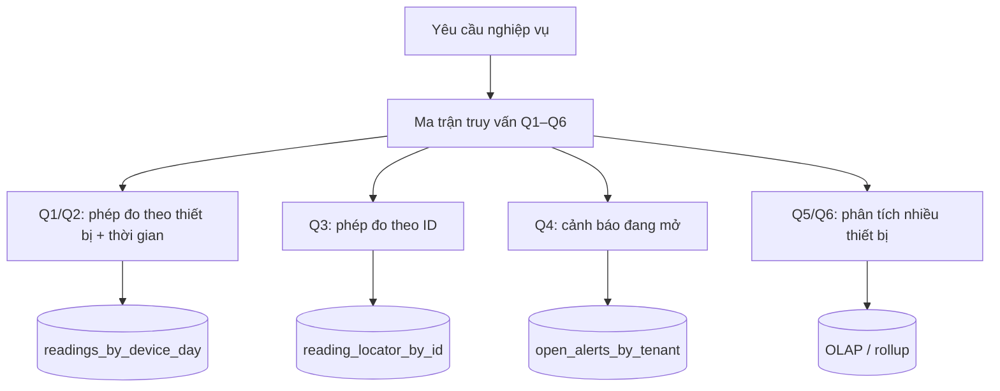
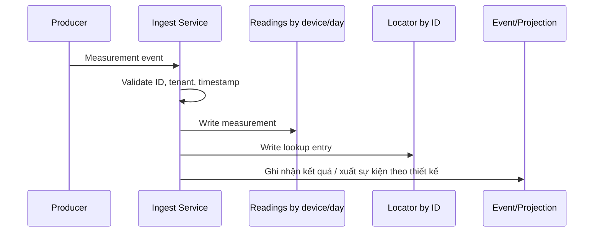

# Mô hình cột rộng và thiết kế bắt đầu từ câu truy vấn

## Mục tiêu học tập

Sau bài học, bạn có thể:

- Giải thích mô hình **cột rộng (wide-column)**, vai trò của partition key, clustering key, hàng và cột; phân biệt nó với kho phân tích lưu theo cột.
- Chuyển yêu cầu nghiệp vụ thành **bảng các mẫu truy vấn** có đầu vào, điều kiện lọc, thứ tự, giới hạn, tần suất và độ nhất quán.
- Thiết kế bảng hoặc nhóm hàng để trả lời một truy vấn mà không phải quét các partition không liên quan.
- Chọn ranh giới partition, khóa sắp xếp, bucket thời gian và cách phân trang theo dữ liệu thực tế.
- Giải thích vì sao thiết kế cột rộng thường dùng **nhiều bảng theo đường đọc** và cần chiến lược đồng bộ dữ liệu lặp.
- Nhận diện những rủi ro của hot partition, phân vùng tăng vô hạn, truy vấn lọc sau đọc, TTL/tombstone và sự kiện đến muộn.
- So sánh wide-column với khóa–giá trị, quan hệ, document và hệ phân tích để chọn giải pháp có thể mở rộng và kiểm chứng.

Trong module **DATABASE_DATA_MODELING**, mục tiêu là chuyển yêu cầu nghiệp vụ thành thực thể, quan hệ, ràng buộc, khóa, chỉ mục và lược đồ vật lý. Chương **Khóa giá trị và cột rộng** nêu một nguyên tắc đặc biệt quan trọng với hệ phân tán: **mô hình dữ liệu phải phản ánh những câu truy vấn ứng dụng thực sự chạy**, bởi cách chọn khóa chi phối trực tiếp dữ liệu nào được đặt cùng nhau và truy xuất hiệu quả.

---

## 1. Mô hình cột rộng là gì?

Mô hình **wide-column** tổ chức dữ liệu quanh những hàng có khóa xác định, được nhóm thành các partition hoặc các dải khóa tùy hệ quản trị. Một hàng có thể có nhiều cột; một số sản phẩm hỗ trợ tập cột thưa hoặc cấu trúc cell linh hoạt. Khóa và quy tắc sắp xếp cho phép đọc một nhóm dữ liệu liên quan mà không cần đi qua toàn bộ tập bản ghi.

Ví dụ minh họa những phép đo của một thiết bị:

```text
Partition: (tenant_7, device_12, 20261122)

Clustering key                    Columns
---------------------------------------------------------
(10:05:00Z, measurement_103)  ->  temperature=26.3, quality=OK
(10:04:00Z, measurement_102)  ->  temperature=26.1, quality=OK
(10:03:00Z, measurement_101)  ->  temperature=26.0, quality=OK

Partition: (tenant_7, device_13, 20261122)

(10:05:00Z, measurement_209)  ->  temperature=24.7, quality=OK
...
```

Từ mô hình trên, câu hỏi “100 phép đo mới nhất của thiết bị 12 trong ngày 22/11” có thể được hỗ trợ bằng một truy vấn tới partition của thiết bị 12 trong ngày đó, có thứ tự rõ ràng.

Tuy nhiên, **không có một chuẩn duy nhất cho mọi hệ cột rộng**. Hai họ triển khai thường gặp khác nhau ở cơ chế khóa:

| Nhóm sản phẩm | Cách nghĩ về khóa và truy cập | Điều không nên suy diễn |
| --- | --- | --- |
| Hệ kiểu Cassandra/CQL | Khóa phân vùng quyết định nhóm hàng; clustering key sắp thứ tự các hàng trong một partition | Có cột trong bảng không đồng nghĩa có thể lọc tùy ý theo cột đó |
| Hệ kiểu Bigtable/HBase | Row key thường được sắp theo thứ tự từ điển; các hàng cùng dải khóa có thể được đọc theo range; cột/cell có thể thưa và có phiên bản theo sản phẩm | Một chuỗi row key không tự có ngữ nghĩa partition + clustering của CQL |
| Kho phân tích dạng cột (columnar OLAP) | Tối ưu quét một số cột, lọc và tổng hợp nhiều hàng | “Lưu theo cột” trong phân tích không có nghĩa là cùng mô hình vận hành wide-column |

Bài sử dụng **cú pháp CQL mang tính minh họa** cho phần thiết kế bảng. Khi triển khai với sản phẩm khác, cần dịch **mẫu truy cập** sang row key, phân vùng, bộ mã hóa và tính năng thật của sản phẩm thay vì sao chép nguyên cú pháp.

### 1.1. Partition, hàng và cột

Trong mô hình kiểu Cassandra:

- **Partition key:** một hoặc nhiều trường dùng để xác định partition logic. Các hàng cùng giá trị partition key thuộc cùng nhóm dữ liệu phục vụ truy vấn.
- **Clustering key:** các trường xác định và sắp thứ tự hàng *trong partition*. Chúng có thể làm thành phần còn lại của primary key.
- **Regular columns:** các thuộc tính của hàng như `temperature_c`, `quality`; có dữ liệu trong cột không tự tạo index.
- **Primary key:** tổ hợp partition key và clustering key. Định nghĩa danh tính logic của hàng theo quy tắc hệ quản trị.

Ví dụ:

```sql
PRIMARY KEY (
    (tenant_id, device_id, day_bucket),
    observed_at,
    measurement_id
)
```

Ở đây partition key là bộ `(tenant_id, device_id, day_bucket)`, còn clustering key là `(observed_at, measurement_id)`. Hai phép đo cùng ngày, cùng thiết bị nhưng thời gian hoặc ID khác nhau có thể nằm trong những hàng khác nhau.

**Quan trọng:** nhiều thành phần trong khóa ghép **không** tự tạo khả năng tìm kiếm bằng mọi tập con. Nếu câu truy vấn chỉ biết `tenant_id` mà không biết `device_id` và `day_bucket`, nó không xác định được một partition đầy đủ trong thiết kế này.

### 1.2. Cột rộng không đồng nghĩa một hàng có vô hạn cột

Tên gọi “cột rộng” dễ tạo hiểu lầm rằng nên nhồi vô hạn sự kiện vào một hàng hoặc partition. Mỗi hệ quản trị có giới hạn và chi phí riêng về kích thước hàng, partition, cell, số cột, compaction và quá trình xóa. Một partition quá lớn hoặc bị ghi quá nóng có thể làm giảm hiệu năng dù dữ liệu có tính thưa và mở rộng theo chiều ngang.

Ranh giới partition là một **quyết định về chi phí và truy cập**, không chỉ một chi tiết đặt tên bảng.

## 2. Vì sao phải bắt đầu từ câu truy vấn?

Trong mô hình quan hệ, người thiết kế thường bắt đầu từ thực thể, mối quan hệ, khóa chính/khóa ngoại, chuẩn hóa rồi bổ sung index theo query. Các hệ wide-column tối ưu cho đường truy cập được định nghĩa trước khiến **query-first modeling** thường cần diễn ra ngay từ đầu.

Đây không có nghĩa bỏ qua mô hình nghiệp vụ. Cần hiểu thực thể và bất biến trước, nhưng lược đồ vật lý có thể gồm **nhiều biểu diễn của cùng một thực thể** để phục vụ các truy vấn khác nhau.

Quy trình bắt đầu bằng các câu hỏi:

1. API hoặc tác vụ biết **đúng những trường nào** tại thời điểm truy vấn?
2. Cần lấy **một hàng, danh sách giới hạn, khoảng thời gian hay tổng hợp**?
3. Có yêu cầu **sắp thứ tự** hoặc phân trang? Thứ tự nào phải ổn định nếu trùng timestamp?
4. Dữ liệu cần mới tới mức nào và có cần đọc nhất quán ngay sau ghi không?
5. Tải lớn nhất là bao nhiêu request/giây, hàng/phút, dung lượng/partition và thời gian lưu giữ?
6. Có những truy vấn ít gặp nhưng thay đổi linh hoạt, khó dự đoán hay không?

Một bảng wide-column tốt trả lời rõ ràng **nó tối ưu cho truy vấn nào**. Không nên đánh giá nó chỉ bằng số cột hay việc tránh trùng lặp dữ liệu.

## 3. Bài toán xuyên suốt: nền tảng thu thập dữ liệu cảm biến

Giả sử nền tảng giám sát thiết bị hoạt động cho nhiều tenant:

- Mỗi tenant có nhiều thiết bị; thiết bị gửi phép đo nhiệt độ liên tục.
- Mỗi phép đo có `measurementId`, `observedAt`, `receivedAt`, `temperatureC` và `quality`.
- Một số thiết bị có thể offline và gửi bù dữ liệu nhiều giờ sau; có thể gửi trùng sự kiện khi retry.
- Dữ liệu thô được giữ 90 ngày; thiết bị đặc biệt có thể có lượng đo cao hơn trung bình hàng trăm lần.
- API cần hiển thị phép đo gần nhất, biểu đồ theo khoảng thời gian và chi tiết một phép đo.
- Màn hình vận hành cần tìm các cảnh báo đang mở theo tenant.
- Báo cáo cần trung bình nhiệt độ theo ngày trên nhiều thiết bị.

### 3.1. Ma trận truy vấn

| Mã | Câu hỏi / API | Đầu vào đã biết | Lọc, thứ tự, giới hạn | Mức ưu tiên |
| --- | --- | --- | --- | --- |
| Q1 | 100 phép đo mới nhất của một thiết bị | `tenantId, deviceId` | `observedAt DESC`, 100 | Rất thường xuyên, độ trễ thấp |
| Q2 | Phép đo của thiết bị trong khoảng thời gian | `tenantId, deviceId, from, to` | `from <= observedAt < to`, phân trang theo thời gian | Thường xuyên |
| Q3 | Chi tiết phép đo theo ID | `tenantId, measurementId` | Một phép đo | Không quá thường xuyên nhưng cần chính xác |
| Q4 | Cảnh báo đang mở của tenant | `tenantId, status=OPEN` | Sắp theo mức ưu tiên và thời điểm | Màn hình vận hành |
| Q5 | Trung bình nhiệt độ ngày theo vùng | `region, day` | Tổng hợp nhiều thiết bị | Phân tích |
| Q6 | Đếm phép đo lỗi theo firmware | `firmwareVersion, time range` | Nhóm theo firmware và thời gian | Truy vấn phân tích có thể phát sinh |

Nhìn vào ma trận, Q1 và Q2 có **cùng khóa tra cứu ban đầu**: tenant + thiết bị + thời gian. Q3 dùng measurement ID; Q4 dùng trạng thái cảnh báo; Q5/Q6 là workload tổng hợp. Một bảng duy nhất không nhất thiết phục vụ cả sáu hiệu quả.

### 3.2. Phân nhóm đường truy cập



Sơ đồ là **mô hình đọc logic**. Chưa quyết định hệ nào là nguồn ghi có thẩm quyền hoặc cơ chế đồng bộ giữa các hình biểu diễn.

## 4. Thiết kế bảng chính theo thiết bị và thời gian

Đầu tiên xử lý Q1/Q2. Trong ví dụ CQL, bảng đọc theo thiết bị và ngày:

```sql
CREATE TABLE readings_by_device_day (
    tenant_id       text,
    device_id       text,
    day_bucket      text,
    observed_at     timestamp,
    measurement_id  uuid,
    received_at     timestamp,
    temperature_c   decimal,
    quality         text,
    PRIMARY KEY (
        (tenant_id, device_id, day_bucket),
        observed_at,
        measurement_id
    )
) WITH CLUSTERING ORDER BY (
    observed_at DESC,
    measurement_id ASC
);
```

`day_bucket` dùng định dạng cố định `YYYYMMDD` theo **ngày UTC của `observed_at`** (ví dụ `20261122`). Dùng `text` ở đây giúp minh họa; triển khai thực tế có thể dùng `date` hoặc kiểu khóa khác theo sản phẩm và quy ước mã hóa.

Giải thích từng thành phần:

| Thành phần | Vì sao chọn? |
| --- | --- |
| `tenant_id` | Giữ phạm vi dữ liệu tenant rõ ràng cho phép kiểm tra quyền và xác định phân vùng |
| `device_id` | Q1/Q2 luôn xác định thiết bị; dữ liệu của thiết bị liên quan đến nhau |
| `day_bucket` | Giới hạn sự tăng trưởng của partition; đọc range dài phải đi qua nhiều ngày |
| `observed_at DESC` | Hỗ trợ xem phép đo mới nhất trước theo thời điểm nghiệp vụ |
| `measurement_id` | Phân định các hàng có cùng timestamp |
| `received_at` | Lưu thời điểm hệ thống nhận để đánh giá sự kiện đến muộn và độ trễ ingest |
| `temperature_c, quality` | Các trường màn hình đọc cùng phép đo |

Trong một partition, mỗi hàng có **cùng** `tenant_id, device_id, day_bucket` nhưng khác clustering key. Query tối ưu chỉ cần đúng partition và dải thời gian phù hợp.

### 4.1. Q1: đọc 100 phép đo mới nhất

Truy vấn trong một ngày:

```sql
SELECT observed_at, measurement_id, temperature_c, quality
FROM readings_by_device_day
WHERE tenant_id = 'tenant_7'
  AND device_id = 'device_12'
  AND day_bucket = '20261122'
LIMIT 100;
```

Điểm quan trọng: truy vấn chỉ lấy 100 hàng từ **một partition**. Nếu hôm nay chỉ có 32 hàng và nghiệp vụ cần **100 hàng mới nhất xuyên nhiều ngày**, ứng dụng phải tiếp tục đọc `20261121`, `20261120`, ... đến khi đủ hoặc hết phạm vi lưu giữ.

Không nên mặc định quét vô hạn về quá khứ: cần giới hạn thời gian tối đa, số partition được đọc và chính sách khi thiết bị không có dữ liệu. Nếu phép đo có timestamp tương lai vì đồng hồ thiết bị sai, hãy định nghĩa cách lọc/xử lý sự kiện bất thường để màn hình không hiển thị “tương lai” ngoài ý định.

**Cách bảo đảm thứ tự:** thời điểm trùng nhau được phân định bằng `measurement_id`, nhưng thứ tự giữa các bản ghi đồng thời phụ thuộc kiểu ID và quy ước thứ tự. Không dùng timestamp đơn lẻ làm cursor nếu có thể trùng.

### 4.2. Q2: đọc khoảng thời gian

Khi đã xác định một ngày cụ thể, có thể dùng range trên clustering key:

```sql
SELECT observed_at, measurement_id, temperature_c
FROM readings_by_device_day
WHERE tenant_id = 'tenant_7'
  AND device_id = 'device_12'
  AND day_bucket = '20261122'
  AND observed_at >= '2026-11-22T08:00:00+0000'
  AND observed_at <  '2026-11-22T10:00:00+0000';
```

Đây là cách diễn đạt điều kiện `[from, to)`: có đầu, không bao gồm cuối. Khi khoảng thời gian trải qua nhiều ngày, ứng dụng tìm các `day_bucket` giao với khoảng rồi đọc từng partition.

Cần quản lý:

- **Thứ tự toàn cục:** mỗi partition có thứ tự nội bộ; khi gộp nhiều partition, ứng dụng phải trả danh sách theo một quy tắc thống nhất.
- **Phân trang:** nên dùng paging state/cursor mà hệ lưu trữ hỗ trợ và/hoặc tuple `(observedAt, measurementId)`; cursor phải gắn với bộ lọc và tenant.
- **Giới hạn:** không để API truy vấn 90 ngày với hàng chục triệu phép đo trong một request không phân trang.
- **Sự kiện đến muộn:** dữ liệu có thể được chèn sau khi người dùng đã xem một trang trước, làm thứ tự kết quả của tập dữ liệu sống thay đổi.

Không suy ra rằng mọi query range đều nhanh như một GET: số hàng trong dải, số partition và kích thước kết quả vẫn quyết định chi phí.

### 4.3. Vì sao không dùng chỉ `device_id` làm partition key?

Nếu partition là `(tenant_id, device_id)`, mọi phép đo của thiết bị trong 90 ngày nằm chung một partition logic. Một thiết bị 2 phép đo/giây tạo khoảng:

\[
2 \times 86\,400 = 172\,800 \text{ phép đo/ngày}
\]

Giả sử payload lưu trữ hiệu dụng trung bình **500 byte cho mỗi phép đo** (chỉ là giả định để ước lượng):

\[
172\,800 \times 500 \approx 86{,}4\ \text{MB/ngày}
\]

Trong 90 ngày, đó là khoảng **7,8 GB** dữ liệu tính theo giả định, chưa gồm overhead, replication, index, metadata và compaction. Một partition kéo dài 90 ngày có thể rất lớn, tùy sản phẩm và giới hạn triển khai.

Chia theo ngày đưa dữ liệu của thiết bị đó vào nhiều partition có quy mô dễ kiểm soát hơn, nhưng với thiết bị phát 100 phép đo/giây, ngay partition ngày cũng có thể lớn hoặc bị ghi nóng. **Bucket ngày là phương án khởi đầu để đánh giá, không phải chuẩn áp dụng cố định.**

## 5. Chọn partition key: sự cân bằng giữa truy vấn và phân phối

Khóa phân vùng lý tưởng phải đáp ứng đồng thời:

- Truy vấn thường xuyên **biết đủ** các thành phần để xác định partition.
- Có đủ partition để hệ phân tán **phân phối tải**.
- Mỗi partition có **kích thước được kiểm soát** trong vòng đời dữ liệu.
- Một partition riêng lẻ không nhận lượng đọc/ghi vượt năng lực của hệ thống.
- Số partition mà một query phải đọc vẫn ở mức chấp nhận được.

### 5.1. So sánh bốn phương án

| Partition key | Q1/Q2 thuận lợi? | Nguy cơ chính |
| --- | --- | --- |
| `(tenantId)` | Phải đọc dữ liệu của toàn bộ thiết bị thuộc tenant | Tenant lớn tạo partition khổng lồ và nóng |
| `(tenantId, deviceId)` | Thuận lợi cho một thiết bị | Lịch sử tăng vô hạn trong một partition, nếu không có cơ chế khác |
| `(tenantId, deviceId, dayBucket)` | Thuận lợi khi biết thiết bị và ngày; đọc nhiều bucket nếu khoảng dài | Fan-out qua ngày; thiết bị cực nóng vẫn có thể áp đảo partition |
| `(tenantId, deviceId, hourBucket, shard)` | Có thể chia tải cao hơn nếu đường định tuyến đúng | Nhiều partition hơn, đọc fan-out nhiều shard/giờ, phức tạp hơn |

Một phân vùng có **cardinality cao** (nhiều giá trị khác nhau) giúp phân tán tổng thể, nhưng không bảo đảm an toàn nếu phân bố truy cập quá lệch. Một thiết bị “nóng” vẫn có thể áp đảo một partition dù có hàng triệu thiết bị khác.

### 5.2. Xác định bucket bằng số liệu, không bằng cảm giác

Khi cân nhắc bucket ngày/giờ, hãy ước lượng từ workload:

```text
số hàng/partition
  ≈ tốc độ ghi của một thực thể × thời gian một bucket

dữ liệu/partition
  ≈ số hàng/partition × kích thước lưu trữ hiệu dụng/hàng
```

Cần tính cho **thiết bị bình thường**, **p95/p99** và **thiết bị cực đoan**, không chỉ trung bình. Đối chiếu với khuyến nghị của hệ quản trị về kích thước partition, tốc độ ghi, số tombstone, tác vụ compaction và giới hạn thao tác.

Nếu chọn bucket nhỏ hơn:

- Mỗi partition chứa ít hàng hơn; tránh tăng trưởng quá mức.
- Đọc một khoảng dài phải gọi nhiều partition hơn.
- Cần quản lý cursor, merge kết quả và dữ liệu đến muộn ở nhiều bucket.

Nếu chọn bucket lớn hơn, đánh đổi đảo ngược. Không có bucket tối ưu nếu chưa xác định **đường truy vấn** và **phân bố lưu lượng**.

### 5.3. Hot partition và sharding

Giả sử một thiết bị phát 10.000 phép đo/giây và tất cả đi vào partition ngày. Việc thêm nhiều node vào cụm không nhất thiết giúp một partition này tự phân tán ghi vô hạn.

Có thể xem xét partition theo `(tenantId, deviceId, hourBucket, shardId)`, với `shardId` được tính ổn định từ `measurementId` hoặc phép phân phối phù hợp.

Nhưng khi API cần 100 phép đo mới nhất, ứng dụng phải đọc **nhiều shard** rồi hợp nhất theo thời gian. Nếu không giới hạn fan-out, “sửa” đường ghi có thể làm hỏng SLA đường đọc.

**Quy tắc:** chỉ thêm shard khi có số liệu chứng minh điểm nghẽn và thiết kế được cả hai chiều ghi/đọc. Thêm một trường vào clustering key không đồng nghĩa chia partition; phải thay **partition key thật**.

## 6. Chọn clustering key theo lọc, sắp xếp và phân trang

Trong mô hình kiểu Cassandra, clustering key cho phép tổ chức hàng theo một thứ tự trong partition. Thứ tự trường trong clustering key rất quan trọng.

Ví dụ:

```text
Partition key: (tenantId, deviceId, dayBucket)
Clustering:   (observedAt DESC, measurementId ASC)
```

Điều này phù hợp khi query:

- Biết đủ partition key.
- Muốn đọc mới nhất trước hoặc một dải thời gian.
- Dùng `measurementId` để phân định khi thời điểm trùng.

Nếu thay clustering key bằng `(quality, observedAt)`, có thể giúp truy vấn khi biết `quality` trong một partition, nhưng **không còn cùng thứ tự thuận tiện** cho “100 phép đo mới nhất bất kể quality”. Thiết kế phải quyết định truy vấn nào được ưu tiên, hoặc cung cấp thêm read model nếu cả hai đều quan trọng.

### 6.1. Những lưu ý về sort key

1. **Thời gian chuẩn hóa:** dùng instant UTC và độ chính xác nhất quán; không trộn chuỗi giờ địa phương/offset khác nhau trong một key dạng byte.
2. **Thứ tự khi trùng timestamp:** thêm một ID/sequence ổn định để không ghi đè hai hàng khác nhau.
3. **Không nhầm thời gian nghiệp vụ với thời gian nhận:** `observedAt` có thể lệch `receivedAt` nhiều giờ; chọn đúng trường theo câu hỏi.
4. **Giới hạn dải:** một partition có thể chứa hàng triệu hàng; query theo range vẫn cần `LIMIT`/paging.
5. **Tính bất biến:** nếu thay một thành phần của primary key, trong nhiều hệ quản trị đó là chuyển hàng sang khóa khác (ghi mới/xóa cũ), không phải sửa một thuộc tính thông thường.

### 6.2. Keyset pagination

Giả sử client tải 50 phép đo của một thiết bị ngày 22/11, bản cuối trang là:

```text
last = (observedAt=2026-11-22T10:04:00Z, measurementId=<id>)
```

Trang sau cần điều kiện “đứng sau tuple này trong thứ tự đã định” cùng một partition, hoặc tiếp tục bằng **paging state** do hệ quản trị cung cấp. Trường hợp timestamp trùng, chỉ lọc `observedAt < lastObservedAt` có thể làm **mất hàng** cùng timestamp.

Không nên tự chế cursor nếu driver đã có paging state phù hợp. Nếu kết quả trải qua nhiều partition hoặc đọc từ dữ liệu sống, thiết kế cursor cần chứa đủ thông tin bucket, shard, thứ tự và bộ lọc. Cursor không tự bảo đảm snapshot bất biến khi dữ liệu đang thay đổi.

## 7. Khi một bảng không trả lời được truy vấn khác

Bảng `readings_by_device_day` tối ưu Q1/Q2, nhưng Q3 chỉ có `measurementId`. Ứng dụng không biết `deviceId`, `dayBucket` hoặc `observedAt` để dựng primary key, nên không thể tra trực tiếp theo thiết kế hiện tại.

**Thêm cột `measurementId` không giải quyết được vấn đề** vì cột này đã nằm trong clustering key và query Q3 vẫn thiếu partition key.

Có thể tạo một đường tra cứu riêng:

```sql
CREATE TABLE reading_locator_by_id (
    tenant_id      text,
    measurement_id uuid,
    device_id      text,
    day_bucket     text,
    observed_at    timestamp,
    PRIMARY KEY ((tenant_id, measurement_id))
);
```

Luồng Q3:

1. Truy vấn `reading_locator_by_id` theo `tenant_id, measurement_id`.
2. Lấy `device_id, day_bucket, observed_at`.
3. Dùng các thành phần đó và `measurement_id` đọc hàng từ `readings_by_device_day`.

Đây là một **lookup index** thủ công. Nếu cần chi tiết ngay trong bước Q3 mà không muốn hai lượt đọc, có thể lưu thêm trường ở `reading_locator_by_id`; điều đó làm tăng dữ liệu trùng và trách nhiệm cập nhật.

**Ràng buộc định danh cần làm rõ:** bảng locator dùng khóa `(tenant_id, measurement_id)` nên giả định `measurement_id` duy nhất trong mỗi tenant. Nếu ID chỉ duy nhất theo thiết bị, đường lookup phải có thêm `device_id` hoặc cần cơ chế cấp phát/collision checking khác.

### 7.1. Một lần ghi có thể cần cập nhật nhiều bảng



Sơ đồ chỉ diễn tả **các tác vụ cần đồng bộ**, không khẳng định ba thao tác trên nằm trong cùng giao dịch. Hệ thống phải thiết kế cơ chế đáng tin cậy để không có locator trỏ tới hàng chưa có, hoặc hàng đã ghi nhưng thiếu locator lâu dài.

Có thể dùng giao dịch thực sự nếu sản phẩm hỗ trợ đúng phạm vi; hoặc nguồn ghi có thẩm quyền + sự kiện/projection idempotent + đối soát, với mức nhất quán cuối cùng được công bố.

## 8. Bảng theo truy vấn và dữ liệu lặp có chủ đích

Trong mô hình quan hệ chuẩn hóa, thông tin đơn hàng thường đặt ở một nơi, quan hệ được nối khi cần. Với wide-column, một read model có thể lưu lặp vài thuộc tính để trả dữ liệu trong một truy vấn đã biết.

Ví dụ trường hợp đơn hàng, các màn hình có thể cần:

```text
orders_by_id
  key: (shopId, orderId)

orders_by_customer_month
  partition: (shopId, customerId, monthBucket)
  clustering: (createdAt DESC, orderId)

orders_by_status_day
  partition: (shopId, status, dayBucket)
  clustering: (statusChangedAt DESC, orderId)
```

Ba mô hình phục vụ ba kiểu tìm khác nhau. Lặp `orderId, status, totalMinor` không tự là sai: quan trọng là **có quy tắc đồng bộ** và lý do truy vấn cụ thể.

Tuy nhiên, không nên tạo một bảng mới cho từng trường chỉ vì có thể. Số bảng đọc tăng làm tăng số lần ghi, dung lượng, độ phức tạp và lượng dữ liệu phải đối soát.

### 8.1. Đặt tên theo câu truy vấn

Tên `orders_by_customer_month` thường truyền đạt đường truy cập hơn tên `orders_v2`. Tên bảng được đặt theo việc **đọc bởi ai / theo khóa nào** giúp nhóm phát triển dễ đánh giá liệu query mới có khớp bảng cũ hay không.

Một thiết kế thực tế cần tài liệu ngắn cho mỗi bảng:

| Thuộc tính | Nội dung cần ghi |
| --- | --- |
| Query được phục vụ | Mã Q1/Q2/Q3 và API tương ứng |
| Partition key | Các trường bắt buộc để xác định partition |
| Clustering key | Thứ tự, phạm vi lọc, thành phần phân định |
| Vòng đời | TTL, chính sách xóa, khoảng lưu giữ |
| Chủ quyền cập nhật | Ai ghi, nguồn chân lý, cách rebuild |
| Giới hạn | Max item size, p95/p99 partition size, fan-out, rate |
| Mức nhất quán | Đọc tức thời hay chấp nhận độ trễ; cách xử lý ghi lỗi |

### 8.2. Bản sao để đọc nhanh không tự là nguồn chân lý

Giả sử đơn hàng đổi `status = PAID` thành `SHIPPED`. Nếu có read model theo status, sự kiện chuyển trạng thái phải loại entry cũ và thêm entry mới đúng cách. Một bản sao cập nhật chậm có thể trả trạng thái cũ.

Với phép đo cảm biến, nếu thiết bị gửi bù dữ liệu cũ, một bảng “latest reading” cập nhật bằng last-write-wins theo **thời điểm nhận** có thể làm phép đo cũ thay thế phép đo mới theo **thời điểm quan sát**. Vì vậy cần xác định tiêu chí “latest” và cơ chế chỉ chấp nhận phép đo mới hơn.

### 8.3. Lựa chọn mức nhất quán

Không được suy ra rằng wide-column tự hỗ trợ một giao dịch đa bảng ACID. Các hệ có mức bảo đảm khác nhau về một hàng, một partition, thao tác điều kiện và nhất quán replica.

| Nhu cầu | Hướng kiểm tra/thiết kế |
| --- | --- |
| Tránh ghi trùng cùng measurement ID | Xác định phạm vi duy nhất và cơ chế idempotency/ghi có điều kiện |
| Ghi thô rồi cập nhật read model | Nguồn chân lý, cơ chế phát sự kiện đáng tin và projection có thể chạy lại |
| Đọc đơn vừa ghi ngay | Yêu cầu read-your-writes, API đọc từ nguồn chính hoặc mức nhất quán phù hợp |
| Đồng bộ index sai lệch | Đối soát, backfill, số phiên bản, báo động độ trễ |
| Ràng buộc qua nhiều thực thể | Đánh giá transaction của sản phẩm hoặc dùng công nghệ có ràng buộc phù hợp |

Việc một hệ có nhiều replica và hỗ trợ chọn mức consistency **không đồng nghĩa** mọi phép cập nhật đa bảng có tính nguyên tử xuyên bảng. Cần đọc bảo đảm của từng thao tác cụ thể.

## 9. Dữ liệu đến muộn, trùng lặp và thay đổi khóa

Sự kiện cảm biến có một đặc điểm quan trọng: thứ tự **nhận** chưa chắc trùng thứ tự **xảy ra**.

Ví dụ:

```text
observedAt = 10:00   receivedAt = 10:00   measurementId = A
observedAt = 09:58   receivedAt = 10:05   measurementId = B
```

Nếu partition theo ngày của `receivedAt` nhưng cần truy vấn theo `observedAt`, một khoảng `[09:55, 10:01)` có thể phải tìm ở những partition khác ngày lúc truyền trễ qua nửa đêm. Với thiết kế chính của bài, `day_bucket` được tính từ `observedAt` để cùng một khoảng truy vấn tương ứng các bucket rõ ràng.

### 9.1. Idempotency không tự có từ một tuple gồm thời gian và ID

Khóa `(tenantId, deviceId, dayBucket, observedAt, measurementId)` chỉ phân biệt hàng theo **toàn bộ tuple**. Nếu producer gửi lại cùng `measurementId` nhưng `observedAt` khác, hai hàng có thể cùng tồn tại.

Nếu nghiệp vụ khẳng định `measurementId` là duy nhất trong tenant, cần cơ chế xác thực/đăng ký định danh để ngăn sự kiện có cùng ID nhưng nội dung khác. Một bảng locator chỉ chứa ID có thể giúp phát hiện, nhưng việc kiểm tra rồi ghi hai bảng không tự tạo giao dịch nguyên tử.

Hướng xử lý tùy yêu cầu:

- Chỉ nhận các event có định danh ổn định và nội dung không đổi khi retry.
- Dùng ghi-if-absent hoặc giao dịch được hệ quản trị hỗ trợ để giành quyền sở hữu ID.
- Nếu chấp nhận ingest ít nhất một lần, cho phép xử lý lặp nhưng bảo đảm projection/aggregate có idempotency.
- Khi phát hiện cùng ID khác payload, ghi nhận xung đột và áp dụng chính sách rõ ràng; không âm thầm thay đổi thời gian quan sát.

### 9.2. Thời gian trong primary key thường không sửa trực tiếp

Nếu một event sai `observedAt` rồi được sửa, row có primary key chứa thời gian cũ và row có primary key chứa thời gian mới là **hai danh tính lưu trữ khác nhau**. Quy trình sửa phải ghi hàng mới, cập nhật locator và loại hàng cũ khi phù hợp, có tính đến TTL và truy vấn đang diễn ra.

Vì vậy cần cân nhắc liệu timestamp nguồn có đủ tin cậy để làm một phần primary key, và xác định chính sách chỉnh sửa dữ liệu lịch sử.

## 10. TTL, tombstone và tác động vận hành

Giả sử phép đo thô được giữ 90 ngày. TTL có thể hữu ích nếu hệ quản trị hỗ trợ hết hạn tự động theo hàng/cột, nhưng:

- **TTL cần gắn với chính sách nghiệp vụ:** 90 ngày tính từ `observedAt` hay thời điểm hệ thống ghi? Sự kiện đến muộn có thể giữ quá lâu nếu đặt TTL cố định theo `receivedAt`.
- **Tombstone/xóa:** một số hệ wide-column sử dụng marker xóa hoặc tombstone trước khi giải phóng vật lý, và quá nhiều tombstone có thể làm truy vấn/compaction tốn kém.
- **Dữ liệu dẫn xuất:** bảng locator, cảnh báo, rollup hoặc hệ tìm kiếm có thể cần chính sách lưu giữ **khác** bảng thô; không mặc định TTL của một bảng tự lan sang bảng khác.
- **Khoảng lưu giữ:** dữ liệu sẽ mất tính sẵn có sau TTL, không nên dùng làm nguồn duy nhất cho nghĩa vụ lưu trữ dài hạn nếu nghiệp vụ cần giữ lâu hơn.
- **Compaction và backup:** không coi “TTL hết” đồng nghĩa các byte đã bị xóa vật lý tức thì ở mọi replica, snapshot hay backup.

Ví dụ, nếu measurement được nhận sau thời điểm quan sát 20 ngày, muốn giữ **đúng đến ngày quan sát + 90 ngày**, TTL khi ghi cần dựa vào thời gian còn lại theo quy tắc đã chọn và khả năng API lưu trữ. Phải xử lý thời gian còn lại bằng 0/âm và kiểm tra giới hạn TTL cụ thể. Với hệ không hỗ trợ TTL linh hoạt phù hợp, có thể cần chiến lược xóa theo bucket hoặc tác vụ quản lý vòng đời.

Tương tự, không tự ghi lại một hàng cũ chỉ để thay trường hiển thị nếu điều đó vô tình **gia hạn TTL** và phá chính sách giữ dữ liệu.

## 11. Tránh suy nghĩ rằng index hoặc filtering giải quyết mọi truy vấn

Với bảng `readings_by_device_day`, yêu cầu mới:

> “Tìm tất cả phép đo có `quality = ERROR` trong toàn bộ tenant trong một giờ.”

Mẫu truy cập không biết `deviceId`, còn `quality` là cột thường. Thêm một điều kiện `WHERE quality = 'ERROR'` không tự biến thành truy vấn hiệu quả; phải xem hệ quản trị hỗ trợ index và execution plan như thế nào.

Một số sản phẩm có secondary index, search index hoặc filtering, nhưng độ hiệu quả phụ thuộc:

- Tập giá trị `quality` ít hay nhiều? ERROR có chiếm 0,01% hay 40% dữ liệu?
- Truy vấn giới hạn trong một tenant và một giờ, hay phải quét nhiều ngày/thiết bị?
- Index được đặt cục bộ hay phân tán? Có hot shard/index không?
- Dữ liệu thay đổi thường xuyên và cần mức nhất quán nào?
- Truy vấn cần đủ các cột hay phải đọc bản ghi gốc bổ sung?

Nếu `ERROR` cần làm màn hình cảnh báo theo thời gian thực, thay vì tìm qua mọi phép đo, có thể phát sinh **sự kiện cảnh báo nghiệp vụ** rồi lưu `open_alerts_by_tenant` theo tenant, bucket và thứ tự phù hợp. Mô hình này phải định nghĩa thời điểm mở/đóng, deduplication, sửa sai, quyền và TTL; nó không phải chỉ một bản sao `quality`.

Nếu yêu cầu là “thống kê lỗi theo firmware trong toàn hệ thống trong 2 năm”, có thể phù hợp với hệ phân tích hoặc bảng tổng hợp hơn là một index vận hành.

## 12. Wide-column, document, quan hệ và phân tích: chọn theo workload

| Nhu cầu nổi trội | Mô hình có thể phù hợp | Lý do / điểm cần kiểm tra |
| --- | --- | --- |
| Một bản ghi theo ID | Key–value, document, quan hệ hoặc wide-column | Đường tra cứu rõ ràng; kiểm tra TTL và cập nhật |
| Chuỗi sự kiện lớn theo thiết bị + khoảng thời gian | Wide-column hoặc time-series chuyên dụng | Partition + clustering, bucket, range scan và throughput |
| Lọc tùy ý theo nhiều thuộc tính trong một tài liệu | Document với index phù hợp | Truy vấn field, compound index, cấu trúc nested |
| Quan hệ nhiều thực thể, khóa ngoại và giao dịch đa bản ghi | Quan hệ | Join, constraint, transaction và optimizer |
| Truy vấn đường đi giữa nhiều mối quan hệ | Đồ thị | Duyệt nút/cạnh theo mẫu truy vấn |
| Tổng hợp nhiều năm, nhiều nhóm và hàng tỷ sự kiện | Kho phân tích dạng cột/OLAP | Quét cột và aggregate; dữ liệu thường được ingest riêng |
| Full-text/ranking/typo tolerance | Search engine | Tokenization, scoring, filter; phải đồng bộ từ nguồn |

Những hệ thống lớn thường phối hợp nhiều mô hình. Điều quan trọng là chỉ rõ **nguồn dữ liệu có thẩm quyền**, **đường đồng bộ** và **mức nhất quán** cho từng chức năng, thay vì nhân bản dữ liệu không có trách nhiệm vận hành.

Không nên chọn wide-column chỉ vì khối lượng dữ liệu lớn. Nếu ứng dụng cần query tự do, join nhiều quan hệ hoặc ràng buộc giao dịch nghiêm ngặt, chi phí duy trì nhiều bảng theo truy vấn có thể cao hơn dùng một hệ quan hệ/document phù hợp.

## 13. Sai lầm thường gặp khi thiết kế bắt đầu từ câu truy vấn

| Thiết kế / suy luận | Vì sao nguy hiểm | Cách sửa |
| --- | --- | --- |
| “Có cột `deviceId` nên lọc được theo device” | Cột không nằm trong đường partition/index phù hợp | Chọn partition theo input query hoặc tạo read model |
| Một partition cho toàn bộ tenant | Tenant lớn có thể rất nóng và chứa khối dữ liệu khổng lồ | Phân chia theo thiết bị, bucket và workload |
| Một partition cho toàn bộ lịch sử một thiết bị | Phân vùng tăng mãi, khó vận hành và TTL | Bucket thời gian; giới hạn phạm vi đọc |
| Bucket theo giờ cho mọi thiết bị | Thiết bị thưa phải đọc quá nhiều partition | Đo thực tế; dùng bucket phù hợp nhóm workload |
| Thêm shard ngẫu nhiên vào partition key | Đọc không biết shard; fan-out tăng | Định tuyến ổn định, kế hoạch merge và giới hạn |
| Chỉ dùng timestamp làm clustering key | Nhiều sự kiện trùng timestamp có thể thành cùng một hàng | Thêm ID/sequence làm thành phần phân định |
| Dùng `ALLOW FILTERING` như chiến lược chính | Có thể vẫn phải duyệt nhiều hàng hoặc bị giới hạn | Thiết kế khóa/index theo query cần chạy |
| Tạo một bảng cho mọi tổ hợp filter | Write amplification, dữ liệu lặp và đồng bộ phức tạp | Nhóm truy vấn quan trọng; cân nhắc công nghệ linh hoạt hơn |
| Ghi nhiều bảng rồi giả định tất cả đã commit | Dữ liệu đọc có thể lệch nếu một bước lỗi | Bảo đảm ghi, projection idempotent và đối soát |
| Quên dữ liệu đến muộn | Bucket hoặc bảng “latest” trả kết quả sai | Phân biệt `observedAt`/`receivedAt` và thứ tự áp dụng |
| Dùng TTL ở bảng thô và bỏ qua index | Index mồ côi hoặc mất truy vấn chi tiết | Chính sách vòng đời cho mọi bản sao |
| Tối ưu chỉ từ dữ liệu demo | Hot partition, p99 và compaction chỉ xuất hiện ở tải thực | Test theo phân bố dữ liệu và truy vấn thật |

## 14. Quy trình thiết kế từ câu truy vấn đến lược đồ vật lý

Để thiết kế một bảng wide-column mới, thực hiện theo trình tự:

1. **Mô tả miền nghiệp vụ.** Xác định thực thể, định danh, quyền sở hữu, trường nào bất biến, thời điểm nghiệp vụ và ràng buộc.
2. **Viết ma trận truy vấn.** Ghi đầu vào luôn có, lọc, sort, pagination, số kết quả, SLA, tần suất và mức độ mới.
3. **Nhóm query có chung đường truy cập.** Một bảng chỉ nên được chọn khi có thể đáp ứng nhóm query qua partition và clustering đã định nghĩa.
4. **Chọn partition key.** Các thành phần phải có trong query; ước lượng cardinality, kích thước, tốc độ ghi và skew theo tenant/thiết bị.
5. **Chọn clustering key.** Phản ánh thứ tự/range và bổ sung tiebreaker khi cần; xác định cách lấy cursor.
6. **Chọn regular columns.** Lưu dữ liệu màn hình cần; cân nhắc số byte, tính lặp và nguồn chân lý.
7. **Thiết kế các read model còn thiếu.** Chỉ thêm bảng/secondary index phục vụ truy vấn có giá trị; xác định write path và độ trễ đồng bộ.
8. **Định nghĩa vòng đời và sửa sai.** TTL, xóa, backfill, rebuild, event lặp/đến sai thứ tự, dữ liệu đo trễ và di trú.
9. **Kiểm chứng bằng lệnh thật của sản phẩm.** Xem truy vấn có hợp lệ theo partition/clustering, có filtering ngoài dự kiến và kế hoạch triển khai chấp nhận được không.
10. **Đo tải đại diện.** Dữ liệu p95/p99, tenant lớn, phân vùng nóng, range dài, nhiều shard, tỉ lệ index lag và chi phí compaction.

### 14.1. Bản thiết kế mẫu cho Q1/Q2

```text
Query:
  readings(tenantId, deviceId, from, to, limit, cursor)

Partition:
  (tenantId, deviceId, UTC-day(observedAt))

Clustering:
  (observedAt DESC, measurementId ASC)

Rows:
  measurementId, receivedAt, temperatureC, quality

Read:
  enumerate intersecting UTC-day buckets;
  query partition(s) with time bounds;
  merge/paginate; enforce max range/limit

Write:
  validate tenant, ID, timestamps;
  compute day bucket from observedAt;
  enforce idempotency policy; write;
  update locator/read models through defined mechanism

Lifecycle:
  retain raw 90 days under explicit business-time policy;
  handle delete/TTL/index cleanup

Operational checks:
  per-partition rows/bytes, hot-device throughput,
  p95/p99 query time, partition fan-out, index lag
```

Bản thiết kế không chỉ ghi “bảng có những cột nào”; nó ghi **truy vấn được phục vụ như thế nào**, **điều gì phải đúng** và **chi phí được quản lý ra sao**.

## 15. Kiểm chứng bằng tình huống và thử nghiệm

### 15.1. Bộ tình huống bắt buộc

| Tình huống | Điều cần chứng minh |
| --- | --- |
| 100 phép đo mới nhất nằm trong một ngày | Query trả đúng thứ tự, đủ giới hạn, không scan tenant khác |
| 100 phép đo trải qua ba ngày | Ứng dụng đọc đúng các bucket, gộp và phân trang nhất quán theo hợp đồng |
| Hai phép đo cùng `observedAt` | Hai hàng vẫn tồn tại nếu khác ID; cursor không bỏ sót |
| Cùng `measurementId` gửi lại | Không nhân đôi nghiệp vụ theo chính sách idempotency |
| Cùng ID nhưng payload/timestamp khác | Phát hiện xung đột thay vì âm thầm tạo hai định danh nghiệp vụ |
| Sự kiện đến muộn qua ranh giới ngày | Ghi vào đúng bucket theo `observedAt` và query tìm thấy |
| Thiết bị có lưu lượng gấp 100 lần | Không vượt giới hạn partition và hot write SLA đã chọn |
| Query 90 ngày | Có giới hạn thời gian và số partition; không tải toàn bộ một lần |
| Cập nhật read model thất bại giữa chừng | Có thể retry/rebuild mà không tạo hàng sai/nhân đôi |
| TTL nguồn thô hết hạn | Không trả locator mồ côi mãi; chính sách giữ/xóa được kiểm chứng |
| User tenant khác truy vấn qua ID | Không thể suy ra hoặc đọc dữ liệu ngoài quyền |
| Dữ liệu thiếu/hỏng | Báo lỗi/quan sát theo hợp đồng và không tự overwrite sai |

### 15.2. Chỉ số nên đo ở môi trường kiểm thử tải

- **Truy vấn:** p50/p95/p99 latency Q1–Q4, số partition đọc/request, số hàng trả và số hàng đọc thực.
- **Partition:** bytes/partition, rows/partition, độ lệch giữa thiết bị bình thường và cực nóng.
- **Ghi:** số writes/measurement, số lần retry, tỉ lệ duplicate, chi phí cập nhật read model.
- **Độ đúng:** tỷ lệ locator trỏ tới hàng không còn tồn tại, index lag, độ lệch bảng tổng hợp, số event xử lý sai thứ tự.
- **Vận hành:** tombstone, compaction, bộ nhớ/cache, ảnh hưởng của TTL và truy vấn lịch sử dài.

Không nên công bố một ngưỡng kích thước partition phổ quát cho tất cả wide-column database. Ngưỡng, cơ chế chia/tách dữ liệu và công cụ quan sát khác nhau theo sản phẩm, phiên bản và hạ tầng.

## 16. Bài tập vận dụng

### Bài tập A — Đơn hàng theo khách

Yêu cầu: API cần lấy 20 đơn mới nhất của một khách trong một shop; đơn được giữ 5 năm, khách có số đơn rất khác nhau.

**Câu hỏi:** Hãy đề xuất partition key, clustering key và chiến lược bucket. Nếu cần tìm đơn trực tiếp theo `orderId`, bổ sung đường truy cập thế nào?

**Gợi ý:** Một hướng là partition `(shopId, customerId, monthBucket)` và clustering `(createdAt DESC, orderId)`. Tính số partition phải đọc để lấy 20 đơn với khách có đơn thưa và khách có nhiều đơn. Tra cứu theo ID có thể cần bảng `orders_by_id` hoặc locator; xác định nguồn chính và cách đồng bộ.

### Bài tập B — Khóa phân vùng có vẻ đúng nhưng bị nóng

Thiết kế ban đầu:

```text
partition = (shopId, status)
clustering = (createdAt DESC, orderId)
```

Mọi đơn của một shop lớn được ghi vào một trong vài partition status.

**Câu hỏi:** Hệ thống có thể gặp vấn đề gì khi hàng triệu đơn và nhiều cập nhật trạng thái mỗi ngày? Thêm bucket theo ngày làm thay đổi cách đọc thế nào?

**Gợi ý:** `status` có cardinality thấp, partition có thể lớn/nóng. Bucket làm nhỏ từng nhóm nhưng query nhiều ngày phải gộp nhiều partition, và chuyển trạng thái cần xóa/thêm đúng entry. Phải đo skew theo shop/status.

### Bài tập C — Lọc theo cột thường

Bảng `readings_by_device_day` có cột `temperature_c`. Product Owner yêu cầu “tìm tất cả phép đo trên 40°C trong 24 giờ qua của mọi thiết bị”.

**Câu hỏi:** Vì sao thêm `WHERE temperature_c > 40` chưa đủ? Hãy chọn giữa tạo luồng cảnh báo, secondary index, read model theo ngưỡng hoặc OLAP, tùy việc đây là màn hình realtime hay báo cáo.

**Gợi ý:** Truy vấn không biết `deviceId` để chọn partition. Cần mô hình đúng mục tiêu: cảnh báo được tạo trong ingest và tra cứu theo tenant/thời gian, hoặc hệ phân tích quét/tổng hợp nếu yêu cầu là báo cáo.

### Bài tập D — Trùng sự kiện và thời gian đổi

Producer gửi:

```text
measurementId = M1, observedAt = 10:00, temperatureC = 23.0
measurementId = M1, observedAt = 10:02, temperatureC = 23.0
```

**Câu hỏi:** Khóa `(deviceId, day, observedAt, measurementId)` có ngăn dữ liệu trùng theo `measurementId` không? Quy tắc nào phải được áp dụng?

**Gợi ý:** Không, vì toàn bộ khóa ghép khác nhau. Cần định nghĩa ID nghiệp vụ ổn định và cách kiểm tra/ghi có điều kiện theo phạm vi duy nhất, xử lý xung đột và locator nhất quán.

### Bài tập E — Chọn công nghệ theo truy vấn

Một sản phẩm cần: (1) đọc lịch sử cảm biến theo thiết bị, (2) tìm lỗi theo từ khóa tự do trong ghi chú kỹ thuật, (3) báo cáo thống kê nhiều năm, (4) quản lý hợp đồng với nhiều ràng buộc quan hệ.

**Câu hỏi:** Có nên bắt một bảng wide-column phục vụ toàn bộ yêu cầu? Hãy đề xuất kiến trúc có nguồn dữ liệu có thẩm quyền và quy tắc đồng bộ.

**Gợi ý:** Wide-column/time-series có thể phục vụ lịch sử theo thiết bị; search index xử lý full-text; OLAP phục vụ thống kê; quan hệ phục vụ hợp đồng/transaction. Quan trọng hơn tên công nghệ là hợp đồng dữ liệu, quyền truy cập và cách xử lý dữ liệu lặp.

## Tổng kết kiến thức

**Mô hình cột rộng hiệu quả khi đường truy vấn được biết trước và phản ánh trực tiếp trong partition key cùng clustering key.** Khóa phân vùng xác định tập dữ liệu cần đọc; khóa sắp xếp tổ chức các hàng trong phạm vi đó. Tính chọn lọc, thứ tự, khoảng thời gian và phân trang phải xuất hiện trong thiết kế ngay từ đầu.

Đổi lại, một thực thể có thể cần nhiều read model để phục vụ nhiều truy vấn. Khi đó, thiết kế chưa hoàn chỉnh nếu chỉ có câu lệnh tạo bảng: phải có **quy tắc ghi, đồng bộ, idempotency, nhất quán, TTL, sửa sai và kiểm chứng dưới tải**. Khi nhu cầu lọc linh hoạt, join phức tạp hoặc tổng hợp trên tập rộng chiếm ưu thế, hãy đánh giá mô hình quan hệ, document, tìm kiếm hay phân tích thay vì ép mọi bài toán vào một partition key.

Câu hỏi quan trọng nhất trước khi chốt lược đồ là: **“Từ đầu vào của câu truy vấn này, hệ thống xác định được partition nào, đọc theo thứ tự nào, phải đi qua bao nhiêu dữ liệu và trả kết quả nhất quán đến mức nào?”**
