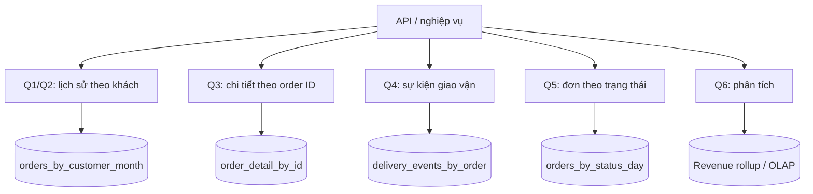

# Khóa phân vùng, khóa sắp xếp và dữ liệu cùng được truy cập

## Mục tiêu học tập

Sau bài học, bạn có thể:

- Giải thích sự khác nhau giữa **khóa phân vùng (partition key)**, **khóa sắp xếp (sort/clustering key)**, **khóa định danh nghiệp vụ** và **phân vùng vật lý**.
- Chuyển một nhóm yêu cầu đọc/ghi cụ thể thành lựa chọn partition key và sort key, dựa trên **dữ liệu thường được truy cập cùng nhau** (*co-accessed data*).
- Nhận biết điều kiện nào được phục vụ bằng tra cứu chính xác, truy vấn theo khoảng trong partition, và điều kiện nào đòi hỏi chỉ mục hoặc mô hình đọc khác.
- Thiết kế thứ tự khóa ghép để hỗ trợ **lọc, lấy bản ghi mới nhất và phân trang ổn định**, kể cả khi nhiều bản ghi có cùng timestamp.
- Đánh giá đánh đổi giữa tính cục bộ khi đọc, độ lớn partition, tốc độ ghi, dữ liệu nóng, fan-out và nhu cầu truy vấn xuyên partition.
- Phân biệt việc dữ liệu **ở cùng partition**, **được đọc trong một yêu cầu** và **được cập nhật nguyên tử**, tránh suy ra các bảo đảm không có.
- Phác thảo và kiểm chứng lược đồ vật lý cho workload cụ thể trong các họ hệ thống key–value và wide-column.

Trong **DATABASE_DATA_MODELING**, việc chuyển yêu cầu nghiệp vụ thành thực thể, quan hệ, ràng buộc, chuẩn hóa, khóa, chỉ mục và lược đồ vật lý phải xuất phát từ dữ liệu ứng dụng thực sự cần. Ở chương **Khóa giá trị và cột rộng**, một quyết định trung tâm là: **nhóm dữ liệu nào nên nằm cùng phạm vi truy cập, và trong phạm vi đó cần sắp xếp theo chiều nào?**

Hai khóa được dùng để trả lời câu hỏi này trong một số hệ lưu trữ phân tán là **partition key** và **sort key**. Tên gọi và các bảo đảm cụ thể khác nhau giữa sản phẩm, nhưng tư duy thiết kế vẫn có thể áp dụng như một quy trình chung.

---

## 1. Khái niệm nền tảng

Một hệ lưu trữ có khả năng phân vùng có thể tổ chức dữ liệu theo hai tầng logic:

1. **Partition key** chỉ ra nhóm dữ liệu liên quan mà thao tác cần truy cập.
2. **Sort/clustering key** phân biệt các hàng hoặc mục bên trong nhóm đó, có thể quyết định thứ tự của chúng nếu sản phẩm hỗ trợ.

Ví dụ khái niệm với các đơn hàng của một khách:

```text
Partition key = (shop_17, user_42, 202611)

Sort key                              Value
----------------------------------------------------------------
(2026-11-22T10:30:00Z, ord_908)  ->  total=219000, status=PAID
(2026-11-20T14:05:00Z, ord_901)  ->  total=150000, status=SHIPPED
(2026-11-05T08:12:00Z, ord_874)  ->  total= 87000, status=DELIVERED
```

Nếu cần “các đơn mới nhất của user 42 trong tháng 11”, ứng dụng đã biết partition key và có thể đọc các hàng theo thứ tự được thiết kế. Ngược lại, yêu cầu “các đơn của mọi user có trạng thái PAID” không có đủ khóa phân vùng và cần đường truy cập khác.

### 1.1. Những thuật ngữ dễ nhầm

| Thuật ngữ | Ý nghĩa | Ví dụ |
| --- | --- | --- |
| **Định danh nghiệp vụ** | Xác định đối tượng theo một phạm vi duy nhất đã quy định | `orderId = ord_908` |
| **Khóa tra cứu** | Tham số dùng để tìm dữ liệu trong một lược đồ cụ thể | `(shopId, orderId)` |
| **Partition key** | Thành phần nhóm/định tuyến dữ liệu trong mô hình lưu trữ | `(shopId, customerId, monthBucket)` |
| **Clustering/sort key** | Thành phần định danh hoặc sắp xếp hàng trong phạm vi partition | `(createdAt DESC, orderId ASC)` |
| **Partition logic** | Tập các hàng chia sẻ giá trị khóa phân vùng theo ngữ nghĩa sản phẩm | Mọi đơn của một khách trong một tháng |
| **Partition vật lý** | Đơn vị lưu/định tuyến thực tế của engine, tablet, shard hoặc range | Do engine phân bổ và có thể thay đổi khi cân bằng tải |
| **Đơn vị truy cập nguyên khối** | Một value hoặc nhóm dữ liệu nghiệp vụ thường được lấy cùng nhau | Giỏ hàng nhỏ được đọc bằng một key |

**Không được đồng nhất partition logic với một máy chủ, một file, một trang đĩa hoặc một giao dịch.** Tùy sản phẩm, partition logic có thể được nhân bản, dàn trải trên các cấu trúc vật lý và chịu các giới hạn vận hành khác nhau. Khả năng “cùng partition” chủ yếu giúp diễn đạt **đường truy vấn**, còn tính nguyên tử và cách đặt dữ liệu vật lý phải xác minh riêng.

### 1.2. Mỗi họ sản phẩm dùng hai loại khóa khác nhau

| Họ mô hình | Cách tổ chức khái niệm | Lưu ý khi áp dụng |
| --- | --- | --- |
| **Key–value thuần** | Một khóa hoàn chỉnh ánh xạ tới một value; có thể phân phối bằng hash | Không mặc định có sort/range query trên những key giống tiền tố |
| **DynamoDB-like** | Một partition key và một sort key tùy chọn ở cấp item; query theo partition và điều kiện sort được hỗ trợ | Sort key có thể là kiểu string/number/binary; phạm vi transaction, throughput và index phải xem theo sản phẩm |
| **Cassandra/CQL-like** | Primary key gồm partition key và các clustering columns; hàng được sắp trong partition theo khai báo | Query thường phải chỉ rõ partition key; điều kiện trên clustering phải tuân quy tắc thứ tự |
| **Bigtable/HBase-like** | Row key có thứ tự byte/từ điển; đọc theo một key hoặc dải key | Không suy diễn row-key range là cùng mô hình partition/clustering của Cassandra |
| **Quan hệ** | Khóa chính và index B-tree có thể chứa nhiều cột, optimizer chọn đường thực thi | Khóa ghép không đồng nghĩa chia partition; join và constraint có ngữ nghĩa khác |

Phần tiếp theo dùng cú pháp **CQL minh họa** cho kiểu partition + clustering, đồng thời có ví dụ **PK/SK dạng chuỗi** để hiểu mô hình item. Đây là bài thiết kế dữ liệu, không phải bản hướng dẫn API của một nhà cung cấp cụ thể.

## 2. “Dữ liệu cùng được truy cập” nghĩa là gì?

*Co-access* là sự quan sát rằng **nhiều phần dữ liệu thường xuất hiện cùng nhau trong một thao tác đọc**. Ví dụ:

- Khi mở một đơn hàng, khách thường xem **thông tin đơn + các dòng sản phẩm**.
- Khi xem lịch sử, khách thường chỉ xem **20 bản tóm tắt đơn** mới nhất; họ chưa cần mọi dòng sản phẩm, địa chỉ và lịch sử thanh toán.
- Khi xem tiến trình giao hàng, khách cần **các sự kiện vận chuyển của một đơn**, theo thứ tự thời gian.
- Khi cập nhật tồn kho, hệ thống thao tác theo **mã kho và SKU**; không nên kéo cả lịch sử đơn của khách vào cùng đơn vị ghi.

Như vậy, cùng một thực thể “đơn hàng” tham gia nhiều **ranh giới cùng truy cập**:

| Màn hình / thao tác | Dữ liệu thường được đọc cùng | Không nhất thiết phải đọc cùng |
| --- | --- | --- |
| Danh sách đơn gần đây | `orderId, createdAt, status, totalMinor, currency` | Tất cả dòng sản phẩm, lịch sử thanh toán, ghi chú dài |
| Trang chi tiết đơn | Metadata đơn và các dòng sản phẩm | Đơn hàng của mọi khách khác |
| Theo dõi giao hàng | Các sự kiện vận chuyển của đơn | Hàng nghìn đơn khác, cấu hình shop |
| Đánh dấu đã giao | Trạng thái đơn và bằng chứng giao theo nghiệp vụ | Mọi dữ liệu dùng cho báo cáo doanh thu |
| Báo cáo doanh thu | Nhiều đơn hoặc bản tổng hợp theo khoảng ngày | Toàn bộ JSON chi tiết của mỗi đơn nếu không cần |

Một **truy cập chung** khác với **cập nhật chung**. Đặt nhiều hàng vào một partition có thể giúp đọc theo nhóm, nhưng không tự mang lại khả năng thay đổi tất cả hàng trong một transaction. Ngược lại, tách dữ liệu giúp các đường ghi độc lập nhưng có thể khiến một màn hình cần nhiều request.

### 2.1. Ba mức độ đặt chung dữ liệu

1. **Chung trong một value:** một key chứa JSON/bytes của toàn bộ giỏ hoặc đơn hàng; dễ lấy một lần, có thể phải ghi lại cả value khi sửa một trường.
2. **Chung trong một partition, khác hàng/item:** metadata, dòng sản phẩm và sự kiện dùng chung partition key, phân biệt bằng sort key; có thể truy cập một dải hàng nếu engine cho phép.
3. **Khác partition nhưng có đường tra cứu rõ:** chi tiết đơn theo `orderId` và lịch sử đơn theo `customerId`; truy vấn phải sử dụng hai mô hình hoặc chỉ mục phù hợp.

Việc chọn mức nào phụ thuộc **kích thước tối đa**, **tần suất cùng đọc**, **mức tranh chấp cập nhật**, **chính sách TTL**, **truy vấn** và **bảo đảm giao dịch**.

## 3. Bắt đầu từ ma trận truy vấn của hệ thống bán hàng

Giả định một nền tảng có nhiều shop; mỗi khách có thể tạo nhiều đơn. Hệ thống cần:

- Q1: lấy 20 đơn mới nhất của một khách trong một shop.
- Q2: xem lịch sử của khách trong khoảng ngày, có phân trang.
- Q3: xem toàn bộ chi tiết một đơn theo `shopId` và `orderId`.
- Q4: xem các sự kiện giao vận của một đơn theo thời gian.
- Q5: tra cứu đơn đang chờ xử lý theo `shopId` và `status`.
- Q6: báo cáo doanh thu theo tháng trên nhiều shop.

### 3.1. Query contract

| Truy vấn | Input đã biết | Lọc/sắp xếp | Cần trả | Hệ quả về khóa |
| --- | --- | --- | --- | --- |
| Q1 | `shopId, customerId` | `createdAt DESC`, `LIMIT 20` | Tóm tắt đơn | Partition theo khách, sort theo thời gian |
| Q2 | `shopId, customerId, from, to` | Khoảng ngày, cursor | Tóm tắt đơn | Cùng hướng với Q1, có thể chia bucket |
| Q3 | `shopId, orderId` | Một đơn | Metadata + line items | Nhóm chi tiết theo order ID |
| Q4 | `shopId, orderId` | Event time và event ID | Dòng sự kiện | Nhóm theo order ID, sort theo thời gian |
| Q5 | `shopId, status` | Thời gian cập nhật hoặc tạo | Danh sách trạng thái | Index/bảng theo status riêng |
| Q6 | Tháng, vùng/shop | `SUM`, `GROUP BY` | Số tổng hợp | Mô hình phân tích hoặc rollup |

**Không có một khóa tối ưu cho mọi query.** Q1/Q2 gắn với khách; Q3/Q4 gắn với đơn; Q5 gắn với trạng thái; Q6 là phép tổng hợp. Lựa chọn đúng thường là thiết kế các đường đọc rõ ràng và định nghĩa cách chúng được đồng bộ.

### 3.2. Sơ đồ những đường truy cập



Từng đường đọc cần một **nguồn dữ liệu có thẩm quyền** và cơ chế cập nhật. Sơ đồ chưa giả định tất cả bảng thuộc cùng một hệ quản trị.

## 4. Thiết kế partition key cho lịch sử đơn theo khách

Với Q1/Q2, ý tưởng đầu tiên là nhóm đơn theo `(shopId, customerId)`:

```text
Partition: (shop_17, user_42)
Sort:      (createdAt DESC, orderId)

2026-11-22  ord_908  -> PAID, 219000
2026-11-20  ord_901  -> SHIPPED, 150000
2026-11-05  ord_874  -> DELIVERED, 87000
...
```

Ưu điểm: mọi đơn của một khách nằm trong cùng một nhóm logic, hỗ trợ đọc mới nhất trước khi biết khách. Nhưng nếu khách có lịch sử dài nhiều năm, partition có thể tăng không giới hạn theo nghiệp vụ.

### 4.1. Bổ sung bucket thời gian khi cần

Một phương án là đưa tháng vào partition:

```text
Partition: (shopId, customerId, yyyyMM)
Sort:      (createdAt DESC, orderId ASC)

(shop_17, user_42, 202611): 3 đơn
(shop_17, user_42, 202610): 5 đơn
(shop_17, user_42, 202609): 1 đơn
...
```

Lược đồ CQL minh họa:

```sql
CREATE TABLE orders_by_customer_month (
    shop_id        text,
    customer_id    text,
    month_bucket   text,
    created_at     timestamp,
    order_id       text,
    status         text,
    total_minor    bigint,
    currency       text,
    PRIMARY KEY (
        (shop_id, customer_id, month_bucket),
        created_at,
        order_id
    )
) WITH CLUSTERING ORDER BY (
    created_at DESC,
    order_id ASC
);
```

Ví dụ truy vấn tháng 11:

```sql
SELECT order_id, created_at, status, total_minor, currency
FROM orders_by_customer_month
WHERE shop_id = 'shop_17'
  AND customer_id = 'user_42'
  AND month_bucket = '202611'
LIMIT 20;
```

Query chỉ rõ **toàn bộ partition key**; các hàng đã được tổ chức theo `created_at DESC`. Để lấy **20 đơn mới nhất xuyên nhiều tháng**, ứng dụng phải bắt đầu từ bucket gần nhất và đọc các bucket cũ hơn đến khi đủ hoặc hết phạm vi. Đây là một thao tác **trên nhiều partition**, không phải phép đọc tự động của lược đồ.

### 4.2. Bucket là đánh đổi, không phải mặc định

| Phương án | Lợi ích | Chi phí/rủi ro |
| --- | --- | --- |
| Không bucket: `(shop, customer)` | Đọc toàn lịch sử một khách qua một partition logic | Partition có thể tăng lớn theo thời gian; một khách nóng gây tranh chấp tải |
| Bucket năm | Ít partition, truy vấn nhiều tháng ít fan-out | Một năm có thể quá lớn với khách phát sinh nhiều đơn |
| Bucket tháng | Giới hạn tăng trưởng tốt hơn; dễ giới hạn lịch sử theo tháng | Q1/Q2 có thể đọc nhiều tháng khi khách ít đơn |
| Bucket ngày | Phân vùng nhỏ, tiện vòng đời ngắn | Khách ít đơn phải đọc nhiều partition; tăng request và metadata |

Không thể chọn bucket tối ưu chỉ từ tên nghiệp vụ. Cần biết lượng đơn/khách, phân bố lệch, số năm lưu, kích thước mỗi hàng, throughput, độ trễ SLA và giới hạn của hệ đang dùng.

### 4.3. Ước lượng kích thước partition

Giả sử một shop có khách B2B tạo trung bình **120 đơn/ngày**. Bản tóm tắt mỗi đơn chiếm khoảng **700 byte dữ liệu lưu trữ hiệu dụng** (giả định để ước lượng):

\[
120 \times 30 = 3\,600 \text{ đơn/tháng}
\]

\[
3\,600 \times 700 \approx 2{,}52 \text{ MB/tháng}
\]

Đây chỉ là dữ liệu hàng ở mức ước lượng, **chưa** bao gồm index, metadata, replication, compaction và đặc tính ghi/xóa. Với khách có 100 lần lưu lượng, partition tháng tương ứng sẽ lớn hơn rất nhiều. Cần đo p95/p99 và nhóm cực đoan, không lấy trung bình làm bảo đảm.

Đặt mục tiêu kích thước và số lần ghi/giây trên **partition logic** theo hướng dẫn sản phẩm cụ thể. Không áp một “ngưỡng an toàn” duy nhất cho tất cả hệ wide-column.

## 5. Chọn sort key: thứ tự nào mang ý nghĩa nghiệp vụ?

Sort/clustering key trả lời câu hỏi “trong một partition, ta phân biệt và đi qua các hàng theo thứ tự nào?”.

Với lịch sử đơn, chọn `(createdAt DESC, orderId ASC)` vì:

- Màn hình ưu tiên đơn mới.
- `createdAt` hỗ trợ lọc theo khoảng thời gian.
- `orderId` phân định hai đơn có cùng timestamp và làm phần cuối của khóa/cursor.

Nếu sort chỉ dùng `orderId`, điều kiện “20 đơn mới nhất” không tự nhiên được tối ưu trừ khi ID thật sự có thứ tự theo thời gian đã được bảo đảm. Một ID có thành phần thời gian cũng không đương nhiên bảo đảm thứ tự tạo toàn cục khi nhiều máy có đồng hồ lệch.

### 5.1. Thứ tự thành phần khóa ghép

Hãy so sánh hai sort key trong cùng partition `(shopId, customerId, month)`:

| Sort key | Truy vấn được ưu tiên | Bất lợi |
| --- | --- | --- |
| `(createdAt DESC, orderId)` | Mới nhất và khoảng ngày | Lọc theo `status` cần index/bảng khác hoặc đọc rồi lọc |
| `(status, createdAt DESC, orderId)` | Nhóm status và thời gian **khi đã biết status** | “Mới nhất bất kể status” không còn là một dải thời gian liên tục toàn nhóm |

Một sort key thường phục vụ tốt **một trật tự ưu tiên điều kiện**. Chọn thứ tự trường theo query contract, không theo mức độ “quan trọng” của tên thuộc tính.

### 5.2. Điều kiện truy vấn có phụ thuộc sản phẩm

Trong hệ CQL, các điều kiện hợp lệ đối với clustering key thường có ràng buộc theo thứ tự các cột khóa, phạm vi và hướng sắp xếp. Trong hệ có PK/SK riêng, có thể query theo partition key và điều kiện prefix/range trên sort key nếu engine hỗ trợ. Trong kho key–value hash thuần, thêm dấu `:` vào key **không tạo ra** một truy vấn range miễn phí.

Hãy kiểm tra với lệnh thực của hệ quản trị:

- Có thể lọc theo một tiền tố của sort key không?
- Có thể áp range trên trường thứ hai mà không có điều kiện trên trường thứ nhất không?
- Có thể đổi chiều đọc hay chỉ dùng thứ tự khai báo?
- Kết quả `LIMIT` áp dụng **trước hay sau** filter?
- Có loại phân trang, nhất quán và giới hạn nào trong một partition?

“Key được tạo bằng nhiều trường” là thuộc tính của mô hình; “query này hợp lệ và chỉ đọc ít dữ liệu” là thuộc tính của **engine và câu lệnh thực thi**.

### 5.3. Thời gian, timezone và giá trị trùng

Giá trị `createdAt` dùng để sort nên là một **instant** được chuẩn hóa, chẳng hạn UTC. Nếu mã hóa vào chuỗi key có thứ tự byte, định dạng thời gian phải cố định, có phần đệm số và thống nhất độ chính xác:

```text
2026-11-05T08:12:00.000Z
2026-11-20T14:05:00.000Z
2026-11-22T10:30:00.000Z
```

Không trộn `2026-1-2` với `2026-11-05` rồi kỳ vọng thứ tự từ điển trùng thời gian. Cũng không trộn các offset múi giờ nếu thứ tự được suy ra từ bytes. Nếu hệ lưu trữ dùng kiểu timestamp native, hãy dùng kiểu đó với định nghĩa rõ về thời gian được chọn.

Hai đơn cùng timestamp vẫn là hai đơn khác nhau; `orderId` hoặc sequence làm khóa phân định. Nếu timestamp từ client không đáng tin, định nghĩa cách gán hoặc kiểm tra thời gian tại nguồn có thẩm quyền.

## 6. Gộp dữ liệu cùng được đọc trong một partition theo order ID

Q3/Q4 dùng `orderId` chứ không dùng `customerId`. Các dòng sản phẩm và sự kiện giao hàng đều thuộc một đơn, nhưng nhu cầu truy cập khác nhau.

### 6.1. Một kiểu lưu trữ item theo PK/SK

Với hệ cho phép nhiều item chia sẻ partition key và phân biệt bằng sort key, ta có thể hình dung:

```text
PK = SHOP#shop_17#ORDER#ord_908

SK = META
  -> {createdAt, customerId, status, totalMinor, currency}

SK = ITEM#0001
  -> {sku:"A17", quantity:2, unitPriceMinor:95000}

SK = ITEM#0002
  -> {sku:"B03", quantity:1, unitPriceMinor:29000}

SK = EVENT#2026-11-22T09:00:00.000Z#evt_101
  -> {type:"PACKED", note:"Đã đóng gói"}

SK = EVENT#2026-11-22T11:30:00.000Z#evt_102
  -> {type:"SHIPPED", note:"Bàn giao vận chuyển"}
```

Các mục có **cùng PK** nên đường đọc có thể lấy nhóm theo order ID. Nhờ **tiền tố sort key**, ứng dụng có thể yêu cầu:

- `SK = META` để đọc metadata.
- `SK bắt đầu bằng ITEM#` để đọc các dòng hàng.
- `SK bắt đầu bằng EVENT#` để đọc sự kiện giao hàng.

Điều này **chỉ khả thi** nếu sản phẩm hỗ trợ truy vấn sort key theo tiền tố/range. Phân biệt cấu trúc key hợp lý với tính năng API thực tế.

### 6.2. Khi nào nên đặt chung partition?

Đặt metadata và items chung một partition hợp lý nếu:

- Trang chi tiết thường lấy cả hai.
- Số dòng sản phẩm trong một đơn có giới hạn hợp lý.
- Các item có chung phạm vi bảo mật/vòng đời với đơn.
- Query biết `shopId` và `orderId`.
- Tải ghi/xem của từng đơn không tạo hot partition vượt hạn mức.

Tuy nhiên, **sự kiện giao hàng** có thể tăng dài, đến từ dịch vụ khác và có chính sách lưu giữ khác. Nếu chúng lớn, thay đổi thường xuyên hoặc cần truy vấn theo đơn vị vận chuyển, có thể lưu chúng ở partition/bảng khác theo `(shopId, orderId, eventBucket)` hoặc `shipmentId`. Co-access là một tín hiệu thiết kế, **không phải lệnh bắt buộc nhồi mọi thông tin liên quan vào một partition**.

### 6.3. Sắp xếp theo loại và theo thời gian

Với sort key dạng chuỗi:

```text
ITEM#0001
ITEM#0002
EVENT#2026-11-22T09:00:00.000Z#evt_101
EVENT#2026-11-22T11:30:00.000Z#evt_102
META
```

Thứ tự từ điển trên toàn partition sẽ nhóm theo **prefix loại mục**, rồi mới đến trường thời gian của sự kiện. Muốn lấy sự kiện mới nhất trước, cần hướng sort/reverse query được hỗ trợ hoặc mã hóa thứ tự đảo có quy tắc. Không nên kỳ vọng mọi item trong partition tự được sắp toàn cục theo thời gian nếu sort key bắt đầu bằng các prefix khác nhau.

Các dấu `#` chỉ là quy ước minh họa. Khi ID có thể chứa delimiter, phải dùng escape/length-prefix hoặc tập ký tự được giới hạn rõ. Cấu trúc key cũng phải tránh chứa email, token hoặc thông tin nhạy cảm dạng thô vì key có thể xuất hiện trong log và metrics.

### 6.4. Ví dụ CQL tách hai bảng theo ranh giới đọc

Nếu dùng mô hình kiểu CQL thay vì một bảng hỗn hợp, có thể thiết kế:

```sql
CREATE TABLE order_items_by_id (
    shop_id           text,
    order_id          text,
    line_no           int,
    sku               text,
    quantity          int,
    unit_price_minor  bigint,
    PRIMARY KEY ((shop_id, order_id), line_no)
);
```

```sql
CREATE TABLE delivery_events_by_order (
    shop_id     text,
    order_id    text,
    occurred_at timestamp,
    event_id    text,
    event_type  text,
    note        text,
    PRIMARY KEY ((shop_id, order_id), occurred_at, event_id)
) WITH CLUSTERING ORDER BY (
    occurred_at DESC,
    event_id ASC
);
```

Cả hai bảng đều cho phép truy cập theo order ID, nhưng **không có nghĩa hai bảng được đặt vật lý cùng một nơi** hoặc một cập nhật qua hai bảng có giao dịch nguyên tử. Chọn một bảng hỗn hợp hay nhiều bảng phụ thuộc khả năng truy vấn, kiểm soát schema, vòng đời và giới hạn của sản phẩm.

## 7. Đơn vị cùng đọc không tự là đơn vị cùng ghi

Đây là điểm quan trọng để bảo đảm đúng dữ liệu.

Ví dụ trang chi tiết đơn cần đọc:

```text
Order metadata + 3 order items + 5 delivery events
```

Mặc dù chúng có thể được đọc bằng một query theo PK, ba nhóm có **nguồn cập nhật khác nhau**:

- Đơn hàng do dịch vụ order quản lý.
- Dòng sản phẩm được cố định hoặc điều chỉnh theo quy tắc sau khi đặt.
- Sự kiện giao hàng do đối tác vận chuyển hoặc worker cập nhật.

Khi đọc nhiều item trong cùng partition, hệ thống có thể quan sát các thời điểm ghi khác nhau tùy bảo đảm nhất quán và cơ chế snapshot. Đừng khẳng định dữ liệu nhất quán như một transaction nếu sản phẩm không công bố điều đó.

### 7.1. Các câu hỏi bất biến

| Bất biến cần bảo vệ | Phạm vi | Tác động đến thiết kế |
| --- | --- | --- |
| Tổng tiền phải khớp các dòng hàng đã chốt | Metadata và items | Cần cơ chế xác nhận/commit hoặc dữ liệu bất biến sau checkout |
| Không cập nhật đơn đã hủy theo một chuyển trạng thái không hợp lệ | Trạng thái đơn | Cần điều kiện phiên bản hoặc giao dịch được hỗ trợ |
| Một sự kiện vận chuyển chỉ được áp dụng một lần | Event ID / trạng thái vận chuyển | Cần idempotency, xử lý event trùng và đến sai thứ tự |
| Đơn thuộc đúng shop, khách có quyền xem | Quyền và định danh | Xác thực tenant/shop tại API, không chỉ dựa vào tiền tố key |
| Một SKU trong một dòng chi tiết có số lượng dương | Giá trị hàng | Kiểm tra schema và nghiệp vụ ở biên ghi |

Cùng partition có thể hỗ trợ một số thao tác điều kiện hoặc transaction hiệu quả hơn tùy sản phẩm, nhưng **bảo đảm vẫn phải được xác minh theo lệnh và phạm vi**. Việc gom dữ liệu chỉ để “cho vào cùng partition là ACID” thường dẫn tới mô hình lớn, nóng và sai giả định.

### 7.2. Giao dịch và triển khai một yêu cầu nghiệp vụ

Giả sử khi thanh toán phải tạo đơn, giữ tồn kho và ghi giao dịch thanh toán. Đây là ràng buộc **xuyên nhiều nguồn dữ liệu**. Dù metadata và item của đơn cùng PK, không thể suy ra tồn kho hoặc thanh toán cũng được commit cùng một giao dịch.

Cần lựa chọn rõ ràng giữa giao dịch được hệ thống hỗ trợ, quy trình nhiều bước có trạng thái, idempotency, bảo đảm nguồn chân lý và cơ chế bù trừ. Thiết kế khóa giúp đường đọc/ghi hiệu quả, nhưng không thay thế việc mô hình hóa **ràng buộc nghiệp vụ**.

## 8. Partition nóng và dữ liệu cùng truy cập quá nhiều

Đặt dữ liệu thường đọc cùng nhau vào cùng partition có lợi tới một ngưỡng. Khi một partition được tất cả client truy cập hoặc tăng quá lớn, nó có thể thành **điểm nghẽn**.

Ví dụ:

- Một user rất lớn tạo hàng nghìn đơn mỗi giây.
- Một shop có dashboard “mọi đơn PAID” trong một partition theo `(shopId, status)`.
- Một sản phẩm nổi tiếng nhận hàng triệu sự kiện trong cùng một partition theo `productId`.
- Một group chat có hàng triệu tin nhắn và người đọc trong một partition theo `roomId`.

Cần phân biệt:

1. **Nhiều partition vừa phải:** hệ phân tán thường có cơ hội phân phối tải.
2. **Một partition nóng:** nhiều node hơn không tự chia đều tải của **chính partition logic** nếu cơ chế định tuyến không hỗ trợ.
3. **Một value/row cực lớn:** có thể chạm giới hạn kích thước dù partition không nhận quá nhiều request.
4. **Một query fan-out quá rộng:** nhiều partition nhỏ vẫn tốn kém nếu một request phải chạm hàng nghìn partition.

### 8.1. Sharding/salting để giảm nóng

Nếu partition `(shopId, status, dayBucket)` quá nóng, có thể cân nhắc:

```text
Partition = (shopId, status, dayBucket, shardId)
shardId   = stableHash(orderId) mod shardCount
```

Ghi theo `orderId` có thể phân phối vào nhiều shard. Nhưng query “20 đơn PAID mới nhất của shop” phải đọc **tất cả shard liên quan**, lấy ứng viên và hợp nhất theo thời gian. Khi thay đổi số shard, quy tắc định tuyến có thể đổi; cần versioning/migration hoặc mapping để vẫn tìm được dữ liệu cũ.

Chia shard chỉ đáng thực hiện khi số liệu cho thấy tác dụng và đã thiết kế đường đọc. Trường `shardId` phải nằm trong **partition key thực sự**, không chỉ clustering key, mới có khả năng giúp phân phối partition theo mô hình tương ứng.

### 8.2. Cân bằng dữ liệu cùng đọc với dữ liệu cùng vòng đời

Một đơn có thể chứa 3 dòng hàng nhưng hàng triệu event hệ thống trong quá trình xử lý lỗi. Gộp event vào cùng một value JSON của đơn sẽ khiến mỗi lần đọc chi tiết phải tải nhiều dữ liệu không liên quan, và mỗi lần thêm event có thể phải ghi lại toàn khối.

Giải pháp hợp lý có thể là:

- Metadata + các dòng hàng có giới hạn, lưu theo order ID.
- Sự kiện vận chuyển trong bảng riêng, phân trang và có thời gian lưu giữ rõ.
- Nhật ký kỹ thuật trong hệ log/sự kiện chuyên dụng, không gắn trực tiếp vào trang chi tiết.
- Bảng tóm tắt sự kiện mới nhất cho UI nếu đường đọc đó thường xuyên.

**Dữ liệu cùng tồn tại về nghiệp vụ không đồng nghĩa được truy cập cùng nhau trong mọi request.**

## 9. Query theo khoảng, phân trang và thứ tự ổn định

Sắp xếp là một phần của **hợp đồng truy vấn**, đặc biệt khi dữ liệu đổi trong lúc client tải nhiều trang.

### 9.1. Vì sao timestamp không đủ làm cursor?

Xét ba đơn:

```text
createdAt=10:00:00.000Z, orderId=ord_103
createdAt=10:00:00.000Z, orderId=ord_102
createdAt=09:59:59.000Z, orderId=ord_101
```

Nếu trang trước dừng ở `10:00:00.000Z` và trang sau query chỉ dùng `createdAt < lastCreatedAt`, có thể bỏ qua đơn còn lại có cùng timestamp.

Do đó, khi dùng keyset pagination, cursor cần đủ thành phần của **thứ tự toàn phần**:

```text
cursor = {
    "shopId": "shop_17",
    "customerId": "user_42",
    "monthBucket": "202611",
    "createdAt": "2026-11-22T10:00:00.000Z",
    "orderId": "ord_102",
    "sortDirection": "createdAt_desc__orderId_asc"
}
```

Đây là biểu diễn logic; cú pháp query thực tế và paging state có thể do driver cung cấp. Với nhiều bucket hoặc shard, cursor có thể cần trạng thái của nhiều luồng đọc và quy tắc hợp nhất.

### 9.2. Phân trang theo khóa và snapshot

Keyset/cursor thường tránh chi phí offset lớn, nhưng **không tự tạo snapshot bất biến**. Nếu đơn mới được thêm hoặc đơn cũ bị xóa giữa hai trang, tập dữ liệu có thể thay đổi; cursor chỉ xác định vị trí trong thứ tự đã chọn.

Nếu nghiệp vụ yêu cầu một báo cáo chính xác theo một thời điểm, cần cơ chế snapshot/phiên bản dữ liệu do hệ quản trị hoặc mô hình xuất báo cáo riêng hỗ trợ. Với màn hình lịch sử đang hoạt động, có thể chấp nhận tập kết quả thay đổi nếu API ghi rõ quy tắc.

### 9.3. Truy vấn nhiều bucket

Lấy 20 đơn mới nhất từ bucket tháng là một ví dụ cụ thể:

```text
function latestOrders(shopId, customerId, limit):
    results = []
    month = currentUtcMonth()

    while results.count < limit and month within retention:
        rows = queryPartition(
            shopId, customerId, month,
            remaining = limit - results.count
        )
        append results, rows
        month = previousMonth(month)

    return results
```

Giả mã chỉ đúng nếu có giả định về timestamp/bucket và thứ tự đầy đủ; triển khai thật còn phải xử lý cursor, giới hạn request, quyền, thời điểm hiện tại, dữ liệu đến muộn và trường hợp dữ liệu có timestamps tương lai. Nếu sự kiện có thể đến muộn, một lần duyệt nhiều bucket vẫn phải giữ quy tắc trả thứ tự và phân trang nhất quán.

Không sử dụng vòng lặp đọc bucket vô hạn khi người dùng không có đơn; đặt giới hạn lookback và SLA cụ thể.

## 10. Truy vấn khi chỉ biết một phần partition key

Bảng lịch sử theo `(shopId, customerId, month)` **không trả lời trực tiếp**:

- “Tìm đơn `ord_908`” nếu chỉ biết `shopId, orderId`.
- “Tất cả đơn PAID của shop” nếu không biết `customerId`.
- “Tổng doanh thu tháng 11 của mọi khách”.
- “Mọi đơn chứa SKU A17”.

Lý do: các giá trị đầu vào **không xác định được partition** của bảng này.

Để phục vụ truy vấn theo order ID, dùng đường đọc riêng:

```sql
CREATE TABLE orders_by_id (
    shop_id      text,
    order_id     text,
    customer_id  text,
    created_at   timestamp,
    status       text,
    total_minor  bigint,
    currency     text,
    PRIMARY KEY ((shop_id, order_id))
);
```

Nếu cần status dashboard, thiết kế thêm bảng/index theo `(shopId, status, dayBucket)` và sort theo thời gian **đúng loại thời gian nghiệp vụ**. Nếu cần doanh thu, dùng rollup/analytics có quy tắc tổng hợp, hoàn tiền và tính nhất quán rõ.

Trong hệ quan hệ, một chỉ mục tổng hợp hay B-tree trên `(shop_id, customer_id, created_at)` có thể hỗ trợ một số query lịch sử mà không cần sao chép cả bảng. Nhưng lựa chọn này vẫn dựa trên execution plan, ràng buộc và workload thực tế; không mặc định relational luôn chậm hay wide-column luôn nhanh.

## 11. Dữ liệu lặp để phục vụ nhiều đường đọc

Giả sử một đơn có hai read model:

```text
orders_by_id(shopId, orderId)               -> status, total, customer
orders_by_customer_month(shopId, user, mon) -> status, total, createdAt
```

Khi đơn thay status từ `PAID` sang `SHIPPED`, hai bản sao phải phản ánh quy tắc nghiệp vụ. Nếu cập nhật `orders_by_id` thành công nhưng bảng theo khách chưa nhận thay đổi, người dùng có thể thấy trạng thái cũ ở danh sách và trạng thái mới ở trang chi tiết.

Các lựa chọn:

| Mức độ nhất quán yêu cầu | Chiến lược thường xem xét |
| --- | --- |
| Tức thời và phải đồng bộ | Giao dịch/secondary index do DB quản lý nếu công nghệ đáp ứng đúng phạm vi |
| Chấp nhận trễ có giới hạn | Nguồn chân lý + projection/event pipeline idempotent, theo dõi độ trễ |
| Danh sách có thể cũ nhưng hành động phải chính xác | Đọc danh sách từ read model, kiểm tra lại nguồn chính trước hành động nhạy cảm |
| Truy vấn phân tích không cần tức thời | Batch/streaming rollup có đối soát |

### 11.1. Event trùng và sai thứ tự

Một event có thể gửi lại nhiều lần. Ví dụ bản cập nhật `orderVersion=8, SHIPPED` đến trước `orderVersion=7, PAID`. Projection không được để version 7 ghi đè kết quả mới.

Cần ID event, version tăng theo **từng order**, quy tắc áp dụng idempotent và cách ghi phiên bản đã áp dụng có bảo đảm nguyên tử phù hợp. Nếu cập nhật nhiều bảng mà không có giao dịch tương ứng, bổ sung workflow khôi phục và đối soát.

**Cùng partition không tự giải quyết việc đồng bộ read model khác partition hoặc khác hệ thống.**

### 11.2. TTL, xóa và khóa ngoại logic

Giả sử chi tiết đơn được giữ 5 năm nhưng danh sách đơn trong app chỉ hiển thị 1 năm. Cần định nghĩa:

- Bản gốc có được xóa cùng lúc index không?
- Một entry index trỏ đến bản gốc đã hết hạn thì ứng dụng xử lý thế nào?
- Khi xóa vì quy định dữ liệu, bản sao index, cache và analytics có phải xử lý cùng chính sách không?
- Nếu cần phục hồi hoặc rebuild read model, dữ liệu gốc còn đủ không?

Không có ràng buộc khóa ngoại khai báo mặc định giữa hai bảng read model chỉ vì chúng cùng chứa `orderId`. Mức độ toàn vẹn cần được bảo đảm bằng sản phẩm, ứng dụng hoặc quá trình đối soát.

## 12. Phân quyền theo tenant và tính cục bộ

Đặt `shopId` hoặc `tenantId` trong partition key giúp biểu đạt phạm vi truy cập, nhưng **không tự xác thực quyền**. Nếu client có thể tự thay `tenantId` mà API không kiểm tra, dữ liệu có nguy cơ bị đọc chéo tenant dù khóa đặt rất đẹp.

Một thiết kế an toàn cần:

1. Lấy danh tính và phạm vi tenant từ ngữ cảnh xác thực đáng tin cậy.
2. Kiểm tra người dùng được quyền xem `shopId/orderId` trước khi tạo query.
3. Tránh dùng email, access token hoặc dữ liệu nhạy cảm dạng thô trong key, vì chúng có thể xuất hiện trong log và chỉ số.
4. Thiết lập chính sách lưu giữ, truy xuất, sao lưu và xóa cho dữ liệu trùng lặp trong các read model.

Khóa phân vùng là **cấu trúc truy cập**, không phải hàng rào phân quyền.

## 13. Kiểm chứng bằng giả định, số liệu và phép thử

Một lược đồ chỉ hoàn chỉnh khi có thể trả lời: **truy vấn nào đi vào partition nào, đọc bao nhiêu hàng, và các bảo đảm nào cần được giữ?**

### 13.1. Phiếu thiết kế cho mỗi read model

| Mục cần ghi | Ví dụ `orders_by_customer_month` |
| --- | --- |
| Query được phục vụ | Q1/Q2: đơn gần nhất và lịch sử theo khách |
| Input bắt buộc | `shopId, customerId`; thời gian để xác định bucket |
| Partition key | `(shopId, customerId, yyyyMM)` |
| Sort key | `(createdAt DESC, orderId ASC)` |
| Dữ liệu trả | `orderId, createdAt, status, totalMinor, currency` |
| Số hàng/partition | Ước lượng từ phân bố đơn/khách/tháng, gồm p95/p99 |
| Fan-out | Số tháng có thể cần đọc cho một request |
| Mức nhất quán | Bản sao danh sách có thể trễ hay phải phản ánh cập nhật tức thì |
| TTL và xóa | Thời gian lưu danh sách, nguồn gốc, cách xử lý entry mồ côi |
| Giới hạn API | `limit` tối đa, lookback tối đa, cursor, quyền theo shop |
| Đo lường | p95/p99 độ trễ, bytes/partition, số partition đọc, index lag |

### 13.2. Các trường hợp bắt buộc kiểm thử

| Tình huống | Kết quả mong đợi |
| --- | --- |
| Một khách có 20 đơn trong một tháng | Một đường đọc partition trả đúng thứ tự |
| Một khách chỉ có một đơn trong mỗi 3 tháng | Query Q1 đọc các bucket cũ có giới hạn cho đến khi đủ hoặc hết phạm vi |
| Hai đơn trùng `createdAt` | Không ghi đè và không bỏ sót khi phân trang |
| Khách B2B có tải gấp 100 lần bình thường | Độ lớn/hot partition nằm trong mục tiêu hoặc có kế hoạch phân tách |
| Xem đơn theo `orderId` | Sử dụng đúng đường tra cứu; không quét toàn bộ khách |
| Thêm event giao hàng cho một đơn | Đọc event theo thứ tự; không làm hỏng metadata đơn |
| Hai dịch vụ cập nhật hai nhóm dữ liệu | Không suy ra transaction từ sự cục bộ; ràng buộc được kiểm tra |
| Bản sao danh sách cập nhật chậm | Mức trễ được ghi nhận; quyết định nhạy cảm đọc nguồn đúng |
| Xóa/hết hạn một đơn | Không còn trả dữ liệu sai lâu dài qua index hoặc cache |
| Query của tenant A yêu cầu đơn của tenant B | Bị từ chối tại biên quyền |
| Thời gian sai múi giờ hoặc timestamp trùng | Truy vấn range và cursor tuân hợp đồng |
| Một query phải đọc hàng nghìn partition | Giới hạn và cảnh báo fan-out hoạt động |

### 13.3. Những chỉ số hữu ích

- **Phân phối tải:** số partition logic, bytes/partition, độ lệch read/write QPS giữa các partition.
- **Truy vấn:** p50/p95/p99 latency, số partition đọc/request, số hàng đọc so với số hàng trả.
- **Ghi và đồng bộ:** writes per business event, retry do xung đột, index lag, số entry index mồ côi.
- **Vòng đời:** TTL/tombstone/compaction theo khả năng hệ quản trị, tốc độ phát sinh và xóa dữ liệu.
- **Phân trang:** tỉ lệ trang rỗng, số bucket phải đọc, mức bỏ sót/trùng theo định nghĩa của API.

Đo trên dữ liệu **đại diện cả trường hợp xấu**, tránh chỉ đánh giá với khách trung bình và dữ liệu demo.

## 14. Các sai lầm thường gặp

| Nhận định / thiết kế sai | Hệ quả | Cách chỉnh |
| --- | --- | --- |
| “Có cùng prefix chuỗi key thì cùng partition” | Sai với hash key–value, có thể phân tán hoàn toàn | Xem cơ chế partition và API range của sản phẩm |
| “Cùng partition thì nhiều hàng luôn cập nhật nguyên tử” | Có thể mất nhất quán khi nhiều ghi | Xác minh transaction/conditional write theo phạm vi lệnh |
| Partition bằng `shopId` cho mọi đơn | Shop lớn tạo partition khổng lồ và nóng | Nhóm theo đường query cụ thể, thêm customer/bucket khi phù hợp |
| Chỉ sort bằng timestamp | Hai sự kiện trùng thời gian có thể đụng khóa và cursor bỏ sót | Thêm ID/sequence làm thành phần phân định |
| Dùng `(status, createdAt)` để đọc mọi đơn mới nhất | Các status tách thành nhóm; sort thời gian toàn partition không còn liên tục | Dùng khóa phù hợp truy vấn “mọi status” hoặc read model riêng |
| Gộp toàn bộ JSON chi tiết vào từng dòng danh sách | Q1 tải dữ liệu không cần, tăng bytes | Lưu summary trong lịch sử và detail ở đường theo order ID |
| Dồn vô hạn event vào một đơn | Giá trị/partition tăng quá lớn | Phân đoạn, phân trang hoặc tách nguồn sự kiện |
| Bucket quá nhỏ không có lý do | Tăng fan-out và phức tạp đọc | Dùng dữ liệu tần suất/retention để chọn bucket |
| Thêm shard nhưng không thiết kế chiều đọc | Muốn lấy “mới nhất” phải quét nhiều shard | Có chiến lược merge, cursor và giới hạn |
| Tối ưu bằng một read model mới cho mọi điều kiện | Dữ liệu trùng khó đồng bộ | Nhóm truy vấn quan trọng; cân nhắc hệ có optimizer/index |
| Lưu `tenantId` trong key rồi bỏ qua phân quyền | Lộ dữ liệu chéo tenant | Kiểm tra quyền từ danh tính đáng tin cậy |
| Không phân biệt source và projection | Trạng thái cũ ở danh sách có thể bị coi là đúng | Định nghĩa nguồn chân lý, lag và kiểm tra lại khi cần |

## 15. Bài tập vận dụng

### Bài tập A — Giỏ hàng và lịch sử đơn

**Yêu cầu:** mỗi khách có một giỏ nhỏ, thường đọc toàn giỏ; mỗi khách có hàng nghìn đơn, màn hình lịch sử chỉ xem 20 bản tóm tắt mới nhất.

Hãy chọn ranh giới dữ liệu phù hợp cho giỏ và lịch sử đơn. Có nên đưa cả giỏ, các dòng đơn và lịch sử hàng nghìn đơn vào một partition/value?

**Gợi ý:** giỏ có thể lưu một value theo `(shopId, userId)` vì nhỏ và thường đọc cùng nhau. Lịch sử nên là nhiều hàng theo customer/time với sort, bucket nếu cần. Chi tiết đơn nên truy cập theo order ID. Dữ liệu cùng thuộc khách không nhất thiết cùng một value.

### Bài tập B — Chat room có lượng truy cập lớn

**Yêu cầu:** phòng chat có hàng chục triệu tin nhắn trong 2 năm; client tải 50 tin mới nhất và cuộn về quá khứ; một số phòng có lượng ghi rất cao.

**Câu hỏi:** partition theo `roomId` có đủ không? Bạn cần thêm gì vào khóa và cursor?

**Gợi ý:** cân nhắc bucket ngày/giờ hoặc shard khi đo thấy hot partition. Sort theo `(sentAt, messageId)` với quy tắc chiều đọc và tiebreaker. Nếu shard, việc lấy mới nhất cần hợp nhất từ nhiều nguồn. Phân trang phải tính đến tin nhắn mới và nội dung bị xóa.

### Bài tập C — Đơn hàng theo trạng thái

**Yêu cầu:** dashboard cần 20 đơn `PAID` mới nhất trong một shop, trong khi app khách cần 20 đơn mới nhất bất kể status.

**Câu hỏi:** một sort key `(status, createdAt)` trong partition theo shop có phục vụ đồng thời hai query tối ưu không? Đề xuất đường đọc.

**Gợi ý:** nhóm theo status tạo thứ tự thuận tiện cho query status, nhưng không cho thứ tự toàn cục qua mọi status. Cần mô hình đọc theo shop/time và theo shop/status/time hoặc index đáp ứng cả hai theo năng lực sản phẩm; kiểm tra kích thước và nóng.

### Bài tập D — Timestamp giống nhau

**Yêu cầu:** hai đơn của khách được tạo trong cùng mili giây. Bảng có partition `(shopId, customerId, month)` và chỉ sort `createdAt`.

**Câu hỏi:** lỗi nào có thể xảy ra? Chọn sửa khóa và cursor.

**Gợi ý:** nếu toàn primary key của hàng là partition + `createdAt`, hai đơn trùng khóa. Thêm `orderId` làm phần phân định; cursor phải giữ tuple đầy đủ theo chiều sort.

### Bài tập E — Chọn mô hình và kiểm chứng

**Yêu cầu:** nền tảng gồm (1) lịch sử đơn theo khách, (2) điều chỉnh tồn kho theo kho/SKU với ràng buộc mạnh, (3) tìm kiếm nội dung ghi chú, (4) doanh thu nhiều năm.

**Câu hỏi:** nên dùng một bảng wide-column duy nhất không? Mỗi đường đọc cần loại khóa/chỉ mục hoặc công nghệ nào? Nêu cơ chế đồng bộ nếu có nhiều mô hình.

**Gợi ý:** lịch sử đơn có thể phù hợp partition/sort theo khách và thời gian; tồn kho cần ràng buộc giao dịch phù hợp; tìm kiếm nội dung cần full-text index; phân tích doanh thu nên dùng rollup/OLAP khi workload lớn. Xác định nguồn chân lý, idempotency và kỳ vọng nhất quán từng đường.

## Tổng kết kiến thức

**Partition key** quyết định phạm vi dữ liệu mà truy vấn có thể xác định và tiếp cận trực tiếp; **sort/clustering key** tổ chức những hàng trong phạm vi đó để phục vụ thứ tự, khoảng và phân trang. Chọn cả hai từ **mẫu truy cập thực tế**: dữ liệu nào được đọc cùng, dữ liệu nào có thể tăng rất lớn, và câu truy vấn nào biết đủ thành phần khóa.

Giữ dữ liệu cùng truy cập ở gần nhau có thể giảm số bước đọc, nhưng **không tự tạo nguyên tử hay nhất quán giữa các hàng**. Khi một partition lớn hoặc nóng, cần đánh đổi bằng bucket, shard và truy vấn nhiều partition; khi nhiều đường đọc không khớp nhau, cần read model/index khác và quy tắc đồng bộ có thể kiểm chứng.

Trước khi chốt một lược đồ, hãy trả lời: **“Với input của API này, ta biết partition nào? Trong partition đó, sort key giúp lấy đúng tập dữ liệu theo thứ tự nào? Có bao nhiêu hàng phải đọc, partition có thể lớn/nóng đến đâu, và những bất biến nào vẫn cần được bảo vệ riêng?”**
