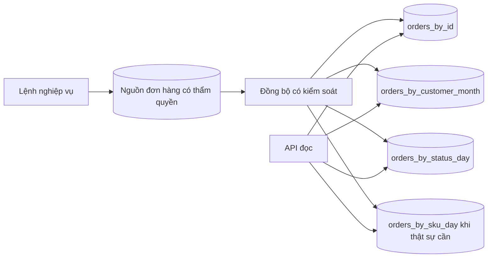
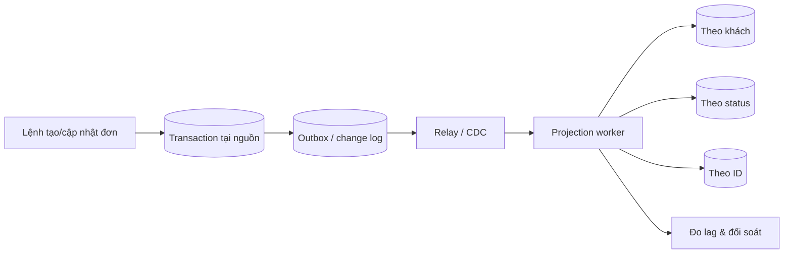
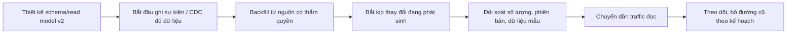

# Một bảng theo mẫu truy cập và nhu cầu nhân bản dữ liệu có kiểm soát

## Mục tiêu học tập

Sau bài này, bạn có thể:

- Giải thích tư duy **thiết kế bảng theo mẫu truy cập** (*table per access pattern* hoặc *query-oriented modeling*) trong hệ cột rộng; phân biệt cách này với việc có một bảng cho mỗi thực thể.
- Chuyển các câu hỏi nghiệp vụ thành bảng ghi rõ đầu vào, bộ lọc, thứ tự, giới hạn, độ mới của dữ liệu và đường truy cập tương ứng.
- Đề xuất các bảng đọc có **partition key, clustering key và trường dữ liệu** phù hợp cho những truy vấn khác nhau trên cùng một thực thể.
- Phân biệt **sao chép dữ liệu có chủ đích (denormalization)** với nhân bản replica để tăng khả dụng, cache và chỉ mục phụ do engine quản lý.
- Xác định nguồn dữ liệu có thẩm quyền, chi phí ghi bổ sung, mức nhất quán, chính sách xóa và cách đồng bộ các bản sao.
- Thiết kế quy trình cập nhật qua **giao dịch**, **outbox/CDC** hoặc **projection** với xử lý sự kiện trùng, sai thứ tự, lỗi từng phần và đối soát.
- Kiểm chứng thiết kế bằng truy vấn, tính đúng đắn dưới cập nhật đồng thời và các chỉ số vận hành như index lag, read amplification và write amplification.

Trong **DATABASE_DATA_MODELING**, người học rèn kỹ năng đi từ yêu cầu nghiệp vụ đến mô hình dữ liệu rõ ràng: xác định thực thể, quan hệ, ràng buộc, khóa, chỉ mục và lược đồ vật lý có thể kiểm chứng. Ở chương **Khóa giá trị và cột rộng**, một quyết định quan trọng là chấp nhận **lưu lặp một phần thông tin** để mỗi đường đọc thường xuyên có thể tìm đúng dữ liệu mà không quét nhiều phân vùng. Đổi lại, ứng dụng phải duy trì **tính đúng đắn của các bản sao** khi dữ liệu thay đổi.

---

## 1. Vì sao “mỗi thực thể một bảng” chưa đủ cho mọi truy vấn?

Xét một nền tảng bán hàng nhiều shop. Mỗi đơn hàng có:

```json
{
  "shopId": "shop_17",
  "orderId": "ord_908",
  "customerId": "user_42",
  "createdAt": "2026-11-22T10:30:00Z",
  "status": "PAID",
  "totalMinor": 219000,
  "currency": "VND",
  "items": [
    {"sku": "A17", "quantity": 2},
    {"sku": "B03", "quantity": 1}
  ]
}
```

Giả sử bảng chính được tối ưu để lấy một đơn bằng `(shopId, orderId)`:

```text
key:   (shop_17, ord_908)
value: customerId=user_42, createdAt=..., status=PAID, total=...
```

Đường đọc chi tiết rất tự nhiên vì API đã biết đủ khóa. Nhưng hai màn hình khác cần:

- **Lịch sử khách hàng:** “20 đơn mới nhất của `user_42` tại `shop_17`”.
- **Bảng điều hành:** “30 đơn đang `PAID` mới nhất của `shop_17`”.

Hai truy vấn này biết `customerId` hoặc `status` nhưng **không biết `orderId` của từng đơn**. Trong mô hình key–value thuần hoặc wide-column được tối ưu theo partition key, việc các thuộc tính nằm trong value/cột thường **không tự tạo đường truy cập** bằng những thuộc tính đó.

Một cách giải quyết là tạo các **bảng đọc khác nhau**, mỗi bảng tổ chức những dòng dữ liệu cần thiết quanh input của một nhóm truy vấn.

> “Một bảng theo mẫu truy cập” là **nguyên tắc lựa chọn lược đồ để phục vụ truy vấn**, không phải quy tắc bắt buộc tạo đúng một bảng mới cho mỗi API. Những truy vấn có partition key, sort và phạm vi dữ liệu tương thích có thể chia sẻ cùng bảng; nhiều API đơn giản vẫn có thể dùng cùng một read model.

### 1.1. Hai câu hỏi khác nhau

1. **Dữ liệu gốc của đơn hàng được quản lý ở đâu?** Nguồn này phải bảo vệ các quy tắc tạo đơn, chuyển trạng thái, thanh toán và chỉnh sửa.
2. **Mỗi màn hình đọc những đơn nào bằng cách nào?** Đường đọc có thể giữ một bản tóm tắt được sắp theo khách, trạng thái hoặc thời gian.

Một mô hình dữ liệu có thể sử dụng một hệ quan hệ làm nguồn ghi có thẩm quyền và wide-column làm bảng đọc, hoặc duy trì nguồn chính và các bảng đọc trong cùng sản phẩm nếu các bảo đảm phù hợp. Vấn đề cốt lõi là **quyền sở hữu dữ liệu và hợp đồng đồng bộ**, không phải số lượng hệ quản trị.

## 2. Viết ma trận mẫu truy cập trước khi tạo bảng

Để định nghĩa bảng, cần ghi rõ truy vấn ở dạng input và output, không chỉ đặt tên thực thể.

| Mã | Câu hỏi cần trả lời | Input được biết | Sort / giới hạn | Mức nhất quán mong muốn |
| --- | --- | --- | --- | --- |
| Q1 | Chi tiết một đơn | `shopId, orderId` | Một đơn | Cần trạng thái hiện hành khi thực hiện hành động nhạy cảm |
| Q2 | Đơn mới nhất của khách | `shopId, customerId` | `createdAt DESC`, 20 | Danh sách có thể trễ ngắn nếu UI công bố |
| Q3 | Đơn khách trong khoảng ngày | `shopId, customerId, from, to` | Theo thời gian, phân trang | Có thể yêu cầu kết quả theo tập dữ liệu đang thay đổi |
| Q4 | Đơn PAID gần đây của shop | `shopId, status` | `statusChangedAt DESC`, 30 | Dashboard có thể trễ theo SLA |
| Q5 | Tìm đơn chứa SKU | `shopId, sku, timeRange` | Danh sách ID đơn | Có thể cần index đảo hoặc hệ tìm kiếm |
| Q6 | Tổng doanh thu theo tháng | `shopId, month` | Tổng hợp, có thể theo danh mục | Thường là báo cáo theo kỳ |
| Q7 | Tạo đơn và giữ tồn kho | Giỏ, khách, địa chỉ, SKU | Quy tắc giao dịch | Bắt buộc bảo vệ bất biến tại nguồn chính |

Q2 và Q3 có thể dùng chung một bảng vì cùng truy cập theo **khách + thời gian**. Q4 dùng trạng thái, nên cần đường truy cập khác nếu truy vấn thường xuyên, latency thấp. Q6 thuộc phân tích; không nên ép mọi tính toán vào một giá trị chứa danh sách đơn vô hạn.

Một bản mô tả truy vấn hoàn chỉnh cần trả lời thêm:

- Tenant nào có thể xuất hiện trong kết quả? Phạm vi quyền truy cập được kiểm tra ở đâu?
- Có thể có hàng triệu kết quả không? API trả giới hạn và cursor thế nào?
- Phân bố theo shop, khách và trạng thái có lệch mạnh không?
- Mức trễ cho phép là 0, 1 giây, 30 giây hay theo batch ngày?
- Truy vấn có phát sinh điều kiện linh hoạt, khó biết trước không?
- Bản ghi nào là nguồn có thẩm quyền khi hai bản sao tạm thời khác nhau?

## 3. Từ ma trận truy vấn đến nhiều bảng đọc

Một thiết kế minh họa gồm các bảng:



**Một số dữ liệu được lưu nhiều lần** vì đường tìm kiếm của các bảng khác nhau:

| Bảng đọc | Partition key (ý tưởng) | Clustering/sort key | Phục vụ |
| --- | --- | --- | --- |
| `orders_by_id` | `(shopId, orderId)` | Không cần sort nếu một hàng/partition | Q1 |
| `orders_by_customer_month` | `(shopId, customerId, yyyyMM)` | `(createdAt DESC, orderId ASC)` | Q2 và Q3 |
| `orders_by_status_day` | `(shopId, status, dayBucket)` | `(statusChangedAt DESC, orderId ASC)` | Q4 |
| `orders_by_sku_day` (tùy chọn) | `(shopId, sku, dayBucket)` | `(createdAt DESC, orderId ASC)` | Q5 |
| Bảng tổng hợp/OLAP | Tháng, shop, danh mục theo nhu cầu | Theo mô hình phân tích | Q6 |

Đây là mô hình **query-oriented**. Tên bảng giúp người đọc hiểu cách tra cứu. Những bảng chỉ đọc một phần dữ liệu thường giữ các trường đủ để dựng danh sách, còn chi tiết lớn nằm ở bảng theo ID hoặc nguồn chính.

### 3.1. Lược đồ CQL minh họa

Ví dụ tiếp theo dùng kiểu cú pháp gần với **Cassandra/CQL** để diễn giải partition và clustering. Những hệ khác có thể có giới hạn, transaction, index, TTL và ngữ nghĩa truy vấn khác; không áp nguyên cú pháp sang mọi sản phẩm wide-column.

**Đọc chi tiết một đơn:**

```sql
CREATE TABLE orders_by_id (
    shop_id        text,
    order_id       text,
    customer_id    text,
    created_at     timestamp,
    status         text,
    total_minor    bigint,
    currency       text,
    PRIMARY KEY ((shop_id, order_id))
);
```

```sql
SELECT *
FROM orders_by_id
WHERE shop_id = 'shop_17'
  AND order_id = 'ord_908';
```

Bảng này dùng khóa đầy đủ để đọc một đơn. Nó không tự phục vụ query theo customer chỉ vì `customer_id` là một cột.

**Danh sách theo khách và thời gian:**

```sql
CREATE TABLE orders_by_customer_month (
    shop_id        text,
    customer_id    text,
    month_bucket   text,
    created_at     timestamp,
    order_id       text,
    status         text,
    total_minor    bigint,
    currency       text,
    PRIMARY KEY (
        (shop_id, customer_id, month_bucket),
        created_at,
        order_id
    )
) WITH CLUSTERING ORDER BY (
    created_at DESC,
    order_id ASC
);
```

```sql
SELECT order_id, created_at, status, total_minor, currency
FROM orders_by_customer_month
WHERE shop_id = 'shop_17'
  AND customer_id = 'user_42'
  AND month_bucket = '202611'
LIMIT 20;
```

Trong một tháng, dữ liệu thuộc cùng khách được đọc theo thời gian. **Lấy 20 đơn mới nhất xuyên nhiều tháng** cần ứng dụng đọc thêm bucket cũ hơn đến khi đủ hoặc hết giới hạn. Cần đưa phần này vào hợp đồng truy vấn chứ không coi bảng đã tự tìm toàn lịch sử.

**Danh sách theo trạng thái:**

```sql
CREATE TABLE orders_by_status_day (
    shop_id           text,
    status            text,
    day_bucket        date,
    status_changed_at timestamp,
    order_id          text,
    customer_id       text,
    total_minor       bigint,
    currency          text,
    PRIMARY KEY (
        (shop_id, status, day_bucket),
        status_changed_at,
        order_id
    )
) WITH CLUSTERING ORDER BY (
    status_changed_at DESC,
    order_id ASC
);
```

```sql
SELECT order_id, customer_id, status_changed_at, total_minor
FROM orders_by_status_day
WHERE shop_id = 'shop_17'
  AND status = 'PAID'
  AND day_bucket = '2026-11-22'
LIMIT 30;
```

Ở đây bảng được hiểu là “đơn **hiện đang** ở status đã cho, sắp theo **thời điểm vào status hiện tại**”. Khi đơn rời `PAID`, entry PAID phải được xóa/cập nhật theo cách bảo đảm đã chọn. Nếu yêu cầu là “mọi lần đã từng chuyển sang PAID”, phải thiết kế **nhật ký chuyển trạng thái bất biến** thay vì dùng cùng một bảng trạng thái hiện tại.

### 3.2. Vì sao các cột lặp lại?

Trên cả ba bảng có thể xuất hiện `order_id`, `status`, `total_minor`. Việc lặp này làm Q2/Q4 có thể trả ngay các trường để hiển thị mà không luôn phải đi tiếp đến Q1.

Tuy nhiên, không nên sao chép **mọi thuộc tính** vào mọi bảng:

- Một danh sách đơn thường cần `orderId, createdAt, status, totalMinor, currency`.
- Nó không nhất thiết cần địa chỉ giao hàng, toàn bộ item, ghi chú, lịch sử thanh toán hoặc PII.
- Mỗi trường được sao chép thêm tạo **nghĩa vụ cập nhật** khi trường đó thay đổi.
- Nếu một trường nhạy cảm, việc sao chép sang nhiều bảng tăng diện tích cần bảo vệ, xóa và kiểm toán.

Thiết kế có kiểm soát là **sao chép đúng phần dữ liệu mà đường đọc cần**, có nguồn chính và cơ chế phục hồi rõ ràng.

## 4. “Một bảng theo mẫu truy cập” không phải “mỗi filter một bảng”

Giả sử có ba API:

```text
GET /customers/{id}/orders?limit=20
GET /customers/{id}/orders?from=2026-11-01&to=2026-12-01
GET /customers/{id}/orders?before=<cursor>
```

Cả ba có thể dùng `orders_by_customer_month` vì cùng dựa trên `(shopId, customerId, monthBucket)` và sort theo thời gian. Không cần tạo ba bảng chỉ vì có ba endpoint.

Ngược lại, hai API nhìn gần giống nhau:

```text
GET /shops/{id}/orders?status=PAID
GET /shops/{id}/orders?customerId=user_42
```

lại có **đầu vào định tuyến khác nhau**, nên một bảng tối ưu theo status có thể không phục vụ tốt theo customer.

### 4.1. Tiêu chí gộp nhiều query vào cùng một bảng

Hai query có thể chia sẻ read model khi:

1. Chúng xác định partition bằng các thành phần có sẵn và tương thích.
2. Chúng dùng cùng thứ tự hoặc một dải truy vấn được engine hỗ trợ.
3. Các trường cần trả về gần nhau, không buộc kéo quá nhiều dữ liệu thừa.
4. Giới hạn kết quả, tần suất và SLA không làm chúng gây nghẽn lẫn nhau.
5. Chúng chấp nhận cùng chính sách đồng bộ và vòng đời.

Nếu chỉ khác tùy chọn hiển thị, có thể xử lý ở tầng API. Nếu khác **cách xác định partition hoặc thứ tự chính**, nên đánh giá thêm index/bảng khác.

### 4.2. Khi nào không nên bổ sung một read model?

Không nên tạo bảng mới nếu:

- Query hiếm và được phép chạy ngoại tuyến bằng scan có giới hạn.
- Hệ quản trị hiện có chỉ mục phụ đáp ứng tốt cả hiệu năng và mức nhất quán.
- Yêu cầu lọc thay đổi linh hoạt đến mức số tổ hợp bảng sẽ tăng quá nhanh.
- Chi phí đồng bộ/sao chép vượt lợi ích giảm độ trễ đọc.
- Query là tổng hợp rất rộng hoặc tìm kiếm toàn văn, có công nghệ chuyên dụng phù hợp hơn.

**Thiết kế bắt đầu từ truy vấn** không đồng nghĩa chỉ được dùng một kiểu lưu trữ. Cần chọn cấu trúc phù hợp để dễ tiến hóa và kiểm chứng.

## 5. Nhân bản dữ liệu có kiểm soát là gì?

Có nhiều khái niệm “nhân bản” với mục đích khác nhau:

| Khái niệm | Mục đích | Ví dụ | Ai chịu trách nhiệm đồng bộ? |
| --- | --- | --- | --- |
| **Replica vật lý** | Chịu lỗi, tăng khả dụng/đọc theo năng lực engine | Nhiều replica của cùng partition | Chủ yếu hệ quản trị theo cấu hình/bảo đảm |
| **Index phụ do engine quản lý** | Tìm theo thuộc tính ngoài khóa chính | Index trên `customer_id` | Engine duy trì theo cơ chế của sản phẩm |
| **Read model/denormalization** | Tổ chức lại dữ liệu theo một đường query khác | `orders_by_customer_month` | Ứng dụng, pipeline hoặc engine nếu có tính năng tương ứng |
| **Cache** | Giảm truy cập tới nguồn chính, cải thiện độ trễ | `order:<id>` trong cache | Cơ chế TTL/invalidation và ứng dụng |
| **Tổng hợp phân tích** | Tính số liệu trên nhiều bản ghi | Revenue per shop/month | ETL/stream/analytics có đối soát |

Bài này tập trung vào **nhân bản logic có chủ đích**, tức thông tin đơn hàng xuất hiện ở nhiều dạng vì truy vấn cần nhiều đường đọc.

Một hệ có 3 replica vật lý của `orders_by_id` vẫn không tự tìm được đơn theo customer. Ngược lại, lưu `orders_by_customer_month` tạo **đường truy vấn mới**, nhưng không tự mang tính nhất quán mạnh như index do engine quản lý.

### 5.1. Bản hợp đồng cho mỗi bản sao

Mỗi read model cần mô tả tối thiểu:

| Thuộc tính | Câu hỏi phải trả lời |
| --- | --- |
| Truy vấn phục vụ | Q nào, cần input và sort gì? |
| Nguồn chân lý | Bản ghi có thẩm quyền nằm ở đâu? |
| Khóa đọc | Partition, clustering/sort key, quy tắc bucket |
| Trường sao chép | Những cột nào phục vụ UI; cột nào chỉ được lấy từ nguồn? |
| Sự kiện kích hoạt | Tạo đơn, đổi status, đổi tổng tiền, hủy/xóa |
| Bảo đảm đồng bộ | Ngay lập tức hay chậm tối đa theo SLA đã định? |
| Xử lý lỗi | Retry, idempotency, sự kiện đến sai thứ tự, dead-letter |
| Vòng đời | TTL, xóa dữ liệu cá nhân, rebuild, thay đổi schema |
| Quan sát | Index lag, độ lệch, lỗi projection, kết quả đối soát |

Nếu một bảng đọc không có nguồn chân lý và quy tắc xây lại, sự lặp dữ liệu có thể biến thành **nhiều phiên bản mâu thuẫn của sự thật nghiệp vụ**.

## 6. Chi phí đọc–ghi: lợi ích nằm ở đâu?

Denormalization đánh đổi **chi phí ghi và lưu trữ** lấy **đường đọc đơn giản**.

Giả sử một đơn mới cần được ghi vào:

1. Nguồn đơn hàng có thẩm quyền.
2. `orders_by_id`.
3. `orders_by_customer_month`.
4. `orders_by_status_day`.
5. `orders_by_sku_day` (mỗi SKU một entry nếu có chức năng này).

Nếu đơn có 3 SKU khác nhau, có thể phát sinh ít nhất **1 + 1 + 1 + 1 + 3 = 7 thao tác ghi logic** theo sơ đồ trên. Đây chỉ là ví dụ số thao tác ở tầng ứng dụng, chưa tính replication, log, metadata, read-before-write hoặc retry. Số ghi thực tế phụ thuộc engine và cách pipeline hoạt động.

Ước lượng khái niệm:

\[
\text{Write amplification logic}
= \frac{\text{tổng số ghi tới nguồn và read model}}{\text{số thay đổi nghiệp vụ}}
\]

Nếu Q2 xuất hiện hàng nghìn lần mỗi giây còn tạo đơn ít hơn nhiều, tăng vài ghi để giảm hàng nghìn lần đọc chi tiết có thể hợp lý. Nếu status thay đổi cực kỳ thường xuyên trong khi dashboard ít dùng, một bảng theo status tốn bảo trì có thể không đáng.

### 6.1. Bảng so sánh chi phí

| Thiết kế | Đường đọc | Chi phí ghi | Rủi ro |
| --- | --- | --- | --- |
| Một bảng theo ID, scan theo customer | Q1 nhanh, Q2/Q4 có thể đọc diện rộng | Đơn giản | Latency Q2/Q4 không tăng trưởng tốt |
| Bảng ID + bảng theo khách | Q1/Q2 tốt nếu query khớp khóa | Thêm ghi/cập nhật danh sách | Index theo khách có thể chậm/sai lệch |
| Thêm bảng theo status | Dashboard theo status nhanh hơn nếu partition phù hợp | Mỗi đổi status phải di chuyển entry | Sự kiện trùng, stale entry, partition nóng |
| Bảng riêng cho mọi tổ hợp filter | Nhiều query định trước chạy nhanh | Số bản sao và số ghi tăng mạnh | Khó bảo trì, dữ liệu mâu thuẫn, tiến hóa chậm |
| Hệ quan hệ/document có index phù hợp | Query linh hoạt trong phạm vi engine | Engine duy trì index | Cần xem kế hoạch thực thi và chi phí index |

**Câu hỏi thiết kế:** lợi ích về latency, throughput và năng lực truy vấn có lớn hơn dung lượng, số lần ghi, mức nhất quán và thời gian vận hành phải trả hay không?

### 6.2. Đừng đồng nhất “đọc ít request” với “đọc ít dữ liệu”

Một bảng list có thể lưu cả JSON đơn hàng dài vài trăm KiB trong mỗi hàng. Query chỉ cần 20 hàng nhưng lại truyền rất nhiều byte mà UI không dùng. Tốt hơn có thể chỉ giữ `orderId, createdAt, status, totalMinor` và mở chi tiết bằng Q1 khi người dùng chọn đơn.

Chi phí tối ưu cần đo **số hàng/key đọc, số byte tải, số partition chạm tới và số lookup phụ**. Một lượt đọc lớn chưa chắc tốt hơn hai lượt đọc nhỏ có chọn lọc.

## 7. Nguồn chân lý và kiến trúc ghi

Nhân bản logic chỉ kiểm soát được khi có câu trả lời duy nhất cho câu hỏi: **đâu là bản có thẩm quyền khi hai bảng khác nhau?**

Với đơn hàng, có thể chọn:

- **Nguồn đơn hàng:** hệ quản lý giao dịch/đơn có thể bảo vệ trạng thái hợp lệ, tiền tệ, tổng tiền, ID và các ràng buộc đặt hàng.
- **Read model:** `orders_by_id`, `orders_by_customer_month`, `orders_by_status_day` là các biểu diễn phục vụ đọc, có thể dựng lại từ nguồn và lịch sử thay đổi cần thiết.

Có ba chiến lược đồng bộ thường gặp, với bảo đảm khác nhau.

### 7.1. Cập nhật nhiều bảng trong một giao dịch được hỗ trợ

Nếu **một hệ quản trị thật sự hỗ trợ giao dịch bao trùm những bản ghi cần cập nhật** với mức nhất quán đáp ứng yêu cầu, có thể cập nhật nguồn và index trong giao dịch đó.

Ưu điểm: ứng dụng dễ dựa vào trạng thái commit chung. Hạn chế: phạm vi, hiệu năng, contention và giới hạn giao dịch phụ thuộc sản phẩm. Không được suy ra “vì hai hàng cùng partition nên nhiều bảng cùng ACID”; các hệ wide-column khác nhau có bảo đảm rất khác.

### 7.2. Dual-write trực tiếp mà không có giao dịch chung

Một cách dễ mắc lỗi:

```text
updateOrderSource(order)
writeOrdersByCustomer(order)
writeOrdersByStatus(order)
return success
```

Nếu nguồn đã ghi thành công nhưng bước thứ hai hoặc thứ ba lỗi, dữ liệu lệch. Nếu client retry toàn bộ, có thể ghi sự kiện trùng; nếu bước đọc index xảy ra giữa các bước, UI thấy hai trạng thái khác nhau.

Cách viết tuần tự **không tạo ra giao dịch nguyên tử qua nhiều hệ**. Chỉ retry ngay trong request cũng không đủ nếu process crash hoặc sự cố kéo dài.

### 7.3. Nguồn chân lý + outbox hoặc CDC + projection

Một kiến trúc phổ biến:



Với **transactional outbox**, việc thay đổi nguồn và ghi một record outbox cần cùng một giao dịch được engine nguồn hỗ trợ; relay phát những thay đổi đã commit sau đó. Với **CDC**, hệ thống đọc thay đổi từ log nguồn theo khả năng sản phẩm; cần hiểu điều kiện giữ thứ tự, mất/nhận lại event, dữ liệu trước–sau và cách khôi phục.

Một event có thể mang:

```json
{
  "eventId": "evt_771",
  "eventType": "OrderStatusChanged",
  "shopId": "shop_17",
  "orderId": "ord_908",
  "orderVersion": 8,
  "previousStatus": "PAID",
  "status": "SHIPPED",
  "statusChangedAt": "2026-11-22T11:00:00Z",
  "occurredAt": "2026-11-22T11:00:00Z"
}
```

Projection nhận event rồi cập nhật các read model. Pipeline này thường đạt **nhất quán cuối cùng**, trừ khi có cơ chế đồng bộ bổ sung. Nó không mặc nhiên là *exactly once* từ đầu tới cuối: event có thể được phát hoặc giao lại sau lỗi. Vì vậy consumer phải được thiết kế **idempotent**.

**Điểm thực dụng:** việc có outbox giúp không quên xuất event gắn với commit nguồn theo thiết kế, nhưng không tự bảo đảm projection cập nhật mọi bảng đích nguyên tử trong cùng một thời điểm. Phần đó cần chiến lược riêng.

## 8. Xử lý cập nhật theo trạng thái: một ví dụ đầy đủ

Xét đơn `ord_908`:

```text
Version 7: status = PAID
Version 8: status = SHIPPED
```

Ở read model theo status, đơn phải **rời nhóm PAID** và **vào nhóm SHIPPED**. Nếu khóa index có status trong partition key thì đây là thay đổi **danh tính entry của chỉ mục**, không chỉ đổi một cột thường.

### 8.1. Quy tắc projection

Một luồng cập nhật logic gồm:

1. Xác định phiên bản hiện tại của đơn trong nguồn.
2. Xác định entry index cũ dựa trên `shopId, oldStatus, oldStatusChangedAt, orderId`.
3. Xóa hoặc đánh dấu không còn hiệu lực entry cũ.
4. Tạo entry mới theo `shopId, newStatus, newStatusChangedAt, orderId`.
5. Ghi nhận phiên bản đã được áp dụng của projection.

Vấn đề: bước 3, 4 và 5 có thể nằm ở **những partition khác nhau**. Nếu engine không hỗ trợ transaction phù hợp, lỗi giữa chừng có thể khiến đơn tạm xuất hiện ở cả hai nhóm hoặc không xuất hiện ở nhóm nào.

Do đó, cần xác định rõ SLA nhất quán và cơ chế phát hiện/sửa sai. Không thể chỉ đặt một trường `orderVersion` trong JSON rồi coi các bước trên đã nguyên tử.

### 8.2. Trùng sự kiện và sai thứ tự

Giả sử worker nhận:

```text
event version 8 -> SHIPPED
event version 7 -> PAID   (đến muộn)
event version 8 -> SHIPPED (được giao lại)
```

Nếu cứ áp event cuối nhận được, bản sao bị lùi về `PAID`. Nếu cứ thêm entry mới vào bảng theo status, có thể có nhiều entry trùng hoặc stale.

Hợp đồng cần:

- `orderId` và `orderVersion` có ý nghĩa ổn định; version tăng **theo từng đơn**.
- Consumer xử lý event trùng bằng `eventId` hoặc so sánh version trong trạng thái projection.
- Kiểm tra version và cập nhật trạng thái điều phối phải được bảo vệ bằng thao tác nguyên tử hoặc cơ chế xử lý tuần tự đủ tin cậy; kiểm tra “đọc version rồi ghi” không có CAS có thể bị race.
- Event cũ không được ghi đè bản mới; cần xử lý event thiếu trung gian nếu dữ liệu event chỉ là **delta**.
- Khi thao tác nhiều bảng đích lỗi từng phần, phải có retry và đối soát theo nguồn.

Giả mã diễn tả yêu cầu, **không phải triển khai giao dịch hoàn chỉnh**:

```text
onOrderEvent(event):
    key = (event.shopId, event.orderId)
    state = projectionState.get(key)

    if state exists and event.orderVersion <= state.appliedVersion:
        return  # trùng hoặc cũ theo quy tắc đã chọn

    # Nguồn có thể cung cấp snapshot hiện tại để sửa lệch.
    canonicalOrder = source.getOrder(key)

    # Lập tập entry đúng ở mọi bảng đọc từ dữ liệu có thẩm quyền.
    desiredEntries = buildReadModels(canonicalOrder)

    # Apply idempotently, với retry và cơ chế điều phối phù hợp.
    # Không giả định thao tác qua nhiều partition là nguyên tử.
    reconcileEntries(key, state, desiredEntries)

    # Chỉ xác nhận phiên bản đã hoàn tất sau khi bước đồng bộ
    # theo hợp đồng đã thành công; nếu lỗi, để công việc được retry.
    persistAppliedVersionWithConcurrencyControl(
        key, canonicalOrder.version
    )
```

Nếu sự kiện đến muộn và worker luôn tải snapshot hiện hành, việc xây từ **trạng thái mới nhất** thường dễ khôi phục hơn việc áp hàng loạt delta cũ. Tuy nhiên, nếu nghiệp vụ là ghi lại **mọi lần chuyển trạng thái**, phải duy trì event history riêng thay vì chỉ snapshot hiện hành.

### 8.3. Chọn một chiến lược bất biến dễ chạy lại

Để hạn chế lỗi do các entry status phải xóa/thêm, có thể áp dụng một hoặc kết hợp các chiến lược:

- Mỗi projection worker xử lý có thứ tự theo `(shopId, orderId)` và dùng checkpoint/version để giảm race.
- Thiết kế thao tác insert/delete **idempotent**, retry được nhiều lần.
- Có bảng trạng thái projection theo ID đơn để biết những entry hiện phải tồn tại.
- Quét đối soát nguồn và index, sửa entry thiếu hoặc mồ côi.
- Nếu yêu cầu mạnh hơn khả năng của workflow, dùng index do cùng engine quản lý hoặc kho hỗ trợ transaction phù hợp.

Lưu ý: **xử lý có thứ tự trong một worker** vẫn cần xem tác động của failover, chạy nhiều worker và quá trình rebalance. Không nên coi nó là bảo đảm tuyệt đối nếu không có giao thức điều phối.

## 9. Độ trễ đồng bộ là một hợp đồng nghiệp vụ

Một read model có thể chậm hơn nguồn chính. Điều này cần được mô tả bằng ngôn ngữ người dùng và đo được bằng hệ thống.

| Màn hình / thao tác | Có thể chấp nhận dữ liệu chậm? | Chiến lược |
| --- | --- | --- |
| Lịch sử đơn của khách | Có thể trễ vài giây nếu sản phẩm cho phép | Trả read model, hiển thị trạng thái xử lý hoặc bổ sung đơn vừa tạo khi cần |
| Dashboard PAID | Có thể trễ theo SLA vận hành | Theo dõi index lag, phát cảnh báo vượt ngưỡng |
| Kiểm tra đơn đã thanh toán trước khi hoàn tiền | Thường yêu cầu hiện hành và ràng buộc đúng | Đọc/kiểm tra nguồn có thẩm quyền trong transaction hoặc lệnh điều kiện |
| Báo cáo ngày đã chốt | Có thể chạy theo batch với thời điểm chốt rõ | Gắn mốc dữ liệu và đối soát số liệu |
| Quyền truy cập đơn | Không được dựa vào index có thể đã cũ để cấp quyền | Xác thực tenant và quyền từ nguồn đáng tin cậy |

Ví dụ Q2 có SLA “95% thay đổi xuất hiện trong danh sách sau không quá 5 giây”. Phải làm rõ độ trễ tính từ **commit nguồn** hay từ **lúc worker nhận event**, và cách đo p95/p99 dưới lỗi hoặc backlog. Một câu “eventual consistency” không đủ để vận hành.

### 9.1. Read-your-writes

Sau khi khách tạo đơn, họ có thể được đưa ngay về trang “Đơn của tôi”. Nếu `orders_by_customer_month` chưa cập nhật, trang danh sách chưa có đơn dù API tạo đơn trả thành công.

Một số hướng xử lý:

- Sau tạo đơn, điều hướng tới trang chi tiết bằng `orderId` ở nguồn đọc đáp ứng tính mới yêu cầu.
- Phản hồi API chứa dữ liệu đơn đã xác nhận, UI tạm bổ sung vào danh sách với trạng thái rõ ràng.
- Chờ/kiểm tra projection đến phiên bản cần thiết nếu SLA cho phép và có cơ chế quan sát đáng tin.
- Chọn cơ chế đồng bộ hoặc transaction phù hợp nếu trải nghiệm yêu cầu nhất quán tức thời.

Cần tránh trả sai khẳng định “chưa tạo đơn” chỉ vì bảng danh sách chưa theo kịp.

## 10. Kiểm soát tính duy nhất và các bất biến liên bảng

Đọc theo khóa nhanh không đồng nghĩa đã kiểm soát được tính duy nhất hoặc ràng buộc xuyên bản sao.

### 10.1. Khóa trong read model chỉ bảo đảm theo phạm vi của nó

Trong `orders_by_customer_month`, khóa đầy đủ là:

```text
(shopId, customerId, monthBucket, createdAt, orderId)
```

Nó phân biệt hàng trong **bảng đó**. Nếu cùng `orderId` được ghi với hai `createdAt` khác nhau, read model có thể chứa hai hàng khác nhau dù nghiệp vụ chỉ có một đơn. Vì vậy cần:

- Nguồn đảm bảo phạm vi duy nhất của `(shopId, orderId)`.
- Quy tắc xác định `createdAt` bất biến, hoặc cơ chế chuyển/xóa entry cũ khi có sửa.
- Projection xây ra đúng một entry hiện hành theo nguồn.
- Đối soát phát hiện entry thừa.

### 10.2. Không lấy read model làm nơi tự quyết định tiền hoặc tồn kho

`totalMinor` trong bảng danh sách chỉ để hiển thị; nó không nên được dùng làm cơ sở cuối cùng để quyết định số tiền hoàn hoặc giao dịch. Nếu tổng tiền đổi theo quy tắc điều chỉnh, bản sao phải được cập nhật nhưng nguồn có thẩm quyền vẫn quyết định.

Nếu nghiệp vụ yêu cầu đồng bộ nhiều thực thể trong một giao dịch, cần bảo đảm ở nguồn lưu trữ có khả năng giao dịch phù hợp hoặc quy trình nghiệp vụ có trạng thái, idempotency, kiểm tra và bù trừ. **Denormalization để đọc nhanh** không thay thế **mô hình ràng buộc**.

## 11. Phân vùng, bucket và nguy cơ bảng đọc bị nóng

Một bảng tổ chức đúng theo query chưa chắc có thể chịu tải nếu partition quá lớn hoặc quá nóng.

Ví dụ `orders_by_status_day` dùng:

```text
partition = (shopId, status, dayBucket)
sort      = (statusChangedAt DESC, orderId)
```

Nếu một shop rất lớn có 2 triệu đơn chuyển vào `PAID` trong một ngày, một partition theo shop/status/day có thể rất lớn và nhận nhiều ghi, nhất là khi status có số giá trị ít.

| Phương án | Lợi ích | Đánh đổi |
| --- | --- | --- |
| Theo `(shopId, status)` | Query status đơn giản, không phải đọc nhiều ngày | Partition tăng theo thời gian, dễ nóng |
| Thêm `dayBucket` | Giới hạn phạm vi mỗi partition | Query nhiều ngày phải đọc và hợp nhất nhiều bucket |
| Thêm `hourBucket` | Chia nhỏ hơn cho shop quá nóng | Fan-out lớn hơn với khoảng dài |
| Thêm `shardId` ổn định | Có thể phân phối tải ghi trên nhiều partition | Đọc top N phải hỏi nhiều shard rồi merge, đổi shard count cần kế hoạch |

**Không thêm shard ngẫu nhiên rồi quên đường đọc.** Khi ứng dụng cần “30 đơn PAID mới nhất”, nó phải biết các shard nào cần đọc, giữ thứ tự toàn cục và giới hạn số request.

### 11.1. Ước lượng sơ bộ

Giả sử shop phát sinh trung bình 120.000 lần vào trạng thái PAID mỗi ngày và mỗi hàng index chứa khoảng 300 byte payload:

\[
120\,000 \times 300 = 36\,000\,000 \text{ byte/ngày}
\]

Đây là khoảng **36 MB payload một ngày**, chưa gồm overhead, replication, compaction, read/write amplification và các lần chuyển trạng thái. Chỉ số trung bình còn có thể che giấu đỉnh theo giờ.

Để kiểm tra, cần đo:

- Số entry/partition ở p50/p95/p99 và shop cực lớn.
- Writes/second của partition nóng nhất, độ lệch giữa các partition.
- Độ trễ query top N, số partition/bucket/shard phải đọc.
- Tombstone và chi phí dọn entry cũ khi status thay đổi.
- Byte lưu trữ và lượng ghi tăng thêm cho mỗi chuyển trạng thái.

Không áp một ngưỡng partition “an toàn” cho mọi hệ wide-column; giới hạn thực tế phụ thuộc sản phẩm, phiên bản, cấu hình và cơ sở hạ tầng.

## 12. Phân trang và tính ổn định của kết quả

Q2 lấy 20 đơn mới nhất, thường phải hỗ trợ cuộn trang. Nếu clustering key chỉ dùng `createdAt`, hai đơn có cùng timestamp có thể trùng danh tính hàng hoặc bị bỏ sót khi dùng cursor.

Thiết kế:

```text
partition = (shopId, customerId, monthBucket)
sort      = (createdAt DESC, orderId ASC)
```

Cursor logic nên ghi đủ tuple sắp xếp:

```json
{
  "shopId": "shop_17",
  "customerId": "user_42",
  "monthBucket": "202611",
  "lastCreatedAt": "2026-11-22T10:30:00Z",
  "lastOrderId": "ord_908",
  "sort": "createdAt_desc_orderId_asc"
}
```

Đây là minh họa hợp đồng, **không phải cú pháp cursor chuẩn của CQL**. Trên hệ có paging state được driver cấp, nên xem xét sử dụng nó theo ràng buộc của API. Nếu đọc nhiều bucket/shard, cursor có thể cần chứa trạng thái của các nguồn và cách merge.

Dữ liệu có thể cập nhật/xóa trong lúc phân trang. **Cursor/keyset không tự cung cấp snapshot bất biến**. Nếu nghiệp vụ cần xuất báo cáo chính xác tại một thời điểm, dùng snapshot hoặc mô hình xuất dữ liệu phù hợp; với danh sách live, ghi rõ quy tắc thay đổi kết quả.

## 13. Xóa, TTL và quyền riêng tư trên nhiều bản sao

Sao chép dữ liệu làm tăng số nơi phải xử lý xóa và giữ dữ liệu. Ví dụ khách yêu cầu xóa thông tin cá nhân hoặc đơn hàng hết hạn theo chính sách:

- Nguồn đơn có thể xóa/ẩn thông tin theo quy định.
- `orders_by_id` có thể vẫn giữ bản tóm tắt.
- `orders_by_customer_month` có thể chứa `customerId`.
- `orders_by_status_day` có thể còn entry cũ.
- Cache, hệ search, analytics và backup có chính sách riêng.

Không được giả định TTL ở bảng nguồn tự lan sang mọi read model. Một entry index có thể trở thành **mồ côi**, trỏ đến bản ghi không còn tồn tại; query phải xử lý an toàn và hệ thống cần đối soát.

### 13.1. Checklist vòng đời

1. Xác định thời điểm bắt đầu lưu giữ: `createdAt`, `statusChangedAt` hay `committedAt`?
2. Chỉ rõ bản sao nào lưu trường PII, trường nào có thể bỏ qua hoặc pseudonymize.
3. Xác định delete event, tombstone và quy trình cập nhật tất cả read model.
4. Bảo vệ không để event cũ **tái tạo dữ liệu đã xóa** sau khi pipeline chạy bù; dùng version/tombstone và nguồn có thẩm quyền.
5. Có quy trình rebuild không khôi phục những bản ghi đã bị xóa đúng chính sách.
6. Kiểm tra backup, snapshot, log và hệ phân tích theo chính sách tổ chức.

Đặc biệt với một số hệ wide-column, việc xóa có thể tạo **tombstone** và tác động compaction/đọc. Cần xem hướng dẫn sản phẩm khi thiết kế bảng có status thay đổi liên tục hoặc TTL lớn.

### 13.2. Tenant isolation

`shopId` trong partition key giúp định tuyến theo shop, nhưng **không thay thế phân quyền**. API phải kiểm tra danh tính người gọi, quan hệ với shop và quyền xem đơn. Không dùng read model đã cũ làm nguồn duy nhất để cấp quyền nếu quyền có thể bị thu hồi.

Key và index có thể xuất hiện trong log, nên tránh chứa email, token hoặc dữ liệu nhạy cảm dạng thô nếu có thể dùng ID nội bộ.

## 14. Thay đổi read model và di trú có kiểm soát

Sau một năm, sản phẩm muốn thêm query “đơn PAID theo phương thức giao hàng và thời gian”. Có ba lựa chọn:

1. Thử dùng bảng/index hiện có và lọc một tập ứng viên nhỏ nếu chi phí chấp nhận.
2. Bổ sung trường và index mới của engine nếu truy vấn, sort và bảo đảm phù hợp.
3. Tạo read model `orders_by_status_shipping_day` khi truy vấn quan trọng, tần suất cao và cần đường khóa riêng.

Nếu tạo bảng mới, tránh chỉ triển khai code ghi mới và quên dữ liệu cũ. Một quá trình phổ biến:



Mỗi bước cần điều kiện rõ: backfill và stream xảy ra đồng thời ra sao, lấy checkpoint/snapshot mốc nào, event lặp được xử lý thế nào, và có dữ liệu nào bị xóa trong lúc backfill không.

### 14.1. Nguy cơ “backfill xong rồi mới nghe stream”

Nếu trong lúc quét dữ liệu nguồn có đơn chuyển status, rồi stream bắt đầu quá muộn, read model có thể thiếu thay đổi hoặc chứa trạng thái cũ. Cần một **ranh giới nhất quán** như snapshot + vị trí log, hoặc pipeline idempotent có thể bắt kịp toàn bộ thay đổi từ mốc được xác định.

Đối soát chỉ số lượng không đủ vì hai bảng cùng 1 triệu hàng vẫn có thể khác ID hoặc status. Nên đối soát theo khóa, version, checksum/field trọng yếu và mẫu có chủ đích.

### 14.2. Phiên bản bảng và bản ghi

Có thể cần `projectionVersion` hoặc `schemaVersion` để phân biệt cách tổ chức value và sự kiện. Nhưng không phải mọi lần thêm cột đều cần bảng v2 mới; quyết định phụ thuộc khả năng đọc tương thích, yêu cầu thay khóa và kế hoạch rollout.

Nếu cách phân vùng thay đổi, ví dụ từ ngày sang giờ, đây là thay đổi **định tuyến dữ liệu** và cần mô hình đọc/ghi chuyển tiếp. Không âm thầm đổi cách tạo key khi hai phiên bản ứng dụng cùng đang chạy.

## 15. Kiểm chứng nghiệp vụ và vận hành

Một bài thiết kế chưa kết thúc ở câu lệnh `CREATE TABLE`. Cần kiểm thử từ query contract đến sự đồng bộ thật.

### 15.1. Bộ tình huống kiểm chứng

| Tình huống | Kết quả mong đợi |
| --- | --- |
| Đọc chi tiết theo `shopId, orderId` | Trả đúng một đơn, không đọc chéo tenant |
| 20 đơn mới nhất của khách | Đúng thứ tự, gồm mọi status, có tiebreaker khi timestamp trùng |
| Lịch sử trải qua nhiều tháng | Đọc các bucket phù hợp, hợp nhất và phân trang không bỏ sót theo hợp đồng |
| Tạo đơn thành công nhưng projection bị dừng | Nguồn vẫn đúng, projection khôi phục qua replay/backfill |
| Event `version=8` tới trước `version=7` | Bản sao không bị tua về trạng thái cũ |
| Event giao lại 3 lần | Không nhân ba entry hoặc tổng tiền |
| Đơn chuyển `PAID → SHIPPED` | Sau thời hạn nhất quán, không còn entry PAID và có entry SHIPPED đúng |
| Projection chỉ xóa cũ, chưa tạo mới | Retry/đối soát đưa index về trạng thái đúng |
| Thêm bảng đọc mới trong lúc nguồn còn ghi | Backfill + stream không bỏ sót thay đổi, có đối soát |
| Entry đã hết TTL nhưng index còn | Query không xác nhận nhầm bản ghi; có cleanup |
| Xóa dữ liệu người dùng | Các bản sao cần xóa đều được xử lý theo chính sách, event cũ không phục hồi dữ liệu đã xóa |
| Shop lớn gấp 100 lần trung bình | Partition nóng và lag nằm trong SLA hoặc có chiến lược bucket/shard |
| Người dùng không có quyền | Không truy cập dữ liệu qua bảng chi tiết, danh sách hay cursor |

### 15.2. Quan sát và cảnh báo

Cần có ít nhất các nhóm chỉ số:

| Chỉ số | Ý nghĩa |
| --- | --- |
| **Read amplification** | Số hàng/byte/partition đọc so với kết quả trả cho một query |
| **Write amplification** | Số thao tác ghi logic và bytes ghi thêm mỗi thay đổi nghiệp vụ |
| **Index/projection lag** | Độ trễ từ commit nguồn đến bản sao đạt phiên bản tương ứng |
| **Projection failure/retry** | Số lần lỗi, backlog, dead-letter hoặc poison events |
| **Divergence** | Entry thiếu, thừa, sai status hoặc sai version qua đối soát |
| **Hot partitions** | Phân phối QPS/bytes theo partition, p95/p99 và outlier |
| **Query latency** | p50/p95/p99 theo từng access pattern, số bucket/shard chạm tới |
| **Lifecycle debt** | Tombstone, entry mồ côi, dữ liệu quá hạn, lỗi xóa |

Đặt **ngưỡng theo SLA nghiệp vụ** và giới hạn của sản phẩm. Ví dụ, một dashboard được phép chậm 10 giây cần báo động khi lag vượt ngưỡng; một thao tác hoàn tiền phải xác thực trực tiếp ở nguồn thẩm quyền dù index lag bằng 0 trong phép đo gần nhất.

## 16. Quy trình ra quyết định: tạo bảng, chỉ mục hay đổi công nghệ?

Trước khi mở thêm một read model, trả lời tuần tự:

1. **Input truy vấn là gì?** Có đủ key cho bảng cũ hay cần lọc field không nằm trong khóa?
2. **Có thể dùng chung đường sort/range không?** Nếu hai query cùng partition/time order, ưu tiên cùng bảng.
3. **Số hàng phải đọc có giới hạn không?** Tránh scan/filter diện rộng để trả vài mục.
4. **Trường nào phải được sao chép?** Chỉ sao chép những trường phục vụ đường đọc; tránh PII và blob lớn không cần.
5. **Ai cập nhật khi dữ liệu gốc đổi?** Giao dịch, index engine, outbox/CDC hay projection?
6. **Mức nhất quán nào cần đảm bảo?** Người dùng có chấp nhận độ trễ? Hành động nào phải đọc nguồn chính?
7. **Có thể rebuild và đối soát không?** Nếu mất cả bảng đọc, cần khôi phục từ đâu?
8. **Chi phí có đáng không?** Đo writes per event, dung lượng, partition skew, độ trễ và khối lượng công sức vận hành.
9. **Truy vấn có thay đổi tùy ý không?** Nếu có, cân nhắc document/quan hệ/search/OLAP thay vì tạo hàng chục bảng.

Một lược đồ bền vững cân bằng **hiệu quả đọc** với **độ khó đồng bộ và tiến hóa**. Mục tiêu không phải nhiều bảng nhất hay ít bảng nhất mà là những đường truy cập quan trọng có chi phí và tính đúng đắn rõ ràng.

## 17. Bài tập vận dụng có hướng dẫn

### Bài tập A — Lịch sử đặt hàng và trang chi tiết

**Yêu cầu:** người dùng biết `shopId, customerId` và muốn 20 đơn mới nhất; khi chọn một đơn, URL cung cấp `orderId`. Dữ liệu được giữ 3 năm.

Hãy đề xuất bảng đọc, khóa phân vùng, khóa sắp xếp, những trường cần lặp và cách xử lý phân trang.

**Gợi ý:** dùng `orders_by_customer_month` theo `(shopId, customerId, monthBucket)`, sort `(createdAt DESC, orderId)`, chỉ lặp summary. Dùng `orders_by_id` để đọc chi tiết theo ID. Thử trường hợp khách ít đơn phải đọc nhiều tháng và hai đơn trùng timestamp.

### Bài tập B — Đổi trạng thái và sự kiện đến sai thứ tự

**Yêu cầu:** `ord_908` chuyển từ `PAID` sang `SHIPPED`. Projection nhận sự kiện version 8 trước version 7 và sau đó nhận lại version 8.

**Câu hỏi:** các bảng `orders_by_customer_month` và `orders_by_status_day` có thể sai ra sao? Thiết kế cách chống sai phiên bản và sửa một cập nhật dở dang.

**Gợi ý:** read model theo khách có thể hiện status cũ; bảng status có thể chứa stale entry PAID hoặc cả hai. Dùng version per order, idempotency, kiểm soát concurrent projection, thao tác delete/insert chạy lại được và đối soát với nguồn chính. Không khẳng định nhiều partition được commit nguyên tử nếu sản phẩm không hỗ trợ.

### Bài tập C — Có nên thêm một bảng theo SKU?

**Yêu cầu:** nhóm bán hàng muốn tìm mọi đơn chứa SKU A17 trong 90 ngày, nhưng chức năng chỉ chạy một lần mỗi tuần để làm báo cáo.

**Câu hỏi:** nên tạo `orders_by_sku_day` phục vụ request trực tuyến hay chọn một mô hình phân tích/batch? Cần số liệu gì?

**Gợi ý:** ước lượng tần suất, thời hạn hoàn thành, lượng đơn theo SKU, kích thước index và khối lượng ghi/xóa thêm. Nếu truy vấn hiếm và SLA cho phép xử lý ngoại tuyến, không nhất thiết duy trì index vận hành thời gian thực.

### Bài tập D — Lọc dữ liệu riêng tư

**Yêu cầu:** danh sách đơn chỉ cần `orderId, status, totalMinor` nhưng team đề xuất sao chép địa chỉ và số điện thoại khách vào mọi bảng đọc để “đỡ gọi thêm API”.

**Câu hỏi:** lợi ích/chi phí và ràng buộc nào bị bỏ qua?

**Gợi ý:** sao chép PII mở rộng phạm vi phân quyền, mã hóa, logging, xóa và cập nhật khi thông tin đổi. Chỉ lặp trường cần thiết cho query; chi tiết nhạy cảm lấy qua đường có kiểm tra quyền khi thật sự cần.

### Bài tập E — Thay đổi partition và backfill

**Yêu cầu:** bảng status theo ngày trở nên nóng, nhóm muốn chuyển sang bucket theo giờ và thêm shard ID.

**Câu hỏi:** cần chuẩn bị những bước nào để dữ liệu cũ vẫn truy vấn được, stream mới không mất, và cursor đa shard hoạt động?

**Gợi ý:** xác định key phiên bản mới, dual-read/chuyển traffic, backfill có checkpoint, nhận stream từ mốc có kiểm soát, đo divergence, cursor giữ bucket/shard/sort và rollback. Chỉ chuyển hoàn toàn khi có bằng chứng đối soát và tải đạt SLA.

## Tổng kết kiến thức

**Thiết kế một bảng theo mẫu truy cập** là cách biến input, điều kiện lọc, thứ tự và giới hạn của câu hỏi nghiệp vụ thành khóa phân vùng, khóa sắp xếp và những cột cần đọc. Nhiều mẫu truy cập trên cùng một thực thể có thể cần nhiều read model; dữ liệu được lặp có chủ đích nhằm tránh quét rộng và giảm chi phí truy vấn.

**Nhân bản dữ liệu chỉ thực sự có kiểm soát** khi mỗi bản sao có nguồn chân lý, phạm vi trường sao chép, quy tắc cập nhật, mức nhất quán, cách xử lý lỗi và khả năng rebuild. Hệ thống phải xét cả chi phí ghi, dữ liệu nóng, TTL, xóa riêng tư, phân trang và đối soát.

Trước khi chốt thêm một bảng, hãy hỏi: **“Truy vấn nào sẽ dùng bảng này; ứng dụng tìm đúng partition và thứ tự thế nào; khi bản gốc thay đổi, những bản sao nào cần đổi; và làm sao chứng minh mọi bản sao cuối cùng trở về trạng thái đúng?”**
