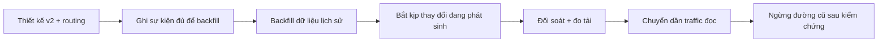

# Phân vùng quá lớn, khóa nóng và dữ liệu phân bố lệch

## Mục tiêu học tập

Sau bài học, bạn có thể:

- Phân biệt **phân vùng quá lớn** (*oversized/large partition*), **khóa nóng** (*hot key*), **phân vùng nóng** (*hot partition*) và **dữ liệu/tải phân bố lệch** (*skew*).
- Giải thích tại sao nhiều partition, nhiều máy chủ hoặc một hàm băm tốt **không tự bảo đảm** hệ thống sẽ phân phối tải đều.
- Dự đoán rủi ro từ **khóa phân vùng, khóa sắp xếp, kích thước mỗi hàng, tốc độ ghi, thời gian lưu giữ và độ lệch theo tenant**.
- Chọn kỹ thuật phù hợp như **time bucketing, hashing, sharding, salting, phân đoạn giá trị, cache, tách đường đọc/ghi** mà không làm mất khả năng tra cứu.
- Thiết kế cả **chiều ghi lẫn chiều đọc** khi thay đổi partition key: định tuyến, quét nhiều shard, hợp nhất thứ tự, phân trang và bảo vệ tính nhất quán.
- Đo lường và kiểm chứng lựa chọn bằng phân bố p95/p99, top-key throughput, partition size, fan-out và chi phí vận hành.
- Lập kế hoạch chuyển đổi khóa/bucket/shard không làm mất dữ liệu cũ hoặc gây trùng lặp khi chạy nhiều phiên bản ứng dụng.

Trong module **DATABASE_DATA_MODELING**, việc chuyển yêu cầu nghiệp vụ thành mô hình dữ liệu có thể kiểm chứng không dừng ở các thực thể, ràng buộc, khóa và chỉ mục: lược đồ vật lý còn phải **chịu được phân bố dữ liệu thực tế**. Với chương **Khóa giá trị và cột rộng**, partition key quyết định nhóm dữ liệu cùng được truy cập, còn sort/clustering key tổ chức dữ liệu trong nhóm đó. Thiết kế có vẻ tốt khi chạy với dữ liệu đều có thể trở thành điểm nghẽn khi một khách hàng, thiết bị, sản phẩm hoặc trạng thái nhận phần lớn lưu lượng.

> Bài học sử dụng ví dụ kiểu key–value và wide-column để phân tích quyết định mô hình hóa. Giới hạn kích thước, ngưỡng throughput, khả năng tách partition, transaction và TTL khác nhau theo sản phẩm/phiên bản; không coi những con số minh họa là giới hạn chung.

---

## 1. Bốn hiện tượng phải tách bạch

Các từ “partition lớn”, “hot key” và “skew” thường bị dùng lẫn nhau, nhưng nguyên nhân và cách sửa khác nhau.

| Hiện tượng | Biểu hiện | Vì sao xảy ra | Dấu hiệu cần đo |
| --- | --- | --- | --- |
| **Phân vùng quá lớn** | Một partition chứa rất nhiều hàng/byte hoặc tombstone | Khóa chỉ nhóm theo đối tượng lâu dài; dữ liệu tăng không giới hạn | Rows/bytes per partition, chi phí đọc/compaction, thời gian quét |
| **Khóa nóng** | Một key cụ thể nhận quá nhiều GET/PUT/update đồng thời | Tài nguyên tập trung vào một định danh như `counter:global` | QPS và contention theo key, số lần retry/CAS failure |
| **Phân vùng nóng** | Một partition logic/dải khóa có read/write load lớn | Nhiều hàng trong cùng partition được đọc/ghi dồn dập | QPS, bytes/s, throttling và latency theo partition/range |
| **Phân bố lệch (skew)** | Một ít tenant/đối tượng chiếm phần lớn dữ liệu hoặc truy vấn | Workload có “đầu nặng, đuôi dài”; mùa vụ, đối tượng nổi tiếng | Top-K contribution, p50/p95/p99, Gini/tỷ lệ tập trung |

**Phân vùng lớn không nhất thiết nóng:** một partition lưu vài năm dữ liệu ít được đọc vẫn lớn nhưng có throughput thấp. **Phân vùng nóng không nhất thiết lớn:** partition theo `(shopId, status=PAID, hour)` chỉ có vài nghìn hàng nhưng một đợt flash sale có thể tạo hàng nghìn ghi mỗi giây.

**Khóa nóng là trường hợp tập trung hơn:** cùng một key bị truy cập liên tục. Trong nhiều hệ, chia thêm partition ở những key khác không làm giảm contention của *chính key đó*. Các sản phẩm có cache, replication, adaptive partitioning hoặc cơ chế split đặc biệt có thể cải thiện một số trường hợp; phải kiểm tra đúng bảo đảm sản phẩm, không khẳng định mọi hot key đều bị giới hạn như nhau.

### 1.1. Partition logic và phân vùng vật lý không giống nhau

Một partition logic trong mô hình kiểu Cassandra có thể được xác định bằng `(tenantId, deviceId, dayBucket)`. Một dải hàng nằm trong tablet hoặc shard vật lý do engine bố trí tùy kiến trúc. Trong hệ row-key có thứ tự như Bigtable/HBase, một **dải key kế tiếp nhau** có thể tập trung ở một tablet/region ngay cả khi có nhiều row key khác nhau.

Vì thế cần hỏi:

1. **Engine định tuyến theo hash của partition key, theo dải row key, hay cơ chế khác?**
2. **Đơn vị nào được tách/cân bằng lại khi hệ thống mở rộng?**
3. **Đơn vị nào bị giới hạn throughput, kích thước, độ trễ hoặc transaction?**
4. **Thứ tự khóa có tạo vùng ghi liên tục ở đầu/cuối dải key không?**

Nếu bỏ qua câu hỏi này, lời giải “thêm một prefix” hoặc “dùng UUID” có thể giúp một hệ nhưng không thay đổi điểm nghẽn ở hệ khác.

## 2. Ví dụ xuyên suốt: nền tảng đơn hàng đa tenant

Một ứng dụng bán hàng có nhiều shop với khối lượng khác nhau:

- 90% shop có dưới 100 đơn/ngày.
- Một số shop có vài chục nghìn đơn/ngày.
- Shop lớn nhất có thể nhận lượng đơn tăng đột biến trong đợt bán hàng.
- API cần hiển thị **30 đơn mới nhất của từng khách**, **đơn đang chờ xử lý theo shop**, và **chi tiết đơn theo ID**.
- Đơn thô được giữ theo chính sách 3 năm; bảng danh sách có thể có vòng đời khác.

Hai cách tổ chức ban đầu:

```text
A. Lịch sử tất cả đơn của shop:
   partition = shopId
   sort      = (createdAt DESC, orderId)

B. Lịch sử của từng khách:
   partition = (shopId, customerId, monthBucket)
   sort      = (createdAt DESC, orderId)
```

Phương án A có vẻ rất tiện cho bảng quản trị của shop, nhưng một shop lớn có thể tạo **một partition khổng lồ** và chịu nhiều lượt ghi. Phương án B chia tải theo khách và thời gian, giúp màn hình “đơn của tôi”, nhưng **không tự trả nhanh “mọi đơn của shop đang PAID”** vì truy vấn không biết customerId.

Bài toán không chỉ là chọn key có số lượng giá trị lớn hơn. Cần biết **đường truy cập nào quan trọng**, dữ liệu thuộc về ai và khi tách ra thì đọc bằng cách nào.

### 2.1. Ma trận truy vấn tối thiểu

| Truy vấn | Đầu vào | Lọc/sort | Tải dự kiến cần đo | Đường truy cập đề xuất |
| --- | --- | --- | --- | --- |
| Chi tiết đơn | `shopId, orderId` | Một đơn | GET/s và độ trễ | `orders_by_id` |
| 30 đơn mới của khách | `shopId, customerId` | `createdAt DESC` | Reads/s, số bucket cần đọc | `orders_by_customer_bucket` |
| Đơn PAID mới của shop | `shopId, status` | `statusChangedAt DESC` | Cực đại trong flash sale | Bảng theo trạng thái + bucket/shard có kiểm soát |
| Doanh thu theo ngày | `shopId, day` | Tổng hợp nhiều đơn | Batch/stream lag | Rollup/OLAP |
| Duyệt tất cả đơn trong 3 năm | `shopId, timeRange` | Dữ liệu rất lớn | Thời gian job, thông lượng scan | Job nền, export hoặc mô hình phân tích |

**Mỗi đường đọc có thể cần một partition key khác.** Một read model theo khách không nhất thiết đáp ứng dashboard theo status. Thêm bảng đọc làm tăng dữ liệu lặp và công việc đồng bộ; điều này phải được tính từ đầu.

## 3. Vì sao hash không tự giải quyết dữ liệu lệch?

Giả sử một hệ dùng hash của partition key để phân phối lên nhiều vùng lưu. Hash tốt có thể làm **nhiều khóa khác nhau** được rải tương đối đều nếu tập khóa và tải truy cập phù hợp.

Nhưng xét hai workload:

```text
Workload X:
  1.000.000 keys; mỗi key khoảng 1 request/phút

Workload Y:
  1.000.000 keys;
  một key nhận 50.000 request/giây;
  các key còn lại gần như không được truy cập
```

Cả hai có cùng số khóa. Trong Y, dù hash rất đều trên tập key, **trọng số tải** dồn vào một key. Phân phối ngẫu nhiên một key tới một partition không chia nhỏ khối lượng của key đó.

Tương tự, nếu `status` chỉ có `NEW`, `PAID`, `SHIPPED` và `CANCELLED`, partition key chỉ dùng `status` sẽ tạo rất ít partition logic. Ngay cả khi hàng triệu đơn thuộc những partition đó, không thể mong các hàng tự trải đều thành hàng triệu nhóm truy cập.

### 3.1. Ba loại phân bố cần theo dõi

- **Key cardinality:** Có bao nhiêu giá trị partition key khác nhau?
- **Data skew:** Mỗi key/partition chứa bao nhiêu hàng và byte?
- **Access skew:** Mỗi key/partition nhận bao nhiêu request, byte/s, ghi có điều kiện và thao tác quét?

**Cardinality cao là điều kiện hữu ích nhưng không đủ.** Với 10.000 shop, nếu shop lớn nhất chiếm 70% đơn, thiết kế chỉ partition theo `shopId` vẫn tạo hotspot.

### 3.2. Khi phân bố lệch theo thời gian

Workload thay đổi theo giờ, ngày, mùa vụ và chiến dịch:

- `dayBucket=today` thường nhận ghi nhiều hơn ngày hôm qua.
- Một đợt flash sale khiến một SKU nhận phần lớn lượt xem/đặt.
- Lô import hoặc backfill có thể dồn ghi vào vài bucket lịch sử.
- Retry hàng loạt sau sự cố có thể khuếch đại tải lên cùng một tập key.
- Cache hết hạn đồng loạt có thể làm nhiều request rơi về backend cùng lúc.

Không lấy một ảnh chụp QPS trung bình cả ngày làm đại diện cho đỉnh 30 giây. Thiết kế phải có **headroom** và chiến lược phản ứng khi phân bố đổi đột ngột.

## 4. Ước lượng định lượng: kích thước, tốc độ và độ lệch

Một lược đồ vật lý cần ít nhất ba ước lượng: **dữ liệu trong một partition**, **lưu lượng đổ vào một partition**, và **số partition phải đọc cho một query**.

### 4.1. Kích thước partition

Với dữ liệu append-only theo thời gian:

\[
N_{\text{partition}}\ \approx\ r \times T
\]

\[
B_{\text{partition}}\ \approx\ N_{\text{partition}} \times S
\]

Trong đó:

- `r`: số hàng trung bình mỗi giây của **một đối tượng/nhóm được phân vùng**.
- `T`: số giây trong một bucket.
- `S`: số byte lưu trữ hiệu dụng mỗi hàng (ước lượng gồm phần phù hợp của metadata/encoding).
- `N` và `B`: số hàng và byte ước tính trong partition.

Ví dụ một thiết bị nóng phát **2.000 phép đo/giây**. Giả sử mỗi hàng chiếm **500 byte lưu trữ hiệu dụng**:

```text
2.000 hàng/giây × 86.400 giây/ngày
  = 172.800.000 hàng/ngày

172.800.000 hàng × 500 byte
  = 86.400.000.000 byte
  ≈ 86,4 GB/ngày (thập phân)
```

Với thiết bị này, **bucket ngày** có thể quá lớn ngay cả trước khi xét replication, tombstone, compaction và yêu cầu đọc. Đổi sang bucket giờ giảm số hàng/partition dự kiến khoảng 24 lần nhưng **không nhất thiết giảm tốc độ ghi tức thời**: các ghi hiện tại vẫn dồn vào bucket của giờ hiện tại. Nếu throughput/partition mới là nút thắt, còn cần chia shard theo chiều không gian hoặc cơ chế phân phối khác.

Đây là điểm nhiều thiết kế bỏ sót: **time bucketing giới hạn tăng trưởng; nó không mặc nhiên phân tán tải đồng thời.**

### 4.2. Tốc độ ghi và đọc

Ước lượng:

\[
W_{\text{hot-partition}} =
\max_{p \in P}\big(\text{writes/s vào partition } p\big)
\]

\[
R_{\text{hot-key}} =
\max_{k \in K}\big(\text{reads/s tới key } k\big)
\]

Cần đo cả **bytes/s**, **requests/s** và **contention/conditional-write failures**. Một ghi value 2 MB có chi phí khác rất lớn với ghi value 200 byte, dù cùng 1 request.

Không nên gắn một ngưỡng ví dụ như “mọi partition tối đa X MB” vào tất cả sản phẩm. Khả năng chịu tải phụ thuộc:

- Loại engine và thuật toán phân vùng.
- Kích thước hàng, blob, số cell và cách index.
- Loại thao tác (đọc cache, ghi có điều kiện, quét range, xóa).
- Replication, mức nhất quán và hạ tầng.
- Cơ chế split/auto-scaling/adaptive capacity thực tế.

### 4.3. Đo skew bằng top-K và phân vị

Một báo cáo hữu ích không chỉ có trung bình:

| Thống kê | Ý nghĩa |
| --- | --- |
| Top 1 / top 10 partition theo bytes | Tìm nhóm dữ liệu quá lớn |
| Top 1 / top 10 key theo GET/PUT/s | Tìm key nhận tải bất thường |
| p50/p95/p99 bytes/partition | Xem phần đuôi của phân bố kích thước |
| p50/p95/p99 writes/s per active partition | Xem phân bố tải; nhớ rằng một partition cực đoan có thể nằm ngoài p99 |
| Tỷ lệ tổng requests do top 1% key tạo ra | Đo độ tập trung |
| Số partition có `T`/`S` vượt ngưỡng nội bộ | Theo dõi khả năng vượt SLA |
| QPS và latency theo tenant/feature | Tìm tác động của một tenant lớn lên các tenant khác |

**Phân vị không thay thế giá trị cực đại.** Nếu chỉ có 100 partition, p99 có thể chưa diễn tả chính xác partition nóng nhất; vẫn cần theo dõi top-K thực tế.

## 5. Chẩn đoán đúng nguyên nhân trước khi đổi khóa

Một API tăng độ trễ có thể do CPU, network, cache miss, index lag hoặc cơ chế lưu trữ, không nhất thiết do partition lớn. Quy trình chẩn đoán có thể là:

1. **Phân tách theo truy vấn:** GET theo ID, query theo partition, quét range, ghi status hay cập nhật counter?
2. **Xem phân bố key/partition:** một ít ID có áp đảo hay không?
3. **Phân tách đọc và ghi:** latency đọc tăng vì scan value lớn, hay ghi bị throttling?
4. **Đo quy mô:** rows/bytes/partition, value size, tombstone, số entry index.
5. **Kiểm tra giới hạn/phân phối vật lý:** hotspot theo token range/tablet/shard, split, cache, compaction, replication.
6. **Tái hiện theo tải thật:** top tenant, giờ cao điểm, retry burst, backfill, dữ liệu cũ và mới.
7. **Chỉ sau đó** chọn thay khóa, bucket, shard hoặc tối ưu truy vấn.

```mermaid
flowchart TD
    A["Latency hoặc throttling tăng"] --> B{"Tập trung ở một key?"}
    B -->|Có| C["Hot key / contention"]
    B -->|Không| D{"Tập trung ở một partition/dải key?"}
    D -->|Có| E["Hot partition / hot range"]
    D -->|Không| F["Kiểm tra scan, index, IO, CPU, cache, network"]
    C --> G["Cache đọc, phân tách ghi/counter, điều kiện nhất quán"]
    E --> H{"Partition quá lớn hay ghi đột biến?"}
    H -->|Quá lớn| I["Bucket / giới hạn tăng trưởng / vòng đời"]
    H -->|Ghi đột biến| J["Shard / phân phối khóa / throttling phù hợp"]
    G --> K["Kiểm thử lại cả chiều đọc và ghi"]
    I --> K
    J --> K
    F --> K
```



Sơ đồ là định hướng, không loại trừ nhiều nguyên nhân đồng thời. Một partition vừa quá lớn vừa nóng cần có thể giải quyết cả kích thước và throughput.

## 6. Anti-pattern 1: partition theo tenant hoặc status quá rộng

Ví dụ bảng vận hành:

```text
partition = (shopId, status)
sort      = (statusChangedAt DESC, orderId)
```

Nếu shop lớn có hàng triệu đơn trải qua nhiều năm và chỉ vài trạng thái, mỗi `(shopId, status)` có thể chứa một tập dữ liệu lớn và thường được cập nhật. Việc trạng thái đơn chuyển từ `PAID` sang `SHIPPED` còn đòi xóa/đánh dấu entry cũ rồi ghi entry mới.

### 6.1. Sửa bằng bucket thời gian

Một hướng:

```text
partition = (shopId, status, dayBucket)
sort      = (statusChangedAt DESC, orderId ASC)
```

Lược đồ minh họa kiểu CQL:

```sql
CREATE TABLE orders_by_status_day (
    shop_id            text,
    status             text,
    day_bucket         date,
    status_changed_at  timestamp,
    order_id           text,
    customer_id        text,
    total_minor        bigint,
    PRIMARY KEY (
        (shop_id, status, day_bucket),
        status_changed_at,
        order_id
    )
) WITH CLUSTERING ORDER BY (
    status_changed_at DESC,
    order_id ASC
);
```

Truy vấn một ngày:

```sql
SELECT order_id, status_changed_at, customer_id, total_minor
FROM orders_by_status_day
WHERE shop_id = 'shop_17'
  AND status = 'PAID'
  AND day_bucket = '2026-11-22'
LIMIT 30;
```

Giả định **bảng thể hiện trạng thái hiện tại**: khi đơn rời status PAID, phải loại entry PAID; `status_changed_at` và bucket tương ứng phải được tính lại cho entry mới. Nếu mục tiêu là **lịch sử mọi lần chuyển trạng thái**, cần một bảng event history riêng, vì một đơn có thể nhiều lần vào cùng trạng thái.

**Bucket theo ngày** giới hạn dữ liệu gắn với một ngày, nhưng không loại trừ hotspot trong ngày có đợt bán hàng quá lớn. Khi đó mới đánh giá bucket giờ hoặc shard.

### 6.2. Truy vấn xuyên bucket

Một dashboard cần “30 đơn PAID mới nhất” trong nhiều ngày phải:

1. Đọc bucket hôm nay trước.
2. Nếu chưa đủ, đọc ngày trước cho tới khi đủ hoặc chạm giới hạn lookback.
3. Gộp dữ liệu theo `(statusChangedAt DESC, orderId ASC)`.
4. Tạo cursor có thông tin bucket/position cho lần đọc tiếp.

Không đọc mọi bucket vô hạn cho một màn hình: đặt giới hạn số ngày, số row và thời gian xử lý. Với dữ liệu đến muộn hoặc thay status, danh sách đang hoạt động có thể đổi giữa các trang; API phải có hợp đồng phân trang phù hợp.

## 7. Anti-pattern 2: time bucketing làm nhỏ partition nhưng không giảm tải ghi hiện tại

Giả sử bảng cảm biến:

```text
partition = (tenantId, deviceId, dayBucket)
sort      = (observedAt DESC, measurementId)
```

Thiết bị bình thường gửi 1 phép đo/phút. Thiết bị công nghiệp cao tải gửi 2.000 phép đo/giây. Bucket ngày có thể ổn cho thiết bị thường nhưng quá lớn cho thiết bị nóng.

Đổi sang `hourBucket` giảm khoảng thời gian mỗi partition:

```text
(tenant_7, device_12, 2026112210)
(tenant_7, device_12, 2026112211)
```

Song tại thời điểm 10:30, phần lớn ghi mới của thiết bị 12 vẫn vào `2026112210`. Nếu vấn đề là **write hotspot**, giảm bucket có thể giảm kích thước nhưng không phân tán luồng ghi trong cùng giờ.

### 7.1. Thêm shard có kiểm soát

Một phương án:

```text
partition = (tenantId, deviceId, hourBucket, shardId)
sort      = (observedAt DESC, measurementId)

shardId = stableHash(measurementId) mod 8
```

Khi ID được phân bố hợp lý, các phép đo có thể đi vào tám partition logic trong giờ. Tuy nhiên:

- API “100 phép đo mới nhất của thiết bị” phải đọc nhiều shard và hợp nhất.
- Kho không được yêu cầu query theo một shard duy nhất nếu muốn có kết quả của toàn thiết bị.
- Truy vấn khoảng thời gian qua ba giờ có thể phải đọc `3 × 8 = 24` partition logic.
- Nếu đổi số shard từ 8 sang 16, hàm modulo thay đổi mapping; phải có versioning/định tuyến cả dữ liệu cũ và mới.
- Nếu các event có cùng `measurementId` nhưng timestamp khác nhau, hash vẫn ra cùng shard, nhưng **khóa hàng** có thể khác; idempotency cần bảo vệ riêng.

Sharding chỉ nên thực hiện khi đã đo được bottleneck và có kế hoạch chiều đọc. **Tối ưu ghi mà làm truy vấn đọc trở thành fan-out không kiểm soát là một lỗi thiết kế mới.**

### 7.2. Shard theo thứ gì?

| Cách chọn shard | Phù hợp khi | Rủi ro |
| --- | --- | --- |
| Hash ID sự kiện ổn định | Các sự kiện có ID phân bố đều, cần retry đến đúng shard | Chỉ định vị được nếu ID được biết; query theo thời gian phải fan-out |
| Hash user/thiết bị con | Tải đến từ nhiều nguồn con và query theo nguồn con | Một nguồn con nóng vẫn tập trung |
| Round-robin/counter có kiểm soát | Cần rải ghi, có bộ cấp shard/sequence | Retry phải quay lại shard cũ; cần lưu định tuyến/idempotency |
| Salt ngẫu nhiên | Đường ghi không cần định vị theo thuộc tính ngoài salt | Khó đọc chính xác lại một bản ghi nếu không lưu mapping |

Tùy hệ thống, cần quyết định một shard ID là phần của **business identity**, một thuộc tính vật lý hay chỉ metadata chỉ mục. Không dùng random salt nếu API chỉ biết `orderId` mà không có cách xác định shard.

## 8. Anti-pattern 3: một khóa giá trị chứa quá nhiều dữ liệu hoặc bị ghi tranh chấp

Không phải mọi vấn đề là wide-column. Key–value có thể gặp hotspot ngay tại **một value**.

Ví dụ:

```text
global-checkout-counter -> 105230912

cart:v1:shop_17:user_42 -> JSON 5 MB

popular-product:v1:sku_A17 -> metadata và thống kê
```

### 8.1. Counter toàn cục

Nếu mọi giao dịch cùng thực hiện “đọc counter, tăng 1, ghi lại”, hai vấn đề cùng xuất hiện:

- **Contended key:** quá nhiều cập nhật vào một khóa.
- **Lost update:** nếu không có lệnh tăng nguyên tử/CAS/giao dịch phù hợp, hai request có thể ghi đè nhau.

Một hướng là bộ đếm chia shard:

```text
checkout-count:v2:00 -> 120
checkout-count:v2:01 -> 113
...
checkout-count:v2:15 -> 128

total = sum(count from shards 00..15)
```

Mỗi sự kiện phải được gán shard và áp dụng **đúng một lần theo chính sách idempotency** nếu tổng đếm cần chính xác. Tổng đọc từ nhiều shard có thể không phải snapshot nguyên tử; nếu dashboard chỉ cần giá trị gần đúng, có thể chấp nhận. Nếu số đếm quyết định hạn mức pháp lý hoặc tài chính, cần bảo đảm mạnh hơn hoặc mô hình khác.

**Không áp dụng shard counter mà không định nghĩa lại tính đúng đắn.** Một bộ đếm nhanh nhưng đôi khi đếm hai lần không thay thế số liệu doanh thu đã chốt.

### 8.2. Value lớn

Giỏ hàng bị nhồi hàng chục nghìn dòng, lịch sử hành động và ghi chú vô hạn có thể khiến:

- Mỗi GET tải nhiều byte không cần.
- Mỗi PUT/CAS đọc–sửa–ghi lại toàn value.
- Nhiều người dùng cùng sửa giỏ tranh chấp trên một khóa.
- Codec và mạng tăng latency; value chạm giới hạn sản phẩm.

Có thể tách **metadata giỏ** và **các dòng giỏ** thành nhiều key/item theo `(cartId, itemId)` hoặc dùng cấu trúc native phù hợp. Nhưng lúc đó phải định nghĩa cách hiển thị giỏ nhất quán và bảo vệ các ràng buộc như tổng tiền, item hợp lệ, số lượng không âm.

Nếu giỏ thường nhỏ và luôn được đọc nguyên khối, tách quá sớm có thể làm tăng số request. Chọn ranh giới theo phân bố kích thước và tần suất thay đổi thực, không theo sở thích “tất cả JSON phải tách”.

### 8.3. Hot read khác hot write

Với key sản phẩm nổi tiếng có hàng trăm nghìn GET/s, **cache/replica** có thể giảm tải đọc từ nguồn nếu chấp nhận chính sách nhất quán phù hợp. Nhưng cache không giải quyết việc cùng key bị ghi liên tục và tranh chấp CAS. Cần xử lý khác nhau:

| Tải nóng | Biện pháp có thể cân nhắc | Điều cần bảo vệ |
| --- | --- | --- |
| Đọc cùng key rất nhiều | Cache tầng ứng dụng/CDN nếu phù hợp, coalescing request, read replica | TTL, invalidation, stale data, quyền |
| Ghi tăng giá trị thường xuyên | Atomic increment, shard counter, batching | Độ chính xác và idempotency |
| Nhiều writer cùng sửa JSON | Cập nhật trường nguyên tử, CAS với retry có giới hạn, tách aggregate | Bất biến nghiệp vụ và lost update |
| Key quá lớn nhưng ít truy cập | Chunking, phân đoạn theo vòng đời, giới hạn dữ liệu | Định danh phần, truy vấn, xóa và phục hồi |

## 9. Anti-pattern 4: ghi nối tiếp vào dải row key đang tăng

Không phải hệ nào cũng phân vùng theo hash. Với kho có **row key được sắp theo thứ tự từ điển** và chia dữ liệu thành các range/tablet, dùng khóa tăng liên tục có thể khiến những ghi mới tập trung vào **dải cuối**.

Ví dụ row key:

```text
event:20261122100000001
event:20261122100000002
event:20261122100000003
...
```

Nếu toàn hệ thống ghi vào cuối trục thời gian, một range có thể nhận đa số write traffic ở một thời điểm. Tăng số lượng row key không tự bảo đảm phân phối vì **các khóa kế tiếp nhau thuộc cùng dải** cho đến khi engine tách và cân bằng lại.

Các hướng cân nhắc, tùy sản phẩm:

- Prefix bằng **bucket theo nguồn** hoặc tenant/thiết bị để nhiều nguồn phân tán.
- Dùng **hash/salt prefix** có thể rải vùng ghi; đánh đổi là truy vấn range theo thời gian phải đi qua nhiều prefix.
- Thiết kế **reverse timestamp** khi truy vấn mới nhất, nhưng kiểm tra việc này có thật sự phân tán tải hay chỉ chuyển hotspot sang đầu dải.
- Dùng cơ chế **pre-split/auto-split** theo hướng dẫn của engine khi workload và số range đã biết.

**Không áp quy tắc “thêm salt vào row key” một cách mù quáng:** nếu truy vấn cần lấy một dải thời gian của một thiết bị, salt có thể biến một range scan thành hàng chục scan. Kích thước salt và cách merge phải nằm trong hợp đồng truy vấn.

## 10. Đọc trên nhiều shard: fan-out, merge và cursor

Khi phân chia một logical group thành nhiều shard, ứng dụng mất lợi ích “một partition trả toàn bộ top N”. Cần thiết kế **k-way merge** hoặc cách tổng hợp phù hợp.

Giả sử yêu cầu 20 đơn PAID mới nhất của shop, và bảng theo status được chia 8 shard trong ngày:

```text
partition = (shopId, status, dayBucket, shardId)
sort      = (statusChangedAt DESC, orderId ASC)
```

### 10.1. K-way merge

Một cách phổ biến:

1. Query mỗi shard theo sort key, lấy một số ứng viên đầu tiên với paging state riêng.
2. So sánh phần tử đứng đầu của các shard, chọn phần tử mới nhất theo **thứ tự toàn phần**.
3. Đưa phần tử đó vào kết quả và tiến con trỏ của shard tương ứng.
4. Lặp đến đủ 20 phần tử hoặc hết dữ liệu và phạm vi đọc.
5. Lưu cursor đủ thông tin để trang tiếp tục không đọc lại sai hoặc bỏ sót theo hợp đồng.

Giả mã:

```text
function topNFromShards(shopId, status, bucket, n, shardCount):
    streams = []

    for shard in 0..shardCount-1:
        streams.add(openPagedQuery(
            partition=(shopId, status, bucket, shard),
            order=(statusChangedAt DESC, orderId ASC)
        ))

    heap = maxHeap(compareBy(statusChangedAt DESC, orderId ASC))
    for stream in streams:
        if stream.hasNext():
            heap.push(stream.next(), stream)

    result = []
    while result.size < n and not heap.empty():
        item, stream = heap.pop()
        result.add(item)
        if stream.hasNext():
            heap.push(stream.next(), stream)

    return result, encodePagingState(streams, heap)
```

Đây là **giả mã khái niệm**, không phải thư viện cursor sẵn có. Triển khai thực tế cần phân biệt đã fetch/đã emit, giữ lại ứng viên trong heap, trạng thái trang của từng shard, bucket kế tiếp, giới hạn fan-out và xử lý retry. Nếu dùng paging state engine, không giả định có thể dùng lại nó sau khi schema/filter thay đổi.

### 10.2. Chi phí fan-out

Tăng shard từ 1 lên 8 có thể giảm tải ghi mỗi partition nếu phân bố đều, nhưng một query top N phải gửi tới **8 partition** cho một bucket. Với 7 bucket trong khoảng, có thể phải xét tới **56 kết hợp bucket–shard** trước tối ưu hóa/giới hạn.

Lợi ích thực tế phải được đo bằng:

- Số request/partition và bytes thực sự đọc.
- p95/p99 latency khi truy vấn song song và khi một shard chậm.
- Kích thước cursor, mức tiêu thụ kết nối và deadline.
- Tỷ lệ dữ liệu đến muộn, trùng ID và index stale.
- Số shard phải quét để trả một phần kết quả hữu ích.

Sharding giúp **chiều ghi** nhưng có thể tạo **read amplification**. Tùy workload, một bảng “latest summary” nhỏ phục vụ UI và một bảng sharded append-only phục vụ lưu trữ chi tiết có thể phù hợp hơn. Nhưng bảng summary cũng tạo trách nhiệm đồng bộ và có thể trở thành hot key nếu thiết kế sai.

### 10.3. Thứ tự và snapshot

Các shard có thể trả dữ liệu tại những thời điểm khác nhau. Merge theo timestamp cho một thứ tự hợp lý, nhưng **không tự bảo đảm ảnh chụp nhất quán** khi có insert/update/delete đồng thời.

Nếu cần báo cáo chính xác tại một mốc, chọn cơ chế snapshot/as-of data do sản phẩm hỗ trợ hoặc xử lý ngoại tuyến tại mốc dữ liệu đã chốt. Nếu là danh sách live, ghi rõ ý nghĩa phân trang khi dữ liệu đổi giữa các lần request.

## 11. Khi nào dùng cache, index, rollup hoặc đổi mô hình?

Không phải mọi hotspot đều nên sửa bằng sharding primary table.

| Nhu cầu / triệu chứng | Hướng giải quyết có thể phù hợp | Đánh đổi cần đo |
| --- | --- | --- |
| Một key chỉ bị đọc nóng | Cache có TTL/invalidation, request coalescing | Staleness và khả năng cache stampede |
| Một bộ đếm bị ghi nóng | Atomic counter, sharded counter, stream aggregation | Độ chính xác, read fan-out, idempotency |
| Lịch sử theo thời gian tăng lớn | Time bucket và giới hạn retention | Range query nhiều bucket |
| Một bucket hiện tại vẫn quá nóng | Thêm shard phân tán ghi hoặc thay mô hình ingest | Merge, cursor, phiên bản shard |
| Row key tăng liên tiếp làm nóng một range | Prefix phân tán, pre-split theo sản phẩm | Tăng số range scan |
| Dashboard query xuyên toàn bộ tenant | Read model theo status/time, chỉ mục, hoặc OLAP | Denormalization và đồng bộ |
| Truy vấn linh hoạt theo nhiều thuộc tính | Document/quan hệ với index/optimizer phù hợp | Chi phí index, join, throughput |
| Tổng hợp số liệu nhiều năm | OLAP/warehouse/rollup | Độ trễ dữ liệu, đối soát, chi phí pipeline |
| Graph traversal nhiều quan hệ | Hệ đồ thị nếu workload phù hợp | Duy trì cạnh/nút và đồng bộ nguồn |

**Tối ưu dữ liệu phân bố lệch là bài toán phân bổ chi phí theo đường truy vấn**, không phải cuộc thi tạo nhiều partition. Trong module data modeling, việc đổi mô hình chỉ đúng khi kết quả vừa **đúng nghiệp vụ**, vừa **kiểm chứng được** dưới workload dự kiến.

## 12. Thay partition key làm thay đổi danh tính lưu trữ

Khi từ:

```text
v1: partition = (shopId, status, dayBucket)
```

chuyển thành:

```text
v2: partition = (shopId, status, hourBucket, shardId)
```

không thể chỉ sửa công thức hash trong code rồi coi dữ liệu cũ tự chuyển sang key mới. Đây là một **thay đổi lược đồ vật lý và định tuyến dữ liệu**.

### 12.1. Các bước di trú có kiểm soát

1. **Định nghĩa hợp đồng khóa mới.** Cách tính bucket theo loại thời gian nào; hash/shard ID, số shard, encoding, phiên bản và phạm vi duy nhất.
2. **Chuẩn bị đường đọc tương thích.** Biết dữ liệu nằm ở v1 hay v2, hoặc có khả năng query cả hai rồi loại bản trùng.
3. **Chọn nguồn chân lý và mốc dữ liệu.** Backfill từ dữ liệu có thẩm quyền; có checkpoint/version để không bỏ sót thay đổi phát sinh trong lúc backfill.
4. **Bắt kịp stream thay đổi.** Consumer idempotent và chống event đến sai thứ tự; tránh cho snapshot cũ ghi đè trạng thái mới.
5. **Đối soát.** So khóa nghiệp vụ, phiên bản và trường trọng yếu; tổng số hàng bằng nhau chưa đủ.
6. **Chuyển dần traffic.** Theo dõi p95/p99, hot partition, bytes, lỗi cursor, độ lệch và chi phí fan-out.
7. **Cắt đường cũ có điều kiện.** Chỉ dọn dữ liệu v1 khi mọi consumer đã dùng đường mới, dữ liệu cần giữ đã chuyển và rollback policy rõ.



Nếu dùng dual-write, phải xử lý lỗi một trong hai nhánh; hai lệnh PUT vào hai key thường không tự tạo transaction. Với nguồn thay đổi bằng outbox/CDC, cần xác định mốc đọc log/snapshot và bảo vệ khả năng phát lại.

### 12.2. Đổi số shard không đơn giản là sửa modulo

Định tuyến:

```text
shard = hash(orderId) mod 8
```

khác:

```text
shard = hash(orderId) mod 16
```

Với nhiều order ID, kết quả shard thay đổi. Khi số shard tăng, có thể:

- Giữ **phiên bản routing** theo bucket hoặc khoảng thời gian; đọc dữ liệu cũ theo mod 8 và dữ liệu mới theo mod 16.
- Có bảng metadata cho biết scheme của mỗi bucket.
- Backfill sang scheme mới và giữ dual-read có khử trùng trong giai đoạn chuyển.

Không ngầm đoán shard từ số shard hiện hành đối với dữ liệu đã viết bằng scheme cũ. Nếu thay key của bản ghi nghiệp vụ, cần đảm bảo idempotency và định danh không bị phụ thuộc duy nhất vào địa chỉ vật lý.

## 13. Tính nhất quán, TTL và dữ liệu lệch khi phân tán

Một read model sharded có thể có nhiều bản sao logic hoặc index được cập nhật sau nguồn chính. Thiết kế phải định nghĩa cách tránh mất dữ liệu, trùng và entry lỗi thời.

### 13.1. Sự kiện trùng và sai thứ tự

Ví dụ đơn hàng:

```text
orderId = ord_908
v7: PAID
v8: SHIPPED
```

Nếu event v8 đến trước v7 mà projection ghi v7 sau cùng, bảng status có thể quay lại PAID dù trạng thái mới là SHIPPED. Nếu di chuyển entry giữa nhiều shard/partition, một lỗi giữa chừng có thể khiến nó tạm xuất hiện ở cả hai nhóm hoặc không nhóm nào.

Giải pháp cần:

- `orderVersion` tăng theo từng đơn và nguồn có thẩm quyền.
- Checkpoint/projection state; cập nhật version có cơ chế tránh race.
- Thao tác insert/delete có thể chạy lại an toàn.
- Đọc lại snapshot nguồn hoặc đối soát khi event thiếu/cũ.
- Mức độ trễ được chấp nhận và chính sách xem lại nguồn khi thao tác nhạy cảm.

**Sharding không giải quyết tính nguyên tử xuyên nhiều partition.** Thậm chí nó có thể đưa một thay đổi trước đây nằm ở cùng một partition sang nhiều partition khác, làm yêu cầu nhất quán khó hơn.

### 13.2. TTL, xóa và tombstone

Nếu dữ liệu chỉ giữ 90 ngày, bucket theo ngày có thể phù hợp để quản lý vòng đời. Nhưng:

- TTL theo **thời điểm ghi** có thể khác chính sách giữ đến `eventTime + 90 ngày`, đặc biệt khi event đến muộn.
- Hết TTL/xóa có thể tạo **tombstone** trong một số hệ, ảnh hưởng đọc và compaction nếu tập xóa lớn.
- Index/locator/read model có thể cần xóa theo quy tắc riêng; TTL của bản gốc không mặc nhiên lan sang nơi khác.
- Backup/snapshot/replica có cơ chế loại bỏ vật lý khác nhau; không đồng nhất TTL hết với bytes biến mất ngay lập tức.
- Shard mới không được “tái tạo” dữ liệu đã xóa chỉ vì stream cũ được replay; cần tombstone/version và chính sách rebuild.

Với dữ liệu cá nhân, phải đưa mọi bản sao được tạo để tăng hiệu năng vào phạm vi xử lý quyền truy cập, xóa, logging và kiểm toán.

### 13.3. Không dùng sort key như cơ chế bảo mật

Một số hệ có key gồm `tenantId`. Điều này giúp phân nhóm nhưng **không tự đảm bảo phân quyền**. API phải lấy tenant từ danh tính đáng tin cậy, xác minh quyền và giới hạn query/cursor. Sharding hoặc thay đổi key không được tạo đường tắt cho phép đoán khóa của tenant khác.

## 14. Quy trình quyết định có thể lặp lại

Khi gặp một bảng hoặc khóa có vấn đề, áp dụng tuần tự:

1. **Xác định query contract:** đầu vào, kết quả, thứ tự, giới hạn, SLA, độ mới và quyền.
2. **Đo quy mô và skew:** số hàng/byte, QPS theo key/partition, p95/p99 và top-K, peak theo thời gian.
3. **Xác định loại nút thắt:** partition lớn, hot key, hot range, scan rộng, contention, compaction hay cache miss.
4. **Dự đoán tác dụng của mỗi phương án:** bucket giảm dữ liệu theo thời gian; shard rải ghi; cache giảm tải đọc; index giúp query khác khóa.
5. **Thiết kế chiều đọc sau thay đổi:** xác định partition từ input, fan-out, merge, cursor và giới hạn.
6. **Bảo vệ invariants:** tính duy nhất, trạng thái, idempotency, concurrent writes, xóa, TTL và phân quyền tenant.
7. **Lập kế hoạch migration:** version định tuyến, backfill, stream, đối soát, rollback và cắt chuyển.
8. **Kiểm chứng bằng tải lệch:** không chỉ tải đều, mà cả tenant cực lớn, một key cực nóng, retry burst và range dài.
9. **Quan sát sau triển khai:** top partitions, p99, throttling, lag và cảnh báo vượt ngưỡng.

### 14.1. Bảng quyết định nhanh

| Nếu nút thắt chính là… | Ưu tiên xem xét | Phải kiểm tra thêm |
| --- | --- | --- |
| Quá nhiều byte trong một partition lịch sử | Bucket theo thời gian, retention, chia domain | Fan-out đọc lịch sử và TTL |
| Ghi vào bucket hiện tại quá dồn | Shard theo ID ổn định, phân phối nguồn ghi | Merge top N, retry, số shard |
| GET một item rất nóng | Cache/read replica/request coalescing | TTL, độ mới, cache stampede |
| Update một counter bị tranh chấp | Native atomic op, shard counter | Idempotency, tổng không nhất quán tức thời |
| Một dải row key tăng liên tục | Prefix phân tán/pre-split theo engine | Khả năng range scan và đọc theo thời gian |
| Một truy vấn không biết partition key | Read model/index hoặc đổi mô hình | Đồng bộ, scan/filter, chi phí ghi |
| Truy vấn phân tích rộng | OLAP/rollup | Độ trễ dữ liệu và đối soát |

## 15. Bộ kiểm thử cho partition lớn, hotspot và skew

Một thiết kế dữ liệu phải được kiểm chứng dưới những phân bố khác nhau, không chỉ số lượng bản ghi.

| Tình huống | Kết quả cần chứng minh |
| --- | --- |
| Nhiều tenant có tải đều | Các partition được rải theo đặc tính sản phẩm; hệ đáp ứng SLA |
| 1 tenant chiếm 70% tải | Tenant khác không bị ảnh hưởng vượt mức chấp nhận; có cơ chế bảo vệ tài nguyên |
| 1 key nhận GET gấp 1.000 lần trung bình | Cache/đường đọc và p99 vẫn trong mục tiêu |
| 1 key bị cập nhật đồng thời | Không mất cập nhật; contention có retry/giới hạn phù hợp |
| Thiết bị có 2.000 event/giây trong một giờ | Kích thước và throughput của bucket/shard đạt mục tiêu |
| Đọc 100 sự kiện mới nhất qua nhiều shard | Kết quả đúng thứ tự, không bỏ sót khi timestamp trùng |
| Truy vấn xuyên 30 bucket | Fan-out, số hàng đọc và latency vẫn nằm trong giới hạn |
| Sự kiện đến muộn qua nửa đêm | Được định tuyến đúng bucket theo hợp đồng và truy vấn tìm được |
| Retry cùng measurementId | Không nhân đôi nghiệp vụ dù request được gửi lại |
| Chuyển từ 8 shard sang 16 shard | Dữ liệu cũ đọc đúng, dữ liệu mới định tuyến đúng; cursor hỗn hợp được xử lý |
| Xóa/hết TTL và replay event cũ | Không khôi phục dữ liệu đã bị xóa theo chính sách |
| Projection đổi status bị lỗi giữa chừng | Đối soát khôi phục entry chính xác |
| Query của tenant khác | Không đọc chéo tenant qua key hoặc cursor |
| Cache hết hạn đồng thời | Có giới hạn tải backend, không tạo thác request |
| Ghi burst khi backfill | Không làm nghẽn query trực tuyến vượt SLA |

### 15.1. Bộ chỉ số đánh giá

- **Phân phối dữ liệu:** bytes/partition và rows/partition theo p50/p95/p99/top-K.
- **Tải:** reads/s, writes/s, bytes/s theo key, partition, tenant và thời gian.
- **Latency:** p50/p95/p99 theo query, vùng dữ liệu và độ lớn partition.
- **Tắc nghẽn:** throttling, queue depth, retry, CAS conflict, cache miss.
- **Đọc sau sharding:** số shard/bucket mỗi request, bytes đọc trên một phần tử kết quả, số trang rỗng.
- **Đúng đắn:** duplicate ID, missing index entry, projection lag, divergence, bản ghi đã hết hạn còn trả ra.
- **Chi phí:** write amplification, read amplification, dung lượng index, số lần backfill và compaction.

Đánh giá phương án bằng **trước–sau** trên cùng workload và phân bố key; khi lượng dữ liệu tăng hoặc luồng đọc thay đổi, cần kiểm tra lại thiết kế.

## 16. Bài tập vận dụng

### Bài tập A — Bucket ngày có đủ không?

Một thiết bị có tốc độ ghi trung bình 5 phép đo/giây, nhưng tối đa 2.000 phép đo/giây trong vài giờ. Mỗi hàng lưu khoảng 500 byte. Bảng dùng partition `(tenantId, deviceId, dayBucket)`.

**Câu hỏi:** Vì sao chọn bucket dựa trên trung bình có thể sai? Đổi từ ngày sang giờ giải quyết vấn đề nào và không giải quyết vấn đề nào?

**Gợi ý:** Dùng tốc độ đỉnh để ước lượng bytes/partition và writes/s; bucket giờ giảm dữ liệu trong partition, nhưng hiện tại phần lớn ghi vẫn dồn vào một bucket giờ. Nếu write hotspot còn, cân nhắc shard hoặc cấu trúc ingest khác; đo read fan-out.

### Bài tập B — Counter toàn cục

Hệ thống lưu `daily-checkout-count:20261122` và mỗi đơn làm một lần đọc–tăng–ghi. Có hàng nghìn checkout đồng thời.

**Câu hỏi:** Nêu hai lỗi khác nhau và chọn phương án bảo vệ độ chính xác.

**Gợi ý:** Hot key gây nghẽn và read–modify–write không điều kiện gây lost update. Xem native atomic increment hoặc sharded counter với idempotency theo transaction ID; nếu tổng phải chính xác tại một mốc, cần một nguồn giao dịch/event log và quy tắc tổng hợp chặt chẽ.

### Bài tập C — Bảng theo status bị nóng

Bảng có partition `(shopId, status)`, clustering `(createdAt DESC, orderId)`. Trong flash sale, một shop chiếm phần lớn ghi vào `status=PAID`.

**Câu hỏi:** Hãy đề xuất thiết kế v2 và mô tả luồng query “30 đơn PAID mới nhất”.

**Gợi ý:** Có thể thêm `dayBucket`, và chỉ thêm `shardId` nếu số liệu cho thấy bucket vẫn nóng. Query cần đọc các shard của ngày mới nhất, merge theo sort, lùi bucket khi chưa đủ; chuyển status phải loại entry cũ và cập nhật bảng mới idempotent.

### Bài tập D — Row key tăng dần

Trong một kho chia dữ liệu theo dải row key, tất cả sự kiện có row key theo timestamp UTC tăng dần và ghi bị nghẽn ở dải cuối.

**Câu hỏi:** Vì sao nhiều key không giúp phân phối tải? Cách thêm prefix hash làm thay đổi query theo thời gian thế nào?

**Gợi ý:** Khóa mới liên tiếp nhau theo byte nên tập trung cùng một range/tablet. Prefix phân tán có thể chia ghi, nhưng truy vấn theo khoảng sẽ phải quét nhiều prefix rồi merge. Phải kiểm tra cơ chế region/tablet split và giới hạn của engine thực tế.

### Bài tập E — Di trú số shard

Phiên bản cũ dùng `hash(orderId) mod 4`, phiên bản mới muốn `mod 16`. Một worker vẫn đang ghi v1 trong khi API mới đọc v2.

**Câu hỏi:** Vì sao chỉ sửa hằng số từ 4 thành 16 làm mất khả năng tìm một phần dữ liệu? Thiết kế kế hoạch di trú an toàn.

**Gợi ý:** Mapping đổi với nhiều ID. Dùng routing version theo bucket/mốc, dual-read có khử trùng, backfill có checkpoint, stream thay đổi không bỏ sót, đối soát và chỉ bỏ v1 khi toàn hệ đọc v2 an toàn.

### Bài tập F — Chọn đúng công nghệ

Ứng dụng cần đồng thời: (1) đọc 20 sản phẩm nổi tiếng theo lượt xem, (2) cập nhật tồn kho có ràng buộc mạnh, (3) tìm kiếm ghi chú tự do, (4) doanh thu nhiều năm.

**Câu hỏi:** Có nên giải quyết cả bốn bằng cách thêm shard vào một bảng wide-column?

**Gợi ý:** Không. Cache/read model có thể phục vụ phổ biến; tồn kho cần cơ chế transaction phù hợp; search index phục vụ văn bản; OLAP/rollup phục vụ phân tích. Cần xác định nguồn dữ liệu có thẩm quyền và đồng bộ cho mỗi đường đọc.

## Tổng kết kiến thức

**Phân vùng quá lớn**, **khóa nóng**, **phân vùng nóng** và **dữ liệu phân bố lệch** không đồng nghĩa nhau. Chúng có thể xuất hiện đồng thời nhưng đòi hỏi các biện pháp khác nhau: bucket giới hạn tăng trưởng theo thời gian; shard/phân phối khóa giảm tập trung ghi khi cơ chế engine cho phép; cache giảm đọc lặp; cấu trúc chỉ mục/read model giải quyết truy vấn không biết khóa chính.

Mọi biện pháp thay đổi partition key đều phải thiết kế cùng lúc **đường đọc, thứ tự, cursor, chi phí fan-out, tính đúng đắn và kế hoạch di trú**. Một lược đồ phân phối đều trên giấy nhưng buộc đọc hàng nghìn partition để trả 20 bản ghi, hoặc làm mất idempotency khi retry, chưa phải lược đồ tốt.

Câu hỏi cuối cùng cần trả lời là: **“Partition/key lớn hoặc nóng đến đâu trong tình huống cực đoan; hệ quản trị thực sự phân phối bằng cơ chế nào; phương án chia dữ liệu có khiến truy vấn khó hơn không; và ta kiểm chứng cả hiệu năng lẫn ràng buộc nghiệp vụ bằng chỉ số nào?”**
