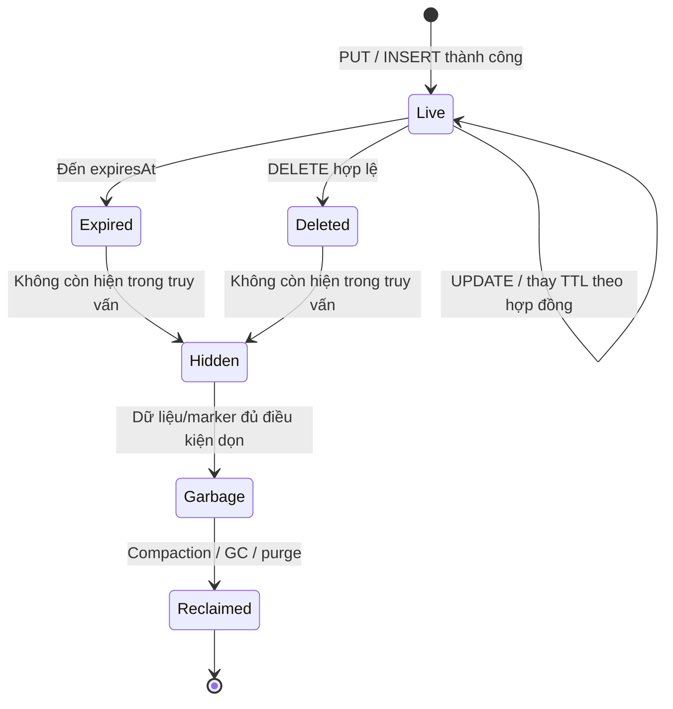
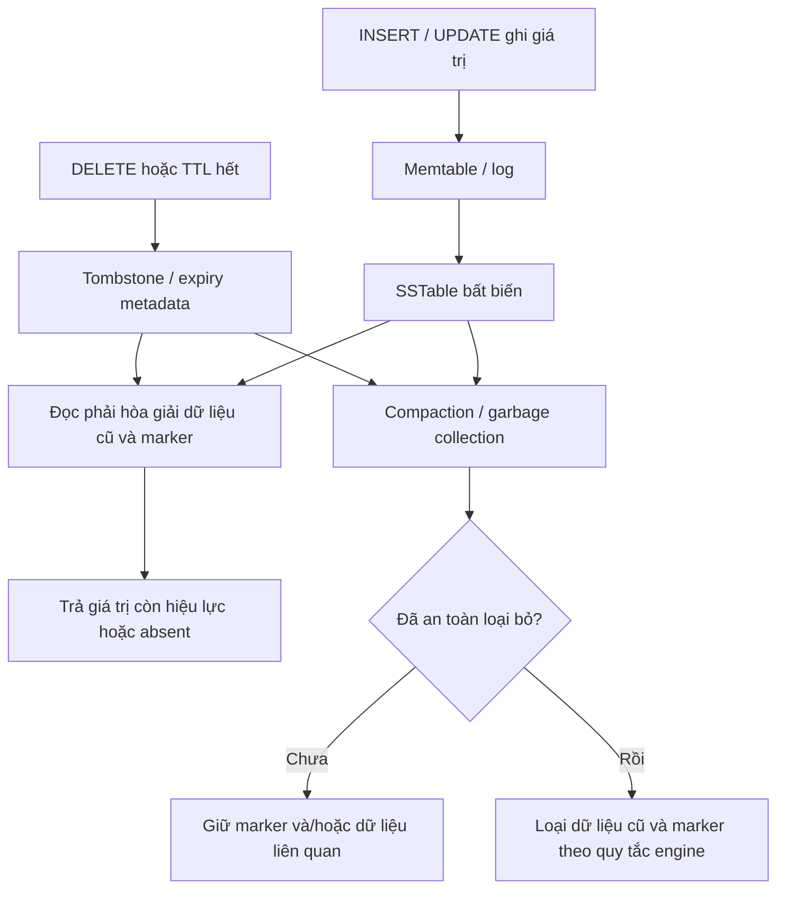
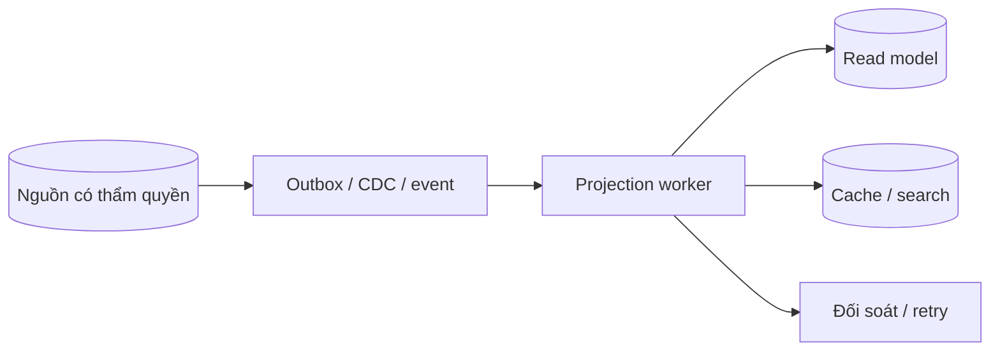

# Thời hạn sống, xóa dữ liệu và ý nghĩa của bản ghi đánh dấu xóa

## Mục tiêu học tập

Sau bài này, bạn có thể:

- Phân biệt **thời hạn sống (TTL)**, **thời điểm hết hạn**, **chính sách lưu giữ (retention)**, **xóa logic** và **loại bỏ vật lý (purge)**.
- Giải thích vì sao một lệnh `DELETE` hoặc một TTL đã hết **không đồng nghĩa** mọi bản sao, tệp lưu trữ, chỉ mục và bản sao lưu đều mất dữ liệu ngay lập tức.
- Hiểu **tombstone** là dấu hiệu biểu diễn một thao tác xóa/hết hạn trong một số engine, đặc biệt với hệ phân tán dùng cấu trúc ghi kiểu **LSM tree**, và nêu vai trò của nó khi hòa giải replica.
- Mô tả cách tombstone ảnh hưởng đến đọc, ghi, compaction, anti-entropy repair và nguy cơ **dữ liệu đã xóa xuất hiện lại** nếu bằng chứng xóa bị loại quá sớm.
- Thiết kế TTL theo **thời gian nghiệp vụ**, đặc biệt với sự kiện đến muộn, bản ghi có nhiều cột và quy tắc gia hạn khi cập nhật.
- Phân tích vòng đời của **bảng chính, chỉ mục phụ, read model, cache, event log, snapshot và backup** khi một thực thể hết hạn hoặc phải bị xóa.
- Đề xuất bộ kiểm thử và chỉ số giám sát để kiểm chứng thời gian hết hạn, số tombstone, chi phí đọc, tính nhất quán và việc dọn dữ liệu.

Trong module **DATABASE_DATA_MODELING**, người học chuyển yêu cầu nghiệp vụ thành mô hình dữ liệu có thực thể, quan hệ, ràng buộc, khóa, chỉ mục và lược đồ vật lý rõ ràng. Ở chương **Khóa giá trị và cột rộng**, chọn partition key và clustering key mới chỉ giải quyết **cách tìm dữ liệu**. Thiết kế còn phải trả lời: **“Dữ liệu tồn tại đến khi nào, ai có quyền xóa, lệnh xóa có ý nghĩa gì và làm sao chắc rằng dữ liệu cũ không quay trở lại?”**

Một hệ thống có thể đọc rất nhanh theo khóa nhưng vẫn không đạt yêu cầu nếu TTL bị làm mới ngoài ý muốn, chỉ mục còn trỏ đến bản ghi đã xóa hoặc tombstone làm truy vấn lịch sử chậm nghiêm trọng.

---

## 1. Từ một yêu cầu lưu giữ đến hợp đồng vòng đời

Giả sử nền tảng theo dõi cảm biến có ba loại dữ liệu:

1. **Phép đo thô:** chỉ cần phục vụ màn hình vận hành trong 30 ngày kể từ **thời điểm đo thực tế**.
2. **Cảnh báo an toàn:** phải giữ ít nhất 365 ngày kể từ khi cảnh báo được tạo theo chính sách nghiệp vụ.
3. **Bản tổng hợp theo ngày:** phục vụ báo cáo dài hạn, không nhất thiết có cùng vòng đời với dữ liệu thô.

Một bản ghi đo:

```json
{
  "tenantId": "tenant_7",
  "deviceId": "device_12",
  "measurementId": "m_103",
  "observedAt": "2026-11-21T10:05:00Z",
  "receivedAt": "2026-11-22T02:10:00Z",
  "temperatureC": 26.3,
  "quality": "OK"
}
```

Nếu thực hiện một lệnh ghi kèm “TTL = 30 ngày” tính từ **thời điểm nhận**, bản ghi được giữ tới 22/12 thay vì 21/12. Với dữ liệu gửi bù sau 15 ngày, độ lệch còn rõ hơn. Vì vậy một câu “giữ 30 ngày” phải được chuyển thành hợp đồng có các trường:

| Mục hợp đồng | Ví dụ câu trả lời |
| --- | --- |
| Đối tượng nào? | Bản ghi phép đo thô của một thiết bị |
| Bắt đầu tính từ lúc nào? | `observedAt` đã được xác thực/chấp nhận |
| Thời điểm hết hạn? | `observedAt + 30 × 24 giờ` theo quy tắc cố định |
| Đến hạn phải xảy ra điều gì? | API không trả bản ghi như dữ liệu còn hiệu lực |
| Khi nào xóa vật lý? | Theo cơ chế dọn dẹp của engine và chính sách vận hành |
| Có bản sao nào liên quan? | Bảng locator, read model theo thiết bị, cache, object store, backup |
| Dữ liệu đến muộn? | Nếu `expiresAt <= now`, từ chối lưu thô hoặc xử lý theo luồng riêng |
| Có ngoại lệ? | Giữ lâu hơn theo yêu cầu hợp lệ/điều tra được phê duyệt |
| Ai được quyền đổi/xóa? | Dịch vụ được cấp quyền, theo tenant và chính sách |
| Cách kiểm chứng? | Test tại ranh giới hết hạn, đo lag dọn và đối soát bản sao |

**TTL là một công cụ thực thi chính sách; bản thân con số TTL chưa phải chính sách hoàn chỉnh.**

## 2. Phân biệt các khái niệm về xóa và hết hạn

| Thuật ngữ | Nghĩa trong thiết kế | Điều **không** được tự suy ra |
| --- | --- | --- |
| **TTL (time-to-live)** | Khoảng thời gian một giá trị/cell/item được coi là hợp lệ sau mốc mà sản phẩm quy định | Không luôn được tính từ `createdAt` nghiệp vụ |
| **Expiration / expiresAt** | Thời điểm sau đó bản ghi không còn được coi là còn sống | Không đồng nghĩa bytes đã biến mất khỏi mọi ổ đĩa |
| **Retention policy** | Quy tắc nghiệp vụ/pháp lý về thời gian và phạm vi dữ liệu cần giữ | Không chỉ một thuộc tính TTL của DB |
| **Logical delete** | Bản ghi bị ẩn khỏi truy vấn hoặc mang trạng thái `deleted` | Không chứng minh đã xóa vật lý |
| **Tombstone** | Marker/bằng chứng xóa do một số engine sử dụng để phân biệt dữ liệu đã xóa với dữ liệu chưa từng có | Không phải mọi hệ key–value đều biểu diễn xóa như nhau |
| **Physical purge** | Dữ liệu cũ được loại khỏi cấu trúc lưu trữ theo quy trình của engine | Không bảo đảm bản sao lưu/snapshot/replica khác đã được xử lý |
| **Compaction** | Hợp nhất/tái tổ chức cấu trúc lưu trữ, có thể loại bỏ dữ liệu không còn cần thiết | Không phải mỗi compaction đều có thể bỏ tombstone |
| **Anti-entropy / repair** | Đồng bộ các replica để sửa sai lệch | Không tự có nếu ứng dụng chưa cấu hình/chạy theo sản phẩm |

Ví dụ đọc sau khi dữ liệu hết hạn:

```text
Thời điểm T0: PUT(key, value, ttl=3600s)
T0 + 30 phút: GET(key) -> value
T0 + 61 phút: GET(key) -> absent / expired theo API
T0 + 61 phút: bytes vật lý có thể vẫn còn trong cấu trúc lưu trữ
T0 + nhiều giờ/ngày: engine mới có cơ hội dọn hoặc compact
```

Kết quả `GET` không thấy dữ liệu chỉ chứng minh **ngữ nghĩa đọc hiện tại**, không chứng minh quá trình xóa vật lý đã hoàn tất ở mọi nơi.

### 2.1. Xóa tường minh và hết hạn tự động

**Xóa tường minh:** ứng dụng nhận một lệnh hủy/xóa có chủ đích, có thể phải kiểm tra quyền và bảo vệ điều kiện phiên bản.

**Hết hạn tự động:** hệ lưu trữ xác định giá trị quá tuổi theo TTL hoặc mốc hết hạn; hành động thực thi có thể tức thời khi đọc hoặc được tiến hành nền theo lịch tùy sản phẩm.

Hai đường có thể dẫn tới cùng kết quả “không đọc thấy bản ghi”, nhưng khác về:

- Thời điểm và lý do.
- Khả năng phát sinh event/CDC.
- Cách tính TTL còn lại.
- Cơ chế giữ bằng chứng xóa.
- Yêu cầu audit, khôi phục và loại dữ liệu khỏi bản sao phụ.

Không dựa vào việc “xóa TTL sẽ phát đúng event như DELETE” nếu sản phẩm chưa công bố bảo đảm đó.

## 3. Một bản ghi đi qua các trạng thái nào?

Sơ đồ vòng đời khái niệm:



Sơ đồ phân biệt **trạng thái ứng dụng quan sát** với **các bước dọn vật lý**. Không phải sản phẩm nào cũng có tất cả trạng thái nội bộ, và các bước không nhất thiết xảy ra đúng ngay tại một thời điểm.

### 3.1. “Không tìm thấy” có nhiều nguyên nhân

Khi `GET(key)` không trả bản ghi, có ít nhất năm khả năng:

1. Key chưa từng tồn tại.
2. Key đã hết TTL.
3. Có lệnh DELETE.
4. Bản ghi đang ở một replica/region khác, còn chưa hiện do mức nhất quán của thao tác.
5. Ứng dụng dùng sai version của key hoặc sai tenant/partition.

Về mặt nghiệp vụ, **không nên đánh đồng mọi trường hợp** khi cần audit hoặc giải quyết tranh chấp. Nếu cần biết lý do, ứng dụng phải lưu metadata/trạng thái phù hợp ở nguồn có thẩm quyền, thay vì cố suy luận chỉ từ `GET -> absent`.

### 3.2. Không phải mọi bản ghi đều nên có TTL

| Loại dữ liệu | Hướng xử lý vòng đời |
| --- | --- |
| Session tạm thời | TTL theo chính sách phiên; có thể gia hạn sau hoạt động hợp lệ |
| Token xác thực dùng một lần | Hết hạn ngắn, consume atomically khi phù hợp, không log dữ liệu bí mật |
| Cache dẫn xuất | TTL/invalidation theo chấp nhận độ cũ |
| Dữ liệu đo thô | Retention theo event time hoặc thời gian nhận có hợp đồng rõ |
| Sự kiện phục vụ replay nguồn chân lý | Không áp TTL ngắn hơn khả năng replay/backfill cần thiết |
| Giao dịch tài chính | Tuân quy định lưu giữ, kiểm toán và chính sách riêng; không xóa bằng TTL tùy tiện |
| Chỉ mục tìm kiếm | Đồng bộ vòng đời với bản gốc, có cơ chế xử lý entry mồ côi |
| Dữ liệu bị yêu cầu xóa vì quyền riêng tư | Quy trình xóa có thể kiểm toán, bao phủ bản sao, backup và nghĩa vụ giữ bắt buộc |

## 4. TTL theo key, item, hàng hay cell?

Khái niệm “TTL của bản ghi” thay đổi theo mô hình lưu trữ.

### 4.1. Với key–value đơn giản

Một hệ key–value có thể quản lý thời hạn ở cấp **key**:

```text
key = session:v1:session_812
value = {userId: "user_42", scopes: ["read"], ...}
TTL = 1.800 giây
```

Khi hết hạn, `GET` có thể không trả value. Nếu `SET` lại key, một số sản phẩm có thể làm mất TTL hoặc cấp TTL mới tùy lệnh và tùy chọn. **Không mặc định thao tác cập nhật bảo toàn TTL.**

Cần kiểm tra:

- Ghi đè key có giữ thời điểm hết hạn cũ không?
- Có lệnh đọc TTL còn lại không? Độ chính xác theo giây hay mili giây?
- TTL được đặt từ thời gian ghi, từ thời gian truy cập hay mốc tuyệt đối?
- Khi lệnh tăng counter/sửa hash chạy, TTL có được gia hạn không?
- Xóa key có tạo marker lâu dài hay chỉ loại entry theo engine?

### 4.2. Với cơ sở dữ liệu cột rộng

Một số hệ kiểu Cassandra sử dụng TTL ở cấp **cell/giá trị cột**; câu lệnh ghi có thể gắn TTL cho các cột được ghi. Điều đó dẫn đến tình huống:

```text
Row: reading(device_12, observedAt=t1, measurementId=m1)

temperature_c -> TTL 30 ngày
quality       -> TTL 30 ngày
note          -> Không TTL / TTL khác
```

Sau 30 ngày, `temperature_c` và `quality` có thể hết hạn trong khi `note` vẫn còn; không nên tự suy ra **cả row** biến mất nếu các cột có vòng đời khác nhau.

Ví dụ CQL minh họa cho một lần ghi:

```sql
INSERT INTO readings_by_device_day (
    tenant_id, device_id, day_bucket,
    observed_at, measurement_id,
    temperature_c, quality
) VALUES (
    'tenant_7', 'device_12', '20261122',
    '2026-11-22T10:05:00+0000', 103,
    26.3, 'OK'
) USING TTL 2592000;
```

`2.592.000` giây bằng 30 × 24 giờ. Cú pháp trên chỉ là ví dụ kiểu CQL; mô hình key, khả năng TTL, phạm vi cột và giới hạn giá trị phải kiểm tra ở **sản phẩm/phiên bản thực tế**. Các cột primary key thường không được coi là payload có TTL cùng ngữ nghĩa với regular cells.

### 4.3. Bảng so sánh phạm vi TTL

| Phạm vi | Lợi ích | Nguy cơ cần giải quyết |
| --- | --- | --- |
| TTL cấp key | Đơn giản cho session/cache/object nhỏ | Ghi lại key có thể thay đổi TTL; thiếu TTL riêng cho trường |
| TTL cấp item/document | Dễ theo dõi vòng đời một thực thể | Engine có thể xóa nền bất đồng bộ; index/cache cần đồng bộ |
| TTL cấp row/cell | Linh hoạt cho cột rộng và dữ liệu thưa | Row có thể **còn một phần cột**; tombstone và repair phức tạp |
| TTL trên bucket/partition qua quy trình riêng | Tối ưu vòng đời của cả nhóm dữ liệu | Không phải engine nào hỗ trợ drop partition/range hiệu quả; range delete có thể tạo tombstone lớn |

Không chỉ ghi “TTL = 30 ngày” ở thiết kế; phải ghi **đơn vị áp dụng** và ý nghĩa khi một phần dữ liệu hết hạn trước phần khác.

## 5. Thời gian nghiệp vụ khác thời gian ghi

Thiết kế TTL cần một **đồng hồ/ngữ cảnh thời gian có thẩm quyền**.

Với phép đo thô, chính sách là giữ tới 30 ngày sau khi quan sát:

\[
\text{expiresAt} = \text{observedAt} + 30 \times 24\text{ giờ}
\]

Tại thời điểm ghi:

\[
\text{ttlRemaining} = \max(0,\ \text{expiresAt} - \text{now})
\]

Nếu event đo lúc 10:00 ngày 1/11 nhưng được nhận lúc 10:00 ngày 16/11, TTL còn lại chỉ khoảng 15 ngày, không phải 30 ngày nữa.

Giả mã:

```text
function storeMeasurement(event, now):
    validateTenantAndDevice(event)
    validateEventId(event.measurementId)
    validateObservedAt(event.observedAt)

    expiresAt = event.observedAt + Duration.ofDays(30)
    remaining = expiresAt - now

    if remaining <= 0:
        handleAlreadyExpiredMeasurement(event)
        return

    ttlSeconds = roundDownToSupportedSeconds(remaining)
    if ttlSeconds <= 0:
        handleAlreadyExpiredMeasurement(event)
        return

    writeWithTtl(event, ttlSeconds)
```

Điều kiện làm tròn, độ lệch đồng hồ, giá trị tối đa của TTL và khả năng lưu mốc tuyệt đối phụ thuộc engine. Nếu bắt buộc **không trả dữ liệu sau mốc** ngay cả khi quá trình dọn nền chậm, có thể cần kiểm tra `expiresAt` khi đọc hoặc chính sách truy vấn chỉ đọc tập dữ liệu còn hiệu lực.

### 5.1. “30 ngày” là 720 giờ hay 30 ngày lịch?

Hai cách diễn giải có thể khác nhau:

- **30 × 24 giờ:** cộng một `Duration` cố định vào instant.
- **30 ngày lịch theo múi giờ:** cộng ngày theo lịch địa phương; các vùng có DST có thể có ngày dài/ngắn khác nhau.

Không dùng hai định nghĩa luân phiên trong các dịch vụ. Với dữ liệu vận hành theo instant, chọn một cách tính thống nhất và nêu rõ. Nếu retention theo ngày pháp lý tại vùng nhất định, lưu múi giờ/chính sách tính ngày và kiểm thử đổi giờ.

### 5.2. Thời gian từ thiết bị có thể không đáng tin

Một thiết bị có đồng hồ sai có thể gửi `observedAt` từ tương lai, kéo dài retention bất hợp lý, hoặc quá khứ xa, khiến dữ liệu bị loại ngay. Vì thế cần quy tắc:

- Sai lệch tương lai tối đa được chấp nhận.
- Có được hiệu chỉnh timestamp tại nguồn có thẩm quyền không?
- Lưu riêng `observedAt` và `receivedAt` để kiểm toán/đánh giá độ trễ.
- Dữ liệu đến quá muộn có lưu ở kho điều tra riêng không?
- Khi sửa timestamp, có phải di chuyển partition/key và cập nhật TTL không?

Không dùng `receivedAt` thay `observedAt` chỉ để việc đặt TTL dễ hơn nếu điều đó thay đổi nghĩa nghiệp vụ của retention.

## 6. TTL có được gia hạn khi cập nhật không?

Xét một phiên người dùng phải hết hạn sau **30 phút không hoạt động**. Đây là **sliding expiration** nếu một hoạt động hợp lệ làm mới mốc hết hạn.

Ngược lại, token xác nhận email có hạn dùng **15 phút kể từ khi phát hành**, dù có bị đọc nhiều lần, là **absolute expiration**.

| Chính sách | Ví dụ | Cập nhật/đọc có gia hạn? |
| --- | --- | --- |
| **Absolute TTL** | Token phát hành lúc T0, hết lúc T0+15 phút | Không, nếu không được cấp token mới theo quy trình |
| **Sliding TTL** | Session hết sau 30 phút không hoạt động | Chỉ gia hạn trên sự kiện hoạt động được xác thực, theo hợp đồng |
| **Fixed business deadline** | Đơn tạm giữ hàng đến 10:15 | Không tự gia hạn khi sửa metadata |
| **Retention từ event time** | Phép đo giữ 30 ngày kể từ `observedAt` | Ghi lại payload không được vô tình “đặt lại tuổi” |
| **Cache freshness TTL** | Bản sao có thể cũ 60 giây | Làm mới theo chính sách cache/invalidation |

### 6.1. Lỗi gia hạn âm thầm

Một worker sửa `quality` của phép đo cũ rồi ghi lại với `TTL = 30 ngày` từ lúc sửa. Bản ghi đã gần hết hạn có thể được giữ thêm 30 ngày ngoài chính sách.

Phương án đúng tùy nghiệp vụ:

- Lưu `expiresAt` hoặc metadata lifecycle ổn định.
- Khi cập nhật, đặt TTL còn lại đến **cùng mốc hết hạn**.
- Dùng lệnh update bảo toàn TTL nếu engine hỗ trợ và hợp đồng cho phép.
- Nếu chỉnh sửa phải gia hạn retention, coi đó là **một quyết định nghiệp vụ có kiểm soát**, không phải hiệu ứng phụ của lệnh PUT.

### 6.2. Ranh giới cập nhật đồng thời

Nếu một client đang gia hạn session trong khi worker khác xóa session vì đăng xuất, phải định nghĩa thao tác nào thắng. Một `GET` rồi `SET` vô điều kiện có thể **tái tạo session đã logout**.

Cần cơ chế CAS/version/conditional update hoặc một mã session mới không thể được tái tạo bởi request cũ. TTL không tự xử lý race giữa xóa và ghi.

## 7. Tombstone là gì và tại sao cần có?

Trong một số hệ wide-column hoặc key–value dựa trên cơ chế **log-structured merge tree (LSM)**, dữ liệu được ghi trước vào cấu trúc có thể append, rồi được hợp nhất dần thành các tệp dữ liệu bất biến. Khi xóa một bản ghi, engine có thể **không sửa ngay từng tệp cũ** để xóa byte.

Thay vào đó, hệ ghi một **tombstone**: marker mang thông tin “giá trị này đã bị xóa” theo cơ chế phiên bản/thời gian của hệ thống. Khi đọc hoặc compact, marker giúp engine xác định dữ liệu cũ không còn hiệu lực.

```text
Trước xóa:
  SSTable cũ: key=A -> value=V1

Sau DELETE(A):
  Memtable / SSTable mới: key=A -> TOMBSTONE(T2)
  SSTable cũ:            key=A -> value=V1(T1)

Với quy tắc phân giải T2 mới hơn T1:
  GET(A) -> absent
```

**Tombstone không phải một bản ghi nghiệp vụ “đã xóa” mà app phải lưu dưới dạng JSON trong mọi trường hợp.** Nó thường là metadata xóa của engine, có phạm vi và cách xử lý riêng. Một trường ứng dụng `isDeleted=true` có thể là *soft-delete flag*, nhưng **không tự thay thế** được cơ chế xóa/đồng bộ replica của engine.

### 7.1. Vòng đời trong hệ ghi kiểu LSM



Những bước này khác nhau giữa các hệ quản trị. Nhiều kho key–value không dùng thuật ngữ hoặc cơ chế tombstone theo cách của Cassandra; một số dùng MVCC, version markers, background GC hoặc xóa item theo lịch.

### 7.2. Các phạm vi tombstone

Tùy sản phẩm, xóa có thể áp dụng ở:

- **Một cell/cột:** xóa một thuộc tính khỏi hàng.
- **Một hàng:** xóa các giá trị thuộc định danh hàng.
- **Một partition:** xóa nhóm dữ liệu theo partition key.
- **Một khoảng khóa:** xóa dải theo clustering/range, có thể sinh range tombstone.
- **Một key hoặc item:** xóa toàn bộ giá trị logic trong kho key–value.

Phạm vi tombstone phải rõ. Ví dụ xóa `quality` không nhất thiết xóa `temperature_c`; xóa cả partition có thể làm một dải hàng lớn không còn hiển thị và có chi phí dọn riêng.

## 8. Tombstone và nhất quán giữa các replica

Vai trò của tombstone đặc biệt quan trọng khi dữ liệu được **nhân bản**.

Xét ba replica A, B, C lưu cùng một khóa:

```text
T1: A, B, C đều có value=PAID
T2: B mất kết nối
T3: ứng dụng DELETE; A và C ghi tombstone mới
T4: B trở lại với value=PAID cũ
```

Nếu hệ không có bằng chứng rằng `PAID` đã bị xóa, quá trình đồng bộ có thể coi bản cũ của B là giá trị hợp lệ và **làm sống lại dữ liệu**.

Một tombstone với thông tin hòa giải mới hơn bản ghi cũ cho phép replica nói: “không phải key chưa từng tồn tại; key đã bị xóa sau khi value cũ được ghi”.

### 8.1. Vì sao không thể xóa tombstone ngay khi GET trả absent?

Giả sử A và C xóa tombstone sau 5 phút, trong khi B đã offline 2 ngày. Khi B quay lại, nếu không còn marker xóa để hòa giải, bản dữ liệu cũ có thể được truyền sang những replica khác trong mô hình mà engine dùng quy tắc đó.

Đây là nguy cơ **zombie data**: dữ liệu đã bị xóa được tái hiện từ bản sao cũ.

Để dọn an toàn, hệ thống cần bảo đảm rằng dữ liệu cũ hơn marker **không còn có thể làm sống lại** qua replica, snapshot/đường đồng bộ hoặc cấu trúc lưu trữ mà engine đang hòa giải.

### 8.2. Khoảng giữ tombstone và repair

Ở một số hệ kiểu Cassandra, có cấu hình **`gc_grace_seconds`** liên quan đến khoảng thời gian giữ tombstone để các replica có cơ hội đồng bộ xóa. Nhưng không thể kết luận:

- “Đợi hết `gc_grace_seconds` là tombstone chắc chắn đã được xóa.”
- “Sau `gc_grace_seconds` thì dữ liệu xóa chắc chắn không bao giờ sống lại.”
- “Đặt `gc_grace_seconds=0` luôn tốt vì giảm tombstone.”

Dọn tombstone còn phụ thuộc **compaction, sự hiện diện của dữ liệu cũ, repair và đặc tính engine**. Nếu một replica offline quá lâu hoặc không được repair đúng trước khi marker bị loại, dữ liệu cũ có thể quay lại theo các kịch bản mà sản phẩm cảnh báo.

**Quy tắc vận hành:** đặt chính sách giữ tombstone, lịch repair, thời gian tối đa replica có thể vắng mặt và cơ chế khôi phục **dựa trên tài liệu chính xác của sản phẩm/phiên bản**. Không tự giảm khoảng grace chỉ để “tối ưu số tombstone” nếu chưa chứng minh điều kiện an toàn.

### 8.3. Timestamp và thứ tự thao tác

Một số engine hòa giải xung đột dựa trên timestamp hoặc version. Điều đó khiến **đồng hồ của writer** và cách sinh timestamp có ý nghĩa. Nếu một bản ghi mới có timestamp “tương lai” do đồng hồ lệch, một tombstone với timestamp thấp hơn có thể không thắng theo quy tắc phân giải tương ứng.

Cần xác định:

- Timestamp do client gán hay engine sinh?
- Thứ tự ghi hay phiên bản nào được dùng để phân giải?
- Có được phép sửa một dữ liệu bằng cách ghi lại cùng key sau DELETE không?
- Các thao tác sửa/xóa cần CAS, version hoặc điều kiện gì để bảo vệ nghiệp vụ?

Không nhầm **timestamp đo của thiết bị** với **timestamp hệ thống dùng để hòa giải ghi**. Hai giá trị này thường phục vụ hai mục đích khác nhau.

## 9. TTL hết hạn có liên quan gì tới tombstone?

Trong một số hệ LSM/wide-column, giá trị có TTL sẽ **trở thành không còn hiệu lực** theo thời gian, và thông tin hết hạn có thể được xử lý tương tự một dạng tombstone để che dữ liệu cũ trong quá trình hòa giải/compaction.

Điều đó có hệ quả vận hành quan trọng:

- TTL quá ngắn trên lượng ghi khổng lồ có thể sinh nhiều giá trị hết hạn và nhiều metadata xóa cần xử lý.
- Dữ liệu đã hết hạn có thể **không xuất hiện trong truy vấn** nhưng vẫn chiếm tài nguyên đọc/đĩa cho tới khi được dọn.
- Nếu các cột trong cùng hàng có TTL khác nhau, query có thể gặp hàng thưa với nhiều cell hết hạn.
- Scan trong partition chứa quá nhiều tombstone có thể tốn công hòa giải, tăng độ trễ hoặc chạm ngưỡng bảo vệ của sản phẩm.

Tuy vậy, **không phải mọi engine TTL đều sinh tombstone theo cùng cơ chế**. Ví dụ một số dịch vụ quản lý TTL trên item và xóa nền bất đồng bộ; một số hệ quản lý phiên bản cell và garbage collection; một số key–value đơn giản trả absent khi key hết hạn và tự thu hồi bằng quy trình riêng.

Nên dùng câu “TTL có thể dẫn tới dấu vết xóa và chi phí dọn” thay vì “mọi TTL ở mọi DB đều tạo một tombstone Cassandra”.

## 10. Xóa vật lý, compaction và chi phí đọc

Tại sao hệ không đơn giản xóa ngay bản ghi và tombstone khỏi mọi tệp?

Trong cấu trúc ghi bất biến, nhiều phiên bản của cùng key có thể nằm trong các tầng/tệp khác nhau. Một compaction chỉ có thể loại bỏ bản cũ khi điều kiện an toàn được thỏa mãn; nếu một bản cũ vẫn có thể được đọc từ tệp khác hoặc replica khác, bỏ marker quá sớm là nguy hiểm.

### 10.1. Một lần đọc có thể phải gặp nhiều “dữ liệu chết”

Giả sử partition theo thiết bị chứa 100.000 hàng, trong đó chỉ 500 hàng còn hiệu lực. Một query yêu cầu `LIMIT 100` hàng sống, nhưng hàng loạt cell/hàng hết hạn nằm xen kẽ trong phạm vi cần duyệt.

```text
Đọc 1.000 entry trong dải:
  900 expired/deleted
  100 live
Trả về client:
  100 live
```

Trong ví dụ này, `LIMIT 100` không đồng nghĩa engine chỉ xem 100 entry. Công việc thực tế phụ thuộc cách tệp được tổ chức, index nội bộ, bloom filter, compaction và quy tắc đọc.

Vấn đề này được gọi chung là **read amplification do dữ liệu chết/tombstone**, có thể tăng CPU/IO và latency. Một số engine có cảnh báo, giới hạn hoặc metric riêng cho số tombstone mà query gặp.

### 10.2. Compaction không phải nút “dọn ngay”

Compaction có thể:

- Hợp nhất nhiều tệp và phiên bản.
- Loại phiên bản cũ không còn cần để phục vụ đọc.
- Loại tombstone **khi** thỏa điều kiện an toàn và phạm vi dữ liệu tương ứng.
- Tăng IO/CPU trong lúc chạy, ảnh hưởng request trực tuyến.
- Tạm tăng dung lượng đĩa trong quá trình viết tệp mới.

Không nên ép compaction thủ công đại trà trên production chỉ vì thấy nhiều tombstone. Cần xác định kiểu compaction, khoảng dữ liệu/tệp liên quan, điều kiện an toàn, mức IO còn lại và hướng dẫn vận hành của engine.

### 10.3. Dấu hiệu giám sát

| Chỉ số | Ý nghĩa |
| --- | --- |
| Tombstone scanned/read per query | Một query phải đi qua bao nhiêu marker xóa |
| Live rows returned vs rows examined | Đọc nhiều nhưng trả ít có thể chỉ ra read amplification |
| SSTable count/overlap (nếu có) | Mức độ phân mảnh phiên bản, khả năng phải hòa giải nhiều tệp |
| Compaction backlog/throughput | Khả năng dọn chậm so với tốc độ sinh dữ liệu hết hạn |
| Disk space theo bảng/partition | Dữ liệu không còn hiển thị vẫn có thể chiếm ổ đĩa |
| Read latency p95/p99 | Tác động người dùng khi query gặp vùng nhiều dữ liệu chết |
| Repair lag / replica health | Nguy cơ dữ liệu cũ chưa được đồng bộ xóa |
| Delete/TTL rate | Số thao tác xóa/hết hạn theo thời gian và partition |

Một tỷ lệ tombstone cao **không tự xác định nguyên nhân**; cần kết hợp kiểu query, tuổi dữ liệu, partition size, compaction và việc TTL được đặt trên cấp nào.

## 11. Thiết kế partition theo thời gian để quản lý vòng đời

Giả sử ghi hàng triệu phép đo mỗi ngày. Một partition theo `(tenantId, deviceId)` trong 30 ngày có thể lớn; bản ghi hết hạn liên tục khiến query phải duyệt qua nhiều dữ liệu cũ.

Một lựa chọn:

```text
partition key = (tenantId, deviceId, UTC-day(observedAt))
clustering    = (observedAt DESC, measurementId)
```

Đường truy vấn “1 giờ gần nhất của một thiết bị” có thể xác định các bucket ngày cần đọc. Đường dọn dữ liệu có thể xử lý dữ liệu theo ngày/bucket theo chính sách.

### 11.1. Phân vùng theo ngày khác với xóa nguyên partition

Đặt dữ liệu vào một bucket ngày **không tự cung cấp** lệnh “drop vật lý partition cũ ngay tức thì”. Một số hệ có cơ chế range deletion, drop partition, compaction chiến lược theo thời gian hoặc lifecycle ở tầng object/table; khả năng và chi phí thay đổi theo sản phẩm.

Ví dụ CQL xóa một partition có thể là:

```sql
DELETE FROM readings_by_device_day
WHERE tenant_id = 'tenant_7'
  AND device_id = 'device_12'
  AND day_bucket = '20261001';
```

Trong hệ LSM tương ứng, thao tác này có thể tạo **partition tombstone**; không mặc nhiên thu hồi toàn bộ byte ngay. Dùng xóa partition hàng loạt vẫn cần kiểm tra tác động tới compaction và latency.

Nếu hệ có chiến lược compaction tối ưu dữ liệu theo thời gian và TTL nhất quán, có thể có phương án thu hồi hiệu quả hơn so với xóa rời rạc hàng triệu cell. Nhưng cấu hình phải phù hợp **mức độ trễ dữ liệu**, việc ghi đè hàng cũ và giới hạn của sản phẩm.

### 11.2. Bucket nhỏ tạo fan-out, bucket lớn tạo áp lực lưu trữ

| Bucket | Ưu điểm | Đánh đổi |
| --- | --- | --- |
| Không bucket | Query toàn lịch sử của một thiết bị đơn giản hơn về định tuyến | Partition có thể lớn, dữ liệu hết hạn trộn với dữ liệu sống |
| Theo tháng | Ít partition phải đọc khi xem nhiều ngày | Partition lớn với thiết bị nóng |
| Theo ngày | Dễ giới hạn query và định tuyến retention | Query range dài phải đọc nhiều ngày |
| Theo giờ | Hạn chế kích thước một partition với nguồn lưu lượng cao | Nhiều partition, fan-out và cursor phức tạp |

Time bucketing giới hạn **thời lượng dữ liệu mỗi partition**, nhưng không tự phân tán ghi trong bucket hiện tại. Thiết bị nóng có thể cần thêm shard hoặc cấu trúc khác, sau đó ứng dụng phải hỗ trợ đọc/merge nhiều shard.

## 12. Vòng đời của chỉ mục, locator và read model

Giả sử phép đo được lưu hai nơi:

```text
readings_by_device_day:
  key = (tenantId, deviceId, dayBucket, observedAt, measurementId)
  value = temperatureC, quality, ...

reading_locator_by_id:
  key = (tenantId, measurementId)
  value = deviceId, dayBucket, observedAt
```

Bản locator giúp tìm một phép đo theo ID khi không biết thiết bị và bucket. Nếu giá trị thô hết hạn sau 30 ngày nhưng locator không được dọn, query theo ID có thể trả **địa chỉ mồ côi**.

Ngược lại, nếu locator hết hạn sớm hơn dữ liệu thô, phép đo còn tồn tại nhưng **không tìm được theo ID**.

### 12.1. Không đồng bộ TTL bằng giả định

Các lựa chọn:

- Dùng cùng một `expiresAt` nghiệp vụ và tính TTL còn lại cho cả hai bản sao khi ghi.
- Nếu không thể bảo đảm hết hạn đồng thời, dùng locator như **gợi ý**: khi đến bản ghi chính không tồn tại, trả `not found` hợp lệ và lập lịch cleanup.
- Dùng event/projection hoặc đối soát để xóa read model.
- Nếu cần xóa mạnh, thực thi quy trình nghiệp vụ riêng có trạng thái, checkpoint và kiểm toán.

Không áp đơn giản “mỗi bảng TTL 30 ngày” nếu chúng được tạo ở **những thời điểm khác nhau**; cùng khoảng TTL có thể cho hai thời điểm hết hạn khác nhau.

### 12.2. TTL và chuyển trạng thái

Với bảng đơn hàng theo status:

```text
orders_by_id(shopId, orderId)                 -> status
orders_by_status_day(shopId, status, day, ...) -> order summary
```

Nếu đơn chuyển `PAID → SHIPPED`, phải loại entry thuộc PAID và thêm entry SHIPPED; không thể chỉ chờ TTL của PAID tự hết nếu dashboard cần trạng thái chính xác trước hạn.

Khi event cập nhật tới trễ hoặc trùng:

- Version theo order và idempotency bảo vệ thứ tự.
- Projection phải biết entry cũ cần xóa.
- Nếu xóa/ghi qua nhiều partition không có transaction, cần retry và đối soát.
- Event cũ không được tạo lại entry đã bị xóa khi trạng thái nguồn mới hơn.

TTL là **chính sách vòng đời**, không thay thế cơ chế cập nhật trạng thái nghiệp vụ.

## 13. Xóa, sự kiện CDC và nguy cơ tái tạo dữ liệu

Một pipeline có thể gồm:



Khi bản ghi bị xóa, cần một **tín hiệu xóa đủ bền** để các consumer biết phải dọn bản sao. Tuy nhiên:

- TTL hết hạn có thể không phát event giống lệnh DELETE trong mọi sản phẩm.
- CDC có thể thấy một thao tác dọn nền trễ hơn mốc TTL.
- Sự kiện có thể được giao nhiều lần hoặc đến sai thứ tự.
- Một consumer offline có thể bỏ lỡ dữ liệu nếu log chỉ được giữ ngắn.
- Rebuild từ snapshot cũ có thể đưa lại bản ghi đã bị xóa nếu không áp các marker/version mới hơn.

### 13.1. Sự kiện xóa cần có danh tính và phiên bản

Ví dụ một sự kiện nghiệp vụ:

```json
{
  "eventId": "evt_900",
  "eventType": "MeasurementDeleted",
  "tenantId": "tenant_7",
  "measurementId": "m_103",
  "entityVersion": 12,
  "deletedAt": "2026-11-22T10:30:00Z",
  "reasonCode": "RETENTION_POLICY"
}
```

Thông tin tối thiểu cần đủ để xác định **thực thể và phạm vi xóa**, so sánh với những cập nhật cũ hơn và xử lý lặp. Không đưa payload nhạy cảm vào event xóa nếu chỉ cần ID và trạng thái.

Giả mã cho projection:

```text
onEvent(event):
    key = (event.tenantId, event.measurementId)
    state = projectionState.get(key)

    if event.entityVersion <= state.appliedVersion:
        return  # duplicate hoặc stale

    if event.type == "MeasurementDeleted":
        removeVisibleEntries(key)
        recordDeletionFence(key, event.entityVersion)
    else:
        require event.entityVersion > state.deletionFenceVersion
        upsertCurrentVersion(key, event)

    persistCheckpointWithAppropriateConcurrencyControl(key)
```

**Đây là giả mã nêu nguyên tắc**, không phải giao dịch nguyên tử sẵn dùng. Khi xóa index, lưu deletion fence và checkpoint ở nhiều partition khác nhau, phải thiết kế workflow an toàn với lỗi từng bước.

### 13.2. Tombstone của engine khác “deletion fence” của ứng dụng

- **Engine tombstone:** metadata của cơ sở dữ liệu để thực thi xóa theo cơ chế lưu trữ/replica.
- **Application deletion fence:** trạng thái/phiên bản do ứng dụng lưu để biết event cũ không được tái tạo thực thể đã bị xóa.

Hai lớp giải quyết hai vấn đề khác nhau. Việc engine đã xóa một hàng không bảo đảm một consumer khác không thể `INSERT` lại hàng từ event cũ nếu không có cơ chế nghiệp vụ ngăn chặn.

Một deletion fence không nhất thiết phải giữ mãi, nhưng thời gian giữ nó phải được thiết kế theo **khả năng phát lại sự kiện, độ trễ tối đa của consumer và thời hạn dữ liệu nguồn**. Nếu xóa fence quá sớm trong khi có log/backfill cũ, bản ghi có thể sống lại ở tầng ứng dụng.

## 14. Xóa vì quyền riêng tư không chỉ là đặt TTL ngắn

Yêu cầu xóa dữ liệu cá nhân có thể đòi hỏi xử lý nhiều nơi, trong khi một số dữ liệu khác lại phải lưu theo nghĩa vụ hợp lệ. Thiết kế cần phân loại mục đích và phạm vi, không tự đồng nhất “người dùng xóa tài khoản” với “xóa tất cả giao dịch ngay lập tức”.

Một sơ đồ phạm vi:

```text
Nguồn hồ sơ người dùng
    |
    +-- Read model theo email / userId
    +-- Search index
    +-- Cache ứng dụng
    +-- Event stream và DLQ
    +-- Audit / telemetry có PII
    +-- Snapshot, backup, môi trường thử nghiệm
    +-- Kho phân tích / xuất dữ liệu
```

Một lệnh `DELETE` ở bảng hồ sơ không tự xóa các bản sao này. Cần có:

1. **Data inventory:** danh sách nguồn, read model, cache, log, backup có chứa dữ liệu liên quan.
2. **Authority & policy:** dữ liệu nào được xóa, dữ liệu nào phải giữ theo nghĩa vụ, ai phê duyệt ngoại lệ.
3. **Deletion workflow:** xóa/ẩn nguồn, phát tín hiệu cho bản sao, theo dõi tiến độ và retry.
4. **Prevent rehydration:** không cho pipeline cũ tái tạo dữ liệu đã xóa.
5. **Verification:** kiểm tra các đường đọc và phạm vi lưu trữ theo chính sách.
6. **Evidence:** lưu bằng chứng quy trình phù hợp, không tạo một kho PII mới chỉ để chứng minh đã xóa.

### 14.1. “Đã xóa” cần định nghĩa theo cấp độ

| Cấp độ | Ý nghĩa cần chứng minh |
| --- | --- |
| Không còn xuất hiện trong API | Người dùng không truy cập được qua đường đọc được hỗ trợ |
| Không còn trong dữ liệu vận hành | Các bảng chính, index, cache đã được xử lý |
| Không còn trong các bản sao cần xóa | Search, analytics, event-derived store được cập nhật |
| Đã có cơ chế xử lý backup/snapshot | Backup hết hạn/được quản lý theo quy trình; khôi phục không tái phát hành dữ liệu đã xóa |
| Bảo đảm thu hồi vật lý phù hợp | Xác minh theo khả năng engine, mã hóa, thiết bị lưu trữ và chính sách tổ chức |

Không hứa “đã xóa hoàn toàn khỏi tất cả đĩa ngay” chỉ vì API trả `204 No Content`. Mặt khác, cũng không được dùng “có tombstone nên đã xóa” làm lời giải trọn vẹn cho yêu cầu quyền riêng tư.

## 15. Những lỗi thiết kế TTL và tombstone thường gặp

| Sai lầm | Hệ quả | Cách cải thiện |
| --- | --- | --- |
| Đặt TTL theo thời gian ingest dù yêu cầu theo event time | Sự kiện đến muộn được giữ quá hạn | Tính `expiresAt` theo mốc nghiệp vụ, đặt TTL còn lại |
| Đọc một key để “gia hạn TTL” ngoài hợp đồng | Session/token tồn tại lâu hơn mong muốn | Tách absolute/sliding expiration rõ ràng |
| Ghi đè value mà quên TTL cũ | Dữ liệu không hết hạn hoặc tuổi bị reset | Dùng deadline ổn định và kiểm tra ngữ nghĩa update |
| Áp TTL khác nhau lên các cell mà nghĩ row mất cùng lúc | Hàng đọc còn một phần trường | Thiết kế TTL cùng vòng đời hoặc xử lý thiếu field |
| `DELETE` xong kết luận bytes đã biến mất | Sai kỳ vọng về compaction, replica, backup | Phân biệt xóa logic và purge vật lý |
| Giảm `gc_grace_seconds` tùy tiện | Tăng rủi ro dữ liệu cũ sống lại trong hệ tương ứng | Dựa trên repair/replica lifecycle và tài liệu engine |
| Lưu dữ liệu vô hạn trong một partition có TTL ngắn | Nhiều tombstone và query range tốn IO | Bucket/compaction/vòng đời theo workload |
| Dùng `LIMIT 20` nên cho rằng chỉ đọc 20 cell | Phần dữ liệu chết vẫn làm tăng read amplification | Đo rows/tombstones scanned, index/range thật |
| TTL nguồn chính nhưng bỏ qua locator/index | Entry mồ côi hoặc dữ liệu không còn tra cứu được | Đồng bộ deadline, cleanup và đối soát |
| Đợi TTL để sửa sai trạng thái nghiệp vụ | Dashboard trả status lỗi thời | Di chuyển entry khi trạng thái đổi; TTL chỉ hỗ trợ vòng đời |
| CDC consumer replay event cũ sau delete | Bản ghi được tái tạo | Version, deletion fence, idempotency và checkpoint |
| Quên TTL của idempotency key | Retry muộn có thể thực hiện nghiệp vụ lần hai | Giữ dấu vết chống lặp theo retry/business horizon |
| Xóa ứng dụng nhưng không kiểm kê backup | Phạm vi xóa không đầy đủ | Quy trình backup retention/restore có áp delete log |
| Chọn bucket quá nhỏ | Tăng fan-out và số partition cần query | Đo p95/p99 kích thước và số bucket/request |

## 16. Thiết kế hoàn chỉnh cho dữ liệu cảm biến 30 ngày

Tổng hợp các khái niệm thành một mô hình có thể triển khai theo sản phẩm phù hợp.

### 16.1. Hợp đồng nghiệp vụ

- Phép đo có `(tenantId, measurementId)` là định danh duy nhất trong tenant.
- `observedAt` là thời điểm đo và được kiểm tra độ lệch hợp lệ.
- Phép đo thô hết hạn 30 × 24 giờ sau `observedAt`.
- API tra cứu chỉ trả dữ liệu còn hiệu lực.
- Dữ liệu đến muộn đã quá hạn không được giữ trong bảng vận hành, trừ đường ngoại lệ được phê duyệt.
- Một số bảng tóm tắt/ngày có chính sách giữ lâu hơn nhưng không chứa dữ liệu cá nhân không cần thiết.
- Sự kiện xóa hoặc hết hạn phải được phản ánh ở locator/read model theo mức nhất quán được công bố.

### 16.2. Lược đồ theo đường truy cập

```text
readings_by_device_day:
    PK  = (tenantId, deviceId, dayBucketUTC(observedAt))
    CK  = (observedAt DESC, measurementId)
    COL = temperatureC, quality, receivedAt

reading_locator_by_id:
    PK  = (tenantId, measurementId)
    COL = deviceId, dayBucketUTC, observedAt, expiresAt

daily_temperature_rollup:
    PK  = (tenantId, deviceId, dayBucketUTC)
    COL = count, min, max, sum or statistics phù hợp
```

Không giả định rollup “sum/count” có thể cập nhật chính xác bằng cộng thuần khi ingest ít nhất một lần; phải có idempotency và quy tắc xử lý sửa/xóa bản ghi đầu vào.

### 16.3. Luồng ghi

```text
1. AuthN/AuthZ, xác minh tenant-device.
2. Validate measurementId và timestamp.
3. Tính expiresAt = observedAt + 30 ngày cố định.
4. Nếu expiresAt <= now: xử lý theo chính sách event quá hạn.
5. Ghi dữ liệu vào nguồn có thẩm quyền bằng định danh ổn định.
6. Đặt TTL còn lại hoặc deadline tại nơi lưu trữ.
7. Đồng bộ locator/read model qua transaction hoặc
   projection có thể retry và đối soát.
8. Ghi nhận version/deletion state để tránh event cũ tái tạo dữ liệu.
```

Lệnh thứ 5–7 **không mặc nhiên nguyên tử** nếu chạy trên nhiều bảng/hệ; phải chọn chiến lược cụ thể (giao dịch phù hợp, outbox/CDC, quy trình replay) và mức nhất quán chấp nhận.

### 16.4. Luồng đọc

```text
readMeasurement(tenantId, measurementId):
    locator = readLocator(tenantId, measurementId)
    if locator is absent:
        return NOT_FOUND

    if now >= locator.expiresAt:
        scheduleIndexCleanupIfNeeded()
        return NOT_FOUND

    reading = readPrimary(
        tenantId,
        locator.deviceId,
        locator.dayBucket,
        locator.observedAt,
        measurementId
    )

    if reading is absent or noLongerValid(reading):
        scheduleIndexCleanupIfNeeded()
        return NOT_FOUND

    return reading
```

Kiểm tra `expiresAt` ở đây bảo vệ đường đọc khi việc xóa nền của hệ quản trị chưa kịp thực hiện. Tùy engine, đọc đã tự ẩn item hết hạn, nhưng vẫn cần xử lý locator mồ côi. Nếu có yêu cầu nhất quán mạnh, phải xác minh mức đọc và race với DELETE/UPDATE; mã giả trên không tự là snapshot giao dịch qua hai bảng.

### 16.5. Dọn dữ liệu và đối soát

- Theo dõi các bản ghi đã quá `expiresAt` nhưng vẫn còn hiển thị từ những đường đọc.
- So locator với nguồn chính, sửa entry mồ côi hoặc thiếu.
- Theo dõi TTL/DELETE rate, tombstones scanned, compaction backlog và repair health khi sản phẩm có những khái niệm này.
- Khi rebuild read model, **lọc bằng chính sách vòng đời và deletion fence**, không tái tạo dữ liệu đã hết hạn hoặc đã bị xóa.
- Tách quy trình xóa vận hành khỏi quy trình xử lý yêu cầu quyền riêng tư có nghĩa vụ riêng.

## 17. Bộ kiểm thử để xác minh vòng đời

| Nhóm thử nghiệm | Kịch bản | Kết quả cần chứng minh |
| --- | --- | --- |
| Hết hạn cơ bản | Ghi lúc T0 với TTL 60 giây | Trước hạn đọc được, sau hạn không trả bản ghi sống |
| Ranh giới | Đọc chính xác tại `expiresAt` | Hợp đồng xác định rõ dấu bằng và độ chính xác thời gian |
| Sự kiện đến muộn | `observedAt` cách hiện tại 29 ngày | TTL còn khoảng 1 ngày theo chính sách |
| Đã quá hạn khi ingest | `observedAt` cách hiện tại 31 ngày | Không lưu như bản ghi còn sống |
| Đồng hồ thiết bị sai | Timestamp tương lai quá giới hạn | Bị từ chối/xử lý theo chính sách, không kéo dài TTL tùy tiện |
| Update gần hết hạn | Sửa `quality` trước expiry | Không reset TTL nếu retention cố định |
| Sliding session | Hoạt động hợp lệ trước deadline | Chỉ gia hạn theo chính sách, logout không bị request cũ tái tạo |
| TTL từng cell | Một trường hết hạn trước trường khác | Reader xử lý hàng thiếu field đúng hợp đồng |
| DELETE + replica vắng mặt | Replica B giữ bản cũ, quay lại muộn | Hệ xử lý xóa/repair theo bảo đảm sản phẩm, không để dữ liệu sống lại |
| Compaction chưa chạy | GET không thấy value nhưng đĩa còn dữ liệu | Không nhầm xóa logic với purge vật lý |
| Tombstone nhiều | Range query qua dữ liệu hết hạn | Đo chi phí và cảnh báo, không chỉ nhìn `LIMIT` |
| Locator TTL không khớp | Bản chính hết trước locator | Không trả sai bản ghi; dọn index mồ côi |
| Event xóa đến trước update cũ | Delete version 12, sau đó update version 11 | Không tái tạo dữ liệu từ event cũ |
| Projection crash giữa các bảng | Xóa index A thành công, B lỗi | Retry/đối soát trả hệ về trạng thái hợp lệ |
| Rebuild từ snapshot cũ | Snapshot có bản ghi đã xóa | Áp deletion fence và retention khi tái dựng |
| Backup restore | Khôi phục bản sao chứa bản ghi bị xóa | Quy trình restore áp dụng xóa/version phù hợp trước khi phục vụ |
| Xóa chéo tenant | Client tenant A yêu cầu xóa B | Bị từ chối, không dùng key làm thay thế kiểm tra quyền |
| Load test | Sinh nhiều TTL/DELETE trong partition nóng | p95/p99 đọc, compaction và repair nằm trong mục tiêu |

### 17.1. Những chỉ số cần gắn SLA

- **Expiration visibility lag:** chênh lệch giữa `expiresAt` và thời điểm đường đọc thôi trả giá trị, nếu engine có dọn bất đồng bộ.
- **Physical reclaim lag:** thời gian thu hồi dung lượng có thể quan sát; phân biệt với visibility.
- **Tombstones per read / rows examined per returned row:** chi phí của dữ liệu chết.
- **Compaction backlog, disk usage và IO:** khả năng dọn theo tốc độ sinh hết hạn.
- **Replica/repair health:** độ trễ đồng bộ, replica vắng mặt lâu và nguy cơ dữ liệu cũ.
- **Orphan index count:** locator/read model không còn bản ghi chính.
- **Deletion workflow lag:** thời gian mọi bản sao cần xử lý đạt trạng thái hợp lệ.
- **Rebuild correctness:** tỷ lệ trùng/mất và số bản ghi đã xóa bị tái tạo trong kiểm thử.

Không đặt một ngưỡng chung cho mọi cơ sở dữ liệu. Ngưỡng phải xuất phát từ **SLA nghiệp vụ, đặc điểm engine và số liệu đo**.

## 18. Bài tập vận dụng

### Bài tập A — TTL và sự kiện đến muộn

Một thiết bị đo lúc 01:00 ngày 1/11 nhưng do mất mạng đến 01:00 ngày 21/11 mới gửi. Chính sách giữ phép đo **30 × 24 giờ tính từ thời điểm đo**.

**Câu hỏi:** đặt `TTL=30 ngày` khi nhận có đúng không? TTL còn lại nên là bao nhiêu tại thời điểm nhận? Cần kiểm tra điều gì trước khi tin timestamp từ thiết bị?

**Gợi ý:** Không. TTL còn khoảng 10 ngày nếu timestamp hợp lệ; kiểm tra độ lệch, định danh thiết bị và cách tính theo UTC. Nếu dữ liệu đã quá hạn thì không lưu như bản ghi sống theo chính sách.

### Bài tập B — Tombstone và replica offline

Ba replica A/B/C có cùng `key=K, value=V1`. B offline, A/C nhận lệnh DELETE. Sau đó B quay lại.

**Câu hỏi:** điều gì có thể xảy ra nếu marker xóa được loại quá sớm? Tại sao lịch repair và thời gian giữ tombstone có liên quan?

**Gợi ý:** B có thể mang giá trị cũ trở lại khi hòa giải. Marker xóa phải tồn tại đủ lâu/có cơ chế an toàn để bản cũ không thắng. Các điều kiện cụ thể phụ thuộc engine, không lấy `gc_grace_seconds` làm bảo đảm đơn lẻ.

### Bài tập C — TTL ở cấp cell

Một hàng wide-column lưu `temperature_c` TTL 30 ngày, `quality` TTL 30 ngày nhưng `note` không TTL. Sau 31 ngày API đọc lại hàng này.

**Câu hỏi:** có thể kết luận hàng hoàn toàn biến mất không? Reader phải đối phó ra sao?

**Gợi ý:** Không. Dữ liệu có thể còn `note`; cần định nghĩa vòng đời thống nhất hoặc kiểm tra tính đầy đủ của record trước khi trả kết quả. Trường thiếu khác với giá trị null do nghiệp vụ.

### Bài tập D — TTL và idempotency

API thanh toán ghi `idempotencyKey` với TTL 5 phút, nhưng gateway có thể retry cùng request sau 24 giờ.

**Câu hỏi:** rủi ro gì xảy ra? Nên chọn horizon giữ dấu chống lặp như thế nào?

**Gợi ý:** Khi dấu idempotency hết hạn, retry muộn có thể được coi là yêu cầu mới. Cần xác định retry horizon, tình trạng giao dịch có thẩm quyền và quy tắc trùng lặp; không chỉ kéo dài TTL vô hạn mà không có mô hình lưu trữ phù hợp.

### Bài tập E — Xóa dữ liệu cá nhân

Hồ sơ user bị xóa ở bảng chính, nhưng `users_by_email`, search index, cache và bản backup vẫn giữ dữ liệu.

**Câu hỏi:** API trả `204` có đủ để tuyên bố đã xóa toàn bộ không? Hãy lập checklist để xác minh và chống tái tạo từ backup/CDC.

**Gợi ý:** Không. Cần data inventory, xóa/ẩn theo policy, deletion event có phiên bản, xử lý index/cache, quy trình restore, đối soát và bằng chứng hoàn tất theo cấp độ được yêu cầu.

### Bài tập F — Lựa chọn cách quản lý dữ liệu 90 ngày

Một thiết bị ghi 1.000 phép đo/giây. Hệ dùng partition `(tenantId, deviceId)` và đặt TTL 90 ngày cho từng cell. Truy vấn chỉ đọc 100 phép đo mới nhất hoặc một khoảng tối đa 24 giờ.

**Câu hỏi:** nguy cơ về kích thước partition/tombstone là gì? Đề xuất bucket hợp lý và những phép đo để kiểm chứng.

**Gợi ý:** Partition chứa lịch sử 90 ngày và lượng cell rất lớn. Bucket theo giờ/ngày có thể giới hạn kích thước; nguồn cực nóng có thể cần thêm shard. Đo writes/s, rows/bytes per partition, tombstones scanned, p99 query, compaction và fan-out. Không khẳng định một bucket cụ thể là tối ưu khi chưa đo.

## Tổng kết kiến thức

**TTL** xác định thời hạn hiệu lực theo một mốc và phạm vi cụ thể; **xóa logic** làm dữ liệu không còn được trả theo hợp đồng; **tombstone** là bằng chứng xóa giúp một số engine hòa giải các bản ghi cũ và replica; **compaction/GC** mới có thể thu hồi cấu trúc lưu trữ khi an toàn. Bốn khái niệm này liên quan nhưng **không đồng nghĩa**.

Trong thiết kế key–value và wide-column, cần lựa chọn khóa, partition và bucket cùng với **vòng đời dữ liệu**. Một partition chứa khối dữ liệu ngắn hạn lớn có thể tạo chi phí tombstone/compaction cao; một index không được dọn có thể trả đường dẫn mồ côi; một consumer phát lại event cũ có thể vô tình khôi phục đối tượng đã xóa.

Thiết kế hoàn chỉnh khi trả lời được bốn câu hỏi: **“Dữ liệu hết hạn theo đồng hồ và quy tắc nào? Lệnh xóa có hiệu lực quan sát và vật lý ra sao? Các bản sao làm thế nào biết dữ liệu đã bị xóa? Ta đo và kiểm chứng bằng gì để không bị chậm, sai hoặc làm dữ liệu cũ sống lại?”**
