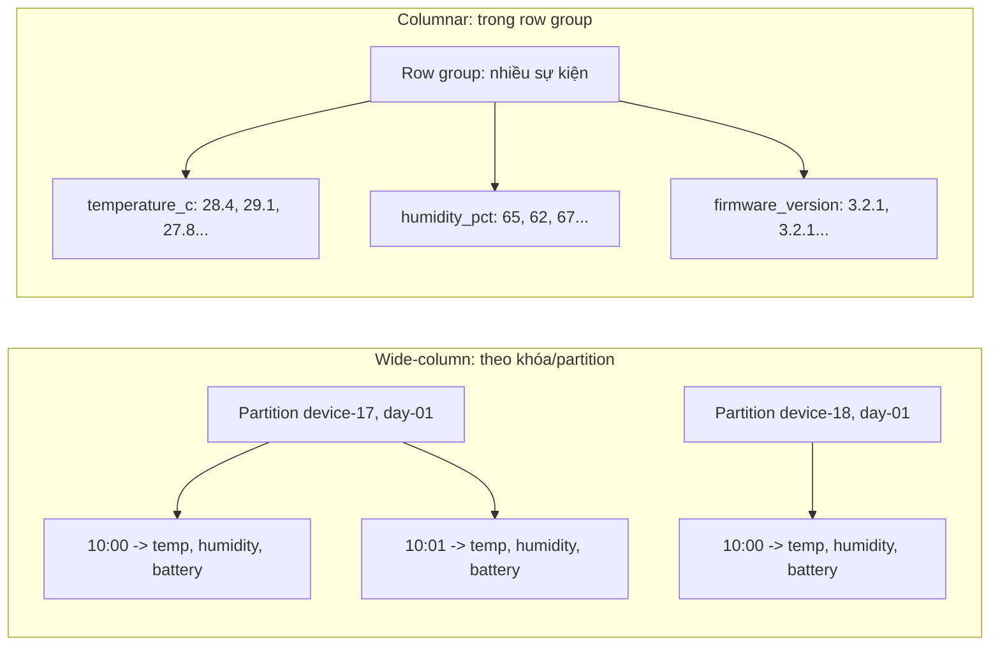
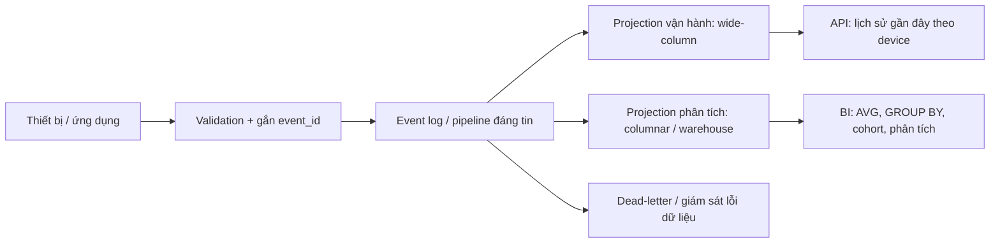

# Phân biệt mô hình cột rộng với lưu trữ cột phục vụ phân tích

Hai cụm từ **wide-column database** (cơ sở dữ liệu **cột rộng**) và **columnar storage** (lưu trữ **theo cột**) rất dễ bị hiểu là một, vì cả hai đều nói đến “cột”. Nhưng chúng giải quyết những vấn đề khác nhau. Một ứng dụng IoT có thể cần lấy ngay **100 phép đo mới nhất của một cảm biến**, đồng thời tính **nhiệt độ trung bình theo giờ của hàng triệu cảm biến trong ba tháng**. Thiết kế tốt cho một truy vấn có thể không phù hợp cho truy vấn còn lại.

Trong chương **Khóa giá trị và cột rộng** của module **DATABASE_DATA_MODELING**, mục tiêu là chuyển yêu cầu nghiệp vụ thành mô hình dữ liệu rõ ràng, từ thực thể, quan hệ và ràng buộc đến khóa, chỉ mục, lược đồ vật lý, rồi lựa chọn giữa hệ quan hệ, document, đồ thị và hệ phân tích. Bài này tập trung vào sự khác biệt giữa:

- **Mô hình cột rộng / wide-column:** cách tổ chức dữ liệu theo **khóa phân vùng hoặc khóa hàng**, nhóm cột/ô và đường truy cập mà ứng dụng đã biết trước; thường gặp ở Apache Cassandra, ScyllaDB và Apache HBase.
- **Lưu trữ dạng cột / columnar:** cách tổ chức dữ liệu vật lý để đọc, nén và tổng hợp **một số cột của rất nhiều bản ghi** hiệu quả; thường gặp ở Apache Parquet và trong các hệ phân tích như ClickHouse hoặc BigQuery, dù triển khai cụ thể khác nhau.

**Điều cần nhớ ngay từ đầu:** *“Cột rộng” là một họ mô hình dữ liệu và đường truy cập; “lưu theo cột” là một tổ chức vật lý/động cơ thực thi thiên về phân tích.* Một hệ thống có thể sở hữu đặc điểm của cả hai ở một mức nào đó, nhưng **không vì có từ “column” mà chúng có cùng hiệu năng, mô hình khóa hay ngữ nghĩa truy vấn**.

## 1. Đọc yêu cầu nghiệp vụ trước khi chọn từ khóa “column”

Xét dữ liệu cảm biến với các thuộc tính:

| Trường | Ví dụ | Ý nghĩa |
| --- | --- | --- |
| `device_id` | `d-17` | Danh tính cảm biến |
| `event_id` | `e-901` | Định danh một lần đo, hỗ trợ chống xử lý lặp |
| `event_time` | `2030-04-01T10:00:02Z` | Thời điểm phép đo thực sự xảy ra |
| `received_at` | `2030-04-01T10:00:04Z` | Thời điểm hệ thống nhận dữ liệu |
| `temperature_c` | `28.4` | Nhiệt độ °C |
| `humidity_pct` | `65.0` | Độ ẩm % |
| `battery_pct` | `83` | Pin % |
| `firmware_version` | `3.2.1` | Phiên bản thiết bị |

Cùng bộ dữ liệu có thể phục vụ các nhu cầu rất khác:

| Nhu cầu | Hình dạng truy vấn | Mục tiêu |
| --- | --- | --- |
| Hiển thị biểu đồ thiết bị | `device_id` + khoảng giờ gần đây, trả vài trăm bản ghi theo thời gian | Đọc theo **khóa hẹp**, độ trễ thấp |
| Xem tình trạng gần nhất | Thiết bị cụ thể, trả một phép đo mới nhất | Đọc rất ít bản ghi, tần suất cao |
| Phân tích chất lượng vận hành | Trung bình nhiệt độ theo giờ trên **tất cả thiết bị** | Quét nhiều bản ghi, chỉ vài cột |
| Báo cáo thiết bị theo vùng | Tổng hợp theo vùng, loại thiết bị, phiên bản firmware | Filter, group by, join chiều dữ liệu |
| Phát hiện bất thường lịch sử | Tính phân vị, xu hướng và so sánh trên nhiều tháng | Xử lý khối lượng lớn, có thể chấp nhận độ trễ cao hơn |

Một yêu cầu như “ghi hàng triệu phép đo mỗi phút” **chưa đủ** để chọn database. Phải biết dữ liệu sẽ được đọc bằng khóa gì, dải thời gian nào, số hàng trả về, độ trễ cần đạt, thời gian lưu giữ, tính nhất quán và tần suất cập nhật/sửa dữ liệu.

## 2. Mô hình cột rộng thực sự là gì?

Trong họ cơ sở dữ liệu cột rộng, dữ liệu được truy cập chủ yếu bằng **row key** hoặc **partition key**. Một hàng logic có thể chứa nhiều cột hay ô; tập cột hiện diện có thể khác nhau giữa các hàng hoặc nhóm thực thể. Dữ liệu thường được phân bố và sắp thứ tự để phục vụ truy cập theo khóa.

Hai hệ hay được dùng làm ví dụ:

- **Apache Cassandra / ScyllaDB:** dùng mô hình wide-column với **partition key** để xác định phân vùng logic và **clustering columns** để sắp xếp các hàng trong phân vùng. Cú pháp CQL trông gần SQL, nhưng cách truy vấn bị chi phối mạnh bởi thiết kế khóa và các đường truy cập.
- **Apache HBase:** dựa trên **row key** có thứ tự và **column family**; ô dữ liệu được định danh qua hàng, họ cột, qualifier và phiên bản/timestamp. Các cột có thể thưa, và scan thường được tối ưu theo dải row key.

Hai sản phẩm **không có cùng API, khả năng giao dịch, mô hình replication hay cách lưu vật lý**. Khi nói chung “wide-column”, ta đang mô tả một họ giải pháp, không khẳng định mọi chi tiết của Cassandra đều đúng với HBase.

### 2.1. Partition và clustering key trong Cassandra

Một bảng Cassandra có thể có khóa:

```text
PRIMARY KEY ((device_id, event_day), event_time, event_id)
             ^^^^^^^^^^^^^^^^^^^^^^  ^^^^^^^^^  ^^^^^^^^
                 partition key         clustering columns
```

- `device_id` + `event_day` xác định **phân vùng logic** mà truy vấn hướng đến.
- `event_time` và `event_id` xác định thứ tự/định danh hàng **trong phân vùng**.
- Một truy vấn biết cả `device_id` và `event_day` có thể tìm đúng phạm vi dữ liệu; truy vấn “nhiệt độ trung bình của mọi thiết bị trong 90 ngày” phải đọc rất nhiều phân vùng, vốn không phải thế mạnh mặc định của thiết kế này.
- Clustering order có thể hỗ trợ đọc theo thời gian, nhưng không biến mọi truy vấn tùy ý thành truy vấn có chỉ mục.

Đặc biệt, **“wide” không có nghĩa cứ tăng vô hạn số cột tĩnh trong một hàng**. Với Cassandra, một phân vùng chứa nhiều clustering rows; kích thước phân vùng và số phần tử tích tụ cần được giới hạn bởi workload. Một phân vùng quá lớn, quá nóng hoặc có nhiều tombstone sẽ gây vấn đề vận hành.

### 2.2. HBase và column family

HBase nhóm ô vào các **column family** được khai báo trước; qualifier trong family có thể linh hoạt hơn. Row key được sắp thứ tự và dữ liệu phân bố theo vùng key (region), vì vậy thiết kế row key ảnh hưởng lớn đến phân tán tải, hotspot và truy vấn range.

Ví dụ minh họa **mang tính khái niệm**, không phải câu lệnh HBase Shell:

```text
row_key: 04|device-17|2030-04-01|<reverse_timestamp>|e-901
family reading:
    temperature_c -> 28.4
    humidity_pct  -> 65.0
family meta:
    firmware      -> 3.2.1
```

Tiền tố phân tán (`04`) hoặc đảo timestamp có thể giúp thiết kế một đường scan cụ thể, nhưng cũng làm các truy vấn khác cần biết thêm tiền tố hoặc quét nhiều dải. Đừng sao chép nguyên một cách tạo row key mà chưa phân tích mô hình phân phối và truy vấn cần hỗ trợ.

**Cần phân biệt:** “column family” của HBase/Cassandra không đồng nghĩa “column chunk” của Parquet. Cái thứ nhất gắn với mô hình truy cập theo row/partition và quản lý ô; cái thứ hai là đơn vị dữ liệu theo cột để quét, nén và giải mã trong hệ phân tích.

## 3. Lưu trữ theo cột cho phân tích là gì?

Hệ **columnar** tổ chức các giá trị của cùng một cột gần nhau theo những đơn vị lưu trữ phù hợp để chỉ cần đọc cột được truy vấn. Ví dụ, để tính `AVG(temperature_c)` từ 100 triệu bản ghi, bộ máy có thể bỏ qua việc đọc payload đầy đủ của `battery_pct`, `firmware_version` và các cột không cần thiết.

Trong Apache Parquet, dữ liệu được tổ chức thành **row group**, mỗi row group chứa **column chunks**, và column chunk có thể có các **page**. Hệ thống phân tích tận dụng metadata, thống kê (nếu có và đáng tin), mã hóa, nén và khả năng bỏ qua cột không được chọn.



Với câu truy vấn:

```sql
SELECT AVG(temperature_c)
FROM telemetry_events
WHERE event_time >= TIMESTAMP '2030-04-01 00:00:00';
```

một động cơ columnar có thể chỉ đọc cột `temperature_c` và cột dùng cho điều kiện lọc `event_time`, thay vì giải mã toàn bộ các trường của từng bản ghi. Hiệu quả thực tế còn phụ thuộc partition pruning, sắp xếp, dữ liệu đã nén, cache, định dạng tệp, thiết kế query và engine.

### 3.1. Vì sao truy vấn tổng hợp có thể nhanh?

Các lợi thế thường gặp:

1. **Column pruning:** chỉ đọc những cột query dùng đến.
2. **Nén theo giá trị giống nhau:** dữ liệu cùng một cột thường có phân bố/kiểu giống nhau; dictionary, run-length encoding hoặc kỹ thuật phù hợp có thể nén tốt.
3. **Đọc và xử lý theo batch/vector:** bộ máy có thể áp dụng phép toán trên nhiều giá trị cùng loại cùng lúc.
4. **Metadata pruning:** bỏ qua những row group/partition/block không có khả năng thỏa điều kiện khi thống kê và thứ tự dữ liệu cho phép.
5. **Tối ưu GROUP BY/aggregation:** thực thi song song trên dữ liệu lớn và kết hợp kết quả trung gian.

Những điều này **không có nghĩa mọi truy vấn đều nhanh**. Truy vấn từng sự kiện theo ID duy nhất, cập nhật một hàng với độ trễ rất thấp, nhiều giao dịch nhỏ hoặc ghi từng bản ghi ngẫu nhiên có thể phù hợp với một hệ khác. ClickHouse có engine, index và đường ingest riêng; BigQuery là hệ phân tích được quản lý; Parquet chỉ là **định dạng tệp** chứ không tự là hệ quản trị cơ sở dữ liệu.

## 4. Bảng so sánh trực diện

| Tiêu chí | Wide-column (ví dụ Cassandra/HBase) | Columnar analytics (ví dụ ClickHouse, BigQuery, Parquet + engine) |
| --- | --- | --- |
| **Mục tiêu phổ biến** | Ghi và đọc theo khóa được thiết kế trước trên quy mô phân tán | Quét/tổng hợp nhiều bản ghi trên một tập cột |
| **Đường truy cập** | Partition/row key; sắp thứ tự trong partition hoặc dải row key | Filter, projection, aggregation, join theo khả năng engine |
| **Chọn một thiết bị và vài bản ghi gần đây** | Có thể rất phù hợp khi partition/clustering đúng | Có thể làm được nhưng không phải luôn tối ưu về latency/chi phí |
| **AVG trên toàn bộ thiết bị trong 90 ngày** | Thường không phù hợp nếu thiết kế chỉ tối ưu theo device key | Thường rất phù hợp khi tổ chức/partition dữ liệu tốt |
| **Mở rộng chiều ngang** | Phân vùng dữ liệu theo key và nhân bản theo mô hình sản phẩm | Phân phối lưu trữ/tính toán và thực thi query theo engine |
| **Thứ tự** | Theo clustering/row key trong phạm vi có quy tắc | Không có thứ tự kết quả nếu thiếu `ORDER BY`; có thể có sort key/storage order riêng |
| **“Cột” biểu thị** | Field/qualifier trong hàng/partition, có thể sparse | Dòng giá trị cùng field được nhóm vật lý để quét/nén |
| **Khóa** | Thiết kế khóa là quyết định sống còn; hạn chế truy vấn không biết key | Partition/sort/cluster có ích nhưng query linh hoạt hơn theo workload OLAP |
| **Giao dịch và consistency** | Phụ thuộc sản phẩm; Cassandra có các mức consistency và LWT, HBase có ngữ nghĩa khác | Phụ thuộc engine, tầng catalog/storage, transaction và đường ingest |
| **Cập nhật/xóa** | Theo key, nhưng có chi phí tombstone/compaction và retention | Một số hệ dùng append/merge/mutation, có độ trễ/chi phí khác |
| **Trường hợp điển hình** | Time series theo device, trạng thái theo tenant/key, lookup tốc độ cao | Dashboard, báo cáo, phân tích cohort, xu hướng dài hạn |

Không nên nói “wide-column là row-store thuần túy” hay “columnar luôn chỉ dùng cho OLAP”. Một số hệ lai có khả năng đọc theo cột, chỉ mục phụ, vector execution hoặc lưu nhiều bản sao theo các layout khác nhau. Điều đáng kiểm chứng là **truy vấn mục tiêu, đường lưu vật lý và chi phí đo được**, không phải nhãn tiếp thị.

## 5. Thiết kế Cassandra theo truy vấn: ví dụ dữ liệu cảm biến

Giả sử API phải hỗ trợ: “Đưa ra tối đa 100 phép đo mới nhất của cảm biến X trong ngày UTC Y” và “Đọc một khoảng thời gian thuộc cùng ngày của cảm biến X”. Để minh họa, ta chọn một phân vùng theo **thiết bị × ngày UTC**.

### 5.1. Lược đồ CQL

```sql
-- Cassandra CQL; dùng kiểu date và timestamp của Cassandra.
CREATE TABLE telemetry_by_device_day (
    device_id uuid,
    event_day date,
    event_time timestamp,
    event_id uuid,
    temperature_c decimal,
    humidity_pct decimal,
    battery_pct int,
    firmware_version text,
    received_at timestamp,
    PRIMARY KEY (
        (device_id, event_day),
        event_time,
        event_id
    )
) WITH CLUSTERING ORDER BY (
    event_time DESC,
    event_id ASC
);
```

**Giải thích khóa:**

- Cặp `(device_id, event_day)` định vị một phân vùng. `event_day` được tính từ `event_time` theo quy ước UTC thống nhất ở ingestion.
- `event_time DESC` giúp các phép đo gần nhất trong ngày nằm ở đầu trật tự clustering.
- `event_id` phân biệt hai phép đo có cùng timestamp. Nó cần được cấp ổn định theo sự kiện nếu hệ thống muốn retry không tạo nhiều hàng cho cùng một sự kiện.
- Các cột giá trị thông thường như `temperature_c` không tự có đường tìm kiếm hiệu quả nếu query chỉ dựa vào chúng; **đây là khác biệt lớn so với việc coi CQL như SQL quan hệ tổng quát**.

Ví dụ truy vấn qua prepared statement CQL; các dấu `?` được driver bind:

```sql
-- Lấy phép đo gần nhất trong một ngày của một thiết bị.
SELECT event_time, event_id, temperature_c, humidity_pct
FROM telemetry_by_device_day
WHERE device_id = ?
  AND event_day = ?
LIMIT 100;

-- Đọc khoảng thời gian trong cùng phân vùng.
SELECT event_time, event_id, temperature_c
FROM telemetry_by_device_day
WHERE device_id = ?
  AND event_day = ?
  AND event_time >= ?
  AND event_time < ?
LIMIT 100;
```

Đây là các truy vấn **đã biết partition key**. Với dữ liệu kéo dài qua hai ngày UTC, ứng dụng phải query hai phân vùng rồi hợp nhất theo `event_time`/`event_id` phù hợp; ngày hiện tại có thể chưa có dữ liệu, nên truy vấn “mới nhất mọi thời điểm” có thể cần kiểm tra ngày trước đó hoặc có một bảng/materialized read model chuyên dụng.

### 5.2. Một truy vấn chưa được mô hình hỗ trợ tốt

```sql
-- Truy vấn phân tích mong muốn, nhưng KHÔNG phải đường đọc
-- hiệu quả của bảng Cassandra thiết kế theo device/day này.
SELECT AVG(temperature_c)
FROM telemetry_by_device_day
WHERE event_time >= ?;
```

Không nên kỳ vọng câu trên hoạt động như một truy vấn OLAP thông thường: nó thiếu partition key, có thể không được CQL chấp nhận theo cú pháp/giới hạn query, và bảng không được tổ chức cho global aggregation. Việc dùng `ALLOW FILTERING` để lách giới hạn đường đọc thường không giải quyết được chi phí quét rộng. Nếu yêu cầu là phân tích toàn bộ thiết bị, hãy tạo **read model khác** hoặc đưa dữ liệu sang hệ phân tích.

### 5.3. Vì sao cần chia bucket theo thời gian?

Nếu partition key chỉ là `device_id`, một thiết bị hoạt động nhiều năm có thể tạo phân vùng rất lớn. Thêm `event_day` giới hạn tăng trưởng mỗi partition, nhưng không có một kích thước bucket “đúng cho tất cả”:

- Thiết bị gửi một bản ghi/giờ: bucket ngày có thể rất nhỏ, overhead nhiều partition trở nên đáng cân nhắc.
- Thiết bị gửi hàng nghìn bản ghi/giây: bucket ngày có thể vẫn quá lớn, cần bucket giờ hoặc shard thêm.
- Một thiết bị nóng khác thường: có thể tạo hotspot dù đã bucket theo ngày.
- Khi đổi bucket, ứng dụng phải biết công thức định tuyến để đọc lại dữ liệu cũ, kể cả qua các phiên bản schema.

Đo **byte/partition, số clustering rows, thông lượng/partition, phân phối thiết bị và truy vấn thực tế** trước khi chốt bucket. Không dựa vào một con số cố định không gắn với phiên bản hệ thống và phần cứng.

### 5.4. TTL, tombstone và thời gian lưu

Cassandra có thể đặt TTL ở mức ghi hoặc bảng tùy thiết kế. Một lựa chọn minh họa:

```sql
-- Minh họa cấu hình TTL 90 ngày, chỉ áp dụng khi phù hợp
-- với chính sách lưu giữ và phiên bản hệ quản trị đang dùng.
ALTER TABLE telemetry_by_device_day
WITH default_time_to_live = 7776000;
```

Ở Cassandra, TTL gắn với thời điểm ghi dữ liệu theo cơ chế hệ thống, **không tự động là `event_time + 90 ngày`**. Nếu sự kiện đến muộn 20 ngày, tuổi lưu trữ theo TTL từ lúc ghi có thể khác kỳ vọng lưu 90 ngày kể từ thời điểm đo. Dữ liệu hết hạn/xóa còn liên quan **tombstone**, compaction và quy trình loại bỏ thực tế; không đồng nhất “hết TTL” với “byte lập tức biến mất khỏi mọi bản sao và bản sao lưu”.

Một bảng phục vụ lịch sử dài hạn thường cần quy trình retention khác bảng truy cập nhanh, nhất là khi báo cáo phải tái lập hoặc xử lý xóa dữ liệu theo yêu cầu pháp lý.

## 6. Cùng dữ liệu nhưng chuyển sang columnar analytics

Với câu hỏi “nhiệt độ trung bình theo giờ của tất cả cảm biến trong một tuần”, ta muốn **quét hàng loạt** và tổng hợp trên vài cột. Ví dụ sau dùng **BigQuery Standard SQL** để minh họa một bảng phân vùng thời gian và cluster theo thiết bị. Đây **không phải CQL**.

```sql
CREATE TABLE analytics.telemetry_events (
    device_id STRING NOT NULL,
    event_id STRING NOT NULL,
    event_time TIMESTAMP NOT NULL,
    received_at TIMESTAMP,
    temperature_c NUMERIC,
    humidity_pct NUMERIC,
    battery_pct INT64,
    firmware_version STRING
)
PARTITION BY DATE(event_time)
CLUSTER BY device_id;
```

Một báo cáo:

```sql
SELECT
    TIMESTAMP_TRUNC(event_time, HOUR) AS hour_utc,
    AVG(temperature_c) AS avg_temp_c,
    COUNT(temperature_c) AS samples_with_temperature
FROM analytics.telemetry_events
WHERE DATE(event_time)
    BETWEEN DATE '2030-04-01' AND DATE '2030-04-07'
GROUP BY hour_utc
ORDER BY hour_utc;
```

Ở đây:

- **Partitioning** theo ngày giúp giảm dữ liệu phải đọc khi lọc theo ngày thích hợp. **Clustering** theo `device_id` có thể hữu ích cho query thường lọc thiết bị; không tự làm query toàn bộ thiết bị nhanh nếu số liệu và partition không hợp lý.
- `AVG` và `COUNT(temperature_c)` bỏ qua giá trị `NULL` của nhiệt độ; khác với `COUNT(*)` là số hàng. Sự khác biệt phải được thống nhất với khái niệm “số phép đo hợp lệ”.
- Kết quả theo giờ ở ví dụ dùng timestamp UTC; nếu báo cáo theo ngày địa phương phải xác định timezone và cách xử lý DST, đừng chỉ cắt chuỗi ngày từ ingestion.
- Lưu trữ dạng cột có thể tối ưu chỉ đọc những cột phục vụ query; hiệu quả cần đo trên dữ liệu và execution plan thực tế.

Tên dataset, quyền truy cập, giới hạn môi trường và cách nạp dữ liệu cần được cấu hình trong dự án thực. Lược đồ là **ví dụ thiết kế**, không phải khẳng định mọi BigQuery workload nên dùng đúng partition/cluster này.

### 6.1. Parquet và ClickHouse có vai trò gì?

| Công nghệ | Vai trò | Nhận xét thực tế |
| --- | --- | --- |
| **Apache Parquet** | Định dạng tệp theo cột | Không tự cung cấp giao dịch, dịch vụ query hay chính sách chỉ mục; thường kết hợp object storage, catalog/table format và engine |
| **ClickHouse** | Hệ quản trị phân tích với các engine lưu trữ dạng cột | Có thiết kế `ORDER BY`/primary index, partitioning và cơ chế merge/mutation tùy engine; chọn sorting key theo query |
| **BigQuery** | Dịch vụ data warehouse phân tích được quản lý | Có partitioning, clustering, SQL phân tích và mô hình vận hành/chi phí riêng |
| **Cassandra / ScyllaDB** | Wide-column operational store | Đường truy cập gắn với partition/clustering key, thích hợp cho các query đã biết |
| **HBase** | Wide-column store với row key/column family | Tối ưu truy cập theo key hoặc scan dải row key; không mặc định là một warehouse SQL tổng hợp |

Parquet có thể được đọc bằng Spark, Trino, DuckDB hoặc engine khác. Những công cụ đó cung cấp phần thực thi SQL/analytics, nhưng bản thân một tập tệp Parquet không giải quyết mọi vấn đề schema evolution, commit nguyên tử, metadata consistency, delete hay cập nhật. Nếu cần các tính chất đó, phải chọn thêm kiến trúc quản lý bảng/tệp và quy trình ingestion.

## 7. Một kiến trúc hai đường đọc cho cùng nguồn dữ liệu

Nhiều ứng dụng cần **cả đọc vận hành độ trễ thấp lẫn phân tích toàn cục**. Thay vì ép một bảng phục vụ cả hai, có thể tạo hai projection chuyên biệt từ cùng sự kiện nguồn.



Thiết kế hai đường đọc có đánh đổi:

- **Đồng bộ không tức thời:** dữ liệu vào hệ vận hành có thể xuất hiện trước hoặc sau hệ phân tích. Phải công bố SLA freshness hoặc watermark phù hợp.
- **Xử lý lặp:** hệ thống phát sự kiện thường có cơ chế retry/at-least-once; phải xác định idempotency qua `event_id` hoặc khóa nghiệp vụ, tránh đếm đôi.
- **Sự kiện đến muộn:** dữ liệu có `event_time` cũ nhưng `received_at` mới có thể làm thay đổi thống kê quá khứ. Cần chính sách cập nhật partition/báo cáo đã công bố.
- **Sửa/xóa:** một bản hiệu chỉnh hoặc yêu cầu xóa dữ liệu phải được chuyển tới cả hai projection và các bản sao liên quan theo chính sách retention.
- **Schema evolution:** thêm cảm biến/thuộc tính mới phải có parser, validator, mapping và quy tắc cho sự kiện cũ chưa có cột.

Trong kiến trúc này, **nguồn sự thật (source of truth)** và **read models** phải được xác định rõ. Nếu cả hai kho đều được phép sửa cùng một phép đo mà không có giao thức đối soát, rất dễ phát sinh phân kỳ dữ liệu.

### 7.1. Ghi điệp khúc “mỗi query có một mô hình dữ liệu”

Ví dụ các projection có thể gồm:

```text
telemetry_by_device_day:
    (device_id, UTC_day) -> measurements ordered by event_time

latest_telemetry_by_device:
    device_id -> latest accepted measurement

analytics.telemetry_events:
    event rows partitioned by event_date, optimized for aggregations
```

Bảng `latest_telemetry_by_device` chỉ hữu ích nếu có **quy tắc chọn latest**: thời gian sự kiện hay thời gian nhận, tie-break trên `event_id`, và cách xử lý event cũ đến muộn. Không dùng thao tác “ghi đến sau thì thắng” nếu yêu cầu là bản có `event_time` mới nhất; cần compare-and-set/điều kiện ghi hoặc cơ chế consumer duy trì thứ tự theo key, tùy engine.

## 8. Khóa, chỉ mục, sắp xếp và phân vùng: cùng tên nhưng khác nghĩa

### 8.1. Partition key của Cassandra khác partition của warehouse

- **Cassandra partition key** quyết định nhóm dữ liệu theo khóa và tuyến truy cập/phân bố trong cluster. Truy vấn tối ưu thường biết key hoặc tập key cụ thể.
- **Warehouse partitioning** thường chia dữ liệu theo ngày hoặc phân đoạn để giảm quét với điều kiện lọc; engine vẫn có thể thực thi truy vấn trên rất nhiều partition để tính tổng hợp.
- **Columnar sort/cluster key** giúp sắp xếp hoặc tập trung các giá trị gần nhau cho pruning/compression theo cách riêng của hệ.

Hai bảng đều có từ `partition` nhưng không nên suy ra cách phân phối tải, routing, tính nhất quán và chi phí query là tương đương.

### 8.2. Primary key của CQL không phải “cứ có thì query gì cũng được”

Trong bảng ví dụ Cassandra, `PRIMARY KEY ((device_id,event_day),event_time,event_id)` bao gồm partition key và clustering columns. Đây không phải một bộ chỉ mục quan hệ tổng quát cho mọi điều kiện lọc. Thiết kế schema phải bắt đầu từ các mẫu truy cập cụ thể, rồi xác định:

1. Những giá trị nào luôn có trong request để biết partition?
2. Kích thước và độ nóng của từng partition sẽ ra sao?
3. Thứ tự cần đọc là ascending hay descending?
4. Có cần range scan và giới hạn số hàng không?
5. Một truy vấn mới có cần bảng/projection mới, secondary index thích hợp hay hệ phân tích riêng?

Đừng tự động dùng `ALLOW FILTERING` để làm cho một CQL query trông “linh hoạt giống SQL”: kết quả có thể đúng nhưng chi phí dữ liệu quét rất cao hoặc không kiểm soát.

### 8.3. Columnar không đồng nghĩa có index giống OLTP

Với Parquet, thống kê row group có thể giúp bỏ qua phần dữ liệu không liên quan nếu điều kiện query và metadata hỗ trợ. Với ClickHouse, sparse primary index và sort key có ngữ nghĩa khác B-tree index phổ biến trong RDBMS. Với BigQuery, clustering và partition pruning khác với primary key-based point lookup. Không gọi mọi thứ là “index” rồi cho rằng chúng có cùng khả năng tra cứu.

## 9. Ghi, sửa, consistency và vòng đời dữ liệu

### Wide-column operational store

**Cassandra** thường cho phép lựa chọn consistency level theo thao tác. Không nên mô tả đơn giản “luôn eventual consistency” hoặc “luôn strongly consistent”: kết quả tùy replication, mức nhất quán, tình trạng cluster và đường thao tác. Các điều kiện compare-and-set/Lightweight Transaction (LWT) có cơ chế và chi phí riêng; không thay thế cho mọi transaction quan hệ.

**HBase** có các bảo đảm riêng ở mức row và truy cập theo row key, không được suy từ Cassandra. Đừng dùng “wide-column” như một lời hứa chung rằng mọi sản phẩm có ACID transaction nhiều hàng hoặc đọc nhất quán cùng mức.

Các vấn đề vận hành thường phải thiết kế:

- Partition quá lớn, nóng hoặc lệch dữ liệu giữa node.
- Tombstone, compaction, amplification khi ghi và đọc, và policy retention.
- Repair, replication, khả năng chịu lỗi và consistency level.
- Query fan-out theo quá nhiều partition, paging, giới hạn batch và backpressure.
- Monitoring latency ở percentile cao, disk, queue và độ lệch hot key.

### Columnar analytics

Các hệ phân tích có thể ingest theo lô hoặc liên tục, nhưng thời điểm dữ liệu **được query nhìn thấy** tùy engine và pipeline. Việc cập nhật/sửa/xóa có thể cần rewrite file, mutation, merge hoặc cơ chế bảng/warehouse riêng. Một engine có thể hỗ trợ transaction đầy đủ hơn engine khác: không tự suy từ “columnar” rằng nó không có ACID, cũng không tự khẳng định có transaction giống OLTP.

Các vấn đề thường quan trọng:

- Độ trễ nạp và sự khác nhau giữa `event_time`/`received_at`.
- Tệp quá nhỏ, row group không hợp lý hoặc partition quá vụn.
- Cardinality của dimension, phân phối filter, sort/cluster và chi phí query.
- Compaction, vacuum/retention, schema evolution và tính tái lập báo cáo.
- Chính sách dữ liệu chậm/thiếu, dedup và xử lý bản cập nhật lịch sử.

## 10. Chọn theo workload bằng ma trận quyết định

| Yêu cầu | Nghiêng về wide-column? | Nghiêng về columnar analytics? | Cần hỏi thêm |
| --- | --- | --- | --- |
| 10 nghìn request/s, mỗi request biết một `device_id` và lấy 20 bản mới nhất | **Có**, nếu key và partition phù hợp | Có thể, nhưng thường cần đánh giá point-query latency/chi phí | Kích thước partition, SLO p99, số ngày cần đọc |
| Tính `AVG` trên 1 tỷ bản ghi, chỉ cần 2–4 cột | Thường không phải lựa chọn đầu tiên | **Có** | Dữ liệu có được partition/sort tốt không? |
| Quét mọi thiết bị theo khu vực để lập dashboard | Chỉ khi đã có projection theo khu vực phù hợp | **Có** nếu cần tổng hợp lớn | Dimension region cập nhật ra sao? |
| Tra cứu trạng thái gần nhất của một tài khoản | **Có** khi có khóa đơn rõ ràng; KV cũng có thể phù hợp | Không phải workload trọng tâm | Ghi đè thế nào, tính nhất quán yêu cầu? |
| Join nhiều bảng và thực thi giao dịch nghiệp vụ phức tạp | Không mặc định phù hợp | Hệ phân tích hỗ trợ join, nhưng không đồng nghĩa phù hợp OLTP | RDBMS quan hệ có phù hợp hơn không? |
| Event stream với cả API thời gian thực và báo cáo dài hạn | Có thể dùng cho projection vận hành | Có thể dùng cho projection phân tích | Source of truth, idempotency, freshness |
| Dữ liệu nhiều thuộc tính thưa, đọc theo row key | **Có thể** hợp với HBase/wide-column | Columnar cũng có thể xử lý sparse tùy định dạng | Shape, cardinality và kiểu truy vấn |

Với workload hỗn hợp, cũng nên cân nhắc **RDBMS có index**, **time-series database**, **search engine**, **document database** hoặc kiến trúc nhiều projection; không có nghĩa wide-column và columnar là hai lựa chọn duy nhất.

## 11. Thiết kế từ yêu cầu đến lược đồ: quy trình thực hành

Một quy trình làm việc hợp lý cho `DATABASE_DATA_MODELING`:

### Bước 1 — Viết bảng truy vấn bắt buộc

Không chỉ ghi “hệ thống cảm biến”. Hãy mô tả:

```text
Q1: GET /devices/{id}/measurements?from=...&to=...
    key: device_id + khoảng thời gian
    output: tối đa 100–1000 measurements
    SLO: p95/p99 do sản phẩm đặt

Q2: GET /devices/{id}/latest
    key: device_id
    output: 1 phép đo mới nhất theo event_time

Q3: dashboard /avg-temperature
    filters: khu vực + khoảng 90 ngày
    grouping: ngày, firmware_version
    output: vài nghìn nhóm tổng hợp
```

Đây là **mẫu** để điền SLO thực tế, không phải con số cam kết. Nếu không có số liệu traffic, dữ liệu và phân phối thiết bị, không nên tuyên bố một thiết kế cụ thể đạt p99 nào đó.

### Bước 2 — Phân loại đường truy cập

- Query biết key hẹp, trả rất ít hàng → cân nhắc mô hình wide-column/KV/row-oriented operational.
- Query quét nhiều hàng, ít cột, aggregate/join → cân nhắc columnar analytics.
- Query có transaction nhiều thực thể và quan hệ phức tạp → đánh giá RDBMS.
- Query full-text/geospatial/graph traversal → đánh giá công cụ có chỉ mục/toán tử phù hợp.

### Bước 3 — Chọn khóa và quy tắc cardinality

Xác định `device_id`/`event_id` là định danh, `event_time` là thời gian nghiệp vụ, `received_at` là thời gian ingestion. Với Cassandra, tính partition size/hotspot theo bucket. Với warehouse, chọn date partition, sort/cluster, bảng dimension và quy tắc join.

### Bước 4 — Giữ invariant khi chuyển tầng

Một event cần có ID, thời điểm, đơn vị đo, nguồn và kiểm tra miền:

```java
import java.math.BigDecimal;
import java.time.Instant;
import java.util.Objects;
import java.util.UUID;

record TelemetryEvent(
    UUID deviceId,
    UUID eventId,
    Instant eventTime,
    Instant receivedAt,
    BigDecimal temperatureC,
    BigDecimal humidityPct
) {
    public TelemetryEvent {
        Objects.requireNonNull(deviceId, "deviceId");
        Objects.requireNonNull(eventId, "eventId");
        Objects.requireNonNull(eventTime, "eventTime");
        Objects.requireNonNull(receivedAt, "receivedAt");
        Objects.requireNonNull(temperatureC, "temperatureC");
        Objects.requireNonNull(humidityPct, "humidityPct");
        if (humidityPct.compareTo(BigDecimal.ZERO) < 0
            || humidityPct.compareTo(new BigDecimal("100")) > 0) {
            throw new IllegalArgumentException(
                "Humidity outside 0..100%"
            );
        }
    }
}
```

Value object Java giúp các adapter dùng **cùng định nghĩa sự kiện**. Tuy vậy, constructor không tự giải quyết tính nhất quán giữa Cassandra và warehouse. Cần hợp đồng event, xử lý lặp, schema validation và cơ chế đối soát.

### Bước 5 — Đo đúng truy vấn, không chỉ đo ghi

Thử nghiệm bằng dữ liệu gần thực tế:

1. Độ trễ point/range query ở p50/p95/p99.
2. Tốc độ nạp và chi phí ghi, compaction, tombstone.
3. Phân bố kích thước/hot partition theo thiết bị/ngày.
4. Tài nguyên/chi phí cho query OLAP lớn và khi tăng concurrency.
5. Độ mới dữ liệu, retry, duplicate, backfill và late arrivals.
6. Hiệu ứng tăng số cột, đổi kiểu dữ liệu, thêm dimension, thay retention.

Không chỉ benchmark 1.000 bản ghi trong bộ nhớ rồi suy ra hiệu năng trên hàng tỷ dòng và nhiều node.

## 12. Sai lầm phổ biến và cách sửa

| Nhầm lẫn | Hệ quả | Cách tiếp cận đúng |
| --- | --- | --- |
| “Cassandra là columnar warehouse vì có chữ column” | Đưa global aggregation lên một bảng tối ưu theo device key | Phân biệt partition/clustering với lưu vật lý theo cột |
| “Parquet là database nên ghi/query trực tiếp như Cassandra” | Thiếu engine, catalog, transaction và chính sách file | Chọn cả định dạng, engine, table management nếu cần |
| Dùng `device_id` làm partition duy nhất cho toàn bộ nhiều năm | Partition lớn, nóng hoặc đọc tốn chi phí | Bucket theo thời gian/shard khi có số liệu |
| Quên query đi qua nửa đêm UTC | Kết quả thiếu thời gian ở bucket bên cạnh | Xác định bucket từ toàn bộ khoảng và merge kết quả |
| Dùng `ALLOW FILTERING` như index tổng quát | Query rất chậm hoặc quét nhiều dữ liệu | Thiết kế đường đọc/projection phù hợp |
| Tính “mới nhất” theo thời gian nhận nhưng nghiệp vụ dùng `event_time` | Sự kiện đến muộn ghi đè trạng thái mới | Quy tắc latest rõ ràng, xử lý thứ tự/so sánh có điều kiện |
| Dùng TTL Cassandra để bảo đảm xóa byte ngay lập tức | Hiểu sai tombstone, compaction và backup | Chính sách retention/xóa xuyên hệ thống có kiểm chứng |
| Warehouse lưu `NULL` nhiệt độ rồi dùng `COUNT(*)` cho số phép đo hợp lệ | Báo cáo sai mẫu số | Phân biệt số sự kiện và số giá trị hợp lệ |
| Đếm sự kiện retry hai lần trên hệ phân tích | Dashboard tăng ảo | Định danh event, dedup/idempotency, đối soát |
| Cho rằng columnar luôn nhanh mọi truy vấn | Point lookup hoặc UPDATE nhỏ có thể tốn chi phí | Đo workload thật và so sánh với RDBMS/KV |
| Coi consistency/transaction giống nhau cho mọi wide-column | Ghi/đọc sai dưới lỗi node hoặc đồng thời | Đọc bảo đảm của từng sản phẩm và consistency level |
| Giấu việc hai projection có độ trễ khác nhau | Người dùng thấy số liệu mâu thuẫn mà không có giải thích | Công bố freshness/SLA và thời điểm cập nhật |

## 13. Bộ kiểm chứng thiết kế

| Ca kiểm thử | Điều cần xác nhận |
| --- | --- |
| Thiết bị phát nhiều sự kiện cùng millisecond | Khóa `event_id` ngăn đè lẫn các bản ghi khác nhau |
| Thiết bị gửi lại đúng `event_id` | Quy tắc idempotency tránh duplicate theo hợp đồng |
| Sự kiện `event_time` thuộc hôm qua nhưng đến hôm nay | Ghi đúng bucket theo thời gian được chọn; báo cáo backfill xử lý đúng |
| Truy vấn 3 giờ qua ranh giới UTC midnight | Đọc đủ các bucket và sắp thứ tự |
| Một thiết bị gửi 100× lưu lượng bình thường | Không gây partition hotspot không thể chịu; có phương án phân tán |
| Một ngày không có phép đo của thiết bị | Không tự suy số đo bằng 0 |
| Warehouse có `temperature_c IS NULL` | `AVG`/`COUNT(temperature_c)` và mẫu số được giải thích |
| Thêm field `pressure_kpa` mới | Event/schema/projection vẫn đọc được sự kiện cũ |
| Cần xóa dữ liệu một thiết bị theo yêu cầu | Xóa/retention được phối hợp giữa store, analytics và các bản sao |
| Warehouse chậm ingestion 30 phút | Dashboard hiển thị freshness hoặc cảnh báo SLA |
| Một service sửa payload sự kiện đã phát | Không âm thầm làm lệch hai projection; có workflow correction/version |
| Query phân tích quét 90 ngày không biết `device_id` | Không cưỡng ép chạy bằng partition-key table |
| Giảm retention vận hành còn 7 ngày, phân tích giữ 2 năm | API và BI có hợp đồng lịch sử khác nhau, không làm mất nguồn bắt buộc |

Kiểm thử kỹ thuật cần dùng đúng engine/version, driver, schema và quy mô dữ liệu dự kiến. Một unit test Java không chứng minh độ trễ phân tán hay tính nhất quán của nhiều storage system.

## 14. Bài tập vận dụng

### Bài tập A — Nhật ký hoạt động của tài khoản

Sản phẩm cần lấy 50 hoạt động gần nhất của **một tài khoản** trong 24 giờ; riêng đội phân tích cần đếm tổng hoạt động theo loại và quốc gia trên **toàn bộ** tài khoản trong 180 ngày.

1. Thiết kế bảng wide-column cho truy vấn thứ nhất với partition key, clustering key và bucket thích hợp.
2. Phác thảo schema columnar cho truy vấn thứ hai, gồm partition/filter/grouping.
3. Nêu cách xử lý event trùng và những khác biệt về độ mới giữa hai projection.

**Gợi ý:** một projection theo `(account_id, UTC_day)` và event time; một bảng event phân tích phân vùng thời gian, có dimension quốc gia/loại hoạt động, event ID và watermark.

### Bài tập B — Hệ giám sát công nghiệp

Một thiết bị gửi 20.000 phép đo/giây trong khi thiết bị khác gửi 1 phép đo/phút. Cùng một thiết kế `(device_id, event_day)` có phù hợp với cả hai không? Hãy đề xuất cách đo partition size/hotspot, cân nhắc bucket giờ hoặc shard, và đánh đổi số query fan-out khi đọc trong 24 giờ.

**Gợi ý:** bắt đầu từ phân bố tải theo thiết bị, không chỉ giá trị trung bình. Nếu chia thêm shard, đường đọc “mới nhất” phải biết cách hợp nhất các shard.

### Bài tập C — Phân tích cohort

Truy vấn yêu cầu tỷ lệ thiết bị lỗi theo `firmware_version`, `region` và từng tuần trong 12 tháng. Đội phát triển định chạy `GROUP BY` trên bảng Cassandra thiết kế theo device/day.

Hãy giải thích vì sao đường đọc này không phù hợp, đề xuất hệ phân tích và cách lưu dimension thay đổi theo thời gian (thiết bị chuyển vùng hoặc firmware được nâng cấp). Nêu cách tránh “áp vùng hiện tại cho sự kiện cũ” nếu báo cáo phải theo vùng lúc sự kiện phát sinh.

**Gợi ý:** bảng fact chứa thời điểm/event ID, liên kết dimension theo version/effective period hoặc lưu snapshot thuộc tính cần thiết theo yêu cầu phân tích.

### Bài tập D — So sánh chi phí hai mô hình

Một workload có 99% query theo thiết bị trả ≤100 bản ghi và 1% query quét toàn bộ dữ liệu 90 ngày. Có nên dùng **một kho** hay **hai projection**?

Hãy phác thảo cách benchmark latency p95/p99, chi phí ingest/storage, chi phí scan, độ mới và vận hành. Đưa ra điều kiện khiến một RDBMS có index/partitioning hoặc một time-series database trở thành lựa chọn tốt hơn kiến trúc kép.

**Gợi ý:** tần suất 1% chưa cho biết chi phí: một query phân tích có thể quét dữ liệu gấp hàng triệu lần một point query. Quyết định dựa trên SLA, khối lượng, TCO và độ phức tạp của hai đường dữ liệu.

## 15. Checklist chốt mô hình

- [ ] Đã phân biệt **wide-column model** với **column-oriented physical storage**, không dùng “cột” như một khái niệm đồng nhất.
- [ ] Đã liệt kê truy vấn thực tế, khóa đầu vào, số hàng kết quả, p95/p99, SLA freshness và retention.
- [ ] Với Cassandra/HBase, đã thiết kế partition/row key, thứ tự, kích thước partition và dự kiến hotspot.
- [ ] Với columnar analytics, đã xác định filter, group by, column pruning, partition/sort/cluster và quy tắc schema.
- [ ] Hiểu rằng Cassandra CQL, HBase API, Parquet file, ClickHouse SQL và BigQuery SQL **không phải cùng một hệ ngữ nghĩa**.
- [ ] Đã phân biệt `event_time` và `received_at`; xử lý late arrivals, duplicate, correction và backfill.
- [ ] Khi dùng nhiều projection, đã xác định source of truth, idempotency, độ trễ, đối soát và cơ chế xóa.
- [ ] Đã kiểm tra consistency/transaction của **sản phẩm cụ thể**, không suy từ nhãn “NoSQL” hoặc “columnar”.
- [ ] Đã phân tích query qua nhiều bucket, TTL/tombstone, compaction, file size và cách phân tán tải.
- [ ] Đã so sánh chi phí và độ phức tạp với lựa chọn RDBMS, time-series hoặc công cụ chuyên dụng.
- [ ] Đã có bài kiểm thử với dữ liệu và tải gần thực tế, đặc biệt các trường hợp biên theo thời gian.

**Ghi nhớ:** Wide-column thường bắt đầu bằng câu hỏi **“Tôi biết khóa nào và cần đọc những hàng gần khóa ấy?”**. Columnar analytics thường bắt đầu bằng **“Tôi cần quét và tổng hợp những cột nào trên rất nhiều hàng?”**. Hai hướng không loại trừ nhau, nhưng cần được mô hình hóa, đo đạc và vận hành theo **hai hình dạng truy vấn khác nhau**; chọn đúng từ yêu cầu nghiệp vụ sẽ giúp khóa, phân vùng, ràng buộc và lược đồ vật lý còn giữ được ý nghĩa khi hệ thống mở rộng.
