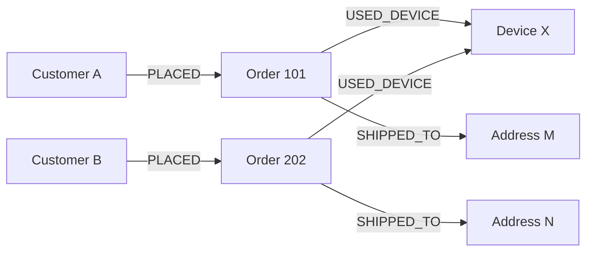

# Khi nào quan hệ giữa các đối tượng là trọng tâm của mô hình

Trong thiết kế dữ liệu, một hệ thống có nhiều bảng liên kết chưa chắc đã cần mô hình đồ thị. Câu hỏi quyết định là: **ứng dụng chủ yếu cần biết thuộc tính của từng đối tượng, hay cần tìm hiểu các đối tượng nối với nhau như thế nào?** Nếu đường đi, mức độ kết nối, nhóm liên thông và sự thay đổi của các mối quan hệ quyết định kết quả nghiệp vụ, ta nên cân nhắc mô hình đồ thị ngay từ bước thiết kế logic.

Bài học thuộc chủ đề **Mô hình đồ thị** của **DATABASE_DATA_MODELING**: rèn cách chuyển yêu cầu nghiệp vụ thành thực thể, quan hệ, ràng buộc, khóa, chỉ mục và cấu trúc lưu trữ phù hợp. Mục tiêu không phải mặc định chọn cơ sở dữ liệu đồ thị, mà là nhận ra **khi nào cấu trúc quan hệ chính là dữ liệu cần truy vấn**, rồi so sánh giải pháp quan hệ, document, đồ thị và phân tích trên cùng yêu cầu.

Sau bài này, bạn có thể:

- Phân biệt quan hệ dùng để nối bản ghi với quan hệ là đối tượng phân tích chính.
- Phát hiện những truy vấn có bản chất duyệt đồ thị, nhất là đường đi nhiều bước, độ dài thay đổi.
- Phác thảo nút, cạnh, hướng, thuộc tính, định danh và các ràng buộc cho một bài toán thực tế.
- Biết khi nào mô hình quan hệ hoặc document vẫn đơn giản hơn, và cách kiểm chứng quyết định bằng truy vấn thực.

## 1. Thế nào là “quan hệ là trọng tâm”?

Xét hai câu hỏi trong một hệ thống thương mại điện tử:

1. “Đơn hàng `O-101` có tổng tiền bao nhiêu, thuộc khách hàng nào và ở trạng thái gì?” — trọng tâm là **bản ghi đơn hàng** và các thuộc tính của nó. Một vài phép `JOIN` theo khóa ngoại thường đủ.
2. “Những khách hàng nào dùng chung thiết bị với khách hàng đang xem, sau đó lại có địa chỉ giao hàng trùng với một nhóm tài khoản bị điều tra?” — trọng tâm là **chuỗi liên kết** đi qua nhiều kiểu đối tượng. Việc đi từ nút này sang nút khác mới tạo ra câu trả lời.

Trong mô hình đồ thị, ta biểu diễn:

- **Nút (node/vertex):** đối tượng có danh tính, như `Customer`, `Order`, `Device`, `Address`.
- **Cạnh (edge/relationship):** mối liên kết có ý nghĩa nghiệp vụ, như `PLACED`, `USED_DEVICE`, `SHIPPED_TO`.
- **Thuộc tính (property):** dữ liệu trên nút hoặc cạnh, như thời điểm đặt hàng hay thời điểm bắt đầu theo dõi.
- **Đường đi (path):** chuỗi cạnh nối các nút; **bước nhảy (hop)** là một lần đi qua cạnh.

Đồ thị là **cách mô hình hóa**, còn cơ sở dữ liệu đồ thị là **một phương án lưu trữ và truy vấn**. Có thể biểu diễn đồ thị bằng bảng quan hệ và dùng SQL; chỉ khi đặc trưng truy vấn, chi phí vận hành và hiệu năng phù hợp mới nên chọn hệ quản trị đồ thị chuyên dụng.

### Những câu hỏi khiến cấu trúc liên kết trở thành dữ liệu chính

| Bối cảnh | Câu hỏi nghiệp vụ | Đặc điểm của quan hệ |
| --- | --- | --- |
| Mạng xã hội | Ai là bạn của bạn trong tối đa ba bước? Hai người có bao nhiêu kết nối chung? | Đường đi, số bước, quan hệ giữa cùng một loại nút |
| Chống gian lận | Những tài khoản nào liên quan qua thiết bị, địa chỉ, phương thức thanh toán? | Nhiều loại cạnh; tìm cụm và chuỗi liên kết gián tiếp |
| Phân quyền | Người dùng có quyền với tài nguyên nhờ thuộc nhóm, nhóm con hay vai trò nào? | Quan hệ kế thừa, đường đi có điều kiện |
| Phụ thuộc hệ thống | Nếu dịch vụ A lỗi thì dịch vụ, quy trình nào có thể bị ảnh hưởng theo chuỗi? | Quan hệ phụ thuộc có hướng; lan truyền qua nhiều bước |
| Logistics | Lộ trình nào có thể chuyển hàng qua các chặng, theo chi phí và ràng buộc? | Đường đi có trọng số, hướng và điều kiện |
| Kiến thức / học tập | Muốn học chuyên đề X phải hoàn thành những kiến thức tiên quyết nào, kể cả gián tiếp? | Cấu trúc tiên quyết và phát hiện chu trình |

**Không nên suy luận rằng cứ có quan hệ nhiều–nhiều là phải dùng graph database.** Ví dụ, hệ thống bán hàng có bảng `order_items` nối `orders` với `products` rất hợp lý trong cơ sở dữ liệu quan hệ, nếu truy vấn chủ yếu là chi tiết đơn, tồn kho và doanh thu.

## 2. Dấu hiệu nhận biết một bài toán thiên về đồ thị

Hãy nhìn vào **những câu hỏi phải trả lời thường xuyên** thay vì chỉ nhìn số lượng thực thể.

| Dấu hiệu | Ví dụ truy vấn | Vì sao đáng cân nhắc đồ thị |
| --- | --- | --- |
| Cần đi qua **nhiều bước, độ dài không cố định** | “Tìm toàn bộ thành phần bị ảnh hưởng từ dịch vụ A, dù cách nhau bao nhiêu lớp” | Độ dài đường đi là một phần của truy vấn; khó mô tả bằng các `JOIN` cố định |
| Cần tìm **đường đi và khả năng tiếp cận** | “Có đường phân quyền hợp lệ từ nhân viên đến tài liệu này không?” | Cần kiểm tra sự tồn tại của chuỗi liên kết với quy tắc trên từng cạnh |
| Cần phân tích **cụm, láng giềng, kết nối chung** | “Những tài khoản nào tập trung quanh thiết bị đáng ngờ?” | Hình dạng và mật độ liên kết ảnh hưởng kết quả |
| Có **nhiều loại quan hệ** giữa cùng hoặc khác loại đối tượng | `FOLLOWS`, `BLOCKS`, `MEMBER_OF`, `OWNS` | Ý nghĩa và hướng cạnh là một phần quan trọng của nghiệp vụ |
| Quan hệ có **thuộc tính và vòng đời riêng** | “A đã theo dõi B từ khi nào?”, “quyền nào đã hết hạn?” | Cạnh không chỉ biểu thị sự tồn tại mà có thêm thời gian, vai trò, nguồn gốc |
| Thường xuyên khám phá kết nối mới | “Từ thực thể bị cảnh báo, tìm các thực thể liên quan theo nhiều kiểu liên kết” | Truy vấn tiến dần theo cấu trúc kết nối, khó dự đoán trước mọi nhánh |

Một dấu hiệu đơn lẻ chưa đủ để quyết định. Chẳng hạn, cây danh mục sản phẩm có quan hệ cha–con, nhưng nếu chỉ có vài cấp cố định, đọc theo danh mục và cập nhật bằng transaction thì bảng `categories(parent_id)` có thể đã là lựa chọn tốt. Ngược lại, một hệ phân quyền có nhiều lớp nhóm lồng nhau và thường xuyên hỏi về đường cấp quyền có thể cần cách tiếp cận rõ ràng hơn cho phép duyệt đồ thị.

## 3. Ví dụ xuyên suốt: phát hiện tài khoản có liên hệ qua thiết bị

### 3.1. Yêu cầu nghiệp vụ

Một nền tảng giao dịch muốn hỗ trợ điều tra các tài khoản có dấu hiệu liên quan. Dữ liệu gồm khách hàng, đơn hàng, thiết bị sử dụng và địa chỉ giao hàng. Câu hỏi điển hình:

> Từ một khách hàng, trong 30 ngày gần đây có những khách hàng nào dùng chung ít nhất một thiết bị? Nếu tiếp tục qua địa chỉ giao hàng, có thể hình thành những nhóm tài khoản liên quan nào?

Yêu cầu **không tự kết luận có gian lận**: nhiều người có thể dùng chung điện thoại gia đình, máy tính công cộng hoặc địa chỉ công ty. Đường liên kết là tín hiệu để kiểm tra thêm, không phải bằng chứng độc lập.

### 3.2. Phác thảo các nút và cạnh



Ở đây `Order` là **nút sự kiện** có `orderId`, `placedAt`, `amount`, `status`. Việc nối thiết bị và địa chỉ **qua đơn hàng** giữ được bối cảnh thời gian: một khách từng dùng thiết bị X để đặt đơn, thay vì khẳng định họ luôn sở hữu thiết bị X. Đây là một khác biệt lớn khi mô hình phải phục vụ điều tra hoặc kiểm toán.

Một mô hình logic tối thiểu:

| Thành phần | Định danh / thuộc tính chính | Ý nghĩa |
| --- | --- | --- |
| `Customer` | `customerId` | Tài khoản khách hàng, định danh ổn định |
| `Order` | `orderId`, `placedAt`, `amount`, `status` | Giao dịch xảy ra tại một thời điểm |
| `Device` | `deviceId` | Thiết bị đã nhận diện theo chính sách hệ thống |
| `Address` | `addressId` | Địa chỉ đã chuẩn hóa hoặc mã định danh được quản lý |
| `(Customer)-[:PLACED]->(Order)` | Có thể có `source` nếu cần | Khách hàng thực hiện đơn hàng |
| `(Order)-[:USED_DEVICE]->(Device)` | Có thể có `observedAt` | Thiết bị được ghi nhận khi đặt đơn |
| `(Order)-[:SHIPPED_TO]->(Address)` | Có thể có `snapshotVersion` | Địa chỉ giao hàng dùng cho đơn cụ thể |

Không dùng tên người, địa chỉ thô hay fingerprint thay đổi theo phiên làm **khóa duy nhất** nếu chúng không thật sự ổn định. Việc chuẩn hóa và ghép định danh sai có thể tạo ra những cạnh giả, khiến truy vấn đường đi trả kết quả sai. Nên định nghĩa rõ độ tin cậy và nguồn thu thập của từng loại liên kết.

### 3.3. Truy vấn minh họa bằng Cypher

Ví dụ dưới đây sử dụng cú pháp Cypher theo kiểu property graph. Giả định `Order.placedAt` lưu dưới dạng `datetime` và tham số `$from` là chuỗi thời gian hợp lệ.

```cypher
MATCH (c:Customer {customerId: $customerId})-[:PLACED]->(o1:Order)-[:USED_DEVICE]->(d:Device)
MATCH (other:Customer)-[:PLACED]->(o2:Order)-[:USED_DEVICE]->(d)
WHERE other <> c
  AND o1.placedAt >= datetime($from)
  AND o2.placedAt >= datetime($from)
RETURN other.customerId AS otherCustomerId,
       count(DISTINCT d) AS sharedDeviceCount
ORDER BY sharedDeviceCount DESC
LIMIT 20;
```

Truy vấn đi từ khách hàng đích → đơn hàng → thiết bị → đơn hàng khác → khách hàng khác. Kết quả là **các ứng viên có thiết bị chung trong khoảng thời gian xét**, cùng số thiết bị chung khác nhau; nó không đo số lần đặt hàng và không chứng minh hành vi bất thường.

Với cùng yêu cầu, SQL cũng giải quyết được nếu có bảng `orders(customer_id, placed_at, ...)` và `order_devices(order_id, device_id)`:

```sql
SELECT o2.customer_id AS other_customer_id,
       COUNT(DISTINCT od1.device_id) AS shared_device_count
FROM orders AS o1
JOIN order_devices AS od1 ON od1.order_id = o1.id
JOIN order_devices AS od2 ON od2.device_id = od1.device_id
JOIN orders AS o2 ON o2.id = od2.order_id
WHERE o1.customer_id = :customer_id
  AND o2.customer_id <> :customer_id
  AND o1.placed_at >= :from_time
  AND o2.placed_at >= :from_time
GROUP BY o2.customer_id
ORDER BY shared_device_count DESC
LIMIT 20;
```

Hai truy vấn mang cùng ý nghĩa nghiệp vụ, dù khác cách biểu đạt. Với **đường đi ngắn, biết trước số bước**, SQL có thể rất rõ ràng và nhanh khi có chỉ mục thích hợp. Lợi thế diễn đạt của đồ thị thường rõ hơn khi truy vấn phải khám phá **nhiều kiểu cạnh hoặc số bước thay đổi**, chẳng hạn từ thiết bị sang nhiều khách, từ khách sang các đơn khác, rồi đến những địa chỉ và thiết bị khác mà chưa biết trước số vòng duyệt. Các truy vấn như vậy vẫn phải giới hạn phạm vi để tránh số đường đi tăng quá lớn.

## 4. Mô hình hóa đúng mối quan hệ quan trọng hơn số lượng nút

### 4.1. Chọn nút, thuộc tính hay cạnh

Một thuộc tính nên ở trên nút khi nó mô tả chính đối tượng đó: `Customer.status`, `Device.type`. Một thuộc tính nên ở trên cạnh khi nó mô tả **liên hệ cụ thể** giữa hai đối tượng: `FOLLOWS.since`, `MEMBER_OF.role`, `DEPENDS_ON.criticality`.

Một sự kiện nên thành nút riêng khi nó gắn nhiều thực thể, có danh tính hoặc vòng đời, cần truy vấn lịch sử, hoặc chứa dữ liệu nghiệp vụ độc lập. Đơn hàng là ví dụ rõ: cùng một đơn nối khách hàng, thiết bị, địa chỉ, nhiều mặt hàng và thanh toán. Nếu thay bằng các cạnh trực tiếp `Customer → Device` và `Customer → Address`, ta có thể mất khả năng biết **thiết bị và địa chỉ nào thực sự được dùng trong cùng một đơn**.

### 4.2. Định nghĩa hướng, kiểu và ý nghĩa của cạnh

`(Course A)-[:REQUIRES]->(Course B)` có nghĩa **A yêu cầu học B trước**. Nếu đổi chiều mà không đổi tên, toàn bộ truy vấn tiên quyết sẽ sai. Với quan hệ đối xứng như “dùng chung thiết bị”, thường nên **suy ra từ sự kiện gốc** thay vì tự ghi hai cạnh nhân tạo giữa mọi cặp khách hàng, bởi số cạnh có thể phình to và dữ liệu dễ lỗi thời.

Đặt kiểu cạnh cụ thể theo động từ nghiệp vụ (`PLACED`, `MEMBER_OF`, `REQUIRES`) thay vì dùng một kiểu mơ hồ `RELATED_TO` cho mọi liên kết. Khi có quan hệ khác nhau, truy vấn cần chỉ rõ những kiểu được phép đi qua; không nên giả định mọi cạnh đều mang cùng ý nghĩa.

### 4.3. Xác định ràng buộc và vòng đời

Một thiết kế logic vẫn cần các quy tắc tương đương khóa và ràng buộc trong mô hình quan hệ:

- **Định danh:** mỗi `Customer` có `customerId` duy nhất; mỗi `Order` có `orderId` duy nhất.
- **Bội số:** mỗi đơn do đúng một khách đặt theo quy tắc nghiệp vụ; một khách có thể có nhiều đơn; một thiết bị có thể liên quan nhiều đơn.
- **Tính hợp lệ:** không tạo đơn không có khách, không gắn cạnh tới thực thể chưa hợp lệ, không tạo liên kết trùng khi nghiệp vụ cấm.
- **Thời gian:** phân biệt thời điểm sự kiện (`placedAt`), thời điểm hệ thống ghi nhận (`recordedAt`) và hiệu lực (`validFrom`/`validTo`) khi cần truy vết thay đổi.
- **Quyền truy cập:** hạn chế việc người đọc truy vấn có thể lần theo dữ liệu nhạy cảm sang những thực thể ngoài phạm vi được phép.

Các hệ quản trị đồ thị **không nhất thiết tự thực thi mọi ràng buộc bội số hoặc nghiệp vụ**. Phải xác định ràng buộc nào triển khai bằng constraint/index, ràng buộc nào do giao dịch và logic ứng dụng bảo đảm.

### 4.4. Không để lịch sử bị ghi đè

Giả sử khách A đổi địa chỉ nhận hàng từ M sang N. Nếu chỉ lưu một cạnh hiện tại `Customer → Address`, ta không còn biết đơn cũ gửi tới đâu. Có thể giữ mỗi `Order → Address` theo dữ liệu khi đặt hàng; trường hợp cần kiểm toán chi tiết thì lưu snapshot thông tin giao hàng của từng đơn, vì bản ghi `Address` hiện tại có thể bị sửa. Chọn mô hình sự kiện và thời gian dựa trên câu hỏi phải tái hiện, thay vì chỉ tối ưu dữ liệu mới nhất.

## 5. Khi nào chọn quan hệ, document, đồ thị hoặc mô hình phân tích?

| Loại mô hình | Phù hợp khi | Điểm cần cân nhắc |
| --- | --- | --- |
| **Quan hệ (relational)** | Giao dịch có cấu trúc, toàn vẹn tham chiếu, `JOIN` ít bước và xác định trước, cập nhật ACID, báo cáo tác nghiệp | Duyệt quan hệ nhiều mức có thể dùng `WITH RECURSIVE` nhưng độ phức tạp truy vấn và hiệu năng phụ thuộc dữ liệu, chỉ mục, hệ quản trị |
| **Document** | Thường đọc/ghi một đối tượng tổng hợp trọn vẹn, như cấu hình hay nội dung đơn hàng với các trường lồng nhau | Nhúng nhiều bản sao của đối tượng dùng chung có thể tạo bất nhất; việc đi qua mạng liên kết tùy ý không phải thế mạnh mặc định |
| **Đồ thị (property graph / RDF graph)** | Truy vấn lấy **mối liên kết, đường đi, láng giềng, cụm** làm kết quả chính; nhiều kiểu quan hệ, độ dài đường đi linh hoạt | Cần kiểm soát độ sâu, nút có bậc lớn, quản lý định danh, giao dịch và chi phí đồng bộ với nguồn dữ liệu |
| **Phân tích / warehouse** | Tổng hợp trên lượng dữ liệu rất lớn theo thời gian, phân tích doanh thu, cohort, KPI và thống kê | Các hệ phân tích dạng cột thường mạnh về quét và tổng hợp; chúng không mặc nhiên tối ưu cho duyệt đường đi tương tác |

**Property graph** thường dùng nút và cạnh có nhãn, loại và thuộc tính, phù hợp cho ứng dụng truy vấn đường đi. **RDF** mô tả thông tin bằng bộ ba *subject–predicate–object*, phù hợp khi cần ngữ nghĩa và khả năng liên thông theo chuẩn tri thức. Lựa chọn giữa chúng phụ thuộc vào hệ sinh thái truy vấn, yêu cầu ngữ nghĩa và công cụ; đây là lựa chọn khác với việc xác định **bài toán có bản chất đồ thị hay không**.

Trong thực tế còn có **thiết kế kết hợp**: cơ sở dữ liệu quan hệ giữ đơn hàng và giao dịch gốc, một mô hình đồ thị dẫn xuất phục vụ điều tra liên kết, còn kho phân tích phục vụ báo cáo tổng hợp. Khi đó cần quy định nguồn sự thật, cách cập nhật và độ trễ đồng bộ chấp nhận được. Không nên sao chép dữ liệu sang hệ đồ thị nếu chưa có truy vấn thực tế đem lại lợi ích rõ ràng.

## 6. Những trường hợp chưa cần cơ sở dữ liệu đồ thị

### Trường hợp A: chỉ cần truy xuất một vài quan hệ cố định

Một ứng dụng bán hàng chủ yếu đọc `Order → OrderItem → Product`, tìm đơn theo khách và thống kê doanh thu. Quan hệ có cấu trúc rõ, độ sâu nhỏ, tính toàn vẹn giao dịch quan trọng. Mô hình bảng và chỉ mục thường là điểm xuất phát hợp lý.

### Trường hợp B: dữ liệu chủ yếu được đọc như một tài liệu hoàn chỉnh

Một trình soạn thảo lưu bản nháp tài liệu với các khối nội dung lồng nhau. Nếu mỗi lần mở đều lấy toàn bộ cây khối và ít cần tìm đường đi giữa các tài liệu khác nhau, mô hình document hoặc cấu trúc quan hệ có phân cấp có thể thuận tiện hơn.

### Trường hợp C: yêu cầu trọng tâm là tổng hợp trên toàn bộ dữ liệu

“Doanh thu theo tháng và khu vực trong ba năm” có nhiều bản ghi nhưng chủ yếu cần lọc, nhóm và tính tổng. Bản chất là **phân tích tập dữ liệu**. Đồ thị không tự biến phép tổng hợp toàn cục thành truy vấn hiệu quả hơn.

### Trường hợp D: chưa có truy vấn đường đi cụ thể

Nếu yêu cầu mới dừng ở “dữ liệu có nhiều mối liên kết”, chưa biết truy vấn nào sẽ đi qua cạnh nào, chưa rõ độ dài đường đi và tần suất, chưa đủ cơ sở chọn công nghệ. Hãy mô tả vài câu hỏi nghiệp vụ cụ thể, thiết kế mô hình quan hệ cơ bản và đánh giá lại khi có bằng chứng về workload.

## 7. Thiết kế theo truy vấn và kiểm chứng lựa chọn

Có thể thực hiện theo trình tự sau.

**Bước 1 — Ghi yêu cầu bằng câu hỏi có thể kiểm chứng.** Ví dụ: “Cho `customerId`, tìm tối đa 20 khách có chung thiết bị với ít nhất một đơn trong 30 ngày”. Một yêu cầu tốt nêu rõ đầu vào, loại quan hệ, thời gian, kết quả và giới hạn.

**Bước 2 — Vẽ đường đi cần truy vấn.** Ghi các loại nút, cạnh, hướng, số bước tối đa và điều kiện trên từng bước. Nếu truy vấn là “mọi dịch vụ phụ thuộc gián tiếp”, cần xác định dừng tại chu trình, có tính các cạnh không còn hiệu lực hay không và giới hạn số bước có chấp nhận được không.

**Bước 3 — Chọn hạt dữ liệu và định danh.** Trong ví dụ gian lận, `Order` là một sự kiện độc lập, `Customer` là tài khoản, `Device` là thực thể được nhận diện. Quy định khóa duy nhất, độ tin cậy của ghép định danh và cách sửa các liên kết sai.

**Bước 4 — Viết ít nhất một truy vấn bằng mỗi phương án khả thi.** Nếu SQL với vài `JOIN` hoặc CTE đệ quy đáp ứng yêu cầu rõ ràng, chưa có lý do mặc định chuyển sang graph database. Nếu phần lớn nghiệp vụ cần nhiều truy vấn duyệt biến thiên, thử property graph và đối chiếu.

**Bước 5 — Kiểm tra dữ liệu và vận hành thật.** Đánh giá số nút/cạnh, phân bố số cạnh trên mỗi nút, độ dài đường đi, tỉ lệ đọc/ghi, cập nhật sự kiện, độ trễ đồng bộ, chi phí lưu trữ/chỉ mục, độ trễ p95/p99 và cách bảo đảm giao dịch. Nút rất nhiều cạnh (*supernode*) và các truy vấn không chặn độ sâu có thể gây bùng nổ số đường đi dù dùng graph database.

**Bước 6 — Chọn mô hình vật lý và đặt ràng buộc.** Với property graph, tra cứu điểm bắt đầu thường dựa vào chỉ mục hoặc constraint trên mã định danh. Chẳng hạn, trong một hệ hỗ trợ cú pháp Neo4j Cypher:

```cypher
CREATE CONSTRAINT customer_id_unique IF NOT EXISTS
FOR (c:Customer) REQUIRE c.customerId IS UNIQUE;

CREATE CONSTRAINT order_id_unique IF NOT EXISTS
FOR (o:Order) REQUIRE o.orderId IS UNIQUE;
```

Đây là ví dụ **triển khai vật lý của một sản phẩm cụ thể**, không phải cú pháp phổ quát cho mọi hệ đồ thị. Các index cho lọc thời gian và các giới hạn giao dịch cần được chọn từ truy vấn, thống kê dữ liệu và tài liệu của hệ quản trị sử dụng.

### Bảng kiểm để đưa ra quyết định

Trả lời những câu hỏi sau bằng tình huống cụ thể và số liệu nếu có:

| Câu hỏi | Nếu “có”, cần làm rõ |
| --- | --- |
| Kết quả có phụ thuộc vào **đường đi, khả năng tới được, nhóm kết nối**? | Đường đi nào, kết quả cần trả về là gì? |
| Số bước duyệt có **biến thiên** theo dữ liệu? | Giới hạn độ sâu và quy tắc chống lặp nào được chấp nhận? |
| Có nhiều kiểu cạnh và điều kiện trên cạnh? | Kiểu cạnh, hướng và thời gian hiệu lực là gì? |
| Truy vấn loại này có xuất hiện thường xuyên và quan trọng? | Tần suất, độ trễ mục tiêu, lượng dữ liệu và các đỉnh có bậc lớn ra sao? |
| SQL/document hiện tại có gây khó khăn được đo lường? | Độ phức tạp bảo trì, thời gian phản hồi hay chi phí vận hành cụ thể là bao nhiêu? |
| Nhóm có khả năng vận hành mô hình đồ thị? | Đồng bộ, bảo mật, backup/restore, giám sát và xử lý lỗi được thiết kế thế nào? |

Không có số lượng câu “có” nào tự động chỉ định một công nghệ. Một truy vấn đường đi quan trọng có thể đủ để thiết lập mô hình đồ thị chuyên biệt; nhiều quan hệ trong dữ liệu cũng có thể hoàn toàn phù hợp với SQL. **Quyết định tốt là quyết định được chứng minh bằng truy vấn và ràng buộc thật.**

## 8. Các lỗi mô hình hóa thường gặp

1. **Biến mọi giá trị thành nút.** `Order.amount` hay `Customer.displayName` thường là thuộc tính; tạo nút riêng cho chúng chỉ làm mô hình rối, trừ khi giá trị đó có danh tính và quan hệ độc lập cần truy vấn.
2. **Dùng cạnh chung `RELATED_TO` không có ngữ nghĩa.** Người đọc không biết cạnh biểu thị sở hữu, phụ thuộc hay chỉ tương đồng; truy vấn dễ đi qua liên kết không hợp lệ.
3. **Bỏ qua thời gian và nguồn gốc.** “Hai khách từng dùng chung một thiết bị” rất khác “cùng dùng trong tuần này”; thiếu dấu thời gian dễ dẫn tới liên hệ sai.
4. **Ghép sai danh tính.** Hai địa chỉ viết gần giống chưa chắc là một địa điểm; một mã thiết bị có thể thay đổi hoặc bị dùng chung. Cần chính sách chuẩn hóa, nhận diện và sửa lỗi.
5. **Truy vấn duyệt không giới hạn.** Mạng có chu trình hoặc nút bậc lớn có thể tạo rất nhiều đường đi; phải giới hạn bước, số kết quả, kiểu cạnh, thời gian và nguồn lực truy vấn theo yêu cầu.
6. **Suy luận nhân quả từ kết nối.** Quan hệ chung là dấu hiệu liên quan; không mặc nhiên chứng minh sở hữu, đồng phạm, quyền truy cập hay nguyên nhân gây sự cố.
7. **Bỏ qua cập nhật và tính nhất quán.** Nếu dữ liệu giao dịch vẫn ở SQL nhưng graph là bản sao, cần giải quyết trường hợp đồng bộ trễ, gửi sự kiện trùng, cập nhật bị đảo thứ tự và xóa dữ liệu.

## 9. Bài tập tự kiểm tra

Một nền tảng học tập quản lý `Course` và quan hệ `REQUIRES`: khóa A yêu cầu khóa B, khóa B yêu cầu khóa C. Hệ thống có hai nhu cầu:

- **Nhu cầu 1:** hiển thị các khóa tiên quyết trực tiếp của khóa A và thông tin từng khóa.
- **Nhu cầu 2:** tìm **toàn bộ tiên quyết trực tiếp và gián tiếp** của A, phát hiện chu trình trong chuỗi tiên quyết và cho biết khóa nào bị ảnh hưởng khi C thay đổi.

Hãy tự trả lời: nút, cạnh, hướng cạnh, khóa định danh là gì? Nhu cầu nào chủ yếu là tra cứu cố định và nhu cầu nào là duyệt đường đi? Có nhất thiết phải đưa toàn bộ nền tảng học tập sang graph database không?

**Gợi ý lời giải:** Nút `Course(courseId, title, ...)`, cạnh `(A)-[:REQUIRES]->(B)`. Nhu cầu 1 có thể giải bằng bảng `course_prerequisites(course_id, prerequisite_course_id)` và `JOIN`. Nhu cầu 2 có tính chất đồ thị rõ hơn: đi theo `REQUIRES` qua số bước thay đổi, kiểm tra chu trình và đi chiều ngược để tìm các khóa phụ thuộc C. Có thể bắt đầu bằng SQL đệ quy hoặc dùng mô hình đồ thị nếu truy vấn này chiếm trọng tâm và dữ liệu đủ phức tạp. Cần quy tắc chống chu trình, cập nhật và ràng buộc khóa ngay cả khi dữ liệu nằm trong một graph database.

## Kết luận

**Quan hệ giữa các đối tượng là trọng tâm của mô hình khi chính cấu trúc kết nối quyết định câu trả lời:** ai nối với ai, qua loại quan hệ nào, đi được bao xa, thuộc cụm nào và liên kết có hiệu lực khi nào. Hãy bắt đầu từ truy vấn nghiệp vụ, mô tả đường đi và các ràng buộc, rồi so sánh SQL, document, đồ thị và kho phân tích trên dữ liệu thực tế. Thiết kế đồ thị tốt giúp diễn đạt quan hệ tự nhiên; chọn hệ lưu trữ tốt đòi hỏi thêm bằng chứng về hiệu năng, tính toàn vẹn và khả năng vận hành.
