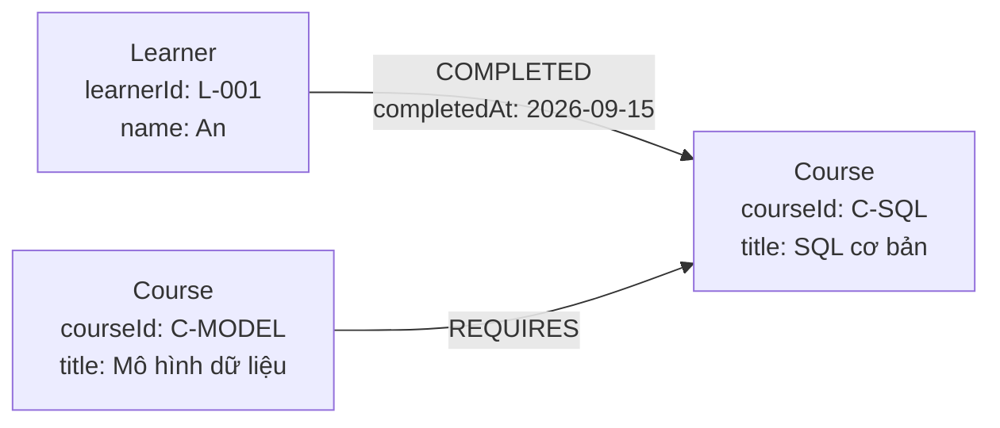
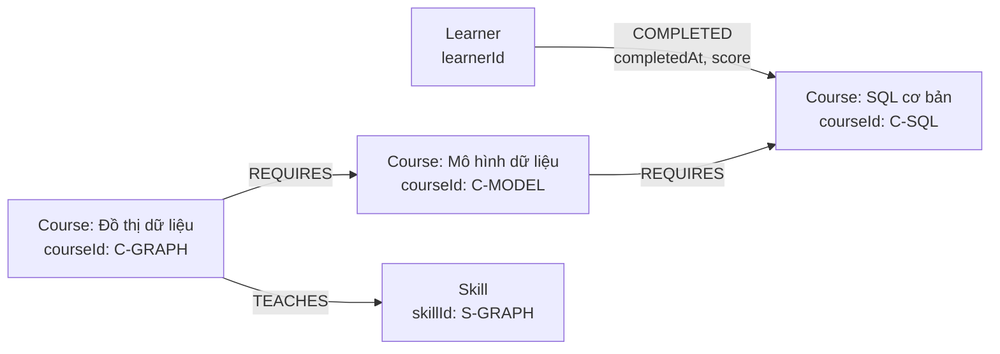
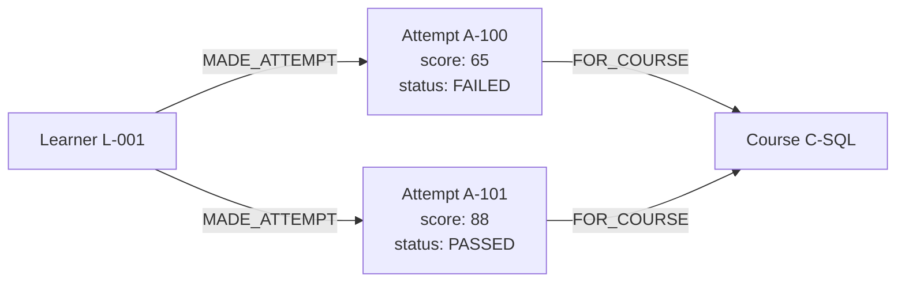

# Đỉnh, cạnh, nhãn và thuộc tính trong mô hình đồ thị thuộc tính

Mô hình **đồ thị thuộc tính** (*property graph*) biểu diễn dữ liệu bằng các đối tượng và những kết nối có ý nghĩa giữa chúng. Đơn vị cơ bản không còn là một hàng trong bảng hay một tài liệu JSON, mà là **đỉnh** và **cạnh**. **Nhãn** cho biết đối tượng thuộc nhóm nào, còn **thuộc tính** mô tả dữ liệu cụ thể trên đỉnh hoặc cạnh. Bốn thành phần này phối hợp để trả lời các câu hỏi như “khóa học nào yêu cầu kiến thức nào?”, “người học đã hoàn thành các điều kiện tiên quyết chưa?” hoặc “một dịch vụ phụ thuộc gián tiếp vào những dịch vụ nào?”.

Trong học phần **Mô hình đồ thị** của **DATABASE_DATA_MODELING**, ta tiếp cận graph từ yêu cầu nghiệp vụ: nhận diện thực thể, quan hệ, ràng buộc, định danh và chỉ mục; sau đó mới quyết định mô hình logic và lược đồ vật lý. Cách làm này giúp so sánh graph với mô hình quan hệ, document và phân tích, đồng thời giữ cho cấu trúc có thể kiểm chứng và tiến hóa. Bài này tập trung vào **cách mô hình hóa chính xác bằng đỉnh, cạnh, nhãn và thuộc tính**, thay vì chỉ học cú pháp truy vấn của một sản phẩm.

Sau khi học, bạn có thể:

- Nhận ra đâu là đỉnh, cạnh, nhãn và thuộc tính từ một yêu cầu nghiệp vụ.
- Thiết kế hướng cạnh, loại quan hệ, khóa định danh và bội số giữa các đối tượng.
- Phân biệt khi nào dữ liệu thuộc về đỉnh, cạnh hoặc một đỉnh sự kiện riêng.
- Đọc và viết các mẫu truy vấn đồ thị thuộc tính, đồng thời hiểu các giới hạn phụ thuộc hệ quản trị.
- Phát hiện lỗi mô hình hóa như nhãn mơ hồ, cạnh thiếu ngữ cảnh, mất lịch sử hoặc duyệt đồ thị không giới hạn.

## 1. Bốn thành phần và cách chúng kết hợp

Xem câu nghiệp vụ: “Người học An đã hoàn thành khóa *SQL cơ bản*; khóa *Mô hình dữ liệu* yêu cầu học *SQL cơ bản* trước”. Một cách biểu diễn là:



| Thành phần | Trong ví dụ | Câu hỏi mà nó giải đáp |
| --- | --- | --- |
| **Đỉnh** (*vertex/node*) | Người học `L-001`; hai khóa học `C-SQL` và `C-MODEL` | “Đối tượng nào tồn tại và có danh tính riêng?” |
| **Cạnh** (*edge/relationship*) | `COMPLETED`, `REQUIRES` | “Đối tượng này liên hệ với đối tượng kia như thế nào?” |
| **Nhãn / loại** (*label/type*) | Nhãn đỉnh `Learner`, `Course`; loại cạnh `COMPLETED`, `REQUIRES` | “Đối tượng hoặc quan hệ thuộc kiểu nghiệp vụ nào?” |
| **Thuộc tính** (*property*) | `learnerId`, `title`, `completedAt` | “Cần lưu giá trị gì để nhận diện, lọc hoặc giải thích?” |

Có thể mô tả một đồ thị dưới dạng `G = (V, E)` với tập đỉnh `V` và tập cạnh `E`. Ở property graph, mỗi đỉnh và cạnh còn có dữ liệu nhận diện kiểu/nhãn cùng các cặp **khóa–giá trị**. Đây là mô hình logic; một hệ quản trị cụ thể có thể triển khai chi tiết khác nhau. Ví dụ, Neo4j cho phép một đỉnh mang nhiều nhãn và mỗi quan hệ mang một **relationship type**; không nên mặc định mọi sản phẩm property graph có cùng quy tắc về nhãn, kiểu dữ liệu hay ràng buộc.

## 2. Đỉnh: đối tượng cần danh tính và vòng đời riêng

Đỉnh đại diện cho một thực thể mà hệ thống cần nhận diện, tham chiếu hoặc truy vấn độc lập: `Learner`, `Course`, `Skill`, `Company`, `Device`, `Order`... Đỉnh thường có một tập thuộc tính và ít nhất một nhãn cho biết kiểu đối tượng.

### 2.1. Khi nào tạo một đỉnh?

Hãy cân nhắc một đối tượng thành đỉnh nếu nó có một hoặc nhiều đặc điểm:

1. Có **danh tính độc lập**, chẳng hạn khóa học `C-SQL`, dù tên hiển thị có thay đổi.
2. Được nhiều đối tượng khác **tham chiếu hoặc kết nối**, chẳng hạn một kỹ năng được nhiều khóa học giảng dạy.
3. Có **vòng đời và quy tắc riêng**, như khóa học được công bố, tạm ẩn hoặc ngừng mở.
4. Người dùng cần **đi từ nó sang các đối tượng liên quan**, ví dụ tìm toàn bộ khóa phụ thuộc một kỹ năng.

Ngược lại, `Course.durationMinutes = 120` thường nên là thuộc tính vì con số thời lượng không phải một thực thể cần danh tính độc lập. Không cần tạo đỉnh cho từng giá trị `120`, `90` hay `60` chỉ vì chúng xuất hiện trong dữ liệu.

### 2.2. Định danh nghiệp vụ khác mã nội bộ của cơ sở dữ liệu

Mỗi `Course` cần `courseId` ổn định, còn mỗi `Learner` cần `learnerId` ổn định. Mã do hệ quản trị graph tự cấp có thể hỗ trợ lưu trữ hoặc truy vấn nội bộ, nhưng không nên xem là khóa nghiệp vụ bền vững khi di chuyển hoặc tích hợp dữ liệu.

Ví dụ một đỉnh:

```text
(:Course {
  courseId: 'C-MODEL',
  title: 'Mô hình dữ liệu',
  level: 'INTERMEDIATE',
  status: 'PUBLISHED',
  durationMinutes: 180
})
```

`courseId` là khóa xác định đối tượng; `title`, `level`, `status`, `durationMinutes` là các thuộc tính có thể dùng để hiển thị, lọc hoặc sắp xếp. Một nhãn không tự bảo đảm `courseId` duy nhất: cần constraint hoặc logic ghi dữ liệu tương ứng trong hệ đang dùng.

### 2.3. Một đỉnh có thể mang nhiều nhãn

Trong các hệ cho phép nhiều nhãn, `(:Person:Instructor)` có thể đại diện cho một người vừa thuộc phạm vi `Person` vừa có vai trò `Instructor`. Điều này giúp nhóm và truy vấn theo từng tập. Tuy nhiên, **nhãn không thay thế ràng buộc nghiệp vụ**: hệ thống vẫn phải xác định ai được quyền gắn hoặc bỏ nhãn, vai trò có hiệu lực khi nào và có được chồng lấn hay không.

Không nên biến mọi giá trị thay đổi thường xuyên thành nhãn: nếu `Course` có trạng thái `DRAFT`, `PUBLISHED`, `ARCHIVED` và trạng thái được cập nhật thường xuyên, thuộc tính `status` thường dễ kiểm soát hơn hàng loạt nhãn trạng thái. Khi một nhóm đối tượng có ý nghĩa phân loại ổn định và có nhiều truy vấn riêng, bổ sung nhãn mới có thể hợp lý.

## 3. Cạnh: mối quan hệ có ý nghĩa, hướng và ngữ cảnh

Cạnh nối hai đỉnh. Với **đồ thị có hướng**, cạnh có điểm bắt đầu và điểm kết thúc. Trong Cypher, một quan hệ như:

```cypher
(advanced:Course)-[:REQUIRES]->(basic:Course)
```

được hiểu là: “khóa nâng cao **yêu cầu** khóa cơ bản”. Đảo hướng thành `(basic)-[:REQUIRES]->(advanced)` sẽ thay đổi ý nghĩa. Hướng cạnh phải được thống nhất ngay từ mô hình nghiệp vụ và trong mọi truy vấn.

### 3.1. Đặt loại cạnh bằng động từ nghiệp vụ

| Cạnh | Đọc thành câu | Mức độ rõ nghĩa |
| --- | --- | --- |
| `(Learner)-[:COMPLETED]->(Course)` | Người học đã hoàn thành khóa học | Rõ vai trò hai đầu và trạng thái hoàn thành |
| `(Course)-[:REQUIRES]->(Course)` | Khóa A yêu cầu khóa B | Rõ hướng phụ thuộc |
| `(Course)-[:TEACHES]->(Skill)` | Khóa học giảng dạy kỹ năng | Rõ mục tiêu giảng dạy |
| `(Learner)-[:RELATED_TO]->(Course)` | Người học có liên quan đến khóa học | Mơ hồ: đăng ký, mua, xem hay hoàn thành? |

Tên loại cạnh nên diễn đạt **một quan hệ cụ thể**, không chỉ “có liên quan”. Một cặp đỉnh vẫn có thể có nhiều quan hệ khác nhau: người học có thể vừa `ENROLLED_IN` vừa `COMPLETED` một khóa, nếu hai khái niệm đó được định nghĩa độc lập.

### 3.2. Cạnh cũng có thuộc tính

Thuộc tính của `COMPLETED` như `completedAt`, `score` hoặc `source` mô tả **việc một người học hoàn thành một khóa cụ thể**, không mô tả bản thân người học hay bản thân khóa học.

```text
(:Learner {learnerId: 'L-001'})
  -[:COMPLETED {completedAt: '2026-09-15', score: 88}]->
(:Course {courseId: 'C-SQL'})
```

Nếu đặt `completedAt` lên `Learner`, ta mất thông tin thời điểm hoàn thành **khóa nào**; nếu đặt lên `Course`, mọi học viên sẽ bị gán cùng một ngày hoàn thành. Cách chọn vị trí thuộc tính phải khớp với **hạt dữ liệu** (*grain*) mà nó mô tả.

### 3.3. Không mặc định một cặp đỉnh chỉ có một cạnh

Nhiều hệ property graph cho phép nhiều cạnh giữa cùng hai đỉnh, kể cả cùng loại; một số cũng cho phép **self-loop** (cạnh quay về chính đỉnh). Điều đó không có nghĩa mọi cạnh như vậy đều hợp lệ theo nghiệp vụ.

Ví dụ `(Learner)-[:COMPLETED]->(Course)` có thể là duy nhất nếu hệ thống chỉ lưu **trạng thái hoàn thành cuối cùng**; nhưng nếu muốn lưu ba lần làm bài kiểm tra ở ba thời điểm khác nhau, không nên vô tình ghi đè chúng vào một cạnh. Có thể dùng các cạnh `ATTEMPTED` phân biệt bằng `attemptId` nếu hệ quản trị và thiết kế hỗ trợ, hoặc tạo đỉnh `Attempt` có danh tính riêng (xem mục 6). Ngược lại, một cạnh `REQUIRES` tự nối `(Course A)-[:REQUIRES]->(Course A)` thường là lỗi và cần được ngăn chặn.

### 3.4. Quan hệ đối xứng và hướng lưu trữ

“A theo dõi B” là quan hệ có hướng; “A là bạn của B” có thể được định nghĩa là quan hệ đối xứng. Ngay cả khi quan hệ nghiệp vụ đối xứng, một hệ property graph vẫn có thể lưu cạnh có hướng. Lúc đó cần quy ước rõ: dùng một hướng chuẩn hóa và truy vấn theo hai chiều, hay lưu hai cạnh và có cơ chế cập nhật nhất quán. Đừng tự suy ra một cạnh có hướng luôn mang ý nghĩa một chiều trong thế giới thực.

## 4. Nhãn đỉnh, loại cạnh và thuộc tính: khác nhau ở đâu?

Đây là ba quyết định rất dễ nhầm:

| Cần biểu diễn | Thành phần phù hợp | Ví dụ | Lý do |
| --- | --- | --- | --- |
| Đối tượng thuộc **loại gì** | Nhãn đỉnh | `:Course`, `:Learner`, `:Skill` | Phân loại các đỉnh để diễn đạt mẫu truy vấn |
| Hai đối tượng **liên hệ ra sao** | Loại cạnh | `:REQUIRES`, `:COMPLETED` | Nói rõ động từ và ý nghĩa của liên kết |
| Một đối tượng/quan hệ **có giá trị gì** | Thuộc tính | `courseId`, `title`, `completedAt` | Dữ liệu cụ thể có thể thay đổi và lọc |
| Một sự kiện có **danh tính và nhiều bên tham gia** | Đỉnh sự kiện + các cạnh | `Attempt`, `Enrollment`, `Order` | Giữ đầy đủ bối cảnh và vòng đời độc lập |

### 4.1. Phân biệt nhãn và thuộc tính

`:Course` là một nhãn, không phải tên riêng của một khóa học. `title = 'SQL cơ bản'` là thuộc tính trên **một đỉnh** `Course`. Tương tự, không nên tạo các loại cạnh động như `:REQUIRES_C_SQL`, `:REQUIRES_C_GRAPH` để mã hóa ID khóa học. Loại cạnh nên thể hiện **khái niệm ổn định**, còn ID cụ thể thuộc đỉnh hoặc thuộc tính cần thiết.

### 4.2. Thuộc tính là giá trị, không phải nút liên kết ngầm

Nếu hai khóa học đều có `category = 'Database'`, việc cùng thuộc tính **không tự tạo quan hệ giữa chúng**. Muốn truy vấn “các khóa khác trong cùng danh mục” có thể so sánh thuộc tính; nhưng nếu danh mục có người quản trị, mô tả, cấp bậc hoặc kết nối với nhiều khóa học, nên cân nhắc đỉnh `Category` và cạnh `IN_CATEGORY`.

### 4.3. Kiểu dữ liệu thuộc tính tùy thuộc hệ quản trị

Nhiều property graph cho phép chuỗi, số, boolean, ngày/giờ và một số kiểu tập hợp; hỗ trợ cho `null`, danh sách, bản đồ lồng nhau hoặc đối tượng phức hợp **không đồng nhất**. Với Neo4j, một thuộc tính được lưu trên đỉnh/cạnh không thể trực tiếp là mọi cấu trúc JSON lồng nhau; giá trị `null` thường đồng nghĩa với **không có thuộc tính** đó. Vì thế không nên thiết kế dựa vào giả định mọi property graph lưu được một document tùy ý trong một trường.

Thiết kế cần nhất quán đơn vị (`durationMinutes` thay vì `duration` mơ hồ), múi giờ, quy tắc chuẩn hóa chuỗi, giá trị mặc định và phân biệt “chưa biết” với “không áp dụng”. Với những thuộc tính quyết định đúng sai nghiệp vụ, hãy xác định rõ kiểu và phạm vi hợp lệ.

## 5. Thiết kế ví dụ hoàn chỉnh: lộ trình học tập

Giả sử nền tảng học tập cần đáp ứng bốn yêu cầu:

1. Hiển thị danh sách khóa học và kỹ năng mỗi khóa giảng dạy.
2. Xác định các khóa tiên quyết trực tiếp và gián tiếp của một khóa học.
3. Kiểm tra những khóa tiên quyết mà một người học chưa hoàn thành.
4. Ghi nhận ngày hoàn thành và điểm của từng người học đối với từng khóa.

### 5.1. Xác định các đỉnh và cạnh



Quy ước chiều: `(khóa nâng cao)-[:REQUIRES]->(khóa tiên quyết)`. Nếu khóa `C-GRAPH` yêu cầu `C-MODEL`, và `C-MODEL` yêu cầu `C-SQL`, thì `C-SQL` là **tiên quyết gián tiếp** của `C-GRAPH`.

| Đỉnh / cạnh | Thuộc tính đề xuất | Ràng buộc nghiệp vụ cần xác định |
| --- | --- | --- |
| `Learner` | `learnerId`, `displayName` | `learnerId` duy nhất; tên có thể trùng |
| `Course` | `courseId`, `title`, `level`, `status` | `courseId` duy nhất; trạng thái từ tập hợp hợp lệ |
| `Skill` | `skillId`, `name` | `skillId` duy nhất; tên có thể được chuẩn hóa |
| `REQUIRES` (`Course → Course`) | `mandatory`, có thể có `effectiveFrom` | Không tự yêu cầu chính nó; không tạo chu trình nếu chương trình không cho phép; tránh cạnh trùng |
| `TEACHES` (`Course → Skill`) | `proficiencyLevel` nếu có | Một khóa có thể dạy nhiều kỹ năng, một kỹ năng có thể xuất hiện ở nhiều khóa |
| `COMPLETED` (`Learner → Course`) | `completedAt`, `score`, `source` | Chỉ ghi khi xác nhận hoàn thành; định nghĩa rõ một hay nhiều bản ghi theo mỗi cặp |

**Điểm quan trọng:** các quy tắc “không có chu trình tiên quyết”, “một khóa học chỉ xuất hiện một lần trong danh sách tiên quyết của chính khóa đó” hoặc “điểm từ 0 đến 100” là **ràng buộc nghiệp vụ**, không tự xuất hiện chỉ vì ta chọn tên nhãn hay cạnh phù hợp. Cần chọn nơi thực thi từng quy tắc.

### 5.2. Tạo dữ liệu minh họa bằng Cypher

Đoạn sau dùng cú pháp **Neo4j Cypher** minh họa cách viết property graph. Chạy trên dữ liệu thử nghiệm trống hoặc đổi ID để tránh xung đột với dữ liệu hiện hữu.

```cypher
CREATE
  (sql:Course {
    courseId: 'C-SQL', title: 'SQL cơ bản', level: 'BEGINNER', status: 'PUBLISHED'
  }),
  (model:Course {
    courseId: 'C-MODEL', title: 'Mô hình dữ liệu', level: 'INTERMEDIATE', status: 'PUBLISHED'
  }),
  (graph:Course {
    courseId: 'C-GRAPH', title: 'Đồ thị dữ liệu', level: 'ADVANCED', status: 'PUBLISHED'
  }),
  (skill:Skill {skillId: 'S-GRAPH', name: 'Graph modeling'}),
  (learner:Learner {learnerId: 'L-001', displayName: 'An'}),
  (model)-[:REQUIRES {mandatory: true}]->(sql),
  (graph)-[:REQUIRES {mandatory: true}]->(model),
  (graph)-[:TEACHES {proficiencyLevel: 'FOUNDATIONAL'}]->(skill),
  (learner)-[:COMPLETED {
    completedAt: date('2026-09-15'), score: 88, source: 'ASSESSMENT'
  }]->(sql);
```

Trong mẫu này:

- `(:Course { ... })` cho biết **nhãn** và **thuộc tính** của một đỉnh.
- `-[:REQUIRES {mandatory: true}]->` cho biết **loại**, **thuộc tính** và **hướng** của cạnh.
- `sql`, `model`, `graph`, `learner` là **biến trong câu truy vấn**, không phải ID bền vững được lưu trong đồ thị.
- `date('2026-09-15')` tạo giá trị ngày trong Neo4j; cách biểu diễn ngày phụ thuộc sản phẩm.

### 5.3. Truy vấn trực tiếp các cạnh

Tìm những khóa `C-GRAPH` yêu cầu trực tiếp:

```cypher
MATCH (c:Course {courseId: 'C-GRAPH'})-[:REQUIRES]->(prereq:Course)
RETURN prereq.courseId AS courseId, prereq.title AS title
ORDER BY courseId;
```

Kết quả theo dữ liệu mẫu chỉ có `C-MODEL`, vì truy vấn này đi qua **một cạnh** `REQUIRES`.

Tìm cả tiên quyết trực tiếp lẫn gián tiếp, giới hạn tối đa năm cạnh:

```cypher
MATCH (c:Course {courseId: 'C-GRAPH'})-[:REQUIRES*1..5]->(prereq:Course)
RETURN DISTINCT prereq.courseId AS courseId, prereq.title AS title
ORDER BY courseId;
```

Kết quả là `C-MODEL` và `C-SQL`. `*1..5` là mẫu đường đi **độ dài thay đổi** trong cú pháp Cypher này. Giới hạn độ sâu cần được chọn theo độ sâu hợp lệ của lộ trình; nếu độ sâu nghiệp vụ vượt quá năm, truy vấn trên sẽ bỏ sót. `DISTINCT` tránh trả cùng một khóa nhiều lần khi có nhiều đường đi tới nó; nó không tự giải quyết vấn đề hiệu năng của đồ thị nhiều nhánh.

### 5.4. Truy vấn thuộc tính trên cạnh

Lấy lịch sử hoàn thành các khóa đã được xác nhận cho người học `L-001`:

```cypher
MATCH (l:Learner {learnerId: 'L-001'})-[done:COMPLETED]->(c:Course)
RETURN c.courseId AS courseId,
       c.title AS title,
       done.completedAt AS completedAt,
       done.score AS score
ORDER BY completedAt DESC;
```

Truy vấn này cho thấy lợi ích của việc đặt `completedAt` và `score` trên đúng cạnh `COMPLETED`: mỗi mối liên kết người học–khóa học có thể có giá trị riêng.

### 5.5. Tìm điều kiện tiên quyết chưa hoàn thành

Kết hợp các cạnh có hướng và điều kiện tồn tại:

```cypher
MATCH (learner:Learner {learnerId: 'L-001'})
MATCH (target:Course {courseId: 'C-GRAPH'})-[:REQUIRES*1..5]->(need:Course)
WHERE NOT EXISTS {
  MATCH (learner)-[:COMPLETED]->(need)
}
RETURN DISTINCT need.courseId AS missingCourseId, need.title AS title
ORDER BY missingCourseId;
```

Với dữ liệu mẫu, người học đã hoàn thành `C-SQL` nhưng chưa hoàn thành `C-MODEL`, nên `C-MODEL` được trả về. Để dùng trong sản phẩm thật, cần định nghĩa thêm: `mandatory = false` có tính không, điểm tối thiểu để được công nhận là bao nhiêu, chứng chỉ có hết hạn không, điều kiện được miễn học xử lý thế nào. Chính các quy tắc này quyết định **ngữ nghĩa của cạnh** và kết quả truy vấn, thay vì chỉ dựa vào hình dạng sơ đồ.

## 6. Khi thuộc tính của cạnh chưa đủ: đỉnh sự kiện

Giả sử người học có thể làm nhiều **lần thi** cho cùng khóa. Mỗi lần có `attemptId`, thời điểm bắt đầu, thời điểm nộp, điểm, giám khảo và trạng thái phúc khảo. Nếu chỉ dùng một cạnh `COMPLETED {score: ...}` thì không thể biểu diễn đầy đủ cả ba lần thi và lý do điểm được thay đổi.

Một mô hình mở rộng có thể tạo `Attempt` thành đỉnh:



Trong thiết kế này `Attempt` có danh tính độc lập để kiểm toán, sửa điểm, lưu chứng cứ và truy vấn theo lần thi. Cạnh `COMPLETED` có thể được **suy ra** từ lần thi đạt điều kiện; nếu vẫn lưu cạnh này để tối ưu truy vấn, cần quy tắc đồng bộ và nguồn sự thật rõ ràng.

Tương tự, một đơn hàng được đặt bởi khách, gửi đến địa chỉ, thực hiện trên thiết bị và chứa nhiều sản phẩm thường là **đỉnh sự kiện** có các cạnh nối đến những đối tượng liên quan. Việc tạo nhiều cạnh trực tiếp từ khách sang từng thông tin có thể làm mất ngữ cảnh “những yếu tố nào cùng xuất hiện trong một đơn hàng”.

Quy tắc thực hành:

| Tình huống | Cách mô hình thường phù hợp |
| --- | --- |
| `Learner` có tên hiển thị | `displayName` trên đỉnh `Learner` |
| Một khóa yêu cầu khóa khác | Cạnh `REQUIRES` từ khóa phụ thuộc tới khóa tiên quyết |
| Người học hoàn thành khóa tại một thời điểm duy nhất theo quy ước | Cạnh `COMPLETED` có `completedAt` |
| Người học có nhiều lần thi, mỗi lần có quy trình riêng | Đỉnh `Attempt` và các cạnh kết nối |
| Khóa học thuộc một danh mục có mô tả, người quản trị và phân cấp | Đỉnh `Category` và cạnh `IN_CATEGORY` / `PARENT_OF` |

## 7. Ràng buộc và chỉ mục: đưa mô hình logic thành lược đồ vật lý

Property graph **không miễn trừ** việc thiết kế khóa, ràng buộc và chiến lược tra cứu. Những thuộc tính như `courseId`, `learnerId`, `skillId` cần ổn định và duy nhất trong tập nhãn tương ứng. Truy vấn thường bắt đầu từ một đỉnh theo ID rồi mới đi qua các cạnh; tìm điểm bắt đầu nhanh và giới hạn việc mở rộng đường đi đều quan trọng.

Ví dụ ràng buộc và chỉ mục với Neo4j Cypher (cú pháp, tính sẵn có và điều kiện cấp phép có thể khác giữa phiên bản/sản phẩm):

```cypher
CREATE CONSTRAINT course_id_unique IF NOT EXISTS
FOR (c:Course) REQUIRE c.courseId IS UNIQUE;

CREATE CONSTRAINT learner_id_unique IF NOT EXISTS
FOR (l:Learner) REQUIRE l.learnerId IS UNIQUE;

CREATE CONSTRAINT skill_id_unique IF NOT EXISTS
FOR (s:Skill) REQUIRE s.skillId IS UNIQUE;

CREATE INDEX course_status_idx IF NOT EXISTS
FOR (c:Course) ON (c.status);
```

Các constraint ví dụ bảo đảm tính duy nhất **khi giá trị ID tồn tại**. Nếu ứng dụng yêu cầu mọi `Course` đều phải có `courseId`, cần thêm quy tắc về **sự tồn tại của thuộc tính**; khả năng thực thi constraint này phụ thuộc phiên bản và sản phẩm. Tương tự, `UNIQUE` trên ID nút không ngăn được hai cạnh `REQUIRES` trùng giữa một cặp đỉnh hoặc một chu trình tiên quyết. Những điều kiện đó phải có cách kiểm soát riêng trong quá trình ghi và kiểm tra dữ liệu.

### 7.1. `CREATE` và `MERGE` phục vụ hai tình huống khác nhau

- `CREATE` tạo đỉnh/cạnh mới theo mẫu; chạy lặp lại lệnh nạp dữ liệu có thể tạo dữ liệu trùng hoặc vi phạm constraint.
- `MERGE` tìm mẫu phù hợp hoặc tạo nếu chưa có. Nó hữu ích để nạp dữ liệu có thể chạy lại, nhưng **không tự tạo khóa duy nhất**, và lựa chọn thuộc tính trong mẫu `MERGE` có thể làm xuất hiện thực thể mới ngoài ý muốn.

Ví dụ khi đã có ràng buộc duy nhất trên `learnerId` và `courseId`, muốn cập nhật trạng thái hoàn thành theo một cặp người học–khóa học:

```cypher
MERGE (l:Learner {learnerId: 'L-001'})
MERGE (c:Course {courseId: 'C-SQL'})
MERGE (l)-[r:COMPLETED]->(c)
ON CREATE SET r.completedAt = date('2026-09-15'), r.score = 88;
```

Đoạn này chỉ phù hợp nếu nghiệp vụ quyết định **tối đa một** cạnh `COMPLETED` cho mỗi cặp; `MERGE` không xóa các cạnh trùng đã có sẵn. Khi phải ghi nhiều lần hoàn thành, nên dùng một định danh sự kiện hoặc mô hình `Attempt` thay vì lặp lại mẫu trên.

### 7.2. Không chỉ tối ưu điểm bắt đầu

Khi một kỹ năng phổ biến liên kết với hàng trăm nghìn khóa học, đỉnh `Skill` có thể có rất nhiều cạnh. Các đỉnh có bậc lớn (*high-degree vertex/supernode*) khiến truy vấn “đi qua mọi liên kết” tạo ra khối lượng công việc lớn. Cần quan sát phân bố số cạnh, giới hạn loại quan hệ được đi qua, dùng điều kiện thời gian/trạng thái, độ sâu và số kết quả. Chỉ mục trên khóa ID không thay thế việc đánh giá **chi phí duyệt cạnh**.

### 7.3. Ràng buộc dữ liệu liên quan thời gian

Nếu một cạnh `REQUIRES` chỉ có hiệu lực từ năm học mới, thuộc tính `effectiveFrom` và `effectiveTo` có thể phù hợp. Truy vấn phải lọc thời gian hiệu lực; nếu không, “tiên quyết hiện tại” và “tiên quyết của năm trước” sẽ bị trộn lẫn. Khi cần lưu nhiều phiên bản của quy tắc có người phê duyệt và lịch sử sửa đổi, có thể dùng đỉnh `CurriculumVersion` hoặc `RequirementRule` thay vì cập nhật một cạnh không có lịch sử.

## 8. So sánh cách biểu diễn với cơ sở dữ liệu quan hệ và document

Cùng một dữ liệu khóa học có thể biểu diễn bằng nhiều mô hình:

| Mục tiêu | Quan hệ | Document | Đồ thị thuộc tính |
| --- | --- | --- | --- |
| Lưu khóa học và thông tin mô tả | Bảng `courses` | Document `course` | Đỉnh `:Course` có thuộc tính |
| Lưu các khóa tiên quyết | Bảng nối `course_prerequisites` với hai khóa ngoại | Mảng `prerequisiteIds` trong document, tùy nhu cầu | Cạnh `(Course)-[:REQUIRES]->(Course)` |
| Lưu tiến độ người học | Bảng `course_completions` hoặc `attempts` | Document tiến độ hoặc subdocument | Cạnh `COMPLETED`, hoặc đỉnh sự kiện `Attempt` |
| Truy vấn tiên quyết trực tiếp | `JOIN` theo khóa ngoại | Đọc mảng ID và truy xuất thêm | Đi một bước qua `REQUIRES` |
| Truy vấn tiên quyết nhiều mức | CTE đệ quy hoặc logic ứng dụng | Cần xử lý kết nối giữa document | Truy vấn đường đi độ dài thay đổi |

Cả ba phương án có thể đúng. Với một hệ học tập chủ yếu xử lý đăng ký, thanh toán và bảng điểm, mô hình quan hệ thường thuận tiện cho tính toàn vẹn giao dịch. Nếu đọc và ghi một tài liệu khóa học như một khối thì document có thể hợp lý. Nếu truy vấn lộ trình, phụ thuộc và ảnh hưởng dây chuyền chiếm trọng tâm, property graph đem lại cách biểu đạt trực tiếp. Quyết định lưu trữ còn phụ thuộc khối lượng dữ liệu, tần suất truy vấn, mức độ nhất quán và khả năng vận hành.

**Đừng đồng nhất property graph với RDF.** RDF biểu diễn thông tin bằng các bộ ba `subject–predicate–object` và có mô hình ngữ nghĩa, công cụ chuẩn riêng. Property graph thường nhấn mạnh đỉnh/cạnh cùng các cặp thuộc tính, dùng các ngôn ngữ truy vấn như Cypher ở một số hệ. Việc một bài toán có cấu trúc mạng liên kết không có nghĩa hai mô hình này có cùng cách lưu nhãn, kiểu cạnh hoặc thuộc tính.

## 9. Sai lầm thường gặp khi xác định bốn thành phần

1. **Mã hóa ID trong nhãn/loại cạnh.** Viết `:Course_SQL` hoặc `:REQUIRES_C_SQL` khiến danh mục kiểu phình to, khó truy vấn tổng quát. Hãy dùng `:Course` với `courseId` và quan hệ `:REQUIRES`.
2. **Dùng một loại cạnh cho mọi mối liên hệ.** `RELATED_TO` không thể hiện được “học xong”, “yêu cầu”, “giảng dạy” hay “thuộc về”. Người đọc và truy vấn rất dễ dùng sai ngữ nghĩa.
3. **Đặt thuộc tính sai hạt dữ liệu.** `score` trên `Course` không thể biểu diễn điểm khác nhau của từng người học. Hãy đặt nó trên liên kết hoàn thành hoặc đỉnh lần thi.
4. **Nhầm chiều cạnh.** `(B)-[:REQUIRES]->(A)` nghĩa là B yêu cầu A, không phải A yêu cầu B. Một lỗi đảo chiều làm sai toàn bộ lộ trình tiên quyết.
5. **Tưởng nhãn hoặc cú pháp tự tạo ràng buộc.** Nhãn `Course` không ngăn ID trùng; loại `REQUIRES` không ngăn chu trình. Cần constraint và quy tắc ghi dữ liệu.
6. **Chỉ lưu trạng thái hiện tại khi cần lịch sử.** Ghi đè thuộc tính hoàn thành hoặc điều kiện tiên quyết làm mất khả năng tái hiện dữ liệu tại một thời điểm.
7. **Lưu đồng thời hai sự thật có thể suy ra nhau.** Nếu đã có `A REQUIRES B`, việc thêm cạnh ngược `B REQUIRED_BY A` sẽ tăng chi phí giữ nhất quán. Chỉ cân nhắc lưu dư thừa khi có lợi ích hiệu năng đo được và cơ chế đồng bộ đáng tin cậy.
8. **Duyệt đồ thị không có giới hạn hoặc điều kiện.** Quan hệ nhiều tầng, chu trình hay đỉnh có bậc lớn có thể khiến số đường đi tăng rất nhanh; phải xác định giới hạn, truy vấn mục tiêu và biện pháp kiểm soát.

## 10. Bài tập thực hành và gợi ý đáp án

### Bài tập 1: xác định đỉnh, cạnh, nhãn và thuộc tính

Một hệ thống vận tải ghi nhận:

- Mỗi `Station` có `stationCode`, `name`, `city`.
- Mỗi tuyến trực tiếp từ ga A tới ga B có `durationMinutes`, `distanceKm`, `operatorCode`.
- Khách hàng có thể tìm các tuyến nối chuyến và đường đi ngắn nhất theo tổng thời gian.

Hãy thiết kế property graph tối thiểu, xác định hướng cạnh và lý do không nên đặt `durationMinutes` lên đỉnh `Station`.

**Gợi ý:** tạo `(:Station {stationCode, name, city})`, nối bằng `(a:Station)-[:ROUTE_TO {durationMinutes, distanceKm, operatorCode}]->(b:Station)`. Thời gian di chuyển thuộc **một chặng cụ thể**, không thuộc ga A hoặc B. Nếu mỗi nhà vận hành có nhiều chuyến cùng cặp ga theo lịch, cần thêm mô hình `Service`/`Trip` với mã định danh, thời gian chạy và ngày hiệu lực. Truy vấn đường đi ngắn nhất cần xác định rõ tiêu chí: ít bước, tổng phút hay tổng chi phí; các hệ graph không có chung một cú pháp hoặc thuật toán mặc định cho mọi tiêu chí.

### Bài tập 2: phát hiện lỗi mô hình hóa

Một nhóm tạo đỉnh `(:Course {courseId: 'C-GRAPH', title: 'Đồ thị dữ liệu', score: 90})` và cạnh `(sql)-[:RELATED_TO]->(graph)`. Nhóm nói `score` là điểm của người học An và `RELATED_TO` nghĩa là SQL là điều kiện tiên quyết của Graph.

**Gợi ý:** `score` không thuộc về khóa học vì mỗi người có điểm khác nhau; đặt trên cạnh `COMPLETED` giữa `Learner` và `Course`, hoặc trên đỉnh `Attempt` nếu có nhiều lần thi. Thay `RELATED_TO` bằng cạnh có ngữ nghĩa và hướng đúng: `(graph)-[:REQUIRES]->(sql)`.

### Bài tập 3: lược đồ logic và ràng buộc

Làm rõ cách ngăn việc khóa A yêu cầu chính A, cách quản lý thay đổi tiên quyết theo từng phiên bản chương trình và cách phát hiện chu trình `A → B → C → A`.

**Gợi ý:** kiểm tra không có cạnh `REQUIRES` tự nối; khi thêm một cạnh `A REQUIRES B`, cần kiểm tra liệu đã có đường đi `B REQUIRES* A` để tránh tạo chu trình. Nếu cần đồng thời xử lý ghi cạnh trong môi trường nhiều giao dịch, cơ chế kiểm tra phải xét tính nhất quán và tranh chấp khi ghi. Có thể quản lý phiên bản bằng các đỉnh chương trình/phiên bản hoặc thuộc tính hiệu lực và lọc đúng phiên bản trong truy vấn. Đừng giả định constraint duy nhất trên `courseId` đủ ngăn chu trình.

## Tổng kết

Trong property graph, **đỉnh** đại diện cho thực thể có danh tính, **cạnh** biểu diễn mối quan hệ có hướng và ý nghĩa, **nhãn/loại** giúp phân loại, còn **thuộc tính** mang giá trị cụ thể của đúng đỉnh hoặc cạnh. Mô hình tốt bắt đầu từ câu hỏi nghiệp vụ, chọn đúng hạt dữ liệu, xác định định danh và vòng đời, rồi bổ sung ràng buộc cùng chiến lược truy vấn. Biểu diễn đồ thị chỉ thực sự hữu ích khi cấu trúc liên kết giúp trả lời những câu hỏi quan trọng rõ ràng và đáng tin cậy hơn.
