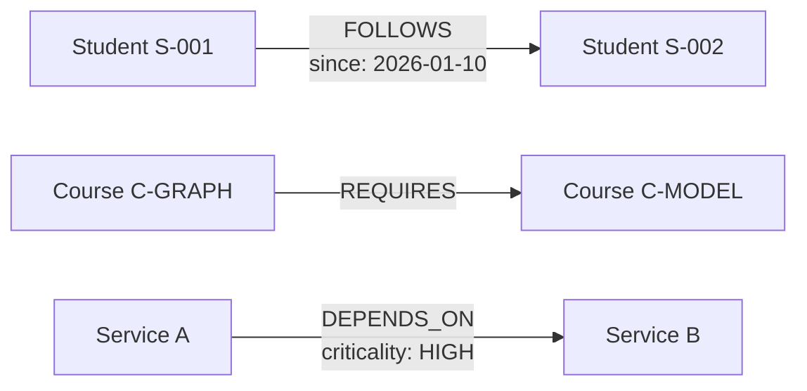
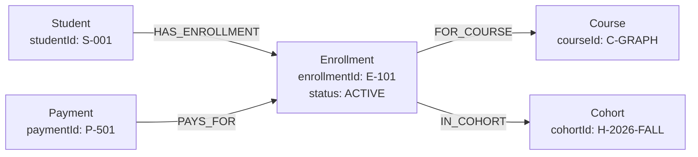
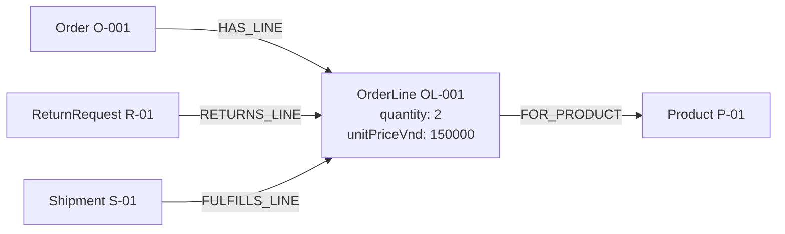

# Chọn thực thể làm đỉnh, quan hệ làm cạnh hay làm đỉnh trung gian

Khi chuyển yêu cầu nghiệp vụ sang **mô hình đồ thị thuộc tính** (*property graph*), câu hỏi khó thường không phải là “vẽ bao nhiêu đỉnh?”, mà là **điều gì thực sự có danh tính độc lập, điều gì chỉ là sự liên hệ, và khi nào sự liên hệ ấy cần được mô hình thành một đối tượng riêng?** Cùng một câu “học viên đăng ký khóa học”, ta có thể tạo cạnh `ENROLLED_IN` từ học viên tới khóa học, hoặc tạo đỉnh `Enrollment` nối tới học viên, khóa học, lớp học phần, thanh toán và lịch sử xử lý. Cả hai đều có thể đúng, nhưng chúng phục vụ những yêu cầu khác nhau.

Bài học nằm trong chương **Mô hình đồ thị** của **DATABASE_DATA_MODELING**. Mục tiêu của học phần là chuyển yêu cầu nghiệp vụ thành mô hình dữ liệu có thực thể, quan hệ, ràng buộc, khóa, chỉ mục và lược đồ vật lý rõ ràng, sau đó so sánh cách tiếp cận quan hệ, document, đồ thị và phân tích để chọn cấu trúc dễ kiểm chứng, dễ tiến hóa. Vì thế, quyết định “đỉnh, cạnh hay đỉnh trung gian” sẽ được lý giải từ **ngữ nghĩa và truy vấn nghiệp vụ**, không chỉ từ sở thích cú pháp hoặc hình vẽ đẹp mắt.

Sau bài này, bạn có thể:

- Phân biệt **thực thể**, **quan hệ nhị nguyên**, **sự kiện/giao dịch** và **quan hệ nhiều bên**.
- Chọn một dữ liệu làm **thuộc tính của đỉnh**, **thuộc tính của cạnh** hoặc **đỉnh trung gian** dựa trên danh tính, bội số và vòng đời.
- Nhìn ra các tình huống mà nhiều cạnh trực tiếp làm mất ngữ cảnh nghiệp vụ.
- Thiết kế một ví dụ bằng sơ đồ và Cypher; so sánh với bảng nối của cơ sở dữ liệu quan hệ.
- Xác định ràng buộc, truy vấn kiểm chứng và những chi phí phải chấp nhận khi thêm đỉnh trung gian.

## 1. Ba lựa chọn mô hình hóa

Giả sử hệ thống quản lý người học và khóa học:

| Lựa chọn | Biểu diễn | Dùng khi nào? |
| --- | --- | --- |
| **Đỉnh thực thể** | `(:Student {studentId, name})` | Người học có định danh, thuộc tính và vòng đời riêng; nhiều hoạt động cần tham chiếu đến người đó. |
| **Cạnh trực tiếp** | `(Student)-[:ENROLLED_IN {enrolledAt, status}]->(Course)` | Đăng ký chủ yếu là mối liên hệ **giữa đúng hai đối tượng**, với vài dữ liệu gắn vào liên hệ đó. |
| **Đỉnh trung gian** | `(Student)-[:HAS_ENROLLMENT]->(Enrollment)-[:FOR_COURSE]->(Course)` | Mỗi lần đăng ký trở thành **bản ghi nghiệp vụ độc lập**, có định danh, nhiều bên liên quan, trạng thái hoặc lịch sử riêng. |

Không có quy tắc “mối quan hệ có thuộc tính thì phải thành đỉnh” hoặc “quan hệ nhiều–nhiều thì phải thành đỉnh trung gian”. Property graph cho phép **cạnh mang thuộc tính**, và nhiều hệ quản trị cho phép nhiều cạnh giữa cùng hai đỉnh. Việc tạo thêm đỉnh chỉ nên xuất phát từ những khả năng mà nghiệp vụ cần, như tham chiếu tới chính lần đăng ký, quản lý nhiều lần đăng ký của cùng một cặp, hoặc nối sự kiện đăng ký với thanh toán và đợt học.

Một câu hỏi khởi đầu hữu ích: **nếu bỏ hai đối tượng ở hai đầu đi, thông tin ở giữa có còn là thứ nghiệp vụ cần nhận diện, truy vết hoặc quản lý riêng hay không?** Đây là gợi ý, không phải phép thử duy nhất; một lần đăng ký có thể phụ thuộc vào người học và khóa học nhưng vẫn có `enrollmentId` và vòng đời riêng.

## 2. Khi nào một khái niệm nên là đỉnh thực thể?

Đỉnh (*node/vertex*) thường biểu diễn thực thể có thể được nhận diện và truy vấn độc lập. Hãy kiểm tra bốn đặc điểm:

1. **Định danh:** đối tượng có khóa nghiệp vụ ổn định (`studentId`, `courseId`, `orderId`) thay vì chỉ là giá trị hiển thị?
2. **Vòng đời:** đối tượng được tạo, thay đổi trạng thái, ngừng hoạt động hoặc xóa theo quy tắc riêng?
3. **Khả năng kết nối:** nhiều đối tượng khác cần liên kết đến nó, hoặc ta muốn truy vấn từ nó để khám phá các quan hệ?
4. **Ràng buộc và quyền:** có những quy tắc sở hữu, bảo mật, tính duy nhất, kiểm toán dành riêng cho đối tượng đó?

Ví dụ, một `Course` cần đỉnh vì có `courseId` độc lập, được nhiều học viên tham gia, giảng dạy các `Skill`, có điều kiện tiên quyết và có trạng thái công bố. `Student.name` thường chỉ là **thuộc tính** của đỉnh `Student`; tạo đỉnh riêng cho từng tên người không giúp xử lý nghiệp vụ và còn gây nhập nhằng khi tên trùng nhau.

### 2.1. Giá trị dùng chung chưa chắc là thực thể

Hai khóa học cùng `level = 'BEGINNER'` không nhất thiết cần đỉnh `Level`. Nếu cấp độ chỉ là một trong vài giá trị cố định để lọc, thuộc tính `level` phù hợp. Nhưng nếu cấp độ có định danh, mô tả, thứ tự, phiên bản tiêu chuẩn hoặc nhiều quy tắc gắn kèm, `(:Level)` và cạnh `HAS_LEVEL` có thể hợp lý hơn.

Tương tự, địa chỉ giao hàng có thể là một **snapshot dạng thuộc tính** trên đơn hàng khi mục tiêu chỉ là lưu đúng thông tin tại thời điểm mua. Nếu cần nhận diện địa điểm chuẩn hóa để tìm đơn cùng địa chỉ, quản lý địa chỉ hay nối với vùng phục vụ, mô hình đỉnh `Address` là một lựa chọn. Nhiều hệ thống còn cần **cả bản snapshot tại thời điểm giao dịch và tham chiếu đến địa chỉ chuẩn**, vì thông tin chuẩn có thể thay đổi.

### 2.2. Khóa nghiệp vụ khác ID nội bộ

Không nên dựa hoàn toàn vào ID đỉnh do hệ quản trị cấp nếu đối tượng cần được đồng bộ qua các hệ thống. Hãy định nghĩa `studentId`, `courseId`, `orderId` hoặc khóa tự nhiên đáng tin cậy và cân nhắc constraint duy nhất tương ứng. Nhãn như `:Course` chỉ phân loại đỉnh; nó không tự bảo đảm `courseId` duy nhất. Khả năng bắt buộc thuộc tính tồn tại, kiểu thuộc tính và ràng buộc bội số phụ thuộc hệ quản trị cụ thể.

## 3. Khi nào quan hệ nên là một cạnh trực tiếp?

Một **cạnh** (*relationship/edge*) là lựa chọn tự nhiên khi quan hệ có thể mô tả rõ bằng động từ từ **một đỉnh nguồn tới một đỉnh đích**, và không cần một thực thể liên kết độc lập.

Ví dụ:



`FOLLOWS.since`, `DEPENDS_ON.criticality` hoặc `REQUIRES.mandatory` là **thuộc tính của đúng mối liên hệ đó**. Bản thân chúng chưa buộc ta tạo đỉnh `Follow`, `Dependency` hay `Prerequisite`.

### 3.1. Điều kiện thuận lợi cho cạnh trực tiếp

Một cạnh trực tiếp thường đủ khi:

- Quan hệ có ý nghĩa **nhị nguyên** rõ ràng: `A REQUIRES B`, `A FOLLOWS B`, `A DEPENDS_ON B`.
- Truy vấn chủ yếu cần biết “có liên kết không?”, “ai kết nối tới ai?” hoặc lọc theo vài thuộc tính của cạnh.
- Không cần đối tượng thứ ba tham gia **vào chính lần liên hệ ấy**.
- Không cần tham chiếu đến một lần liên hệ cụ thể từ nghiệp vụ khác.
- Bội số và cách cập nhật có thể mô tả rõ: một cạnh hợp lệ cho mỗi cặp, hay nhiều cạnh có định danh/đặc trưng phân biệt.

Trong một hệ học tập đơn giản, nếu mỗi học viên chỉ có **một trạng thái đăng ký hiện tại** cho mỗi khóa và truy vấn chỉ cần lọc theo trạng thái, cạnh sau có thể hợp lý:

```text
(:Student {studentId: 'S-001'})
  -[:ENROLLED_IN {
      enrolledAt: '2026-08-10',
      status: 'ACTIVE'
    }]->
(:Course {courseId: 'C-GRAPH'})
```

Thời điểm `enrolledAt` không nên đặt lên `Student` hay `Course`: mỗi học viên đăng ký từng khóa ở những thời điểm khác nhau. Đó là ví dụ đúng của **thuộc tính gắn với quan hệ**, dù quan hệ vẫn được biểu diễn bằng cạnh.

### 3.2. Hướng của cạnh quyết định ý nghĩa

Với `(Course A)-[:REQUIRES]->(Course B)`, hiểu rằng **A yêu cầu B**. Nếu đảo mũi tên nhưng giữ nguyên tên loại cạnh, ta đổi luôn sự thật nghiệp vụ. Quan hệ đối xứng như “hai người là bạn” vẫn có thể được lưu bằng cạnh có hướng trong một hệ thống cụ thể; khi ấy phải thống nhất quy ước cách lưu và cách truy vấn hai chiều.

### 3.3. Nhiều cạnh giữa cùng hai đỉnh có thể hợp lệ

Trong một số hệ property graph, có thể lưu hai cạnh `ENROLLED_IN` giữa cùng `Student` và `Course`, mỗi cạnh mang `term` khác nhau. Điều đó **không tự động là lỗi**. Tuy nhiên, nếu mỗi lượt đăng ký còn có thanh toán, phúc khảo và lịch sử trạng thái, chỉ thêm nhiều cạnh có thuộc tính sẽ khiến việc quản lý một lượt cụ thể khó hơn. Đây là lúc xem xét đỉnh trung gian.

## 4. Khi nào nên nâng quan hệ thành đỉnh trung gian?

**Đỉnh trung gian** (*association node*, *relationship node* hoặc *reification*) biến một quan hệ thành một đối tượng có thể được liên kết và quản lý như các thực thể khác. Đừng nhầm nó với một “đỉnh giả” vô nghĩa: nếu quyết định tạo đỉnh trung gian, phải giải thích **nó đại diện cho đơn vị nghiệp vụ nào**.

### 4.1. Năm tín hiệu quan trọng

| Tín hiệu | Ví dụ | Lý do đỉnh trung gian hữu ích |
| --- | --- | --- |
| **Có định danh riêng** | Đăng ký `E-2026-041` có thể được tìm bằng mã | Định danh một lần đăng ký để sửa, đối soát, hỗ trợ khách hàng. |
| **Có nhiều bên tham gia vào cùng một sự kiện** | Học viên đăng ký khóa học **trong một lớp học phần** và theo **gói ưu đãi** | Một đỉnh `Enrollment` gom các vai trò vào đúng một lần đăng ký. |
| **Có các đối tượng khác liên kết tới chính quan hệ** | Hóa đơn, thanh toán, chứng chỉ, yêu cầu hoàn tiền thuộc về một lượt đăng ký | Nhiều property graph thông dụng không cho phép nối trực tiếp một cạnh tới một cạnh khác. |
| **Có nhiều lượt giữa cùng một cặp** | Học viên đăng ký cùng khóa trong hai học kỳ | Mỗi lượt có mã, thời gian, trạng thái và lịch sử riêng. |
| **Có vòng đời, quy trình hoặc kiểm toán riêng** | `REQUESTED → APPROVED → PAID → CANCELLED` | Cần theo dõi từng chuyển trạng thái và xử lý độc lập. |

**Lưu ý:** một cạnh có thời điểm, trạng thái hay nhiều thuộc tính **vẫn có thể là thiết kế đúng**. Điều quan trọng là ứng dụng có cần **tham chiếu, kết nối và quản trị mối quan hệ như một thực thể độc lập** hay không.

### 4.2. Ví dụ: lượt đăng ký là một đối tượng nghiệp vụ

Yêu cầu mở rộng: “Mỗi lần học viên đăng ký một khóa thuộc **một lớp học phần cụ thể**; lần đăng ký có mã riêng, học phí được chốt khi đăng ký, có thể thanh toán nhiều lần và có thể hủy. Học viên có thể đăng ký lại cùng khóa ở kỳ sau.”

Mô hình đỉnh trung gian:



Lần đăng ký `E-101` trở thành **một nút liên kết có định danh**. Nếu học viên quay lại học kỳ sau, hệ thống tạo `E-102` cùng trỏ tới `Student` và `Course`, nhưng có `Cohort`, học phí hoặc trạng thái khác. Một khoản thanh toán `P-501` biết chính xác nó thuộc lượt đăng ký nào.

Những cạnh `HAS_ENROLLMENT`, `FOR_COURSE`, `IN_COHORT`, `PAYS_FOR` cần được diễn giải với vai trò cụ thể. Chẳng hạn, `Payment -[:PAYS_FOR]-> Enrollment` khác với việc thanh toán cho **khóa học nói chung**; nếu thanh toán gắn trực tiếp `Payment → Course`, có thể mất thông tin về học viên và kỳ đăng ký được thanh toán.

### 4.3. Quan hệ ba bên không thể tùy tiện tách thành ba quan hệ nhị nguyên

Giả sử học viên `S-001` đăng ký khóa `C-GRAPH` ở lớp `H1`, đồng thời đăng ký khóa `C-SQL` ở lớp `H2`. Nếu chỉ ghi:

```text
Student S-001  --ENROLLED_IN--> Course C-GRAPH
Student S-001  --ENROLLED_IN--> Course C-SQL
Student S-001  --JOINS-------> Cohort H1
Student S-001  --JOINS-------> Cohort H2
```

ta **không biết** lớp `H1` thuộc lượt đăng ký khóa nào của học viên. Kết hợp tùy tiện các cạnh có thể tạo ra cặp `C-GRAPH/H2` chưa từng xảy ra. Sự thiếu hụt này gọi là **mất tính đồng xuất hiện**: các quan hệ nhị nguyên riêng lẻ không ràng buộc được các thành phần phải thuộc **cùng một sự kiện**.

Đỉnh `Enrollment` giúp nhóm đúng bộ `(Student, Course, Cohort)` của **mỗi lần đăng ký**. Trong bài toán rất đơn giản, có thể đặt `cohortId` trên cạnh `ENROLLED_IN` và lọc bằng thuộc tính; nhưng nếu `Cohort` là đỉnh có lịch, giảng viên và địa điểm riêng, hoặc muốn gắn thêm thanh toán, đỉnh trung gian thường rõ ràng và dễ mở rộng hơn.

### 4.4. Sự kiện có lịch sử và nguồn gốc riêng

Một lần đăng ký có thể chứa `requestedAt`, `approvedAt`, `cancelledAt`, `status` và lý do hủy. Lưu `status` hiện tại trên `Enrollment` chưa đủ nếu hệ thống phải **tái hiện ai đã phê duyệt, khi nào, từ trạng thái nào sang trạng thái nào**. Khi đó còn có thể cần những đỉnh `EnrollmentEvent`, hoặc nhật ký kiểm toán độc lập, mỗi bản ghi gắn với cùng `Enrollment`.

**Đỉnh trung gian không tự động tạo lịch sử bất biến.** Nó chỉ cung cấp đơn vị để tổ chức lịch sử. Quy tắc cập nhật, tính toàn vẹn và lưu sự kiện vẫn phải được thiết kế.

## 5. Thiết kế đối chiếu: cạnh trực tiếp và đỉnh trung gian

Cùng một câu “học viên đăng ký khóa học”, hãy xem hai phiên bản cụ thể.

### 5.1. Phiên bản A: cạnh `ENROLLED_IN`

Giả định có tối đa một đăng ký hiện tại giữa mỗi cặp học viên–khóa học; không cần đối tượng khác tham chiếu tới lần đăng ký.

```cypher
// Ví dụ Neo4j Cypher. Chạy trên cơ sở dữ liệu thử nghiệm trống.
CREATE (s:Student {studentId: 'S-001', fullName: 'An'}),
       (c:Course {courseId: 'C-GRAPH', title: 'Mô hình đồ thị'}),
       (s)-[:ENROLLED_IN {
         enrolledAt: date('2026-08-10'),
         status: 'ACTIVE'
       }]->(c);
```

Tìm các khóa học người học đang đăng ký:

```cypher
MATCH (s:Student {studentId: $studentId})
      -[r:ENROLLED_IN]->(c:Course)
WHERE r.status = 'ACTIVE'
RETURN c.courseId AS courseId,
       c.title AS courseTitle,
       r.enrolledAt AS enrolledAt;
```

**Ưu điểm:** đường đi ngắn (`Student → Course`), ít thành phần, truy vấn trực tiếp. **Giới hạn:** khi cần gắn `Payment`, `Cohort` hoặc `RefundRequest` tới **một lượt đăng ký cụ thể**, mô hình sẽ thiếu thực thể để nối các vai trò ấy, trừ khi thay đổi cấu trúc hoặc dùng khóa liên kết bằng thuộc tính.

### 5.2. Phiên bản B: đỉnh `Enrollment`

Giả định một học viên có thể đăng ký một khóa nhiều lần, và mỗi lượt có mã riêng, lớp học phần và khoản thanh toán.

```cypher
// Ví dụ độc lập; chạy trong cơ sở dữ liệu thử nghiệm khác phiên bản A.
CREATE (s:Student {studentId: 'S-001', fullName: 'An'}),
       (c:Course {courseId: 'C-GRAPH', title: 'Mô hình đồ thị'}),
       (h:Cohort {cohortId: 'H-2026-FALL', term: '2026-FALL'}),
       (e:Enrollment {
         enrollmentId: 'E-101',
         enrolledAt: date('2026-08-10'),
         tuitionVnd: 1200000,
         status: 'ACTIVE'
       }),
       (s)-[:HAS_ENROLLMENT]->(e),
       (e)-[:FOR_COURSE]->(c),
       (e)-[:IN_COHORT]->(h);
```

Tìm danh sách **lượt đăng ký**, giữ được thông tin lớp và mã từng lượt:

```cypher
MATCH (s:Student {studentId: $studentId})
      -[:HAS_ENROLLMENT]->(e:Enrollment)
      -[:FOR_COURSE]->(c:Course)
OPTIONAL MATCH (e)-[:IN_COHORT]->(h:Cohort)
RETURN e.enrollmentId AS enrollmentId,
       c.courseId AS courseId,
       h.cohortId AS cohortId,
       e.status AS status,
       e.tuitionVnd AS tuitionVnd
ORDER BY enrollmentId;
```

Với truy vấn gắn thanh toán, ta có thể thêm `(p:Payment)-[:PAYS_FOR]->(e:Enrollment)` để biết tiền được dùng cho **đúng lượt** nào. Số bước duyệt tăng, nhưng mỗi bước mang một vai trò nghiệp vụ rõ ràng.

### 5.3. So sánh dựa trên yêu cầu, không dựa vào số dòng mã

| Tiêu chí | Cạnh trực tiếp `ENROLLED_IN` | Đỉnh trung gian `Enrollment` |
| --- | --- | --- |
| Định danh lượt đăng ký | Thường dựa vào cặp đỉnh và thuộc tính cạnh; phụ thuộc khả năng quản lý ID cạnh của sản phẩm | Có `enrollmentId` nghiệp vụ, thuận tiện tham chiếu ngoài graph |
| Nhiều lần giữa cùng hai đối tượng | Có thể dùng nhiều cạnh ở hệ cho phép, nhưng cần phân biệt từng lần | Mỗi lượt là một đỉnh độc lập |
| Thuộc tính ngày đăng ký, trạng thái | Đặt trực tiếp trên cạnh, ngắn gọn | Đặt trên đỉnh lượt đăng ký |
| Liên kết tới học kỳ, hóa đơn, hoàn tiền | Khó nối **tới chính cạnh** trong nhiều property graph | Các bên cùng trỏ đến đỉnh `Enrollment` |
| Tính đơn giản của đường đi | Ít bước hơn | Nhiều đỉnh/cạnh và điều kiện ràng buộc hơn |
| Kiểm toán và vòng đời nhiều giai đoạn | Cần thêm cơ chế/định danh bổ trợ | Có trung tâm để gắn lịch sử, nhưng vẫn phải thiết kế audit |
| Khả năng cập nhật nhất quán | Ít cấu phần hơn nếu nghiệp vụ đơn giản | Phải bảo đảm các cạnh tới `Enrollment` không bị thiếu, trùng hoặc sai vai trò |

Việc có đỉnh trung gian **không mặc nhiên tăng hiệu năng**. Nó tăng số đỉnh, số cạnh, số bước duyệt và chi phí ghi; đổi lại, có thể làm rõ ràng dữ liệu nghiệp vụ, giảm sự mơ hồ và hỗ trợ các truy vấn vốn khó biểu đạt bằng cạnh trực tiếp.

## 6. Ví dụ thứ hai: `OrderItem` giữa đơn hàng và sản phẩm

Một đơn hàng `O-001` có sản phẩm `P-01` với số lượng 2, đơn giá tại lúc mua 150.000 đồng. Có hai cách mô hình hóa.

**Cách A — cạnh trực tiếp:**

```text
(Order O-001)-[:CONTAINS {quantity: 2, unitPriceVnd: 150000}]->(Product P-01)
```

Cách này hợp lý khi mỗi đơn chỉ có một dòng cho mỗi sản phẩm, không cần tham chiếu từng dòng và không có nhiều quy trình riêng cho dòng hàng.

**Cách B — đỉnh dòng hàng:**



Nếu cùng sản phẩm được thêm thành **hai dòng khác nhau** do khuyến mãi, giá tại thời điểm mua hay phân bổ giao hàng khác nhau; hoặc nếu việc trả hàng, đổi hàng, giao từng phần và chiết khấu đều gắn với **một dòng cụ thể**, `OrderLine` nên có `orderLineId` riêng. Cũng cần lưu **đơn giá và thông tin sản phẩm tại thời điểm mua** trên dòng hàng hoặc snapshot phù hợp. Chỉ tham chiếu giá hiện tại của `Product` có thể làm báo cáo đơn cũ thay đổi theo bảng giá mới.

Đây là một ví dụ điển hình: trong cơ sở dữ liệu quan hệ, `order_items` đôi khi được gọi là “bảng nối” giữa `orders` và `products`, nhưng về nghiệp vụ nó thường là **thực thể dòng hàng** có định danh và thông tin giao dịch riêng. Khi chuyển sang graph, không nên ép nó thành cạnh nếu các quy trình bên ngoài vẫn cần tham chiếu tới dòng hàng.

## 7. Bảng quyết định: chọn đỉnh, thuộc tính, cạnh hay đỉnh trung gian?

Quy trình dưới đây giúp đưa ra một thiết kế ban đầu có thể giải thích được.

| Câu hỏi theo thứ tự | Nếu câu trả lời là “có” | Nếu câu trả lời là “không” |
| --- | --- | --- |
| 1. Khái niệm có danh tính/vòng đời độc lập và được tham chiếu ở nhiều nghiệp vụ? | Xem xét **đỉnh thực thể** | Xem xét thuộc tính hoặc quan hệ |
| 2. Nó chỉ là một giá trị mô tả đối tượng/quan hệ khác? | **Thuộc tính** trên đúng đỉnh hoặc cạnh | Tiếp tục |
| 3. Nó mô tả liên hệ rõ ràng giữa đúng hai đỉnh? | Có thể là **cạnh trực tiếp**, kể cả cạnh có thuộc tính | Cần xác định sự kiện/quan hệ nhiều bên |
| 4. Các bên khác có cần nối vào **chính lần quan hệ** này? | Cân nhắc **đỉnh trung gian** | Cạnh trực tiếp vẫn có thể đủ |
| 5. Quan hệ có nhiều lần giữa cùng cặp, mỗi lần có ID và quy trình riêng? | Cân nhắc **đỉnh trung gian / đỉnh sự kiện** | Không cần tạo đỉnh chỉ vì có quan hệ nhiều–nhiều |
| 6. Đỉnh trung gian có làm rõ câu hỏi nghiệp vụ và chi phí vận hành chấp nhận được? | Chọn mô hình trung gian, thiết kế ràng buộc | Giữ mô hình đơn giản và ghi rõ giới hạn |

### Ví dụ áp dụng nhanh

| Phát biểu nghiệp vụ | Lựa chọn thường hợp lý | Cần đổi lựa chọn khi nào? |
| --- | --- | --- |
| Người dùng theo dõi người dùng khác từ ngày X | Cạnh `FOLLOWS {since}` | Khi từng lần theo dõi/hủy theo dõi có ID, bằng chứng hoặc quy trình kiểm duyệt riêng |
| Khóa học A yêu cầu khóa B | Cạnh `REQUIRES` | Khi **quy tắc tiên quyết** có phiên bản, điều kiện phức hợp, nguồn phê duyệt và lịch sử độc lập |
| Thiết bị có tên, loại, định danh ổn định | Đỉnh `Device` | Nếu đó chỉ là chuỗi mô tả không cần nối/tra cứu riêng, có thể là thuộc tính |
| Học viên có tên hiển thị | Thuộc tính `Student.displayName` | Nếu đối tượng “tên/biệt danh” có danh tính hoặc quan hệ riêng được yêu cầu |
| Học viên đăng ký khóa, một trạng thái hiện tại | Cạnh `ENROLLED_IN` có thuộc tính | Khi nhiều lượt, nhiều bên hoặc lịch sử quy trình phải được nhận diện riêng |
| Một đơn chứa nhiều dòng sản phẩm với trả hàng và giao riêng | Đỉnh `OrderLine` | Nếu chỉ cần danh sách mặt hàng đơn giản, cạnh có thuộc tính có thể đủ |
| Nhân viên giữ vai trò tại dự án từ ngày A đến B | Cạnh `ASSIGNED_TO {role, from, to}` trong bài toán đơn giản | Khi mỗi đợt phân công có phê duyệt, ngân sách, lịch sử và các tác vụ gắn vào nó |

Đây là **bảng gợi ý để thảo luận mô hình**, không phải công thức máy móc. Một kiểu quan hệ có thể bắt đầu là cạnh trực tiếp rồi được nâng thành thực thể khi nghiệp vụ mở rộng; cũng có thể được giữ thành cạnh nếu mọi truy vấn thực tế chỉ cần hai đầu và vài thuộc tính.

## 8. Thiết kế khóa, bội số và tính toàn vẹn

Lựa chọn đỉnh trung gian kéo theo những ràng buộc cần ghi rõ. Với `Enrollment`:

- **Định danh:** `Student.studentId`, `Course.courseId`, `Cohort.cohortId`, `Enrollment.enrollmentId` duy nhất trong kiểu đối tượng tương ứng.
- **Bội số:** một `Enrollment` thuộc đúng một `Student`, một `Course` và theo yêu cầu hiện tại đúng một `Cohort`. Một `Student` có nhiều `Enrollment`.
- **Trùng lặp hợp lệ:** có thể có nhiều `Enrollment` cùng cặp `(Student, Course)` theo học kỳ, nhưng không được có hai bản ghi cùng `enrollmentId`.
- **Trạng thái:** `status` thuộc tập hợp hợp lệ, các bước chuyển trạng thái tuân theo quy trình.
- **Tồn tại và nhất quán:** khi tạo một lượt đăng ký phải tạo được các cạnh bắt buộc, hoặc giao dịch không được xem là hoàn tất.
- **Xóa dữ liệu:** xóa `Course` khi còn lượt đăng ký cần một chính sách rõ ràng: chặn xóa, lưu trữ, vô hiệu hóa hoặc chuyển tham chiếu theo quy trình.

Với **Neo4j Cypher**, có thể bắt đầu bằng constraint duy nhất:

```cypher
CREATE CONSTRAINT enrollment_id_unique IF NOT EXISTS
FOR (e:Enrollment) REQUIRE e.enrollmentId IS UNIQUE;

CREATE CONSTRAINT student_id_unique IF NOT EXISTS
FOR (s:Student) REQUIRE s.studentId IS UNIQUE;

CREATE CONSTRAINT course_id_unique IF NOT EXISTS
FOR (c:Course) REQUIRE c.courseId IS UNIQUE;
```

Các ràng buộc trên minh họa tính **duy nhất khi thuộc tính tồn tại**. Tùy phiên bản/sản phẩm, có thể cần constraint khác để bắt buộc thuộc tính hiện diện. **Constraint duy nhất trên ID không tự bảo đảm** rằng mỗi `Enrollment` có đúng một cạnh `FOR_COURSE` hay không có liên kết nhầm học viên; các ràng buộc bội số thường phải kiểm soát ở phần ghi dữ liệu, giao dịch và kiểm tra nhất quán.

### 8.1. Tạo dữ liệu nhất quán khi dùng đỉnh trung gian

Ví dụ sau giả định đã tồn tại `Student`, `Course`, `Cohort` có đúng những ID được truyền; ứng dụng thực hiện toàn bộ lệnh trong một giao dịch và xử lý trường hợp không tìm thấy đầu mối.

```cypher
MATCH (s:Student {studentId: $studentId})
MATCH (c:Course {courseId: $courseId})
MATCH (h:Cohort {cohortId: $cohortId})
CREATE (e:Enrollment {
  enrollmentId: $enrollmentId,
  enrolledAt: date(),
  status: 'REQUESTED'
})
CREATE (s)-[:HAS_ENROLLMENT]->(e)
CREATE (e)-[:FOR_COURSE]->(c)
CREATE (e)-[:IN_COHORT]->(h)
RETURN e.enrollmentId AS enrollmentId;
```

Nếu một trong các `MATCH` không tìm thấy đỉnh, câu truy vấn sẽ không tạo `Enrollment`; ứng dụng phải phân biệt trường hợp đó với tạo thành công. Khi chạy lặp lại, `CREATE` có thể gây lỗi trùng khóa; nên xác định rõ cách xử lý **idempotency** theo `enrollmentId` và chỉ sử dụng `MERGE` khi đã hiểu khóa duy nhất cùng quy tắc cập nhật. Không nên vô tình tạo thêm một `Course` hay `Student` chỉ vì một sự kiện đăng ký gửi lên có ID mới.

### 8.2. Không nhân đôi cùng một sự thật nếu chưa có lý do

Giả sử ta vừa lưu `(Student)-[:ENROLLED_IN]->(Course)` vừa lưu `(Student)-[:HAS_ENROLLMENT]->(Enrollment)-[:FOR_COURSE]->(Course)` cho cùng khái niệm. Một lần hủy có thể chỉ cập nhật cạnh trực tiếp nhưng không cập nhật đỉnh `Enrollment`. Hai đường biểu diễn sẽ mâu thuẫn nếu không có quy tắc rõ ràng. Có thể lưu cạnh trực tiếp như một **quan hệ dẫn xuất** để tăng tốc truy vấn, nhưng phải chỉ định nguồn sự thật, thời điểm đồng bộ và cách phát hiện sai lệch.

## 9. Tác động tới truy vấn, chỉ mục và hiệu năng

Một lựa chọn mô hình hóa chỉ tốt khi nó phục vụ truy vấn quan trọng nhất mà hệ thống cần trả lời.

### 9.1. Điểm bắt đầu truy vấn

Với cạnh trực tiếp, truy vấn bắt đầu từ `Student.studentId` rồi đi một cạnh tới `Course`. Với đỉnh trung gian, truy vấn bắt đầu từ `Student.studentId`, đi sang `Enrollment`, sau đó tới `Course` hoặc `Cohort`. Khi truy vấn một lần đăng ký theo `enrollmentId` để xử lý hỗ trợ hoặc hoàn tiền, mô hình có `Enrollment` là đỉnh cho phép **tìm thẳng đối tượng đó bằng khóa** rồi duyệt tới các bên liên quan.

Nếu ứng dụng thường tìm “tất cả lần đăng ký đang chờ phê duyệt trong hôm nay”, đỉnh `Enrollment` với `status`, `enrolledAt` có thể đóng vai trò đầu truy vấn; hãy cân nhắc chỉ mục dựa trên **bộ lọc thường dùng** và thống kê thực tế. Một số hệ hỗ trợ chỉ mục thuộc tính trên cạnh, một số có khả năng khác; không nên suy ra lợi thế chỉ mục chung cho mọi graph database.

### 9.2. Chi phí tăng khi thêm đỉnh

Một cạnh `ENROLLED_IN` có thể được thay bằng **một đỉnh và hai hoặc nhiều cạnh**, làm tăng số phần tử lưu trữ, số bước duyệt và thao tác ghi. Nếu hàng triệu người theo dõi nhau và chỉ cần “ai đang theo dõi ai?”, biến mỗi `FOLLOWS` thành một đỉnh riêng có thể tạo gánh nặng không cần thiết. Ngược lại, nếu nghiệp vụ cần hàng chục loại đối tượng gắn vào mỗi lượt đăng ký, thêm một đỉnh `Enrollment` có thể giảm độ phức tạp về ngữ nghĩa và tính toàn vẹn dù truy vấn đi qua nhiều bước hơn.

### 9.3. Thử bằng workload cụ thể

Đừng chỉ so sánh số đỉnh, số cạnh hoặc số dòng Cypher. Hãy đối chiếu:

| Truy vấn thực tế | Cần đo / kiểm chứng |
| --- | --- |
| Liệt kê khóa đang học của một học viên | Độ trễ, số phần tử mở rộng, tỉ lệ cache và tính chính xác |
| Tìm một lần đăng ký theo `enrollmentId` | Tra cứu đúng một sự kiện, đường đi tới người học/khóa học/lớp |
| Tìm các lượt chưa thanh toán theo trạng thái và kỳ học | Bộ lọc, chỉ mục, dữ liệu phân bố theo trạng thái và thời gian |
| Đối soát các lượt đăng ký và khoản thanh toán | Không thiếu/mất liên kết, không nhân bản kết quả do nhiều khoản trả |
| Đồng bộ dữ liệu từ hệ giao dịch chính | Độ trễ, xử lý sự kiện trùng, khả năng khôi phục và nhất quán |

Trong truy vấn có nhiều cạnh `Payment` trên mỗi `Enrollment`, một phép `MATCH` kết hợp còn có thể trả **nhiều hàng cho cùng lượt đăng ký**. Khi tổng hợp, cần chọn đúng cấp dữ liệu, dùng `DISTINCT` khi phù hợp hoặc gom theo `enrollmentId` thay vì vô tình đếm số khoản thanh toán như số lượt đăng ký.

## 10. Liên hệ với mô hình quan hệ và document

### 10.1. Bảng nối trong relational không luôn tương đương với cạnh graph

Một bảng đơn giản:

```sql
CREATE TABLE course_prerequisites (
    course_id VARCHAR(32) NOT NULL,
    prerequisite_course_id VARCHAR(32) NOT NULL,
    PRIMARY KEY (course_id, prerequisite_course_id),
    FOREIGN KEY (course_id) REFERENCES courses(course_id),
    FOREIGN KEY (prerequisite_course_id) REFERENCES courses(course_id),
    CHECK (course_id <> prerequisite_course_id)
);
```

có thể ánh xạ khá tự nhiên thành `(Course)-[:REQUIRES]->(Course)`. Bảng có hai khóa ngoại và chủ yếu trả lời **liên kết nhị nguyên**. Tuy nhiên, quy tắc `CHECK` trên hai ID mới ngăn tự phụ thuộc trực tiếp; để ngăn chu trình dài cần kiểm tra thêm bằng logic hoặc thuật toán đồ thị.

Một bảng khác:

```sql
CREATE TABLE enrollments (
    enrollment_id VARCHAR(32) PRIMARY KEY,
    student_id VARCHAR(32) NOT NULL REFERENCES students(student_id),
    course_id VARCHAR(32) NOT NULL REFERENCES courses(course_id),
    cohort_id VARCHAR(32) NOT NULL REFERENCES cohorts(cohort_id),
    enrolled_at TIMESTAMP NOT NULL,
    status VARCHAR(24) NOT NULL
);
```

không chỉ là một bảng “nối hai khóa ngoại”: nó có **mã đăng ký riêng**, liên kết **ba loại thực thể**, và trạng thái riêng. Ánh xạ sang `Enrollment` là đỉnh có các cạnh mang vai trò cụ thể thường tự nhiên hơn. Nếu mỗi học viên được phép đăng ký lại cùng khóa nhiều lần, **không được đặt** `UNIQUE(student_id, course_id)` khi chưa có điều kiện bổ sung như học kỳ hoặc quy tắc chống đăng ký trùng đang hiệu lực.

### 10.2. Document có thể nhúng quan hệ vào một đối tượng

Trong một document `Student`, có thể có mảng `enrollments` chứa `courseId`, `cohortId`, `enrolledAt` và `status`. Cách này thuận lợi nếu ứng dụng thường tải toàn bộ danh sách của một học viên và cập nhật trong phạm vi document. Nhưng khi một lượt đăng ký cần được tham chiếu bởi nhiều hệ thống hoặc liên kết sang nhiều đối tượng khác, phải quản lý ID, tính nhất quán và cập nhật các document liên quan. Lúc ấy có thể chọn document riêng cho `Enrollment`, mô hình relational hoặc đỉnh graph tùy workload.

### 10.3. Kho phân tích nhìn sự kiện theo góc độ khác

Một kho phân tích có thể dùng bảng sự kiện `fact_enrollment` ở cấp **mỗi lần đăng ký**, với khóa đến học viên, khóa học, lớp, ngày và số tiền. Cấp dữ liệu (*grain*) này gần với ý nghĩa của đỉnh `Enrollment`, nhưng mục tiêu là tổng hợp cohort, tỷ lệ chuyển đổi, doanh thu và phân tích theo chiều; còn graph chú trọng **kết nối và đường đi**. Cùng một sự kiện nghiệp vụ có thể có những biểu diễn vật lý khác nhau cho mục đích khác nhau.

## 11. Những sai lầm phổ biến

1. **Tạo đỉnh cho mọi động từ.** Việc `Student FOLLOWS Student` chỉ cần cạnh nếu không có lượt theo dõi với danh tính riêng. “Mọi quan hệ phải là đỉnh” gây tăng cấu trúc không cần thiết.
2. **Ép mọi thực thể liên kết thành cạnh.** `OrderLine` có hoàn trả, giao hàng và mã dòng riêng vẫn là thực thể nghiệp vụ quan trọng, dù nó nằm giữa `Order` và `Product`.
3. **Tách quan hệ nhiều bên thành các cặp rồi mất ngữ cảnh.** Nhiều cạnh từ `Student` tới `Course` và `Cohort` không đủ chứng minh khóa nào đã học trong lớp nào ở từng lượt.
4. **Nhầm thuộc tính của đối tượng và thuộc tính của quan hệ.** `enrolledAt` không thuộc về bản thân `Course`; `priceAtPurchase` không phải giá hiện tại của `Product`.
5. **Ghi đè các lượt khác nhau.** Nếu đăng ký lại cùng khóa tạo một lượt mới, cập nhật cạnh hoặc đỉnh cũ sẽ làm mất lịch sử và đối soát.
6. **Dùng nhãn/loại cạnh để mã hóa dữ liệu biến thiên.** `:ENROLLED_2026_FALL` khiến danh sách loại quan hệ phình to; thông tin kỳ học thường nên là thuộc tính hoặc quan hệ tới đỉnh `Cohort`.
7. **Bỏ qua ràng buộc sau khi đổi mô hình.** Một đỉnh `Enrollment` không tự được bảo đảm có đúng một học viên, một khóa hay một lớp. Cần luật ghi và kiểm tra dữ liệu.
8. **Lưu trùng hai biểu diễn nhưng không đồng bộ.** Đỉnh `Enrollment` và cạnh tắt `ENROLLED_IN` có thể mâu thuẫn nếu không có nguồn sự thật thống nhất.
9. **Chọn theo hình vẽ thay vì truy vấn.** Một sơ đồ có nhiều đỉnh đẹp mắt chưa chắc nhanh, dễ quản lý hoặc phản ánh đúng quy trình.

## 12. Bài tập thực hành và gợi ý lời giải

### Bài tập 1 — Quan hệ phụ thuộc

Một hệ thống quản lý dịch vụ cần biểu diễn “Service A phụ thuộc Service B”, kèm `criticality = HIGH`, và truy vấn các dịch vụ bị ảnh hưởng khi B lỗi. Mỗi lần phụ thuộc không có mã riêng, không gắn tới sự kiện khác.

**Câu hỏi:** chọn cạnh hay đỉnh trung gian? Chiều nào hợp lý?

**Gợi ý:** dùng `(Service A)-[:DEPENDS_ON {criticality: 'HIGH'}]->(Service B)`. Khi B lỗi, duyệt **ngược chiều** quan hệ `DEPENDS_ON` để tìm những dịch vụ phụ thuộc trực tiếp và gián tiếp vào B. Cần xử lý chu trình và giới hạn truy vấn theo yêu cầu. Nếu sau này từng hợp đồng phụ thuộc có phiên bản, người phê duyệt và chuỗi sự kiện, có thể tạo đỉnh `DependencyAgreement` riêng.

### Bài tập 2 — Đặt lịch khám

Một bệnh nhân đặt lịch với bác sĩ tại phòng khám, có `appointmentId`, giờ hẹn, trạng thái, hình thức thanh toán, khả năng đổi bác sĩ và nhật ký hủy. Lịch hẹn phải tham chiếu được từ thông báo, hóa đơn và đánh giá sau khám.

**Câu hỏi:** có thể chỉ nối `Patient → Doctor` bằng cạnh `VISITS` không?

**Gợi ý:** nên có đỉnh `Appointment` vì **mỗi lượt hẹn** là một sự kiện có danh tính, thời gian, nhiều bên và vòng đời riêng. Có thể biểu diễn `(Patient)-[:BOOKED]->(Appointment)-[:WITH_DOCTOR]->(Doctor)`, đồng thời nối `Appointment` tới `Clinic`, `Invoice` khi có yêu cầu. Các thuộc tính như `scheduledAt`, `status` đặt trên `Appointment`; lịch sử thay đổi quan trọng có thể cần bản ghi sự kiện riêng.

### Bài tập 3 — Khuyến mãi cho từng dòng hàng

Một đơn có hai dòng cùng `productId` vì một dòng dùng mã khuyến mãi và một dòng theo giá thường. Khách có thể trả lại đúng một dòng. Hãy chọn giữa `Order-[:CONTAINS {quantity, price}]->Product` và `Order → OrderLine → Product`.

**Gợi ý:** dùng `OrderLine` có `orderLineId`, `quantity`, `unitPriceAtPurchase`, `discountApplied`, rồi nối `ReturnRequest` tới đúng `OrderLine`. Nếu muốn giữ hai dòng khác nhau mà chỉ lưu một cạnh tổng cho mỗi cặp `(Order, Product)`, thông tin về khuyến mãi và trả hàng sẽ bị gộp sai. Một hệ cho phép nhiều cạnh trực tiếp vẫn có thể giữ từng dòng, nhưng cần ID ổn định và khả năng tham chiếu tới từng cạnh; khi có nhiều đối tượng gắn kèm, đỉnh `OrderLine` thường biểu đạt rõ hơn.

### Bài tập 4 — Kiểm tra thiết kế chưa đầy đủ

Nhóm phân tích tạo `Enrollment` với `enrollmentId`, nhưng chỉ nối `(Student)-[:HAS_ENROLLMENT]->(Enrollment)` rồi lưu `courseTitle` trên `Enrollment` thay vì liên kết đến đỉnh `Course` hiện có.

**Câu hỏi:** mô hình này có thể gây ra vấn đề gì?

**Gợi ý:** tên khóa có thể trùng/đổi; không có quan hệ tới `Course` nên khó truy vấn từ khóa sang các lượt đăng ký và khó bảo đảm ID tham chiếu hợp lệ. Nên có cạnh `(Enrollment)-[:FOR_COURSE]->(Course)` tới khóa có `courseId` ổn định; nếu cần lưu tên khóa như tại thời điểm đăng ký để kiểm toán, có thể giữ thêm snapshot `courseTitleAtEnrollment` với ngữ nghĩa riêng.

## Kết luận

Hãy chọn **đỉnh** cho thực thể có danh tính và vòng đời cần quản lý; chọn **cạnh trực tiếp** khi muốn diễn đạt một quan hệ nhị nguyên rõ nghĩa, kể cả khi cạnh có thuộc tính; và chọn **đỉnh trung gian** khi một **lần quan hệ** cần được nhận diện, gắn nhiều bên, được tham chiếu bởi đối tượng khác hoặc có quy trình, lịch sử riêng. Không có biểu diễn nào mặc định tốt nhất: mô hình đúng phải bảo toàn ngữ nghĩa nghiệp vụ, hỗ trợ truy vấn cần thiết và có ràng buộc cùng chi phí vận hành chấp nhận được.
