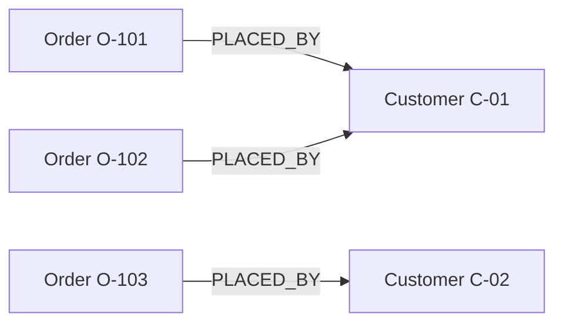
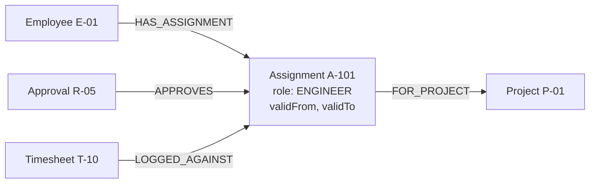

# Chiều cạnh, bội số và quan hệ có thuộc tính hoặc thời gian hiệu lực

Trong mô hình đồ thị, biểu diễn “A có liên hệ với B” mới là bước đầu. Để dữ liệu trả lời đúng câu hỏi nghiệp vụ, ta còn phải nói rõ **ai là nguồn, ai là đích; mỗi đối tượng được phép có bao nhiêu liên kết; thông tin nào thuộc về chính liên kết; và liên kết có hiệu lực từ khi nào đến khi nào**. Thiếu một trong các quyết định này, cùng một sơ đồ có thể cho ra kết quả trái ngược khi truy vấn.

Bài học thuộc chương **Mô hình đồ thị** của học phần **DATABASE_DATA_MODELING**. Mục tiêu của học phần là rèn khả năng chuyển yêu cầu nghiệp vụ thành thực thể, quan hệ, ràng buộc, khóa, chỉ mục và lược đồ vật lý rõ ràng; sau đó so sánh mô hình quan hệ, document, đồ thị và phân tích để chọn cấu trúc phù hợp, dễ kiểm chứng và phát triển. Ở đây, chúng ta tập trung vào **ngữ nghĩa của cạnh trong property graph** và cách biến ngữ nghĩa đó thành quy tắc thiết kế, truy vấn và kiểm tra dữ liệu.

Sau bài này, bạn có thể:

- Quy định hướng cạnh từ một phát biểu nghiệp vụ và phân biệt **chiều lưu trữ** với **ý nghĩa quan hệ**.
- Xác định bội số, tính bắt buộc/tùy chọn và các trường hợp có nhiều cạnh giữa cùng hai đỉnh.
- Đặt thuộc tính đúng trên cạnh, đồng thời nhận ra khi nào cần đỉnh sự kiện hay đỉnh trung gian.
- Thiết kế quan hệ có **thời gian hiệu lực**, truy vấn tại một thời điểm và xử lý thay đổi trong lịch sử.
- Diễn đạt các ràng buộc trong lược đồ logic, triển khai bằng constraint/giao dịch phù hợp và kiểm thử bằng những tình huống biên.

## 1. Một cạnh là một phát biểu nghiệp vụ có cấu trúc

Xét ba yêu cầu:

1. “Khóa học Đồ thị **yêu cầu** khóa Mô hình dữ liệu.”
2. “Đơn hàng O-101 **do** khách C-01 **đặt**.”
3. “Nhân viên E-01 **được phân công** vào dự án P-01 từ ngày 01/01/2026, với vai trò kỹ sư và mức phân bổ 50%.”

Cả ba có thể biểu diễn bằng cạnh, nhưng không có cùng đặc điểm:

| Quan hệ | Hướng đề xuất | Bội số cần xét | Dữ liệu trên cạnh |
| --- | --- | --- | --- |
| Khóa học yêu cầu khóa học | `(Course)-[:REQUIRES]->(Course)` | Một khóa có thể yêu cầu nhiều khóa; một khóa có thể là điều kiện cho nhiều khóa khác | `mandatory`, `validFrom` nếu chương trình có phiên bản |
| Đơn hàng do khách đặt | `(Order)-[:PLACED_BY]->(Customer)` | Mỗi đơn có đúng một khách theo giả định; một khách có thể đặt nhiều đơn | Thường chỉ cần cạnh; ngữ cảnh giao dịch chủ yếu nằm trên `Order` |
| Nhân viên được phân công vào dự án | `(Employee)-[:ASSIGNED_TO]->(Project)` | Nhiều nhân viên trên một dự án, một nhân viên trên nhiều dự án; có thể nhiều **đợt phân công** giữa cùng một cặp | `role`, `allocationPct`, `validFrom`, `validTo` |

Trong một property graph có hướng, mẫu tổng quát là:

```text
(đỉnh nguồn)-[:LOẠI_CẠNH {thuộcTính: giáTrị}]->(đỉnh đích)
```

Nhãn đỉnh và loại cạnh thể hiện **khái niệm nghiệp vụ ổn định**. Các thuộc tính thể hiện **giá trị của một đối tượng hoặc một lần liên hệ**. Không nên dùng tên cạnh kiểu `ASSIGNED_TO_P01_IN_2026` để mã hóa dữ liệu dự án và năm; dự án nên có định danh riêng, còn khoảng hiệu lực nên nằm trong dữ liệu.

## 2. Chiều cạnh: chọn từ ngữ nghĩa, không từ vị trí trên hình

### 2.1. Câu chủ động cho một quy ước dễ đọc

Một cạnh có hướng là một phát biểu từ nguồn tới đích. Với quan hệ tiên quyết:


Quy ước là **khóa nâng cao `REQUIRES` khóa tiên quyết**. Vì vậy:

- Để tìm *khóa mà C-GRAPH cần học trước*, đi **theo chiều** `REQUIRES`.
- Để tìm *khóa sẽ bị ảnh hưởng khi C-MODEL thay đổi*, đi **ngược chiều** `REQUIRES`.
- Để tìm mọi khóa tiên quyết gián tiếp, có thể đi qua **nhiều cạnh liên tiếp** theo cùng chiều, với điều kiện chặn chu trình và phạm vi truy vấn phù hợp.

Ví dụ cú pháp Neo4j Cypher:

```cypher
// Các điều kiện tiên quyết trực tiếp của một khóa
MATCH (course:Course {courseId: $courseId})
      -[:REQUIRES]->(prerequisite:Course)
RETURN prerequisite.courseId AS prerequisiteId;
```

```cypher
// Những khóa trực tiếp phụ thuộc vào một khóa
MATCH (dependent:Course)-[:REQUIRES]->
      (changed:Course {courseId: $courseId})
RETURN dependent.courseId AS dependentId;
```

Đảo chiều trên hình mà không đổi quy ước sẽ làm tất cả truy vấn phụ thuộc bị đảo nghĩa. Vì vậy, tài liệu mô hình nên luôn viết cạnh thành **một câu đầy đủ**, chẳng hạn “A yêu cầu B”, “đơn hàng được đặt bởi khách”, “nhân viên được phân công vào dự án”.

### 2.2. Chiều lưu trữ không nhất thiết đồng nghĩa với quan hệ một chiều

Quan hệ “người dùng A theo dõi B” là **bất đối xứng**: A theo dõi B không khiến B theo dõi A. Còn “A và B là bạn bè” có thể được định nghĩa là **đối xứng** theo nghiệp vụ, ngay cả khi hệ quản trị lưu cạnh có hướng.

Với quan hệ đối xứng, nhóm thiết kế cần chọn một quy ước nhất quán:

- **Một cạnh đại diện cho cặp không thứ tự:** có thể chuẩn hóa thứ tự hai ID khi ghi và truy vấn không xét hướng.
- **Hai cạnh có hướng:** dùng khi sản phẩm thực sự phân biệt hai quyết định độc lập, ví dụ A đồng ý kết bạn với B và B đồng ý kết bạn với A. Nếu hai cạnh chỉ là bản sao của một sự thật, phải có cơ chế giữ chúng nhất quán.

Trong Cypher, mẫu không có mũi tên sau đây tìm cạnh `FRIEND_WITH` **không quan tâm chiều đã lưu**:

```cypher
MATCH (p:Person {personId: $personId})
      -[:FRIEND_WITH]-(friend:Person)
RETURN DISTINCT friend.personId AS friendId;
```

Truy vấn không xét hướng **không biến mọi cạnh thành đối xứng về mặt nghiệp vụ**. Nó chỉ yêu cầu công cụ khớp hai hướng lưu trữ.

Một lỗi thường gặp là cùng lưu `(A)-[:OWNS]->(B)` và `(B)-[:OWNED_BY]->(A)` để “dễ tìm hơn”, dù chúng là hai cách nói của một sự thật. Điều này tạo thêm trách nhiệm đồng bộ khi A ngừng sở hữu B. Chỉ nên lưu quan hệ dẫn xuất dư thừa khi đã xác định nguồn sự thật và chứng minh lợi ích bằng workload thực tế.

### 2.3. Cạnh tự nối và chu trình có thể hợp lệ hoặc không

Property graph thường cho phép cạnh quay lại chính đỉnh (*self-loop*), chẳng hạn `(Course)-[:REQUIRES]->(Course)`. Tuy nhiên, với điều kiện tiên quyết, đây là lỗi nghiệp vụ. Chu trình `A REQUIRES B`, `B REQUIRES C`, `C REQUIRES A` cũng thường không hợp lệ dù không có self-loop.

Ngược lại, mạng giao thông có đường một chiều quay lại điểm xuất phát; mạng xã hội có chu trình theo dõi; đồ thị phụ thuộc dịch vụ có thể chứa chu trình cần **phát hiện và xử lý**, thay vì mặc định xóa mọi chu trình.

Cần tách hai lớp quy tắc:

1. **Cấu trúc:** hệ quản trị có thể lưu những kiểu cạnh, hướng và chu trình nào?
2. **Nghiệp vụ:** kiểu quan hệ cụ thể có cho phép tự nối, chu trình hoặc hai chiều không?

Đừng cho rằng khai báo loại cạnh `REQUIRES` sẽ tự ngăn các chu trình. Hành vi đó cần được kiểm tra khi ghi hoặc bằng một quy trình xác minh riêng.

## 3. Bội số: mỗi đỉnh được phép có bao nhiêu cạnh?

**Bội số** (*multiplicity/cardinality*) mô tả số liên kết hợp lệ của một đỉnh tại một vai trò đầu cạnh. Nó khác với số lượng đỉnh hiện tại trong cơ sở dữ liệu: việc hôm nay mỗi đơn có một khách chưa chứng minh lược đồ đã ràng buộc điều đó.

Những ký hiệu hay dùng:

| Ký hiệu | Ý nghĩa |
| --- | --- |
| `0..1` | Không có hoặc có tối đa một liên kết |
| `1` | Phải có đúng một liên kết |
| `0..*` | Có thể không có hoặc có nhiều liên kết |
| `1..*` | Phải có ít nhất một liên kết |

### 3.1. Đọc bội số theo từng đầu cạnh

Giả sử mô hình:



Nếu chính sách yêu cầu mỗi đơn thuộc **đúng một** khách:

- Với **mỗi `Order`**, số cạnh `PLACED_BY` đi ra phải là **1**.
- Với **mỗi `Customer`**, số cạnh `PLACED_BY` đi vào có thể là **0..***.

Đây là quan hệ **một–nhiều** theo cách nhìn từ khách tới đơn, dù mũi tên được lưu theo chiều *đơn → khách*. “Một–nhiều” không yêu cầu mũi tên phải vẽ từ phía “một” sang phía “nhiều”.

Các quan hệ khác:

| Loại cạnh | Số cạnh từ một đỉnh nguồn | Số cạnh đến một đỉnh đích | Giả định nghiệp vụ |
| --- | --- | --- | --- |
| `(Order)-[:PLACED_BY]->(Customer)` | Một `Order`: `1` | Một `Customer`: `0..*` | Đơn phải có một khách; khách chưa chắc đã đặt đơn |
| `(Employee)-[:ASSIGNED_TO]->(Project)` | Một nhân viên: `0..*` | Một dự án: `0..*` | Có thể tham gia nhiều dự án và một dự án có nhiều người |
| `(Course)-[:REQUIRES]->(Course)` | Một khóa: `0..*` | Một khóa: `0..*` | Một khóa có nhiều tiên quyết và có thể là tiên quyết của nhiều khóa khác |
| `(Invoice)-[:BILLS]->(Order)` | Một hóa đơn: `1` | Một đơn: tùy bài toán, ví dụ `0..*` | Có thể có nhiều đợt lập hóa đơn; cần định nghĩa trước |

Bội số luôn gắn với **phạm vi và quy tắc cụ thể**. “Mỗi nhân viên chỉ có một quản lý” có thể đúng **tại một thời điểm**, nhưng không đúng nếu xét lịch sử nhiều năm. “Mỗi đơn chỉ có một khoản thanh toán” có thể sai nếu khách thanh toán chia đợt. Cần nêu rõ tính hiện tại, theo phiên bản, theo tổ chức hoặc theo thời gian.

### 3.2. Tính bắt buộc khác với tính duy nhất

Hai câu sau không giống nhau:

- “Một đơn có **không quá một** khách”: `0..1`, có thể bỏ trống.
- “Một đơn có **đúng một** khách”: `1`, vừa **bắt buộc tồn tại** vừa **không được có hai**.

Tương tự, constraint duy nhất trên `Order.orderId` không bảo đảm mỗi `Order` có đúng một cạnh `PLACED_BY`. Nó chỉ bảo đảm quy tắc về ID của đỉnh nếu hệ quản trị hỗ trợ constraint đó. Việc kiểm soát số cạnh, các đỉnh bắt buộc và vai trò đầu cạnh thường cần transaction, logic ứng dụng hoặc công cụ kiểm tra nhất quán.

### 3.3. Nhiều cạnh giữa cùng một cặp đỉnh

Nhiều property graph cho phép nhiều cạnh cùng loại giữa cùng hai đỉnh (*parallel edges*). Ví dụ một nhân viên tham gia dự án trong hai giai đoạn:

```text
(Employee E-01)
  -[:ASSIGNED_TO {role: 'ENGINEER', validFrom: 2026-01-01, validTo: 2026-07-01}]->
(Project P-01)

(Employee E-01)
  -[:ASSIGNED_TO {role: 'TECH_LEAD', validFrom: 2026-07-01, validTo: ...}]->
(Project P-01)
```

Hai cạnh này đại diện cho **hai giai đoạn hợp lệ**, không phải dữ liệu trùng theo định nghĩa nghiệp vụ đã nêu. Nhưng nếu đội ngũ chỉ muốn lưu một phân công hiện tại trên mỗi cặp, việc xuất hiện hai cạnh đang hoạt động có thể là lỗi.

Cần xác định chính xác **khóa logic của một lần quan hệ**, chẳng hạn:

- Một quan hệ hiện tại duy nhất theo `(employeeId, projectId)`.
- Một đợt phân công duy nhất theo `(employeeId, projectId, role, validFrom)`.
- Hoặc mỗi lượt có `assignmentId` riêng nếu cần quản lý và tham chiếu độc lập.

Chọn khóa theo ý nghĩa sự kiện, không suy ra chỉ từ hai đầu đỉnh.

## 4. Thuộc tính của cạnh: dữ liệu thuộc về chính mối liên hệ

Cạnh property graph có thể mang dữ liệu như thời điểm bắt đầu, vai trò, tỷ lệ phân bổ, nguồn bằng chứng hoặc độ ưu tiên.

```text
(:Employee {employeeId: 'E-01'})
  -[:ASSIGNED_TO {
      role: 'ENGINEER',
      allocationPct: 50,
      validFrom: 2026-01-01,
      validTo: 2026-07-01
    }]->
(:Project {projectId: 'P-01'})
```

Các thuộc tính `role` và `allocationPct` mô tả **E-01 làm gì ở P-01 trong giai đoạn ấy**, không phải E-01 luôn là kỹ sư hay dự án P-01 luôn có mức phân bổ 50%. Nếu đặt chúng trên `Employee` hoặc `Project`, mô hình có thể mất dữ liệu khi một nhân viên tham gia nhiều dự án với vai trò khác nhau.

### 4.1. Cách xác định “hạt dữ liệu” của thuộc tính

Hãy hoàn thành câu: “Giá trị này thuộc về **ai hoặc lần liên kết nào**?”.

| Thuộc tính | Thường đặt ở đâu? | Lý do |
| --- | --- | --- |
| `Employee.employeeId`, `Employee.displayName` | Đỉnh `Employee` | Nhận diện/mô tả nhân viên |
| `Project.projectId`, `Project.name` | Đỉnh `Project` | Nhận diện/mô tả dự án |
| `ASSIGNED_TO.role` | Cạnh `ASSIGNED_TO` | Vai trò của **một nhân viên trong một dự án/giai đoạn** |
| `ASSIGNED_TO.allocationPct` | Cạnh `ASSIGNED_TO` | Phân bổ trong một đợt, có thể khác ở dự án khác |
| `ASSIGNED_TO.validFrom`, `validTo` | Cạnh `ASSIGNED_TO` | Khoảng thời gian mà đợt phân công có hiệu lực |
| `Project.budgetVnd` | Đỉnh `Project`, hoặc một cấu trúc phiên bản nếu cần lịch sử | Ngân sách của dự án, có thể thay đổi theo phiên bản |

Thuộc tính không nên ghi đè thông tin lịch sử nếu truy vấn cần tái hiện quá khứ. Ví dụ, giá đơn hàng tại ngày mua không nên chỉ được suy ra từ giá sản phẩm đang áp dụng hiện nay.

### 4.2. Khi nào thuộc tính cạnh là chưa đủ?

Cạnh trực tiếp phù hợp nếu quan hệ chỉ cần hai đầu và một nhóm thuộc tính. Tuy nhiên, nên cân nhắc **đỉnh trung gian** `Assignment` nếu một lần phân công:

- Có `assignmentId` riêng dùng trong các hệ thống khác.
- Có nhiều bên tham gia, như dự án, vị trí ngân sách, người duyệt và hợp đồng.
- Được hóa đơn, timesheet, phê duyệt hoặc yêu cầu điều chỉnh **trỏ tới chính lần phân công**.
- Có nhiều lần điều chỉnh, luồng duyệt và lịch sử sự kiện độc lập.



Thời gian hiệu lực **không tự buộc** phải tạo đỉnh trung gian: một cạnh `ASSIGNED_TO` có khoảng thời gian là mô hình hợp lệ nếu nghiệp vụ đủ đơn giản. Đỉnh trung gian có thêm chi phí lưu trữ, cạnh và thao tác ghi, đổi lại giúp tham chiếu và kiểm toán **đúng một sự kiện**. Không nên tạo cả cạnh tắt `ASSIGNED_TO` và đỉnh `Assignment` cho cùng sự thật nếu chưa xác định bên nào là nguồn dữ liệu chính và cách đồng bộ.

## 5. Thời gian hiệu lực: quan hệ đúng vào lúc nào?

Đối với một cạnh có vòng đời, câu hỏi “hai đỉnh có liên hệ không?” cần bổ sung “**tại thời điểm nào?**”. Một quan hệ từng đúng trong quá khứ có thể không còn đúng hiện tại.

### 5.1. Chọn quy ước khoảng thời gian trước khi ghi dữ liệu

Một quy ước nhất quán và thuận tiện là **nửa mở**:

```text
[validFrom, validTo)
```

Nghĩa là **bao gồm** `validFrom` và **không bao gồm** `validTo`. Một thời điểm `t` thuộc khoảng nếu:

```text
validFrom <= t AND (validTo không có OR t < validTo)
```

Ví dụ:

```text
Vai trò ENGINEER:  [2026-01-01, 2026-07-01)
Vai trò TECH_LEAD: [2026-07-01, +infinity)

Thời điểm 2026-06-30: ENGINEER
Thời điểm 2026-07-01: TECH_LEAD
```

Hai khoảng nối sát nhau tại 01/07 nhưng **không chồng lấn**. Nếu dùng cả hai đầu đóng `[start, end]` mà không quy định lại, thời điểm chuyển vai trò có thể khớp đồng thời với cả hai khoảng.

| Quy tắc | Diễn giải và kiểm tra |
| --- | --- |
| `validFrom` bắt buộc | Quan hệ có ngày bắt đầu theo nghiệp vụ |
| `validTo` có thể vắng mặt | Quan hệ chưa xác định ngày hết hiệu lực, tạm xem là mở về tương lai |
| `validTo > validFrom` khi có `validTo` | Không chấp nhận khoảng rỗng hoặc kết thúc trước khi bắt đầu |
| So sánh ở cùng độ chính xác | Không trộn ngày với thời gian có giờ nếu chưa định nghĩa chuyển đổi |
| Quy tắc giao nhau rõ ràng | Hai khoảng `[a, b)` và `[c, d)` chồng lấn khi `a < d` và `c < b`, với đầu mút mở tương ứng |

Trong Neo4j, không lưu được thuộc tính có giá trị `null` theo nghĩa một giá trị property tồn tại; đặt `null` thường làm thuộc tính vắng mặt. Vì vậy, mẫu `r.validTo IS NULL` trong Cypher bên dưới biểu thị **không có giá trị kết thúc**. Nếu sản phẩm khác phân biệt `null` và thuộc tính vắng mặt, cần thống nhất cách ánh xạ.

### 5.2. Phân biệt ngày và thời điểm có giờ

Nếu chính sách phân công tính theo **ngày làm việc**, `date` có thể đủ. Nếu quyền truy cập có hiệu lực từ 09:30 đến 12:00 ở một múi giờ cụ thể, cần kiểu `datetime` phù hợp và quy ước múi giờ.

- Thời điểm tuyệt đối nên lưu dưới dạng có múi giờ hoặc UTC, đồng thời giữ timezone nghiệp vụ nếu cần hiển thị/tính theo lịch địa phương.
- Không tự suy đoán `2026-07-01` là cuối ngày hay đầu ngày; quy ước `[start, end)` phải được mô tả rõ.
- Với lịch theo ngày địa phương, các quy tắc giờ mùa hè và khác biệt múi giờ có thể làm “cộng 24 giờ” khác “sang ngày tiếp theo”.

### 5.3. Một cạnh lịch sử và một cạnh hiện tại

Với mô hình **lưu lịch sử bằng nhiều cạnh**, sau khi chuyển vai trò, đừng xóa cạnh cũ. Hãy đóng `validTo` của giai đoạn cũ và tạo cạnh mới có `validFrom` bằng ngày chuyển đổi.

Ví dụ:

| Nhân viên | Dự án | Vai trò | `validFrom` | `validTo` |
| --- | --- | --- | --- | --- |
| E-01 | P-01 | ENGINEER | 2026-01-01 | 2026-07-01 |
| E-01 | P-01 | TECH_LEAD | 2026-07-01 | Không có |
| E-02 | P-01 | DESIGNER | 2026-03-01 | 2026-10-01 |

Khi hỏi “Ai thuộc dự án P-01 vào tháng 6?”, truy vấn phải lọc theo khoảng hiệu lực; duyệt tất cả cạnh `ASSIGNED_TO` mà không lọc sẽ **trộn dữ liệu hiện tại và quá khứ**.

### 5.4. Thời gian hiệu lực khác thời gian hệ thống biết thông tin

Có ít nhất hai trục thời gian cần phân biệt:

| Trục thời gian | Câu hỏi | Ví dụ |
| --- | --- | --- |
| **Valid time** — thời gian hiệu lực nghiệp vụ | “Quan hệ thực sự được xem là có hiệu lực vào lúc nào?” | Ngày 01/07 nhân viên bắt đầu làm trưởng nhóm |
| **Transaction/record time** — thời gian hệ thống ghi nhận | “Hệ thống biết hoặc ghi thông tin này từ khi nào?” | Đến 03/07 phòng nhân sự mới nhập quyết định có hiệu lực từ 01/07 |

Nếu chỉ lưu `validFrom` và `validTo`, ta có thể trả lời “quan hệ có hiệu lực ngày nào”, nhưng **không chắc tái hiện được** “vào ngày 02/07 hệ thống đang tin điều gì” khi có sửa dữ liệu hồi tố. Bài toán vừa cần lịch sử hiệu lực vừa cần lịch sử thời điểm ghi nhận được gọi là **bitemporal modeling**. Nó thường cần phiên bản bất biến, sự kiện thay đổi hoặc mô hình lịch sử riêng cùng quy tắc truy vấn theo hai trục; chỉ thêm `recordedAt` lên một cạnh rồi cập nhật đè cạnh ấy chưa đủ để bảo toàn các phiên bản đã từng được ghi nhận.

Ví dụ: ngày 10/08, phát hiện quyết định đổi vai trò phải có hiệu lực từ 15/06 chứ không phải 01/07. Nếu sửa dữ liệu cũ tại chỗ, truy vấn hiện nay về 20/06 có thể đúng hơn, nhưng không còn bằng chứng hệ thống từng ghi 01/07. Tùy mức độ kiểm toán, cần ghi nhận **ai sửa, khi nào, lý do và bản ghi trước đó**.

## 6. Ví dụ đầy đủ: phân công nhân viên theo thời gian trong Neo4j Cypher

Trong phần này, ta quy ước:

- Cạnh có hướng `(Employee)-[:ASSIGNED_TO]->(Project)`.
- Một nhân viên có thể tham gia nhiều dự án; một dự án có thể có nhiều nhân viên.
- Mỗi cạnh đại diện cho **một giai đoạn có một vai trò và mức phân bổ cụ thể**.
- Hai giai đoạn cho cùng người, cùng dự án và cùng vai trò **không được chồng lấn** nếu nghiệp vụ chỉ cho phép một phân công ở vai trò ấy tại một thời điểm.
- Dùng ngày theo quy ước `[validFrom, validTo)`. Thiếu `validTo` nghĩa là giai đoạn vẫn mở.

Các đoạn sau dùng **cú pháp Neo4j Cypher** làm ví dụ cho property graph; constraint và cú pháp có thể khác ở hệ quản trị khác. Chạy dữ liệu ví dụ trong cơ sở dữ liệu thử nghiệm trống hoặc dùng bộ ID riêng.

### 6.1. Tạo những đỉnh và cạnh có ý nghĩa

```cypher
CREATE
  (an:Employee {employeeId: 'E-01', displayName: 'An'}),
  (binh:Employee {employeeId: 'E-02', displayName: 'Bình'}),
  (project:Project {projectId: 'P-01', name: 'Cổng học tập'}),
  (an)-[:ASSIGNED_TO {
    role: 'ENGINEER',
    allocationPct: 50,
    validFrom: date('2026-01-01'),
    validTo: date('2026-07-01')
  }]->(project),
  (an)-[:ASSIGNED_TO {
    role: 'TECH_LEAD',
    allocationPct: 80,
    validFrom: date('2026-07-01')
  }]->(project),
  (binh)-[:ASSIGNED_TO {
    role: 'DESIGNER',
    allocationPct: 60,
    validFrom: date('2026-03-01'),
    validTo: date('2026-10-01')
  }]->(project);
```

Quan sát hai điểm: `ASSIGNED_TO` là **cùng một loại cạnh** cho cả hai vai trò của An; còn `role` và khoảng thời gian phân biệt từng đợt. Việc lặp hai cạnh giữa cùng cặp An–P-01 là có chủ đích theo mô hình lịch sử.

### 6.2. Tìm người tham gia dự án tại một ngày

Giả định tham số `$projectId = 'P-01'` và `$asOfDate = '2026-06-30'` (chuỗi ngày ISO):

```cypher
MATCH (employee:Employee)-[assignment:ASSIGNED_TO]->
      (project:Project {projectId: $projectId})
WHERE assignment.validFrom <= date($asOfDate)
  AND (
    assignment.validTo IS NULL
    OR date($asOfDate) < assignment.validTo
  )
RETURN employee.employeeId AS employeeId,
       employee.displayName AS employeeName,
       assignment.role AS role,
       assignment.allocationPct AS allocationPct
ORDER BY employeeId, role;
```

Ngày 30/06, kết quả là An ở vai trò `ENGINEER` và Bình ở vai trò `DESIGNER`. Thay `$asOfDate` bằng `2026-07-01`, An chuyển sang `TECH_LEAD`, không còn `ENGINEER`. Ngày 01/10, phân công của Bình đã hết hiệu lực vì `validTo` **không bao gồm** ngày 01/10.

### 6.3. Tìm dự án đang tham gia từ phía nhân viên

Dù mũi tên lưu **nhân viên → dự án**, vẫn có thể bắt đầu truy vấn từ dự án (mục 6.2), hoặc từ nhân viên:

```cypher
MATCH (employee:Employee {employeeId: $employeeId})
      -[assignment:ASSIGNED_TO]->(project:Project)
WHERE assignment.validFrom <= date($asOfDate)
  AND (
    assignment.validTo IS NULL
    OR date($asOfDate) < assignment.validTo
  )
RETURN project.projectId AS projectId,
       assignment.role AS role,
       assignment.allocationPct AS allocationPct
ORDER BY projectId, role;
```

Điểm bắt đầu phụ thuộc vào câu hỏi và khả năng tra cứu bằng chỉ mục; **không cần lưu thêm cạnh ngược** `ASSIGNED_FROM` chỉ để truy vấn “dự án có những người nào”.

### 6.4. Kiểm tra mức phân bổ vượt 100% tại một ngày

Nếu quy tắc nghiệp vụ giới hạn tổng `allocationPct` của một nhân viên trên mọi phân công đang hiệu lực không quá 100%, một truy vấn phát hiện bất thường là:

```cypher
MATCH (employee:Employee)-[assignment:ASSIGNED_TO]->(:Project)
WHERE assignment.validFrom <= date($asOfDate)
  AND (
    assignment.validTo IS NULL
    OR date($asOfDate) < assignment.validTo
  )
WITH employee, sum(assignment.allocationPct) AS totalAllocationPct
WHERE totalAllocationPct > 100
RETURN employee.employeeId AS employeeId,
       totalAllocationPct
ORDER BY totalAllocationPct DESC;
```

Truy vấn này chỉ đúng nếu **mỗi cạnh đang hiệu lực là một khoản phân bổ cần cộng**. Nếu mỗi vai trò chỉ là một cách phân loại cùng một giai đoạn, cộng tất cả cạnh có thể đếm trùng. Luôn xác định **hạt dữ liệu** và quy tắc cộng trước khi viết phép tổng hợp.

### 6.5. Một số quy tắc phải kiểm tra khi ghi

```text
Đối với mỗi cạnh ASSIGNED_TO:
1. Nguồn là Employee, đích là Project.
2. role thuộc bộ giá trị được chấp nhận.
3. 0 <= allocationPct <= 100.
4. validFrom phải có giá trị.
5. validTo không có hoặc validFrom < validTo.

Đối với cặp (Employee, Project, role):
6. Không có hai khoảng [validFrom, validTo) giao nhau
   nếu nghiệp vụ cấm đồng thời hai lượt ở cùng vai trò.
```

Quy tắc 6 là **ràng buộc theo tập cạnh và thời gian**. Việc tạo constraint duy nhất trên `employeeId` và `projectId` của hai đỉnh không đủ thực thi nó. Ngay cả khi kiểm tra trước khi ghi, hai giao dịch đồng thời vẫn có thể cùng nhìn thấy “chưa có khoảng giao nhau” rồi cùng ghi. Cần chọn cơ chế giao dịch, khóa phù hợp, cách tuần tự hóa việc ghi theo cặp hoặc cơ chế constraint chuyên biệt mà hệ sử dụng hỗ trợ.

## 7. Ràng buộc vật lý, chỉ mục và lựa chọn mô hình dữ liệu

### 7.1. Khóa định danh không thay thế quy tắc về cạnh

Nếu dùng Neo4j, có thể định nghĩa các constraint duy nhất:

```cypher
CREATE CONSTRAINT employee_id_unique IF NOT EXISTS
FOR (e:Employee) REQUIRE e.employeeId IS UNIQUE;

CREATE CONSTRAINT project_id_unique IF NOT EXISTS
FOR (p:Project) REQUIRE p.projectId IS UNIQUE;
```

Các constraint trên thể hiện tính duy nhất của giá trị ID khi thuộc tính tồn tại. Nếu hệ thống cần **bắt buộc có ID**, cần kiểm tra khả năng ràng buộc sự tồn tại theo phiên bản và sản phẩm. Không constraint nào ở đây bảo đảm mọi `ASSIGNED_TO` đều có đủ thuộc tính, không có khoảng giao nhau hay không trỏ nhầm loại đỉnh.

Trong thiết kế đồ thị thực tế, nên ghi rõ ràng buộc nào thực thi ở:

- Lược đồ/constraint của hệ quản trị.
- Cùng một giao dịch ghi đủ các đối tượng và cạnh.
- Logic ứng dụng, dịch vụ kiểm soát phân công hoặc quy trình phê duyệt.
- Công việc kiểm tra định kỳ để phát hiện dữ liệu cũ hoặc dữ liệu nhập ngoài luồng.

### 7.2. Chỉ mục phụ thuộc vào cách bắt đầu truy vấn

Nếu phần lớn truy vấn tìm nhân viên theo `employeeId` rồi duyệt cạnh `ASSIGNED_TO`, chỉ mục/constraint cho `Employee.employeeId` giúp chọn đỉnh bắt đầu. Truy vấn liệt kê tất cả phân công đang hiệu lực theo thời gian có thể cần chiến lược khác, bao gồm chỉ mục thuộc tính trên cạnh nếu hệ quản trị hỗ trợ, hoặc bảng/materialized view phục vụ danh sách hiện tại.

Không nên tự kết luận rằng có chỉ mục trên `validFrom` thì mọi truy vấn khoảng thời gian sẽ nhanh. Một đỉnh có hàng triệu cạnh, khoảng thời gian mở, bộ lọc `validTo` và phân bố dữ liệu lệch có thể tạo chi phí lớn. Cần xem kế hoạch thực thi, độ trễ ở p95/p99, số phần tử mở rộng, kích thước dữ liệu và tần suất cập nhật.

### 7.3. So sánh một biểu diễn quan hệ

Với dữ liệu phân công, cơ sở dữ liệu quan hệ cũng biểu diễn rõ từng giai đoạn:

```sql
CREATE TABLE project_assignments (
    assignment_id VARCHAR(40) PRIMARY KEY,
    employee_id VARCHAR(40) NOT NULL REFERENCES employees(employee_id),
    project_id VARCHAR(40) NOT NULL REFERENCES projects(project_id),
    role VARCHAR(40) NOT NULL,
    allocation_pct INTEGER NOT NULL,
    valid_from DATE NOT NULL,
    valid_to DATE NULL,
    CHECK (allocation_pct BETWEEN 0 AND 100),
    CHECK (valid_to IS NULL OR valid_from < valid_to)
);
```

Truy vấn tại một ngày dùng cùng ngữ nghĩa:

```sql
SELECT a.employee_id, a.project_id, a.role, a.allocation_pct
FROM project_assignments AS a
WHERE a.project_id = :project_id
  AND a.valid_from <= :as_of_date
  AND (a.valid_to IS NULL OR :as_of_date < a.valid_to);
```

Bảng có khóa chính `assignment_id` vì một giai đoạn phân công được xem là bản ghi độc lập. Có thể ánh xạ bản ghi này thành **đỉnh `Assignment`** nếu graph cần tham chiếu trực tiếp tới từng lượt, hoặc thành **cạnh có thuộc tính** nếu truy vấn chủ yếu đi giữa `Employee` và `Project`. Đây là **quyết định mô hình logic**, không phải phép chuyển đổi một–một từ “bảng” sang “đỉnh”.

Đối với các hệ SQL có chức năng hỗ trợ ràng buộc khoảng thời gian, có thể dùng thêm công cụ chuyên biệt; nhưng `CHECK` trên từng hàng như trên chỉ kiểm tra chính hàng ấy, **không ngăn hai hàng cùng cặp nhân viên–dự án–vai trò chồng lấn**. Điều này tương tự yêu cầu kiểm soát liên cạnh trong graph.

### 7.4. Khi nào document và mô hình phân tích phù hợp hơn?

Một document quản lý lịch sử phân công theo **một nhân viên** có thể thuận tiện khi ứng dụng luôn đọc/ghi toàn bộ lịch của người đó. Tuy nhiên, truy vấn “dự án P-01 có ai trong ngày X” hoặc kiểm soát chồng lấn giữa nhiều document cần cơ chế thích hợp. Kho phân tích có thể lưu bảng fact `assignment_period` để tính số người theo tháng, thời lượng dự án và phân bổ nhân sự; cấu trúc ấy tối ưu cho tổng hợp và không mặc nhiên thay thế mô hình giao dịch hay duyệt liên kết nhiều bước.

Tùy yêu cầu, một hệ thống có thể giữ bảng SQL làm nguồn sự thật, tạo graph để phân tích phụ thuộc và kho phân tích để tính KPI. Khi đó cần định nghĩa rõ đồng bộ sự kiện, độ trễ, cập nhật hồi tố và cách đối soát dữ liệu lịch sử.

## 8. Bộ tình huống kiểm chứng thiết kế

Một mô hình tốt cần có **ví dụ biên** mà người đọc có thể dùng để xác minh thuật toán và dữ liệu. Với ba cạnh ở mục 6:

| Điều kiện | Kết quả đúng theo quy ước |
| --- | --- |
| Xem P-01 ngày **2025-12-31** | Chưa có phân công nào |
| Xem P-01 ngày **2026-01-01** | An / ENGINEER |
| Xem P-01 ngày **2026-06-30** | An / ENGINEER và Bình / DESIGNER |
| Xem P-01 ngày **2026-07-01** | An / TECH_LEAD và Bình / DESIGNER |
| Xem P-01 ngày **2026-09-30** | An / TECH_LEAD và Bình / DESIGNER |
| Xem P-01 ngày **2026-10-01** | Chỉ còn An / TECH_LEAD |
| Thêm cạnh có `validTo = validFrom` | Phải từ chối nếu cấm khoảng rỗng |
| Thêm phân công ENGINEER chồng lấn cho E-01/P-01 | Phải từ chối nếu quy tắc cấm hai đợt cùng vai trò đồng thời |
| Thêm vai trò khác trùng thời gian | Phải xét quy tắc tổng phân bổ và chính sách đa vai trò; không mặc định lỗi |
| Truy vấn không lọc hiệu lực | Có thể xuất hiện cả giai đoạn hết hạn và hiện hành; không được gọi là “đang tham gia” |

Bộ tình huống này chưa phải một bộ kiểm thử tự động; nó chỉ cung cấp **đáp án nghiệp vụ** để so sánh với các truy vấn và kết quả thực thi.

### Câu hỏi kiểm tra thiết kế trước khi phát hành

1. Tên cạnh đã tạo thành một câu có chủ ngữ và tân ngữ rõ nghĩa chưa?
2. Hai hướng của cạnh mang cùng ý nghĩa hay hai ý nghĩa khác nhau?
3. Mỗi đầu cạnh có bội số `0..1`, `1`, `0..*` hay `1..*`? Bội số này áp dụng cho **mọi thời điểm** hay chỉ **đang hiệu lực**?
4. Thuộc tính đang mô tả đỉnh, liên kết hay **một lần liên kết cụ thể**?
5. Có nhiều cạnh giữa cùng hai đỉnh không? Nếu có, đặc điểm nào phân biệt chúng?
6. Khoảng thời gian dùng `date` hay `datetime`, đầu cuối đóng/mở thế nào?
7. Có cần hỏi “dữ liệu đã đúng trong quá khứ” hay “hệ thống khi đó đã biết gì”? Hai câu hỏi cần mức lịch sử khác nhau.
8. Cơ chế nào thực thi tính duy nhất, sự tồn tại, độ lớn thuộc tính và không chồng lấn **khi có ghi đồng thời**?
9. Có cần định danh lần quan hệ để đối tượng khác tham chiếu không? Nếu có, nên cân nhắc đỉnh sự kiện.
10. Truy vấn thường bắt đầu từ đâu và cần lọc theo thời gian/loại quan hệ như thế nào?

## 9. Các lỗi thường gặp và cách tránh

### Lỗi 1: đọc ngược chiều quan hệ

`(Service A)-[:DEPENDS_ON]->(Service B)` nghĩa là **A phụ thuộc B**. Khi B lỗi, tìm các dịch vụ bị ảnh hưởng cần duyệt **ngược chiều** từ B, không duyệt xuôi `DEPENDS_ON` rồi kết luận các phụ thuộc của B sẽ bị ảnh hưởng.

### Lỗi 2: gắn bội số vào loại đỉnh mà không nêu vai trò

Nói “một Customer có nhiều Order” chưa đủ nếu không chỉ rõ **mỗi Order có được có nhiều Customer hay không** và có bắt buộc có khách không. Hãy viết hai ràng buộc theo từng đầu cạnh.

### Lỗi 3: hiểu tính duy nhất trên đỉnh là tính duy nhất trên cạnh

Constraint `Course.courseId UNIQUE` không ngăn hai cạnh `REQUIRES` trùng giữa hai khóa và không ngăn chu trình. Các quy tắc liên cạnh cần được mô tả và thực thi riêng.

### Lỗi 4: đặt thuộc tính lên sai đối tượng

`Employee.role` có thể hợp lý cho chức danh chính hiện tại, nhưng không thể thay thế `ASSIGNED_TO.role` khi một nhân viên có vai trò khác nhau theo dự án hoặc theo giai đoạn.

### Lỗi 5: chỉ lưu “đang hoạt động” và xóa quan hệ khi hết hạn

Xóa cạnh khi dự án kết thúc khiến truy vấn lịch sử “ai đã tham gia ở tháng trước?” mất dữ liệu. Nếu cần báo cáo quá khứ, hãy lưu hiệu lực hoặc sự kiện lịch sử phù hợp và thiết kế chính sách lưu trữ.

### Lỗi 6: dùng khoảng thời gian không thống nhất

Đợt trước kết thúc ngày 01/07 và đợt sau bắt đầu ngày 01/07 có thể bị tính hai lần nếu một truy vấn dùng `<= validTo` còn truy vấn khác dùng `< validTo`. Hãy chọn một quy tắc duy nhất và kiểm thử ngày biên.

### Lỗi 7: nhầm sửa hồi tố với dữ liệu được biết vào thời điểm cũ

Thay đổi `validFrom` trong quá khứ có thể làm câu trả lời “đúng theo thông tin hiện nay” thay đổi. Nếu cần kiểm toán, cần bảo lưu cả thời gian ghi nhận hoặc lịch sử phiên bản.

### Lỗi 8: lạm dụng cạnh ngược hoặc cạnh suy ra

Lưu đồng thời `MANAGES` và `REPORTS_TO` có thể tiết kiệm vài thao tác truy vấn, nhưng dễ mâu thuẫn nếu cập nhật thiếu một chiều. Chỉ duy trì dữ liệu dẫn xuất với quy tắc rõ ràng về nguồn sự thật.

## 10. Bài tập vận dụng

### Bài tập 1 — Xác định chiều và bội số

Một hệ thống có `Team` và `Employee`. Mỗi nhân viên có **đúng một** nhóm chính tại một thời điểm; một nhóm có thể không có hoặc có nhiều nhân viên. Lịch sử chuyển nhóm phải được giữ.

**Yêu cầu:** chọn loại cạnh, hướng, bội số và thuộc tính thời gian. Giải thích tại sao bội số “đúng một” không nên áp dụng cho **toàn bộ cạnh lịch sử**.

**Gợi ý:** dùng `(Employee)-[:PRIMARY_MEMBER_OF {validFrom, validTo}]->(Team)`. Tại một ngày đang xét, mỗi Employee phải có **đúng một cạnh hiệu lực** nếu đó là chính sách bắt buộc; một Team có thể có `0..*` nhân viên. Xét toàn bộ lịch sử, Employee có thể có nhiều cạnh nối nhiều Team khác nhau. Cần kiểm tra các khoảng hiệu lực không chồng lấn và không có khoảng trống nếu chính sách yêu cầu liên tục.

### Bài tập 2 — Quan hệ có thuộc tính và lịch sử

Dịch vụ A phụ thuộc dịch vụ B với `criticality` từ `MEDIUM` sang `HIGH` kể từ 15/08/2026. Cần biết mức độ phụ thuộc tại ngày 01/08 và ngày 01/09.

**Yêu cầu:** chọn một biểu diễn, mô tả hai giai đoạn và câu hỏi về chiều khi B gặp sự cố.

**Gợi ý:** cạnh `(A)-[:DEPENDS_ON {criticality, validFrom, validTo}]->(B)`; lưu hai giai đoạn `[ngày bắt đầu cũ, 2026-08-15)` và `[2026-08-15, +infinity)`, với giá trị `MEDIUM` rồi `HIGH`. Khi B lỗi, duyệt cạnh `DEPENDS_ON` đi **vào B** để tìm các dịch vụ bị ảnh hưởng. Nếu thay thuộc tính `criticality` trên một cạnh duy nhất và không lưu lịch sử, câu hỏi về 01/08 sẽ không còn đáng tin.

### Bài tập 3 — Có cần đỉnh trung gian?

Một hợp đồng phân công có `assignmentId`, điều khoản, hạn mức, nhiều người phê duyệt, các hóa đơn dịch vụ và lịch sử gia hạn. Nhân viên có thể có hai hợp đồng khác nhau với cùng dự án trong một tháng.

**Yêu cầu:** có nên tiếp tục lưu tất cả vào cạnh `ASSIGNED_TO` hay tạo `Assignment`? Nêu hai ưu điểm và một chi phí.

**Gợi ý:** tạo đỉnh `Assignment` với `assignmentId` và các cạnh tới `Employee`, `Project`, `Approval`, `Invoice`. Ưu điểm: tham chiếu được đúng một hợp đồng/lần phân công; biểu diễn được nhiều bên và vòng đời riêng. Chi phí: thêm đỉnh, cạnh, giao dịch ghi và bước duyệt, nên cần đo theo truy vấn thực tế.

### Bài tập 4 — Kiểm tra trường hợp biên

Quan hệ `R` có `validFrom = 2026-04-01`, `validTo = 2026-04-10`. Một truy vấn muốn lấy quan hệ hiệu lực vào đúng ngày `2026-04-10`.

**Yêu cầu:** quan hệ có hiệu lực không nếu thiết kế dùng `[validFrom, validTo)`? Nếu thêm khoảng mới `[2026-04-10, 2026-04-20)`, hai khoảng có chồng lấn không?

**Gợi ý:** ngày 10/04 **không thuộc** khoảng đầu; khoảng thứ hai bắt đầu ngày 10/04 và **không chồng lấn** với khoảng trước. Điều kiện truy vấn phải là `validFrom <= t` và `t < validTo` khi có `validTo`.

## Tổng kết

Trong mô hình đồ thị, **chiều cạnh** thể hiện ai thực hiện hoặc phụ thuộc vào ai; **bội số** giới hạn số quan hệ hợp lệ ở từng đầu; **thuộc tính cạnh** mô tả chính mối liên hệ; còn **thời gian hiệu lực** giúp phân biệt quan hệ hiện tại với quan hệ lịch sử. Những quy tắc này cần được viết bằng ngôn ngữ nghiệp vụ, kiểm chứng bằng truy vấn tại thời điểm cụ thể và thực thi bằng các constraint, giao dịch hoặc phép kiểm tra phù hợp. Đồ thị là một cách biểu diễn kết nối mạnh, nhưng tính đúng đắn của dữ liệu vẫn bắt đầu từ định nghĩa rõ ràng về hướng, bội số, danh tính và thời gian.
