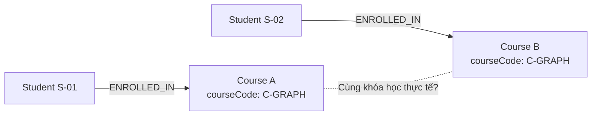
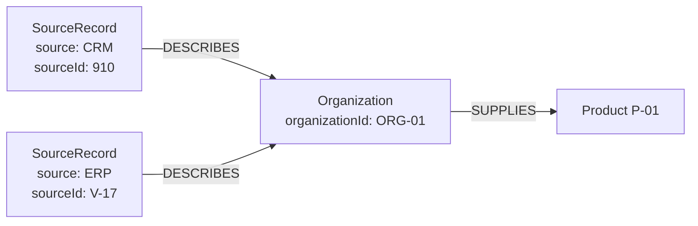

# Định danh, ràng buộc duy nhất và tránh tạo đỉnh trùng

Trong mô hình đồ thị thuộc tính (*property graph*), hai đỉnh có cùng tên **không nhất thiết** biểu diễn cùng một đối tượng; ngược lại, hai đỉnh mang tên khác nhau **có thể** là những bản ghi trùng của cùng một đối tượng. Nếu thiết kế định danh không rõ ràng, những cạnh nối tới hai đỉnh trùng sẽ bị phân tán, khiến truy vấn thiếu quan hệ, thống kê đếm thừa, phân quyền sai hoặc kết luận không chính xác.

Bài này thuộc chương **Mô hình đồ thị** của học phần **DATABASE_DATA_MODELING**. Mục tiêu của học phần là chuyển yêu cầu nghiệp vụ thành mô hình dữ liệu rõ ràng — từ thực thể, quan hệ và ràng buộc tới chuẩn hóa, khóa, chỉ mục, lược đồ vật lý — rồi so sánh relational, document, graph và mô hình phân tích. Vì thế, định danh được xem là **một quyết định nghiệp vụ có thể kiểm chứng**, sau đó mới được hiện thực bằng constraint, thao tác ghi và quy trình làm sạch dữ liệu.

Sau bài học, bạn có thể:

- Phân biệt **danh tính nghiệp vụ**, **khóa từ hệ thống nguồn** và **định danh nội bộ** của hệ quản trị đồ thị.
- Chọn khóa đơn, khóa kết hợp và phạm vi duy nhất theo nhãn/đối tượng, tổ chức hoặc tenant.
- Dùng **ràng buộc duy nhất** và thao tác tạo/cập nhật thích hợp để hạn chế đỉnh trùng.
- Nhận diện các trường hợp `MERGE` vẫn tạo trùng, ghép nhầm hoặc không bảo đảm an toàn khi nhiều tiến trình cùng ghi.
- Xây dựng quy trình phát hiện, xác minh và xử lý đỉnh trùng mà vẫn bảo toàn cạnh, lịch sử và nguồn gốc dữ liệu.

## 1. Đỉnh trùng gây ra vấn đề gì?

Giả sử nền tảng đào tạo có một khóa học thực tế với mã `C-GRAPH`. Dịch vụ quản lý khóa học tạo đỉnh `A`; tiến trình nhập dữ liệu khác tạo thêm đỉnh `B` có cùng mã:



Khi truy vấn một đỉnh khóa học rồi đếm người đăng ký, kết quả có thể chỉ thấy một phần học viên. Khi liệt kê tất cả `Course` có mã `C-GRAPH`, lại có hai kết quả. Một truy vấn đi từ `Student S-01` tới khóa học và sang các học viên khác cũng có thể bỏ sót `S-02` vì các cạnh nằm trên **hai đỉnh vật lý khác nhau**.

Có ít nhất bốn hệ quả:

1. **Phân mảnh liên kết:** các cạnh của cùng đối tượng bị chia trên nhiều đỉnh, làm kết quả duyệt đồ thị thiếu.
2. **Đếm thừa:** thống kê số khóa, khách hàng hoặc thiết bị có thể tăng sai khi mỗi bản sao được tính riêng.
3. **Sai quy tắc nghiệp vụ:** constraint chỉ áp dụng với từng đỉnh riêng không thể bảo đảm dữ liệu chung của thực thể thực tế.
4. **Khó xử lý vòng đời:** đổi tên, ngừng cung cấp, xóa hoặc cập nhật quyền ở một bản sao chưa chắc lan sang bản sao khác.

**Ngược lại**, việc cùng tên không chứng minh hai đỉnh trùng. Hai người mang tên “Nguyễn An”, hai cửa hàng có tên “Cửa hàng Trung tâm”, hay hai tenant cùng đặt mã khóa học `BASIC` có thể là các đối tượng **khác nhau hợp lệ**. Chống trùng đỉnh phải đi cùng nguyên tắc **không ghép nhầm**.

## 2. Ba lớp định danh phải phân biệt

### 2.1. Danh tính nghiệp vụ

**Danh tính nghiệp vụ** trả lời: “Điều gì khiến đối tượng này được xem là chính nó qua thời gian?”. Ví dụ:

- Khóa học trong một nền tảng: `courseId` không đổi khi tiêu đề thay đổi.
- Đơn hàng: `orderId` không đổi khi trạng thái chuyển từ `PENDING` sang `PAID`.
- Học viên: `studentId` hoặc một định danh ổn định theo chính sách quản lý.
- Thiết bị: định danh thiết bị được cấp và giải thích rõ giới hạn độ tin cậy; không giả định fingerprint luôn duy nhất và bất biến.

Một khóa nghiệp vụ tốt có **phạm vi duy nhất xác định**, đủ ổn định, được tạo từ nguồn có thẩm quyền và có chính sách xử lý khi đối tượng được hợp nhất hoặc tách ra. “Tên hiển thị” thường không đáp ứng các điều kiện này.

### 2.2. Định danh của hệ thống nguồn

Trong tích hợp dữ liệu, cùng một đối tượng có thể có nhiều mã ở các hệ thống khác nhau:

| Nguồn dữ liệu | Mã trong nguồn | Đối tượng thực tế |
| --- | --- | --- |
| LMS | `courseId = LMS-104` | Khóa “Mô hình đồ thị” |
| CMS nội dung | `contentCourseId = CNT-88` | Cũng khóa “Mô hình đồ thị” |
| Hệ thống bán hàng | `productCourseId = SKU-GRAPH` | Sản phẩm thương mại tương ứng với khóa đó |

Ba mã này **không tự bằng nhau**, cũng chưa chắc cần hợp nhất thành một đỉnh. `Product` có thể là đối tượng thương mại khác với `Course` vì một khóa có nhiều gói bán. Trước khi ghép, phải định nghĩa **loại thực thể** và quan hệ nghiệp vụ giữa chúng.

Nếu ba nguồn thực sự mô tả cùng một `Course`, hệ thống có thể cấp **khóa chuẩn** `courseId = C-GRAPH` và lưu ánh xạ từ các định danh nguồn tới khóa chuẩn. Cần giữ dấu vết nguồn và quy trình sửa ánh xạ khi phát hiện ghép sai.

### 2.3. Định danh nội bộ của hệ quản trị

Nhiều graph database quản lý ID của đỉnh/cạnh để thực thi truy vấn. Trong Neo4j, `elementId(n)` giúp nhận diện một phần tử trong bối cảnh của hệ quản trị, nhưng **không nên dùng làm khóa nghiệp vụ để trao đổi lâu dài** giữa ứng dụng, bản sao và lần nhập dữ liệu. Một lần chuyển dữ liệu hoặc tạo lại graph có thể làm thay đổi ID nội bộ.

Hãy dùng các khóa ổn định do nghiệp vụ/ứng dụng quản lý, ví dụ `courseId`, `studentId`, `tenantId + courseCode`. ID nội bộ phù hợp để **chẩn đoán hai đỉnh nghi trùng trong cùng hệ hiện tại**, không làm chứng cứ đối tượng nào là “cùng một thực thể” ở cấp nghiệp vụ.

### 2.4. Tách “đối tượng” khỏi “bản ghi nói về đối tượng”

Ví dụ, một hệ thống nhà cung cấp đưa về hai bản ghi `SourceRecord` khác nhau cho cùng doanh nghiệp. Nếu yêu cầu cần biết “nguồn nào nói điều gì, tại thời điểm nào”, hãy giữ mỗi bản ghi nguồn là một đỉnh và nối chúng đến `Organization` chuẩn đã được xác minh:



**Hai bản ghi nguồn** là hai đối tượng dữ liệu thực sự khác nhau; **tổ chức được nhắc đến** mới là một thực thể chung. Mô hình này tránh xóa nguồn gốc và giúp xử lý trường hợp hai nguồn có giá trị thuộc tính mâu thuẫn.

## 3. Chọn khóa định danh cho đỉnh

### 3.1. Khóa tự nhiên và khóa do hệ thống cấp

| Kiểu khóa | Ví dụ | Ưu điểm | Cần lưu ý |
| --- | --- | --- | --- |
| **Khóa nghiệp vụ tự nhiên** | Mã số quản lý do cơ quan hoặc tổ chức phát hành | Có nghĩa trong miền nghiệp vụ; có thể thuận tiện đối soát | Phạm vi duy nhất, thay đổi/thu hồi, dữ liệu thiếu hoặc sai, quyền riêng tư |
| **Khóa ứng dụng cấp** | `courseId = C-GRAPH`, `orderId = O-101` | Ổn định, có thể kiểm soát quy trình cấp phát | Cần bảo đảm sinh khóa, đồng bộ và tránh xung đột giữa hệ thống |
| **Khóa kết hợp** | `(tenantId, courseCode)` | Diễn đạt đúng phạm vi duy nhất theo tenant | Mọi thao tác đọc/ghi phải cung cấp đầy đủ các thành phần |
| **Khóa từ nguồn ngoài** | `(sourceSystem, externalId)` | Nhận diện chính xác bản ghi trong một nguồn | Không tự suy ra danh tính chuẩn khi có nhiều nguồn |
| **ID nội bộ graph** | `elementId(node)` trong Neo4j | Hữu ích cho công cụ và chẩn đoán cục bộ | Không dùng làm khóa nghiệp vụ dài hạn |

**Mục tiêu quan trọng:** một khóa phải phân biệt được các đối tượng **đúng trong phạm vi được khai báo**. Nếu hai công ty dùng chung một mã sản phẩm nội bộ `P-01`, khóa `productCode` đơn lẻ không thể đại diện cho tính duy nhất trên toàn bộ nền tảng.

### 3.2. Ví dụ nhiều tenant: khóa đơn là chưa đủ

Một hệ thống đào tạo phục vụ hai doanh nghiệp:

| `tenantId` | `courseCode` | `title` |
| --- | --- | --- |
| `T-RED` | `BASIC` | Nhập môn dữ liệu |
| `T-BLUE` | `BASIC` | Cơ sở dữ liệu nhập môn |
| `T-RED` | `GRAPH` | Mô hình đồ thị |

Mã `BASIC` **được phép trùng giữa các tenant**. Vì vậy, trong miền này:

```text
CourseIdentity = (tenantId, courseCode)

Đúng: một Course duy nhất cho (T-RED, BASIC)
Đúng: một Course khác cho (T-BLUE, BASIC)
Sai: hai Course cùng (T-RED, BASIC)
```

Nếu chỉ dùng `courseCode` làm khóa toàn cục, tiến trình nhập dữ liệu có thể ghép nhầm hai khóa học của hai tenant. Nếu chỉ dùng `title`, dữ liệu vừa dễ trùng tên vừa thay đổi khi biên tập nội dung.

Trong các câu truy vấn sau, phải **luôn truyền đủ hai thành phần** và bảo đảm chúng đã được kiểm tra hợp lệ trước khi ghi.

### 3.3. Chuẩn hóa giá trị khóa, nhưng không chuẩn hóa tùy tiện

Khi nhập từ CSV, API hoặc nhiều ngôn ngữ, mã định danh có thể có khoảng trắng, khác chữ hoa/chữ thường hoặc cách biểu diễn Unicode khác nhau. Cần thống nhất quy tắc trước khi áp dụng uniqueness:

- Nếu mã **không phân biệt chữ hoa/thường**, chuẩn hóa `" graph-01 "` và `"GRAPH-01"` thành cùng khóa trước khi ghi.
- Nếu mã **phân biệt chữ hoa/thường**, `"abc"` và `"ABC"` có thể là hai mã hợp lệ; không được tự chuyển về một giá trị.
- Nếu mã chứa ký tự Unicode, quy tắc chuẩn hóa Unicode phải được chỉ định thống nhất giữa các hệ.
- Không được loại bỏ dấu, ký tự đặc biệt, số 0 đầu hoặc phần hậu tố nếu chúng có ý nghĩa nghiệp vụ.

Nên lưu **khóa chuẩn** phục vụ so khớp, đồng thời có thể lưu **giá trị gốc** và nguồn gốc để điều tra sai lệch. Chuẩn hóa sai có thể biến hai đối tượng khác nhau thành một khóa và gây **ghép nhầm**, khó khắc phục hơn đỉnh trùng.

## 4. Ràng buộc duy nhất: bảo vệ danh tính ở tầng lưu trữ

**Uniqueness constraint** là quy tắc cơ sở dữ liệu ngăn hai phần tử trong phạm vi quy định mang cùng một giá trị khóa hợp lệ. Nó khác với việc chỉ tạo index phục vụ truy vấn: **index giúp tra cứu**, còn **constraint đảm bảo tính hợp lệ khi ghi**. Trong một số sản phẩm, uniqueness constraint sử dụng index hỗ trợ bên dưới.

Các ví dụ dưới đây dùng **Neo4j Cypher**; cú pháp, phạm vi, điều kiện cấp phép và loại constraint có thể khác theo phiên bản và sản phẩm graph database.

### 4.1. Ràng buộc duy nhất cho một thuộc tính

```cypher
CREATE CONSTRAINT student_id_unique IF NOT EXISTS
FOR (s:Student) REQUIRE s.studentId IS UNIQUE;
```

Constraint này ngăn hai đỉnh mang nhãn `Student` cùng tồn tại với **cùng một `studentId` khác null**. Nó không yêu cầu mọi `Student` phải có thuộc tính `studentId`: các đỉnh không có khóa vẫn có thể tồn tại nếu không có constraint bổ sung về sự hiện diện.

Một ví dụ khác:

```cypher
CREATE CONSTRAINT course_id_unique IF NOT EXISTS
FOR (c:Course) REQUIRE c.courseId IS UNIQUE;
```

Nếu tên khóa bị đổi, đỉnh vẫn giữ nguyên `courseId` và các cạnh đang nối tới nó. Không nên dùng `title` làm khóa nếu tiêu đề có thể thay đổi hoặc trùng giữa những khóa học độc lập.

### 4.2. Khóa kết hợp trong môi trường nhiều tenant

```cypher
CREATE CONSTRAINT course_tenant_code_unique IF NOT EXISTS
FOR (c:Course)
REQUIRE (c.tenantId, c.courseCode) IS UNIQUE;
```

Constraint trên ngăn hai `Course` có **cùng bộ** `(tenantId, courseCode)` khi các giá trị khóa tham gia đều hiện diện. Đây là ví dụ rất khác với hai constraint đơn lẻ `tenantId UNIQUE` và `courseCode UNIQUE`; tạo hai constraint đơn sẽ vô tình cấm một tenant có nhiều khóa hoặc hai tenant dùng cùng mã.

**Lưu ý về thuộc tính thiếu:** tính duy nhất của bộ khóa không đồng nghĩa bắt buộc mọi phần tử của bộ khóa phải có mặt. Muốn mọi `Course` có đầy đủ `tenantId` và `courseCode`, cần quy tắc yêu cầu sự tồn tại của thuộc tính. Một số phiên bản/sản phẩm hỗ trợ constraint tồn tại, node key hoặc ràng buộc kiểu; kiểm tra đúng tài liệu và phiên bản triển khai, đồng thời có thể kiểm soát trong API ghi dữ liệu.

### 4.3. Phạm vi uniqueness theo nhãn

Một constraint `FOR (c:Course) ...` áp dụng cho đỉnh mang nhãn `Course`. Nó không mặc nhiên ngăn `Product` khác dùng cùng mã `C-GRAPH`. Điều này có thể hợp lý vì đó là **hai loại thực thể**.

Cần chú ý tình huống một đỉnh có **nhiều nhãn**. Nếu một đỉnh vừa có nhãn `Person` vừa `Employee`, nó có thể chịu những constraint theo cả hai nhãn. Thiết kế nhãn và quy tắc chuyển vai trò phải rõ ràng để tránh xung đột ngầm khi thêm/bỏ nhãn.

### 4.4. Dọn dữ liệu trước khi tạo constraint

Nếu dữ liệu cũ đã có hai đỉnh `Course` cùng khóa, thao tác tạo uniqueness constraint sẽ **không thể hoàn tất thành công** cho đến khi xử lý mâu thuẫn. Không nên coi lỗi tạo constraint là lý do để xóa nhanh một đỉnh: đỉnh bị xóa có thể đang chứa các cạnh hợp lệ mà đỉnh còn lại chưa có.

Quy trình hợp lý là **kiểm kê → xác minh → hợp nhất/khắc phục → tạo constraint → kiểm tra lại**. Cơ chế tạo constraint cần được thiết lập trước khi mở nhiều luồng ghi đồng thời; nếu không, dữ liệu có thể tiếp tục trùng trong lúc xử lý.

## 5. `CREATE`, `MATCH` và `MERGE` khác nhau thế nào?

Trong Neo4j Cypher, ba từ khóa này phục vụ những mục đích khác nhau:

| Cú pháp | Ý nghĩa | Nguy cơ với bài toán trùng đỉnh |
| --- | --- | --- |
| `CREATE (c:Course {...})` | Tạo đỉnh mới theo mẫu | Chạy lại có thể tạo bản sao nếu chưa có constraint |
| `MATCH (c:Course {...})` | Tìm đỉnh đang tồn tại theo mẫu | Có thể không tìm thấy hoặc tìm ra **nhiều đỉnh** nếu dữ liệu đã trùng |
| `MERGE (c:Course {key: value})` | Tìm mẫu khớp; nếu không tồn tại thì tạo | An toàn hơn cho ghi lặp **khi mẫu dùng khóa chuẩn**, nhưng không thay thế constraint, không sửa trùng cũ và có thể ghép nhầm nếu chọn khóa sai |

### 5.1. Vì sao `CREATE` trong tiến trình nhập dữ liệu dễ sinh trùng?

Giả sử một luồng đồng bộ nhận cùng một sự kiện “đã tạo khóa `C-GRAPH`” hai lần:

```cypher
CREATE (:Course {courseId: 'C-GRAPH', title: 'Mô hình đồ thị'});
```

Nếu không có uniqueness constraint, chạy hai lần có thể tạo **hai đỉnh**. Khi đã có uniqueness constraint, lần ghi sau với cùng `courseId` sẽ thất bại theo ràng buộc, nhưng ứng dụng cần xử lý lỗi đó và xác định liệu đây là sự kiện trùng hay dữ liệu mâu thuẫn. Việc một thao tác thất bại không tự tạo quy trình upsert đúng.

### 5.2. `MERGE` chỉ nên dùng khóa định danh trong mẫu chính

Cách ghi phù hợp với yêu cầu “mỗi tenant có một Course cho mỗi courseCode”:

```cypher
// $tenantId và $courseCode đã được chuẩn hóa, kiểm tra không null.
MERGE (c:Course {
  tenantId: $tenantId,
  courseCode: $courseCode
})
ON CREATE SET
  c.title = $title,
  c.status = 'DRAFT',
  c.createdAt = datetime()
ON MATCH SET
  c.title = $title
RETURN c.tenantId AS tenantId,
       c.courseCode AS courseCode,
       c.title AS title;
```

Ý nghĩa:

- `MERGE` tìm hoặc tạo **đỉnh được xác định bằng bộ khóa** `tenantId, courseCode`.
- `ON CREATE SET` chỉ thiết lập giá trị khi **một đỉnh mới** được tạo.
- `ON MATCH SET` áp dụng khi **đỉnh đã tồn tại** theo mẫu khóa.
- Nếu tên khóa thay đổi, chạy lại không nên tạo đỉnh mới chỉ vì `title` khác.

Không đặt những thuộc tính dễ thay đổi vào mẫu `MERGE` nếu chúng không thuộc danh tính, ví dụ:

```cypher
// Sai ý định nếu title không phải là phần của khóa:
MERGE (c:Course {
  tenantId: $tenantId,
  courseCode: $courseCode,
  title: $title
});
```

Khi tiêu đề được cập nhật, toàn bộ mẫu cũ không khớp. Câu lệnh có thể **cố tạo đỉnh mới**; nếu có uniqueness constraint trên bộ khóa, thao tác bị từ chối vì vi phạm constraint. Nếu chưa có constraint, nó có thể tạo trùng.

### 5.3. Dữ liệu thiếu và `null` phải được xử lý trước

Không nên gửi khóa định danh bị thiếu rồi mong `MERGE` tự “đoán” đối tượng. Với Neo4j, mẫu `MERGE` chứa thuộc tính khóa có giá trị `null` không phải cách hợp lệ để tạo đỉnh. Ứng dụng nên:

1. Xác nhận `tenantId` và `courseCode` hiện diện, đúng kiểu và đã chuẩn hóa.
2. Từ chối hoặc đưa vào hàng chờ xác minh nếu thiếu khóa.
3. Chỉ `MERGE` sau khi có khóa đáng tin cậy.

Nếu nguồn thực sự chưa biết khóa chuẩn, có thể tạo **bản ghi nguồn có định danh riêng** rồi ghép với thực thể chuẩn sau; không nên tự dùng tên hiển thị như khóa thay thế và nhập nhằng về danh tính.

### 5.4. Đừng `MERGE` cả một chuỗi đỉnh–cạnh khi danh tính các đỉnh chưa rõ

Giả sử cần tạo quan hệ `(Student)-[:ENROLLED_IN]->(Course)`. Mẫu dễ gây lỗi là đặt toàn bộ chuỗi vào một `MERGE`, kèm các thuộc tính có thể thay đổi, mà không xác định trước đỉnh nào là thực thể có sẵn. Khi cả mẫu **không khớp**, engine có thể cần tạo những phần còn thiếu theo ngữ nghĩa của câu lệnh; điều đó làm kiểm soát danh tính, lỗi constraint và cập nhật quan hệ khó hơn.

Một mẫu dễ kiểm soát hơn:

```cypher
// Chỉ lấy các thực thể hiện hữu bằng khóa đã kiểm soát.
MATCH (s:Student {studentId: $studentId})
MATCH (c:Course {tenantId: $tenantId, courseCode: $courseCode})
// Chỉ tạo quan hệ nếu quy tắc nghiệp vụ cho tối đa một
// ENROLLED_IN hiện tại giữa cặp Student và Course này.
MERGE (s)-[r:ENROLLED_IN]->(c)
ON CREATE SET r.enrolledAt = date(), r.status = 'ACTIVE'
RETURN s.studentId AS studentId, c.courseCode AS courseCode;
```

Mẫu trên chỉ phù hợp khi **nghiệp vụ cho tối đa một quan hệ kiểu này giữa hai đỉnh**. Nếu mỗi học kỳ có một lượt đăng ký riêng, mô hình cần phân biệt theo học kỳ/`enrollmentId` hoặc dùng đỉnh `Enrollment` để không gộp sai nhiều sự kiện vào một cạnh.

### 5.5. `MERGE` không thay thế constraint hay bảo đảm chống ghi đua

Hai tiến trình đồng thời có thể cùng kiểm tra thấy chưa có đỉnh/quan hệ rồi cùng tạo. Không nên coi một câu `MERGE` đơn độc là biện pháp bảo đảm không trùng cho mọi mô hình. **Uniqueness constraint trên khóa đỉnh**, giao dịch phù hợp và xử lý lỗi cạnh tranh là những biện pháp cần đi cùng nhau.

Đối với **cạnh**, constraint định danh/uniqueness hỗ trợ đến đâu là chuyện của từng sản phẩm và phiên bản. Constraint trên `Student.studentId` và `Course.courseCode` **không đồng nghĩa** constraint “mỗi cặp `Student, Course` có tối đa một cạnh `ENROLLED_IN`”. Nếu nghiệp vụ yêu cầu quy tắc này trong môi trường ghi đồng thời, cần thiết kế cách ghi tuần tự an toàn, khóa theo cặp, một thực thể `Enrollment` có ID duy nhất, hoặc cơ chế constraint thích hợp của hệ đang dùng.

Ngoài ra, `MERGE` **không xóa đỉnh trùng đã có**. Nếu hai `Course` cùng khóa đã tồn tại trước khi constraint được thiết lập, một truy vấn `MERGE` có thể khớp nhiều bản ghi; đầu tiên phải phát hiện và xử lý dữ liệu bẩn.

## 6. Tránh ghép nhầm: xác định “cùng thực thể” trước khi hợp nhất

**Chống đỉnh trùng** không đồng nghĩa với việc đưa mọi bản ghi có thuộc tính giống nhau về cùng một đỉnh.

### 6.1. Khóa chắc chắn và tín hiệu so khớp

| Dấu hiệu | Có thể quyết định cùng thực thể ngay không? | Cách xử lý |
| --- | --- | --- |
| Cùng khóa chuẩn do cùng nguồn có thẩm quyền cấp, đúng phạm vi | Thường **có**, theo hợp đồng dữ liệu | Dùng làm định danh, đặt constraint và kiểm soát ghi |
| Cùng `(sourceSystem, externalId)` | Đủ để nhận diện **bản ghi nguồn** trong hệ được khai báo | Kiểm tra xem nguồn dùng mã đó cho thực thể hay cho lần giao dịch |
| Cùng tên và ngày sinh | **Không tự đủ** | Tạo ứng viên cần thêm thuộc tính và chính sách xác minh |
| Cùng email/điện thoại | **Không tự đủ** | Có thể dùng chung, tái cấp hoặc thay đổi; cân nhắc xác minh và quyền riêng tư |
| Cùng địa chỉ giao hàng | **Không tự đủ** | Hộ gia đình, tòa nhà hay công ty có thể có nhiều người |
| Cùng thiết bị đăng nhập | **Không tự đủ** | Thiết bị dùng chung không đồng nghĩa cùng chủ sở hữu |
| Tên gần giống theo thuật toán fuzzy matching | **Không tự đủ** | Xếp hạng ứng viên, ghi mức tin cậy và duyệt theo chính sách |

Ngay cả với khóa có vẻ chắc chắn, hãy kiểm tra **phạm vi tổ chức và khoảng thời gian hiệu lực**. Một mã có thể đã từng được tái sử dụng, một tenant có thể thay đổi chủ sở hữu, hoặc hệ nguồn có thể xuất ra bản ghi thử nghiệm. Cần định nghĩa bộ quy tắc nhận diện theo miền dữ liệu.

### 6.2. Hai lỗi đối nghịch

- **False negative (không hợp nhất khi thực ra cùng đối tượng):** tạo hai đỉnh trùng; thông tin và cạnh bị chia tách.
- **False positive (hợp nhất hai đối tượng khác nhau):** trộn quyền, lịch sử, tài khoản, đơn hàng hoặc hồ sơ của hai chủ thể; thường có tác động nghiêm trọng hơn và khó tách lại.

Bởi vậy, nếu chưa đủ bằng chứng, nên giữ hai bản ghi nguồn riêng và đánh dấu **ứng viên liên kết** để xác minh. Không nên gộp người dùng chỉ vì email trùng, hay gộp doanh nghiệp chỉ vì tên được chuẩn hóa giống nhau.

### 6.3. Mô hình provenance: giữ bằng chứng cho quyết định ghép

Nếu tích hợp nhiều nguồn, mô hình có thể dùng:

```text
(:SourceRecord {
  sourceSystem: 'CRM',
  externalId: '910',
  importedAt: <timestamp>
})
  -[:DESCRIBES {method: 'VERIFIED_MAPPING'}]->
(:Organization {organizationId: 'ORG-01'})
```

Trên dữ liệu thật, thay `<timestamp>` bằng một giá trị thời gian hợp lệ của hệ quản trị. `SourceRecord` giữ nguồn dữ liệu, phiên bản và thuộc tính gốc; `Organization` đại diện cho thực thể chuẩn. Khi ánh xạ bị phát hiện sai, có thể xem lại **bản ghi nguồn nào**, **quyết định ghép nào** và **cạnh nào phát sinh** từ quyết định ấy.

Nếu chỉ cần ánh xạ một–một và nguồn đáng tin cậy, không phải lúc nào cũng cần tạo thêm đỉnh nguồn. Một bảng ánh xạ, thuộc tính định danh hoặc cấu trúc document riêng cũng có thể phù hợp. Hãy chọn theo yêu cầu kiểm toán và truy vấn.

## 7. Phát hiện đỉnh trùng trong dữ liệu hiện có

Các truy vấn dưới đây là **truy vấn chẩn đoán**, không tự sửa hay xóa dữ liệu. Chạy trên môi trường được phép xem dữ liệu, hạn chế hiển thị thông tin nhạy cảm và chú ý khối lượng dữ liệu khi quét toàn bộ tập đỉnh.

### 7.1. Tìm đỉnh `Course` trùng khóa kết hợp

```cypher
MATCH (c:Course)
WHERE c.tenantId IS NOT NULL
  AND c.courseCode IS NOT NULL
WITH c.tenantId AS tenantId,
     c.courseCode AS courseCode,
     collect(elementId(c)) AS elementIds,
     count(*) AS nodeCount
WHERE nodeCount > 1
RETURN tenantId, courseCode, nodeCount, elementIds
ORDER BY nodeCount DESC, tenantId, courseCode;
```

Nếu xuất hiện kết quả, có **nhiều đỉnh cùng bộ khóa tại thời điểm truy vấn**. `elementId` trong kết quả chỉ hỗ trợ tìm các đỉnh cần điều tra cục bộ; không dùng làm định danh chuẩn trong hệ tích hợp.

Nếu uniqueness constraint tương ứng đã được tạo thành công và duy trì đúng, tập dữ liệu hợp lệ sẽ không có các nhóm trùng khóa như vậy. Trước khi tạo constraint trên dữ liệu cũ, truy vấn chẩn đoán giúp xác định các trường hợp cần xử lý.

### 7.2. Tìm khóa bị thiếu

```cypher
MATCH (c:Course)
WHERE c.tenantId IS NULL OR c.courseCode IS NULL
RETURN elementId(c) AS elementId,
       c.tenantId AS tenantId,
       c.courseCode AS courseCode,
       c.title AS title
LIMIT 100;
```

Hàng trăm đỉnh không có khóa có thể không vi phạm **uniqueness constraint**, nhưng vẫn khiến quy trình đồng bộ không xác định được đỉnh nào là thực thể hiện hữu. Cần phân loại bản ghi tạm, dữ liệu nguồn chưa xác minh và dữ liệu đáng lẽ phải có khóa trước khi cập nhật.

### 7.3. Tìm những cặp tên giống nhau chỉ để điều tra

```cypher
MATCH (c:Course)
WHERE c.title IS NOT NULL
WITH toLower(trim(c.title)) AS normalizedTitle,
     collect({
       tenantId: c.tenantId,
       courseCode: c.courseCode,
       title: c.title
     }) AS candidates,
     count(*) AS candidateCount
WHERE candidateCount > 1
RETURN normalizedTitle, candidateCount, candidates
ORDER BY candidateCount DESC
LIMIT 50;
```

Đây chỉ là bước **tạo danh sách ứng viên**. Kết quả cùng tên có thể chứa nhiều khóa khác nhau một cách hợp lệ. Phép `toLower(trim(...))` không phải giải pháp chuẩn hóa mọi ngôn ngữ hay mọi loại mã; nếu cần chuẩn hóa tiếng Việt và Unicode theo quy tắc cụ thể, nên thực hiện trong một bước được thiết kế và kiểm thử riêng trước khi đưa vào khóa.

### 7.4. Phân biệt đỉnh trùng với cạnh trùng

Hai `Course` có cùng khóa là trùng ở **tầng đỉnh**. Nhưng một `Student` và một `Course` đúng khóa có thể có **hai cạnh `ENROLLED_IN`**, tạo vấn đề khác:

```cypher
MATCH (s:Student)-[r:ENROLLED_IN]->(c:Course)
WITH s, c, count(r) AS relationshipCount
WHERE relationshipCount > 1
RETURN s.studentId AS studentId,
       c.tenantId AS tenantId,
       c.courseCode AS courseCode,
       relationshipCount
ORDER BY relationshipCount DESC;
```

**Không tự xóa các cạnh được tìm thấy.** Nếu một học viên được phép đăng ký lại nhiều lần theo học kỳ, hai cạnh có thể đúng. Cần quyết định bội số và khóa của **một lần đăng ký** trước khi xác định đó có phải dữ liệu trùng.

## 8. Quy trình xử lý đỉnh trùng mà không làm mất liên kết

Khi đã xác minh hai đỉnh thực sự mô tả **cùng một thực thể nghiệp vụ**, việc xử lý không đơn giản là xóa một đỉnh và giữ một đỉnh. Cần xét các cạnh, thuộc tính, lịch sử và những phụ thuộc bên ngoài.

### Bước 1 — Đóng phạm vi và ngăn nguồn tạo trùng mới

Xác định kiểu đỉnh, tenant, nguồn tạo dữ liệu và các tuyến ghi liên quan. Nếu cho phép dữ liệu tiếp tục vào trong lúc khắc phục, cần một cơ chế kiểm soát phù hợp để tránh trạng thái vừa sửa xong lại bị tạo trùng.

### Bước 2 — Xác minh danh tính bằng bằng chứng

Đối chiếu khóa chuẩn, bản ghi nguồn và quy tắc nhận diện. Phân biệt:

- **Cùng thực thể chắc chắn:** có thể chuẩn bị hợp nhất.
- **Ứng viên chưa đủ chứng cứ:** cần xác minh, chưa hợp nhất.
- **Khác thực thể hợp lệ:** sửa quy tắc định danh nếu chúng đang bị nhận diện giống nhau.

Không dùng cùng `title` hoặc tên người làm bằng chứng duy nhất.

### Bước 3 — Chọn bản ghi chuẩn và chiến lược thuộc tính

Quy định rõ “đỉnh nào sẽ đại diện cho thực thể” hoặc có tạo đỉnh mới từ khóa chuẩn. Với từng thuộc tính, chọn nguồn có thẩm quyền và cách xử lý giá trị mâu thuẫn:

| Trường dữ liệu | Cách quyết định minh họa |
| --- | --- |
| `courseId` / `tenantId + courseCode` | Theo khóa chuẩn đã được xác minh |
| `title` | Theo CMS hoặc nguồn biên tập có thẩm quyền |
| `publishedAt` | Theo hệ ghi nhận xuất bản |
| `lastSyncedAt` | Theo từng nguồn, không lấy giá trị bất kỳ |
| `status` | Theo quy tắc vòng đời và nguồn sự thật của trạng thái |

Không nên lấy tùy tiện “giá trị mới nhất” cho mọi thuộc tính: dấu thời gian hệ thống nhập dữ liệu có thể khác thời gian hiệu lực nghiệp vụ.

### Bước 4 — Rà soát các cạnh ở cả hai phía

Liệt kê các cạnh đến và đi của mọi đỉnh nghi trùng. Đánh giá loại cạnh, hướng, thuộc tính trên cạnh, bội số, thời gian hiệu lực và quan hệ đã phát sinh do ghép định danh sai.

Ví dụ, nếu `Course A` có cạnh `REQUIRES` còn `Course B` có cạnh `ENROLLED_IN` từ học viên, hợp nhất cần giữ cả hai nhóm quan hệ **nếu chúng cùng hợp lệ**. Đối với cạnh có lịch sử hoặc nhiều lần giao dịch, không được tự gộp chúng chỉ vì cùng hai đầu.

### Bước 5 — Thực hiện hợp nhất có kiểm soát và khả năng hoàn tác

Trong môi trường thử nghiệm, thiết kế phương án chuyển liên kết sang thực thể chuẩn, hợp nhất thuộc tính theo quy tắc đã chọn và xử lý trùng cạnh nếu có. Cần sao lưu hoặc khả năng khôi phục, ghi nhật ký ánh xạ đỉnh cũ → đỉnh chuẩn, và áp dụng giao dịch/đợt xử lý phù hợp với dung lượng dữ liệu.

Bài này **không đưa ra một câu lệnh xóa/gộp dùng chung cho mọi đồ thị**, vì thao tác có thể làm mất cạnh hoặc vi phạm quy tắc nghiệp vụ nếu áp dụng máy móc. Lệnh xóa chỉ được thiết kế khi đã xác minh từng điều kiện và có phương án khôi phục.

### Bước 6 — Đối soát sau hợp nhất

Kiểm tra rằng:

- Mỗi bộ khóa nghiệp vụ chỉ còn một đỉnh trong phạm vi được xác định.
- Không mất các cạnh hợp lệ, nhất là cạnh có thuộc tính thời gian và trạng thái.
- Không có cạnh trùng không được phép, self-loop mới phát sinh hoặc bội số bị vi phạm.
- Các truy vấn nghiệp vụ trả kết quả như mong đợi trước và sau chuyển đổi.
- Các ứng dụng và sự kiện đồng bộ đã được cập nhật từ ID cũ sang khóa chuẩn.

Cuối cùng, tạo constraint, thử lại quá trình nhập dữ liệu và bổ sung giám sát để phát hiện khóa thiếu hoặc lỗi vi phạm constraint.

## 9. Kiểm chứng thiết kế bằng các tình huống cụ thể

Với mô hình `Course(tenantId, courseCode, title)`, hãy xác định đầu ra mong đợi trước khi triển khai:

| Tình huống | Hành vi đúng |
| --- | --- |
| Ghi `(T-RED, BASIC)` lần đầu | Tạo đúng một `Course` |
| Ghi lại sự kiện với cùng `(T-RED, BASIC)` và cùng title | Dùng lại đỉnh, không tạo đỉnh thứ hai |
| Title của `(T-RED, BASIC)` đổi | Cập nhật thuộc tính theo quy tắc, giữ danh tính và các cạnh |
| Thêm `(T-BLUE, BASIC)` | Tạo đỉnh mới hợp lệ vì khác tenant |
| Thiếu `tenantId` | Từ chối ghi vào tập `Course` chuẩn hoặc đưa vào quy trình xử lý dữ liệu chưa có khóa |
| Nguồn ngoài gửi `courseCode = ' basic '` | Xử lý theo quy tắc chuẩn hóa mã trước khi `MERGE`, không tự đoán |
| Hai luồng đồng thời tạo `(T-RED, GRAPH)` | Chỉ một danh tính hợp lệ; có cơ chế constraint, giao dịch và xử lý lỗi cạnh tranh |
| Hai đỉnh khác nhau cùng title | Không tự hợp nhất nếu khóa nghiệp vụ khác |
| Hai bản ghi nguồn cùng mô tả một `Course` đã xác minh | Giữ provenance và cùng trỏ tới `Course` chuẩn |
| Hai `Course` trùng có cạnh khác nhau | Chuyển/đối soát đầy đủ cạnh hợp lệ trước khi loại bỏ bản sao |
| Hai cạnh `ENROLLED_IN` giữa cùng cặp | Kiểm tra quy tắc số lần đăng ký trước khi kết luận là trùng |

### Bộ kiểm tra chất lượng tối thiểu

1. **Kiểm tra khóa:** thuộc tính định danh không thiếu và đúng phạm vi duy nhất.
2. **Kiểm tra ghi lặp:** gửi cùng sự kiện nhiều lần không tăng số đỉnh chuẩn.
3. **Kiểm tra thay đổi thuộc tính:** cập nhật tên không tạo thêm đỉnh.
4. **Kiểm tra phân vùng tenant:** khóa trùng ở hai tenant không bị ghép nhầm.
5. **Kiểm tra đồng thời:** có kế hoạch xử lý khi hai tiến trình cùng tạo một danh tính.
6. **Kiểm tra quan hệ:** sau đồng bộ, các cạnh còn nối đến đúng đối tượng.
7. **Kiểm tra nguồn gốc:** quyết định hợp nhất có thể truy xuất, sửa và đối soát.

## 10. Liên hệ với mô hình relational, document và phân tích

| Mối quan tâm | Relational | Document | Property graph |
| --- | --- | --- | --- |
| Danh tính thực thể | `PRIMARY KEY`, `UNIQUE`, khóa ngoại | `_id`, chỉ mục duy nhất theo trường (tùy hệ) | Đỉnh có khóa nghiệp vụ, uniqueness constraint theo nhãn/bộ thuộc tính (tùy hệ) |
| Mối quan hệ | Khóa ngoại hoặc bảng nối | Tham chiếu ID/nhúng document | Cạnh nối tới đỉnh |
| Tác hại khi thực thể bị tạo trùng | Hàng trùng, khóa ngoại chia sang nhiều bản ghi | Document trùng, cập nhật nhiều bản sao | Đỉnh trùng làm **đường đi và láng giềng bị phân mảnh** |
| Ghi có thể chạy lại | Upsert theo khóa và constraint | Upsert theo ID/index | `MERGE` hoặc upsert theo khóa + constraint và xử lý cạnh tranh |
| Nhập nhiều nguồn | Bảng ánh xạ, staging, master data | Document nguồn và ánh xạ | Đỉnh nguồn/provenance hoặc ánh xạ ngoài graph |
| Phân tích thống kê | SQL tổng hợp | Pipeline tổng hợp theo hệ | Duyệt graph hoặc xuất sang warehouse cho thống kê lớn |

Một **kho phân tích** thường cần định danh ổn định cho các bảng chiều (*dimension*) và khóa liên kết trong bảng fact; nếu cùng một khách được đưa vào hai dòng chiều, thống kê cohort, chi phí hay doanh thu cũng có thể bị chia sai. Vì vậy, bài toán **master data** và **entity resolution** không thuộc riêng công nghệ graph. Điểm nhạy cảm của graph là sự sai lệch danh tính còn tác động trực tiếp tới **đường đi**, truy vấn nhiều bước và phân tích mạng lưới.

Hệ thống thật có thể sử dụng cơ sở dữ liệu quan hệ làm nguồn giao dịch chuẩn và graph làm mô hình dẫn xuất phục vụ truy vấn liên kết. Khi đó, các ID chuẩn và mapping từ nguồn phải đồng nhất; cần hỗ trợ sự kiện gửi lại, sự kiện đến sai thứ tự, cập nhật muộn và sửa lỗi ánh xạ. Đảm bảo tính duy nhất ở mỗi tầng lưu trữ không tự động chứng minh hai tầng có cùng một danh tính; phải có quy trình đối soát.

## 11. Những lỗi mô hình hóa cần tránh

1. **Dùng tên làm khóa duy nhất.** Tên có thể trùng, sai chính tả, đổi hoặc khác ngôn ngữ. Ưu tiên định danh ổn định do nguồn có thẩm quyền cấp.
2. **Quên phạm vi tenant/đơn vị.** `courseCode = BASIC` có thể hợp lệ ở nhiều tenant. Chọn khóa kết hợp đúng miền.
3. **Gắn thuộc tính dễ đổi vào `MERGE`.** Dẫn tới tạo trùng hoặc lỗi constraint khi tên/trạng thái thay đổi.
4. **Tin rằng `MERGE` tự thay mọi constraint.** Ghi đồng thời, dữ liệu cũ và quan hệ có bội số phức tạp vẫn cần cơ chế kiểm soát riêng.
5. **Dùng ID nội bộ làm khóa tích hợp.** ID nội bộ không có hợp đồng ổn định xuyên hệ thống hoặc xuyên lần tái tạo đồ thị.
6. **Chỉ ràng buộc duy nhất mà cho phép thiếu khóa.** Nhiều đỉnh không có `courseId` có thể vẫn tồn tại nếu không kiểm soát sự hiện diện.
7. **Chuẩn hóa quá mức.** Xóa dấu, bỏ số đầu, đổi chữ hoa/thường không theo quy tắc có thể hợp nhất sai hai thực thể.
8. **Gộp theo tín hiệu yếu.** Chung tên, email, địa chỉ hoặc thiết bị chưa chắc là một người/tổ chức.
9. **Xóa đỉnh trùng trước khi chuyển và đối soát cạnh.** Làm mất quan hệ và lịch sử.
10. **Nhầm đỉnh trùng với cạnh trùng.** Nhiều cạnh có thể biểu diễn nhiều sự kiện hợp lệ; phải xét bội số và thời gian hiệu lực.
11. **Duy trì hai ID chuẩn mâu thuẫn.** Nếu từng hệ tự tạo khóa chính cho cùng đối tượng, việc liên kết đa hệ vẫn sẽ phân mảnh khi không có mapping đáng tin cậy.
12. **Thiếu kịch bản sửa quyết định ghép.** Entity resolution có thể sai; cần giữ provenance và khả năng giải quyết tranh chấp định danh.

## 12. Bài tập vận dụng và gợi ý đáp án

### Bài tập 1 — Phân biệt tên và danh tính

Một nền tảng có hai doanh nghiệp cùng tên “An Phát”. Doanh nghiệp thứ nhất có `organizationId = ORG-100`, doanh nghiệp thứ hai có `organizationId = ORG-200`; mỗi doanh nghiệp có khách hàng và hợp đồng khác nhau.

**Câu hỏi:** có nên dùng `name` làm khóa để `MERGE` hai doanh nghiệp? Tác hại nếu làm vậy?

**Gợi ý:** không. Hai ID chuẩn là hai thực thể khác nhau theo dữ liệu đã cho. Dùng `Organization.organizationId` và constraint duy nhất phù hợp. `name` là thuộc tính hiển thị; ghép theo tên sẽ trộn các hợp đồng và đường liên kết khách hàng của hai doanh nghiệp.

### Bài tập 2 — Khóa theo tenant

Hai tenant `A` và `B` cùng có khóa `INTRO`. Tenant `A` đổi tên khóa từ “Giới thiệu dữ liệu” sang “Nhập môn dữ liệu”.

**Câu hỏi:** khóa nào dùng để tạo hoặc cập nhật `Course`? Nên thay đổi gì khi tên mới xuất hiện?

**Gợi ý:** dùng bộ `(tenantId, courseCode)` làm khóa. `MERGE` theo bộ khóa, cập nhật `title` trên đỉnh hiện hữu của tenant `A`. Tenant `B` có `INTRO` là đỉnh khác, không bị đổi theo. Ràng buộc uniqueness phải áp dụng cho **cặp thuộc tính**, không cho `courseCode` riêng lẻ.

### Bài tập 3 — Dữ liệu đồng bộ bị gửi lại

Một sự kiện tạo `Course C-101` được gửi ba lần do cơ chế thử lại của hàng đợi. Dịch vụ đang dùng `CREATE` mà không có uniqueness constraint.

**Câu hỏi:** kết quả có thể ra sao? Đề xuất cách ghi có thể chạy lại.

**Gợi ý:** có thể tạo ba đỉnh cùng `courseId`. Thiết lập uniqueness constraint trên khóa sau khi đã xử lý dữ liệu cũ; kiểm tra khóa không thiếu; `MERGE` hoặc upsert theo khóa ổn định; có xử lý lỗi cạnh tranh khi ghi đồng thời. Các thuộc tính có thể đổi nên được cập nhật sau khi xác định đúng danh tính.

### Bài tập 4 — Hai nguồn mô tả cùng công ty

CRM có bản ghi `sourceSystem = CRM`, `externalId = 300`; ERP có bản ghi `sourceSystem = ERP`, `externalId = V-8`. Nhóm dữ liệu xác minh chúng cùng nói về `Organization ORG-20`.

**Câu hỏi:** muốn giữ nguồn gốc nhưng chỉ có một đỉnh tổ chức chuẩn, thiết kế thế nào?

**Gợi ý:** tạo một `Organization {organizationId: 'ORG-20'}`. Giữ hai `SourceRecord` riêng, định danh bằng `(sourceSystem, externalId)`, rồi nối cả hai bằng cạnh `DESCRIBES` tới đỉnh chuẩn. Hoặc sử dụng bảng mapping ngoài graph nếu workload không cần duyệt từ nguồn. Đừng coi ID của các nguồn khác nhau phải bằng nhau để được ghép.

### Bài tập 5 — Phát hiện trước khi tạo constraint

Dữ liệu có hai `Course` cùng `(T-RED, GRAPH)`. Một đỉnh nhận cạnh `TEACHES -> Skill S-01`; đỉnh kia nhận cạnh `ENROLLED_IN` từ `Student S-01`. Dự định tạo uniqueness constraint ngay.

**Câu hỏi:** rủi ro là gì, cần làm gì trước?

**Gợi ý:** constraint có thể không tạo được vì dữ liệu đã vi phạm uniqueness. Trước tiên xác minh hai đỉnh thực sự trùng, xác định đỉnh chuẩn, chuyển và kiểm tra các cạnh hợp lệ, giải quyết mâu thuẫn thuộc tính và lưu mapping từ đỉnh cũ. Sau khi dữ liệu sạch, tạo constraint và thử lại các truy vấn đếm người học, tìm kỹ năng được dạy.

### Bài tập 6 — Đỉnh trùng hay cạnh hợp lệ?

Học viên `S-01` đăng ký khóa `C-JAVA` ở học kỳ 1, trượt, rồi đăng ký lại ở học kỳ 2. Graph có hai cạnh `ENROLLED_IN` giữa cùng `Student` và `Course`.

**Câu hỏi:** có phải trùng dữ liệu không?

**Gợi ý:** chưa thể kết luận. Nếu mỗi cạnh mang `term` và đại diện cho một **lượt đăng ký riêng**, hai cạnh là hợp lệ. Nếu nghiệp vụ chỉ cho phép một trạng thái đăng ký hiện tại, cần mô hình hoặc ràng buộc khác. Khi mỗi lượt có thanh toán, lớp học phần và lịch sử riêng, cân nhắc đỉnh `Enrollment` có `enrollmentId` duy nhất.

## Tổng kết

**Danh tính của đỉnh phải được định nghĩa ở tầng nghiệp vụ**, trong một phạm vi nhất quán như loại thực thể, tổ chức hoặc tenant. Ràng buộc duy nhất và thao tác ghi theo khóa giúp bảo vệ danh tính đó, nhưng không thay thế việc chọn khóa đúng, chuẩn hóa có kiểm soát, xử lý ghi đồng thời và xác minh bản ghi đến từ nhiều nguồn. Khi phát hiện trùng, phải đối soát **cả đỉnh lẫn những cạnh đang gắn với chúng** trước khi hợp nhất. Một đồ thị có các khóa rõ ràng, provenance đáng tin và quy tắc chống trùng được kiểm chứng sẽ tạo nền tảng vững chắc cho truy vấn đường đi, ràng buộc quan hệ và những thay đổi dữ liệu trong tương lai.
