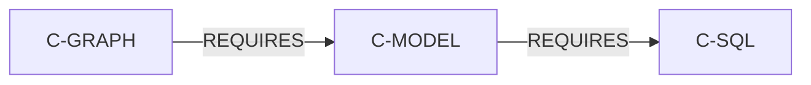
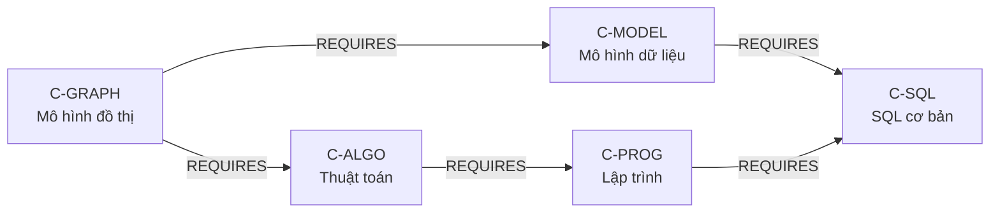
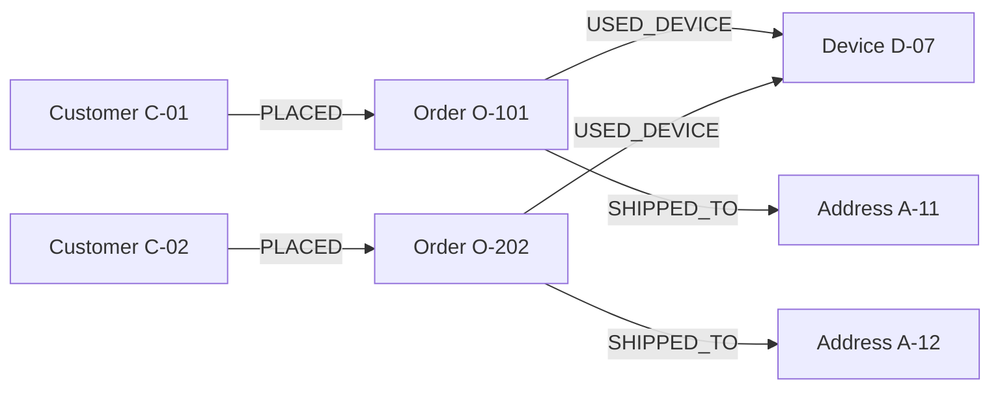
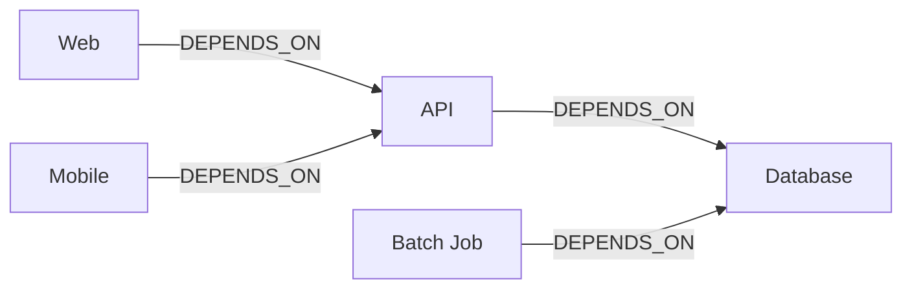

# Đường đi, lân cận và kiểu truy vấn chi phối thiết kế

Trong **mô hình đồ thị**, lưu được các đối tượng và những cạnh nối giữa chúng mới chỉ là phần đầu. Giá trị của thiết kế thể hiện ở khả năng trả lời những câu hỏi như: “Từ khóa học này cần học những gì trước?”, “Hai tài khoản có chung thiết bị nào?”, “Sự cố ở dịch vụ B có thể ảnh hưởng tới những dịch vụ nào?”, hay “Có đường đi hợp lệ từ người dùng đến tài nguyên được yêu cầu không?”. Những câu hỏi ấy có đặc điểm chung: **kết quả phụ thuộc vào đường đi, lân cận và ngữ nghĩa của chuỗi liên kết**.

Bài học thuộc chương **Mô hình đồ thị** của **DATABASE_DATA_MODELING**. Học phần rèn kỹ năng chuyển yêu cầu nghiệp vụ thành thực thể, quan hệ, ràng buộc, khóa, chỉ mục và lược đồ vật lý, đồng thời so sánh mô hình quan hệ, document, đồ thị và phân tích để chọn cấu trúc dễ tiến hóa, dễ kiểm chứng. Vì vậy, thay vì vẽ một mạng liên kết rồi tìm cách truy vấn, ta bắt đầu từ **những kiểu truy vấn nghiệp vụ cần chạy**, sau đó thiết kế cấu trúc dữ liệu đáp ứng chúng.

Sau bài học, bạn có thể:

- Phân biệt **đỉnh lân cận**, **bước nhảy**, **đường đi**, **khả năng tới được** và **đường đi ngắn nhất**.
- Chuyển câu hỏi nghiệp vụ thành mẫu duyệt đồ thị có hướng, kiểu cạnh, bộ lọc và giới hạn độ sâu rõ ràng.
- Nhận ra tác động của truy vấn lân cận, nhiều bước, láng giềng chung, truy vấn đường đi và phân tích ảnh hưởng lên thiết kế đỉnh/cạnh.
- Phác thảo các truy vấn Cypher cho một mô hình minh họa; hiểu rằng cú pháp và thuật toán phụ thuộc hệ quản trị.
- Đánh giá tính đúng đắn và chi phí của truy vấn, đặc biệt với chu trình, đỉnh có nhiều cạnh, thời gian hiệu lực và số đường đi tăng nhanh.

## 1. Các khái niệm nền tảng: từ một cạnh đến một đường đi

Một **property graph** gồm các **đỉnh** (*vertex/node*), **cạnh** (*edge/relationship*) và thuộc tính trên đỉnh/cạnh. Cạnh thường có loại, chẳng hạn `REQUIRES`, `USES_DEVICE` hoặc `DEPENDS_ON`, và trong nhiều hệ property graph có hướng.

### 1.1. Lân cận và số bước nhảy

Nếu có cạnh:

```text
(Course C-GRAPH)-[:REQUIRES]->(Course C-MODEL)
```

thì `C-MODEL` là **lân cận đi ra một bước** (*out-neighbor*, 1-hop neighbor) của `C-GRAPH` theo loại cạnh `REQUIRES`. Ngược lại, `C-GRAPH` là **lân cận đi vào một bước** (*in-neighbor*) của `C-MODEL` theo cùng loại cạnh.

**Một bước nhảy** (*hop*) là đi qua một cạnh. “Hai bước” có nghĩa lần lượt đi qua hai cạnh; nó không nhất thiết là hai đối tượng, vì đường đi có cả đỉnh bắt đầu, đỉnh giữa và đỉnh kết thúc.

Ví dụ:



Ở đây `C-SQL` cách `C-GRAPH` **hai bước** theo chiều `REQUIRES`. Nếu câu hỏi chỉ là “khóa tiên quyết trực tiếp”, `C-SQL` không nằm trong kết quả; nếu hỏi “mọi khóa tiên quyết trực tiếp và gián tiếp”, nó thuộc kết quả.

### 1.2. Đường đi, tính tới được và chu trình

| Khái niệm | Ý nghĩa | Ví dụ trong hệ khóa học |
| --- | --- | --- |
| **Path — đường đi** | Chuỗi các đỉnh và cạnh liên tiếp thỏa điều kiện duyệt | `C-GRAPH → C-MODEL → C-SQL` |
| **Length — độ dài** | Số cạnh được đi qua | Đường trên dài **2 bước** |
| **Reachability — khả năng tới được** | Có ít nhất một đường hợp lệ từ A tới B hay không | `C-SQL` có thể đi tới từ `C-GRAPH` theo `REQUIRES` |
| **Neighbor — đỉnh lân cận** | Đỉnh có quan hệ trực tiếp theo hướng/loại cạnh đã chọn | `C-MODEL` là tiên quyết trực tiếp của `C-GRAPH` |
| **Common neighbor — lân cận chung** | Đỉnh nối với nhiều đỉnh xuất phát theo mẫu xác định | Hai học viên cùng dùng một thiết bị |
| **Cycle — chu trình** | Chuỗi cạnh quay về đỉnh đã đi qua | `A REQUIRES B REQUIRES C REQUIRES A` |
| **Shortest path — đường ngắn nhất** | Đường tối ưu theo một tiêu chí, thường ít cạnh nhất nếu không có trọng số | Chuỗi tiên quyết từ A đến B có ít bước nhất |
| **Connected component — thành phần liên thông** | Tập đỉnh liên thông theo định nghĩa đã chọn | Một nhóm tài khoản có thể liên hệ gián tiếp qua thiết bị |

**Chú ý về thuật ngữ:** trong lý thuyết đồ thị, *walk* có thể lặp cả đỉnh lẫn cạnh; *trail* không lặp cạnh; *simple path* không lặp đỉnh. Các ngôn ngữ truy vấn/hệ quản trị có quy tắc khác nhau về việc cạnh hoặc đỉnh có được lặp trong một mẫu đường đi hay không. Không được suy ra “dùng từ `path` thì đương nhiên không có chu trình”. Hãy kiểm tra ngữ nghĩa của ngôn ngữ đang dùng và quy định rõ khi nghiệp vụ cần đường đi đơn.

### 1.3. Đường đi có hướng và đường đi không xét hướng

Hai đồ thị có **cùng tập đỉnh và cạnh**, nhưng quy ước chiều khác nhau, có thể cho kết quả nghiệp vụ khác nhau.

Với `(Service A)-[:DEPENDS_ON]->(Service B)`, câu “A phụ thuộc B” có nghĩa: nếu **B gặp sự cố**, A **có thể bị ảnh hưởng**. Muốn tìm các dịch vụ bị ảnh hưởng từ B, truy vấn đi **ngược chiều lưu trữ** `DEPENDS_ON`. Việc đi xuôi từ B lại trả những dịch vụ **mà B phụ thuộc vào**.

Một số truy vấn thực sự không cần xét hướng, ví dụ tìm tài khoản kết nối với nhau thông qua quan hệ dùng chung tài nguyên đã được định nghĩa là hai chiều. Khi ấy có thể truy vấn không định hướng, nhưng phải **quy định ngữ nghĩa**; không được bỏ hướng để làm truy vấn dễ viết hơn rồi thay đổi ý nghĩa nghiệp vụ.

## 2. Kiểu truy vấn quyết định ta cần mô hình hóa gì

Hai hệ thống có cùng các thực thể `Course`, `Learner`, `Skill` chưa chắc nên có cùng cách lưu quan hệ. Cần xem câu hỏi thường xuyên, dữ liệu xuất phát, kết quả và quy tắc đường đi.

| Kiểu truy vấn | Câu hỏi nghiệp vụ | Đặc điểm kỹ thuật | Quyết định thiết kế ảnh hưởng |
| --- | --- | --- | --- |
| **Lân cận một bước** | Khóa học này yêu cầu trực tiếp những khóa nào? | Đi một loại cạnh theo một chiều | Loại cạnh, hướng, định danh điểm bắt đầu |
| **Lân cận nhiều bước / k-hop** | Tất cả khóa tiên quyết trong tối đa 5 lớp? | Duyệt biến độ dài; cần giới hạn | Chu trình, độ sâu, kiểu cạnh được phép |
| **Tính tới được** | Có đường cấp quyền hợp lệ từ nhân viên tới tài nguyên không? | Chỉ cần biết **có/không** | Quy tắc cạnh, phân quyền, thời gian hiệu lực |
| **Lấy đường đi để giải thích** | Quyền truy cập được kế thừa qua những nhóm nào? | Cần chính **chuỗi** đỉnh/cạnh, không chỉ đích | Thuộc tính nguồn gốc, hướng và kiểu cạnh |
| **Đường đi ngắn nhất** | Từ A tới B cần ít lần chuyển tiếp nhất? | Tối ưu số bước hoặc trọng số | Định nghĩa trọng số, hướng, cạnh hợp lệ |
| **Lân cận chung / tương đồng** | Những khách nào dùng chung thiết bị với khách X? | So tập láng giềng theo mẫu | Dữ liệu sự kiện, loại cạnh, khử đếm trùng |
| **Lan truyền ảnh hưởng** | Dịch vụ nào phụ thuộc trực tiếp/gián tiếp vào B? | Duyệt ngược quan hệ phụ thuộc | Chu trình, điều kiện lọc và độ sâu |
| **Cụm / thành phần liên thông** | Có những nhóm tài khoản liên hệ với nhau? | Khảo sát mạng lớn, định nghĩa liên thông | Cạnh nào được xem là bằng chứng kết nối |
| **Thống kê trên quan hệ** | Mỗi dịch vụ có bao nhiêu dịch vụ phụ thuộc vào nó? | Đếm độ kết nối theo hướng/loại | Bội số, cạnh trùng, cách tổng hợp |

Chẳng hạn, nếu ứng dụng chỉ cần liệt kê khóa tiên quyết **trực tiếp**, một bảng `course_prerequisites` trong SQL hoặc các cạnh `REQUIRES` trong graph đều dễ triển khai. Nếu người dùng thường tìm **mọi khóa tiên quyết gián tiếp**, tìm đường đi dẫn đến một khóa và phát hiện chu trình, mô hình cần dành sự quan tâm cụ thể cho truy vấn duyệt nhiều bước.

**Có quan hệ nhiều–nhiều không đủ để kết luận phải chọn graph database.** Đó là một dấu hiệu về cấu trúc dữ liệu; quyết định phụ thuộc vào truy vấn thực, độ sâu duyệt, yêu cầu giao dịch, chi phí vận hành và khả năng kiểm chứng.

## 3. Ví dụ xuyên suốt: mạng tiên quyết của khóa học

Giả sử nền tảng học tập cần kiểm tra lộ trình học và đề xuất những khóa cần hoàn thành trước khi học `C-GRAPH`.

### 3.1. Yêu cầu nghiệp vụ và quy ước

- Mỗi `Course` có `courseId` ổn định và duy nhất.
- Cạnh `(advanced:Course)-[:REQUIRES]->(basic:Course)` nghĩa là **khóa nâng cao cần hoàn thành khóa cơ bản trước**.
- Một khóa có thể có nhiều tiên quyết; một khóa có thể là tiên quyết của nhiều khóa khác.
- Mạng tiên quyết **không được có chu trình** theo chính sách học tập giả định.
- Khi truy vấn, cần phân biệt **tiên quyết trực tiếp**, **gián tiếp**, **một đường giải thích** và **khóa chưa hoàn thành** của người học.

Sơ đồ:



Có **hai đường đi** từ `C-GRAPH` đến `C-SQL`:

1. `C-GRAPH → C-MODEL → C-SQL`: **2 bước**.
2. `C-GRAPH → C-ALGO → C-PROG → C-SQL`: **3 bước**.

Nhưng `C-SQL` vẫn là **một khóa** tiên quyết gián tiếp, không phải hai khóa. Đây là khác biệt cốt lõi giữa **đếm số đường đi** và **đếm số đỉnh đích phân biệt**.

### 3.2. Mô hình logic

| Thành phần | Thuộc tính và hướng | Quy tắc cần kiểm tra |
| --- | --- | --- |
| `Course` | `courseId`, `title`, `status` | `courseId` duy nhất, trạng thái hợp lệ |
| `Learner` | `learnerId`, `displayName` | `learnerId` duy nhất |
| `(Course)-[:REQUIRES]->(Course)` | Có thể có `mandatory`, `validFrom`, `validTo` | Hướng từ khóa phụ thuộc tới khóa tiên quyết; không tự nối/không tạo chu trình nếu nghiệp vụ cấm |
| `(Learner)-[:COMPLETED]->(Course)` | `completedAt`, `score`, có thể `source` | Xác định chuẩn hoàn thành và cách lưu nhiều lần thi |
| `(Course)-[:TEACHES]->(Skill)`, nếu cần | Ví dụ `proficiency` | Khác với `REQUIRES`: dạy kỹ năng không tự tạo quan hệ tiên quyết |

Đặt `status` và `title` trên `Course` vì chúng mô tả khóa học. Đặt `completedAt` trên `COMPLETED` vì mỗi người học có thể hoàn thành cùng khóa vào thời điểm khác nhau. Nếu một lần thi có `attemptId`, giám khảo và quy trình phúc khảo riêng, có thể dùng đỉnh sự kiện `Attempt` thay cho việc dồn toàn bộ thông tin vào cạnh `COMPLETED`.

### 3.3. Tạo dữ liệu mẫu bằng Neo4j Cypher

Ví dụ dưới đây sử dụng **Cypher của Neo4j**, chạy trên cơ sở dữ liệu thử nghiệm trống hoặc chỉnh ID để tránh xung đột. Cú pháp không mặc nhiên tương thích với mọi graph database.

```cypher
CREATE
  (g:Course {courseId: 'C-GRAPH', title: 'Mô hình đồ thị'}),
  (m:Course {courseId: 'C-MODEL', title: 'Mô hình dữ liệu'}),
  (a:Course {courseId: 'C-ALGO', title: 'Thuật toán'}),
  (s:Course {courseId: 'C-SQL', title: 'SQL cơ bản'}),
  (p:Course {courseId: 'C-PROG', title: 'Lập trình'}),
  (learner:Learner {learnerId: 'L-001', displayName: 'An'}),
  (g)-[:REQUIRES]->(m),
  (g)-[:REQUIRES]->(a),
  (m)-[:REQUIRES]->(s),
  (a)-[:REQUIRES]->(p),
  (p)-[:REQUIRES]->(s),
  (learner)-[:COMPLETED {
    completedAt: date('2026-09-15')
  }]->(s);
```

Để dùng trong ứng dụng thật, cần quản lý khóa, chống ghi trùng, giao dịch và vòng đời đối tượng. Việc dùng `CREATE` như trên nhằm minh họa cấu trúc, **không phải quy trình nạp dữ liệu có thể chạy lại an toàn**.

## 4. Từ câu hỏi nghiệp vụ tới mẫu truy vấn

### 4.1. Truy vấn lân cận một bước

“Khóa `C-GRAPH` yêu cầu trực tiếp khóa nào?”

```cypher
MATCH (target:Course {courseId: 'C-GRAPH'})
      -[:REQUIRES]->(prereq:Course)
RETURN prereq.courseId AS courseId,
       prereq.title AS title
ORDER BY courseId;
```

Kết quả: `C-ALGO` và `C-MODEL`.

Mẫu chỉ gồm **một cạnh `REQUIRES`**. Nó không trả `C-PROG` hoặc `C-SQL` vì những khóa đó ở nhiều bước hơn.

“Những khóa nào trực tiếp phụ thuộc `C-SQL`?” là **câu hỏi đi ngược hướng**:

```cypher
MATCH (dependent:Course)-[:REQUIRES]->
      (changed:Course {courseId: 'C-SQL'})
RETURN dependent.courseId AS dependentCourseId
ORDER BY dependentCourseId;
```

Kết quả trực tiếp là `C-MODEL` và `C-PROG`. Nếu muốn toàn bộ khóa bị ảnh hưởng gián tiếp, cần truy vấn nhiều bước.

### 4.2. Truy vấn lân cận k bước và khử trùng đỉnh đích

“Tìm mọi tiên quyết cách `C-GRAPH` từ 1 tới 5 bước.”

```cypher
MATCH (target:Course {courseId: 'C-GRAPH'})
      -[:REQUIRES*1..5]->(prereq:Course)
RETURN DISTINCT prereq.courseId AS prerequisiteId
ORDER BY prerequisiteId;
```

Trên dữ liệu mẫu, trả về bốn khóa: `C-ALGO`, `C-MODEL`, `C-PROG` và `C-SQL`. `C-SQL` xuất hiện chỉ **một lần** nhờ `DISTINCT` dù có hai đường đi tới nó.

**`*1..5` là giới hạn đường đi 1–5 cạnh** trong cú pháp Neo4j Cypher được minh họa. Nếu chương trình có chuỗi tiên quyết sâu hơn năm bước, kết quả sẽ thiếu. Đừng chọn số 5 tùy tiện nếu nghiệp vụ yêu cầu “toàn bộ tiên quyết”; cần xác định độ sâu tối đa hợp lệ hoặc chiến lược duyệt đáp ứng đúng yêu cầu.

`DISTINCT` chỉ khử các bản ghi đích trùng trong kết quả. Nó **không làm biến mất chi phí duyệt nhiều đường đi**, không chứng minh đồ thị không có chu trình và không thay thế quy tắc nghiệp vụ.

### 4.3. Cần đường đi để giải thích, không chỉ cần tập đích

“Tại sao `C-SQL` là tiên quyết của `C-GRAPH`?”

```cypher
MATCH path =
  (target:Course {courseId: 'C-GRAPH'})
    -[:REQUIRES*1..5]->
  (basic:Course {courseId: 'C-SQL'})
RETURN [n IN nodes(path) | n.courseId] AS courseChain,
       length(path) AS hops
ORDER BY hops;
```

Kết quả có thể chứa hai chuỗi:

```text
[C-GRAPH, C-MODEL, C-SQL]           -- 2 hops
[C-GRAPH, C-ALGO, C-PROG, C-SQL]    -- 3 hops
```

Truy vấn chỉ trả **đích** sẽ không trả lời được “vì sao” nếu người học cần xem chuỗi tiên quyết. Điều này tác động đến thiết kế: cạnh phải mang **loại có nghĩa**, hướng đúng và đủ thuộc tính để giải thích nguồn của quy tắc nếu ứng dụng cần audit.

**Cảnh báo:** với đồ thị phân nhánh mạnh, số đường đi có thể lớn hơn nhiều so với số đỉnh đích. Nếu chỉ cần một đường giải thích hoặc đường ít bước nhất, nên chọn chiến lược truy vấn phù hợp thay vì lấy **mọi đường đi** rồi bỏ bớt ở ứng dụng.

### 4.4. Kiểm tra có đường đi hay không

“`C-SQL` có phải tiên quyết trực tiếp hoặc gián tiếp của `C-GRAPH`?”

Trong ứng dụng, yêu cầu có thể chỉ cần **true/false**, không cần trả tất cả đường đi:

```cypher
MATCH (start:Course {courseId: 'C-GRAPH'})
MATCH (finish:Course {courseId: 'C-SQL'})
RETURN EXISTS {
  MATCH (start)-[:REQUIRES*1..5]->(finish)
} AS isPrerequisite;
```

Với dữ liệu mẫu, `isPrerequisite = true`. Đây là phép kiểm tra **tính tới được trong tối đa năm bước**; nếu không có đường ngắn hơn năm bước nhưng có một đường dài hơn, kết quả sẽ là `false` dù trong toàn bộ đồ thị vẫn tới được. Giới hạn độ sâu là **một phần của ngữ nghĩa truy vấn**, phải được ghi rõ.

Nếu cần kiểm tra toàn bộ không giới hạn chiều sâu, phải đánh giá dữ liệu, chu trình và chi phí, cũng như tính đúng của thuật toán/engine; không nên bỏ giới hạn một cách máy móc trên mạng lớn.

### 4.5. Tìm một đường ít bước nhất

“Từ `C-GRAPH` tới `C-SQL`, chuỗi `REQUIRES` ít cạnh nhất có bao nhiêu bước?”

```cypher
MATCH (start:Course {courseId: 'C-GRAPH'})
MATCH (finish:Course {courseId: 'C-SQL'})
MATCH path = shortestPath(
  (start)-[:REQUIRES*..8]->(finish)
)
RETURN [n IN nodes(path) | n.courseId] AS courseChain,
       length(path) AS hops;
```

Theo dữ liệu mẫu, một đường ngắn nhất có **2 bước** đi qua `C-MODEL`. Ở đây “ngắn nhất” là **ít cạnh nhất**, không phản ánh học phí, thời lượng học hay mức độ khó.

`shortestPath` trong ví dụ là cú pháp của Neo4j Cypher. Các phiên bản ngôn ngữ còn có những mẫu truy vấn đường ngắn nhất khác; cú pháp và khả năng trả **một**, **tất cả** hay **một số** đường ngắn nhất không nên suy từ ví dụ này sang mọi sản phẩm.

### 4.6. Tìm các điều kiện tiên quyết mà một người học chưa hoàn thành

“Người học `L-001` cần hoàn thành thêm khóa nào trước khi bắt đầu `C-GRAPH`?”

```cypher
MATCH (learner:Learner {learnerId: 'L-001'})
MATCH (target:Course {courseId: 'C-GRAPH'})
      -[:REQUIRES*1..5]->(prereq:Course)
WHERE NOT EXISTS {
  MATCH (learner)-[:COMPLETED]->(prereq)
}
RETURN DISTINCT prereq.courseId AS missingCourseId
ORDER BY missingCourseId;
```

Với dữ liệu minh họa, người học đã hoàn thành `C-SQL` nên kết quả còn `C-ALGO`, `C-MODEL` và `C-PROG`.

Truy vấn này chỉ đúng với **giả định** rằng mọi cạnh `REQUIRES` trong phạm vi đều là bắt buộc, một cạnh `COMPLETED` đủ chứng minh hoàn thành và không có miễn học/chứng chỉ hết hạn. Nếu có `mandatory = false`, điều kiện điểm tối thiểu hoặc hiệu lực theo học kỳ, mô hình và truy vấn phải thể hiện đầy đủ quy tắc đó.

## 5. Phân biệt kiểu truy vấn đường đi

Không nên dùng một kiểu duyệt cho mọi câu hỏi vì chúng có **đầu ra và chi phí khác nhau**.

### 5.1. Tìm tất cả đỉnh tới được khác với liệt kê mọi đường đi

Trong sơ đồ ví dụ, có **4 đỉnh đích** là tiên quyết của `C-GRAPH` nhưng có **5 đường kết thúc tại các tiên quyết** nếu tính mỗi đường từ đỉnh bắt đầu tới mỗi đích:

- Tới `C-MODEL`: một đường.
- Tới `C-ALGO`: một đường.
- Tới `C-PROG`: một đường.
- Tới `C-SQL`: hai đường.

Nếu chỉ cần danh sách khóa, kết quả nên là **tập đích duy nhất**, không phải toàn bộ chuỗi đường đi. Nếu cần giải thích mọi cách đi tới `C-SQL`, phải trả đường đi và chấp nhận nhiều dòng. Hai yêu cầu cần thiết kế kết quả khác nhau ngay từ đầu.

### 5.2. Đường ngắn nhất theo số bước khác đường có chi phí nhỏ nhất

Trong logistics, giả sử có hai tuyến:

```text
Tuyến 1: A → B → D           2 chặng, tổng 160 phút
Tuyến 2: A → C → E → D       3 chặng, tổng 90 phút
```

**Đường ít cạnh nhất** là tuyến 1, nhưng **đường nhanh nhất** là tuyến 2. Vì vậy cần định nghĩa “ngắn” theo **số cạnh, quãng đường, thời gian, tiền, độ rủi ro** hay nhiều điều kiện kết hợp.

Nếu trọng số `travelMinutes` nằm trên cạnh `ROUTE_TO`, việc tìm đường tối thiểu tổng phút cần **thuật toán đường đi có trọng số** như Dijkstra khi trọng số không âm, hoặc công cụ thích hợp của hệ quản trị. Hàm `shortestPath` theo số bước không tự tối ưu tổng `travelMinutes`. Không nên giả định engine Cypher cơ bản có đủ mọi thuật toán phân tích đồ thị; một số hệ cần thư viện thuật toán hoặc pipeline riêng.

### 5.3. Một đường đại diện khác với tất cả đường hợp lệ

Trong phân quyền, “người dùng có được quyền truy cập hay không?” thường chỉ cần biết có **ít nhất một đường cấp quyền hợp lệ**. “Tại sao được quyền?” cần một **chuỗi giải thích**. “Quyền truy cập được cấp qua bao nhiêu con đường độc lập?” lại cần đếm hoặc phân tích các đường theo quy tắc riêng.

Truy vấn lấy **tất cả đường đi** có thể tăng rất nhanh, ngay cả khi số đỉnh không lớn. Cần nêu yêu cầu đầu ra: `boolean`, một đỉnh, một tập đỉnh, một đường, top K đường, hay thống kê đường đi. Không thu thập dữ liệu chi tiết hơn nhu cầu nghiệp vụ.

## 6. Truy vấn lân cận chung: mô hình hóa ngữ cảnh để tránh liên hệ giả

Xem xét bài toán điều tra liên kết tài khoản trên nền tảng bán hàng. Yêu cầu là:

> Từ khách hàng C-01, tìm các khách hàng khác đã đặt đơn trên **cùng thiết bị**, với các đơn phát sinh trong 30 ngày được xét.

Nếu chỉ nối `Customer-[:USED_DEVICE]->Device`, ta biết khách từng dùng thiết bị, nhưng có thể mất **đơn hàng nào**, **khi nào** và **trong giao dịch nào**.

Mô hình giữ ngữ cảnh:



Ở đây, `Order` là **đỉnh sự kiện** có `orderId` và `placedAt`. Nó cho phép nói rõ thiết bị nào được quan sát **trong đúng đơn hàng nào**, thay vì khẳng định chung “hai khách sở hữu cùng thiết bị”.

### 6.1. Truy vấn láng giềng chung theo mẫu nhiều loại cạnh

```cypher
MATCH (origin:Customer {customerId: $customerId})
      -[:PLACED]->(o1:Order)
      -[:USED_DEVICE]->(device:Device)
MATCH (other:Customer)-[:PLACED]->(o2:Order)
      -[:USED_DEVICE]->(device)
WHERE other <> origin
  AND o1.placedAt >= datetime($fromTime)
  AND o2.placedAt >= datetime($fromTime)
RETURN other.customerId AS relatedCustomerId,
       count(DISTINCT device) AS sharedDeviceCount
ORDER BY sharedDeviceCount DESC
LIMIT 20;
```

Truy vấn có **mẫu đường đi cố định** qua bốn bước nối giữa hai khách. Nó lọc thời gian trên **đỉnh đơn hàng**, vì thời điểm này thuộc sự kiện, và dùng `count(DISTINCT device)` để tránh một thiết bị bị đếm nhiều lần do có nhiều đơn.

Kết quả là **ứng viên có liên kết thông qua thiết bị dùng chung**, không chứng minh hai tài khoản là cùng một người hoặc có hành vi gian lận. Thiết bị chung có thể thuộc gia đình, nhân viên quầy, không gian làm việc hoặc một máy dùng chung.

### 6.2. Đếm và mở rộng lân cận cần định nghĩa bằng chứng

Nếu cần đi thêm qua địa chỉ hoặc phương thức thanh toán, phải hỏi:

- Mỗi **kiểu cạnh** có được phép tham gia không?
- Có bắt buộc sự kiện xảy ra trong cùng cửa sổ thời gian không?
- Có giới hạn số bước hoặc số ứng viên không?
- Một liên kết gián tiếp cần **bao nhiêu bằng chứng độc lập** mới đủ để gắn cờ?
- Có cần ghi nguồn gốc và độ tin cậy của quan hệ?

Dùng cạnh chung chung `RELATED_TO` cho thiết bị, địa chỉ và thanh toán có thể làm mất khả năng phân biệt tín hiệu, khiến truy vấn nối qua những cạnh không cùng ngữ nghĩa. Mặt khác, tạo cạnh khách–khách cho **mọi cặp** dùng chung thiết bị có thể gây bùng nổ số cạnh ở một thiết bị có hàng nghìn lượt sử dụng và làm phát sinh yêu cầu đồng bộ các cạnh dẫn xuất khi sự kiện gốc bị sửa.

## 7. Truy vấn lan truyền ảnh hưởng: chọn hướng để tìm đúng tập liên quan

Trong mô hình phụ thuộc hệ thống:



Câu hỏi “Nếu Database lỗi, dịch vụ nào **có thể** bị ảnh hưởng?” đi **ngược `DEPENDS_ON`**. Đối tượng cần tìm không phải những gì Database phụ thuộc vào, mà là những dịch vụ phụ thuộc Database trực tiếp hoặc gián tiếp.

```cypher
MATCH (failed:Service {serviceId: $failedServiceId})
      <-[:DEPENDS_ON*1..6]-(affected:Service)
RETURN DISTINCT affected.serviceId AS affectedServiceId
ORDER BY affectedServiceId;
```

Từ `Database`, với dữ liệu minh họa, ta tìm được `API`, `Web`, `Mobile` và `Batch Job`.

**Giới hạn quan trọng:** “có đường phụ thuộc” chỉ xác định **khả năng ảnh hưởng**, chưa chứng minh mọi dịch vụ sẽ ngừng hoạt động. Dự phòng, cache, chuyển vùng, trạng thái kết nối, cơ chế chịu lỗi và tính hiệu lực của phụ thuộc có thể khiến kết quả thực tế khác. Để đánh giá chính xác hơn, có thể cần thuộc tính như `criticality`, `required` hoặc `validFrom`/`validTo`, cũng như quy tắc tổng hợp của nghiệp vụ.

Nếu mạng có chu trình phụ thuộc, truy vấn cần chính sách tránh duyệt quá mức và xác định có được phép quay lại đỉnh xuất phát hay không. Dấu `DISTINCT` trong kết quả chỉ loại đỉnh đích trùng; nó không ngăn hệ thống phải khảo sát nhiều đường tới cùng đỉnh.

## 8. Kiểu truy vấn chi phối cách thiết kế đỉnh, cạnh và thuộc tính

Một quyết định mô hình hóa có thể tốt cho truy vấn này nhưng gây khó cho truy vấn khác. Hãy đưa **query-first modeling** vào quá trình chuyển yêu cầu nghiệp vụ.

### 8.1. Bắt đầu từ tập điểm xuất phát

Nếu người dùng thường truy vấn một khóa học qua `courseId`, cần khóa nghiệp vụ và cơ chế tra cứu phù hợp trên `Course.courseId`. Trong Neo4j có thể khai báo uniqueness constraint:

```cypher
CREATE CONSTRAINT course_id_unique IF NOT EXISTS
FOR (c:Course) REQUIRE c.courseId IS UNIQUE;
```

Constraint duy nhất có thể sử dụng cấu trúc chỉ mục hỗ trợ tùy hệ, nhưng cần phân biệt với ràng buộc **phải có thuộc tính** và các ràng buộc trên cạnh. Nếu khóa học có nhiều tenant và `courseCode` chỉ duy nhất trong từng tenant, phải dùng **khóa kết hợp** thích hợp thay vì ràng buộc duy nhất toàn cục trên `courseCode`.

Khóa tốt giúp tìm được đỉnh xuất phát đúng. Nó **không** tự giải quyết chi phí duyệt hàng nghìn cạnh sau khi tìm điểm bắt đầu.

### 8.2. Chọn cạnh dựa vào chuỗi liên kết thực sự cần đi

| Truy vấn thường gặp | Mô hình nên làm rõ | Nếu thiết kế thiếu |
| --- | --- | --- |
| Tìm mọi tiên quyết của một khóa | `Course-[:REQUIRES]->Course` có hướng | Không biết đi xuôi hay ngược; dễ lẫn điều kiện với nội dung giảng dạy |
| Tìm thiết bị dùng trong đơn 30 ngày | `Order` có `placedAt` nối `Device` | Mất bối cảnh đơn hàng và thời gian |
| Giải thích đường cấp quyền | `User`, `Group`, `Resource` và các loại cạnh có ngữ nghĩa | Không giải thích được quyền được cấp qua đâu |
| Phân tích phụ thuộc đang hiệu lực | `DEPENDS_ON` có hướng và khoảng hiệu lực nếu cần | Lẫn quan hệ quá khứ với hiện tại |
| Tối ưu thời gian vận chuyển | Cạnh chặng có `durationMinutes`, hướng và quy tắc tính chi phí | Chỉ tìm được đường ít chặng, không biết đường nhanh |
| Điều tra các lượt giao dịch riêng | `Order` hoặc đỉnh sự kiện có mã, thời gian và nguồn | Các liên kết bị gộp, khó xác định các yếu tố cùng xảy ra |

Một quan hệ có thể là **cạnh mang thuộc tính** nếu chỉ có hai đối tượng và vài dữ liệu gắn với liên kết. Nếu **một lần quan hệ** có định danh, vòng đời, nhiều bên hoặc được đối tượng khác tham chiếu, đỉnh sự kiện/đỉnh trung gian có thể phản ánh yêu cầu tốt hơn. Không có quy tắc rằng mọi mối quan hệ có thuộc tính đều phải thành đỉnh.

### 8.3. Thiết kế ràng buộc cùng lúc với kiểu truy vấn

Trong bài toán tiên quyết, cần:

- `courseId` duy nhất, định danh ổn định.
- `REQUIRES` có hướng thống nhất.
- Không tự yêu cầu chính mình; không tạo chu trình nếu chương trình cấm.
- Mỗi cạnh tiên quyết có ngữ nghĩa rõ: bắt buộc hay tùy chọn, còn hiệu lực hay đã thay thế.
- Khi người học hoàn thành khóa, tiêu chí `COMPLETED` phải rõ để truy vấn thiếu tiên quyết không trả kết quả sai.

Ràng buộc trên khóa đỉnh **không tự bảo đảm** không có chu trình hoặc không có cạnh `REQUIRES` trùng. Cần cơ chế kiểm tra khi ghi. Ví dụ, trước khi thêm cạnh `A REQUIRES B`, phải xem có đường `B → ... → A` theo `REQUIRES` hay không; nếu có, việc thêm cạnh sẽ tạo chu trình. Kiểm tra hữu hạn độ sâu không phát hiện được chu trình dài hơn giới hạn. Trong môi trường có nhiều giao dịch đồng thời, phải kiểm soát trường hợp hai giao dịch cùng thêm những cạnh tạo chu trình mà mỗi giao dịch riêng lẻ chưa nhìn thấy.

### 8.4. Thời gian hiệu lực nằm trong ngữ nghĩa đường đi

Một quan hệ `REQUIRES` có thể chỉ áp dụng cho phiên bản chương trình năm 2026. Khi đó truy vấn “các tiên quyết của khóa trong chương trình 2025” khác truy vấn cho 2026.

Giả sử mỗi cạnh có:

```text
validFrom: ngày bắt đầu có hiệu lực
validTo: ngày hết hiệu lực, nếu có
```

Chọn quy ước khoảng **[validFrom, validTo)**: bao gồm đầu, loại trừ cuối. Truy vấn phải bảo đảm **mọi cạnh trên đường đi** phù hợp với thời điểm `asOf`, không chỉ lọc đỉnh cuối hoặc đỉnh đầu.

Một ví dụ minh họa trên Cypher dùng biến `relationships(path)` để lọc từng cạnh:

```cypher
MATCH path =
  (:Course {courseId: $courseId})
    -[:REQUIRES*1..5]->
  (prereq:Course)
WHERE ALL(r IN relationships(path) WHERE
  r.validFrom <= date($asOfDate)
  AND (r.validTo IS NULL OR date($asOfDate) < r.validTo)
)
RETURN DISTINCT prereq.courseId AS prerequisiteId;
```

Đoạn này giả định mọi cạnh liên quan **đều có `validFrom` kiểu ngày**. Nếu dữ liệu cũ thiếu `validFrom`, điều kiện sẽ không giữ lại các đường đó; hệ thống cần quy tắc hợp lệ cho dữ liệu thiếu hoặc chuẩn hóa trước khi truy vấn. Nếu sử dụng thời điểm có giờ, cần kiểu thời gian và múi giờ phù hợp. Cũng cần phân biệt *thời gian hiệu lực nghiệp vụ* với *thời gian hệ thống ghi nhận* nếu phải tái hiện cả hai.

## 9. Chi phí duyệt: vì sao số đường đi có thể bùng nổ?

### 9.1. Một ước lượng để nhận ra rủi ro

Nếu mỗi đỉnh có trung bình **10 cạnh đi tiếp** phù hợp với bộ lọc, một lần duyệt không loại lặp có thể xét khoảng:

| Độ sâu | Số nhánh tiềm năng ở lớp đó |
| --- | ---: |
| 1 | 10 |
| 2 | 100 |
| 3 | 1.000 |
| 4 | 10.000 |
| 5 | 100.000 |

Đây là **minh họa tăng trưởng theo 10^k**, không phải dự báo hiệu năng cho một cơ sở dữ liệu cụ thể. Đỉnh có thể trùng, cạnh có thể hội tụ, điều kiện lọc và ngữ nghĩa duyệt có thể giảm kết quả; ngược lại, đỉnh có bậc lớn có thể khiến chi phí thực tế cao hơn kỳ vọng.

**Nhiều đường đi không đồng nghĩa nhiều đỉnh đích.** Trong mạng có nhiều nhánh hội tụ, trả `DISTINCT` đích vẫn có thể đòi hỏi engine xử lý rất nhiều mẫu đường đi trước khi khử trùng.

### 9.2. Đỉnh có bậc lớn (*supernode*)

Một thiết bị ở quầy giao dịch có thể gắn với hàng chục nghìn đơn hàng. Nếu truy vấn “khách hàng có liên quan qua thiết bị” đi qua thiết bị này mà không có bộ lọc, số ứng viên sẽ tăng mạnh và nhiều liên kết có giá trị tín hiệu thấp.

Có thể xử lý bằng cách:

- Lọc thời gian sự kiện trước hoặc trong quá trình mở rộng cạnh.
- Phân biệt loại thiết bị công cộng với thiết bị cá nhân nếu nghiệp vụ có bằng chứng.
- Giới hạn độ sâu và loại cạnh được đi qua.
- Xác định mức độ tin cậy/độ phổ biến của bằng chứng, tránh coi mọi thiết bị như nhau.
- Dùng giải pháp thống kê, phân tích theo lô hoặc thuật toán đồ thị khi nhu cầu thật sự ở quy mô toàn mạng.

Không nên **xóa tùy tiện** những cạnh nối tới supernode chỉ để giảm chi phí; việc loại dữ liệu khỏi một truy vấn phải được mô tả bằng quy tắc nghiệp vụ.

### 9.3. Bộ lọc trên đỉnh, cạnh và đường đi

Những điều kiện thường giúp giảm không gian tìm kiếm và tăng tính đúng:

| Loại lọc | Ví dụ |
| --- | --- |
| Đỉnh xuất phát | `Course.courseId = C-GRAPH` |
| Loại cạnh | Chỉ duyệt `REQUIRES`, không đi qua `TEACHES` |
| Hướng | Duyệt xuôi để tìm tiên quyết, ngược để tìm khóa phụ thuộc |
| Độ sâu | Tối đa 5 bước nếu quy tắc nghiệp vụ cho phép |
| Thuộc tính cạnh | `mandatory = true`, còn hiệu lực ở `asOfDate` |
| Thuộc tính đỉnh giữa | Chỉ các dịch vụ thuộc môi trường production |
| Thuộc tính đích | Chỉ khóa học còn được công bố |
| Dạng đường đi | Tránh lặp đỉnh nếu nghiệp vụ yêu cầu đường đi đơn |
| Số lượng kết quả | Top 20 khách liên quan kèm thứ tự sắp xếp có nghĩa |

Giới hạn `LIMIT 20` ở cuối truy vấn không tự bảo đảm engine chỉ phải khảo sát 20 đường đi. Với truy vấn đường biến độ dài, cần xem kế hoạch thực thi và thiết kế bộ lọc ở những vị trí thích hợp.

### 9.4. Chọn thuật toán theo loại câu hỏi

| Câu hỏi | Hướng giải quyết thường gặp | Giới hạn quan trọng |
| --- | --- | --- |
| Có thể tới B từ A không? | BFS/DFS hoặc phép kiểm tra reachability tương ứng | Cần quy tắc chu trình và điều kiện cạnh |
| Đường ít bước nhất? | BFS với cạnh có cùng chi phí / tính theo hop | Không tối ưu chi phí có trọng số |
| Đường chi phí nhỏ nhất với trọng số không âm? | Dijkstra hoặc thuật toán tương đương | Trọng số phải phù hợp; đánh giá khi có cập nhật |
| Tìm đường theo heuristic địa lý? | A* khi có heuristic phù hợp | Heuristic phải được thiết kế đúng để bảo đảm tính tối ưu |
| Phân thành phần liên thông? | Connected components / weakly connected components tùy yêu cầu | Cần phân biệt liên thông có hướng và không hướng |
| Đo mức quan trọng của đỉnh? | Degree, PageRank, betweenness... tùy định nghĩa | Không dùng chỉ số mà không xác định ý nghĩa nghiệp vụ |

Một số hệ graph có công cụ thuật toán chuyên biệt; không phải mọi phép phân tích đều có sẵn trong Cypher cơ bản. Cần chọn **công cụ, thuật toán và cách triển khai** sau khi biết yêu cầu, chất lượng dữ liệu và khối lượng thực tế.

## 10. So sánh triển khai trong relational, document, graph và phân tích

### 10.1. Quan hệ: truy vấn đệ quy vẫn có thể phù hợp

Trong SQL, một mạng tiên quyết có thể được lưu ở bảng:

```sql
CREATE TABLE course_prerequisites (
    course_id VARCHAR(32) NOT NULL REFERENCES courses(course_id),
    prerequisite_course_id VARCHAR(32) NOT NULL
        REFERENCES courses(course_id),
    PRIMARY KEY (course_id, prerequisite_course_id),
    CHECK (course_id <> prerequisite_course_id)
);
```

Một **CTE đệ quy** có thể đi qua nhiều mức (ví dụ minh họa SQL hỗ trợ `WITH RECURSIVE`):

```sql
WITH RECURSIVE prereq(course_id, depth) AS (
    SELECT prerequisite_course_id, 1
    FROM course_prerequisites
    WHERE course_id = :start_course_id

    UNION ALL

    SELECT cp.prerequisite_course_id, p.depth + 1
    FROM prereq AS p
    JOIN course_prerequisites AS cp
      ON cp.course_id = p.course_id
    WHERE p.depth < :max_depth
)
SELECT DISTINCT course_id
FROM prereq;
```

Đây là ví dụ **duyệt có giới hạn độ sâu**. Nếu dữ liệu có chu trình, `UNION ALL` có thể tạo nhiều hàng cho các lần quay lại, nhưng `max_depth` giữ số vòng ở mức hữu hạn. Cú pháp và khả năng kiểm soát chu trình chi tiết phụ thuộc hệ SQL; truy vấn trên **không tự ngăn chu trình** hoặc bảo đảm chi phí thấp. Muốn phát hiện hay loại chu trình chính xác, cần bổ sung cơ chế ghi nhận đường đã đi hoặc cấu trúc đệ quy tương thích với SQL dialect đang sử dụng.

Với bài toán giao dịch rõ ràng, quan hệ khóa ngoại và các truy vấn đệ quy có tần suất thấp, SQL có thể đủ. Graph đáng cân nhắc khi những câu hỏi duyệt, giải thích đường đi, tìm láng giềng nhiều kiểu hoặc mạng biến thiên trở thành phần trọng tâm của ứng dụng. Cần thử trên dữ liệu và truy vấn thật, không dựa vào giả định “graph luôn nhanh hơn JOIN”.

### 10.2. Document: tối ưu cho đối tượng tổng hợp

Một document khóa học có thể chứa mảng `prerequisiteCourseIds`. Khi người dùng mở khóa học, ứng dụng dễ lấy ngay các ID tiên quyết **trực tiếp**. Nhưng nếu cần đi qua nhiều khóa, kiểm tra chu trình, tìm mọi khóa phụ thuộc ngược hay dùng các quan hệ chung khác, ứng dụng phải truy xuất thêm document hoặc dùng chức năng truy vấn/aggregation tương ứng của hệ.

Document phù hợp khi phần lớn thao tác đọc/ghi là một **đối tượng tổng hợp**, số liên kết ổn định và yêu cầu giao dịch nhất quán nằm trong phạm vi được hỗ trợ. Lưu một danh sách ID lồng nhau không tự biến document thành graph có thể truy vấn nhiều bước hiệu quả.

### 10.3. Graph: liên kết là cấu trúc truy vấn chính

Trong property graph, cạnh `REQUIRES`, `DEPENDS_ON` hoặc `USED_DEVICE` biểu diễn rõ quan hệ có hướng và thường có thuộc tính riêng. Truy vấn đi từ một đỉnh qua các cạnh này một cách tự nhiên. Tuy nhiên, cần quản lý định danh, ràng buộc bội số, dữ liệu trùng, độ sâu, hiệu lực thời gian, quyền truy cập và chi phí mở rộng liên kết.

Nếu dữ liệu gốc nằm trong hệ giao dịch khác, graph có thể là **mô hình dẫn xuất**. Cần xác định nguồn sự thật, cách đồng bộ cạnh, độ trễ được chấp nhận và cách xử lý khi sự kiện bị gửi trùng hoặc đến sai thứ tự.

### 10.4. Kho phân tích: câu hỏi tổng hợp khác câu hỏi đường đi

Một data warehouse có thể trả lời “mỗi tháng có bao nhiêu học viên hoàn thành khóa”, “tỷ lệ hoàn thành theo nhóm” hoặc “tổng chi phí xử lý đơn”. Những câu hỏi đó chủ yếu dùng lọc, nhóm, tính tổng và thống kê trên lượng dữ liệu lớn. Đồ thị phù hợp hơn khi kết quả phụ thuộc vào **chuỗi kết nối**.

Có thể dùng cả hai: graph để tìm nhóm liên hệ hoặc đường ảnh hưởng, sau đó xuất tập kết quả có định danh chuẩn sang kho phân tích để thống kê. Một hệ duy nhất không nhất thiết phục vụ tốt mọi kiểu truy vấn.

## 11. Quy trình thiết kế theo truy vấn có thể kiểm chứng

### Bước 1 — Viết “hợp đồng truy vấn”

Không dừng ở yêu cầu mơ hồ “hệ thống phải tìm dữ liệu liên quan”. Hãy viết rõ:

```text
Tên truy vấn: Tìm các khóa tiên quyết gián tiếp

Đầu vào: courseId, phiên bản chương trình/asOfDate
Điểm bắt đầu: một đỉnh Course theo khóa nghiệp vụ
Đường đi: chỉ REQUIRES, theo chiều từ khóa tới tiên quyết
Độ sâu: theo chính sách chương trình; nêu nếu có giới hạn
Bộ lọc: loại trừ cạnh hết hiệu lực và không bắt buộc nếu cần
Đầu ra: tập courseId phân biệt, hoặc chuỗi đường giải thích
Sắp xếp: theo courseId hoặc thứ tự học do nghiệp vụ xác định
Chính sách lỗi: courseId không tồn tại, chu trình, dữ liệu thiếu
Chỉ tiêu: độ trễ, kích thước dữ liệu, tần suất và mức nhất quán
```

Đầu ra “tập khóa phân biệt” khác “danh sách mọi đường”, nên **không được thay chúng cho nhau** trong quá trình tối ưu.

### Bước 2 — Vẽ sơ đồ khớp đúng đường đi

Đánh dấu đỉnh bắt đầu, đỉnh trung gian, các loại cạnh và hướng. Với mỗi dữ liệu thời gian hoặc bằng chứng, chỉ rõ nó thuộc **đỉnh thực thể**, **cạnh** hay **đỉnh sự kiện**.

Nếu điều tra cần biết thiết bị dùng trong **đơn hàng nào**, phải giữ sự kiện `Order` hoặc cơ chế tương đương; nếu chỉ nối khách–thiết bị một cách vô điều kiện, sẽ mất khả năng lọc chính xác theo giao dịch.

### Bước 3 — Viết các trường hợp đối chứng

Với ví dụ tiên quyết:

| Tình huống | Kết quả mong đợi |
| --- | --- |
| Truy vấn trực tiếp từ `C-GRAPH` | `C-MODEL` và `C-ALGO` |
| Truy vấn nhiều bước từ `C-GRAPH` | 4 khóa tiên quyết phân biệt |
| Tìm đường tới `C-SQL` | Có hai đường, dài 2 và 3 bước |
| Tìm đường **ít bước nhất** tới `C-SQL` | Một đường 2 bước qua `C-MODEL` |
| Hỏi `C-SQL` có phải tiên quyết của `C-GRAPH`? | `true` trong phạm vi đầy đủ của ví dụ |
| Học viên `L-001` đã hoàn thành `C-SQL` | Ba khóa còn thiếu theo giả định mọi `REQUIRES` đều bắt buộc |
| Khóa không có tiên quyết | Danh sách trống, không tạo cạnh giả |
| Dữ liệu có chu trình ngoài ý muốn | Phát hiện và chặn theo chính sách ghi |
| Một khóa tới được qua hai đường | Không đếm thành hai khóa khác nhau khi kết quả là **tập đỉnh** |
| Truy vấn tại thời điểm khác nhau | Chỉ đi qua những cạnh có hiệu lực tại thời điểm tương ứng |

### Bước 4 — Tạo chỉ mục, ràng buộc và kiểm soát ghi

Xác định khóa trên từng loại đỉnh, constraint duy nhất phù hợp, điều kiện tồn tại, hướng cạnh, bội số và quy tắc chu trình. Tránh tạo đỉnh trùng khi import; nếu cùng khóa học xuất hiện ở hai đỉnh, các nhánh tiên quyết và quan hệ hoàn thành có thể bị **chia thành hai mạng**, khiến mọi truy vấn đường đi cho kết quả sai.

### Bước 5 — Đo trên workload có đặc điểm thật

Đánh giá:

- Số đỉnh/cạnh, phân bố độ bậc và các supernode.
- Tần suất truy vấn 1-hop, nhiều hop, shortest path hoặc toàn mạng.
- Phạm vi thời gian, tỷ lệ cạnh có hiệu lực và độ sâu thường gặp.
- Số kết quả, số đường tiềm năng, số đỉnh/cạnh được mở rộng.
- Độ trễ p50/p95/p99 và tài nguyên CPU, bộ nhớ, cache.
- Chi phí ghi, đồng bộ, độ trễ nhất quán và khả năng khôi phục.
- Tính chính xác của đường giải thích, không chỉ tốc độ truy vấn.

Nếu dữ liệu lớn và nhiều câu hỏi là phân tích theo lô, cân nhắc pipeline phân tích graph hoặc warehouse thay vì truy vấn trực tiếp không giới hạn từ giao diện người dùng.

### Bước 6 — Tái kiểm tra khi nghiệp vụ tiến hóa

Lúc đầu chỉ cần tiên quyết trực tiếp; về sau có thể cần nhiều phiên bản chương trình, lựa chọn “học một trong hai khóa”, công nhận chứng chỉ bên ngoài hoặc tính thời lượng học. Những yêu cầu đó có thể làm mô hình `REQUIRES` đơn giản chưa đủ: phải đưa điều kiện tiên quyết thành nhóm điều kiện, quy tắc có phiên bản hoặc đỉnh trung gian theo cấu trúc phù hợp. Đừng ép logic phức tạp vào một chuỗi cạnh không đủ ngữ nghĩa rồi kỳ vọng thuật toán duyệt tự hiểu quy tắc.

## 12. Những lỗi phổ biến trong thiết kế truy vấn đồ thị

1. **Thiết kế theo hình đẹp thay vì yêu cầu đọc thực tế.** Một sơ đồ nhiều cạnh không chứng minh được mô hình có ích; phải có câu hỏi và kết quả dự kiến.
2. **Nhầm trực tiếp với gián tiếp.** Một cạnh `REQUIRES` chỉ biểu thị tiên quyết trực tiếp; truy vấn nhiều bước có thể trả cả tiên quyết gián tiếp.
3. **Bỏ qua chiều cạnh.** Đi xuôi `DEPENDS_ON` từ dịch vụ lỗi có thể tìm sai nhóm dịch vụ bị ảnh hưởng.
4. **Lẫn số đường đi với số đỉnh đích.** Một khóa học có thể tới được bằng nhiều đường nhưng vẫn là một khóa.
5. **Giả định `DISTINCT` giải quyết bùng nổ chi phí.** Nó xử lý bản ghi kết quả trùng, không nhất thiết giảm công việc duyệt trước đó.
6. **Dùng shortest path không đúng tiêu chí.** Đường ít cạnh nhất chưa chắc có tổng thời gian hoặc chi phí nhỏ nhất.
7. **Không giới hạn hoặc không giải thích giới hạn độ sâu.** Giới hạn thiếu căn cứ có thể làm sai kết quả; bỏ giới hạn có thể khiến duyệt quá tốn kém.
8. **Không xử lý chu trình và bậc lớn.** Chu trình có thể khiến một đỉnh được gặp lại; supernode có thể tạo hàng nghìn nhánh ít giá trị.
9. **Bỏ qua hiệu lực thời gian.** Duyệt cạnh đã hết hạn làm cho kết luận “đang phụ thuộc” hoặc “đang có quyền” sai.
10. **Gộp nhiều loại quan hệ vào `RELATED_TO`.** Truy vấn không biết cạnh nào thực sự cho phép cấp quyền, phân tích phụ thuộc hay liên kết tài khoản.
11. **Đặt sự kiện thành cạnh trực tiếp và mất ngữ cảnh.** Dùng chung thiết bị ở hai đơn khác nhau khác với dùng chung trong cùng một giao dịch.
12. **Cho rằng graph luôn nhanh hơn SQL.** Với đường đi ngắn, biết trước và ràng buộc giao dịch mạnh, mô hình quan hệ vẫn có thể đơn giản, chính xác và hiệu quả.

## 13. Bài tập thực hành và gợi ý đáp án

### Bài tập 1 — Xác định lân cận trực tiếp và nhiều bước

Có các quan hệ `A REQUIRES B`, `A REQUIRES C`, `B REQUIRES D`, `C REQUIRES D`, `D REQUIRES E`.

**Yêu cầu:** (a) Tiên quyết trực tiếp của A là gì? (b) Có bao nhiêu đỉnh tiên quyết phân biệt của A? (c) Có bao nhiêu đường đi từ A đến D và đường ngắn nhất dài bao nhiêu cạnh?

**Gợi ý:** (a) B, C. (b) B, C, D, E: **4 đỉnh**. (c) A→B→D và A→C→D: **2 đường**, mỗi đường **2 cạnh**. Đếm đường đi và đếm khóa tiên quyết phải được phân biệt.

### Bài tập 2 — Tìm dịch vụ bị ảnh hưởng

Có `Web DEPENDS_ON API`, `Mobile DEPENDS_ON API`, `API DEPENDS_ON Database`, `Job DEPENDS_ON Database`.

**Yêu cầu:** khi Database lỗi, tìm tập dịch vụ có thể bị ảnh hưởng; cần duyệt theo hướng nào?

**Gợi ý:** đi **ngược `DEPENDS_ON`** từ Database: API và Job ở một bước, Web và Mobile ở hai bước. Tập kết quả là `API`, `Job`, `Web`, `Mobile`. Kết quả thể hiện **khả năng ảnh hưởng theo quan hệ**, chưa phải bằng chứng tất cả dịch vụ sẽ ngừng hoạt động.

### Bài tập 3 — Lân cận chung và thời gian

Khách C1 có hai đơn dùng thiết bị D1; khách C2 có ba đơn dùng D1 và một đơn dùng D2; khách C3 chỉ dùng D3.

**Yêu cầu:** khi tìm khách dùng chung thiết bị với C1, vì sao không được `COUNT(*)` trên các cặp đơn? Nếu tất cả đơn của C2 trên D1 nằm ngoài 30 ngày yêu cầu thì sao?

**Gợi ý:** `COUNT(*)` có thể đếm **6 cặp đơn** từ hai đơn của C1 và ba đơn của C2, nhưng số **thiết bị chung phân biệt** chỉ là **1**. Dùng `COUNT(DISTINCT device)` nếu muốn đo theo thiết bị. Nếu các đơn của C2 không thỏa cửa sổ 30 ngày, C2 không được trả trong truy vấn yêu cầu cả hai bên có sự kiện ở giai đoạn đó.

### Bài tập 4 — Chọn mô hình vật lý theo truy vấn

Một hệ thống quản lý danh mục có cây ba cấp cố định và chỉ cần đọc con trực tiếp. Một hệ phân quyền có nhóm lồng nhau nhiều cấp thay đổi, phải giải thích đường cấp quyền tới từng tài nguyên.

**Yêu cầu:** hệ nào có động cơ mạnh hơn để cân nhắc graph database?

**Gợi ý:** hệ phân quyền có nhu cầu truy vấn **khả năng tới được và đường đi giải thích nhiều bước**, nên có động cơ rõ hơn để đánh giá mô hình graph. Cây ba cấp cố định thường có thể triển khai hiệu quả bằng bảng cha–con trong SQL hoặc cấu trúc document phù hợp. Tuy nhiên, vẫn cần đo hiệu năng, giao dịch và khả năng vận hành trước khi chốt công nghệ.

### Bài tập 5 — Giới hạn độ sâu và chu trình

Một đồ thị tiên quyết có đường hợp lệ dài tám cạnh. Truy vấn dùng `REQUIRES*1..5` và trả `false` cho câu hỏi “khóa X có phụ thuộc khóa Y không?”. Một tiến trình khác dự định thêm cạnh `Y REQUIRES X`.

**Yêu cầu:** nêu hai rủi ro.

**Gợi ý:** giới hạn năm bước có thể tạo **âm tính giả** đối với đường dài tám bước; và nếu thêm `Y REQUIRES X` trong khi X đã tới được Y, sẽ tạo chu trình tiên quyết. Kiểm tra chu trình phải phù hợp độ sâu thực tế và có cơ chế nhất quán khi nhiều giao dịch ghi đồng thời.

### Bài tập 6 — Đường ngắn nhất không theo số bước

Có hai tuyến: A→D trực tiếp hết 180 phút, A→B→D hết 90 phút. Hãy chọn thuật toán và mô hình cạnh cho yêu cầu “đi nhanh nhất”.

**Gợi ý:** cạnh `ROUTE_TO` cần thuộc tính thời gian/chi phí; tìm đường tối thiểu **tổng trọng số**. Với trọng số không âm và không phụ thuộc thời gian, có thể dùng Dijkstra hoặc thuật toán tương đương. Chọn đường một bước A→D vì `shortestPath` ít cạnh là **sai yêu cầu**.

## Tổng kết

**Lân cận** cho biết những đối tượng kết nối trực tiếp; **đường đi** thể hiện chuỗi liên kết; còn **kiểu truy vấn** quyết định hệ thống cần tập đích, một đường giải thích, đường tối ưu hay thống kê mạng. Thiết kế dữ liệu phải xuất phát từ những câu hỏi ấy: khóa để tìm điểm bắt đầu, hướng và loại cạnh để đi đúng ngữ nghĩa, đỉnh sự kiện để giữ bối cảnh, thuộc tính thời gian để lọc hiệu lực, ràng buộc để ngăn dữ liệu sai và giới hạn duyệt để kiểm soát chi phí. Chọn graph, relational, document hay kho phân tích dựa trên **workload và tính đúng đắn đo được**, không chỉ dựa vào việc dữ liệu có nhiều liên kết.
