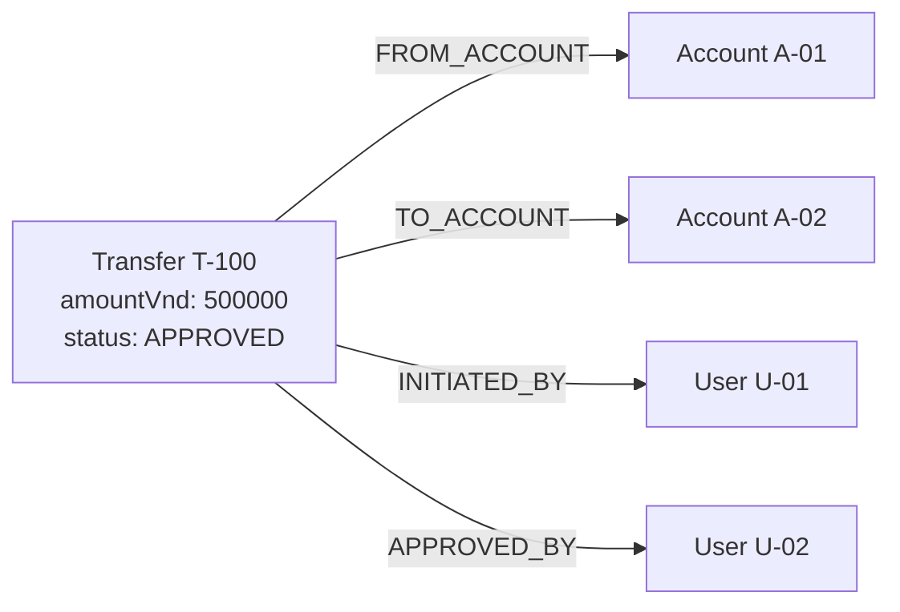
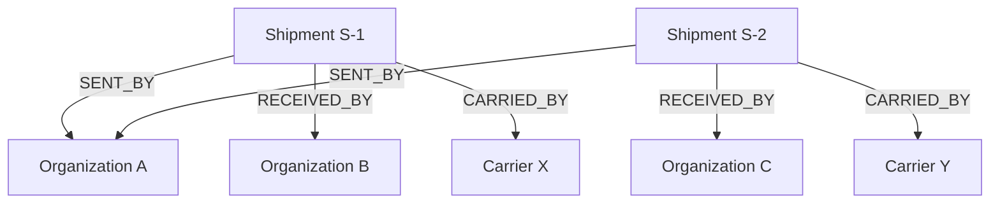
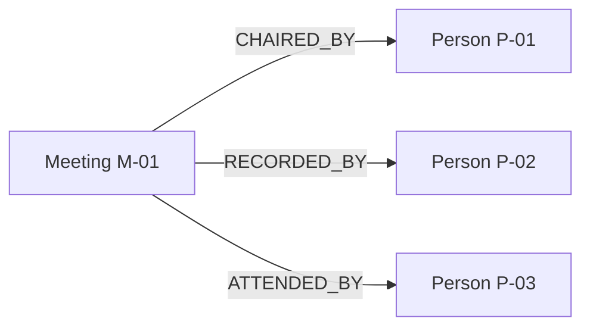
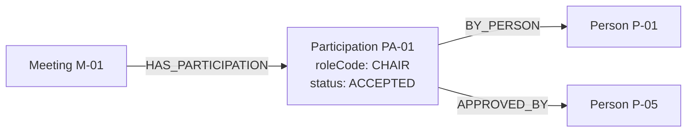
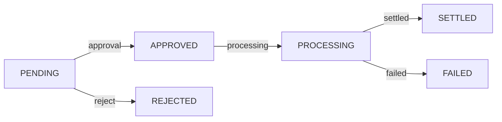

# Quan hệ nhiều vai trò và cách giữ rõ ý nghĩa các đầu liên kết

Trong mô hình đồ thị, một cạnh nối hai đỉnh có thể diễn đạt rất rõ “A theo dõi B” hoặc “khóa A yêu cầu khóa B”. Nhưng nhiều nghiệp vụ thực tế không phải một mối liên hệ độc lập giữa đúng hai đối tượng. Một giao dịch chuyển tiền liên quan đồng thời đến **tài khoản nguồn, tài khoản nhận, người khởi tạo, người phê duyệt** và chính giao dịch. Một chuyến giao hàng có **người gửi, người nhận, đơn vị vận chuyển, điểm lấy và điểm giao**. Nếu biến các vai trò thành những cạnh chung chung hoặc tách chúng thành các cặp không liên quan, hệ thống có thể mất ý nghĩa “những ai đã tham gia **cùng một sự kiện** và với **vai trò gì**”.

Bài học thuộc chương **Mô hình đồ thị** trong học phần **DATABASE_DATA_MODELING**, nơi yêu cầu nghiệp vụ được chuyển thành thực thể, quan hệ, ràng buộc, khóa, chỉ mục và lược đồ vật lý. Việc thiết kế phải cho phép kiểm chứng tính đúng đắn và so sánh cách biểu diễn bằng relational, document, graph hay mô hình phân tích. Trọng tâm ở đây là **quan hệ nhiều vai trò** (*n-ary relationship*), **vai trò ở từng đầu liên kết** (*endpoint role*) và cách bảo toàn ngữ cảnh nghiệp vụ trong **property graph**.

Sau bài này, bạn có thể:

- Phân biệt quan hệ nhị nguyên với sự kiện liên kết từ ba đối tượng hoặc vai trò trở lên.
- Xác định rõ **đỉnh nào tham gia**, **đóng vai trò gì** và **thuộc lần sự kiện nào**.
- Chọn giữa cạnh trực tiếp, đỉnh sự kiện, cạnh có tên vai trò và mô hình **participation** riêng.
- Thiết kế hướng cạnh, bội số theo vai trò, tính bắt buộc, quan hệ cùng loại đỉnh và ràng buộc theo thời gian.
- Viết truy vấn Cypher trả đúng bộ vai trò và tránh ghép nhầm các đối tượng của những sự kiện khác nhau.
- Đối chiếu mô hình đồ thị với khóa ngoại nhiều vai trò trong SQL và document lồng nhau.

## 1. Vai trò là một phần của ý nghĩa liên kết

Xét phát biểu:

> “Người dùng U-01 khởi tạo giao dịch T-100 chuyển 500.000 VND từ tài khoản A-01 sang tài khoản A-02. Người dùng U-02 phê duyệt giao dịch.”

Các thành phần cần nhận diện:

| Đối tượng | Kiểu thực thể | Vai trò trong giao dịch T-100 |
| --- | --- | --- |
| `T-100` | `Transfer` | Sự kiện trung tâm |
| `A-01` | `Account` | **Tài khoản nguồn** (*source account*) |
| `A-02` | `Account` | **Tài khoản đích** (*destination account*) |
| `U-01` | `User` | **Người khởi tạo** (*initiator*) |
| `U-02` | `User` | **Người phê duyệt** (*approver*) |

Hai tài khoản đều là đỉnh mang nhãn `Account`. Hai người đều là đỉnh `User`. **Nhãn đối tượng không đủ cho biết vai trò của nó trong một giao dịch cụ thể**. Cần thể hiện vai trò bằng **kiểu cạnh và hướng**, hoặc bằng mô hình tham gia có thuộc tính vai trò.

Trong property graph thông dụng, một cạnh thường nối **hai đầu đỉnh**. Vì vậy, quan hệ nhiều bên thường được biểu diễn bằng **một đỉnh sự kiện** rồi nối các vai trò tới đỉnh đó:



Đây là một **đồ thị thuộc tính**: `Transfer` là đỉnh có danh tính và thuộc tính giao dịch; những cạnh `FROM_ACCOUNT`, `TO_ACCOUNT`, `INITIATED_BY`, `APPROVED_BY` thể hiện **vai trò cụ thể của mỗi đầu liên kết**.

**Lưu ý:** mô hình này minh họa dữ liệu của một giao dịch; bản thân việc tạo đỉnh và cạnh **không chuyển tiền, không thực hiện nghiệp vụ ghi sổ kế toán**. Việc ghi sổ, kiểm soát số dư, xác nhận giao dịch và hoàn tiền cần các quy tắc, giao dịch và nguồn sự thật riêng.

## 2. Quan hệ nhị nguyên, nhiều vai trò và sự kiện độc lập

### 2.1. Quan hệ nhị nguyên thường đủ dùng cạnh trực tiếp

Với câu “khóa A yêu cầu khóa B”, biểu diễn sau thường rõ nghĩa:

```text
(Course A)-[:REQUIRES]->(Course B)
```

Hai đầu có vai trò khác nhau vì **hướng và động từ**: A là khóa *phụ thuộc*, B là khóa *tiên quyết*. Thuộc tính như `mandatory` hoặc `validFrom` có thể nằm trên cạnh. Không cần tạo đỉnh `Requirement` chỉ vì cạnh có thuộc tính.

### 2.2. Quan hệ nhiều bên cần bảo toàn sự đồng xuất hiện

Với một lần giao hàng, ta có bộ dữ liệu:

```text
Shipment S-1: sender=A, receiver=B, carrier=X
Shipment S-2: sender=A, receiver=C, carrier=Y
```

Nếu chỉ ghi các cạnh độc lập từ A tới B, C, X và Y, ta không thể kết luận **đơn vị vận chuyển X đã giao tới B hay tới C**. Từ các quan hệ nhị nguyên bị tách rời có thể suy ra sai hai tổ hợp không có thật: `(A, B, Y)` và `(A, C, X)`.

Một đỉnh `Shipment` gom các thành phần của **cùng một lần giao**:



Sơ đồ này không chỉ “thêm một đỉnh ở giữa”. Nó **giữ ranh giới của từng bộ quan hệ**: đường từ `S-1` dẫn tới đúng người gửi, người nhận và đơn vị vận chuyển của `S-1`.

### 2.3. Phân biệt một thực thể trung gian với một phép biến đổi cấu trúc

Trong cơ sở dữ liệu có hỗ trợ *hyperedge*, một quan hệ có thể liên kết nhiều thực thể trực tiếp. Tuy nhiên, **không nên mặc định property graph phổ biến hỗ trợ hyperedge như một primitive**. Đỉnh `Transfer` hoặc `Shipment` là một cách **tái biểu diễn** (*reification*) quan hệ nhiều bên thành các cạnh nhị nguyên.

Đỉnh trung tâm nên có một **định danh nghiệp vụ** như `transferId` hay `shipmentId` khi mỗi lần sự kiện có vòng đời, thời gian và các quy tắc riêng. Nếu sự kiện không có danh tính độc lập, vẫn có thể tạo đỉnh liên kết logic, nhưng cần quyết định **khóa phân biệt các lần quan hệ** để tránh gộp nhầm những lần hợp lệ.

## 3. Thiết kế vai trò của từng đầu liên kết

Để một cạnh dễ hiểu và kiểm chứng, hãy định nghĩa rõ **vai trò của đỉnh nguồn**, **vai trò của đỉnh đích**, **hướng lưu trữ** và **loại cạnh**.

### 3.1. Dùng tên cạnh gắn với vai trò nghiệp vụ

Với một đỉnh giao dịch trung tâm, chọn quy ước tất cả cạnh đi **từ giao dịch tới những thành phần tham gia**:

| Loại cạnh | Đỉnh nguồn | Đỉnh đích | Câu nghiệp vụ |
| --- | --- | --- | --- |
| `FROM_ACCOUNT` | `Transfer` | `Account` | Giao dịch ghi nhận tài khoản nguồn nào? |
| `TO_ACCOUNT` | `Transfer` | `Account` | Giao dịch ghi nhận tài khoản nhận nào? |
| `INITIATED_BY` | `Transfer` | `User` | Ai khởi tạo giao dịch? |
| `APPROVED_BY` | `Transfer` | `User` | Ai phê duyệt giao dịch? |

Quy ước này giúp mọi truy vấn bắt đầu tại `Transfer` rồi lần theo các vai trò. Đặt tên cạnh `LINKED_TO` hoặc `RELATED_TO` cho cả bốn mối liên kết sẽ **làm mất ngữ nghĩa vai trò**, dù vẫn giữ được bốn đỉnh đích.

Không cần áp dụng một chiều mũi tên thống nhất cho mọi miền nghiệp vụ. Điều quan trọng là **mỗi loại cạnh có một cách đọc cố định** và hướng không tùy tiện đổi giữa dữ liệu nhập và truy vấn.

### 3.2. Hai đầu cùng kiểu vẫn cần hai vai trò khác nhau

Giả sử cả nguồn và đích đều là `Account`:

```text
(Transfer T-100)-[:FROM_ACCOUNT]->(Account A-01)
(Transfer T-100)-[:TO_ACCOUNT]->(Account A-02)
```

Đừng dùng hai cạnh `HAS_ACCOUNT` rồi suy ra “cạnh thứ nhất là nguồn, cạnh thứ hai là đích”. Property graph không nên phụ thuộc vào thứ tự hiển thị hay thứ tự vật lý của cạnh. Khi một tài khoản có thể tham gia nhiều giao dịch, mọi thứ tự ngầm sẽ thiếu ổn định.

Nếu nghiệp vụ cho phép cùng một tài khoản đóng hai vai trò trong một trường hợp đặc biệt, cần nói rõ quy tắc đó. Ngược lại, nếu **cấm chuyển từ tài khoản tới chính nó**, hệ thống phải kiểm tra hai vai trò **không trỏ tới cùng một đỉnh**. Tên cạnh không tự thực thi điều kiện này.

### 3.3. Cùng một người có thể xuất hiện ở hai vai trò

Hai cạnh `INITIATED_BY` và `APPROVED_BY` đều trỏ tới `User`. Theo một chính sách phê duyệt độc lập, **người phê duyệt phải khác người khởi tạo**; theo chính sách khác, giao dịch nhỏ có thể tự động duyệt mà không có đỉnh người phê duyệt.

Như vậy, một thiết kế cần ghi rõ:

- Vai trò nào là **bắt buộc**, vai trò nào có thể vắng mặt?
- Một đối tượng có được đảm nhiệm **nhiều vai trò trong cùng một sự kiện** không?
- Nếu cấm, cấm mọi trường hợp hay chỉ một số trạng thái/ngưỡng giá trị?
- Vai trò có được thay đổi, ủy quyền hoặc tiếp quản sau khi sự kiện được tạo không?

Các câu trả lời thuộc **ràng buộc nghiệp vụ**, không tự xuất hiện khi dùng hai nhãn `User` hay hai loại cạnh khác nhau.

### 3.4. Vai trò có thể thay đổi theo ngữ cảnh

Một `Person` có thể là **người tổ chức** của cuộc họp M-01, đồng thời là **người tham dự** của M-02. Thuộc tính `Person.role = 'ORGANIZER'` không phù hợp nếu đây là vai trò **trong từng cuộc họp**. Nên đặt vai trò trên **mối tham gia** hoặc thể hiện bằng cạnh riêng:

```text
(Meeting M-01)-[:ORGANIZED_BY]->(Person P-01)
(Meeting M-02)-[:ATTENDED_BY]->(Person P-01)
```

Nếu vai trò có hiệu lực theo từng thời điểm hoặc mỗi người giữ nhiều vai trò, hãy xác định đúng **hạt dữ liệu**: “vai trò của người P trong cuộc họp M tại giai đoạn nào”, thay vì gán nhầm vai trò cố định cho người P.

## 4. Bội số và tính bắt buộc được định nghĩa theo từng vai trò

Với giao dịch chuyển tiền mẫu, ta có thể đặt quy tắc:

| Vai trò | Số cạnh trên một `Transfer` | Quy tắc nghiệp vụ minh họa |
| --- | --- | --- |
| `FROM_ACCOUNT` | **1** | Mỗi giao dịch có đúng một tài khoản nguồn |
| `TO_ACCOUNT` | **1** | Mỗi giao dịch có đúng một tài khoản nhận |
| `INITIATED_BY` | **1** | Mỗi giao dịch có đúng một người khởi tạo |
| `APPROVED_BY` | **0..1** | Trước khi được duyệt có thể chưa có; nếu duyệt thủ công thì có tối đa một người phê duyệt |
| `HAS_ATTACHMENT` | **0..*** | Có thể có nhiều tài liệu hỗ trợ, nếu nghiệp vụ cần |

Đối với một `Account`, số giao dịch đóng vai trò tài khoản nguồn có thể là **0..***; số giao dịch mà nó là tài khoản nhận cũng **0..***. Bội số từ phía đỉnh trung tâm và bội số từ phía đối tượng tham gia **khác nhau**.

Nếu quy trình cho phép **nhiều người phê duyệt**, không thể giữ quy tắc `APPROVED_BY 0..1`. Khi đó cần mô tả rõ: nhiều người được duyệt theo thứ tự hay song song, một lượt duyệt hay nhiều vòng, và “giao dịch đã được duyệt” nghĩa là **tất cả**, **đa số** hay **một người** đã phê duyệt.

### 4.1. Ràng buộc theo vai trò khác ràng buộc theo định danh

Một uniqueness constraint trên `Transfer.transferId` ngăn đỉnh giao dịch trùng theo ID, **không** ngăn một `Transfer` có hai cạnh `TO_ACCOUNT`. Muốn có “đúng một tài khoản đích”, ta cần bảo đảm:

1. **Tồn tại:** ít nhất một cạnh `TO_ACCOUNT` tới đỉnh `Account` hợp lệ.
2. **Tối đa một:** không được có hai cạnh `TO_ACCOUNT`.
3. **Không mâu thuẫn:** tài khoản đích và nguồn thỏa quy tắc phân biệt nếu có.
4. **Tính nguyên tử khi ghi:** không để lại một giao dịch “hoàn tất” nhưng chưa có đủ các cạnh bắt buộc.

Một số hệ đồ thị có constraint về khóa hoặc thuộc tính, nhưng **không nên giả định mọi hệ hỗ trợ khai báo bội số theo vai trò** ngay trên loại cạnh. Cần xác định phần nào được bảo đảm bằng constraint và phần nào bằng giao dịch/logic ứng dụng.

### 4.2. Bội số còn phụ thuộc vào thời điểm và trạng thái

Ví dụ `APPROVED_BY` có thể vắng mặt khi `status = 'PENDING'`, nhưng phải có nếu `status = 'APPROVED'` theo quy tắc minh họa. Đó là một ràng buộc **có điều kiện** theo trạng thái.

Một người dùng có thể được phân quyền phê duyệt ở thời điểm T nhưng hết quyền ở T+1. Nếu cần kiểm tra quyết định duyệt đúng thời điểm, phải lưu được **thời điểm phê duyệt**, quyền có hiệu lực, thông tin được ủy quyền hoặc bằng chứng từ nguồn có thẩm quyền. Chỉ có cạnh `APPROVED_BY` mà không có thời gian có thể chưa đủ cho yêu cầu kiểm toán.

## 5. Khi nào dùng loại cạnh riêng, khi nào dùng thuộc tính `role`?

Một hệ thống tổ chức cuộc họp có người **chủ trì**, **thư ký**, **khách mời**, **người tham dự**. Có ít nhất hai phương án mô hình hóa.

### 5.1. Phương án A: loại cạnh riêng cho vai trò ổn định



Ưu điểm: truy vấn và tài liệu nghiệp vụ đọc rõ ràng. Khi số loại vai trò nhỏ và ổn định, loại cạnh như `CHAIRED_BY` và `RECORDED_BY` phản ánh đúng quy tắc khác nhau của từng vai trò.

Hạn chế: nếu vai trò do người dùng tự cấu hình và có hàng trăm giá trị, tạo một loại cạnh cho từng giá trị có thể làm mô hình khó quản lý. Cũng không nên biến từng **ID của người tham gia** thành một loại cạnh khác nhau.

### 5.2. Phương án B: cạnh tham gia với thuộc tính vai trò

```text
(Meeting M-01)-[:HAS_PARTICIPANT {
  roleCode: 'CHAIR',
  joinedAt: '2026-11-20T09:00:00+07:00'
}]->(Person P-01)
```

Một kiểu cạnh `HAS_PARTICIPANT` với thuộc tính `roleCode` có thể phù hợp khi tập vai trò **được cấu hình**, cần tra cứu chung mọi người tham gia và các vai trò có cùng cấu trúc dữ liệu.

Lúc đó cần quy tắc riêng: `roleCode` phải nằm trong danh mục cho phép, một cuộc họp có tối đa một `CHAIR` hay không, một người có được vừa `CHAIR` vừa `NOTE_TAKER` không, và khi vai trò đổi có giữ lịch sử hay chỉ cập nhật trạng thái hiện tại.

### 5.3. Phương án C: đỉnh `Participation` khi chính lượt tham gia có vòng đời



Đỉnh `Participation` hữu ích khi **mỗi lần phân vai** có `participationId`, thư mời, xác nhận, thay thế, các vòng phê duyệt hoặc lịch sử riêng. Đừng dùng đỉnh trung gian chỉ vì cạnh có một trường `roleCode`; thêm đỉnh tăng số phần tử và số bước duyệt, nên cần lý do nghiệp vụ rõ ràng.

### 5.4. So sánh ba cách

| Tiêu chí | Loại cạnh riêng | Cạnh có `roleCode` | Đỉnh `Participation` |
| --- | --- | --- | --- |
| Số vai trò nhỏ, có nghĩa ổn định | Rất phù hợp | Phù hợp | Có thể dư thừa |
| Danh mục vai trò do người dùng cấu hình | Cần quản lý nhiều loại cạnh | Thường thuận tiện | Phù hợp khi có quy trình riêng |
| Muốn tìm mọi thành viên cuộc họp | Truy vấn nhiều loại cạnh | Truy vấn một loại `HAS_PARTICIPANT` | Qua đỉnh tham gia |
| Lượt tham gia có mã định danh và được đối tượng khác tham chiếu | Khó trong nhiều property graph | Khó trong nhiều property graph | Thuận tiện |
| Vai trò có thuộc tính thời gian | Có thể đặt trên cạnh | Có thể đặt trên cạnh | Có thể đặt trên đỉnh tham gia và sự kiện |
| Bội số và tính hợp lệ | Cần kiểm soát theo từng loại cạnh | Cần kiểm soát theo giá trị `roleCode` | Cần kiểm soát theo loại đỉnh và cạnh vai trò |
| Chi phí cấu trúc | Ít phần tử hơn | Ít phần tử hơn | Thêm đỉnh và cạnh |

Việc chọn cách nào phụ thuộc vào **những truy vấn cần trả lời** và **những quy tắc cần thực thi**, không phụ thuộc riêng số lượng nhãn hay vẻ đơn giản của sơ đồ.

## 6. Ví dụ hoàn chỉnh: xây dựng graph cho giao dịch nhiều vai trò

Trong ví dụ này, **mỗi `Transfer` đại diện cho một yêu cầu chuyển khoản duy nhất**, có `transferId`, số tiền, đơn vị tiền, thời điểm tạo và trạng thái. Một `Account` có thể tham gia nhiều giao dịch ở cả hai vai trò nguồn/đích; một `User` có thể khởi tạo hoặc phê duyệt nhiều giao dịch.

### 6.1. Thiết kế logic

| Thành phần | Dữ liệu chính | Cần kiểm soát |
| --- | --- | --- |
| `Account` | `accountId`, `status` | `accountId` duy nhất, trạng thái hợp lệ |
| `User` | `userId`, `displayName` | `userId` duy nhất, chính sách phân quyền theo thời điểm |
| `Transfer` | `transferId`, `amountVnd`, `status`, `createdAt` | `transferId` duy nhất, số tiền dương, chuyển trạng thái hợp lệ |
| `FROM_ACCOUNT` | `Transfer → Account` | Đúng một tài khoản nguồn |
| `TO_ACCOUNT` | `Transfer → Account` | Đúng một tài khoản đích |
| `INITIATED_BY` | `Transfer → User` | Đúng một người khởi tạo |
| `APPROVED_BY` | `Transfer → User` | Tùy trạng thái; phải tuân quy tắc phê duyệt độc lập nếu có |

Giả sử trong bài tập:

- Giao dịch chưa duyệt có `status = 'PENDING'` và chưa có `APPROVED_BY`.
- Giao dịch duyệt thủ công có `status = 'APPROVED'` và đúng một cạnh `APPROVED_BY`.
- Người phê duyệt phải khác người khởi tạo.
- Tài khoản nguồn phải khác tài khoản đích.
- Hai lần chuyển từ A-01 sang A-02 có `transferId` khác nhau vẫn là **hai giao dịch hợp lệ**.

Đây chỉ là **giả định của bài toán mẫu**. Hệ thực tế có thể duyệt tự động, phê duyệt nhiều cấp hoặc hỗ trợ các trường hợp đặc biệt; khi đó phải sửa mô hình và ràng buộc theo đúng hợp đồng nghiệp vụ.

### 6.2. Ví dụ tạo dữ liệu bằng Cypher

Đoạn mã dùng **Neo4j Cypher** và giả định chạy trong cơ sở dữ liệu thử nghiệm trống. Nó minh họa cấu trúc của mô hình, không thực hiện chuyển khoản hay ghi sổ.

```cypher
CREATE
  (source:Account {accountId: 'A-01', status: 'ACTIVE'}),
  (dest:Account {accountId: 'A-02', status: 'ACTIVE'}),
  (initiator:User {userId: 'U-01', displayName: 'An'}),
  (approver:User {userId: 'U-02', displayName: 'Bình'}),
  (t:Transfer {
    transferId: 'T-100',
    amountVnd: 500000,
    status: 'APPROVED',
    createdAt: datetime('2026-11-20T08:00:00+07:00'),
    approvedAt: datetime('2026-11-20T08:02:00+07:00')
  }),
  (t)-[:FROM_ACCOUNT]->(source),
  (t)-[:TO_ACCOUNT]->(dest),
  (t)-[:INITIATED_BY]->(initiator),
  (t)-[:APPROVED_BY]->(approver);
```

Các điểm quan trọng:

- `Transfer` có ID riêng vì **một cặp tài khoản có thể chuyển nhiều lần**.
- `FROM_ACCOUNT` và `TO_ACCOUNT` là hai **loại cạnh khác nhau** dù cùng trỏ tới `Account`.
- `INITIATED_BY` và `APPROVED_BY` phân biệt hai **vai trò nghiệp vụ**, không dùng chung loại `HAS_USER`.
- `amountVnd` thuộc **giao dịch**, không đặt lên `Account` và cũng không phải thuộc tính của một mũi tên không có ngữ cảnh.
- `createdAt`, `approvedAt` phản ánh các mốc khác nhau; muốn kiểm toán chi tiết cần thêm nguồn và lịch sử thay đổi.

### 6.3. Truy vấn lấy toàn bộ bộ vai trò của một giao dịch

```cypher
MATCH (t:Transfer {transferId: $transferId})
      -[:FROM_ACCOUNT]->(source:Account)
MATCH (t)-[:TO_ACCOUNT]->(dest:Account)
MATCH (t)-[:INITIATED_BY]->(initiator:User)
OPTIONAL MATCH (t)-[:APPROVED_BY]->(approver:User)
RETURN t.transferId AS transferId,
       t.amountVnd AS amountVnd,
       t.status AS status,
       source.accountId AS sourceAccountId,
       dest.accountId AS destinationAccountId,
       initiator.userId AS initiatedBy,
       approver.userId AS approvedBy;
```

Kết quả ví dụ:

| transferId | amountVnd | sourceAccountId | destinationAccountId | initiatedBy | approvedBy |
| --- | ---: | --- | --- | --- | --- |
| T-100 | 500000 | A-01 | A-02 | U-01 | U-02 |

`OPTIONAL MATCH` cho phép giao dịch chưa có người phê duyệt vẫn xuất hiện, với `approvedBy` không có giá trị. Tuy nhiên, nếu dữ liệu sai và một `Transfer` có **hai cạnh cùng loại `TO_ACCOUNT`**, truy vấn có thể trả **nhiều hàng cho một giao dịch**. Không nên dùng `DISTINCT` để che lấp lỗi bội số; phải kiểm tra nguồn dữ liệu và quy tắc ghi.

### 6.4. Truy vấn theo đúng vai trò của tài khoản

“Tài khoản A-01 đã đóng vai **nguồn** trong những giao dịch nào?”

```cypher
MATCH (t:Transfer)-[:FROM_ACCOUNT]->
      (account:Account {accountId: $accountId})
MATCH (t)-[:TO_ACCOUNT]->(receiver:Account)
RETURN t.transferId AS transferId,
       receiver.accountId AS receiverAccountId,
       t.amountVnd AS amountVnd,
       t.status AS status
ORDER BY transferId;
```

Nếu cần tìm giao dịch mà A-01 là **đích**, thay `FROM_ACCOUNT` bằng `TO_ACCOUNT` ở phần lọc. Không được dùng `MATCH (t)-[]->(account)` rồi coi mọi giao dịch nối đến A-01 là giao dịch gửi đi; cách đó sẽ **trộn vai trò nguồn và đích**.

### 6.5. Truy vấn người vừa khởi tạo vừa phê duyệt

Theo giả định của bài toán, hai vai trò này phải do hai người khác nhau đảm nhiệm. Có thể tìm các giao dịch vi phạm:

```cypher
MATCH (t:Transfer)-[:INITIATED_BY]->(initiator:User)
MATCH (t)-[:APPROVED_BY]->(approver:User)
WHERE initiator = approver
RETURN t.transferId AS invalidTransferId,
       initiator.userId AS userId;
```

Việc kết quả rỗng chỉ chứng minh **không tìm thấy vi phạm dạng này trong dữ liệu hiện tại**; chưa xác nhận người phê duyệt được cấp quyền, phê duyệt đúng thời điểm hoặc không có giao dịch thiếu cạnh phê duyệt. Các kiểm tra đó cần có quy tắc riêng.

### 6.6. Phát hiện thiếu hoặc thừa cạnh bắt buộc

Để kiểm tra số cạnh theo từng vai trò mà **không tạo tích Descartes giữa các loại cạnh**, có thể dùng các biểu thức `COUNT { ... }` theo phạm vi mỗi giao dịch trong Neo4j Cypher có hỗ trợ cú pháp này:

```cypher
MATCH (t:Transfer)
WITH t,
     COUNT { (t)-[:FROM_ACCOUNT]->(:Account) } AS fromCount,
     COUNT { (t)-[:TO_ACCOUNT]->(:Account) } AS toCount,
     COUNT { (t)-[:INITIATED_BY]->(:User) } AS initiatorCount,
     COUNT { (t)-[:APPROVED_BY]->(:User) } AS approverCount
WHERE fromCount <> 1
   OR toCount <> 1
   OR initiatorCount <> 1
   OR approverCount > 1
   OR (t.status = 'APPROVED' AND approverCount <> 1)
RETURN t.transferId AS transferId,
       fromCount, toCount, initiatorCount, approverCount;
```

Kết quả cho biết **từng giao dịch nào** thiếu hoặc thừa vai trò. Truy vấn là kiểm tra dữ liệu và giả định **các cạnh vai trò chỉ được nối đến đúng loại đỉnh**. Cạnh `TO_ACCOUNT` tới nhãn sai, nếu tồn tại, cần được kiểm tra thêm; tổng số cạnh `TO_ACCOUNT` không phân biệt nhãn cũng có thể là một phép đối soát bổ sung.

Nếu hệ Neo4j dùng phiên bản không hỗ trợ biểu thức `COUNT { ... }` dạng trên, cần chuyển thành phép đếm trong các subquery phù hợp. Không nên coi đây là cú pháp phổ quát cho mọi property graph.

### 6.7. Đừng chỉ dùng `MERGE` để bảo đảm đủ các vai trò

Để tạo giao dịch qua API, cần tìm đầy đủ đỉnh tham gia bằng khóa nghiệp vụ, kiểm tra chính sách rồi tạo `Transfer` và các cạnh bắt buộc trong **một giao dịch cơ sở dữ liệu**. Ví dụ:

```cypher
MATCH (source:Account {accountId: $sourceAccountId})
MATCH (dest:Account {accountId: $destinationAccountId})
MATCH (initiator:User {userId: $initiatorUserId})
WHERE source <> dest AND $amountVnd > 0
CREATE (t:Transfer {
  transferId: $transferId,
  amountVnd: $amountVnd,
  status: 'PENDING',
  createdAt: datetime()
})
CREATE (t)-[:FROM_ACCOUNT]->(source)
CREATE (t)-[:TO_ACCOUNT]->(dest)
CREATE (t)-[:INITIATED_BY]->(initiator)
RETURN t.transferId AS transferId;
```

Giả định trước khi chạy đã kiểm tra tham số đúng kiểu, định danh không thiếu, tài khoản hoạt động và người khởi tạo có quyền. Nếu một `MATCH` không thấy đỉnh, truy vấn không tạo `Transfer`; ứng dụng phải nhận biết trường hợp này thay vì mặc định thành công. Với `CREATE`, cần **uniqueness constraint** trên `transferId` để việc nhận sự kiện lặp không tạo thêm giao dịch trùng. Lỗi xung đột khóa hoặc cập nhật cạnh tranh phải được xử lý theo hợp đồng API; không nên tạo đỉnh mới từ thông tin chưa xác minh.

## 7. Ràng buộc dữ liệu và khóa ở lược đồ vật lý

### 7.1. Constraint cho các đỉnh có danh tính

Ví dụ Neo4j Cypher:

```cypher
CREATE CONSTRAINT transfer_id_unique IF NOT EXISTS
FOR (t:Transfer) REQUIRE t.transferId IS UNIQUE;

CREATE CONSTRAINT account_id_unique IF NOT EXISTS
FOR (a:Account) REQUIRE a.accountId IS UNIQUE;

CREATE CONSTRAINT user_id_unique IF NOT EXISTS
FOR (u:User) REQUIRE u.userId IS UNIQUE;
```

Các constraint này kiểm soát **giá trị khóa trên những đỉnh có thuộc tính tương ứng**. Để bắt buộc ID tồn tại trên mọi đỉnh, có thể cần loại constraint về sự hiện diện hoặc một quy tắc ứng dụng bổ sung, tùy hệ quản trị và phiên bản.

Chúng **không tự kiểm tra**:

- Một `Transfer` có đúng một `FROM_ACCOUNT` và đúng một `TO_ACCOUNT`.
- `FROM_ACCOUNT` và `TO_ACCOUNT` có trỏ cùng một đỉnh hay không.
- Người phê duyệt có khác người khởi tạo và có được cấp quyền không.
- Trạng thái `APPROVED` có nhất quán với `APPROVED_BY` và `approvedAt` không.

Đây là các ràng buộc **xuyên đỉnh/cạnh** hoặc **theo điều kiện nghiệp vụ**, cần cơ chế kiểm tra khi ghi và khi đối soát dữ liệu.

### 7.2. Ràng buộc theo trạng thái và thời gian

Ví dụ một quy trình:



Đây là **một quy trình mẫu** cho metadata giao dịch. Thực tế có thể có các trạng thái và chuyển tiếp khác. Khi chuyển sang `APPROVED`, ứng dụng phải lưu được ai duyệt và khi nào theo chính sách. Nếu sau này có hai cấp phê duyệt, không nên ép `APPROVED_BY 0..1` vẫn đúng mà phải mô hình thêm **lượt duyệt** hoặc **quyết định duyệt**.

Cần phân biệt:

- **Thời điểm sự kiện:** `createdAt`, `approvedAt`, `settledAt`.
- **Thời gian hiệu lực của quyền/vai trò:** một người có quyền duyệt từ ngày nào đến ngày nào.
- **Thời gian hệ thống ghi nhận:** thông tin quyết định được nhập hoặc đồng bộ lúc nào.

Nếu phải tái hiện “tại thời điểm quyết định, người phê duyệt có quyền hay không”, chỉ kiểm tra quyền hiện tại có thể sai. Nếu cần lịch sử kiểm toán hoặc sửa hồi tố, phải giữ phiên bản/sự kiện và nguồn gốc phù hợp; một thuộc tính trạng thái bị cập nhật đè không tự bảo toàn lịch sử.

### 7.3. Ràng buộc khi một vai trò có nhiều người

Một cuộc họp hoặc hồ sơ phê duyệt có thể có nhiều người tham gia cùng vai trò. Hãy quyết định bội số cho **mỗi sự kiện**: một chủ trì, tối đa một thư ký, nhiều người dự, ít nhất hai người phản biện, v.v.

Nếu có một `ReviewRound` mà mỗi người có thể gửi nhiều ý kiến, nên phân biệt `Reviewer` là một người với **mỗi lượt review** có `reviewId`, `decision`, `submittedAt`. Đếm số cạnh tới người khác với đếm số quyết định. Điều kiện “hai người độc lập đã chấp thuận” cần **hai danh tính người duyệt khác nhau**, không chỉ hai cạnh cùng trỏ tới một người.

## 8. Vai trò tĩnh, vai trò động và tham gia nhiều lần

### 8.1. Vai trò tĩnh của một sự kiện

`Transfer.FROM_ACCOUNT` và `Transfer.TO_ACCOUNT` thường có vai trò rõ, cố định trong toàn bộ đời giao dịch. Nếu phát hiện tài khoản nguồn sai sau khi đã ghi nhận giao dịch, không nên sửa đầu cạnh tùy tiện; có thể cần hủy và tạo bản ghi mới hoặc sửa theo quy trình kiểm toán. Một cạnh thay đổi đầu đích có thể làm mất khả năng tái hiện quyết định ban đầu.

### 8.2. Vai trò động của con người trong một dự án

Một `Employee` có thể là `REVIEWER` từ ngày 01/01 tới 01/06, rồi `LEAD` từ 01/06. Khi vai trò có hiệu lực theo thời gian, cần lưu:

```text
participationId / assignmentId nếu mỗi lần phân vai có ID riêng
roleCode
validFrom
validTo
assignedBy / approvalSource nếu yêu cầu truy vết
```

Có thể đặt `roleCode` và thời gian trên cạnh `ASSIGNED_TO` nếu vai trò là dữ liệu của một liên kết đơn giản. Khi phải nối vào **mỗi lần phân vai** các yêu cầu phê duyệt, timesheet, ngân sách hay lịch sử, dùng đỉnh `Assignment` sẽ rõ hơn.

### 8.3. Hai lần tham gia cùng một vai trò không nhất thiết trùng

Người P-01 có thể dự cuộc họp M-01 **hai phiên** khác nhau. Hai cạnh `ATTENDED_BY` cùng trỏ P-01 có thể là dữ liệu trùng nếu mỗi cuộc họp chỉ có một vai trò tham dự hiện tại; hoặc là hai lần tham dự hợp lệ nếu có phiên `sessionId` khác nhau.

Nên định nghĩa **khóa của lượt tham gia** như `(meetingId, personId, sessionId, roleCode)` hoặc `participationId`. Đừng suy ra uniqueness chỉ từ cặp đỉnh khi nghiệp vụ có nhiều lần sự kiện.

## 9. So sánh với relational, document và dữ liệu phân tích

### 9.1. SQL biểu diễn vai trò bằng các khóa ngoại có tên

Một bảng quan hệ có thể lưu giao dịch nhiều vai trò rất rõ:

```sql
CREATE TABLE transfers (
    transfer_id VARCHAR(40) PRIMARY KEY,
    source_account_id VARCHAR(40) NOT NULL
        REFERENCES accounts(account_id),
    destination_account_id VARCHAR(40) NOT NULL
        REFERENCES accounts(account_id),
    initiated_by_user_id VARCHAR(40) NOT NULL
        REFERENCES users(user_id),
    approved_by_user_id VARCHAR(40) NULL
        REFERENCES users(user_id),
    amount_vnd BIGINT NOT NULL,
    status VARCHAR(24) NOT NULL,
    created_at TIMESTAMP NOT NULL,
    CHECK (amount_vnd > 0),
    CHECK (source_account_id <> destination_account_id)
);
```

Ở đây **hai khóa ngoại cùng tham chiếu `accounts`** nhưng mang vai trò khác nhau bằng tên cột. Một bảng `transfers` lưu mỗi **lần giao dịch** và bộ khóa ngoại của những người/tài khoản cùng tham gia. Khi chuyển sang graph, đỉnh `Transfer` cùng các cạnh loại vai trò là một cách ánh xạ có ngữ nghĩa tương tự.

`NOT NULL` trên cột khóa ngoại giúp SQL biểu diễn **vai trò bắt buộc**, và `CHECK` thể hiện một số điều kiện cùng hàng. Ràng buộc “người duyệt phải được cấp quyền tại thời điểm duyệt” vẫn cần thiết kế thêm; nó không tự được bảo đảm chỉ từ khóa ngoại.

Nếu chỉ lưu các bảng nối độc lập `account_relations` và `user_relations` mà không có `transfer_id`, SQL cũng có thể mất mối liên hệ “các thành viên này thuộc **cùng giao dịch**”, tương tự mô hình graph bị tách những cạnh nhị nguyên không có đỉnh sự kiện.

### 9.2. Document có thể lưu vai trò trong một bản ghi tổng hợp

Một document giao dịch có thể là:

```json
{
  "transferId": "T-100",
  "sourceAccountId": "A-01",
  "destinationAccountId": "A-02",
  "initiatedBy": "U-01",
  "approvedBy": "U-02",
  "amountVnd": 500000,
  "status": "APPROVED"
}
```

Document giữ các vai trò trong **cùng một đối tượng tổng hợp**, phù hợp nếu phần lớn thao tác đọc/ghi lấy toàn bộ giao dịch. Nhưng khi cần duyệt mạng tài khoản/giao dịch theo nhiều bước, truy vấn nhóm liên quan hay tìm quan hệ giữa người và tài khoản, các tham chiếu ID đòi hỏi thao tác truy vấn hoặc cấu trúc bổ sung tùy hệ quản trị.

### 9.3. Kho phân tích dùng hạt dữ liệu (*grain*) để giữ bộ vai trò

Một bảng fact `fact_transfer` có thể có **mỗi dòng là một giao dịch**, với các khóa tới những dimension `source_account`, `destination_account`, `initiator` và `approver`. Đây là một cách giữ vai trò rõ ràng trong mô hình phân tích.

Tuy vậy, bài toán thống kê “tổng số giao dịch theo tháng và trạng thái” khác truy vấn mạng “những tài khoản liên hệ gián tiếp qua nhiều lần chuyển?”. Có thể dùng warehouse để tổng hợp, graph để khảo sát đường đi, và cơ sở dữ liệu giao dịch để thực hiện nghiệp vụ chính. Quan trọng là các hệ có **ID chuẩn**, quy tắc đồng bộ và khả năng đối soát chung.

### 9.4. Tóm tắt lựa chọn cấu trúc

| Trọng tâm nghiệp vụ | Cấu trúc thường phù hợp |
| --- | --- |
| Chỉ cần liên hệ A → B với một vài thuộc tính | Cạnh trực tiếp có loại và hướng rõ |
| Một lần liên hệ nhiều bên, có ID riêng | Đỉnh sự kiện/đỉnh trung gian với cạnh theo vai trò |
| Mỗi lần tham gia có trạng thái và lịch sử riêng | Đỉnh `Participation` hoặc `Assignment` |
| Giao dịch nhiều cột vai trò và ràng buộc giao dịch mạnh | Bảng SQL có khóa ngoại rõ tên; graph có thể là mô hình dẫn xuất |
| Luôn đọc/ghi trọn một sự kiện | Document chứa các ID theo vai trò có thể thích hợp |
| Chủ yếu tổng hợp số lượng/số tiền theo chiều | Bảng fact và dimension có vai trò rõ ràng |
| Cần khám phá nhiều bước liên kết giữa người, tài khoản, sự kiện | Graph có thể thuận tiện nếu chất lượng định danh và truy vấn được kiểm chứng |

## 10. Quy trình thiết kế quan hệ nhiều vai trò

### Bước 1 — Viết một câu nghiệp vụ cho **mỗi vai trò**

Không dừng ở “giao dịch liên quan tới bốn đối tượng”. Viết:

- `Transfer` **lấy tiền từ** một `Account`.
- `Transfer` **đưa tiền tới** một `Account`.
- `Transfer` **được khởi tạo bởi** một `User`.
- `Transfer` **được phê duyệt bởi** một `User` nếu cần duyệt.

Chính các động từ này gợi tên loại cạnh và hướng. Nếu một vai trò chưa diễn đạt được bằng câu rõ nghĩa, mô hình có nguy cơ đang sử dụng khái niệm quá chung.

### Bước 2 — Xác định **hạt dữ liệu** của quan hệ

Một đỉnh `Transfer` đại diện cho **một lần chuyển** hay cho **một lệnh định kỳ** gồm nhiều lần chuyển? Một `Shipment` đại diện một kiện hàng, một chuyến xe hay một lượt giao? Một `Meeting` gồm nhiều phiên hay một phiên cụ thể?

Nếu không định nghĩa hạt dữ liệu, các cạnh có thể kết hợp thành những bộ vai trò sai. Chọn ID nghiệp vụ để phân biệt từng lần sự kiện, kể cả hai sự kiện có cùng người tham gia.

### Bước 3 — Gắn khóa, hướng, loại cạnh và bội số

Lập bảng vai trò, số lượng tối thiểu/tối đa cho mỗi sự kiện và điều kiện phải khác nhau. Ghi rõ những vai trò có thể lặp, có thể thiếu hoặc có thể do cùng một đối tượng đảm nhiệm. Thiết kế constraint và quy trình tạo tất cả cạnh bắt buộc một cách nhất quán.

### Bước 4 — Xem có cần lịch sử, trạng thái và nguồn gốc không

Nếu vai trò có thể đổi hoặc phê duyệt qua nhiều vòng, cần ghi lại **khi nào**, **ai quyết định**, **dựa trên quyền nào**. Lựa chọn giữa thuộc tính cạnh, đỉnh `Participation` và sự kiện bất biến tùy độ sâu lịch sử và loại truy vấn kiểm toán.

### Bước 5 — Viết câu truy vấn từ **đỉnh sự kiện trung tâm**

Ví dụ các yêu cầu kiểm chứng:

| Yêu cầu | Điều phải có trong truy vấn |
| --- | --- |
| “Giao dịch T-100 chuyển từ đâu tới đâu?” | Cùng **T-100**, cạnh `FROM_ACCOUNT` và `TO_ACCOUNT` |
| “Ai phê duyệt T-100?” | Cạnh `APPROVED_BY` của **đúng T-100** |
| “A-01 đã gửi cho những tài khoản nào?” | Lọc A-01 ở vai trò **nguồn**, lấy đích trong **cùng Transfer** |
| “Giao dịch nào thiếu người khởi tạo?” | Đếm vai trò `INITIATED_BY` bằng 0 |
| “Có bao nhiêu người phê duyệt?” | Đếm **danh tính người** hay **lượt duyệt** theo chính quy tắc đã định |
| “Ai đã phê duyệt tại thời điểm đó?” | Cạnh/đỉnh quyết định có thời gian và nguồn gốc, đối chiếu quyền hiệu lực |

Không dùng các cạnh không có vai trò rồi dựa vào thứ tự kết quả của bộ máy truy vấn để đoán ai là ai.

### Bước 6 — Kiểm chứng trên dữ liệu biên

Kiểm tra ít nhất:

1. Hai giao dịch khác nhau có **cùng cặp tài khoản** không bị gộp.
2. Một giao dịch thiếu tài khoản đích không được xem là hoàn chỉnh.
3. Một giao dịch có hai tài khoản nguồn bị phát hiện là vi phạm nếu quy tắc đòi đúng một.
4. Một giao dịch có cùng người khởi tạo và phê duyệt bị xử lý theo đúng chính sách.
5. Vai trò `PENDING` không yêu cầu người duyệt trước khi có quyết định; vai trò `APPROVED` đáp ứng quy tắc đã khai báo.
6. Mỗi giao dịch giữ nguyên kết nối với các thành phần tham gia ngay cả khi một tài khoản/nhân viên có nhiều giao dịch khác.
7. Truy vấn tổng hợp không nhân bản giao dịch khi có nhiều file đính kèm hoặc nhiều lượt duyệt.

## 11. Những sai lầm thường gặp

1. **Gọi mọi cạnh là `RELATED_TO`.** Không phân biệt ai gửi, ai nhận, ai tạo và ai duyệt.
2. **Dùng nhãn đối tượng thay vai trò.** Hai đỉnh `Account` không cho biết đâu là nguồn, đâu là đích.
3. **Dựa vào thứ tự cạnh.** Thứ tự trả về không định nghĩa ngữ nghĩa đầu liên kết.
4. **Tách một sự kiện nhiều bên thành những cặp rời rạc.** Làm mất thông tin các đối tượng thuộc cùng một lần sự kiện, dẫn tới tổ hợp giả.
5. **Gộp các sự kiện có cùng người tham gia.** Hai giao dịch từ A tới B có thể là hai giao dịch khác nhau với ID, số tiền và thời gian riêng.
6. **Đặt vai trò theo cuộc họp lên đỉnh `Person`.** Vai trò là dữ liệu của mối tham gia, không phải đặc tính cố định của người.
7. **Tạo đỉnh `Participation` cho mọi cạnh không có nhu cầu riêng.** Tăng độ phức tạp cấu trúc và số bước truy vấn.
8. **Quên bội số theo vai trò.** Mỗi giao dịch cần đúng một nguồn và một đích, nhưng một tài khoản được tham gia nhiều giao dịch.
9. **Giả định constraint trên ID đỉnh bảo đảm đủ cạnh.** `transferId UNIQUE` không bắt giao dịch có đủ người và tài khoản.
10. **Dùng `DISTINCT` che lỗi nhân bản kết quả.** Hai `TO_ACCOUNT` là lỗi dữ liệu nếu chỉ được phép một, cần phát hiện và xử lý ở nguồn.
11. **Bỏ qua trạng thái và thời gian hiệu lực.** Người có quyền hôm nay chưa chắc có quyền tại lúc phê duyệt trong quá khứ.
12. **Giữ đồng thời cạnh tắt và đỉnh sự kiện không có nguồn sự thật.** Hai biểu diễn có thể mâu thuẫn sau sửa đổi hoặc sự kiện gửi lại.

## 12. Bài tập thực hành và gợi ý đáp án

### Bài tập 1 — Vai trò của người gửi và người nhận

Có hai chuyến giao:

```text
Shipment S-1: sender=A, receiver=B, carrier=X
Shipment S-2: sender=A, receiver=C, carrier=Y
```

**Yêu cầu:** (a) Vì sao không nên chỉ nối A tới B, C, X và Y bằng những cạnh không gắn với chuyến? (b) Vẽ mô hình có thể trả lời “ai vận chuyển hàng đến B?”.

**Gợi ý:** tạo hai đỉnh `Shipment S-1` và `Shipment S-2`. Trên mỗi đỉnh, dùng `SENT_BY`, `RECEIVED_BY`, `CARRIED_BY`. Câu hỏi về B phải đi qua **S-1** để lấy `Carrier X`; không tạo tổ hợp không có thật `B/Y`.

### Bài tập 2 — Cùng kiểu thực thể, khác vai trò

Một người dùng đăng ký học thay cho em mình. Cả người trả tiền và người học đều là `Person`. Mỗi lần đăng ký có `enrollmentId` riêng, có thể thêm mã ưu đãi và lịch học.

**Yêu cầu:** đặt tên hai cạnh vai trò và giải thích vì sao không dùng `(Enrollment)-[:HAS_PERSON]->(Person)` hai lần.

**Gợi ý:** tạo `Enrollment` có `enrollmentId`, cạnh `PAID_BY` tới người trả tiền và `FOR_LEARNER` tới người học. Hai `Person` có cùng kiểu nhưng khác vai trò; đôi khi có thể là cùng một người, tùy chính sách. Loại `HAS_PERSON` sẽ làm truy vấn khó phân biệt và dễ báo người trả tiền là người học.

### Bài tập 3 — Nhiều lượt phê duyệt

Một hồ sơ cần **hai người phê duyệt khác nhau** ở hai cấp. Một người có thể gửi nhiều quyết định khi hồ sơ được sửa và duyệt lại.

**Yêu cầu:** vì sao chỉ tạo hai cạnh `APPROVED_BY` chưa chắc đủ? Mô hình nào có thể phù hợp hơn?

**Gợi ý:** cần phân biệt **người** với **mỗi quyết định phê duyệt**. Có thể tạo đỉnh `ApprovalDecision` với `decisionId`, `level`, `status`, `decidedAt`, nối tới `Request` và `User`. Ràng buộc hai cấp được chấp thuận phải kiểm tra **hai danh tính người khác nhau** và đúng phiên bản hồ sơ. Hai cạnh tới cùng một người không thỏa điều kiện “hai người”.

### Bài tập 4 — Bội số và trạng thái

Một giao dịch chuyển khoản có bốn vai trò: nguồn (1), đích (1), người khởi tạo (1), người phê duyệt (0..1). Khi `APPROVED`, người duyệt phải có mặt và khác người khởi tạo.

**Yêu cầu:** nêu ba trường hợp dữ liệu không hợp lệ và một trường hợp hợp lệ chưa duyệt.

**Gợi ý:** không hợp lệ nếu (i) thiếu `TO_ACCOUNT`, (ii) có hai `FROM_ACCOUNT`, (iii) `status = APPROVED` nhưng không có `APPROVED_BY` hoặc người phê duyệt trùng người khởi tạo. Hợp lệ chưa duyệt là `status = PENDING` có đủ nguồn, đích, người khởi tạo và không có người phê duyệt.

### Bài tập 5 — Chọn cách lưu vai trò cuộc họp

Một tổ chức có các vai trò cố định `CHAIR` và `SECRETARY`, đồng thời cho phép người dùng tự định nghĩa các vai trò khác. Mỗi lời mời có mã riêng, có thể từ chối và được ủy quyền.

**Yêu cầu:** nên dùng loại cạnh riêng, thuộc tính `roleCode` hay đỉnh `Participation`?

**Gợi ý:** với vai trò cố định đơn giản, loại cạnh riêng dễ đọc. Vai trò cấu hình có thể dùng `HAS_PARTICIPANT {roleCode}`. Nhưng **mỗi lời mời có ID, trạng thái và ủy quyền** là một lượt nghiệp vụ độc lập: đỉnh `Participation` hoặc `Invitation` có thể phù hợp hơn. Có thể kết hợp các phương án nếu định nghĩa rõ ranh giới và tránh lưu hai sự thật không đồng bộ.

### Bài tập 6 — So sánh với relational

Một bảng SQL `transfers` có `source_account_id`, `destination_account_id`, `initiated_by_user_id` và `approved_by_user_id`. Khi chuyển thành property graph, nhóm định gộp mọi quan hệ thành `Transfer-[:LINKED_TO]->Account/User`.

**Yêu cầu:** vấn đề gì sẽ xảy ra và sửa thế nào?

**Gợi ý:** các cột SQL đã mang **vai trò riêng**; chuyển thành một loại `LINKED_TO` làm mất ý nghĩa đó. Giữ `Transfer` làm đỉnh và tạo các loại cạnh `FROM_ACCOUNT`, `TO_ACCOUNT`, `INITIATED_BY`, `APPROVED_BY`; hoặc dùng cạnh tham gia có thuộc tính vai trò khi có lý do phù hợp. Mọi truy vấn phải nối **qua cùng Transfer** để lấy đúng bộ thành viên của một sự kiện.

## Tổng kết

**Quan hệ nhiều vai trò** không chỉ là nhiều cạnh cùng xuất hiện trong một sơ đồ. Thiết kế phải giữ rõ **mỗi vai trò thuộc lần sự kiện nào**, **đầu nào đóng vai trò gì**, **số lượng được phép**, **thời điểm và trạng thái hợp lệ**, và **định danh của từng lần tham gia hoặc sự kiện**. Property graph thường biểu diễn quan hệ nhiều bên bằng **đỉnh sự kiện** cùng những cạnh có tên vai trò; khi vai trò có vòng đời riêng, có thể dùng đỉnh `Participation`. Hãy kiểm chứng mô hình bằng truy vấn cụ thể và các tình huống biên, rồi chọn cấu trúc lưu trữ — graph, relational, document hoặc phân tích — theo yêu cầu nghiệp vụ và khả năng duy trì tính nhất quán.
