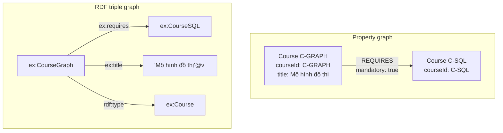
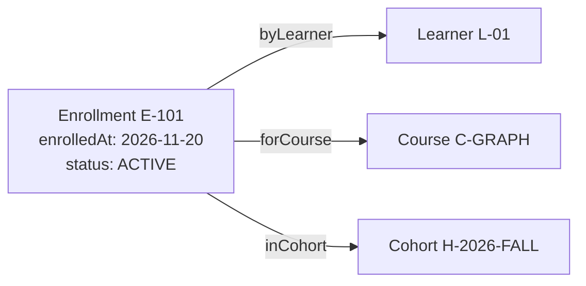

# Phân biệt đồ thị thuộc tính với mô hình bộ ba RDF

Một mạng dữ liệu có thể được biểu diễn theo nhiều cách. Với câu “khóa *Mô hình đồ thị* yêu cầu học *SQL cơ bản* trước”, **đồ thị thuộc tính** (*property graph*) thường biểu diễn hai đỉnh `Course` và một cạnh `REQUIRES`. Trong **RDF** (*Resource Description Framework*), cùng sự thật được biểu diễn bằng một **bộ ba** (*triple*) gồm chủ thể, vị từ và đối tượng. Nhìn bên ngoài, cả hai đều có “nút” và “mũi tên”, nhưng cách định danh, cách đặt thuộc tính, quy tắc ngữ nghĩa, công cụ truy vấn và cơ chế mở rộng khác nhau đáng kể.

Bài học thuộc chương **Mô hình đồ thị** của **DATABASE_DATA_MODELING**. Mục tiêu của học phần là rèn kỹ năng chuyển yêu cầu nghiệp vụ thành thực thể, quan hệ, ràng buộc, chuẩn hóa, khóa, chỉ mục và lược đồ vật lý; từ đó so sánh mô hình quan hệ, document, đồ thị và phân tích để chọn giải pháp dễ tiến hóa, dễ kiểm chứng. Ở đây, chúng ta so sánh **property graph và RDF như hai cách mô hình hóa dữ liệu** trước khi chọn bất kỳ hệ quản trị cụ thể nào.

Sau bài này, bạn có thể:

- Đọc và giải thích một đồ thị thuộc tính bằng **đỉnh, cạnh, nhãn, thuộc tính**, và một đồ thị RDF bằng **subject, predicate, object**.
- Nhận diện sự khác nhau giữa **nhãn trên đỉnh**, **kiểu cạnh**, **IRI**, **literal**, **blank node** và các quan hệ `rdf:type`.
- Biểu diễn cùng một yêu cầu nghiệp vụ bằng property graph và RDF mà vẫn giữ đúng **định danh, vai trò và lịch sử sự kiện**.
- So sánh **Cypher** với **SPARQL**, đặc biệt truy vấn trực tiếp, nhiều bước và truy vấn theo kiểu thực thể.
- Phân biệt **suy luận ngữ nghĩa** (RDFS/OWL) với **xác thực ràng buộc** (SHACL, constraint hoặc logic ứng dụng).
- Lựa chọn mô hình theo truy vấn, tính liên thông giữa các hệ thống, quy tắc dữ liệu và khả năng vận hành.

## 1. Hai họ mô hình đồ thị giải quyết những câu hỏi gì?

### 1.1. Property graph: đối tượng và liên kết mang thuộc tính

Trong **property graph**, ta thường có:

- **Đỉnh** (*node/vertex*) đại diện một đối tượng, chẳng hạn `Course`, `Learner` hoặc `Skill`.
- **Cạnh** (*relationship/edge*) nối các đỉnh, có loại và thường có hướng, như `REQUIRES`, `COMPLETED`.
- **Nhãn** (*label*) phân loại đỉnh, như `:Course` và `:Learner`.
- **Thuộc tính** (*property*) là các cặp khóa–giá trị trên đỉnh hoặc cạnh, như `courseId`, `title`, `completedAt`.

Ví dụ theo ký pháp gần với Cypher:

```text
(:Course {courseId: "C-GRAPH", title: "Mô hình đồ thị"})
  -[:REQUIRES {mandatory: true}]->
(:Course {courseId: "C-SQL", title: "SQL cơ bản"})
```

Thuộc tính `mandatory` nằm **trên cạnh `REQUIRES`**, vì nó mô tả chính quan hệ tiên quyết. Property graph thường thuận tiện cho truy vấn xuất phát từ một đối tượng rồi duyệt các cạnh có loại cụ thể, như “đi tới mọi khóa tiên quyết” hoặc “tìm láng giềng của tài khoản này”.

Đây là **mô hình dữ liệu**, không phải tên của một sản phẩm. Các hệ property graph có thể khác nhau về đa nhãn, kiểu dữ liệu property, khả năng lưu nhiều cạnh song song, constraint, ngôn ngữ truy vấn và thuật toán hỗ trợ.

### 1.2. RDF: phát biểu dữ liệu thành các bộ ba

**RDF** là mô hình do W3C chuẩn hóa để mô tả các **tài nguyên** (*resource*) và mối liên hệ bằng những phát biểu dạng:

```text
(subject, predicate, object)
(chủ thể, vị từ, đối tượng)
```

Ví dụ khái niệm:

```text
(khóa C-GRAPH, yêu cầu, khóa C-SQL)
(khóa C-GRAPH, có tiêu đề, "Mô hình đồ thị")
(khóa C-GRAPH, thuộc loại, Course)
```

Một bộ ba xác nhận **một phát biểu**. Tập các bộ ba hình thành đồ thị RDF: khi đối tượng của một bộ ba là tài nguyên, các bộ ba có thể nối thành đường đi.

- **Subject**: tài nguyên được mô tả, thường được nhận diện bằng IRI hoặc là một blank node.
- **Predicate**: IRI biểu thị loại quan hệ hoặc thuộc tính; vị từ là thành phần mang ngữ nghĩa của phát biểu.
- **Object**: tài nguyên (IRI hoặc blank node) **hoặc** giá trị literal như chuỗi, số, ngày có kiểu.

RDF có hệ sinh thái các chuẩn liên quan: **Turtle** để viết dữ liệu dễ đọc, **SPARQL** để truy vấn, **RDFS/OWL** để diễn đạt từ vựng và suy luận, **SHACL** để kiểm tra hình dạng/ràng buộc dữ liệu. Sử dụng RDF **không bắt buộc** phải sử dụng OWL hoặc reasoning; một kho RDF có thể chỉ lưu và truy vấn các bộ ba tường minh.

### 1.3. Minh họa cùng một nội dung



Khác biệt quan trọng không chỉ nằm ở **cách vẽ**. Trong phần RDF, `ex:title` và `rdf:type` cũng là **vị từ tạo bộ ba**, thay vì các cặp property hoặc nhãn được lưu theo cùng cơ chế với property graph.

## 2. Cấu trúc RDF: IRI, literal và blank node

### 2.1. IRI: định danh tài nguyên và vị từ

**IRI** (*Internationalized Resource Identifier*) là định danh cho tài nguyên và cho các vị từ. Nó có thể dùng cú pháp tương tự URL nhưng **không đòi hỏi mọi IRI phải là một trang web có thể tải về**. Trong hệ tri thức liên thông, thường nên có chiến lược IRI ổn định, phân vùng tên rõ ràng và tài liệu từ vựng công khai hoặc nội bộ.

Ví dụ:

```text
https://example.org/learning/course/C-GRAPH
https://example.org/learning/course/C-SQL
https://example.org/vocab/requires
```

Khi viết Turtle, ta có thể khai báo prefix để rút gọn IRI dài:

```turtle
@prefix ex: <https://example.org/learning/> .
@prefix xsd: <http://www.w3.org/2001/XMLSchema#> .

ex:CourseGraph
    a ex:Course ;
    ex:courseId "C-GRAPH" ;
    ex:title "Mô hình đồ thị"@vi ;
    ex:requires ex:CourseSQL .

ex:CourseSQL
    a ex:Course ;
    ex:courseId "C-SQL" ;
    ex:title "SQL cơ bản"@vi ;
    ex:durationMinutes 180 .
```

Trong Turtle:

- `ex:CourseGraph` là dạng viết tắt một IRI theo prefix `ex:`.
- `a` là ký pháp rút gọn cho `rdf:type`, tức phát biểu tài nguyên thuộc lớp `ex:Course`.
- Dấu `;` nhóm nhiều phát biểu có cùng chủ thể; dấu `.` kết thúc một nhóm phát biểu.
- `"Mô hình đồ thị"@vi` là chuỗi có **nhãn ngôn ngữ tiếng Việt**.
- `180` là literal số nguyên; `"C-GRAPH"` là literal chuỗi.
- `ex:requires` là **IRI của vị từ**; nó không phải một chuỗi tự do chỉ dùng trong truy vấn.

Các tên `ex:Course`, `ex:requires`, `ex:courseId` trong ví dụ là **từ vựng do ứng dụng định nghĩa**. Chỉ đặt tên không tự tạo luật tiên quyết, ràng buộc bội số hoặc suy luận.

### 2.2. Literal khác IRI

Đối tượng trong RDF có thể là **literal** hoặc một **tài nguyên**:

```turtle
ex:CourseGraph ex:courseId "C-GRAPH" .
ex:CourseGraph ex:title "Mô hình đồ thị"@vi .
ex:CourseGraph ex:requires ex:CourseSQL .
```

Trong ba phát biểu:

- `"C-GRAPH"` là giá trị chuỗi; nó không tự trỏ tới đỉnh/tài nguyên khác.
- `"Mô hình đồ thị"@vi` là literal có ngôn ngữ.
- `ex:CourseSQL` là tài nguyên có IRI; từ đó có thể truy vấn tiếp những phát biểu về chính khóa ấy.

Nếu muốn mở rộng một giá trị thành đối tượng có danh tính, cần dùng IRI hoặc blank node phù hợp, thay vì lưu mọi thông tin vào literal. Chẳng hạn `Skill` có thể là tài nguyên riêng nếu nhiều khóa học cùng dạy kỹ năng đó và kỹ năng có quan hệ tiên quyết riêng.

### 2.3. Blank node: tài nguyên chưa được đặt tên toàn cục

RDF cho phép **blank node** (nút trắng) làm tài nguyên không có IRI do ứng dụng đặt. Nó có ích cho cấu trúc phụ trợ hoặc đối tượng mà chưa cần định danh công khai.

```turtle
ex:CourseGraph ex:hasAudience [
    ex:minimumLevel "INTERMEDIATE" ;
    ex:language "vi"
] .
```

Phần trong `[ ... ]` tạo một blank node diễn đạt thông tin khán giả. Nó vẫn có thể nối nhiều bộ ba, nhưng **không phải định danh nghiệp vụ bền vững để các hệ thống khác trỏ tới**. Nhãn blank node trong một bản tuần tự hóa (nếu có) không nên dùng làm khóa tích hợp.

Với `Course`, `Learner`, `Order` hoặc `Enrollment` có định danh nghiệp vụ rõ ràng và cần trao đổi giữa hệ thống, IRI ổn định thường thích hợp hơn.

### 2.4. RDF là tập phát biểu, không phải danh sách cạnh tùy ý

RDF graph được mô hình như một **tập các bộ ba**. Hai bản sao **giống hệt** của cùng một bộ ba không tạo thành hai phát biểu khác nhau trong ngữ nghĩa tập hợp. Ngược lại, property graph thường có thể có **hai cạnh song song riêng biệt** giữa cùng hai đỉnh, kể cả cùng loại, theo khả năng của hệ quản trị.

Điều đó trở nên quan trọng với sự kiện lặp lại: hai lần đăng ký cùng một người vào cùng khóa có thể là **hai sự kiện khác nhau** với hai mã, học kỳ và thời gian. Không thể chỉ ghi lặp lại bộ ba `(Learner, ex:enrolledIn, Course)` rồi mong RDF tự phân biệt hai lượt.

## 3. Property graph biểu diễn điều tương đương như thế nào?

Với cùng dữ liệu khóa học, trong Cypher có thể tạo các đỉnh và cạnh:

```cypher
// Ví dụ Neo4j Cypher, chạy trên cơ sở dữ liệu thử nghiệm trống.
CREATE
  (graph:Course {
    courseId: 'C-GRAPH',
    title: 'Mô hình đồ thị',
    durationMinutes: 240
  }),
  (sql:Course {
    courseId: 'C-SQL',
    title: 'SQL cơ bản',
    durationMinutes: 180
  }),
  (graph)-[:REQUIRES {mandatory: true}]->(sql);
```

Trong ký pháp này, `Course` là **nhãn trên đỉnh**. `courseId`, `title`, `durationMinutes` là **thuộc tính của đỉnh**. `REQUIRES` là **loại cạnh**, còn `mandatory` là **thuộc tính của cạnh**. Biến `graph` và `sql` chỉ có nghĩa trong câu lệnh, không phải khóa định danh tồn tại vĩnh viễn trong cơ sở dữ liệu.

Một hệ property graph có thể cho phép nhiều nhãn trên cùng đỉnh, ví dụ `(:Person:Instructor)`. **Nhãn** là công cụ phân loại, tra cứu và biểu đạt mô hình; bản thân chúng không đương nhiên mang ngữ nghĩa kiểu `rdfs:subClassOf` hoặc những quy tắc suy luận OWL.

Khi mô hình hóa dữ liệu liên thông, đỉnh vẫn nên có **ID nghiệp vụ ổn định** và có thể lưu thêm IRI từ hệ chuẩn. Không nên coi ID nội bộ do engine cấp là định danh thích hợp để xuất/nhập giữa các cơ sở dữ liệu khác nhau.

## 4. Bảng đối chiếu bốn thành phần

| Khía cạnh | Property graph | RDF |
| --- | --- | --- |
| Đối tượng chính | Đỉnh có nhãn và thuộc tính | Tài nguyên là chủ thể/đối tượng của các bộ ba |
| Danh tính | ID nghiệp vụ/khóa ứng dụng; engine có thể có ID nội bộ | IRI ổn định hoặc blank node |
| Quan hệ | Cạnh có loại, thường có hướng | Bộ ba với **predicate là IRI** |
| Giá trị mô tả | Thuộc tính trên đỉnh hoặc cạnh | Bộ ba có object là literal |
| Loại đối tượng | Nhãn đỉnh, ví dụ `:Course` | `rdf:type ex:Course` |
| Thuộc tính của chính quan hệ | Thường đặt trực tiếp trên cạnh | Cần một cấu trúc bổ sung nếu muốn mô tả **một phát biểu hoặc một lần quan hệ** |
| Quan hệ lặp cùng hai đầu | Có thể có nhiều cạnh song song tùy hệ | Bộ ba giống hệt không phân biệt nhiều lần xảy ra; mô hình sự kiện riêng |
| Truy vấn thường gặp | Cypher, GQL hoặc ngôn ngữ phù hợp sản phẩm | SPARQL |
| Ngữ nghĩa suy luận | Không mặc nhiên có một hệ suy luận chuẩn chung | RDF/RDFS/OWL có đặc tả ngữ nghĩa và suy luận theo lựa chọn |
| Kiểm tra ràng buộc | Constraint/transaction/logic ứng dụng tùy hệ | SHACL hoặc công cụ kiểm tra; OWL không thay thế validation |
| Liên thông | Có thể xuất/nhập hoặc tự xây quy ước định danh | IRI, bộ ba và từ vựng chuẩn giúp công bố/tích hợp tri thức |
| Tối ưu truy vấn | Phụ thuộc workload, engine và chỉ mục | Phụ thuộc workload, store và chiến lược chỉ mục |

**Không nên kết luận mô hình nào “mạnh hơn” chỉ từ bảng này.** Một hệ property graph có thể hỗ trợ liên thông, ontology hoặc thuật toán phức tạp qua phần mở rộng; một hệ RDF có thể xử lý duyệt nhiều bước, rule và analytics. Cách chọn phải dựa trên yêu cầu và các tính năng **có thật** của sản phẩm được triển khai.

## 5. Cùng một yêu cầu, hai cách lưu và hai cách truy vấn

### 5.1. Dữ liệu khóa tiên quyết trong RDF

Dùng các bộ ba:

```turtle
@prefix ex: <https://example.org/learning/> .

ex:Graph a ex:Course ;
    ex:courseId "C-GRAPH" ;
    ex:title "Mô hình đồ thị"@vi ;
    ex:requires ex:Model ;
    ex:requires ex:Algorithm .

ex:Model a ex:Course ;
    ex:courseId "C-MODEL" ;
    ex:requires ex:SQL .

ex:Algorithm a ex:Course ;
    ex:courseId "C-ALGO" ;
    ex:requires ex:Programming .

ex:Programming a ex:Course ;
    ex:courseId "C-PROG" ;
    ex:requires ex:SQL .

ex:SQL a ex:Course ;
    ex:courseId "C-SQL" ;
    ex:title "SQL cơ bản"@vi .
```

Ở đây, `ex:Graph` có hai quan hệ `ex:requires`. Những tài nguyên trung gian và đích có thể được duyệt tiếp theo cùng vị từ.

### 5.2. SPARQL: tiên quyết trực tiếp

```sparql
PREFIX ex: <https://example.org/learning/>

SELECT ?prerequisite
WHERE {
  ex:Graph ex:requires ?prerequisite .
}
ORDER BY ?prerequisite
```

Kết quả là `ex:Model` và `ex:Algorithm`. Trong SPARQL, `?prerequisite` là biến trong mẫu bộ ba; dấu chấm kết thúc mẫu phát biểu.

### 5.3. SPARQL: tiên quyết trực tiếp và gián tiếp

SPARQL 1.1 hỗ trợ **property paths**. Toán tử `+` sau vị từ nghĩa là đi qua **một hoặc nhiều lần** quan hệ đó:

```sparql
PREFIX ex: <https://example.org/learning/>

SELECT DISTINCT ?prerequisite
WHERE {
  ex:Graph ex:requires+ ?prerequisite .
}
ORDER BY ?prerequisite
```

Trên dữ liệu mẫu, ta thu được bốn tài nguyên: `ex:Model`, `ex:Algorithm`, `ex:Programming`, `ex:SQL`. `ex:SQL` có thể tới được qua **hai chuỗi liên kết**, nhưng trong yêu cầu “tập đích” nó chỉ xuất hiện một lần.

Một **property path** như `ex:requires+` dùng để khớp các cặp điểm đầu–đích đáp ứng biểu thức đường đi. **Không đồng nghĩa** với việc SPARQL tự trả về danh sách từng đỉnh/cạnh trên mọi đường đi để giải thích lộ trình. Nếu nghiệp vụ cần các đường đi tường minh, điểm số, tất cả đường ngắn nhất hoặc thuật toán đặc biệt, phải xác định khả năng của sản phẩm và chiến lược truy vấn bổ sung.

### 5.4. Cypher: truy vấn tương đương

Trong property graph có các đỉnh `Course` và cạnh `REQUIRES` tương ứng, một mẫu Cypher minh họa:

```cypher
MATCH (start:Course {courseId: 'C-GRAPH'})
      -[:REQUIRES*1..5]->(prereq:Course)
RETURN DISTINCT prereq.courseId AS prerequisiteId
ORDER BY prerequisiteId;
```

`*1..5` chọn đường đi có độ dài từ một đến năm cạnh trong cú pháp Neo4j Cypher minh họa. **Giới hạn năm bước là lựa chọn của truy vấn**, nên nếu đồ thị thật có chuỗi dài hơn, kết quả có thể thiếu.

Hai mẫu cho ý nghĩa “có thể đi qua nhiều liên kết `requires`” là tương tự ở mức nghiệp vụ, nhưng không nên coi chúng là **phép dịch cú pháp một–một**: SPARQL property paths và Cypher variable-length patterns có các quy tắc khác nhau về tập kết quả, trùng lặp, đường đi, chu trình và giới hạn. Cần kiểm thử kết quả trên dữ liệu thật.

### 5.5. Tra cứu theo định danh trong hai mô hình

Trong property graph, người dùng có thể tìm theo `courseId`:

```cypher
MATCH (c:Course {courseId: $courseId})
RETURN c.courseId AS courseId, c.title AS title;
```

Trong RDF, nếu ứng dụng đã có IRI chuẩn cho mã khóa, có thể truy vấn trực tiếp **tài nguyên đó**:

```sparql
PREFIX ex: <https://example.org/learning/>

SELECT ?title
WHERE {
  ex:Graph ex:title ?title .
}
```

Nếu chỉ biết chuỗi mã bên ngoài, có thể tìm qua literal `ex:courseId` hoặc ánh xạ mã sang IRI tại tầng ứng dụng. **IRI của tài nguyên** và **giá trị mã nghiệp vụ trong literal** là hai khái niệm khác nhau, dù một hệ thống có thể quy ước tạo IRI từ mã ổn định.

## 6. Quan hệ có thuộc tính: khác biệt thiết kế rất quan trọng

Câu nghiệp vụ:

> Học viên L-01 đăng ký khóa C-GRAPH vào ngày 20/11/2026, trạng thái đang học, thuộc lớp H-2026-FALL.

Có thể đơn giản hóa thành cạnh `ENROLLED_IN` giữa hai đối tượng. Nhưng khi cần lưu **học kỳ, thời điểm, thanh toán, lần đăng ký lại hoặc phê duyệt**, ta cần xét **mỗi lần đăng ký** là một đối tượng nghiệp vụ hay chỉ là một thuộc tính của cặp học viên–khóa học.

### 6.1. Property graph: cạnh có thuộc tính

Với trường hợp **mỗi cặp học viên–khóa học chỉ có một đăng ký** và không có đối tượng khác tham chiếu tới đăng ký đó:

```cypher
MATCH (learner:Learner {learnerId: 'L-01'})
MATCH (course:Course {courseId: 'C-GRAPH'})
CREATE (learner)-[:ENROLLED_IN {
  enrolledAt: date('2026-11-20'),
  status: 'ACTIVE'
}]->(course);
```

`enrolledAt` và `status` thuộc **mối quan hệ**. Việc đặt chúng trực tiếp trên cạnh là tự nhiên trong property graph. Đoạn `CREATE` chỉ minh họa cấu trúc; nếu chạy lặp lại có thể tạo cạnh trùng, vì vậy cần thiết kế khóa/lần đăng ký và cách ghi có thể chạy lại theo nghiệp vụ.

### 6.2. RDF: tạo tài nguyên `Enrollment` mang sự kiện

RDF không có một trường “property trên cạnh bộ ba” với cùng ý nghĩa primitive như property graph. Một cách ổn định, dễ liên thông là tạo **tài nguyên cho lần đăng ký** rồi liên kết tới hai bên:

```turtle
@prefix ex:  <https://example.org/learning/> .
@prefix xsd: <http://www.w3.org/2001/XMLSchema#> .

ex:EnrollmentE101 a ex:Enrollment ;
    ex:enrollmentId "E-101" ;
    ex:byLearner ex:LearnerL01 ;
    ex:forCourse ex:Graph ;
    ex:inCohort ex:CohortFall2026 ;
    ex:enrolledAt "2026-11-20"^^xsd:date ;
    ex:status "ACTIVE" .

ex:LearnerL01 a ex:Learner ;
    ex:learnerId "L-01" .

ex:Graph a ex:Course ;
    ex:courseId "C-GRAPH" .

ex:CohortFall2026 a ex:Cohort ;
    ex:cohortId "H-2026-FALL" .
```

Sơ đồ:



Đỉnh `Enrollment` có **danh tính riêng**, cho phép hai lần đăng ký cùng một học viên vào cùng một khóa ở các học kỳ khác nhau được phân biệt bằng `enrollmentId`. Những tài nguyên như `Payment` hoặc `Approval` cũng có thể liên kết tới đúng lượt đăng ký.

Một property graph **cũng có thể dùng đỉnh `Enrollment` và các cạnh vai trò tương tự**. Khác biệt là property graph **có thêm lựa chọn** đặt dữ liệu trực tiếp trên cạnh khi đủ đơn giản; RDF thường cần mô hình thêm tài nguyên hoặc kỹ thuật diễn đạt metadata khác nếu muốn mô tả **một phát biểu cụ thể**.

### 6.3. SPARQL: tìm những lần đăng ký của một người

```sparql
PREFIX ex: <https://example.org/learning/>

SELECT ?enrollment ?course ?enrolledAt ?status
WHERE {
  ?enrollment a ex:Enrollment ;
      ex:byLearner ex:LearnerL01 ;
      ex:forCourse ?course ;
      ex:enrolledAt ?enrolledAt ;
      ex:status ?status .
}
ORDER BY ?enrolledAt
```

Truy vấn giữ nguyên **bộ thông tin cùng một lượt đăng ký**. Không tách các bộ ba `Learner → Course` và `Learner → Cohort` ra riêng rồi suy ra tổ hợp khóa/lớp bất kỳ, vì có thể tạo quan hệ chưa từng xảy ra.

### 6.4. Metadata của phát biểu khác metadata của sự kiện

Một phát biểu RDF như:

```turtle
ex:Graph ex:requires ex:SQL .
```

có thể cần thông tin “ai đưa ra quy tắc?”, “nguồn nào công bố?” và “quy tắc có hiệu lực khi nào?”. Có **nhiều cách diễn đạt** và chúng không tương đương trong mọi tình huống:

| Kỹ thuật | Dùng để làm gì? | Lưu ý |
| --- | --- | --- |
| **Tài nguyên quy tắc/sự kiện riêng** | Mô hình `RequirementRule` có ID, nguồn, thời gian, trạng thái rồi nối tới các khóa | Rõ khi quy tắc có vòng đời hoặc nhiều bên; thêm bộ ba |
| **RDF reification truyền thống** | Có các bộ ba mô tả chủ thể/vị từ/đối tượng của một phát biểu | Việc mô tả phát biểu **không tự khẳng định** phát biểu gốc là đúng trong graph |
| **Named graph trong RDF dataset** | Gom một tập bộ ba theo tên graph, ví dụ bộ dữ liệu do nguồn X xuất bản | Phù hợp provenance ở cấp graph; không mặc nhiên cung cấp metadata riêng cho từng bộ ba |
| **RDF-star / các cơ chế triple term tương ứng** | Diễn đạt metadata gắn với một phát biểu bằng cú pháp/cấu trúc mở rộng | Hỗ trợ và ngữ nghĩa tùy chuẩn/phiên bản/sản phẩm; cần kiểm tra công cụ đang dùng |

**Đừng lẫn “thời gian một phát biểu được công bố” với “thời gian sự kiện thực tế diễn ra”.** Một hệ thống nhập quy tắc vào ngày 25/11 nhưng quy tắc có hiệu lực từ 01/11; nếu chỉ lưu ngày nhập, truy vấn lịch sử hiệu lực có thể sai.

## 7. RDF có lớp và suy luận; property graph có nhãn nhưng không mặc nhiên suy luận

### 7.1. `rdf:type` khác nhãn đỉnh

Trong RDF, ta có thể ghi:

```turtle
@prefix ex:   <https://example.org/learning/> .
@prefix rdfs: <http://www.w3.org/2000/01/rdf-schema#> .

ex:Instructor rdfs:subClassOf ex:Person .
ex:Alice a ex:Instructor .
```

Theo ngữ nghĩa RDFS, một bộ suy luận phù hợp có thể suy ra rằng `ex:Alice` cũng là một `ex:Person`. Điều này dựa trên **quan hệ lớp con được khai báo** và các quy tắc suy luận, không phải chỉ vì chữ “Instructor” giống “Person”.

Trong property graph:

```text
(:Instructor {name: "Alice"})
```

việc có nhãn `Instructor` **không tự có nghĩa** đỉnh thuộc nhãn `Person`. Có thể gắn cả hai nhãn `(:Person:Instructor)` hoặc quản lý phân cấp loại ở ứng dụng, nhưng khả năng suy luận không được mặc định bởi cú pháp nhãn.

### 7.2. RDFS, OWL và ontology

RDF cung cấp hình thức phát biểu cơ bản. **RDFS** giúp mô tả các lớp, thuộc tính, quan hệ lớp con/thuộc tính con, domain và range. **OWL** mở rộng khả năng diễn đạt ontology, ví dụ các quan hệ lớp, tương đương danh tính và nhiều điều kiện logic, tùy cấu hình suy luận.

Những khả năng này hữu ích khi:

- Nhiều tổ chức cần **chia sẻ cùng ý nghĩa** của dữ liệu.
- Bộ phân loại có quan hệ **lớp con**, **thuộc tính con**, hoặc cần khớp từ vựng khác nhau.
- Truy vấn cần bao gồm **sự thật được suy ra**, ngoài những bộ ba viết trực tiếp.
- Dữ liệu được liên kết với các nguồn tri thức khác có IRI và ontology thống nhất.

Ví dụ, khi hai đội gọi cùng khái niệm “Instructor” và “Teacher”, việc giải thích chúng **tương đương hay khác nhau** là một quyết định ontology; chỉ đổi tên cột hoặc nhãn không làm hệ thống có quy tắc suy luận.

**Suy luận không phải phép kiểm tra dữ liệu đầu vào theo kiểu SQL constraint.** Trong các ngữ nghĩa OWL có tính mở, một thiếu hụt dữ liệu hoặc một số kiểu mâu thuẫn có thể được xử lý theo logic khác với “reject bản ghi” trong ứng dụng giao dịch.

### 7.3. Giả định thế giới mở và thế giới đóng

RDF và OWL thường được giải thích theo **giả định thế giới mở** (*Open World Assumption, OWA*): nếu graph **không có** bộ ba `ex:Alice ex:hasCertificate ex:SQLCertificate`, điều đó **không đủ chứng minh** Alice không có chứng chỉ; có thể hệ thống chưa biết hoặc chưa nhập nguồn.

Trong ứng dụng tác nghiệp, nhiều quy tắc được kiểm theo hướng **thế giới đóng** trong phạm vi dữ liệu kiểm soát: nếu trong cơ sở dữ liệu đã xác minh không có chứng chỉ đạt yêu cầu, hệ thống có thể quyết định **chưa đủ điều kiện đăng ký**.

Hai điều này trả lời **hai loại câu hỏi khác nhau**:

- “Graph tri thức hiện **khẳng định điều gì** và có thể suy ra điều gì?”
- “Hệ thống nghiệp vụ **đủ bằng chứng đã xác minh** để cho phép hành động chưa?”

Một truy vấn SPARQL `FILTER NOT EXISTS` có thể tìm dữ liệu **không xuất hiện trong dataset đang truy vấn**, nhưng **không biến sự thiếu vắng đó thành phủ định logic toàn cục** theo OWA.

Property graph cũng không mặc nhiên chứa đầy đủ thế giới thực. Việc một query Cypher không tìm thấy cạnh không có nghĩa ngoài đời quan hệ không tồn tại. Sự khác nhau là RDF/RDFS/OWL có hệ ngữ nghĩa chuẩn để diễn giải phát biểu và suy luận, trong khi quyết định cho phép giao dịch vẫn do yêu cầu và quy tắc kiểm chứng của ứng dụng.

## 8. Xác thực dữ liệu: SHACL khác OWL và khác uniqueness constraint

Một mô hình phải trả lời “dữ liệu này **hợp lệ** để hệ thống xử lý chưa?”, bên cạnh câu “dữ liệu này **mang ý nghĩa gì**?”.

### 8.1. Ràng buộc trong property graph

Trong Neo4j Cypher, có thể đặt uniqueness constraint trên định danh khóa:

```cypher
CREATE CONSTRAINT course_id_unique IF NOT EXISTS
FOR (c:Course) REQUIRE c.courseId IS UNIQUE;

CREATE CONSTRAINT enrollment_id_unique IF NOT EXISTS
FOR (e:Enrollment) REQUIRE e.enrollmentId IS UNIQUE;
```

Constraint này quản lý **tính duy nhất của thuộc tính ID khi có giá trị**, không tự bảo đảm mỗi `Enrollment` có đúng một `Learner`, đúng một `Course`, hoặc không được thiếu ngày đăng ký. Những điều kiện bội số xuyên đỉnh/cạnh có thể cần giao dịch, logic ứng dụng hoặc chức năng constraint riêng tùy sản phẩm và phiên bản.

### 8.2. SHACL: kiểm tra hình dạng đồ thị RDF

**SHACL** (*Shapes Constraint Language*) cho phép định nghĩa shape để **kiểm tra một data graph** so với yêu cầu cấu trúc. Ví dụ, mỗi tài nguyên `Enrollment` phải có đúng một người học, một khóa và một thời điểm đăng ký:

```turtle
@prefix ex:  <https://example.org/learning/> .
@prefix sh:  <http://www.w3.org/ns/shacl#> .
@prefix xsd: <http://www.w3.org/2001/XMLSchema#> .

ex:EnrollmentShape
    a sh:NodeShape ;
    sh:targetClass ex:Enrollment ;
    sh:property [
        sh:path ex:byLearner ;
        sh:minCount 1 ;
        sh:maxCount 1 ;
        sh:class ex:Learner
    ] ;
    sh:property [
        sh:path ex:forCourse ;
        sh:minCount 1 ;
        sh:maxCount 1 ;
        sh:class ex:Course
    ] ;
    sh:property [
        sh:path ex:enrolledAt ;
        sh:minCount 1 ;
        sh:maxCount 1 ;
        sh:datatype xsd:date
    ] .
```

Shape này là một **quy tắc validation** trên data graph được chọn. Nó không tự kiểm tra **tài nguyên học viên và khóa có ID nghiệp vụ duy nhất**, cũng không tự ép kho RDF từ chối mọi lần ghi sai. Cần xác định **khi nào chạy validation**, cách xử lý báo cáo vi phạm, hiệu lực của entailment nếu có và cách đồng bộ với luồng ghi.

### 8.3. Tính duy nhất trong RDF phải được quy định cụ thể

IRI giúp định danh **tài nguyên**: nếu mọi nguồn dùng cùng một IRI chuẩn cho một `Course` thì các phát biểu về nó có thể được kết hợp. Nhưng một kho RDF vẫn có thể chứa:

```turtle
ex:CourseA ex:courseId "C-GRAPH" .
ex:CourseB ex:courseId "C-GRAPH" .
```

Đây là **hai IRI khác nhau** cùng mang literal `courseId` như nhau. RDF tự thân **không tự coi chúng là cùng tài nguyên hoặc từ chối bộ ba thứ hai** vì trùng giá trị chuỗi. Để duy trì quy tắc duy nhất của mã nghiệp vụ, cần chính sách cấp IRI, validation (ví dụ kiểm tra SPARQL/SHACL phù hợp) và quy trình nhập dữ liệu có kiểm soát.

Một số ontology có thể phát biểu ràng buộc logic dẫn đến **suy luận về cùng danh tính** thay vì phát sinh lỗi kiểu “unique key violation”. Vì thế không nên xem khai báo OWL là phép thay thế trực tiếp cho uniqueness constraint trong cơ sở dữ liệu giao dịch.

### 8.4. Bảng phân biệt nhiệm vụ

| Công cụ/cơ chế | Câu hỏi chính |
| --- | --- |
| Khóa nghiệp vụ và uniqueness constraint trong property graph | Có được tồn tại hai đỉnh cùng khóa theo quy tắc không? |
| Logic giao dịch, kiểm tra bội số | Mỗi sự kiện đã có đủ các cạnh đúng vai trò chưa? |
| RDF/RDFS/OWL | Các phát biểu mang ý nghĩa gì; có thể suy ra thêm điều gì theo ngữ nghĩa đã khai báo? |
| SHACL | Data graph có tuân theo shapes/ràng buộc đã khai báo không? |
| Quy trình entity resolution | Hai bản ghi/IRI thực sự mô tả cùng đối tượng ngoài đời không? |

Công việc thiết kế dữ liệu tốt thường cần **kết hợp** các lớp này thay vì kỳ vọng một ngôn ngữ giải quyết toàn bộ.

## 9. Định danh, liên thông và nguồn gốc dữ liệu

### 9.1. RDF phát huy lợi thế khi cần hợp nhất tri thức nhiều nguồn

Một tổ chức cung cấp taxonomy kỹ năng, một tổ chức khác cung cấp khóa học và tổ chức thứ ba cung cấp chứng chỉ. Nếu tất cả dùng các **IRI bền vững** và một từ vựng chung/ánh xạ được, ta có thể liên kết các nguồn mà không phải chuyển mọi định danh thành một bộ nhãn cục bộ.

Ví dụ:

```turtle
@prefix ex: <https://example.org/learning/> .
@prefix sk: <https://example.org/skills/> .

ex:Graph ex:teachesSkill sk:GraphModeling .
ex:AdvancedGraphs ex:requiresSkill sk:GraphModeling .
```

`sk:GraphModeling` là một tài nguyên được tham chiếu từ nhiều phát biểu. Muốn dữ liệu liên thông đúng, vẫn cần thống nhất **ý nghĩa, phạm vi và quản trị IRI**. Hai IRI khác nhau cùng có nhãn “Graph modeling” **không tự là cùng kỹ năng**.

### 9.2. Prefix không phải cam kết về danh tính

`ex:Graph` chỉ là một cách viết rút gọn. Nếu hai tập dữ liệu cùng viết `ex:Graph` nhưng khai báo `ex:` thành **hai IRI gốc khác nhau**, chúng **không trỏ cùng tài nguyên**. Ngược lại, hai prefix khác nhau nhưng mở rộng ra **cùng IRI** thì vẫn định danh cùng tài nguyên.

Khi xuất/nhập RDF, cần kiểm tra IRI đầy đủ và chính sách phiên bản/đổi tên thay vì so sánh chỉ phần sau prefix.

### 9.3. Named graphs và provenance

Một **RDF dataset** có thể chứa default graph và các **named graph**. Named graph cho phép nhóm các bộ ba theo nguồn, phiên bản hoặc tập nhập tùy thiết kế. Một ví dụ bằng TriG:

```trig
@prefix ex: <https://example.org/learning/> .

ex:Curriculum2026 {
    ex:Graph ex:requires ex:Model .
    ex:Model ex:requires ex:SQL .
}

ex:Curriculum2025 {
    ex:Graph ex:requires ex:SQL .
}
```

Tùy cách tổ chức dataset, truy vấn một graph cụ thể có thể sử dụng `GRAPH`:

```sparql
PREFIX ex: <https://example.org/learning/>

SELECT ?prerequisite
WHERE {
  GRAPH ex:Curriculum2026 {
    ex:Graph ex:requires ?prerequisite .
  }
}
```

**Named graph giúp tổ chức tập phát biểu theo ngữ cảnh**, nhưng không tự chứng minh những phát biểu đó đáng tin, không tự đưa ra thời gian hiệu lực của từng bộ ba và không tự giải quyết vấn đề quyền truy cập. Những điều này cần quy ước metadata, nguồn xác thực và chính sách hệ thống.

Property graph cũng có thể biểu diễn nguồn gốc bằng `sourceId`, thời gian, đỉnh nguồn hoặc phân vùng dữ liệu theo khả năng sản phẩm. RDF có ưu thế ở **các chuẩn dữ liệu và ngữ nghĩa có thể trao đổi**, còn chất lượng provenance phụ thuộc cách thiết kế thực tế.

## 10. Truy vấn đường đi và hiệu năng: tránh những so sánh đơn giản

### 10.1. Cùng hình dạng đồ thị chưa chắc cùng cách xử lý

Với property graph, các cạnh có loại và thuộc tính có thể được lưu/truy vấn theo thiết kế engine cụ thể. Với RDF, kho dữ liệu thường tối ưu việc khớp bộ ba theo các thành phần `S/P/O` và các tổ hợp chỉ mục phù hợp; SPARQL có thể ghép nhiều mẫu và duyệt property paths.

Từ đó **không thể suy ra** mọi property graph luôn nhanh hơn RDF ở truy vấn nhiều bước, hoặc RDF luôn kém hơn ở nghiệp vụ tác nghiệp. Chênh lệch phụ thuộc:

- Kích thước dữ liệu, phân bố bậc đỉnh và số quan hệ cùng loại.
- Số bước duyệt, khả năng lọc sớm, chu trình và số đường đi khác nhau.
- Loại truy vấn: lấy điểm đích, giải thích đường, tìm đường tối ưu hay tổng hợp.
- Chỉ mục, thống kê, kế hoạch thực thi, khả năng cache và phần cứng.
- Quy tắc suy luận có bật hay không và cách materialize kết quả suy luận.
- Nhu cầu cập nhật, transaction, phân quyền, đồng bộ và giới hạn tài nguyên.

Một graph có đỉnh phổ biến nối tới hàng triệu sự kiện vẫn có thể rất tốn kém để duyệt qua, bất kể mô hình gốc là RDF hay property graph.

### 10.2. Không so sánh chỉ bằng số bộ ba hoặc số cạnh

Ví dụ một `Enrollment` trong property graph có thể là **một cạnh mang nhiều thuộc tính**. Trong RDF, mô hình `Enrollment` riêng tạo **nhiều bộ ba** cho vai trò, ngày, trạng thái và ID. So sánh “10 triệu bộ ba” với “2 triệu cạnh” mà không xét **ngữ nghĩa và cấu trúc dữ liệu được biểu diễn** sẽ dẫn tới kết luận sai.

Khi đo, hãy đặt cạnh nhau **cùng một yêu cầu nghiệp vụ**, cùng dữ liệu logic, cùng mức độ chi tiết, cùng tính nhất quán và kết quả mong đợi. Đánh giá độ trễ p50/p95/p99, throughput, kích thước chỉ mục, chi phí nhập/sửa và chất lượng câu trả lời.

### 10.3. Phân biệt truy vấn vận hành với truy vấn tri thức

| Workload | Yêu cầu chính | Cần kiểm chứng khi chọn công nghệ |
| --- | --- | --- |
| Chống gian lận theo các liên kết thiết bị/đơn hàng | Duyệt nhiều kiểu cạnh có thời gian, độ trễ tương tác | Query plan, bậc đỉnh lớn, dữ liệu nguồn và quyền truy cập |
| Quản lý khóa học và điểm số | Tính toàn vẹn giao dịch, khóa, bội số, báo cáo | Transaction, upsert, ràng buộc và tích hợp với SQL |
| Tri thức nhiều tổ chức | IRI liên thông, ontology, nhiều ngôn ngữ, suy luận | RDF/SPARQL/RDFS/OWL, quản trị từ vựng, chất lượng mapping |
| Khám phá phụ thuộc và đường đi | Đường có hướng, nhiều bước, giải thích, giới hạn | Cú pháp truy vấn/thuật toán, kiểm soát chu trình, hiệu năng |
| Tổng hợp KPI lớn | Quét và nhóm dữ liệu trên khối lượng cao | Data warehouse/analytical engine và khả năng xuất dữ liệu |

Nếu trọng tâm là giao dịch có cấu trúc và vài phép nối cố định, **relational** vẫn có thể phù hợp nhất. Nếu chủ yếu tải/ghi một đối tượng tổng hợp, **document** có thể thuận tiện. Chỉ nên thêm một hệ graph khi truy vấn hoặc yêu cầu ngữ nghĩa đem lại giá trị đủ rõ so với chi phí vận hành và đồng bộ.

## 11. Chuyển đổi giữa property graph và RDF: chỗ nào dễ mất nghĩa?

Chuyển đổi không chỉ là đổi tên `node` thành `subject` và `edge` thành `predicate`. Cần đưa ra quyết định ánh xạ rõ ràng.

### 11.1. Ánh xạ từ property graph sang RDF

Một chiến lược ban đầu:

| Property graph | RDF đề xuất | Lưu ý |
| --- | --- | --- |
| Đỉnh `Course` có `courseId` | IRI cho khóa học + `rdf:type ex:Course` | Xác định IRI ổn định và phạm vi uniqueness |
| Thuộc tính `Course.title` | Bộ ba `course ex:title "..."@vi` | Chọn literal ngôn ngữ/kiểu đúng |
| Cạnh `Course -[:REQUIRES]-> Course` | Bộ ba `course ex:requires otherCourse` | Định nghĩa nghĩa vị từ và hướng |
| Thuộc tính `REQUIRES.mandatory` | Tài nguyên quy tắc riêng hoặc cơ chế metadata phù hợp | Không có ánh xạ 1–1 đơn giản nếu cần metadata cho mỗi cạnh |
| Hai cạnh `ENROLLED_IN` song song | Hai tài nguyên `Enrollment` có ID riêng | Đừng gộp hai lần sự kiện vào một triple |
| Đỉnh nhiều nhãn `:Person:Instructor` | Nhiều bộ ba `rdf:type` hoặc mô hình lớp phù hợp | Suy luận lớp chỉ có nếu ontology/engine được thiết kế tương ứng |

Đặc biệt, **cạnh có ID riêng, nhiều thuộc tính hoặc nhiều lần giữa cùng cặp** phải được ánh xạ sao cho giữ được từng **lần quan hệ**, không chỉ giữ sự tồn tại của `(source, predicate, target)`.

### 11.2. Ánh xạ từ RDF sang property graph

Không phải mọi bộ ba RDF đều thành **cạnh giữa hai đỉnh**:

- Object là **literal**: thường phù hợp thành thuộc tính đỉnh, nhưng cần chính sách với nhiều giá trị cùng predicate, loại dữ liệu và nhãn ngôn ngữ.
- Object là **IRI/blank node**: có thể thành cạnh tới tài nguyên tương ứng, tùy loại vị từ và mô hình muốn dùng.
- `rdf:type`: có thể thành nhãn đỉnh, hoặc quan hệ tới đỉnh loại nếu ontology cần được truy vấn như dữ liệu.
- `rdfs:subClassOf`, `owl:sameAs` và các phát biểu ontology: cần xác định liệu chỉ **lưu tường minh** hay còn cần **suy luận**.
- **Named graph**: cần giữ provenance/tập nguồn bằng thuộc tính, đỉnh nguồn, phân vùng hoặc một cấu trúc riêng theo khả năng hệ đích.

**Lỗi phổ biến:** đổi mọi literal thành một thuộc tính đơn. Trong RDF, một tài nguyên có thể có nhiều `ex:title` với các ngôn ngữ khác nhau; ghi đè chúng vào một `title` sẽ mất bản dịch. Tương tự, một predicate có thể có nhiều object mà không mặc nhiên là lỗi; việc đưa vào một thuộc tính đơn trong property graph cần kiểm tra bội số.

### 11.3. Không tự động suy ra rằng hai IRI là một thực thể

RDF không áp dụng một “giả định tên duy nhất” theo kiểu mỗi IRI khác nhau chắc chắn chỉ một đối tượng ngoài đời. Hai IRI khác nhau có thể được khai báo cùng danh tính dưới ngữ nghĩa ontology phù hợp; hoặc chúng thực sự khác nhau. Để **hợp nhất dữ liệu**, cần bằng chứng entity resolution và quy tắc quản trị.

Ngược lại, trong property graph, hai đỉnh có cùng literal `courseId` cũng không tự hợp nhất, trừ khi có cơ chế ghi/constraint bảo đảm. Quy tắc dữ liệu phải được thiết kế ở cả hai hướng chuyển đổi.

## 12. Nên chọn property graph, RDF hay kiến trúc kết hợp?

### 12.1. Khi property graph thường là ứng viên phù hợp

- Truy vấn chủ yếu bắt đầu từ một đỉnh rồi duyệt **các loại cạnh có thuộc tính**.
- Nhiều yêu cầu cần lân cận, đường đi, phát hiện cộng đồng, quan hệ sử dụng/đơn hàng hoặc phụ thuộc nhiều bước.
- Mô hình cần ghi và đọc **mối liên hệ có thuộc tính** trực tiếp, không thường xuyên yêu cầu ontology liên thông với các hệ ngoài.
- Nhóm phát triển có kinh nghiệm với engine, ngôn ngữ truy vấn, transaction và cơ chế constraint phù hợp.

Ví dụ: trong một hệ điều tra quan hệ khách hàng–đơn hàng–thiết bị, dữ liệu có thể được biểu diễn bằng các đỉnh `Customer`, `Order`, `Device` và cạnh `PLACED`, `USED_DEVICE`. Truy vấn nhiều bước theo ngữ cảnh giao dịch có thể được diễn đạt rõ trong property graph.

### 12.2. Khi RDF thường là ứng viên phù hợp

- Nhiều tổ chức cần **trao đổi và liên kết dữ liệu** bằng các định danh chung.
- Dữ liệu có ontology, từ vựng, phân cấp lớp/thuộc tính hoặc cần **suy luận ngữ nghĩa**.
- Dự án cần chuẩn hóa việc công bố tri thức, liên kết tài nguyên và truy vấn theo SPARQL.
- Đơn vị muốn tách **data graph**, **vocabulary/ontology** và **shapes validation** thành các lớp rõ ràng.

Ví dụ: một mạng tri thức liên kết kỹ năng, chứng chỉ, học liệu và khóa học từ nhiều tổ chức, mỗi tổ chức có hệ thống riêng. RDF giúp mô tả tài nguyên, loại, quan hệ và từ vựng bằng IRI; một ontology thống nhất có thể giúp suy luận hoặc đồng bộ cách hiểu trong phạm vi thiết kế.

### 12.3. Khi nên cân nhắc kết hợp

Một nền tảng học tập có thể có:

- **Relational** giữ học viên, thanh toán và đăng ký chính thức với giao dịch và khóa ngoại.
- **Property graph** phục vụ truy vấn lộ trình, phụ thuộc và đề xuất qua quan hệ nhiều bước.
- **RDF/knowledge graph** phục vụ taxonomy kỹ năng, ontology và trao đổi với đối tác.
- **Warehouse** phục vụ tổng hợp tỷ lệ hoàn thành, cohort và doanh thu.

Thiết kế kết hợp đòi hỏi **nguồn sự thật**, ánh xạ ID/IRI, quy tắc đồng bộ, độ trễ chấp nhận được và khả năng xử lý sửa đổi hồi tố. Thêm công nghệ chỉ có ý nghĩa khi lợi ích vượt chi phí vận hành và rủi ro không nhất quán.

### 12.4. Bảng hỏi ra quyết định

| Câu hỏi cần trả lời | Nếu “có”, nên tìm hiểu |
| --- | --- |
| Chủ yếu truy vấn láng giềng/đường đi có thuộc tính, độ dài biến thiên? | Property graph và khả năng traversal của engine; SQL đệ quy để đối chứng |
| Cần liên kết tài nguyên từ nhiều tổ chức bằng chuẩn mở? | RDF, IRI, SPARQL và quản trị từ vựng |
| Cần lý luận theo phân cấp lớp, đồng nhất từ vựng và luật ontology? | RDFS/OWL cùng cấu hình reasoning thích hợp |
| Cần kiểm tra một `Enrollment` có đúng một `Course`? | SHACL/transaction/constraint tùy mô hình, không chỉ ontology |
| Cần lưu nhiều lần quan hệ cùng hai đối tượng với lịch sử riêng? | Đỉnh sự kiện/participation; đánh giá kỹ thuật metadata của từng mô hình |
| Chỉ cần vài phép nối cố định và giao dịch ACID? | Relational có thể đủ, tránh thêm graph nếu chưa có ích |
| Phần lớn thao tác đọc/ghi một đối tượng lồng nhau? | Document hoặc cách nhúng phù hợp |
| Chủ yếu tổng hợp số liệu lớn theo thời gian? | Kho phân tích/cột và mô hình fact–dimension |

## 13. Các sai lầm thường gặp

1. **Xem RDF chỉ là property graph viết dài dòng.** Bộ ba, IRI, literal, ontology và ngữ nghĩa RDF có đặc điểm khác cấu trúc thuộc tính–cạnh của property graph.
2. **Coi nhãn `:Course` tương đương hoàn toàn với `rdf:type`.** RDF có hệ ngữ nghĩa suy luận theo chuẩn; nhãn property graph không tự nhận mọi quan hệ lớp con.
3. **Coi một literal là một tài nguyên có thể duyệt.** `"C-GRAPH"` là giá trị chuỗi; `ex:Graph` là tài nguyên IRI.
4. **Dùng blank node làm khóa xuyên hệ thống.** Blank node không phải định danh nghiệp vụ bền vững.
5. **Ghi lặp một bộ ba rồi kỳ vọng tạo hai lần giao dịch.** RDF graph là tập bộ ba; lần sự kiện cần tài nguyên nhận diện riêng.
6. **Gắn metadata lên một triple bằng cách hiểu sai reification.** Việc mô tả một phát biểu và việc khẳng định phát biểu gốc không tự đồng nhất trong mọi cơ chế.
7. **Tin rằng RDF/OWL mặc nhiên từ chối dữ liệu thiếu.** Suy luận theo OWA khác validation; dùng SHACL hoặc chính sách kiểm soát ghi khi cần.
8. **Tin rằng IRI tự giải quyết trùng thực thể.** Hai IRI khác nhau có thể mô tả cùng đối tượng; hai nguồn còn cần mapping và quản trị định danh.
9. **Giả định mọi SPARQL property path đều trả chuỗi từng cạnh.** Chúng có thể trả điểm đích mà không giữ toàn bộ đường đi giải thích dưới dạng đối tượng đường đi.
10. **So sánh hiệu năng chỉ theo số triple và số edge.** Cần cùng mức chi tiết nghiệp vụ, cùng truy vấn, cùng chất lượng dữ liệu và cùng điều kiện đo.
11. **Xuất RDF sang property graph mà mất literal đa ngôn ngữ hoặc dữ liệu nhiều giá trị.** Đừng ép mọi predicate vào một property đơn.
12. **Chọn công nghệ trước khi xác định câu hỏi nghiệp vụ.** Bắt đầu từ yêu cầu, ràng buộc, mô hình logic và truy vấn kiểm chứng.

## 14. Bài tập tự luyện và gợi ý đáp án

### Bài tập 1 — Dịch từ property graph sang RDF

Có:

```text
(:Course {courseId: "C-GRAPH", title: "Mô hình đồ thị"})
  -[:REQUIRES]->
(:Course {courseId: "C-SQL", title: "SQL cơ bản"})
```

**Yêu cầu:** diễn đạt bằng RDF/Turtle tối thiểu để giữ hai tài nguyên, loại, mã, tên và quan hệ tiên quyết.

**Gợi ý:** dùng hai IRI `ex:Graph`, `ex:SQL`; với mỗi tài nguyên khai báo `rdf:type ex:Course` và các predicate `ex:courseId`, `ex:title`; quan hệ `ex:Graph ex:requires ex:SQL`. Dùng literal tiếng Việt có tag `@vi` nếu cần phân biệt ngôn ngữ. Không dùng literal `"C-SQL"` làm đối tượng quan hệ `ex:requires` khi muốn duyệt sang tài nguyên khóa học.

### Bài tập 2 — Truy vấn SPARQL theo nhiều bước

Dữ liệu có:

```text
Graph requires Model
Model requires SQL
Graph requires Algorithm
Algorithm requires SQL
```

**Yêu cầu:** truy vấn các tiên quyết trực tiếp và gián tiếp của Graph. SQL được tính bao nhiêu lần trong **tập đích phân biệt**?

**Gợi ý:** dùng `ex:Graph ex:requires+ ?prereq` và `SELECT DISTINCT ?prereq`. Kết quả gồm Model, Algorithm, SQL; SQL chỉ là **một đỉnh đích** dù có hai chuỗi đường đi tới nó. Nếu cần xem từng chuỗi đường đi, truy vấn property path thuần túy chưa chắc đáp ứng yêu cầu giải thích.

### Bài tập 3 — Lượt đăng ký có thuộc tính

Học viên L-01 đăng ký khóa Graph ở học kỳ đầu, hủy, rồi đăng ký lại kỳ sau; mỗi lần có ID, học phí, khoản thanh toán riêng.

**Yêu cầu:** nếu dùng RDF, có nên ghi hai lần bộ ba `Learner ex:enrolledIn Course`? Nếu dùng property graph, cạnh `ENROLLED_IN` có thuộc tính đã đủ chưa?

**Gợi ý:** không thể phân biệt hai lượt chỉ bằng hai bộ ba giống hệt. RDF nên dùng hai tài nguyên `Enrollment` với hai ID. Property graph **có thể** dùng hai cạnh song song nếu hệ cho phép và quản lý được từng lần, nhưng vì thanh toán gắn với lượt cụ thể, đỉnh `Enrollment` thường rõ ràng hơn. Hai mô hình đều cần định danh và quy tắc bội số/lịch sử.

### Bài tập 4 — Nhãn và suy luận lớp

Graph RDF có `Instructor rdfs:subClassOf Person` và `Alice rdf:type Instructor`.

**Yêu cầu:** điều gì có thể suy ra khi sử dụng RDFS reasoning? Nếu trong property graph chỉ có đỉnh `(:Instructor {name:'Alice'})` thì sao?

**Gợi ý:** theo quy tắc RDFS phù hợp, có thể suy ra Alice thuộc lớp `Person`. Trong property graph, nhãn `Instructor` không mặc nhiên làm phát sinh nhãn `Person`; cần gắn thêm nhãn hoặc quy định cơ chế suy luận riêng.

### Bài tập 5 — Ràng buộc RDF

Một hệ RDF yêu cầu mỗi `Enrollment` có đúng một `byLearner` và một `forCourse`. Nhóm triển khai chỉ dùng `rdf:type ex:Enrollment` và cho rằng dữ liệu sẽ tự bị từ chối nếu thiếu người học.

**Yêu cầu:** lập luận đó đúng không, và có thể dùng công cụ gì?

**Gợi ý:** không. Bộ ba `rdf:type` không tự áp đặt ràng buộc bội số cho mọi kho RDF. Có thể dùng **SHACL** với `sh:minCount 1`, `sh:maxCount 1` và kiểm soát validation trong quy trình ghi. Nếu dùng property graph, vẫn phải xác định cơ chế kiểm tra số cạnh tương ứng.

### Bài tập 6 — Hợp nhất dữ liệu hai tổ chức

Hai tổ chức công bố kỹ năng có nhãn `"Graph Modeling"@en` và `"Mô hình đồ thị"@vi`, nhưng dùng hai IRI khác nhau.

**Yêu cầu:** có được tự hợp nhất hai tài nguyên không? Nêu cách an toàn hơn.

**Gợi ý:** không tự hợp nhất chỉ từ nhãn dịch thuật hoặc tên giống nhau. Xác minh chúng diễn đạt cùng kỹ năng, cùng phạm vi và cấp độ; lưu provenance của từng tổ chức. Chỉ thiết lập ánh xạ tương đương theo loại quan hệ phù hợp khi có bằng chứng và chính sách quản trị rõ.

### Bài tập 7 — Chọn mô hình theo mục tiêu

Hai nhóm làm hai sản phẩm: (A) quản lý mạng liên kết giữa khách–đơn hàng–thiết bị phục vụ điều tra tương tác; (B) xây dựng ontology kỹ năng liên thông với các tổ chức giáo dục và chứng chỉ quốc tế.

**Yêu cầu:** ứng viên mô hình nào đáng thử đầu tiên, và cần đo gì trước khi chốt?

**Gợi ý:** nhóm A có lý do đánh giá **property graph** và đối chứng với SQL cho các truy vấn láng giềng/đường đi có thuộc tính thời gian; nhóm B có lý do đánh giá **RDF/SPARQL cùng RDFS/OWL/SHACL** cho từ vựng và liên thông. Cả hai cần kiểm thử truy vấn thực, chất lượng định danh, độ trễ, tính nhất quán, bảo mật và chi phí vận hành; không có lựa chọn tự động chỉ từ tên bài toán.

## Tổng kết

**Property graph** mô hình hóa đối tượng bằng đỉnh có nhãn và thuộc tính, quan hệ bằng cạnh có loại và thường có thuộc tính riêng; cách này diễn đạt tự nhiên nhiều bài toán duyệt liên kết nghiệp vụ. **RDF** biểu diễn thông tin thành các bộ ba `subject–predicate–object` được định danh bằng IRI hoặc mô tả bằng literal, đồng thời có hệ chuẩn cho truy vấn, từ vựng, suy luận và validation. Hai mô hình có thể diễn đạt cùng sự thật nhưng khác nhau ở **định danh, cấu trúc thuộc tính của quan hệ, bội số, ngữ nghĩa và cách truy vấn**. Hãy chọn theo câu hỏi và ràng buộc nghiệp vụ, nhu cầu liên thông, mức độ suy luận, workload thực và khả năng bảo đảm tính toàn vẹn khi dữ liệu tiến hóa.
