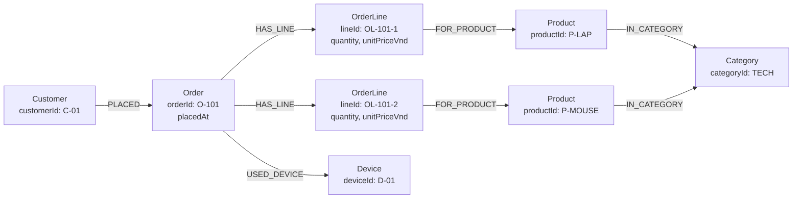
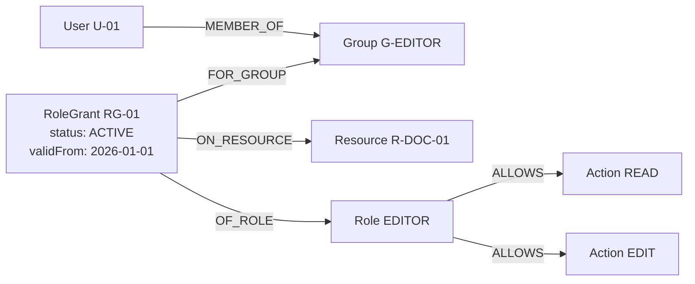

# Mô hình mạng quan hệ khách hàng, sản phẩm hoặc quyền truy cập

Nhiều yêu cầu nghiệp vụ không dừng ở việc lưu từng đối tượng. Một cửa hàng cần biết **khách nào mua sản phẩm gì, qua đơn hàng nào và trong bối cảnh nào**; hệ thống đề xuất muốn tìm sản phẩm thường được mua cùng nhau; bộ phận vận hành muốn hiểu thiết bị nào xuất hiện trong các giao dịch khác nhau. Trong một hệ thống phân quyền, câu hỏi quan trọng lại là **người dùng có thể thực hiện hành động gì trên tài nguyên nào, thông qua nhóm hoặc vai trò nào**. Đây là những bài toán có cấu trúc mạng liên kết, nhưng mỗi loại liên kết có ngữ nghĩa và ràng buộc khác nhau.

Bài học thuộc chương **Mô hình đồ thị** của **DATABASE_DATA_MODELING**. Mục tiêu học phần là biến yêu cầu nghiệp vụ thành thực thể, quan hệ, ràng buộc, chuẩn hóa, khóa, chỉ mục và lược đồ vật lý; đồng thời so sánh cách mô hình hóa quan hệ, document, đồ thị và phân tích để chọn cấu trúc phù hợp, có thể tiến hóa và kiểm chứng. Bài này thực hiện việc đó qua **hai ví dụ xuyên suốt**: mạng **khách hàng–sản phẩm** và mạng **quyền truy cập** trong property graph.

Sau bài này, bạn có thể:

- Xác định đúng **đỉnh, cạnh, hướng cạnh và hạt dữ liệu** cho mạng khách hàng–đơn hàng–sản phẩm.
- Biết khi nào cần **đỉnh sự kiện** như `Order`, `OrderLine` hoặc `RoleGrant` thay vì nối trực tiếp các thực thể.
- Thiết kế truy vấn **mua cùng**, **khách cùng sử dụng thiết bị** và **kiểm tra quyền truy cập theo phạm vi tài nguyên**.
- Phân biệt **tồn tại đường liên kết** với **bằng chứng nghiệp vụ** hoặc **quyết định cấp quyền**.
- Xây dựng ràng buộc định danh, bội số, thời gian hiệu lực, tenant và kiểm soát tính nhất quán.
- So sánh property graph với SQL, document và kho phân tích dựa trên workload, khả năng kiểm chứng và chi phí.

## 1. Bắt đầu từ câu hỏi, không bắt đầu từ hình vẽ

Một mô hình đồ thị chỉ thực sự hữu ích nếu nó trả lời được những câu hỏi quan trọng. Hãy viết mỗi truy vấn thành một **hợp đồng** gồm điểm bắt đầu, các cạnh được phép đi qua, điều kiện lọc, phạm vi thời gian và ý nghĩa đầu ra.

| Miền nghiệp vụ | Câu hỏi cần trả lời | Đường đi liên quan | Bản chất kết quả |
| --- | --- | --- | --- |
| Thương mại | Khách C-01 đã mua sản phẩm nào? | `Customer → Order → OrderLine → Product` | Giao dịch đã ghi nhận |
| Thương mại | Hai sản phẩm được mua trong cùng những đơn nào? | `Product ← OrderLine ← Order → OrderLine → Product` | Đồng xuất hiện trong một đơn |
| Vận hành | Những khách nào từng đặt đơn bằng một thiết bị chung? | `Customer → Order → Device ← Order ← Customer` | Tín hiệu liên kết, **không phải** chứng cứ cùng danh tính |
| Danh mục | Sản phẩm cùng danh mục hoặc thuộc danh mục con nào? | `Product → Category → ParentCategory` | Phân loại theo danh mục |
| Phân quyền | Người U-01 có được sửa tài liệu R-01 không? | `User → Group ← RoleGrant → Resource` và `RoleGrant → Role → Action` | Đủ điều kiện cho phép **theo một chính sách đã định** |
| Phân quyền | Quyền của U-01 đến từ đâu? | Các cạnh tham gia, grant, vai trò và tài nguyên | Chuỗi giải thích nguồn quyền |
| Quản trị | Thu hồi một vai trò sẽ ảnh hưởng tới những nhóm/tài nguyên nào? | Từ grant hoặc role đến các đối tượng liên quan | Danh sách có thể bị ảnh hưởng |

Từ bảng này đã thấy: câu “khách **liên quan** sản phẩm” quá mơ hồ vì khách có thể **xem**, **thêm vào giỏ**, **mua**, **đánh giá** hoặc **trả lại** sản phẩm. Trong phân quyền, “người dùng **liên quan** tài liệu” cũng chưa cho biết người đó có thể **đọc**, **sửa**, **chia sẻ** hay **xóa**.

Nguyên tắc nền tảng là **mỗi loại cạnh phải tạo thành một câu nghiệp vụ rõ nghĩa**. Các cạnh `PLACED`, `HAS_LINE`, `FOR_PRODUCT`, `MEMBER_OF` và `ALLOWS` không thể thay thế cho nhau bằng một cạnh `RELATED_TO` duy nhất mà vẫn giữ được ý nghĩa truy vấn.

## 2. Ví dụ A: mạng khách hàng–đơn hàng–sản phẩm

### 2.1. Yêu cầu nghiệp vụ

Giả sử một cửa hàng trực tuyến cần:

1. Tra cứu lịch sử mua của từng khách.
2. Thống kê số khách đã mua một sản phẩm.
3. Tìm những sản phẩm thường được mua **cùng một đơn**.
4. Tìm các khách đã dùng chung thiết bị **trong những lần đặt đơn**.
5. Giữ đúng giá, số lượng và khuyến mãi tại thời điểm mua, kể cả khi giá niêm yết thay đổi.
6. Tách biệt dữ liệu nếu nền tảng phục vụ nhiều tenant/doanh nghiệp.

Để đáp ứng, không nên chỉ tạo cạnh `Customer-[:BOUGHT]->Product` rồi lưu tổng số lần mua. Cạnh tắt này có thể mất thông tin **đơn hàng nào**, **ngày nào**, **giá nào**, **thiết bị nào** và **những sản phẩm nào cùng nằm trong một đơn**.

### 2.2. Mô hình logic có đỉnh sự kiện



Mỗi đỉnh và cạnh có **một hạt dữ liệu** xác định:

| Thành phần | Ý nghĩa và thuộc tính tiêu biểu | Quy tắc ban đầu |
| --- | --- | --- |
| `Customer` | Một khách trong tenant: `tenantId`, `customerId` | Khóa kết hợp duy nhất theo tenant |
| `Order` | Một lần đặt hàng: `tenantId`, `orderId`, `placedAt`, `status` | Một `Order` có đúng một khách đặt theo giả định |
| `OrderLine` | **Một dòng hàng**: `lineId`, `quantity`, `unitPriceVnd` | Một đơn có ít nhất một dòng khi được xác nhận |
| `Product` | Một sản phẩm: `tenantId`, `productId`, `title`, `currentPriceVnd` | Mã ổn định, giá hiện tại không thay giá lịch sử |
| `Device` | Một thiết bị hoặc định danh thiết bị được nguồn ghi nhận: `tenantId`, `deviceId` | Chỉ là **tín hiệu kỹ thuật**, có thể dùng chung hoặc thay đổi |
| `Category` | Danh mục: `categoryId`, `name` | Có thể dùng chung cho nhiều sản phẩm |
| `PLACED` | `Customer → Order` | Phân biệt người đặt đơn với người nhận hàng |
| `HAS_LINE` | `Order → OrderLine` | Không gộp hai dòng khác nhau vì cùng sản phẩm |
| `FOR_PRODUCT` | `OrderLine → Product` | Mỗi dòng tham chiếu một sản phẩm theo giả định |
| `USED_DEVICE` | `Order → Device` | Gắn thiết bị vào **chính lần giao dịch** |
| `IN_CATEGORY` | `Product → Category` | Mỗi sản phẩm có thể thuộc một hoặc nhiều danh mục theo chính sách |

Nếu hệ thống cho phép một đơn do **nhiều người đồng sở hữu**, quy tắc “một đơn đúng một người đặt” phải thay đổi. Nếu có các mặt hàng số lượng lớn, giảm giá theo từng dòng hoặc trả hàng từng phần, `OrderLine` là đơn vị tự nhiên để tiếp tục nối tới `Shipment`, `ReturnRequest` hoặc các đỉnh khác.

### 2.3. Vì sao `OrderLine` quan trọng?

Giả sử một đơn có hai dòng cùng `Product P-MOUSE`: một dòng giá thường và một dòng được khuyến mãi. Nếu chỉ dùng một cạnh `Order-[:CONTAINS {quantity}]->Product` và gộp theo cặp đối tượng, ta có thể mất **đơn giá, chính sách khuyến mãi và khả năng trả đúng dòng**.

Đỉnh `OrderLine` có `lineId`, `quantity`, `unitPriceVnd` và có thể `discountVnd`. Nó giúp tách các sự kiện khác nhau ngay cả khi cùng trỏ tới một sản phẩm.

**Giá tại thời điểm mua** không nên chỉ đọc từ `Product.currentPriceVnd`. Nếu giá hiện tại tăng, tổng tiền trong đơn hàng cũ **không được thay đổi** theo. Cần lưu snapshot hoặc số tiền đã chốt trên dòng hàng; nếu có thuế, đơn vị tiền, giảm giá hay hoàn tiền, quy tắc tính phải được mô tả riêng.

### 2.4. Dữ liệu thử nghiệm bằng Neo4j Cypher

Các đoạn tiếp theo sử dụng **Neo4j Cypher** minh họa mô hình property graph; chạy trong cơ sở dữ liệu thử nghiệm trống. Mẫu `CREATE` không phải luồng import có thể chạy lại an toàn nếu không có constraint và chính sách ghi.

```cypher
CREATE
  (c1:Customer {tenantId: 'T-01', customerId: 'C-01'}),
  (c2:Customer {tenantId: 'T-01', customerId: 'C-02'}),
  (laptop:Product {
    tenantId: 'T-01', productId: 'P-LAP',
    title: 'Máy tính xách tay', currentPriceVnd: 13000000
  }),
  (mouse:Product {
    tenantId: 'T-01', productId: 'P-MOUSE',
    title: 'Chuột không dây', currentPriceVnd: 350000
  }),
  (category:Category {
    tenantId: 'T-01', categoryId: 'TECH', name: 'Thiết bị công nghệ'
  }),
  (d1:Device {tenantId: 'T-01', deviceId: 'D-SHARED'}),
  (d2:Device {tenantId: 'T-01', deviceId: 'D-OTHER'}),
  (o1:Order {
    tenantId: 'T-01', orderId: 'O-101',
    placedAt: datetime('2026-10-01T09:00:00+07:00'),
    status: 'PAID'
  }),
  (o2:Order {
    tenantId: 'T-01', orderId: 'O-102',
    placedAt: datetime('2026-10-03T11:00:00+07:00'),
    status: 'PAID'
  }),
  (o3:Order {
    tenantId: 'T-01', orderId: 'O-103',
    placedAt: datetime('2026-10-05T15:00:00+07:00'),
    status: 'PAID'
  }),
  (line1:OrderLine {
    tenantId: 'T-01', lineId: 'OL-101-1',
    quantity: 1, unitPriceVnd: 12000000
  }),
  (line2:OrderLine {
    tenantId: 'T-01', lineId: 'OL-101-2',
    quantity: 1, unitPriceVnd: 300000
  }),
  (line3:OrderLine {
    tenantId: 'T-01', lineId: 'OL-102-1',
    quantity: 1, unitPriceVnd: 11800000
  }),
  (line4:OrderLine {
    tenantId: 'T-01', lineId: 'OL-103-1',
    quantity: 2, unitPriceVnd: 320000
  }),
  (c1)-[:PLACED]->(o1),
  (c2)-[:PLACED]->(o2),
  (c2)-[:PLACED]->(o3),
  (o1)-[:HAS_LINE]->(line1),
  (o1)-[:HAS_LINE]->(line2),
  (o2)-[:HAS_LINE]->(line3),
  (o3)-[:HAS_LINE]->(line4),
  (line1)-[:FOR_PRODUCT]->(laptop),
  (line2)-[:FOR_PRODUCT]->(mouse),
  (line3)-[:FOR_PRODUCT]->(laptop),
  (line4)-[:FOR_PRODUCT]->(mouse),
  (o1)-[:USED_DEVICE]->(d1),
  (o2)-[:USED_DEVICE]->(d1),
  (o3)-[:USED_DEVICE]->(d2),
  (laptop)-[:IN_CATEGORY]->(category),
  (mouse)-[:IN_CATEGORY]->(category);
```

Theo dữ liệu mẫu:

- C-01 đặt O-101, mua **laptop và chuột cùng một đơn**.
- C-02 đặt O-102 mua laptop và O-103 mua chuột.
- O-101 và O-102 dùng thiết bị `D-SHARED`; O-103 dùng `D-OTHER`.
- `Product.currentPriceVnd` có thể khác `OrderLine.unitPriceVnd` vì một bên là giá hiện tại, bên kia là giá đã chốt.

### 2.5. Truy vấn lịch sử sản phẩm của khách

```cypher
MATCH (customer:Customer {
    tenantId: $tenantId, customerId: $customerId
  })-[:PLACED]->(o:Order)-[:HAS_LINE]->(line:OrderLine)
    -[:FOR_PRODUCT]->(product:Product)
WHERE o.tenantId = $tenantId
  AND line.tenantId = $tenantId
  AND product.tenantId = $tenantId
RETURN o.orderId AS orderId,
       o.placedAt AS placedAt,
       product.productId AS productId,
       line.quantity AS quantity,
       line.unitPriceVnd AS unitPriceVnd
ORDER BY placedAt, orderId, productId;
```

Đầu ra có một hàng cho **mỗi dòng hàng**. Nếu một khách mua cùng sản phẩm ở nhiều đơn, sản phẩm có thể xuất hiện nhiều lần, đúng với yêu cầu **lịch sử giao dịch**. Không được tự dùng `DISTINCT product` nếu người dùng cần đầy đủ từng lần mua.

### 2.6. Truy vấn khách đã mua một sản phẩm

```cypher
MATCH (customer:Customer)-[:PLACED]->(o:Order)
      -[:HAS_LINE]->(line:OrderLine)
      -[:FOR_PRODUCT]->(product:Product {
        tenantId: $tenantId, productId: $productId
      })
WHERE customer.tenantId = $tenantId
  AND o.tenantId = $tenantId
  AND line.tenantId = $tenantId
  AND o.status = 'PAID'
RETURN count(DISTINCT customer) AS distinctBuyerCount;
```

Với `$tenantId = 'T-01'` và `$productId = 'P-LAP'`, kết quả là **2 khách**. `DISTINCT customer` ngăn một khách được đếm nhiều lần nếu mua cùng sản phẩm ở nhiều đơn. Đây là “số khách phân biệt”, **không phải số đơn, số dòng hay số lượng sản phẩm đã bán**.

### 2.7. Truy vấn sản phẩm thường được mua cùng nhau

Một đề xuất “mua cùng” dựa trên **sản phẩm nằm trong cùng đơn** khác với “hai sản phẩm được cùng một khách mua vào hai thời điểm khác nhau”.

```cypher
MATCH (anchor:Product {
    tenantId: $tenantId, productId: $productId
  })<-[:FOR_PRODUCT]-(line1:OrderLine)<-[:HAS_LINE]-
  (o:Order)-[:HAS_LINE]->(line2:OrderLine)
    -[:FOR_PRODUCT]->(other:Product)
WHERE other <> anchor
  AND o.tenantId = $tenantId
  AND other.tenantId = $tenantId
  AND line1.tenantId = $tenantId
  AND line2.tenantId = $tenantId
  AND o.status = 'PAID'
RETURN other.productId AS coPurchasedProductId,
       count(DISTINCT o) AS distinctOrderCount
ORDER BY distinctOrderCount DESC, coPurchasedProductId
LIMIT 10;
```

Với `P-LAP`, dữ liệu mẫu gợi ý `P-MOUSE` vì chúng cùng nằm trong O-101. Lưu ý:

- `count(DISTINCT o)` đếm **đơn hàng phân biệt**, tránh nhân số lượng khi một sản phẩm có nhiều dòng.
- Một đơn có nhiều dòng của `anchor` và `other` có thể tạo nhiều cặp dòng khi khớp mẫu; phép khử trùng áp dụng ở cấp đơn cho metric đang xét.
- Một đồng mua trong một đơn **không đủ** để đánh giá chất lượng đề xuất. Hệ thống thật cần ngưỡng bằng chứng, loại trừ đơn hủy/trả, cân nhắc độ phổ biến và dữ liệu có liên quan đến người dùng.

Không nên dùng kết quả “sản phẩm cùng danh mục” thay cho “được mua cùng”: hai quan hệ trả lời những câu hỏi khác nhau.

### 2.8. Truy vấn khách liên kết qua thiết bị dùng trong giao dịch

```cypher
MATCH (origin:Customer {
    tenantId: $tenantId, customerId: $customerId
  })-[:PLACED]->(o1:Order)-[:USED_DEVICE]->(device:Device)
MATCH (other:Customer)-[:PLACED]->(o2:Order)
      -[:USED_DEVICE]->(device)
WHERE other <> origin
  AND other.tenantId = $tenantId
  AND device.tenantId = $tenantId
  AND o1.tenantId = $tenantId
  AND o2.tenantId = $tenantId
  AND o1.placedAt >= datetime($fromTime)
  AND o2.placedAt >= datetime($fromTime)
RETURN other.customerId AS relatedCustomerId,
       count(DISTINCT device) AS sharedDeviceCount
ORDER BY sharedDeviceCount DESC, relatedCustomerId
LIMIT 20;
```

Nếu `$customerId = 'C-01'` và `$fromTime = '2026-10-01T00:00:00+07:00'`, kết quả gồm C-02 với **1 thiết bị chung**. Dữ liệu không nói rằng C-01 và C-02 là cùng một người; thiết bị có thể là thiết bị công cộng hoặc dùng chung hợp pháp.

**Phải phân biệt** “dùng chung thiết bị”, “sở hữu thiết bị” và “có hành vi bất thường”: đó là ba kết luận khác nhau. Không được tự chuyển một đường liên kết thành quyết định bất lợi cho khách. Nếu cần phân tích rủi ro, phải có chính sách sử dụng dữ liệu, bằng chứng và quy trình kiểm tra phù hợp.

## 3. Bài học từ mạng khách hàng–sản phẩm

### 3.1. Những kiểu cạnh không thể hoán đổi

```text
(Customer)-[:VIEWED]->(Product)             // Sự kiện xem, cần thời gian/ngữ cảnh
(Customer)-[:ADDED_TO_CART]->(Product)       // Thao tác giỏ hàng
(Customer)-[:PLACED]->(Order)                // Một lần đặt hàng
(Order)-[:HAS_LINE]->(OrderLine)             // Dòng thuộc đơn
(OrderLine)-[:FOR_PRODUCT]->(Product)        // Sản phẩm của dòng
(Customer)-[:REVIEWED]->(Product)           // Đánh giá, cần nguồn và thời gian
```

Nếu `VIEWED`, `BOUGHT` và `REVIEWED` đều trở thành `RELATED_TO`, hệ thống khó phân biệt mức độ tương tác. Không nên đồng nhất **một lượt xem** với **một giao dịch đã thanh toán** khi đề xuất sản phẩm hay tính tỷ lệ chuyển đổi.

Một tương tác có **nhiều lần diễn ra** có thể là nhiều cạnh hoặc **đỉnh sự kiện** với `eventId`, `occurredAt`, `source`. Nếu nguồn dữ liệu chỉ cần lưu số lượt xem tổng hợp, mô hình phân tích hoặc document/bảng sự kiện có thể phù hợp hơn việc tạo vô số cạnh trực tiếp.

### 3.2. Mạng sản phẩm có thể có quan hệ riêng

Bản thân `Product` cũng có thể tạo thành mạng:

| Quan hệ | Ý nghĩa | Lưu ý |
| --- | --- | --- |
| `(Product)-[:IN_CATEGORY]->(Category)` | Sản phẩm thuộc danh mục | Có thể một hoặc nhiều danh mục |
| `(Category)-[:PARENT_OF]->(Category)` | Phân cấp danh mục | Cần quy tắc chống chu trình nếu danh mục phải là cây/DAG |
| `(Product)-[:COMPATIBLE_WITH]->(Product)` | Hai sản phẩm tương thích | Tính đối xứng có thể tùy loại tương thích |
| `(Product)-[:REPLACES]->(Product)` | Sản phẩm thay thế phiên bản cũ | Hướng quan hệ quan trọng |
| `(Product)-[:BUNDLED_WITH]->(Product)` | Sản phẩm được bán trong gói | Cần phân biệt gói thương mại với việc mua chung thực tế |

Đừng tự suy ra cạnh `COMPATIBLE_WITH` chỉ vì hai sản phẩm được mua cùng nhau; việc mua cùng là **bằng chứng hành vi**, còn tương thích kỹ thuật cần nguồn có thẩm quyền.

### 3.3. Có nên tạo cạnh tắt `Customer → Product`?

Có thể vật hóa một cạnh dẫn xuất như:

```text
(Customer C-01)-[:PURCHASED_SUMMARY {
  firstPurchasedAt: ...,
  lastPurchasedAt: ...,
  totalQuantity: ...
}]->(Product P-LAP)
```

Nó giúp truy vấn “khách từng mua sản phẩm này chưa?” theo một bước. Tuy nhiên, đây là **bản tóm tắt** từ `OrderLine` và `Order`, không phải nguồn sự thật độc lập. Nếu đơn hủy, hàng trả hoặc dữ liệu nhập muộn, cạnh tắt phải cập nhật nhất quán. Chỉ nên thêm khi có nhu cầu hiệu năng được đo và quy tắc đồng bộ, xử lý idempotent, phục hồi và đối soát rõ ràng.

## 4. Ví dụ B: mô hình mạng quyền truy cập

### 4.1. Tránh mô hình quyền quá đơn giản

Một thiết kế ban đầu có thể là:

```text
(User U-01)-[:CAN_EDIT]->(Resource R-01)
```

Nó phù hợp với trường hợp rất đơn giản nhưng khó trả lời các câu hỏi:

- Quyền đến từ **nhóm** hay được cấp trực tiếp?
- Người dùng là `EDITOR` của **tài liệu R-01** hay của **mọi tài liệu**?
- Quyền bắt đầu và hết hạn khi nào?
- Nếu xóa người dùng khỏi nhóm hoặc thu hồi cấp quyền, phải thay đổi những cạnh nào?
- Có quy tắc **deny**, chia sẻ theo tenant, sở hữu, bảo mật tài liệu hoặc quyền phụ thuộc phiên bản không?
- Làm thế nào giải thích vì sao một yêu cầu được cho phép?

Đặc biệt, đặt cạnh `Group-[:HAS_ROLE]->Role` và `Group-[:CAN_ACCESS]->Resource` riêng lẻ có nguy cơ tạo **tích ghép sai phạm vi**: hệ thống có thể hiểu một vai trò áp dụng cho **mọi tài nguyên nhóm kết nối tới** dù thực tế grant chỉ cho một tài nguyên cụ thể.

### 4.2. Tạo `RoleGrant` để giữ đúng phạm vi cấp quyền

Giả sử một nhóm được cấp vai trò `Editor` **trên một tài nguyên nhất định**. Sự kiện cấp quyền có thể bao gồm:

```text
grantId      = RG-01
groupId      = G-EDITOR
roleCode     = EDITOR
resourceId   = R-DOC-01
status       = ACTIVE
validFrom    = 2026-01-01
validTo      = chưa có
```

Một đỉnh `RoleGrant` gom **nhóm, vai trò và tài nguyên vào cùng một lần cấp quyền**, thay vì tách thành các cặp không còn ngữ cảnh.



Ở đây, `User` có thể truy cập tài nguyên theo đường suy luận:

```text
User --MEMBER_OF--> Group <--FOR_GROUP-- RoleGrant
RoleGrant --ON_RESOURCE--> Resource
RoleGrant --OF_ROLE--> Role --ALLOWS--> Action
```

Nhưng đường đi chỉ chứng minh **một ứng viên cấp quyền**. Để **cho phép hành động** cần kiểm tra thêm tình trạng tài khoản, tenant, thời gian hiệu lực, chính sách deny, trạng thái tài nguyên và những điều kiện nghiệp vụ khác được hệ thống đặt ra.

### 4.3. Khái niệm role, action, grant và resource không giống nhau

| Đối tượng / cạnh | Ý nghĩa | Lỗi khi nhập nhằng |
| --- | --- | --- |
| `User` | Danh tính người dùng/tác nhân | Gộp hai người cùng email/tên vào một đỉnh |
| `Group` | Tập thành viên có quy tắc quản lý | Tin rằng một người thuộc nhóm mãi mãi dù đã bị gỡ |
| `Role` | Tập quyền như `Viewer`, `Editor` | Xem role là quyền toàn hệ thống dù chỉ cấp ở một tài nguyên |
| `Action` | Hành động cụ thể: `READ`, `EDIT`, `DELETE` | Gộp mọi hành động thành `ACCESS` |
| `Resource` | Tài liệu, thư mục, dự án hoặc đối tượng bị bảo vệ | Không phân biệt tài nguyên riêng của từng tenant |
| `RoleGrant` | Một lần cấp `Role` cho một nhóm trên một `Resource` | Tách ba liên kết và gán quyền chéo sai |
| `MEMBER_OF` | Người dùng thuộc nhóm | Không tính hiệu lực/thành viên bị vô hiệu hóa |
| `ALLOWS` | Vai trò cho phép hành động theo định nghĩa role | Nhầm vai trò có tên giống nhau giữa tenant/phiên bản |

Một hệ thực tế có thể có **direct grants** cấp thẳng cho người dùng, **nested groups** hoặc **resource hierarchy**. Chúng đều cần mở rộng mô hình và logic ủy quyền một cách có chủ đích, không phải tự động đi qua mọi loại cạnh `RELATED_TO`.

### 4.4. Phân biệt truy vấn quyền và cơ chế thực thi quyền

Dữ liệu đồ thị có thể giúp **giải thích** và **tính toán ứng viên quyền**. Tuy nhiên, dịch vụ ủy quyền thực tế cần một **điểm ra quyết định có thẩm quyền** (*policy decision point*) kiểm tra toàn bộ chính sách. Chỉ dùng một truy vấn kiểu “có đường đi giữa User và Resource” là không an toàn vì đường có thể đi qua:

- Một grant đã hết hạn hoặc bị thu hồi.
- Một nhóm mà người dùng không còn là thành viên.
- Một tài nguyên thuộc tenant khác.
- Một vai trò không có hành động được yêu cầu.
- Một nhóm/role đã bị vô hiệu hóa.
- Một đường liên kết không đúng hướng hoặc loại quan hệ.

Khi nói “`allowed = true`”, phải chỉ rõ **những điều kiện nào đã được kiểm tra** và những gì vẫn nằm ngoài phạm vi minh họa.

## 5. Dữ liệu thử nghiệm cho graph quyền truy cập

### 5.1. Đỉnh, cạnh và các giả định

Giả sử chỉ có một tenant `T-01`, một tài liệu `R-DOC-01`, nhóm `G-EDITOR`, vai trò `EDITOR` và hai hành động `READ`, `EDIT`. Người dùng U-01 thuộc nhóm; U-02 không thuộc nhóm.

Giả định cho ví dụ:

- Một `RoleGrant` đại diện một lần cấp một vai trò cho một nhóm trên một tài nguyên.
- `RoleGrant.status = 'ACTIVE'` và ngày truy vấn nằm trong khoảng `[validFrom, validTo)`.
- `Role` và `Action` là các giá trị đã được quản trị; không có explicit deny, direct grants, nested groups hay các điều kiện bổ sung trong mô hình mẫu.
- `User`, `Group`, `Resource`, `RoleGrant` đều phải thuộc cùng tenant khi xác minh quyền.
- Quy tắc **mặc định từ chối**: không tìm thấy một grant hợp lệ nghĩa là không cấp quyền trong mô hình mẫu.

### 5.2. Tạo dữ liệu minh họa bằng Neo4j Cypher

```cypher
CREATE
  (u1:User {
    tenantId: 'T-01', userId: 'U-01', status: 'ACTIVE'
  }),
  (u2:User {
    tenantId: 'T-01', userId: 'U-02', status: 'ACTIVE'
  }),
  (g:Group {
    tenantId: 'T-01', groupId: 'G-EDITOR', status: 'ACTIVE'
  }),
  (r:Resource {
    tenantId: 'T-01', resourceId: 'R-DOC-01',
    type: 'DOCUMENT', status: 'ACTIVE'
  }),
  (role:Role {
    roleCode: 'EDITOR', status: 'ACTIVE'
  }),
  (read:Action {actionCode: 'READ'}),
  (edit:Action {actionCode: 'EDIT'}),
  (grant:RoleGrant {
    tenantId: 'T-01', grantId: 'RG-01',
    status: 'ACTIVE', validFrom: date('2026-01-01')
  }),
  (u1)-[:MEMBER_OF]->(g),
  (grant)-[:FOR_GROUP]->(g),
  (grant)-[:ON_RESOURCE]->(r),
  (grant)-[:OF_ROLE]->(role),
  (role)-[:ALLOWS]->(read),
  (role)-[:ALLOWS]->(edit);
```

Trong mẫu này, `Role` và `Action` là **danh mục được quản trị chung**. Nếu mỗi tenant được tự định nghĩa một vai trò `EDITOR` mang tập quyền khác nhau, không được dùng một `Role {roleCode:'EDITOR'}` chung mà phải thêm phạm vi tenant hoặc phiên bản vào định danh role.

### 5.3. Kiểm tra một quyền theo đúng resource và hành động

```cypher
MATCH (user:User {
    tenantId: $tenantId, userId: $userId, status: 'ACTIVE'
  })-[:MEMBER_OF]->(g:Group {
    tenantId: $tenantId, status: 'ACTIVE'
  })
MATCH (grant:RoleGrant {
    tenantId: $tenantId, status: 'ACTIVE'
  })-[:FOR_GROUP]->(g)
MATCH (grant)-[:ON_RESOURCE]->(resource:Resource {
    tenantId: $tenantId,
    resourceId: $resourceId,
    status: 'ACTIVE'
  })
MATCH (grant)-[:OF_ROLE]->(role:Role {
    status: 'ACTIVE'
  })-[:ALLOWS]->(:Action {actionCode: $actionCode})
WHERE grant.validFrom <= date($asOfDate)
  AND (
    grant.validTo IS NULL
    OR date($asOfDate) < grant.validTo
  )
RETURN count(DISTINCT grant) > 0 AS allowed;
```

Với `T-01`, `U-01`, `R-DOC-01`, `EDIT` và một ngày trong năm 2026, truy vấn trả `allowed = true` theo dữ liệu mẫu. Với `U-02`, truy vấn không tìm thấy đường cấp quyền qua nhóm và trả `false` trong mô hình này.

**Phạm vi bảo đảm của ví dụ:** truy vấn kiểm tra user/group/grant/resource đang hoạt động, tenant và thời gian hiệu lực của **grant**, đồng thời kiểm tra hành động nằm trong tập của role. Nó **chưa kiểm tra thời gian hiệu lực của membership**, phân cấp tài nguyên, explicit deny, direct grant, policy ngoài graph, đăng nhập hoặc điều kiện nhạy cảm theo ngữ cảnh. Trong sản phẩm thật, nếu chính sách yêu cầu một trong những điều kiện ấy, phép kiểm tra trên **chưa đủ để ra quyết định ủy quyền cuối cùng**.

Ngoài ra, với kiểm tra “hôm nay có quyền không”, tham số thời gian phải lấy từ một nguồn thời gian đáng tin và được chuẩn hóa. Không được để client tùy ý chọn một ngày cũ có grant còn hiệu lực để tự nhận quyền truy cập hiện tại.

### 5.4. Truy vấn giải thích nguồn cấp quyền

```cypher
MATCH (user:User {
    tenantId: $tenantId, userId: $userId
  })-[:MEMBER_OF]->(group:Group {
    tenantId: $tenantId
  })
MATCH (grant:RoleGrant {
    tenantId: $tenantId
  })-[:FOR_GROUP]->(group)
MATCH (grant)-[:ON_RESOURCE]->(resource:Resource {
    tenantId: $tenantId,
    resourceId: $resourceId
  })
MATCH (grant)-[:OF_ROLE]->(role:Role)
RETURN grant.grantId AS grantId,
       group.groupId AS groupId,
       role.roleCode AS roleCode,
       resource.resourceId AS resourceId,
       grant.status AS grantStatus,
       grant.validFrom AS validFrom,
       grant.validTo AS validTo
ORDER BY grantId;
```

Đây là truy vấn **giải thích dữ liệu grant có liên hệ**, chưa lọc hiệu lực và hành động, nên **không được dùng kết quả của nó như một quyết định cho phép**. Nó hữu ích cho kiểm toán và xác minh vì chỉ ra chính xác grant, nhóm, vai trò và resource liên quan.

### 5.5. Phát hiện grant thiếu một trong các đầu liên kết

Có thể kiểm tra dữ liệu bị thiếu hoặc thừa cạnh mà không ghép sai nhiều hàng qua các `MATCH`:

```cypher
MATCH (grant:RoleGrant {tenantId: $tenantId})
WITH grant,
     COUNT { (grant)-[:FOR_GROUP]->(:Group) } AS groupCount,
     COUNT { (grant)-[:ON_RESOURCE]->(:Resource) } AS resourceCount,
     COUNT { (grant)-[:OF_ROLE]->(:Role) } AS roleCount
WHERE groupCount <> 1
   OR resourceCount <> 1
   OR roleCount <> 1
RETURN grant.grantId AS grantId,
       groupCount, resourceCount, roleCount;
```

Cú pháp `COUNT { ... }` là ví dụ cho **các phiên bản Neo4j Cypher có hỗ trợ count subquery**. Các hệ/phiên bản khác có thể cần cách đếm tương đương. Truy vấn giúp phát hiện thiếu/thừa vai trò; nó **không tự thực thi constraint** và cũng chưa phát hiện mọi cạnh trỏ sai tenant, vai trò vô hiệu hóa hoặc trạng thái grant không nhất quán.

## 6. Mở rộng quyền theo nhóm lồng nhau, tài nguyên cha–con và deny

### 6.1. Nhóm lồng nhau

Giả sử một nhóm nhỏ có thể kế thừa grant của nhóm cha:

```text
(Group G-DEV)-[:INHERITS_FROM]->(Group G-ENGINEERING)
```

Người dùng `U-01` là thành viên `G-DEV` có thể được xét các grant của `G-ENGINEERING` **nếu chính sách thực sự cho phép thừa kế**. Truy vấn phải chỉ duyệt cạnh `INHERITS_FROM` đúng hướng, theo giới hạn hợp lệ và trạng thái nhóm.

Một mẫu truy vấn minh họa phần tìm nhóm có hiệu lực:

```cypher
MATCH (u:User {
    tenantId: $tenantId, userId: $userId
  })-[:MEMBER_OF]->(direct:Group {tenantId: $tenantId})
MATCH (direct)-[:INHERITS_FROM*0..5]->(effective:Group)
WHERE effective.tenantId = $tenantId
RETURN DISTINCT effective.groupId AS groupId;
```

`*0..5` cho phép trường hợp **không đi cạnh kế thừa** (nhóm trực tiếp) hoặc tối đa năm cấp. Đó là **giới hạn kỹ thuật được minh họa**, không tự chứng minh kết quả đầy đủ cho tổ chức có độ sâu lớn hơn. Cần ngăn chu trình nếu nhóm phải có cấu trúc phân cấp, xác minh mọi nhóm trung gian hợp lệ và cập nhật quyền khi thay đổi thành viên.

Một truy vấn bỏ qua tenant ở các nhóm **trung gian** có thể đi xuyên một cạnh phân cấp sai dữ liệu. Nếu tenant isolation là yêu cầu bắt buộc, cần bảo đảm tính hợp lệ của **toàn bộ đường đi** bằng dữ liệu đã được kiểm soát và/hoặc kiểm tra từng đỉnh/cạnh trên đường.

### 6.2. Tài nguyên cha–con không tự truyền mọi quyền

```text
(Resource Folder-01)-[:CONTAINS]->(Resource Document-01)
```

Việc một folder chứa document không mặc nhiên khiến mọi quyền trên folder được truyền cho document. Một số ứng dụng cho phép inheritance; ứng dụng khác có tài nguyên được bảo vệ riêng hoặc quy tắc *break inheritance*. Cần mô tả rõ:

- Quyền nào được kế thừa: `READ`, `EDIT`, `SHARE` hay tất cả?
- Khi tài nguyên con chặn kế thừa, cách tính quyền ra sao?
- Grant trên resource cha có hiệu lực tại thời điểm nào?
- Có giới hạn phạm vi tenant, dự án và tổ chức không?

Nếu truy vấn chỉ đi qua `CONTAINS*` rồi mặc định cấp `EDIT`, hệ thống có thể cấp quyền sai.

### 6.3. Quy tắc từ chối và ưu tiên chính sách

Trong mô hình tối giản chỉ có grant cho phép, phép kiểm tra “không tìm thấy đường hợp lệ thì từ chối” tương đối rõ. Nhưng nếu hệ thống có **explicit deny** hoặc chính sách xung đột, phải xác định cơ chế ưu tiên trước:

| Tình huống | Câu hỏi phải giải quyết |
| --- | --- |
| Grant cho phép từ G-EDITOR, deny từ G-RESTRICTED | Deny có thắng allow không, hay chính sách nào cụ thể hơn? |
| Người dùng bị khóa, role vẫn còn hiệu lực | Khóa tài khoản có phủ quyết mọi grant không? |
| Tài liệu chuyển tenant hoặc chủ sở hữu | Cách thu hồi và tái xét các grant cũ ra sao? |
| Membership hết hạn nhưng grant còn hạn | Phải lọc **cả membership** hay chỉ grant? |
| Resource đang bị cách ly/bảo mật bổ sung | Có kiểm tra điều kiện ngoài graph không? |

**Không có một quy tắc giải quyết xung đột chung cho mọi hệ thống**. Bất kỳ ví dụ nào đưa ra kết quả `allowed` đều phải dựa trên chính sách đã thống nhất và được kiểm thử; “đi tới được resource” chỉ là một điều kiện kỹ thuật.

## 7. Định danh, ràng buộc và dữ liệu nhiều tenant

### 7.1. Tính duy nhất của các thực thể

Với một nền tảng đa tenant, khóa `customerId` hoặc `resourceId` có thể chỉ duy nhất **bên trong tenant**. Khi đó, một uniqueness constraint đơn lẻ trên `customerId` có thể quá mạnh (cấm hai tenant dùng cùng mã), còn không có constraint lại cho phép tạo trùng trong một tenant.

Ví dụ Neo4j Cypher:

```cypher
CREATE CONSTRAINT customer_key_unique IF NOT EXISTS
FOR (c:Customer)
REQUIRE (c.tenantId, c.customerId) IS UNIQUE;

CREATE CONSTRAINT product_key_unique IF NOT EXISTS
FOR (p:Product)
REQUIRE (p.tenantId, p.productId) IS UNIQUE;

CREATE CONSTRAINT order_key_unique IF NOT EXISTS
FOR (o:Order)
REQUIRE (o.tenantId, o.orderId) IS UNIQUE;

CREATE CONSTRAINT line_key_unique IF NOT EXISTS
FOR (l:OrderLine)
REQUIRE (l.tenantId, l.lineId) IS UNIQUE;

CREATE CONSTRAINT resource_key_unique IF NOT EXISTS
FOR (r:Resource)
REQUIRE (r.tenantId, r.resourceId) IS UNIQUE;

CREATE CONSTRAINT grant_key_unique IF NOT EXISTS
FOR (g:RoleGrant)
REQUIRE (g.tenantId, g.grantId) IS UNIQUE;
```

Các constraint trên là minh họa **tính duy nhất của bộ thuộc tính khi giá trị khóa có mặt**. Một số kiểu constraint riêng có thể bảo đảm thuộc tính bắt buộc hoặc kiểu dữ liệu, tùy phiên bản, sản phẩm và điều kiện triển khai. Ngoài ra, vẫn cần ràng buộc cho `User`, `Group`, `Category`, `Device` theo phạm vi định danh tương ứng.

**Constraint ID không tự chặn cạnh nối hai tenant khác nhau**. Vì vậy các đường ghi phải kiểm tra tất cả thành viên của một lần sự kiện hay grant thuộc đúng tenant. Nếu graph có nhiều tenant, quyền đọc và quyền truy vấn đồ thị của backend cũng phải được giới hạn, không chỉ dựa vào filter mà client gửi.

### 7.2. Bội số theo từng vai trò

| Vai trò | Quy tắc ví dụ |
| --- | --- |
| `Customer-[:PLACED]->Order` | Mỗi `Order` đúng một `Customer` đặt |
| `Order-[:HAS_LINE]->OrderLine` | Một `Order` có một hoặc nhiều dòng khi hoàn tất |
| `OrderLine-[:FOR_PRODUCT]->Product` | Mỗi `OrderLine` đúng một `Product` |
| `Order-[:USED_DEVICE]->Device` | Có thể 0..1 hoặc nhiều theo cơ chế quan sát; phải định nghĩa |
| `RoleGrant-[:FOR_GROUP]->Group` | Mỗi `RoleGrant` một nhóm |
| `RoleGrant-[:ON_RESOURCE]->Resource` | Mỗi `RoleGrant` một tài nguyên |
| `RoleGrant-[:OF_ROLE]->Role` | Mỗi `RoleGrant` một vai trò |

Nếu một lần grant cần **nhiều người thụ hưởng hoặc nhiều tài nguyên**, phải mô hình lại sự kiện/cấu trúc grant thay vì âm thầm cho phép nhiều cạnh trái quy tắc. Tương tự, không được ghép hai `OrderLine` cùng sản phẩm chỉ vì chúng cùng hai đầu; chúng có thể mang giá và khuyến mãi khác nhau.

### 7.3. Quy tắc thời gian và hiệu lực

Một khách từng dùng thiết bị trong đơn ngày X không có nghĩa **hiện đang dùng** thiết bị đó. Một grant từng cấp không có nghĩa **hiện còn quyền**.

Quy ước phổ biến là khoảng thời gian nửa mở:

```text
[validFrom, validTo)

validFrom <= asOf
AND (validTo vắng mặt OR asOf < validTo)
```

Khoảng này tránh tính một mốc chuyển vai trò vào hai giai đoạn cùng lúc. Với dữ liệu có giờ, cần dùng kiểu thời gian và múi giờ phù hợp. Nếu cần trả lời cả “quy tắc có hiệu lực khi nào” và “hệ thống đã biết quy tắc ấy từ khi nào”, có thể cần mô hình hai trục thời gian hoặc lịch sử sự kiện; cập nhật đè một grant không tự bảo đảm kiểm toán hồi tố.

### 7.4. Chống đỉnh trùng và cạnh trùng

Hai `Customer` cùng `(tenantId, customerId)` sẽ làm phân tán lịch sử đơn và quan hệ thiết bị. Hai `RoleGrant` cùng `grantId` có thể khiến giải thích nguồn quyền mâu thuẫn. Hãy dùng khóa nghiệp vụ chuẩn, uniqueness constraint và luồng ghi có thể chạy lại an toàn.

Tuy nhiên, **nhiều cạnh giữa cùng một cặp đỉnh không tự là lỗi**. Hai `Order` có thể được cùng khách đặt; hai `OrderLine` có thể cùng trỏ một `Product`; hai grant hợp lệ khác nhau có thể cấp cùng một role cho hai phạm vi thời gian khác nhau. Cần xác định **đơn vị sự kiện** trước khi dedup.

## 8. Query-first modeling: lộ trình thiết kế có thể kiểm chứng

### Bước 1 — Viết hợp đồng cho mỗi câu hỏi

Ví dụ:

```text
Tên truy vấn: Khách dùng chung thiết bị với C-01

Đầu vào: tenantId, customerId, fromTime
Điểm bắt đầu: một Customer theo khóa tenant + customerId
Đường đi: Customer → Order → Device ← Order ← Customer
Bộ lọc: đúng tenant, thời gian Order, loại đơn hợp lệ nếu yêu cầu
Đầu ra: customerId phân biệt, số device chung phân biệt
Giới hạn: top 20 theo số bằng chứng
Ý nghĩa: tín hiệu liên kết, không phải kết luận đồng danh tính
Chính sách: chỉ dùng cho mục đích được phép, kiểm soát truy cập dữ liệu
```

Với phân quyền, hợp đồng còn phải có `actionCode`, `resourceId`, `asOfDate`, quy tắc allow/deny, membership và cấp quyền trực tiếp/kế thừa. **Không xác định chính sách thì chưa thể khẳng định thuật toán trả lời “có quyền” là đúng.**

### Bước 2 — Chọn đối tượng có danh tính riêng

`Order`, `OrderLine` và `RoleGrant` thường đáng làm đỉnh khi có ID, vòng đời, nhiều vai trò hoặc bên khác tham chiếu. `Product.title` là thuộc tính hiển thị, không cần một đỉnh riêng cho từng chuỗi tên. `Role.code` có thể là thuộc tính định danh của `Role`, nhưng “vai trò nào trên tài nguyên nào” cần gắn đúng grant.

### Bước 3 — Xác định hướng cạnh và loại quan hệ

Viết cạnh thành câu:

- “Customer **placed** Order”.
- “Order **has line** OrderLine”.
- “OrderLine **is for product** Product”.
- “User **is member of** Group”.
- “RoleGrant **is for group** Group”.
- “RoleGrant **is on resource** Resource”.
- “Role **allows** Action”.

Nếu câu nghiệp vụ không rõ, nên đổi tên cạnh trước khi viết truy vấn. Hướng quan hệ quyết định đường đi: `Order-[:USED_DEVICE]->Device` khác với `Device-[:USED_BY]->Order` nếu hệ thống không thiết kế quy ước nhất quán.

### Bước 4 — Thêm khóa, ràng buộc và thời gian

Thiết lập ID ổn định, phạm vi tenant, kiểm soát số cạnh bắt buộc và các thuộc tính như `placedAt`, `validFrom`, `validTo`. Xác định các rule phải thực thi trong transaction và cách phát hiện dữ liệu cũ vi phạm. Không kỳ vọng một uniqueness constraint trên ID sẽ bảo đảm đúng mọi đường đi.

### Bước 5 — Viết các ví dụ có đáp án

| Trường hợp | Kết quả cần kiểm chứng |
| --- | --- |
| C-01 mua laptop và chuột trong O-101 | Hai dòng hàng trong cùng đơn |
| C-02 mua laptop ở O-102 và chuột ở O-103 | Có hai sản phẩm đã mua, nhưng **không phải mua cùng một đơn** |
| Đếm khách mua laptop | **2 khách phân biệt** |
| Tìm sản phẩm mua cùng laptop | Chuột có **1 đơn mua cùng** trong dữ liệu mẫu |
| C-01 và C-02 có cùng D-SHARED ở hai đơn | Có **1 thiết bị chung**, không suy ra cùng người |
| U-01 thuộc G-EDITOR và grant RG-01 còn hiệu lực | Có ứng viên cho phép `EDIT` trên `R-DOC-01` theo chính sách mẫu |
| U-02 không thuộc nhóm nào được cấp quyền | `false` theo mô hình mẫu, mặc định từ chối |
| RG-01 hết hiệu lực | Không được tính là quyền đang còn hiệu lực |
| Grant của tenant khác trỏ tới resource T-01 | Phải bị chặn hoặc không được dùng để cấp quyền |
| Có hai `ON_RESOURCE` cho cùng RoleGrant dù quy tắc yêu cầu đúng một | Phải phát hiện là dữ liệu không hợp lệ |

### Bước 6 — Đo và điều chỉnh theo workload thật

Đánh giá số đỉnh/cạnh, tần suất đọc/ghi, bậc đỉnh và các truy vấn nhiều bước. Với `Device` dùng ở quầy công cộng, số lượng `Order` nối vào có thể rất lớn; với `Role` phổ biến, số grant có thể rất lớn. Một truy vấn duyệt toàn mạng không giới hạn có thể tốn kém dù bắt đầu từ một đỉnh có ID được đánh chỉ mục.

Cần đo kết quả trên dữ liệu đại diện: số cạnh được mở rộng, số đường đi, số bản ghi trước/sau khử trùng, độ trễ p50/p95/p99, tải ghi, khả năng cache và chất lượng câu trả lời. **`DISTINCT` ở cuối không loại bỏ chi phí sinh hàng trung gian**.

## 9. So sánh với relational, document và mô hình phân tích

### 9.1. SQL vẫn diễn đạt rõ nhiều quan hệ nghiệp vụ

Ví dụ một lược đồ relational đơn giản:

```sql
CREATE TABLE customers (
    tenant_id VARCHAR(32) NOT NULL,
    customer_id VARCHAR(40) NOT NULL,
    PRIMARY KEY (tenant_id, customer_id)
);

CREATE TABLE products (
    tenant_id VARCHAR(32) NOT NULL,
    product_id VARCHAR(40) NOT NULL,
    title VARCHAR(200) NOT NULL,
    PRIMARY KEY (tenant_id, product_id)
);

CREATE TABLE orders (
    tenant_id VARCHAR(32) NOT NULL,
    order_id VARCHAR(40) NOT NULL,
    customer_id VARCHAR(40) NOT NULL,
    placed_at TIMESTAMP NOT NULL,
    PRIMARY KEY (tenant_id, order_id),
    FOREIGN KEY (tenant_id, customer_id)
      REFERENCES customers(tenant_id, customer_id)
);

CREATE TABLE order_lines (
    tenant_id VARCHAR(32) NOT NULL,
    line_id VARCHAR(40) NOT NULL,
    order_id VARCHAR(40) NOT NULL,
    product_id VARCHAR(40) NOT NULL,
    quantity INTEGER NOT NULL,
    unit_price_vnd BIGINT NOT NULL,
    PRIMARY KEY (tenant_id, line_id),
    FOREIGN KEY (tenant_id, order_id)
      REFERENCES orders(tenant_id, order_id),
    FOREIGN KEY (tenant_id, product_id)
      REFERENCES products(tenant_id, product_id),
    CHECK (quantity > 0),
    CHECK (unit_price_vnd >= 0)
);
```

Các bảng và khóa ngoại bảo toàn ngữ cảnh `Customer → Order → OrderLine → Product`. Trong SQL, truy vấn “ai mua sản phẩm nào” dùng phép nối; mạng quan hệ **không bắt buộc** phải lưu trong graph database để đúng về mặt nghiệp vụ.

Tương tự, hệ phân quyền relational có thể dùng bảng `group_memberships`, `roles`, `role_permissions` và `role_grants` với khóa ngoại `group_id`, `role_id`, `resource_id` để bảo toàn phạm vi cấp quyền. Graph hữu ích khi nhu cầu tra cứu/giải thích **nhiều bước quan hệ** xuất hiện thường xuyên, nhưng quyết định cho phép truy cập vẫn phải tuân thủ chính sách đầy đủ.

### 9.2. Document hỗ trợ mô hình theo đối tượng tổng hợp

Một document `Order` có thể nhúng các dòng hàng cùng giá tại lúc mua để đọc nhanh một đơn. Đây là thiết kế hợp lý nếu hệ thống thường tải và cập nhật toàn bộ đơn như một khối.

Tuy nhiên, khi cần tìm **mọi khách cùng dùng một thiết bị** hoặc đi qua nhiều đơn, sản phẩm, địa chỉ và danh mục, ứng dụng cần nhiều truy vấn, pipeline tổng hợp hoặc cấu trúc chỉ mục phù hợp. Khi các mối liên kết xuyên document là trọng tâm, graph có thể làm câu truy vấn dễ biểu đạt hơn; nhưng cũng tăng chi phí đồng bộ nếu document vẫn là nguồn dữ liệu chính.

### 9.3. Kho phân tích tối ưu cho câu hỏi tổng hợp

Kho dữ liệu có thể có bảng fact `fact_order_line` với một dòng cho **mỗi dòng hàng**, dimension `Customer`, `Product`, `Date`, `Category`. Nó phù hợp để tính doanh thu, tỷ lệ mua, phân nhóm khách hoặc tăng trưởng theo thời gian.

Một graph phù hợp cho câu hỏi **đường liên kết và ảnh hưởng**; còn warehouse phù hợp với **quét và tổng hợp dữ liệu lớn**. Hai mô hình có thể đồng tồn tại, nhưng cần thống nhất ID, nguồn sự thật, thời gian ghi nhận và tiêu chí metric.

### 9.4. Chọn theo tính chất công việc

| Nhu cầu chính | Ứng viên nên đánh giá |
| --- | --- |
| Đơn hàng, thanh toán, tồn kho có ràng buộc giao dịch mạnh | Relational hoặc hệ giao dịch phù hợp |
| Đọc/ghi một đơn với nhiều dòng như một đối tượng | Document hoặc relational, tùy workload |
| Truy vấn khách–đơn–thiết bị, phân tích nhóm liên kết | Property graph nếu truy vấn nhiều bước là trọng tâm |
| Đường cấp quyền qua nhiều nhóm, vai trò và tài nguyên | Graph có thể giúp giải thích, nhưng cần policy engine và kiểm soát nhất quán |
| Báo cáo doanh thu, đơn hàng theo tháng và cohort | Kho phân tích |
| Chia sẻ tri thức/ontology giữa tổ chức | Xem xét RDF/SPARQL nếu có yêu cầu liên thông ngữ nghĩa |

Không nên chuyển hệ thống chỉ vì “dữ liệu có quan hệ”. Hãy so sánh kết quả truy vấn, độ chính xác, chi phí nhập/sửa, quyền truy cập, khả năng phục hồi và vận hành.

## 10. Các rủi ro chất lượng dữ liệu và bảo mật

### 10.1. Đồ thị cho ra đường đi **hợp lệ theo cấu trúc**, không tự bảo đảm đúng nghiệp vụ

Một cạnh `USED_DEVICE` có thể đến từ fingerprint không đáng tin. Một cạnh `MEMBER_OF` có thể bị trễ khi người dùng bị gỡ khỏi nhóm. Một cạnh `ALLOWS` có thể còn tồn tại sau khi chính sách thay đổi. Vì vậy phải có **nguồn gốc, thời gian hiệu lực, quy trình cập nhật và kiểm tra dữ liệu**.

### 10.2. Quyền truy cập cần chế độ mặc định từ chối và dữ liệu cập nhật đáng tin

Nếu graph được dựng từ sự kiện đồng bộ **không đồng bộ** với hệ nguồn, việc thu hồi quyền có thể đến chậm. Đối với hành động nhạy cảm, quyết định cuối phải được kiểm tra bằng dữ liệu/phương thức đủ mạnh theo yêu cầu an ninh; không mặc định cache graph luôn phản ánh trạng thái ngay lập tức.

Cần bảo vệ truy vấn và dữ liệu đồ thị: người dùng không nên được phép tự thay `tenantId`, `userId` hoặc `resourceId` để xem dữ liệu không thuộc phạm vi mình. Backend phải xác minh danh tính từ phiên đăng nhập đáng tin, áp dụng tenant isolation và kiểm tra chính sách ở tầng dịch vụ, không chỉ ở giao diện.

### 10.3. Bảo vệ dữ liệu khách và tránh suy luận quá mức

Mạng khách–đơn–thiết bị có thể chứa thông tin nhạy cảm về hành vi và mối liên hệ. Không đưa mọi thuộc tính cá nhân vào graph nếu không cần cho truy vấn. Cần giới hạn mục đích sử dụng, thời hạn lưu, phạm vi truy cập, dữ liệu log, bản sao phân tích và quy trình xóa/hạn chế dữ liệu theo chính sách áp dụng.

**Thiết bị dùng chung không phải bằng chứng danh tính**, một đường liên kết gián tiếp không phải bằng chứng gian lận, và một đề xuất “sản phẩm mua cùng” không chứng minh sự tương thích kỹ thuật. Các loại kết luận cần có tiêu chí riêng.

### 10.4. Cạnh tắt, materialized view và tính nhất quán

Cạnh `CUSTOMER_PURCHASED_PRODUCT` hoặc `USER_CAN_EDIT_RESOURCE` được tính trước có thể tăng tốc truy vấn, nhưng cũng tạo **bản sao của sự thật được suy ra**. Cần xác định nguồn sự thật, chiến lược tính lại sau sửa đơn/thu hồi quyền, xử lý sự kiện trùng, kiểm soát độ trễ và cơ chế so sánh với kết quả tính trực tiếp.

Đặc biệt, cạnh quyền truy cập vật hóa không được trở thành nguồn cấp quyền không thể thu hồi vì hệ thống quên cập nhật dữ liệu dẫn xuất.

## 11. Bài tập thực hành và gợi ý đáp án

### Bài tập 1 — Mua cùng hay cùng khách đã mua?

C-01 mua `P-LAP` và `P-MOUSE` trong O-101; C-02 mua `P-LAP` ở O-102 và `P-MOUSE` ở O-103.

**Yêu cầu:** (a) Khách nào đã mua cả hai sản phẩm? (b) Có bao nhiêu đơn chứa cả hai sản phẩm? (c) Vì sao hai câu hỏi khác nhau?

**Gợi ý:** (a) Cả C-01 và C-02 đều đã mua hai sản phẩm, nếu xét mọi đơn của mỗi khách. (b) Chỉ O-101 chứa cả hai, nên có **1 đơn mua cùng**. (c) “Cùng khách” không có nghĩa “cùng giao dịch”; cần duyệt qua `Order` và các `OrderLine` đúng hạt dữ liệu.

### Bài tập 2 — Giữ giá lịch sử

Một dòng hàng có giá mua 12 triệu đồng, `Product.currentPriceVnd` tăng lên 13 triệu đồng.

**Yêu cầu:** tiền trong đơn cũ là bao nhiêu và nên lưu ở đâu?

**Gợi ý:** đơn cũ phải giữ `unitPriceVnd = 12000000` trên `OrderLine` hoặc snapshot giao dịch phù hợp; không tính ngược từ giá hiện tại. Nếu có số lượng và giảm giá/thuế, cần quy tắc xác định đúng giá trị chốt của từng dòng.

### Bài tập 3 — Dùng chung thiết bị không phải cùng tài khoản

Hai khách đặt hai đơn ở cùng một máy tính công cộng. Graph có đường `Customer C1 → Order O1 → Device D1 ← Order O2 ← Customer C2`.

**Yêu cầu:** điều gì có thể kết luận? Điều gì **không** thể kết luận?

**Gợi ý:** có bằng chứng rằng hai **đơn hàng** ghi nhận cùng một `deviceId` theo nguồn dữ liệu. Không thể tự kết luận hai khách là cùng một người, đang thông đồng hoặc có hành vi sai trái. Cần thêm dữ liệu, chất lượng nguồn, phạm vi thời gian và tiêu chí đánh giá có kiểm chứng.

### Bài tập 4 — Quyền chỉ áp dụng cho một tài nguyên

Nhóm G-EDITOR có vai trò `EDITOR` trên tài liệu R-01 nhưng chỉ `VIEWER` trên R-02.

**Yêu cầu:** tại sao không nên chỉ lưu `Group-[:HAS_ROLE]->Role` và `Group-[:CAN_ACCESS]->Resource`? Đề xuất mô hình giữ đúng phạm vi.

**Gợi ý:** các cạnh tách rời có thể khiến `EDITOR` bị áp vào R-02. Dùng hai `RoleGrant`: một liên kết G-EDITOR, `EDITOR`, R-01; một liên kết G-EDITOR, `VIEWER`, R-02. Mỗi grant có ID/trạng thái/thời gian hiệu lực riêng, và kiểm tra hành động trên đúng resource.

### Bài tập 5 — Thu hồi quyền khi graph đồng bộ chậm

Dịch vụ chính đã gỡ U-01 khỏi G-EDITOR nhưng bản graph phục vụ truy vấn giải thích chưa nhận sự kiện cập nhật.

**Yêu cầu:** có nên để ứng dụng cấp quyền `EDIT` chỉ vì truy vấn graph còn tìm thấy đường hợp lệ theo bản sao cũ?

**Gợi ý:** không. Nếu hệ yêu cầu thu hồi quyền có hiệu lực ngay, cần quyết định từ nguồn chính sách **đủ mới** hoặc cơ chế thu hồi đáng tin theo yêu cầu an ninh. Graph có thể dùng để giải thích, kiểm tra hoặc làm cache trong giới hạn được chấp nhận, nhưng không được tự biến trạng thái cũ thành quyền hiện tại.

### Bài tập 6 — Thiết kế vai trò cho một nhóm lồng nhau

U-01 thuộc G-A; G-A kế thừa G-B; G-B có grant đọc R-01. G-B bị vô hiệu hóa sau khi grant được tạo.

**Yêu cầu:** khi truy vấn quyền đọc hiện tại, có nên chỉ tìm đường `MEMBER_OF → INHERITS_FROM → RoleGrant`?

**Gợi ý:** chưa đủ. Cần kiểm tra G-B có còn hoạt động, cả đường kế thừa và membership có hợp lệ, grant còn hiệu lực, đúng tenant, role cho phép `READ` trên R-01 và không có chính sách phủ quyết. Có đường đi nhưng qua nhóm vô hiệu hóa **không tạo quyền hợp lệ**.

### Bài tập 7 — Lựa chọn hệ lưu trữ

Một cửa hàng nhỏ cần CRUD đơn hàng, thanh toán và báo cáo doanh thu theo tháng. Một công ty khác liên tục phân tích liên kết khách–đơn–thiết bị và cần giải thích các đường liên quan nhiều bước.

**Yêu cầu:** bài toán nào có động cơ mạnh hơn để dùng property graph? Có cần thay thế hoàn toàn cơ sở dữ liệu quan hệ không?

**Gợi ý:** công ty thứ hai có động cơ rõ hơn để đánh giá property graph cho truy vấn liên kết. Cửa hàng thứ nhất có thể dùng relational và warehouse/SQL báo cáo. Công ty thứ hai vẫn có thể giữ relational làm nguồn giao dịch, graph làm mô hình dẫn xuất; phải đo lợi ích, chi phí đồng bộ và tính nhất quán trước khi quyết định.

### Bài tập 8 — Kiểm thử bội số và tenant

Một `RoleGrant RG-01` trỏ tới hai `Resource` khác nhau dù thiết kế yêu cầu đúng một; một cạnh `FOR_GROUP` lại trỏ tới Group của tenant khác.

**Yêu cầu:** có những lỗi nào và cơ chế nào cần phát hiện?

**Gợi ý:** vi phạm bội số `ON_RESOURCE` và vi phạm tenant isolation. Uniqueness constraint trên `grantId` **không** ngăn hai lỗi này. Cần kiểm soát giao dịch ghi, xác minh đúng vai trò các đầu liên kết, cùng tenant và kiểm tra dữ liệu định kỳ.

## Tổng kết

Trong mạng **khách hàng–sản phẩm**, đỉnh `Order` và `OrderLine` giúp giữ đúng bối cảnh “ai mua gì, trong đơn nào, với giá nào”; các cạnh có loại và hướng rõ giúp phân biệt lượt xem, mua, dùng thiết bị hoặc phân loại sản phẩm. Trong mạng **quyền truy cập**, đỉnh `RoleGrant` giúp giữ đúng bộ **nhóm–vai trò–tài nguyên**, tránh cấp quyền chéo khi tách các quan hệ nhiều vai trò. Tuy nhiên, **một đường đi trong graph không tự chứng minh danh tính, gian lận hoặc quyền được phép**: phải kết hợp ràng buộc, thời gian hiệu lực, chính sách nghiệp vụ và nguồn dữ liệu đáng tin. Mô hình nên được chọn từ những câu hỏi thực tế, kiểm chứng bằng dữ liệu và đánh giá cùng relational, document hoặc phân tích tùy workload.
