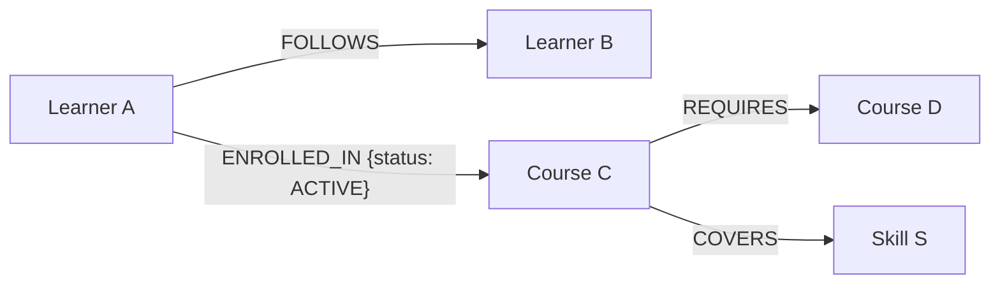
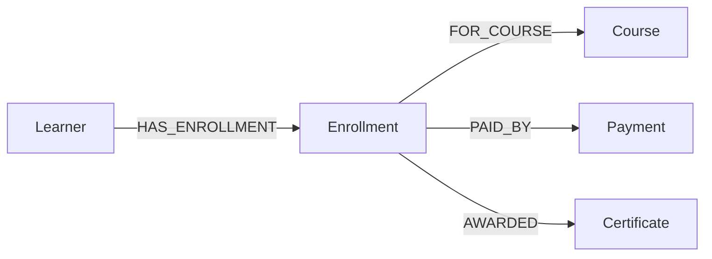
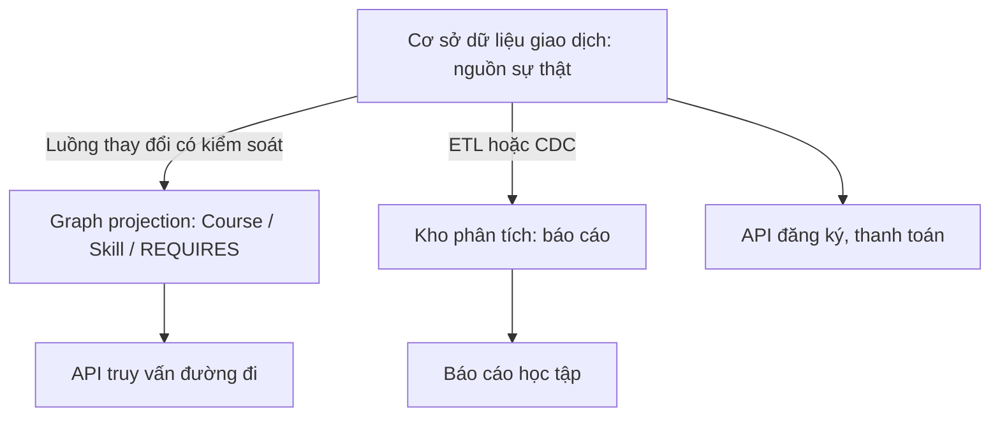

# So sánh mô hình đồ thị với bảng liên kết quan hệ theo yêu cầu truy vấn

## 1. Bài toán không phải “graph hay SQL hiện đại hơn?”

Một nghiệp vụ có thể được biểu diễn bằng cả **bảng liên kết trong cơ sở dữ liệu quan hệ** và **nút/cạnh trong cơ sở dữ liệu đồ thị**. Chẳng hạn, người học theo dõi người học khác, tham gia khóa học, hoặc một khóa học yêu cầu hoàn thành khóa học nền tảng. Cả hai cách đều mô tả được thực thể và quan hệ đó.

Sự khác biệt đáng quan tâm không chỉ nằm ở hình vẽ hay cú pháp truy vấn. Người thiết kế cần trả lời:

- Truy vấn chủ yếu hỏi **quan hệ trực tiếp**, hay thường đi qua **nhiều bước liên tiếp**?
- Số bước duyệt là cố định, có giới hạn, hay thay đổi theo dữ liệu?
- Cần lấy **đường đi**, tìm kết nối, tìm đường ngắn nhất, hay chỉ lấy danh sách/thống kê?
- Một nút có thể có rất nhiều kết nối không? Có nút “siêu kết nối” (*supernode*) không?
- Quan hệ có thuộc tính, trạng thái, thời điểm hiệu lực và ràng buộc riêng không?
- Dữ liệu cần được phân quyền theo tổ chức, cập nhật nguyên tử và báo cáo tổng hợp như thế nào?

Bài này thuộc chương **Mô hình đồ thị** của **DATABASE_DATA_MODELING**. Phạm vi học tập là chuyển yêu cầu nghiệp vụ thành mô hình dữ liệu rõ ràng, xác định thực thể, quan hệ, ràng buộc, khóa, chỉ mục và lược đồ vật lý; so sánh các cách mô hình hóa quan hệ, document, đồ thị và phân tích để lựa chọn có căn cứ, dễ tiến hóa và kiểm chứng.

**Mục tiêu sau bài học:** bạn có thể mô hình hóa cùng dữ liệu theo hai cách, viết truy vấn tương đương, đánh giá những khác biệt về độ sâu và độ phân nhánh, xác định ranh giới nhất quán/bảo mật, rồi đề xuất lựa chọn dựa trên workload thay vì khẩu hiệu “graph nhanh hơn join”.

## 2. Hai cách biểu diễn cùng một quan hệ

### 2.1. Bảng liên kết trong mô hình quan hệ

Giả sử một nền tảng học tập có học viên, khóa học và các quan hệ:

- Học viên A **theo dõi** học viên B.
- Học viên A **ghi danh** vào khóa học C.
- Khóa học C **yêu cầu trước** khóa học D.
- Khóa học C **bao phủ** một kỹ năng S.

Trong mô hình quan hệ, mỗi thực thể thường có bảng riêng, còn quan hệ nhiều–nhiều được biểu diễn qua **bảng liên kết** (*junction/association table*):

```text
learners(tenant_id, learner_id, display_name, ...)
courses(tenant_id, course_id, title, ...)
skills(tenant_id, skill_id, name, ...)

follows(
  tenant_id, follower_id, followee_id, created_at
)

enrollments(
  tenant_id, learner_id, course_id, status, enrolled_at
)

course_prerequisites(
  tenant_id, course_id, required_course_id
)

course_skills(
  tenant_id, course_id, skill_id
)
```

Mỗi dòng bảng liên kết biểu diễn một **quan hệ có hướng hoặc có vai trò**. Ví dụ `follower_id` và `followee_id` không thể đổi chỗ nếu `FOLLOWS` là quan hệ một chiều.

Ưu điểm nổi bật: các khóa chính, khóa ngoại, ràng buộc duy nhất, kiểu dữ liệu và giao dịch có thể diễn đạt rõ ở schema quan hệ. Truy vấn kết hợp bằng `JOIN`, `EXISTS`, phép tổng hợp hoặc truy vấn đệ quy.

### 2.2. Property graph

Trong **mô hình đồ thị thuộc tính (property graph)**:

- **Node (nút):** biểu diễn thực thể, ví dụ `Learner`, `Course`, `Skill`.
- **Relationship/edge (cạnh):** biểu diễn liên hệ, ví dụ `FOLLOWS`, `ENROLLED_IN`, `REQUIRES`.
- **Properties (thuộc tính):** có thể nằm trên nút và cạnh, chẳng hạn `status`, `enrolledAt`.
- **Labels/types:** mô tả loại nút và loại cạnh; quy tắc hỗ trợ đa nhãn và kiểu thuộc tính phụ thuộc hệ quản trị.

Một cách biểu diễn:



Cách đọc tương đương:

```text
(:Learner {learnerId: "U-A"})
  -[:FOLLOWS]->
(:Learner {learnerId: "U-B"})

(:Learner {learnerId: "U-A"})
  -[:ENROLLED_IN {status: "ACTIVE"}]->
(:Course {courseId: "C-ADV"})

(:Course {courseId: "C-ADV"})
  -[:REQUIRES]->
(:Course {courseId: "C-BASE"})
```

**Ý nghĩa nghiệp vụ giống nhau:** mỗi quan hệ liên kết các thực thể, có thể có chiều và thuộc tính. Graph không tự tạo ra thông tin mới mà bảng liên kết không biểu diễn được.

### 2.3. Bảng đối chiếu khái niệm

| Yêu cầu | Mô hình quan hệ | Property graph |
| --- | --- | --- |
| Học viên | Dòng trong `learners` | Nút `:Learner` |
| Khóa học | Dòng trong `courses` | Nút `:Course` |
| Học viên theo dõi học viên khác | Dòng trong `follows` | Cạnh `:FOLLOWS` |
| Học viên ghi danh khóa học | Dòng trong `enrollments` | Cạnh `:ENROLLED_IN` |
| Trạng thái ghi danh | Cột `status` của bảng liên kết | Thuộc tính `status` của cạnh |
| Ràng buộc không trùng ghi danh | Khóa duy nhất theo cặp | Cơ chế ràng buộc/ghi có điều kiện theo DB graph |
| Danh sách quan hệ trực tiếp | `JOIN` hoặc truy vấn bảng liên kết | Duyệt một cạnh |
| Đi qua N liên kết | N join hoặc truy vấn đệ quy | Mẫu đường đi có N cạnh |
| Phân quyền theo tổ chức | Điều kiện `tenant_id` và ràng buộc | Điều kiện trên nút, cạnh, đường đi và kiểm soát truy cập |

Không nên coi “graph schema linh hoạt” là lý do bỏ qua định danh, kiểu thuộc tính, ràng buộc và quyền truy cập. Đồ thị cũng phải có **hợp đồng dữ liệu**.

## 3. Thiết kế bảng liên kết đúng trước khi so sánh

Một đánh giá công bằng cần có mô hình quan hệ **hợp lý và có chỉ mục**, không phải so sánh graph tối ưu với bảng SQL không có khóa/index.

Ví dụ PostgreSQL với quan hệ theo dõi có phạm vi tổ chức:

```sql
CREATE TABLE learners (
    tenant_id   text NOT NULL,
    learner_id  text NOT NULL,
    display_name text NOT NULL,
    PRIMARY KEY (tenant_id, learner_id)
);

CREATE TABLE follows (
    tenant_id    text NOT NULL,
    follower_id  text NOT NULL,
    followee_id  text NOT NULL,
    created_at   timestamptz NOT NULL DEFAULT now(),
    PRIMARY KEY (tenant_id, follower_id, followee_id),
    FOREIGN KEY (tenant_id, follower_id)
        REFERENCES learners (tenant_id, learner_id),
    FOREIGN KEY (tenant_id, followee_id)
        REFERENCES learners (tenant_id, learner_id),
    CHECK (follower_id <> followee_id)
);

-- Truy vấn ngược: ai đang theo dõi học viên X?
CREATE INDEX follows_by_followee
    ON follows (tenant_id, followee_id, follower_id);
```

Giải thích:

- Khóa chính ghép ngăn lặp cùng cặp `(tenant_id, follower_id, followee_id)`.
- Khóa ngoại bảo vệ tham chiếu trong **cùng tenant**.
- Ràng buộc `CHECK` ngăn tự theo dõi nếu nghiệp vụ cấm.
- Khóa chính có thể phục vụ truy vấn từ follower đến followee theo tiền tố phù hợp.
- Chỉ mục ngược phục vụ truy vấn “ai theo dõi B”.
- Việc xóa học viên cần chính sách rõ: từ chối, xóa cascade hoặc lưu lịch sử. Không tự chọn tùy tiện.

Đây là minh họa SQL kiểu PostgreSQL; cú pháp và khả năng của các hệ RDBMS khác có thể khác. Các khóa ngoại không tự tạo chỉ mục ở phía bảng con trong mọi hệ; cần kiểm tra cấu trúc thực tế.

### 3.1. Cạnh có thuộc tính = bảng liên kết có thuộc tính

Ghi danh không chỉ là hai ID:

```sql
CREATE TABLE enrollments (
    tenant_id   text NOT NULL,
    learner_id  text NOT NULL,
    course_id   text NOT NULL,
    status      text NOT NULL,
    enrolled_at timestamptz NOT NULL DEFAULT now(),
    PRIMARY KEY (tenant_id, learner_id, course_id),
    CHECK (status IN ('ACTIVE', 'COMPLETED', 'CANCELLED'))
);
```

Trong graph, cùng dữ kiện có thể nằm trên cạnh:

```cypher
(:Learner {learnerId: "U-A"})
  -[:ENROLLED_IN {
      status: "ACTIVE",
      enrolledAt: datetime("2026-11-22T08:00:00Z")
    }]->
(:Course {courseId: "C-ADV"})
```

Khi quan hệ có lịch sử nhiều lần ghi danh, thời hạn, chứng nhận hoặc giao dịch riêng, nó có thể cần **định danh riêng**. Trong quan hệ, có thể dùng bảng enrollment với `enrollment_id`; trong graph, có thể cân nhắc một nút `Enrollment` thay vì cạnh đơn nếu vòng đời và các liên hệ của việc ghi danh trở nên phức tạp.

**Không phải quan hệ có hai đầu nào cũng nên luôn là một edge đơn giản.** Cần xác định vòng đời, tính duy nhất và những truy vấn nhắm trực tiếp vào chính quan hệ đó.

## 4. Truy vấn một bước: cả JOIN lẫn duyệt cạnh đều là ứng viên tốt

### 4.1. Bài toán

“Lấy những người mà học viên U-A đang theo dõi, trong tổ chức ORG-07.”

**SQL:**

```sql
SELECT l.learner_id, l.display_name
FROM follows AS f
JOIN learners AS l
  ON l.tenant_id = f.tenant_id
 AND l.learner_id = f.followee_id
WHERE f.tenant_id = 'ORG-07'
  AND f.follower_id = 'U-A';
```

**Cypher (minh họa Neo4j):**

```cypher
MATCH (a:Learner {tenantId: 'ORG-07', learnerId: 'U-A'})
      -[:FOLLOWS]->(b:Learner)
WHERE b.tenantId = 'ORG-07'
RETURN b.learnerId AS learnerId, b.displayName AS displayName;
```

Hai truy vấn có thể đều nhanh nếu:

- Hệ SQL có chỉ mục theo `tenant_id, follower_id` và khóa join.
- Hệ graph tìm được nút đầu bằng index/constraint và duyệt số cạnh hợp lý.
- Kết quả có giới hạn phù hợp và dữ liệu liên quan nằm trong vùng truy cập hiệu quả.
- Mức tải đồng thời và cache được xét khi benchmark.

**Kết luận:** với quan hệ trực tiếp, không có cơ sở để khẳng định graph luôn vượt trội. Một bảng liên kết được thiết kế đúng có thể đáp ứng rất tốt.

### 4.2. Lấy số người theo dõi

“U-A đang theo dõi bao nhiêu người?”

**SQL:**

```sql
SELECT count(*) AS following_count
FROM follows
WHERE tenant_id = 'ORG-07'
  AND follower_id = 'U-A';
```

**Cypher:**

```cypher
MATCH (:Learner {tenantId: 'ORG-07', learnerId: 'U-A'})
      -[:FOLLOWS]->(b:Learner)
WHERE b.tenantId = 'ORG-07'
RETURN count(b) AS followingCount;
```

Cần phân biệt đếm **cạnh** và đếm **đích phân biệt**. Nếu có cạnh trùng, `count(b)` đếm nhiều lần; để đếm người duy nhất có thể cần `count(DISTINCT b)`. Tốt hơn là bảo vệ bất biến không có quan hệ trùng khi nghiệp vụ yêu cầu.

Nếu một nút có hàng triệu cạnh và số lượt truy vấn đếm rất cao, cả hai hệ đều có thể cần tính toán trước, cache hoặc bộ đếm dẫn xuất với cơ chế đối soát.

## 5. Truy vấn hai bước: join cố định hay mẫu đường đi?

### 5.1. Bài toán

“Tìm những người được theo dõi bởi người mà U-A đang theo dõi” — thường gọi là **friends-of-friends**, nhưng quan hệ `FOLLOWS` là **có hướng**, không được mặc định là quan hệ bạn bè hai chiều.

**SQL với hai lần nối bảng liên kết:**

```sql
SELECT DISTINCT f2.followee_id AS suggested_learner_id
FROM follows AS f1
JOIN follows AS f2
  ON f2.tenant_id = f1.tenant_id
 AND f2.follower_id = f1.followee_id
WHERE f1.tenant_id = 'ORG-07'
  AND f1.follower_id = 'U-A'
  AND f2.followee_id <> 'U-A';
```

**Cypher với mẫu hai cạnh:**

```cypher
MATCH (a:Learner {tenantId: 'ORG-07', learnerId: 'U-A'})
      -[:FOLLOWS]->(:Learner)
      -[:FOLLOWS]->(candidate:Learner)
WHERE candidate.tenantId = 'ORG-07'
  AND candidate.learnerId <> 'U-A'
RETURN DISTINCT candidate.learnerId AS suggestedLearnerId;
```

Cả hai truy vấn tìm **các đích sau đúng hai bước**. Chúng chưa loại trừ người mà U-A đã theo dõi trực tiếp. Nếu nghiệp vụ muốn đề xuất **người chưa theo dõi**, cần thêm điều kiện phủ định.

**SQL:**

```sql
SELECT DISTINCT f2.followee_id AS suggested_learner_id
FROM follows AS f1
JOIN follows AS f2
  ON f2.tenant_id = f1.tenant_id
 AND f2.follower_id = f1.followee_id
WHERE f1.tenant_id = 'ORG-07'
  AND f1.follower_id = 'U-A'
  AND f2.followee_id <> 'U-A'
  AND NOT EXISTS (
      SELECT 1
      FROM follows AS direct
      WHERE direct.tenant_id = f1.tenant_id
        AND direct.follower_id = 'U-A'
        AND direct.followee_id = f2.followee_id
  );
```

**Cypher:**

```cypher
MATCH (a:Learner {tenantId: 'ORG-07', learnerId: 'U-A'})
      -[:FOLLOWS]->(:Learner)
      -[:FOLLOWS]->(candidate:Learner)
WHERE candidate.tenantId = 'ORG-07'
  AND candidate <> a
  AND NOT EXISTS {
    MATCH (a)-[:FOLLOWS]->(candidate)
  }
RETURN DISTINCT candidate.learnerId AS suggestedLearnerId;
```

Điều kiện trong Cypher chỉ lọc `candidate` ở tenant đó; nếu dữ liệu có cạnh xuyên tenant ngoài dự kiến, **nút trung gian vẫn cần kiểm tra quyền/tenant**. Các ví dụ này giả định hệ thống đã bảo vệ ràng buộc cạnh `FOLLOWS` trong cùng tenant. Khi xây một hệ đa tenant thực, phải kiểm tra cả nút, cạnh và tuyến duyệt ở từng bước hoặc dùng cơ chế phân vùng/authorization tương đương.

### 5.2. Điều gì thay đổi ở bước ba, bốn, năm?

Với số bước cố định là hai, ba hoặc bốn, SQL có thể dùng nhiều `JOIN` và graph có thể dùng mẫu nối tiếp. Cú pháp graph thường **gần cách diễn đạt đường đi hơn**, nhưng điều đó **không tự chứng minh hiệu năng cao hơn**.

Khi độ sâu không cố định, SQL thường cần truy vấn đệ quy hoặc bảng đóng đường đi (*closure table*), trong khi ngôn ngữ graph có khả năng mô tả mẫu độ dài biến thiên. Cách chọn phụ thuộc tần suất và độ phức tạp của những truy vấn này.

## 6. Truy vấn nhiều bước với độ sâu biến thiên

### 6.1. Bài toán khóa học tiên quyết

Một khóa học có thể yêu cầu hoàn thành một hoặc nhiều khóa khác, và mỗi khóa nền tảng lại có thể có yêu cầu trước. Hệ thống cần tìm **tất cả khóa tiên quyết** trong tối đa năm tầng.

Cấu trúc có hướng:

```text
C-ADV  --REQUIRES--> C-MID
C-MID  --REQUIRES--> C-BASE
C-ADV  --REQUIRES--> C-MATH
```

Đây là một đồ thị quan hệ giữa chính các khóa học. Nếu nghiệp vụ cấm vòng `C-A → C-B → C-A`, hệ thống cần bảo vệ quy tắc **không có chu trình** bằng cơ chế nghiệp vụ có kiểm soát.

### 6.2. SQL: recursive common table expression

Lược đồ liên kết:

```sql
CREATE TABLE course_prerequisites (
    tenant_id          text NOT NULL,
    course_id          text NOT NULL,
    required_course_id text NOT NULL,
    PRIMARY KEY (tenant_id, course_id, required_course_id),
    CHECK (course_id <> required_course_id)
);
```

Truy vấn PostgreSQL với giới hạn năm cạnh và một mảng ID đã đi qua để tránh lặp vòng trên từng đường:

```sql
WITH RECURSIVE paths AS (
    SELECT
        p.tenant_id,
        p.course_id AS root_course_id,
        p.required_course_id AS current_course_id,
        1 AS depth,
        ARRAY[p.course_id, p.required_course_id] AS visited
    FROM course_prerequisites AS p
    WHERE p.tenant_id = 'ORG-07'
      AND p.course_id = 'C-ADV'

    UNION ALL

    SELECT
        x.tenant_id,
        x.root_course_id,
        p.required_course_id,
        x.depth + 1,
        x.visited || p.required_course_id
    FROM paths AS x
    JOIN course_prerequisites AS p
      ON p.tenant_id = x.tenant_id
     AND p.course_id = x.current_course_id
    WHERE x.depth < 5
      AND NOT p.required_course_id = ANY(x.visited)
)
SELECT DISTINCT current_course_id
FROM paths;
```

**Những gì truy vấn này làm được:**

- Đi theo cạnh `course_id → required_course_id`.
- Dừng tại năm bước để bảo vệ ngân sách truy vấn.
- Tránh đi lại một nút trong **cùng đường đi** bằng `visited`.
- Trả một danh sách khóa tiên quyết phân biệt, không trả đường đi đầy đủ hoặc đường đi ngắn nhất.

**Những gì chưa giải quyết:**

- Nó không chứng minh dữ liệu nguồn không chứa chu trình; bộ truy vấn chỉ tránh lặp khi duyệt.
- Nếu có nhiều đường khác nhau đến một khóa học, có thể vẫn mở rộng các đường đó trước khi `DISTINCT`.
- Độ sâu năm là **giới hạn thiết kế giả định**, không phải bảo đảm bao phủ mọi tiên quyết thực.
- Việc kiểm tra tenant, xác thực tham chiếu và quyền truy cập vẫn cần đầy đủ trong dữ liệu và ứng dụng.

Nếu muốn hiển thị cả các đường đi, có thể trả thêm `visited`, nhưng số đường có thể tăng rất nhanh. Nếu chỉ cần xác định **có thể tới đích hay không**, nên cân nhắc truy vấn tồn tại hoặc cấu trúc chuyên biệt thay vì liệt kê mọi đường.

### 6.3. Cypher: mẫu đường đi biến độ dài

Ví dụ Cypher với độ sâu từ một đến năm cạnh:

```cypher
MATCH path =
  (start:Course {tenantId: 'ORG-07', courseId: 'C-ADV'})
  -[:REQUIRES*1..5]->
  (required:Course)
WHERE all(node IN nodes(path)
          WHERE node.tenantId = 'ORG-07')
RETURN DISTINCT required.courseId AS requiredCourseId;
```

Mẫu `*1..5` mô tả quan hệ `REQUIRES` có **độ dài biến thiên trong khoảng được giới hạn**. Điều kiện `all(...)` kiểm tra tenant trên tất cả nút của đường đi.

Cần kiểm tra thêm nếu mô hình cho phép cạnh mang `tenantId` hoặc có quy tắc phân quyền riêng: **kiểm tra chỉ các nút không thay thế kiểm tra cạnh và quyền người dùng**. Nếu có dữ liệu hỗn hợp hoặc cạnh xuyên tenant, phải bổ sung điều kiện phù hợp.

Cypher làm biểu thức đường đi trực quan, nhưng không tự khiến việc liệt kê tất cả đường đi trở nên rẻ. Một số hệ graph có quy tắc không lặp cạnh/nút trong một phép duyệt; chi tiết đó phụ thuộc ngôn ngữ và phiên bản. Muốn cấm chu trình ở **dữ liệu gốc**, vẫn cần validation và cơ chế ghi, không chỉ dựa vào cú pháp MATCH.

### 6.4. Khi độ sâu lớn, rủi ro bùng nổ kết quả

Giả sử từ mỗi khóa học trung bình có 8 cạnh dẫn sang khóa khác. Trước khi lọc trùng và áp đặt ràng buộc, số **đường đi tiềm năng** sau k bước có thể tăng xấp xỉ:

```text
Số đường ở tầng k ≈ 8^k

k = 1   ->          8
k = 2   ->         64
k = 3   ->        512
k = 4   ->      4.096
k = 5   ->     32.768
k = 6   ->    262.144
```

Các số là **mô hình minh họa**, không phải benchmark. Dữ liệu thực có thể trùng đích, có chu trình, bộ lọc giảm tải hoặc phân phối bậc rất lệch. Nhưng kết luận vẫn quan trọng: **graph không miễn phí khỏi độ phức tạp tổ hợp**.

Nếu truy vấn chỉ cần biết một khóa có phụ thuộc vào khóa khác, dùng truy vấn tồn tại có thể tiết kiệm hơn việc liệt kê mọi đường. Nếu cần nhiều tuyến và giải thích đường đi, phải đặt giới hạn độ sâu, số kết quả, timeout và kiểm thử nút có nhiều liên kết.

## 7. Tìm đường đi và đường ngắn nhất: truy vấn khác với lấy danh sách

### 7.1. Những câu hỏi khác nhau cần thuật toán khác nhau

- **Reachability:** Có đường đi từ A đến B không?
- **Shortest path theo số cạnh:** Đường đi ít bước nhất từ A đến B là gì?
- **K-shortest paths:** Có những đường tốt nhất nào, theo cách xếp hạng quy định?
- **Weighted shortest path:** Đường có **tổng trọng số nhỏ nhất**, ví dụ thời gian, chi phí hoặc mức độ rủi ro?
- **All paths:** Liệt kê mọi đường đáp ứng điều kiện, trong một phạm vi giới hạn.

“Đường ngắn nhất” chỉ có nghĩa khi xác định **thước đo**. Ít cạnh nhất không đồng nghĩa tổng thời gian ít nhất hoặc chi phí thấp nhất.

### 7.2. Trong SQL

Có thể dùng recursive CTE để kiểm tra khả năng tới đích hoặc tìm đường trong phạm vi giới hạn. Với bài toán đường đi có trọng số lớn, thuật toán chuyên dụng hoặc phương án tính toán khác có thể phù hợp hơn; không nên tự viết một recursive CTE rồi mặc định nó triển khai đúng thuật toán đường đi ngắn nhất có trọng số.

Một hệ có thể lưu **closure table** để tăng tốc truy vấn reachability:

```text
course_reachability
  tenant_id
  ancestor_course_id
  prerequisite_course_id
  min_depth
```

Khi đã lưu sẵn tất cả cặp có đường đi, truy vấn kiểm tra phụ thuộc có thể đơn giản. Đánh đổi là phải cập nhật closure table khi cạnh đổi, xử lý đường trùng và đường bị xóa, đồng thời bảo vệ tính nhất quán. Đây là một dạng **dữ liệu dẫn xuất** cần nguồn thẩm quyền và quy trình rebuild.

### 7.3. Trong graph

Ngôn ngữ/trình mở rộng graph có thể cung cấp phép tìm đường ngắn nhất hoặc các thuật toán đường đi khác. Ví dụ Cypher cổ điển cho đường ngắn nhất theo số cạnh, có giới hạn độ sâu:

```cypher
MATCH (a:Course {tenantId: 'ORG-07', courseId: 'C-ADV'}),
      (b:Course {tenantId: 'ORG-07', courseId: 'C-BASE'})
MATCH path = shortestPath((a)-[:REQUIRES*..5]->(b))
RETURN [n IN nodes(path) | n.courseId] AS coursePath,
       length(path) AS hops;
```

**Đây là ví dụ minh họa cú pháp Cypher theo phiên bản hỗ trợ `shortestPath`.** Khả năng và cú pháp đường đi ngắn nhất đã có những khác biệt giữa phiên bản và hệ graph. Cần kiểm tra tài liệu chính thức của sản phẩm thực tế, điều kiện lọc trên đường đi và semantics khi có nhiều đường ngắn nhất.

Ví dụ trên tìm theo **số cạnh**, không dùng trọng số. Nếu phải bảo đảm mọi nút/cạnh trung gian thuộc tenant và người dùng có quyền xem, các ràng buộc đó phải được áp đặt **trong quá trình tìm đường** bằng cơ chế phù hợp, không chỉ lọc hai đầu. Nếu dữ liệu có cạnh bị cấm ở giữa, một đường ngắn nhất “toàn cục” rồi mới kiểm tra quyền có thể cho kết quả sai so với **đường ngắn nhất trong tập được phép**.

### 7.4. Quyết định theo truy vấn đường đi

| Loại truy vấn | Quan hệ có bảng liên kết | Property graph |
| --- | --- | --- |
| Quan hệ trực tiếp A → B | `JOIN`/`EXISTS`, rất phù hợp | Duyệt một cạnh, rất phù hợp |
| Đúng hai hoặc ba bước | Join nhiều lần, thường rõ | Pattern nhiều cạnh, thường rõ |
| Độ sâu biến thiên nhưng có trần | Recursive CTE, closure table | Path pattern biến độ dài |
| Kiểm tra reachability rất thường xuyên | Đệ quy hoặc dữ liệu dẫn xuất | Duyệt graph với điều kiện và giới hạn |
| Tìm và giải thích đường đi | Cần lưu đường trong CTE/thuật toán | Path là khái niệm tự nhiên của truy vấn |
| Đường đi có trọng số/phức tạp | Thuật toán hoặc mô hình chuyên biệt | Kiểm tra thuật toán/extension được hỗ trợ |
| Liệt kê toàn bộ đường ở graph phân nhánh lớn | Có thể rất đắt | Cũng có thể rất đắt |

**Sự khác biệt trọng tâm là sự thuận tiện biểu diễn và hành vi thực thi trên workload cụ thể, không phải “SQL bất lực trước nhiều bước”.**

## 8. Độ phân nhánh, nút siêu kết nối và điều kiện lọc

### 8.1. Nút có bậc cao

Trong mạng học viên, phần lớn người theo dõi vài chục người nhưng một tài khoản nổi tiếng có thể được hàng triệu người theo dõi. Trong đồ thị sản phẩm, một nhãn phổ biến có thể nối tới hàng trăm nghìn sản phẩm.

Nút có số lượng cạnh rất lớn thường được gọi là **supernode** hoặc hub. Nếu một truy vấn duyệt qua hub mà không có bộ lọc, số lượng kết quả và công việc mở rộng có thể lớn.

Ví dụ:

```text
U-A -> U-HUB -> 100.000 học viên
```

Ngay cả một truy vấn hai bước cũng có thể tạo lượng ứng viên rất lớn. Graph engine không tự triệt tiêu chi phí này; SQL cũng không tránh được nếu yêu cầu đòi truy cập từng quan hệ.

### 8.2. Tính chọn lọc của điểm bắt đầu

So sánh:

- “Tìm các liên hệ của **một người cụ thể** trong tối đa ba bước.”
- “Tìm mọi cặp người có đường đi dài tối đa ba bước trong toàn hệ thống.”

Truy vấn đầu có một **điểm neo (anchor)** chọn lọc, dễ giới hạn phạm vi duyệt. Truy vấn thứ hai có thể tạo tập kết quả khổng lồ.

Trong graph, chỉ mục trên nhãn/định danh của nút bắt đầu giúp tìm điểm neo; việc duyệt cạnh phía sau phụ thuộc cách graph engine lưu quan hệ và bộ lọc. Trong SQL, chỉ mục trên cột nguồn/đích của bảng liên kết giúp bước join và truy vấn đệ quy.

### 8.3. Không so sánh theo trung bình duy nhất

Khi dự báo dữ liệu, cần biết:

- Phân phối số cạnh vào/ra trên mỗi nút: trung vị, p95, p99 và giá trị lớn nhất.
- Số bước tối đa thường truy vấn.
- Tỷ lệ truy vấn bắt đầu ở hub.
- Tỷ lệ bị loại bởi điều kiện thuộc tính và phân quyền.
- Số đường đi trùng tới cùng đích.
- Số truy vấn đồng thời và độ trễ mục tiêu.

Một benchmark chỉ dùng đồ thị đều với mỗi nút 10 cạnh sẽ không đại diện cho hệ thống có vài nút hàng triệu cạnh.

## 9. Ràng buộc và tính nhất quán: graph không tự bảo đảm đúng nghiệp vụ

### 9.1. Cạnh không trùng

Nghiệp vụ “A theo dõi B tối đa một lần” tương đối rõ với bảng `follows` có khóa chính ghép.

Trong property graph, lệnh tìm hoặc tạo quan hệ phải được thiết kế theo semantics và mức bảo đảm của hệ graph. Ví dụ Cypher:

```cypher
MATCH (a:Learner {tenantId: 'ORG-07', learnerId: 'U-A'}),
      (b:Learner {tenantId: 'ORG-07', learnerId: 'U-B'})
MERGE (a)-[:FOLLOWS]->(b);
```

`MERGE` mô tả yêu cầu khớp hoặc tạo mẫu quan hệ. Nhưng với ghi đồng thời, **không được mặc nhiên coi mọi hệ graph bảo vệ duy nhất cặp đầu–cuối theo cùng cách một unique constraint trên bảng SQL**. Cần kiểm tra cơ chế ràng buộc, transaction, khóa và tình huống race của sản phẩm; có thể cần mô hình quan hệ có ID riêng hoặc một cơ chế bảo vệ bổ sung.

### 9.2. Cấm chu trình của quan hệ tiên quyết

Khóa học C-A yêu cầu C-B, còn C-B yêu cầu C-A sẽ tạo chu trình. Cả hai biểu diễn đều có thể lưu điều này nếu không có kiểm tra.

- Với SQL, khóa ngoại và `CHECK(course_id <> required_course_id)` chỉ chặn tự tham chiếu trực tiếp, **không chặn chu trình dài**.
- Với graph, việc một cạnh `REQUIRES` được tạo không tự chứng minh graph vẫn là DAG.
- Một kiểm tra “trước khi thêm A→B, B có đường đi tới A không?” cần được thực hiện dưới cơ chế nhất quán đủ mạnh. Hai tiến trình thêm cạnh đồng thời có thể cùng vượt qua kiểm tra rời rạc.

Vì vậy, cần thiết kế **điểm ghi có thẩm quyền**, mức cô lập hoặc cơ chế đồng bộ phù hợp để bảo vệ bất biến.

### 9.3. Xóa nút và quan hệ

Nếu một khóa học bị xóa, các cạnh `REQUIRES` và `ENROLLED_IN` liên quan phải được xử lý theo chính sách:

- Ngăn xóa nếu vẫn có phụ thuộc bắt buộc?
- Xóa cascade các quan hệ không còn hợp lệ?
- Giữ snapshot lịch sử ghi danh và chỉ ẩn khóa học?
- Cập nhật các báo cáo/đồ thị dẫn xuất?

Cơ sở dữ liệu quan hệ có thể định nghĩa chính sách khóa ngoại; trong graph, cơ chế xóa nút/cạnh khác nhau theo hệ quản trị. **Đừng dùng lệnh xóa hàng loạt chỉ để tránh lỗi ràng buộc** khi chưa hiểu tác động nghiệp vụ.

## 10. Chỉ mục và tối ưu truy vấn: so sánh đúng cùng một công việc

### 10.1. Cấu trúc vật lý trong SQL

Với truy vấn liên kết, chỉ mục thường cần theo:

- Khóa nguồn của quan hệ để đi **thuận chiều**.
- Khóa đích để đi **ngược chiều**.
- Cột lọc và thứ tự như `tenant_id, status, created_at`.
- Khóa chính/unique để bảo vệ định danh và tính duy nhất.

Ví dụ:

```sql
-- Phục vụ đi từ course sang các khóa cần trước.
CREATE INDEX prerequisites_by_course
    ON course_prerequisites (tenant_id, course_id, required_course_id);

-- Phục vụ đi ngược: những khóa nào yêu cầu C-BASE?
CREATE INDEX prerequisites_by_required
    ON course_prerequisites (tenant_id, required_course_id, course_id);
```

Nếu khóa chính đã tạo đường truy cập tương đương chỉ mục đầu, có thể không cần tạo chỉ mục trùng lặp. Cần xem **schema thực và kế hoạch truy vấn** trước khi thêm.

### 10.2. Cấu trúc truy cập trong graph

Trong property graph, chỉ mục/constraint thường giúp **tìm nút hoặc quan hệ bằng thuộc tính**, chẳng hạn:

```cypher
// Ví dụ Cypher kiểu Neo4j, khả năng cú pháp tùy phiên bản.
CREATE CONSTRAINT course_tenant_id IF NOT EXISTS
FOR (c:Course)
REQUIRE (c.tenantId, c.courseId) IS UNIQUE;
```

Sau khi tìm được nút `C-ADV`, việc duyệt `REQUIRES` phụ thuộc graph engine và kiểu lưu trữ quan hệ. Một số hệ tối ưu cho truy cập lân cận; không có nghĩa việc duyệt nhiều tầng hoặc qua hub sẽ luôn nhanh.

Đối với cả hai mô hình, **đường truy cập phải được đo từ điểm neo tới tập kết quả**, không chỉ đếm số index.

### 10.3. Kế hoạch thực thi và metrics

Trong PostgreSQL, thường kiểm tra:

```sql
EXPLAIN (ANALYZE, BUFFERS)
SELECT f.followee_id
FROM follows AS f
WHERE f.tenant_id = 'ORG-07'
  AND f.follower_id = 'U-A';
```

Cần xem truy cập index, lượng dòng ước lượng/thực tế, số lần lặp join, buffer I/O và thời gian thực thi. `EXPLAIN ANALYZE` thực thi câu lệnh trong môi trường hiện tại; dùng cẩn thận với thao tác thay đổi dữ liệu và benchmark production.

Trong hệ graph, kiểm tra `PROFILE`/`EXPLAIN` hoặc công cụ tương đương để xem:

- Cách tìm nút bắt đầu.
- Số cạnh/nút đã mở rộng.
- Số dòng trung gian và kết quả.
- Bộ lọc, phép loại trùng, sắp xếp và memory.
- Thời gian, I/O và chi phí truy vấn theo công cụ của sản phẩm.

Không so sánh chỉ bằng “SQL có 4 JOIN, Cypher có 4 mũi tên”. Chi phí phụ thuộc dữ liệu và plan, không phải độ dài câu truy vấn.

## 11. Bài toán lựa chọn theo yêu cầu truy vấn

Ma trận sau là **hướng phán đoán ban đầu**, không phải quy tắc tuyệt đối:

| Yêu cầu chiếm ưu thế | Bảng liên kết quan hệ | Property graph | Ghi chú |
| --- | --- | --- | --- |
| Tra cứu A liên quan trực tiếp B | Rất phù hợp | Rất phù hợp | Hãy đo bằng index và query plan |
| Danh sách và phân trang quan hệ của một thực thể | Rất phù hợp | Phù hợp | Cả hai cần ổn định thứ tự/giới hạn kết quả |
| Lọc theo nhiều thuộc tính bảng và báo cáo tổng hợp | Thường thuận tiện | Có thể thực hiện | SQL có ưu thế về hệ sinh thái BI và truy vấn tabular |
| Đúng 2–3 bước kết nối, cấu trúc cố định | Phù hợp | Phù hợp | JOIN được tối ưu có thể đủ tốt |
| Thường xuyên tìm đường đi biến độ dài | Cần recursive CTE/closure table | Là trọng tâm biểu đạt của graph | Phải đo phân nhánh và nút nóng |
| Cần giải thích một tuyến kết nối | Có thể xây qua CTE/thuật toán | Path là thực thể truy vấn tự nhiên | Không suy ra graph luôn nhanh hơn |
| Thuật toán mạng phức tạp (trung tâm, cộng đồng) | Thường cần pipeline/công cụ chuyên biệt | Có thể có thư viện thuật toán | Kiểm tra khả năng thuật toán, quy mô, giấy phép/sản phẩm |
| Ghi giao dịch nhiều bảng với FK chặt | Thường mạnh | Phụ thuộc graph DB | Xác minh isolation và constraint |
| Quan hệ thay đổi thường xuyên giữa nhiều loại nút | Có thể cần nhiều bảng | Thường biểu đạt trực quan | Vẫn cần schema và ownership |
| Báo cáo định kỳ trên hàng tỷ sự kiện | Hệ quan hệ/warehouse phù hợp tùy tải | Graph không mặc nhiên tốt hơn | Có thể tách mô hình phân tích |
| Hệ thống phải vận hành đơn giản, đội đã thành thạo SQL | Lợi thế thực tế | Thêm công nghệ cần chứng minh | Tính chi phí con người và vận hành |

**Kết luận tạm thời:** nếu workload chủ yếu là CRUD, tra cứu 1–2 bước và báo cáo có cấu trúc, bắt đầu với bảng liên kết quan hệ thường là phương án tốt để kiểm chứng. Nếu **đường đi biến độ dài, tương tác mạng và quan hệ nhiều tầng** là phần cốt lõi có tần suất lớn, graph đáng được benchmark nghiêm túc.

## 12. Hệ thống đa tenant và bảo mật đường duyệt

Trong nền tảng nhiều tổ chức, chỉ kiểm tra quyền của **nút bắt đầu** thường chưa đủ.

Giả sử một cạnh sai dữ liệu nối từ học viên ORG-07 tới học viên ORG-12. Truy vấn:

```cypher
MATCH (a:Learner {tenantId: 'ORG-07', learnerId: 'U-A'})
      -[:FOLLOWS*1..3]->
      (candidate:Learner)
RETURN DISTINCT candidate;
```

có thể đi qua nút/cạnh ngoài phạm vi mong muốn nếu cơ sở dữ liệu chứa các quan hệ đó và truy vấn không giới hạn đường đi. Cần bảo vệ:

1. **Khi ghi:** không cho tạo quan hệ trái quy tắc tenant và quyền.
2. **Trong dữ liệu:** ràng buộc danh tính, nguồn–đích, loại quan hệ và phạm vi.
3. **Khi truy vấn:** kiểm tra quyền đối với **mọi thực thể và quan hệ liên quan trên đường đi**, không chỉ hai đầu.
4. **Ở tầng trả kết quả:** không tiết lộ sự tồn tại của nút bị hạn chế qua thông báo lỗi, độ dài đường đi hoặc số đếm khi nghiệp vụ cấm.
5. **Trong môi trường vận hành:** chính sách phân vùng, quyền truy cập và ghi log tương ứng.

Với SQL, dùng điều kiện `tenant_id` ở mọi bước JOIN và khóa ngoại ghép khi khả dụng. Với graph, dùng cơ chế ràng buộc/truy vấn/ủy quyền phù hợp sản phẩm. Nếu định tuyến hoặc cách ly bằng database/partition riêng cho từng tổ chức, vẫn cần kiểm tra kiến trúc thực tế.

**Không coi mã truy vấn minh họa là một chính sách bảo mật hoàn chỉnh.** Thẩm quyền truy cập thuộc thiết kế nghiệp vụ và bảo mật, không chỉ một câu `WHERE`.

## 13. Mô hình quan hệ thành nút hay cạnh? Một số quyết định khó

### 13.1. Khi cạnh có vai trò nghiệp vụ độc lập

Ví dụ việc ghi danh có:

- Mã ghi danh dùng để thanh toán.
- Lịch sử chuyển trạng thái.
- Yêu cầu phê duyệt.
- Thời điểm hết hạn và giấy chứng nhận.
- Nhiều lần ghi danh lại cùng khóa theo các kỳ học khác nhau.

Nếu chỉ lưu:

```text
(Learner)-[:ENROLLED_IN {status, enrolledAt}]->(Course)
```

có thể đủ cho trạng thái hiện hành đơn giản, nhưng khó diễn đạt các thực thể **Enrollment** riêng biệt và những quan hệ tới Payment/Certificate nếu vòng đời phức tạp.

Có thể chọn:



Trong SQL, `enrollments` là bảng thực thể có `enrollment_id`, và các bảng giao dịch tham chiếu nó. Trong graph, `Enrollment` là một node; các cạnh nối thể hiện những quan hệ của chính lượt ghi danh.

**Nguyên tắc:** chọn edge cho một liên hệ đơn giản; chọn node/association entity khi chính liên hệ có danh tính, vòng đời và kết nối phức tạp.

### 13.2. Các cạnh có thuộc tính thời gian

Quan hệ có thể chỉ có hiệu lực trong một khoảng:

```text
(Learner)-[:MEMBER_OF {
    validFrom: ...,
    validTo: ...
}]->(Organization)
```

Trong SQL, bảng membership có cặp thời gian tương đương. Cả hai cần quy tắc tránh khoảng hiệu lực chồng nhau nếu nghiệp vụ yêu cầu, cách xử lý trạng thái hiện hành và khả năng truy vấn “tại thời điểm T”.

Không nên chỉ lưu trạng thái hiện tại nếu sau này cần chứng minh ai có quyền ở thời điểm quá khứ. Đồng thời, các cạnh đã hết hiệu lực không được dùng trong truy vấn phân quyền hiện tại nếu không được phép.

### 13.3. Quan hệ không có hướng

“Bạn bè” có thể là quan hệ đối xứng, còn “theo dõi”, “yêu cầu trước”, “quản lý” có hướng. Cần định nghĩa điều này từ nghiệp vụ.

Trong SQL, có thể lưu một cặp ID theo thứ tự chuẩn hoặc hai dòng có quy tắc. Trong property graph, một cạnh có hướng vật lý có thể được truy vấn không phân biệt hướng, nhưng điều đó **không tự tạo ra tính đối xứng nghiệp vụ** hoặc quy tắc cập nhật.

## 14. Khi nào dùng một mô hình lai?

Một hệ thống không bắt buộc chọn **chỉ** SQL hoặc **chỉ** graph.

Ví dụ nền tảng học tập có:

- Giao dịch ghi danh, thanh toán, chứng từ và khóa ngoại chặt.
- Quan hệ tiên quyết khóa học và mạng kỹ năng cần duyệt nhiều bước.
- Báo cáo học tập theo tháng dựa trên hàng triệu sự kiện.

Một kiến trúc có thể là:



Graph ở đây có thể là **mô hình đọc dẫn xuất**, không phải nguồn ghi chính của tất cả dữ kiện. Phải quy định:

- Nơi có thẩm quyền tạo/sửa/xóa quan hệ.
- Cách truyền thay đổi: sự kiện, outbox hoặc CDC khi phù hợp.
- Cách xử lý gửi trùng, đến trễ và sai thứ tự.
- Độ trễ chấp nhận của graph projection.
- Khóa định danh dùng để đối soát SQL và graph.
- Cách rebuild graph khi mô hình hoặc schema đổi.
- Chính sách xóa dữ liệu và quyền truy cập áp dụng trên cả hai nơi.

**Đánh đổi:** truy vấn graph có thể rõ hơn trong khi chi phí vận hành tăng vì thêm kho dữ liệu, đồng bộ và quan sát. Chỉ xây mô hình lai khi lợi ích truy vấn thật sự đáng chi phí đó.

## 15. Case study: lộ trình học và bản đồ kỹ năng

### 15.1. Bối cảnh nghiệp vụ

Một nền tảng có khoảng 50.000 khóa học, 12.000 kỹ năng và nhiều người học. Mỗi khóa có thể có:

- Các khóa tiên quyết trực tiếp.
- Một số kỹ năng được giảng dạy.
- Người học đã hoàn thành hoặc đang học.
- Một thứ tự gợi ý để học lên trình độ cao hơn.

Người dùng muốn:

1. Mở chi tiết khóa và danh sách tiên quyết **trực tiếp**.
2. Tìm tất cả khóa cần trước một khóa nâng cao, trong tối đa bốn tầng.
3. Giải thích **một đường học tập ngắn** từ nền tảng tới khóa mục tiêu.
4. Gợi ý khóa học chứa kỹ năng mà học viên chưa có.
5. Báo cáo số lượng ghi danh, hoàn thành và doanh thu theo tháng.

Các con số là **giả định của bài tập**, không phải số đo thực tế của một hệ thống.

### 15.2. Tách từng query shape

| Query | Cách truy cập | Đặc điểm | Phương án đáng thử |
| --- | --- | --- | --- |
| Q1 | Course → required course | Một bước | SQL join hoặc graph |
| Q2 | Course → REQUIRES lặp tối đa 4 | Độ sâu biến thiên, có trần | SQL recursive CTE và graph benchmark |
| Q3 | Đường đi giữa hai Course | Tìm path, có giải thích | Graph hoặc thuật toán/CTE phù hợp |
| Q4 | Learner → Skill → Course | Kết hợp nhiều loại quan hệ và bộ lọc | Graph đáng thử, SQL vẫn khả thi |
| Q5 | Enrollment/payment → tháng | Tổng hợp tập lớn dạng bảng | SQL/warehouse thường phù hợp |
| Ghi danh | Learner–Course, trạng thái, thanh toán | Ràng buộc giao dịch | Nguồn giao dịch có constraint rõ |
| Chỉnh tiên quyết | Thêm/xóa REQUIRES | Cần cấm chu trình | Một nguồn có thẩm quyền, transaction/check có cạnh tranh |

Không nên dùng một benchmark Q3 để kết luận mọi chức năng phải chuyển sang graph; Q5 và nghiệp vụ ghi danh có đặc điểm khác.

### 15.3. Một lược đồ quan hệ có thể bắt đầu

```text
courses(tenant_id, course_id, title, status, ...)
skills(tenant_id, skill_id, name, ...)
course_prerequisites(tenant_id, course_id, required_course_id)
course_skills(tenant_id, course_id, skill_id)
learner_skills(tenant_id, learner_id, skill_id, proficiency)
enrollments(tenant_id, learner_id, course_id, status, ...)
```

Các chỉ mục tối thiểu cần xem xét:

- `course_prerequisites(tenant_id, course_id, required_course_id)`.
- `course_prerequisites(tenant_id, required_course_id, course_id)` khi duyệt ngược.
- `course_skills(tenant_id, skill_id, course_id)` cho truy vấn theo kỹ năng.
- `learner_skills(tenant_id, learner_id, skill_id)` cho kỹ năng của người học.
- Chỉ mục theo thời gian/trạng thái phục vụ báo cáo và danh sách.

Các khóa unique/FK phụ thuộc vòng đời nghiệp vụ. Nếu có bản ghi hoàn thành qua nhiều kỳ, không thể áp dụng một unique constraint cứng cho mọi lần ghi danh mà không xem lại nhu cầu lịch sử.

### 15.4. Một mô hình graph ứng viên

```text
(:Learner {tenantId, learnerId, ...})
(:Course  {tenantId, courseId, title, ...})
(:Skill   {tenantId, skillId, ...})

(:Course)-[:REQUIRES]->(:Course)
(:Course)-[:COVERS]->(:Skill)
(:Learner)-[:HAS_SKILL {proficiency}]->(:Skill)
(:Learner)-[:ENROLLED_IN {status}]->(:Course)
```

Q4 có thể được diễn đạt theo quan hệ kỹ năng:

```cypher
MATCH (u:Learner {tenantId: 'ORG-07', learnerId: 'U-A'})
MATCH (c:Course {tenantId: 'ORG-07'})
      -[:COVERS]->
      (s:Skill {tenantId: 'ORG-07'})
WHERE NOT EXISTS {
  MATCH (u)-[:HAS_SKILL]->(s)
}
RETURN c.courseId AS courseId, count(DISTINCT s) AS missingSkills
ORDER BY missingSkills DESC
LIMIT 20;
```

Đây là **ví dụ định hướng**: nó xếp khóa theo số kỹ năng chưa có trong danh mục, chưa xét quyền xem khóa, khóa tiên quyết, mức độ thông thạo, kỹ năng ưu tiên hay sự phổ biến. Với đồ thị lớn, mẫu match tất cả khóa có thể tốn chi phí; cần điểm neo và bộ lọc chọn lọc hơn theo người học/nhu cầu.

Nếu các cạnh kỹ năng có thể vượt tenant hoặc có quyền riêng, các ràng buộc phải được kiểm tra trên toàn bộ đường đi.

### 15.5. Phương án lựa chọn hợp lý

**Giai đoạn đầu:** nếu Q1, ghi danh và báo cáo chiếm đa số, còn Q2/Q3 tương đối hiếm với trần sâu thấp, dùng PostgreSQL và recursive CTE có thể đủ, tránh thêm hệ graph.

**Giai đoạn phát triển:** nếu Q2/Q3/Q4 trở thành nghiệp vụ cốt lõi, cần biểu diễn đường đi phức tạp, truy vấn đa loại quan hệ nhiều tầng và p99 của SQL không đạt mục tiêu dù đã tối ưu hợp lý, xây một phép thử graph trên dữ liệu đại diện.

**Giai đoạn quyết định:** chỉ bổ sung graph nếu phép đo cho thấy lợi ích tổng thể về truy vấn, khả năng phát triển tính năng và vận hành lớn hơn chi phí đồng bộ, bảo mật, dữ liệu trùng và đội ngũ vận hành.

Không có lựa chọn nào là đáp án duy nhất nếu chưa có workload và SLA cụ thể.

## 16. Cách benchmark công bằng hai mô hình

### 16.1. Cùng dữ liệu và cùng kết quả

Để so sánh SQL và graph:

1. Dùng cùng tập thực thể, quan hệ, chiều cạnh và thuộc tính.
2. Bảo đảm cách xử lý trùng quan hệ, thời gian hiệu lực, tenant và trạng thái là như nhau.
3. Kiểm tra hai truy vấn thực sự trả **cùng kết quả nghiệp vụ**.
4. Có chỉ mục/constraint hợp lý ở cả hai hệ.
5. Dùng dữ liệu có phân phối bậc thật: median, p95, p99 và supernode.
6. Đo cùng giới hạn độ sâu, timeout, số kết quả và phương pháp phân trang.

Một truy vấn graph trả tất cả đường đi không thể so công bằng với SQL chỉ trả các nút đích duy nhất. Ngược lại, SQL `COUNT(*)` không thể so với graph đang tải cả thuộc tính của từng nút nếu mục đích chỉ cần số đếm.

### 16.2. Tập thử tối thiểu

| Bài thử | Câu hỏi cần trả lời |
| --- | --- |
| Tra quan hệ một bước | Hệ nào đạt độ trễ tốt với nguồn có 10, 100, 100.000 cạnh? |
| Hai bước với loại trùng | Chi phí mở rộng và `DISTINCT` thế nào? |
| 1–4 bước, nguồn ít cạnh | Khi độ sâu tăng, plan thay đổi ra sao? |
| 1–4 bước, nguồn là hub | Có bùng nổ số kết quả hoặc memory không? |
| Reachability A→B | Có dừng sớm khi tìm thấy đích không? |
| Đường ngắn nhất có giới hạn | Kết quả có đúng và cùng định nghĩa “ngắn nhất” không? |
| Cập nhật hàng loạt quan hệ | Chi phí index/constraint và xung đột ghi ra sao? |
| Xóa một nút có nhiều cạnh | Tác động tới thời gian/nhất quán/quyền truy cập? |
| Phân trang và lọc theo tenant | Có đủ/đúng kết quả và không lộ quan hệ ngoài quyền? |
| Báo cáo tổng hợp | Truy vấn tabular đạt SLA với chi phí tài nguyên nào? |

### 16.3. Chỉ số phải ghi

- **Latency:** p50, p95, p99 của từng query shape.
- **Throughput:** số truy vấn/giây ở mức concurrent load thực tế.
- **I/O và bộ nhớ:** buffer hit/miss, lượng dữ liệu đọc, memory của phép duyệt.
- **Công việc trung gian:** rows examined, edges expanded, số path được tạo, số đích phân biệt.
- **Tải ghi:** độ trễ chèn/xóa cạnh, index updates, conflict/retry.
- **Dung lượng:** dữ liệu, index/adjacency, bản sao và backup.
- **Chi phí vận hành:** quản trị, giám sát, sửa lỗi, khôi phục, đào tạo đội ngũ.
- **Tính đúng đắn:** kết quả, phân quyền, chu trình bị cấm và idempotency.

Một chỉ số p99 đo trên đồ thị nhỏ và cache luôn nóng không đủ để quyết định. Cần thử cả dữ liệu lớn, trạng thái cache khác nhau và các workload đọc–ghi xen kẽ.

### 16.4. Báo cáo benchmark không được đánh tráo chi phí

Nếu SQL phải dùng closure table được cập nhật trước để đạt truy vấn nhanh, cần tính **chi phí xây và cập nhật closure table**. Nếu graph dùng projection được đẩy từ SQL, cần tính **độ trễ đồng bộ và vận hành hai kho**. Nếu graph dùng thuật toán tiền xử lý, cần tính chi phí materialization tương ứng.

So sánh **toàn bộ kiến trúc** thay vì chỉ một lệnh truy vấn khi dữ liệu đã được chuẩn bị sẵn.

## 17. Những hiểu nhầm thường gặp

**Hiểu nhầm 1: “Mỗi JOIN làm truy vấn chậm theo cấp số nhân.”**  
Không có quy luật đó. Query planner, index, độ chọn lọc, cardinality và chiến lược join quyết định chi phí. SQL có thể tối ưu rất tốt nhiều truy vấn liên kết.

**Hiểu nhầm 2: “Graph luôn nhanh khi đi nhiều bước.”**  
Số đường đi có thể tăng cực nhanh ở đồ thị phân nhánh; supernode và việc liệt kê mọi đường khiến truy vấn graph rất tốn kém.

**Hiểu nhầm 3: “SQL không truy vấn đệ quy được.”**  
Nhiều RDBMS hỗ trợ recursive CTE; cũng có thể dùng closure table hoặc thuật toán chuyên biệt. Cần đánh giá cú pháp, chi phí và giới hạn của hệ đang dùng.

**Hiểu nhầm 4: “Mỗi quan hệ trong SQL là JOIN, còn graph không cần index.”**  
Graph thường vẫn cần index/constraint để tìm nút bắt đầu; truy vấn nhiều cạnh vẫn cần tối ưu điểm neo và bộ lọc.

**Hiểu nhầm 5: “Property graph tự kiểm tra mọi cạnh hợp lệ.”**  
Phải thiết kế định danh, loại cạnh, trùng lặp, vòng đời, phân quyền, cấm chu trình và transaction. Không phải hệ graph nào cũng hỗ trợ cùng tập ràng buộc.

**Hiểu nhầm 6: “Đặt trạng thái trên edge luôn là tốt nhất.”**  
Nếu bản thân quan hệ có định danh, lịch sử và liên hệ đến thực thể khác, có thể cần một association entity/nút riêng.

**Hiểu nhầm 7: “Quan hệ FOLLOWS là hai chiều.”**  
FOLLOWS thường có hướng. Cần phân biệt quan hệ một chiều, đối xứng và vô hướng theo nghiệp vụ.

**Hiểu nhầm 8: “Nếu chỉ trả node cuối và nó thuộc tenant, toàn bộ path đã an toàn.”**  
Đường đi trung gian có thể vượt tenant hoặc đi qua dữ liệu không được phép. Kiểm soát quyền phải tính cả đường duyệt và side-channel.

**Hiểu nhầm 9: “Graph phù hợp nhất cho mọi báo cáo.”**  
Báo cáo lớn dạng bảng/OLAP có đặc điểm khác với path traversal; warehouse hoặc SQL thường là lựa chọn cần so sánh.

**Hiểu nhầm 10: “Chuyển tất cả sang graph giúp hệ thống đơn giản hơn.”**  
Có thể làm tăng chi phí giao dịch, đồng bộ, nhân bản dữ liệu và vận hành. Chỉ chuyển nếu yêu cầu truy vấn thực sự thúc đẩy lựa chọn.

## 18. Bài tập thực hành: mạng quan hệ nhân viên và dự án

Một doanh nghiệp có:

- 20.000 nhân viên thuộc nhiều đơn vị.
- 4.000 dự án, mỗi nhân viên có thể tham gia nhiều dự án.
- Nhân viên có thể làm việc với người khác qua các dự án chung.
- Mỗi quan hệ tham gia dự án có vai trò và thời gian hiệu lực.
- Trang hồ sơ cần danh sách dự án đang tham gia.
- Phân tích rủi ro cần tìm những người liên hệ gián tiếp trong tối đa bốn bước.
- Ban quản lý cần báo cáo số giờ công theo tháng và dự án.
- Dữ liệu dự án có phân quyền; không được lộ đường liên hệ qua dự án mật.

**Yêu cầu:** thiết kế bảng liên kết hoặc property graph cho từng câu hỏi.

### 18.1. Gợi ý thiết kế

Bảng quan hệ:

```text
employees(employee_id, org_id, ...)
projects(project_id, org_id, visibility, ...)
memberships(
  membership_id, employee_id, project_id,
  role, valid_from, valid_to, ...
)
work_logs(employee_id, project_id, hours, occurred_at, ...)
```

Property graph:

```text
(:Employee)-[:MEMBER_OF {role, validFrom, validTo}]->(:Project)
```

Nếu một membership có nhiều bản hợp đồng, thanh toán hoặc phê duyệt liên quan, cân nhắc nâng nó thành node `Membership` hoặc thực thể riêng.

### 18.2. Chọn theo query shape

- **Danh sách dự án của nhân viên:** bảng `memberships` có index phù hợp là ứng viên mạnh; graph duyệt một cạnh cũng tốt.
- **Người có chung dự án trong đúng hai bước:** hai phép join hoặc pattern `Employee→Project←Employee` đều rõ ràng.
- **Liên hệ gián tiếp tối đa bốn bước:** graph đáng thử; SQL recursive CTE cũng có thể giải bài toán, nhất là khi độ sâu giới hạn.
- **Giờ công theo tháng:** bảng `work_logs` và SQL/warehouse thường phù hợp với tổng hợp.
- **Phân quyền dự án mật:** phải áp dụng ở cả quan hệ trung gian, không chỉ lọc nhân viên đầu/cuối; cả SQL và graph đều cần quy trình đúng.
- **Xóa dự án/đổi vai trò:** cần quy tắc giữ lịch sử, hiệu lực theo thời gian và trách nhiệm cập nhật.

### 18.3. Câu hỏi tự kiểm tra

1. Nếu 90% nhân viên chỉ có 2–3 dự án nhưng một dự án có 15.000 người, điều gì xảy ra khi truy vấn “đồng nghiệp qua dự án chung”?
2. Nếu nhân viên có nhiều lần tham gia cùng một dự án ở các giai đoạn khác nhau, khóa `(employee_id, project_id)` còn đủ không?
3. Nếu truy vấn cần đường liên hệ ngắn nhất **chỉ qua các dự án công khai**, phải đặt điều kiện quyền ở đâu?
4. Nếu chỉ có 1% yêu cầu dùng graph traversal, có nên đưa thêm một cơ sở dữ liệu graph vào hệ thống không?
5. Nếu dùng graph projection từ SQL, hệ thống sẽ biết kết quả đã cập nhật đến phiên bản nguồn nào?
6. Có thể dùng một nút `Membership` thay vì cạnh `MEMBER_OF` trong trường hợp nào?
7. Với số giờ công, bạn sẽ chọn loại chỉ mục nào và tại sao việc thêm graph không tự cải thiện báo cáo?
8. Nếu phải tránh dữ liệu lộ qua path count hoặc thông báo “có kết nối”, cơ chế authorization phải xét những gì?

Bài làm tốt phải **nêu giả định**, liệt kê workload, bảo vệ bất biến và giải thích phép đo cần thu thập; không chỉ vẽ hai sơ đồ tương ứng.

## 19. Quy trình ra quyết định trong dự án

Có thể sử dụng quy trình sau mỗi khi một nhóm đề xuất “đổi bảng liên kết sang đồ thị”:

1. **Mô tả dữ kiện:** thực thể, loại quan hệ, chiều, thuộc tính, vòng đời, quyền truy cập.
2. **Ghi bất biến:** định danh, unique, ràng buộc FK/đầu–cuối, cấm chu trình, hiệu lực thời gian.
3. **Liệt kê query shapes:** một bước, cố định N bước, biến độ sâu, path, shortest path, lọc thuộc tính, tổng hợp.
4. **Đo tải dữ liệu:** số nút, số cạnh, phân phối bậc, p95/p99, nút hub, tốc độ thêm/xóa.
5. **Phác hai mô hình:** bảng liên kết và property graph, có khóa/index/constraint tối thiểu.
6. **Viết truy vấn tương đương:** kiểm tra chúng trả cùng ngữ nghĩa, nhất là trùng, chiều và phân quyền.
7. **Thiết kế nhất quán:** nguồn thẩm quyền, transaction, idempotency, xử lý xóa và thay đổi quan hệ.
8. **Thử plan và benchmark:** cùng tập dữ liệu, độ sâu, concurrency, SLA và điều kiện lọc.
9. **Tính tổng chi phí:** vận hành, backup, giám sát, đồng bộ dữ liệu, kỹ năng của đội và khả năng tiến hóa.
10. **Ghi quyết định có thể kiểm chứng:** vì sao chọn, những giới hạn đã biết, số liệu và điều kiện cần đánh giá lại.

Một **Architecture Decision Record** ngắn có thể ghi:

```text
Quyết định: Giữ bảng course_prerequisites trong PostgreSQL ở giai đoạn 1.

Cơ sở:
  - Q1 trực tiếp và các truy vấn báo cáo chiếm đa số.
  - Q2 nhiều bước bị giới hạn tối đa 4, tần suất thấp.
  - Recursive CTE đạt SLA trên dữ liệu và tải thử.
  - Đội vận hành đã có công cụ giám sát, backup và migration SQL.

Điều kiện xem lại:
  - Truy vấn đường đi trở thành nghiệp vụ thường xuyên.
  - p99 vượt mục tiêu sau khi đã tối ưu hợp lý.
  - Bộ lọc nhiều loại node/edge trở nên quá phức tạp.
  - POC graph cho lợi ích vượt chi phí đồng bộ/vận hành.

Lưu ý: các dòng là ví dụ quyết định, không phải kết quả benchmark thực.
```

## 20. Checklist kiểm chứng trước khi chốt mô hình

- [ ] Đã mô tả rõ nút/thực thể, cạnh/quan hệ, chiều và thuộc tính.
- [ ] Đã định nghĩa ID ổn định, khóa tham chiếu và phạm vi tenant.
- [ ] Đã phân biệt quan hệ đơn giản và **thực thể liên kết có vòng đời riêng**.
- [ ] Đã ghi các query shape theo tần suất, độ sâu và số lượng kết quả.
- [ ] Không mặc định query nhiều bước bắt buộc phải dùng graph.
- [ ] Có mẫu SQL JOIN/recursive CTE và graph path tương đương cho truy vấn chủ đạo.
- [ ] Có giới hạn độ sâu/timeout/kết quả cho các truy vấn path.
- [ ] Đã đo độ phân nhánh và ảnh hưởng của supernode.
- [ ] Đã thiết kế index cho nguồn/đích ở SQL và điểm neo ở graph.
- [ ] Không nhầm tính duy nhất của cạnh với việc chỉ dùng `MERGE`.
- [ ] Có chiến lược chống chu trình, xóa quan hệ và cập nhật đồng thời.
- [ ] Quyền truy cập được bảo vệ trên **toàn đường duyệt**, không chỉ nút trả về.
- [ ] Đã phân biệt shortest path theo số cạnh và bài toán có trọng số.
- [ ] Có benchmark cùng dữ liệu, cùng kết quả và cùng SLA.
- [ ] Đã tính chi phí tổng hợp, lưu trữ, index, ghi và vận hành.
- [ ] Nếu dùng projection SQL→graph, có hợp đồng đồng bộ và đối soát.
- [ ] Có tiêu chí rõ để chọn, giữ nguyên hoặc đánh giá lại kiến trúc.

**Điểm cần nhớ:** **Bảng liên kết và property graph đều mô tả được quan hệ; yêu cầu truy vấn mới quyết định cách biểu diễn có lợi hơn.** Với quan hệ trực tiếp, độ sâu cố định và báo cáo dạng bảng, cơ sở dữ liệu quan hệ được thiết kế tốt thường đáp ứng rất hiệu quả. Khi đường đi biến độ dài, kết nối nhiều loại và truy vấn mạng trở thành phần cốt lõi, property graph là ứng viên đáng thử. Quyết định vững chắc dựa trên **ngữ nghĩa truy vấn, ràng buộc, độ phân nhánh, số đo hiệu năng và chi phí vận hành**, không dựa trên số lượng mũi tên hay JOIN trong câu lệnh.
