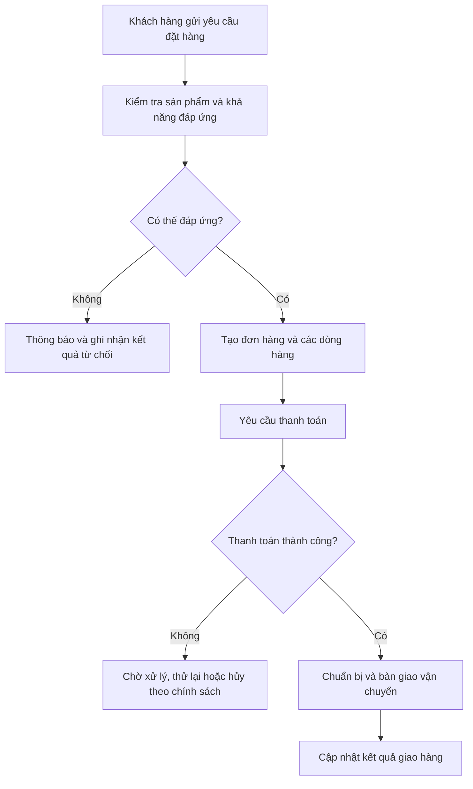
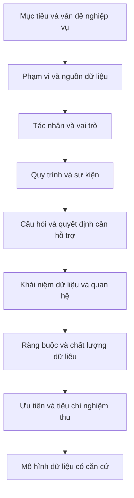

# Xác định mục tiêu hệ thống, đối tượng sử dụng và câu hỏi cần trả lời

Phân tích yêu cầu là bước xác định hệ thống cần hỗ trợ ai, giải quyết vấn đề gì và phải lưu trữ, cung cấp thông tin nào để người dùng hoàn thành công việc. Với một bài toán mô hình dữ liệu, bước này quyết định chất lượng của mọi bước tiếp theo: xác định thực thể, thuộc tính, quan hệ, ràng buộc, lịch sử dữ liệu và cách tổ chức lưu trữ.

Một mô hình có nhiều bảng hoặc nhiều collection vẫn có thể sai nếu nó không trả lời được câu hỏi nghiệp vụ. Ngược lại, khi mục tiêu, vai trò và câu hỏi đã rõ, nhóm phát triển có thể giải thích vì sao một dữ liệu cần tồn tại, ai tạo ra nó, ai sử dụng nó, dữ liệu thay đổi thế nào và điều kiện nào phải luôn đúng.

## 1. Kết quả cần đạt sau khi phân tích yêu cầu

Trước khi phác thảo lược đồ, cần có đủ thông tin để trả lời những câu hỏi sau:

- **Mục tiêu:** Hệ thống tạo ra kết quả nghiệp vụ nào? Vấn đề hiện tại nào cần được giải quyết? Kết quả có thể đo lường bằng tiêu chí gì?
- **Phạm vi:** Hệ thống chịu trách nhiệm với nghiệp vụ và dữ liệu nào? Phần nào thuộc hệ thống bên ngoài hoặc nằm ngoài phạm vi?
- **Đối tượng sử dụng:** Ai trực tiếp thao tác, ai vận hành, ai quản trị, ai xem báo cáo và hệ thống bên ngoài nào trao đổi dữ liệu?
- **Quy trình:** Các đối tượng đó thực hiện công việc theo những bước nào? Sự kiện nào bắt đầu, thay đổi hoặc kết thúc một quy trình?
- **Câu hỏi nghiệp vụ:** Người dùng cần tra cứu, ghi nhận, so sánh, thống kê hoặc kiểm chứng điều gì?
- **Yêu cầu dữ liệu:** Cần biết những khái niệm, thuộc tính, quan hệ, trạng thái và mốc thời gian nào để trả lời các câu hỏi đó?
- **Ràng buộc chất lượng:** Dữ liệu cần chính xác, nhất quán, bảo mật, sẵn sàng và được lưu giữ trong bao lâu?

Đầu ra nên là một tập hợp tài liệu có thể truy vết: mục tiêu và phạm vi hệ thống, danh sách tác nhân, mô tả quy trình, danh mục câu hỏi, thuật ngữ nghiệp vụ, yêu cầu dữ liệu, ràng buộc và tiêu chí nghiệm thu. Đây là căn cứ để xây dựng mô hình khái niệm và mô hình logic.

## 2. Phân biệt mục tiêu, chức năng, tác nhân và câu hỏi

Các khái niệm này liên quan nhưng không thể thay thế cho nhau.

| Khái niệm | Ý nghĩa | Ví dụ trong hệ thống bán hàng |
|---|---|---|
| Mục tiêu nghiệp vụ | Kết quả tổ chức muốn đạt được | Giảm thời gian xử lý đơn hàng và giảm sai lệch tồn kho |
| Mục tiêu hệ thống | Khả năng hệ thống phải cung cấp để hỗ trợ mục tiêu nghiệp vụ | Ghi nhận đơn hàng, theo dõi thanh toán và cập nhật tồn kho |
| Chức năng / quy trình | Công việc hệ thống và người dùng thực hiện | Tạo đơn, xác nhận thanh toán, đóng gói và giao hàng |
| Tác nhân | Người hoặc hệ thống tương tác với hệ thống trong một vai trò | Khách hàng, nhân viên kho, cổng thanh toán |
| Câu hỏi nghiệp vụ | Thông tin cần biết để hành động hoặc ra quyết định | Đơn nào đã thanh toán nhưng chưa giao? |
| Yêu cầu dữ liệu | Dữ liệu và quy tắc cần có để trả lời câu hỏi | Đơn hàng, giao dịch thanh toán, trạng thái giao hàng và thời điểm cập nhật |

Ví dụ, “quản lý khách hàng” là một mô tả chức năng quá rộng. Cần làm rõ khách hàng cần được nhận diện bằng thông tin nào, nhân viên có thể tìm kiếm theo tiêu chí gì, một khách hàng có thể có nhiều địa chỉ hay không, thông tin liên hệ nào được phép thay đổi và lịch sử đơn hàng có phải được giữ lại khi khách hàng cập nhật hồ sơ hay không.

Không nên bắt đầu bằng câu hỏi “cần tạo những bảng nào?”. Hãy bắt đầu bằng “người dùng cần hoàn thành việc gì?” và “họ cần biết điều gì để hoàn thành việc đó?”.

## 3. Xác định mục tiêu và ranh giới hệ thống

### 3.1. Mô tả vấn đề hiện tại

Ghi lại cách công việc đang diễn ra trước khi đề xuất giải pháp. Một mô tả vấn đề hữu ích nêu rõ:

1. Ai đang gặp khó khăn?
2. Công việc nào bị chậm, sai hoặc khó kiểm soát?
3. Nguyên nhân liên quan đến quy trình, thông tin hay công cụ hiện tại là gì?
4. Hậu quả có thể đo lường được là gì?
5. Điều gì sẽ được cải thiện nếu hệ thống mới hoạt động đúng?

Tránh các phát biểu chung chung như “cần quản lý dữ liệu tốt hơn”. Hãy cụ thể hóa thành “nhân viên kho phải đối chiếu ba bảng tính khác nhau để xác định số lượng có thể bán, khiến việc xác nhận đơn hàng mất trung bình 20 phút”. Mô tả này chỉ ra cả người dùng, dữ liệu và kết quả cần cải thiện.

### 3.2. Viết mục tiêu có thể kiểm chứng

Một mục tiêu tốt mô tả hành vi hoặc kết quả mong muốn, đối tượng được hưởng lợi và thước đo thành công. Có thể dùng cấu trúc:

> Đối với **[đối tượng]**, hệ thống cần hỗ trợ **[khả năng]** để đạt **[kết quả đo lường được]** trong **[điều kiện hoặc thời hạn]**.

Ví dụ: “Đối với nhân viên kho, hệ thống cần hiển thị số lượng tồn có thể bán theo từng sản phẩm để giảm thời gian xác nhận khả năng đáp ứng đơn hàng xuống dưới hai phút”.

Chỉ số cần có định nghĩa thống nhất. “Thời gian xử lý đơn” bắt đầu từ lúc nào, kết thúc ở bước nào, có tính đơn bị hủy hay không? Nếu chưa thống nhất cách tính, dữ liệu có thể đầy đủ nhưng báo cáo vẫn cho kết quả sai.

### 3.3. Xác định ranh giới và nguồn dữ liệu

Vẽ ranh giới hệ thống để biết dữ liệu nào được tạo và quản lý bên trong, dữ liệu nào được nhận từ bên ngoài và dữ liệu nào chỉ được gửi đi.

| Câu hỏi | Điều cần xác định |
|---|---|
| Hệ thống chịu trách nhiệm nghiệp vụ nào? | Các chức năng nằm trong phạm vi và các chức năng bị loại trừ |
| Dữ liệu được tạo ở đâu? | Người dùng, dịch vụ nội bộ, thiết bị hoặc hệ thống bên ngoài |
| Nguồn nào là nguồn chuẩn? | Hệ thống có quyền quyết định giá trị chính thức của từng loại dữ liệu |
| Dữ liệu được trao đổi theo cách nào? | API, sự kiện, tệp nhập, đồng bộ định kỳ hoặc thao tác thủ công |
| Ai chịu trách nhiệm sửa dữ liệu sai? | Chủ sở hữu dữ liệu và quy trình xử lý sai lệch |

Ví dụ, hệ thống bán hàng có thể lưu mã giao dịch và trạng thái thanh toán nhận từ cổng thanh toán, nhưng không tự quyết định giao dịch ngân hàng đã được ghi nhận hay chưa. Cần phân biệt dữ liệu do hệ thống sở hữu với dữ liệu được sao chép để tra cứu. Nếu không xác định nguồn chuẩn, hai hệ thống có thể cập nhật cùng một thông tin theo các quy tắc khác nhau.

## 4. Xác định đối tượng sử dụng và vai trò

### 4.1. Phân loại tác nhân

Tác nhân là người hoặc hệ thống tương tác với hệ thống trong một vai trò cụ thể. Một người có thể đảm nhận nhiều vai trò; nhiều người có thể cùng đảm nhận một vai trò. Vì vậy, không nên đồng nhất tác nhân nghiệp vụ với một tài khoản đăng nhập hoặc một bản ghi người dùng.

| Nhóm tác nhân | Mục đích tương tác | Ví dụ |
|---|---|---|
| Người dùng chính | Thực hiện nghiệp vụ cốt lõi | Khách hàng tạo đơn và theo dõi đơn |
| Nhân viên vận hành | Xử lý các bước nội bộ | Nhân viên kho xác nhận và đóng gói hàng |
| Quản trị viên | Cấu hình, phân quyền và quản lý danh mục | Quản trị viên thiết lập vai trò và chính sách |
| Người quản lý / phân tích | Theo dõi kết quả và ra quyết định | Quản lý xem doanh thu và tỷ lệ giao đúng hạn |
| Hệ thống bên ngoài | Trao đổi dữ liệu tự động | Cổng thanh toán, đơn vị vận chuyển |
| Kiểm toán / hỗ trợ | Kiểm tra hoặc điều tra sự cố | Nhân viên hỗ trợ tra cứu lịch sử thay đổi |

Người trả tiền, người nhận hàng, người đặt hàng và người sở hữu tài khoản có thể là những người khác nhau. Khi nghiệp vụ có sự khác biệt này, mô hình dữ liệu phải giữ được từng vai trò liên quan thay vì gộp tất cả vào một trường “khách hàng”.

### 4.2. Lập hồ sơ tác nhân

Với mỗi tác nhân, ghi lại:

- Vai trò và trách nhiệm trong nghiệp vụ.
- Mục tiêu khi sử dụng hệ thống.
- Công việc được phép thực hiện.
- Dữ liệu cần xem, tạo, sửa, xác nhận hoặc xóa.
- Phạm vi dữ liệu được phép truy cập, chẳng hạn dữ liệu của chính mình, một chi nhánh hoặc toàn tổ chức.
- Tần suất và bối cảnh sử dụng: trực tuyến, tại kho, theo ca, qua API hoặc theo lô.
- Rủi ro nếu dữ liệu bị thiếu, sai hoặc bị truy cập trái phép.

Ví dụ ma trận vai trò:

| Tác nhân | Đọc | Tạo / cập nhật | Phê duyệt / xác nhận | Phạm vi |
|---|---|---|---|---|
| Khách hàng | Hồ sơ và đơn của mình | Địa chỉ, yêu cầu đặt hàng | Xác nhận đặt hàng | Tài khoản của mình |
| Nhân viên kho | Đơn được phân công, tồn kho | Phiếu xuất và thông tin đóng gói | Xác nhận đã lấy hàng | Kho được phân công |
| Quản lý | Báo cáo và lịch sử nghiệp vụ | Một số cấu hình được cấp quyền | Duyệt ngoại lệ | Chi nhánh hoặc toàn hệ thống |
| Cổng thanh toán | Yêu cầu thanh toán cần xử lý | Kết quả giao dịch qua tích hợp | Xác nhận trạng thái theo giao thức | Giao dịch được gửi đến cổng |

Ma trận này giúp phát hiện yêu cầu phân quyền và truy vết ngay từ đầu. Chẳng hạn, nếu nhân viên chỉ được xem đơn thuộc kho mình, hệ thống cần biết đơn hàng được phân công cho kho nào và lịch sử phân công có cần lưu hay không.

### 4.3. Phân biệt tác nhân và bên liên quan

Bên liên quan (stakeholder) có thể ảnh hưởng đến yêu cầu nhưng không trực tiếp thao tác với hệ thống. Ban lãnh đạo, bộ phận pháp chế, bộ phận tài chính hoặc nhóm bảo mật có thể là bên liên quan. Họ cung cấp mục tiêu, quy định và giới hạn; người dùng trực tiếp cung cấp quy trình và câu hỏi trong công việc hằng ngày. Cần thu thập yêu cầu từ cả hai nhóm để tránh mô hình chỉ phù hợp với giao diện hiện tại mà bỏ qua nhu cầu quản trị hoặc kiểm toán.

## 5. Khám phá quy trình và vòng đời dữ liệu

Danh sách tác nhân chưa đủ để hiểu dữ liệu. Cần tìm hiểu cách họ phối hợp qua các quy trình và sự kiện.

Với mỗi quy trình, mô tả:

1. **Điều kiện bắt đầu:** Ai khởi tạo? Sự kiện hoặc yêu cầu nào kích hoạt quy trình?
2. **Điều kiện trước:** Cần có dữ liệu hoặc trạng thái nào trước khi thực hiện?
3. **Các bước chính:** Ai thực hiện từng bước và hệ thống đọc hoặc ghi dữ liệu gì?
4. **Nhánh và ngoại lệ:** Điều gì xảy ra khi thiếu hàng, thanh toán thất bại, người dùng hủy hoặc tích hợp bị gián đoạn?
5. **Kết quả:** Quy trình tạo ra dữ liệu, thay đổi trạng thái hoặc phát sinh sự kiện nào?
6. **Điều kiện kết thúc:** Khi nào công việc được xem là hoàn thành? Có thể mở lại hay hoàn tác không?

Ví dụ quy trình xử lý đơn hàng:



Sơ đồ trên chỉ là luồng tổng quát. Khi phân tích thật, cần làm rõ các nhánh như thanh toán một phần, thanh toán lại, giao nhiều đợt, giao thất bại hoặc hoàn tiền.

### 5.1. Phân biệt trạng thái hiện tại và lịch sử sự kiện

Trạng thái hiện tại trả lời “đối tượng đang ở tình trạng nào?”. Lịch sử sự kiện trả lời “đối tượng đã thay đổi như thế nào, khi nào và do ai?”. Hai nhu cầu này khác nhau.

Ví dụ, trường `status = 'SHIPPED'` cho biết đơn đã được gửi đi. Nhưng khi cần biết ai xác nhận đóng gói, đơn được bàn giao lúc nào, trạng thái giao hàng thay đổi mấy lần hoặc vì sao giao thất bại, chỉ lưu trạng thái cuối cùng là chưa đủ. Khi đó cần xem xét lưu các sự kiện hoặc bản ghi lịch sử có thời điểm, tác nhân và nguyên nhân.

Không phải mọi thay đổi đều cần lưu vô hạn. Hãy hỏi nghiệp vụ có cần kiểm toán, giải quyết khiếu nại, tính toán theo thời điểm hoặc khôi phục trạng thái hay không, rồi xác định chính sách lưu lịch sử phù hợp.

## 6. Xây dựng danh mục câu hỏi nghiệp vụ

Đây là bước chuyển từ mô tả quy trình sang nhu cầu dữ liệu cụ thể. Mỗi câu hỏi nên thể hiện một hành động hoặc quyết định thực tế.

### 6.1. Các nhóm câu hỏi thường gặp

| Nhóm | Dạng câu hỏi | Hàm ý đối với dữ liệu |
|---|---|---|
| Tra cứu định danh | Khách hàng này là ai? Đơn hàng có mã nào? | Khóa định danh ổn định, quy tắc tìm kiếm và chống trùng |
| Tra cứu trạng thái | Đơn đang ở bước nào? Sản phẩm còn bán được không? | Trạng thái, quy tắc chuyển trạng thái và dữ liệu cập nhật gần nhất |
| Quan hệ | Đơn này thuộc khách hàng nào? Có những sản phẩm nào? | Quan hệ giữa các đối tượng, số lượng và bội số của quan hệ |
| Lịch sử | Ai thay đổi địa chỉ? Giá tại thời điểm đặt hàng là bao nhiêu? | Dữ liệu theo thời gian, snapshot hoặc lịch sử thay đổi |
| Giao dịch | Thanh toán nào thuộc đơn? Kho nào đã xuất hàng? | Giao dịch, khóa tham chiếu, tính duy nhất và ràng buộc toàn vẹn |
| Báo cáo | Doanh thu theo ngày và theo chi nhánh là bao nhiêu? | Định nghĩa chỉ số, mức chi tiết dữ liệu, chiều phân tích và mốc thời gian |
| Dự báo / phân tích | Sản phẩm nào có nguy cơ hết hàng? | Dữ liệu lịch sử, thời điểm quan sát, chất lượng và độ đầy đủ |
| Kiểm toán | Ai đã xem hoặc sửa dữ liệu nhạy cảm? | Danh tính tác nhân, thời điểm, hành động và nhật ký truy cập |

### 6.2. Viết câu hỏi đủ cụ thể

Một câu hỏi như “doanh thu tháng này là bao nhiêu?” chưa đủ để thiết kế dữ liệu và báo cáo. Cần xác định:

- Doanh thu được tính theo đơn đã tạo, tiền đã thu hay hàng đã giao?
- Dùng ngày đặt hàng, ngày thanh toán hay ngày ghi nhận kế toán?
- Đơn bị hủy, hoàn tiền, giảm giá và thuế được xử lý thế nào?
- Báo cáo theo múi giờ nào và loại tiền nào?
- Cần xem theo sản phẩm, chi nhánh, nhân viên hay kênh bán?
- Dữ liệu cần cập nhật tức thời hay có thể chậm vài phút hoặc vài giờ?
- Ai được xem báo cáo và có cần giới hạn theo chi nhánh không?

Với câu hỏi tra cứu, cũng cần làm rõ tiêu chí tìm kiếm, cách sắp xếp, phân trang, giới hạn kết quả và yêu cầu thời gian phản hồi. Những thông tin này ảnh hưởng đến chỉ mục, cấu trúc truy vấn và lựa chọn cách tổ chức dữ liệu.

### 6.3. Ghi nhận câu hỏi theo mẫu

| Trường | Nội dung cần ghi |
|---|---|
| Mã câu hỏi | Mã ổn định để truy vết, ví dụ `Q-ORDER-01` |
| Người hỏi / tác nhân | Vai trò cần câu trả lời |
| Câu hỏi | Phát biểu rõ điều cần biết hoặc quyết định cần đưa ra |
| Thời điểm / phạm vi | Khoảng thời gian, tổ chức, chi nhánh hoặc đối tượng áp dụng |
| Chi tiết kết quả | Một dòng đại diện cho gì; cần tổng hợp hay danh sách chi tiết |
| Bộ lọc / sắp xếp | Tiêu chí lọc, thứ tự và cách phân trang |
| Độ mới dữ liệu | Tức thời, gần thời gian thực hay theo lô |
| Quyền truy cập | Vai trò nào được xem dữ liệu |
| Tần suất / mức ưu tiên | Số lần sử dụng và mức quan trọng đối với nghiệp vụ |
| Tiêu chí đúng | Ví dụ hoặc quy tắc để xác nhận câu trả lời chính xác |

Định nghĩa “một dòng kết quả” đặc biệt quan trọng. Một dòng có thể đại diện cho một đơn hàng, một sản phẩm trong đơn, một giao dịch thanh toán hoặc một ngày tổng hợp. Nếu không xác định mức chi tiết (grain), nhóm phát triển dễ cộng trùng số liệu hoặc thiết kế quan hệ sai.

## 7. Từ câu hỏi đến yêu cầu dữ liệu

Sau khi có danh mục câu hỏi, hãy xác định dữ liệu tối thiểu cần thiết để trả lời từng câu. Chưa cần quyết định ngay tên bảng, collection hay công nghệ lưu trữ.

### 7.1. Nhận diện khái niệm dữ liệu

Đọc câu hỏi và quy trình để tìm các nhóm khái niệm:

- **Đối tượng có danh tính riêng:** khách hàng, sản phẩm, đơn hàng, kho, nhân viên.
- **Giao dịch hoặc sự kiện:** đặt hàng, thanh toán, hoàn tiền, xuất kho, giao hàng.
- **Danh mục tham chiếu:** loại sản phẩm, đơn vị tiền tệ, phương thức thanh toán, khu vực.
- **Giá trị mô tả:** số lượng, đơn giá, địa chỉ, thời điểm, trạng thái.
- **Quan hệ:** khách hàng đặt đơn, đơn chứa dòng hàng, giao dịch thanh toán thuộc đơn.

Không phải mọi danh từ trong yêu cầu đều là thực thể. “Màu sắc” có thể là thuộc tính, danh mục tham chiếu hoặc một đối tượng riêng tùy nghiệp vụ: hệ thống chỉ lưu tên màu, hay phải quản lý mã màu, nhà cung cấp, hình ảnh và tồn kho theo từng biến thể?

### 7.2. Làm rõ danh tính và quan hệ

Với mỗi khái niệm, hãy hỏi:

- Làm thế nào nhận diện duy nhất một đối tượng?
- Mã định danh do hệ thống tạo hay do bên ngoài cung cấp?
- Hai bản ghi có thể mô tả cùng một đối tượng không? Quy tắc hợp nhất là gì?
- Một đối tượng có thể liên kết với bao nhiêu đối tượng khác?
- Quan hệ có bắt buộc hay tùy chọn ở mỗi phía?
- Quan hệ có thuộc tính riêng hoặc có vòng đời riêng không?

Ví dụ, một đơn hàng có nhiều dòng hàng và một sản phẩm có thể xuất hiện trong nhiều đơn hàng. Quan hệ này thường cần một khái niệm trung gian là dòng hàng, vì mỗi dòng có số lượng, đơn giá tại thời điểm mua, chiết khấu và các thông tin riêng. Chỉ lưu danh sách mã sản phẩm trong đơn sẽ không thể hiện đầy đủ các thuộc tính của lần mua đó.

### 7.3. Xác định dữ liệu hiện tại và dữ liệu lịch sử

Thông tin mô tả có thể thay đổi theo thời gian, trong khi giao dịch đã xảy ra cần giữ đúng ngữ cảnh tại thời điểm phát sinh.

Ví dụ, giá niêm yết hiện tại của sản phẩm có thể thay đổi. Đơn hàng cũ vẫn phải giữ đơn giá, số lượng và mức giảm giá đã áp dụng khi mua. Vì vậy, dữ liệu dòng hàng cần lưu thông tin giá trị giao dịch tại thời điểm đặt hàng, thay vì chỉ tham chiếu đến giá hiện tại của sản phẩm.

Tương tự, địa chỉ giao hàng của đơn đã xác nhận có thể cần được lưu như một bản chụp tại thời điểm đặt hàng, dù khách hàng có thể sửa địa chỉ hồ sơ sau đó. Cần hỏi nghiệp vụ giá trị nào phải phản ánh hiện tại và giá trị nào phải bảo toàn theo lịch sử.

### 7.4. Liên kết câu hỏi với dữ liệu

Ví dụ với hệ thống bán hàng:

| Câu hỏi | Khái niệm dữ liệu có thể cần | Điểm cần xác minh |
|---|---|---|
| Khách hàng đã đặt những đơn nào? | Khách hàng, đơn hàng | Một khách hàng có thể đặt đơn với tư cách nào? Có khách vãng lai không? |
| Đơn hàng gồm những gì? | Đơn hàng, dòng hàng, sản phẩm | Số lượng, giá và chiết khấu tại thời điểm mua được lưu ở đâu? |
| Đơn đã được thanh toán chưa? | Đơn hàng, giao dịch thanh toán | Có thanh toán nhiều lần, một phần hoặc hoàn tiền không? |
| Hàng đang ở đâu? | Đơn hàng, lô giao hàng, sự kiện vận chuyển | Một đơn có thể được giao thành nhiều kiện không? Có lưu lịch sử trạng thái không? |
| Tồn kho có thể bán là bao nhiêu? | Sản phẩm, kho, tồn kho, giữ chỗ, giao dịch kho | Tồn thực tế và tồn có thể bán được tính theo quy tắc nào? |
| Doanh thu theo ngày là bao nhiêu? | Dòng hàng, thanh toán, hoàn tiền, mốc thời gian | Định nghĩa doanh thu và ngày ghi nhận là gì? |

Một câu hỏi có thể cần dữ liệu từ nhiều khái niệm. Ngược lại, một khái niệm có thể phục vụ nhiều câu hỏi. Đây là cơ sở để tìm ra các thực thể và quan hệ cốt lõi mà không tạo dữ liệu trùng lặp một cách tùy tiện.

## 8. Thu thập ràng buộc và yêu cầu chất lượng dữ liệu

Yêu cầu chức năng cho biết hệ thống phải làm gì; ràng buộc chất lượng cho biết hệ thống phải làm việc đó trong điều kiện nào. Các ràng buộc này ảnh hưởng trực tiếp đến khóa, chỉ mục, giao dịch, lưu lịch sử và lựa chọn mô hình dữ liệu.

| Nhóm ràng buộc | Câu hỏi cần làm rõ | Ví dụ |
|---|---|---|
| Chính xác và toàn vẹn | Giá trị nào bắt buộc? Quy tắc nào không được vi phạm? | Số lượng đặt hàng phải lớn hơn 0; mã giao dịch không được trùng |
| Nhất quán giao dịch | Những thay đổi nào phải thành công hoặc thất bại cùng nhau? | Tạo đơn và giữ chỗ tồn kho cần có quy tắc xử lý nhất quán |
| Đồng thời | Điều gì xảy ra khi nhiều người cập nhật cùng dữ liệu? | Hai nhân viên không thể cùng bán đơn vị tồn kho cuối cùng |
| Lịch sử và kiểm toán | Cần biết ai làm gì, khi nào và vì sao? | Lưu lịch sử chuyển trạng thái đơn hàng |
| Bảo mật và riêng tư | Dữ liệu nào nhạy cảm? Ai được xem hoặc sửa? | Chỉ vai trò được cấp quyền mới xem thông tin cá nhân |
| Hiệu năng | Truy vấn quan trọng cần phản hồi trong bao lâu? | Tra cứu đơn hàng thường hoàn thành trong một giây ở tải dự kiến |
| Quy mô | Số người dùng, giao dịch và dung lượng dự kiến là bao nhiêu? | Số đơn mỗi ngày và tốc độ tăng trưởng theo năm |
| Sẵn sàng và phục hồi | Hệ thống chịu gián đoạn bao lâu? Có thể mất dữ liệu đến mức nào? | Xác định mục tiêu RPO và RTO cho dữ liệu đơn hàng |
| Lưu giữ và xóa | Dữ liệu phải giữ trong bao lâu? Khi nào được ẩn danh hoặc xóa? | Chính sách lưu hồ sơ giao dịch và yêu cầu xóa dữ liệu cá nhân |
| Tích hợp | Dữ liệu bên ngoài có thể đến trễ, lặp hoặc sai thứ tự không? | Webhook thanh toán được gửi lại nhiều lần |

Đặc biệt, cần phân biệt “xóa khỏi giao diện”, “xóa logic”, “ẩn danh” và “xóa vật lý”. Mỗi cách có ảnh hưởng khác nhau đến báo cáo, khóa tham chiếu, kiểm toán và nghĩa vụ lưu giữ.

Không nên tự đặt ra các con số hiệu năng hoặc quy mô. Hãy ghi nguồn của giả định, người xác nhận và cách đo. Nếu chưa có số liệu, đánh dấu là giả định cần kiểm chứng để tránh biến phỏng đoán thành yêu cầu chính thức.

## 9. Ưu tiên yêu cầu và xác định tiêu chí nghiệm thu

Không phải câu hỏi nào cũng quan trọng như nhau. Có thể phân loại theo mức độ cần thiết:

- **Bắt buộc:** Thiếu sẽ khiến quy trình cốt lõi không thể hoạt động hoặc vi phạm quy định.
- **Nên có:** Tăng hiệu quả hoặc giảm rủi ro nhưng có thể triển khai sau.
- **Có thể bổ sung:** Hữu ích nhưng chưa cần cho phạm vi hiện tại.

Khi ưu tiên, hãy cân nhắc tác động nghiệp vụ, tần suất sử dụng, rủi ro, chi phí triển khai và sự phụ thuộc giữa các yêu cầu. Không nên chỉ ưu tiên theo số lượng người yêu cầu; một yêu cầu kiểm toán ít được dùng vẫn có thể bắt buộc.

Mỗi yêu cầu quan trọng cần tiêu chí nghiệm thu có thể kiểm tra. Ví dụ:

**Yêu cầu:** Hệ thống phải giữ được giá bán tại thời điểm khách hàng đặt hàng.

**Tiêu chí nghiệm thu:**

1. Khi tạo đơn, hệ thống ghi nhận đơn giá và mức giảm giá áp dụng cho từng dòng hàng.
2. Khi giá niêm yết sản phẩm thay đổi, đơn đã tạo vẫn hiển thị đúng giá tại thời điểm đặt.
3. Báo cáo giá trị đơn hàng sử dụng giá trị giao dịch đã ghi nhận, không tính lại bằng giá hiện tại.
4. Có thể truy vết đơn giá đã áp dụng về quy tắc hoặc chương trình giá tương ứng nếu nghiệp vụ yêu cầu.

Tiêu chí này giúp kiểm tra được cả dữ liệu cần lưu và hành vi của hệ thống. Nó cũng làm rõ vì sao chỉ tham chiếu mã sản phẩm là chưa đủ.

### 9.1. Truy vết từ mục tiêu đến mô hình

Mỗi yêu cầu nên có mã và liên kết đến câu hỏi, tác nhân, quy trình, dữ liệu và kiểm thử tương ứng. Ví dụ:

| Mục tiêu | Tác nhân / quy trình | Câu hỏi | Dữ liệu liên quan | Kiểm chứng |
|---|---|---|---|---|
| Giảm thời gian xác nhận đơn | Nhân viên kho / xác nhận đơn | Đơn có thể được đáp ứng không? | Sản phẩm, kho, tồn kho, giữ chỗ | Hai yêu cầu đồng thời không làm bán vượt tồn khả dụng |
| Giải quyết khiếu nại nhanh | Hỗ trợ / tra cứu đơn | Ai đã thay đổi trạng thái và lúc nào? | Đơn hàng, lịch sử trạng thái, tác nhân | Truy vấn được chuỗi thay đổi theo thời gian |
| Báo cáo doanh thu đúng | Quản lý / tổng hợp doanh thu | Doanh thu theo ngày được tính ra sao? | Dòng hàng, thanh toán, hoàn tiền, thời gian | Kết quả khớp bộ dữ liệu kiểm chứng và định nghĩa chỉ số |

Truy vết giúp phát hiện hai vấn đề: dữ liệu được lưu nhưng không phục vụ mục tiêu nào, hoặc có câu hỏi quan trọng nhưng chưa có dữ liệu cần thiết để trả lời.

## 10. Ví dụ tổng hợp: phân tích yêu cầu cho cửa hàng trực tuyến

Giả sử một cửa hàng muốn triển khai hệ thống để tiếp nhận đơn hàng, quản lý tồn kho, theo dõi thanh toán và giao hàng.

### 10.1. Mục tiêu và phạm vi

- Giảm thời gian xác nhận khả năng đáp ứng đơn hàng.
- Theo dõi được trạng thái thanh toán và giao hàng của từng đơn.
- Cung cấp số liệu doanh thu nhất quán cho quản lý.
- Lưu được lịch sử cần thiết để xử lý khiếu nại.

Phạm vi hệ thống gồm quản lý đơn, dòng hàng, thông tin giao dịch được tích hợp, tồn kho và trạng thái giao hàng. Cổng thanh toán và đơn vị vận chuyển là hệ thống bên ngoài; hệ thống cửa hàng tiếp nhận kết quả và lưu thông tin cần cho vận hành.

### 10.2. Tác nhân và nhu cầu

| Tác nhân | Công việc chính | Thông tin cần biết |
|---|---|---|
| Khách hàng | Đặt và theo dõi đơn | Giá, số lượng, trạng thái thanh toán và giao hàng |
| Nhân viên kho | Xác nhận và chuẩn bị hàng | Số lượng có thể bán, vị trí kho, đơn được phân công |
| Nhân viên hỗ trợ | Xử lý yêu cầu và khiếu nại | Chi tiết đơn, lịch sử thay đổi, giao dịch và thông tin vận chuyển |
| Quản lý | Theo dõi hoạt động | Doanh thu, đơn hủy, tỷ lệ giao thành công và tồn kho |
| Cổng thanh toán | Xử lý giao dịch | Mã tham chiếu, số tiền, kết quả và thời điểm giao dịch |
| Đơn vị vận chuyển | Nhận và cập nhật kiện hàng | Mã vận đơn, người nhận, trạng thái và sự kiện giao hàng |

### 10.3. Các câu hỏi cần trả lời

1. Một khách hàng có thể có nhiều đơn hàng không? Khách chưa đăng ký có được đặt hàng không?
2. Một đơn có thể chứa nhiều sản phẩm hoặc được giao thành nhiều kiện không?
3. Giá và địa chỉ giao hàng có cần được giữ nguyên theo thời điểm đặt hàng không?
4. Một đơn có thể có nhiều lần thanh toán, thanh toán một phần hoặc hoàn tiền không?
5. Tồn kho khả dụng được tính sau khi trừ số lượng đã giữ chỗ như thế nào?
6. Trạng thái đơn hàng và trạng thái giao hàng có độc lập không?
7. Báo cáo doanh thu dựa trên thời điểm đặt hàng hay thời điểm tiền được thu? Hoàn tiền được trừ vào kỳ nào?
8. Khi có khiếu nại, cần truy vết những thao tác và sự kiện nào?

### 10.4. Hàm ý đối với mô hình dữ liệu

- Cần phân biệt khách hàng, đơn hàng và các dòng hàng vì chúng có vòng đời và thuộc tính riêng.
- Dòng hàng cần lưu số lượng và giá trị giao dịch tại thời điểm đặt hàng.
- Thanh toán và hoàn tiền cần được xem là các giao dịch có định danh, thời điểm và trạng thái riêng; không thể chỉ dùng một cờ `paid` nếu nghiệp vụ hỗ trợ nhiều giao dịch.
- Tồn kho cần làm rõ tồn thực tế, số lượng đã giữ chỗ và số lượng có thể bán; quy tắc cập nhật đồng thời phải được xác định.
- Giao hàng có thể có nhiều kiện hoặc nhiều lần cập nhật; cần xác định quan hệ và lịch sử sự kiện tương ứng.
- Báo cáo cần định nghĩa rõ mức chi tiết, mốc thời gian, cách xử lý hủy và hoàn tiền trước khi quyết định cách tổng hợp.

Các kết luận này chưa phải lược đồ vật lý. Chúng là yêu cầu đã được làm rõ để nhóm thiết kế có thể so sánh mô hình quan hệ, document, đồ thị hoặc mô hình phân tích theo tính toàn vẹn, kiểu truy vấn, quan hệ, quy mô và cách tiến hóa dữ liệu.

## 11. Mẫu ghi nhận yêu cầu có thể tái sử dụng

Có thể dùng mẫu sau trong buổi phỏng vấn hoặc workshop với người dùng:

```yaml
system:
  name: "Tên hệ thống"
  business_problem: "Vấn đề hiện tại và tác động"
  business_objectives:
    - id: OBJ-01
      description: "Kết quả cần đạt"
      measure: "Chỉ số và cách đo"
  scope:
    included: ["Nghiệp vụ trong phạm vi"]
    excluded: ["Nghiệp vụ ngoài phạm vi"]
  data_sources:
    - name: "Nguồn dữ liệu"
      ownership: "Hệ thống chịu trách nhiệm chính"
      exchange: "API, event, file hoặc thao tác thủ công"

actors:
  - id: ACT-01
    role: "Vai trò"
    goals: ["Mục tiêu của vai trò"]
    permissions: ["Dữ liệu và hành động được phép"]
    data_scope: "Phạm vi bản ghi được truy cập"

workflows:
  - id: WF-01
    name: "Tên quy trình"
    trigger: "Điều kiện bắt đầu"
    main_steps: ["Bước thực hiện"]
    exceptions: ["Nhánh ngoại lệ"]
    outcome: "Dữ liệu hoặc trạng thái được tạo ra"

questions:
  - id: Q-01
    actor: ACT-01
    objective: OBJ-01
    question: "Câu hỏi cần trả lời"
    grain: "Một dòng kết quả đại diện cho gì"
    filters: ["Bộ lọc cần hỗ trợ"]
    time_basis: "Mốc thời gian áp dụng"
    freshness: "Yêu cầu độ mới dữ liệu"
    priority: "MUST | SHOULD | COULD"
    acceptance: "Cách kiểm chứng câu trả lời"

constraints:
  integrity: ["Quy tắc toàn vẹn"]
  security: ["Quy tắc truy cập và bảo vệ dữ liệu"]
  history: ["Yêu cầu lưu lịch sử"]
  performance: ["Mục tiêu hiệu năng có căn cứ"]
  retention: ["Thời hạn và quy tắc lưu giữ"]
```

Mẫu trên là khung trao đổi, không phải schema bắt buộc cho cơ sở dữ liệu hoặc file cấu hình. Có thể bổ sung trường phù hợp với nghiệp vụ, nhưng nên giữ mã định danh ổn định để truy vết giữa yêu cầu, thiết kế và kiểm thử.

## 12. Sai lầm thường gặp khi phân tích yêu cầu dữ liệu

| Sai lầm | Hậu quả | Cách khắc phục |
|---|---|---|
| Bắt đầu từ giao diện hoặc danh sách màn hình | Bỏ sót câu hỏi nghiệp vụ không xuất hiện trên màn hình hiện tại | Phỏng vấn theo mục tiêu, vai trò, quy trình và quyết định |
| Mục tiêu quá chung chung | Không biết dữ liệu nào là cần thiết và thế nào là thành công | Viết kết quả có thước đo và điều kiện rõ ràng |
| Chỉ hỏi người dùng chính | Bỏ sót vận hành, tích hợp, bảo mật và kiểm toán | Thu thập yêu cầu từ các vai trò và bên liên quan khác nhau |
| Chỉ lưu trạng thái cuối cùng | Không giải thích được lịch sử và nguyên nhân thay đổi | Xác định yêu cầu truy vết, lịch sử và thời điểm |
| Không định nghĩa chỉ số | Các báo cáo đưa ra con số khác nhau cho cùng một khái niệm | Thống nhất công thức, mốc thời gian và cách xử lý ngoại lệ |
| Không xác định nguồn chuẩn | Dữ liệu bị ghi đè hoặc lệch giữa các hệ thống | Ghi rõ chủ sở hữu và quy tắc đồng bộ |
| Bỏ qua dữ liệu đồng thời | Phát sinh giao dịch trùng hoặc vượt tồn kho | Phân tích tình huống tranh chấp và yêu cầu toàn vẹn |
| Chọn công nghệ quá sớm | Mô hình bị chi phối bởi giới hạn công cụ trước khi hiểu nghiệp vụ | Hoàn thiện yêu cầu và mẫu truy vấn trước khi chọn cách lưu trữ |
| Không ghi giả định | Giả định chưa kiểm chứng trở thành yêu cầu sai | Đánh dấu giả định, người xác nhận và kế hoạch kiểm chứng |

## 13. Checklist trước khi chuyển sang thiết kế mô hình

- [ ] Mục tiêu nghiệp vụ và mục tiêu hệ thống được phát biểu rõ, có cách đo.
- [ ] Phạm vi, phần loại trừ và ranh giới tích hợp đã được xác định.
- [ ] Các tác nhân, vai trò, quyền và phạm vi dữ liệu đã được ghi nhận.
- [ ] Các quy trình chính, sự kiện kích hoạt và nhánh ngoại lệ đã được mô tả.
- [ ] Danh mục câu hỏi bao gồm tra cứu, giao dịch, quan hệ, lịch sử và báo cáo cần thiết.
- [ ] Mức chi tiết kết quả, bộ lọc, mốc thời gian và yêu cầu độ mới đã rõ.
- [ ] Các khái niệm dữ liệu, định danh, quan hệ và vòng đời đã được nhận diện.
- [ ] Nhu cầu lưu snapshot, lịch sử và kiểm toán đã được xác định.
- [ ] Ràng buộc toàn vẹn, bảo mật, đồng thời, hiệu năng, quy mô và lưu giữ đã được ghi nhận.
- [ ] Yêu cầu quan trọng có mức ưu tiên, tiêu chí nghiệm thu và liên kết truy vết.
- [ ] Các giả định và câu hỏi còn bỏ ngỏ có người chịu trách nhiệm xác minh.



Khi các câu hỏi trên đã có câu trả lời hoặc được ghi rõ là giả định cần xác minh, nhóm phát triển có thể bắt đầu xây dựng mô hình khái niệm. Mỗi thực thể, thuộc tính, quan hệ và ràng buộc lúc đó đều có thể truy ngược về một mục tiêu, một tác nhân hoặc một câu hỏi nghiệp vụ cụ thể.
