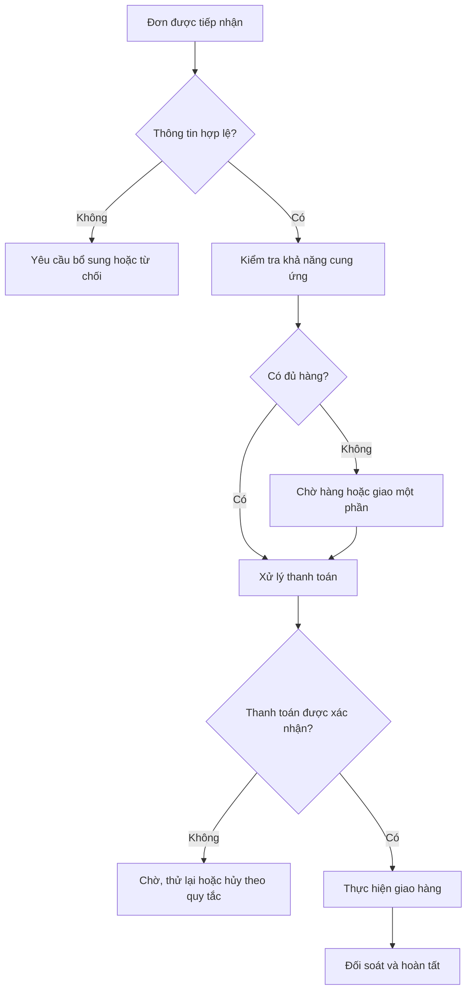

# Thu thập quy trình nghiệp vụ, dữ liệu mẫu và trường hợp ngoại lệ

Trong chương **Khảo sát yêu cầu**, bước thu thập quy trình nghiệp vụ, dữ liệu mẫu và trường hợp ngoại lệ giúp người thiết kế hiểu dữ liệu được tạo ra, thay đổi, sử dụng và kết thúc như thế nào trong hoạt động thực tế. Đây là nền tảng để chuyển yêu cầu nghiệp vụ thành mô hình dữ liệu có thực thể, quan hệ, thuộc tính và ràng buộc phù hợp.

Một mô hình dữ liệu tốt bắt đầu từ bằng chứng về cách tổ chức vận hành. Tên cột trong một bảng tính, một màn hình hiện tại hoặc một vài bản ghi mẫu chỉ phản ánh một phần câu chuyện. Cần tìm hiểu ai tạo dữ liệu, sự kiện nào làm dữ liệu thay đổi, quy tắc nào quyết định kết quả, trường hợp nào làm quy trình đi lệch khỏi luồng thông thường và hệ thống phải lưu lại điều gì để giải thích được lịch sử.

Sau bài học, người học có thể:

- Xác định phạm vi quy trình, tác nhân, sự kiện bắt đầu, trạng thái và điểm kết thúc.
- Phỏng vấn, quan sát và đối chiếu tài liệu để ghi nhận luồng nghiệp vụ có thể kiểm chứng.
- Thu thập tập dữ liệu mẫu có tính đại diện, nhận diện chất lượng và giới hạn của dữ liệu.
- Lập danh sách trường hợp ngoại lệ, điều kiện phát sinh, kết quả mong đợi và cách phục hồi.
- Chuyển bằng chứng thu thập được thành yêu cầu dữ liệu có thể truy vết và xác nhận với bên nghiệp vụ.

## 1. Ba loại bằng chứng cần thu thập

Ba loại bằng chứng bổ sung cho nhau, nhưng không thể thay thế nhau.

| Loại bằng chứng | Trả lời câu hỏi | Ví dụ |
|---|---|---|
| Quy trình nghiệp vụ | Ai làm gì, khi nào, theo điều kiện nào và tạo ra kết quả gì? | Khách đặt hàng, nhân viên xác nhận, kho giao từng phần, kế toán hoàn tiền. |
| Dữ liệu mẫu | Dữ liệu thực tế có hình dạng, giá trị, mức độ thiếu và biến động ra sao? | Đơn có khách đăng ký, đơn khách vãng lai, nhiều mặt hàng, địa chỉ thiếu số căn hộ. |
| Trường hợp ngoại lệ | Điều gì xảy ra khi điều kiện bình thường không còn đúng? | Thanh toán thành công nhưng hệ thống chưa nhận được xác nhận; đơn bị hủy sau khi đã giao một phần. |

Ví dụ, một biểu mẫu đặt hàng cho thấy có trường `customerId`, nhưng không chứng minh mọi đơn hàng đều thuộc về một tài khoản đã đăng ký. Quy trình bán hàng có thể cho phép khách vãng lai. Dữ liệu mẫu có thể xác nhận rằng thông tin khách được lưu trực tiếp trên đơn. Trường hợp ngoại lệ như khách yêu cầu xóa tài khoản sau khi mua hàng còn làm phát sinh câu hỏi về việc giữ lại chứng từ và lịch sử giao dịch. Chỉ khi kết hợp cả ba nguồn, người thiết kế mới có đủ căn cứ xác định ý nghĩa và vòng đời dữ liệu.

## 2. Xác định phạm vi và ngôn ngữ nghiệp vụ

Trước khi phỏng vấn hoặc lấy dữ liệu, hãy xác định rõ quy trình đang khảo sát và ranh giới của nó. Một quy trình có thể bắt đầu từ yêu cầu của khách hàng, từ một sự kiện do hệ thống khác gửi đến hoặc từ thao tác của nhân viên. Điểm kết thúc cũng cần được định nghĩa: hoàn thành nghiệp vụ, chuyển sang quy trình khác hay chỉ ghi nhận một trạng thái tạm thời.

Với mỗi quy trình, ghi lại tối thiểu:

1. **Mục tiêu:** hoạt động này giải quyết nhu cầu nào của tổ chức hoặc khách hàng?
2. **Tác nhân:** người dùng, bộ phận, hệ thống nội bộ hay đối tác nào tham gia?
3. **Sự kiện kích hoạt:** điều gì khiến quy trình bắt đầu hoặc tiếp tục?
4. **Đầu vào và đầu ra:** thông tin nào được đọc, tạo mới, cập nhật hoặc chuyển tiếp?
5. **Quyết định:** điều kiện nào làm quy trình rẽ nhánh?
6. **Trạng thái:** đối tượng nghiệp vụ có thể ở những trạng thái nào và chuyển trạng thái khi nào?
7. **Ranh giới hệ thống:** dữ liệu nào thuộc hệ thống đang thiết kế, dữ liệu nào chỉ được tham chiếu từ hệ thống khác?

Thống nhất thuật ngữ trước khi mô hình hóa. Hai bộ phận có thể dùng từ “khách hàng”, “người mua”, “người nhận” hoặc “người thanh toán” để nói về những vai trò khác nhau. Ngược lại, hai tên gọi khác nhau đôi khi chỉ cùng một khái niệm. Hãy lập bảng thuật ngữ gồm tên gọi, định nghĩa, ví dụ, người xác nhận và các tên gọi tương đương. Không tự kết luận hai khái niệm là một chỉ vì chúng đang được lưu trong cùng một cột.

Một số câu hỏi giúp khóa phạm vi:

- Sự kiện nào được xem là một giao dịch nghiệp vụ mới?
- Ai có quyền tạo, sửa, duyệt, hủy hoặc xem dữ liệu?
- Khi quy trình hoàn tất, dữ liệu nào phải còn để tra cứu hoặc đối soát?
- Có thao tác nào được thực hiện ngoài hệ thống, chẳng hạn qua điện thoại hoặc bảng tính?
- Quy trình có thay đổi theo chi nhánh, loại khách hàng, khu vực hoặc kênh bán không?
- Hệ thống nào là nguồn chính thức cho từng loại thông tin?

## 3. Khảo sát quy trình bằng sự kiện thực tế

### 3.1. Kết hợp nhiều phương pháp

Không nên chỉ dựa vào một buổi phỏng vấn hoặc tài liệu quy trình đã ban hành. Hãy đối chiếu nhiều nguồn để tìm ra khác biệt giữa quy trình được mô tả và cách công việc thực sự diễn ra.

| Phương pháp | Cách thực hiện | Điều cần chú ý |
|---|---|---|
| Phỏng vấn theo vai trò | Trao đổi riêng với người thực hiện, người phê duyệt, quản lý và bộ phận nhận kết quả. | Hỏi về một giao dịch cụ thể, tránh chỉ hỏi quy trình lý tưởng. |
| Quan sát công việc | Theo dõi một giao dịch từ lúc bắt đầu đến khi bàn giao. | Ghi lại thao tác thủ công, trao đổi ngoài hệ thống và bước làm lại. |
| Đi qua một hồ sơ mẫu | Yêu cầu người dùng giải thích từng trường, trạng thái và tài liệu của một hồ sơ đã xử lý. | Xác minh ý nghĩa nghiệp vụ, nguồn tạo và thời điểm cập nhật. |
| Đọc tài liệu | Đối chiếu biểu mẫu, hướng dẫn, hợp đồng, báo cáo và quy định nội bộ. | Ghi rõ phiên bản, ngày hiệu lực và người sở hữu tài liệu. |
| Phân tích nhật ký hoặc báo cáo | Quan sát tần suất sự kiện, trạng thái chuyển tiếp và lỗi thường gặp. | Kiểm tra cách ghi log; không coi log thiếu dữ liệu là bằng chứng rằng sự kiện không xảy ra. |

### 3.2. Đi theo một giao dịch từ đầu đến cuối

Chọn một giao dịch có thật hoặc một tình huống mô phỏng đã được nghiệp vụ xác nhận. Yêu cầu người thực hiện kể lại theo thứ tự thời gian. Với từng bước, ghi nhận tác nhân, thời điểm, dữ liệu đầu vào, hành động, điều kiện quyết định, kết quả và nơi lưu bằng chứng.

Ví dụ về quy trình xử lý đơn hàng:

| Bước | Sự kiện hoặc hành động | Dữ liệu cần quan sát | Câu hỏi cần xác nhận |
|---|---|---|---|
| 1 | Khách gửi đơn | Người mua, mặt hàng, số lượng, địa chỉ, thời điểm đặt | Khách vãng lai có được đặt hàng không? |
| 2 | Hệ thống tiếp nhận đơn | Mã đơn, kênh bán, trạng thái ban đầu | Mã đơn được cấp lúc tạo nháp hay lúc xác nhận? |
| 3 | Kiểm tra và giữ hàng | Sản phẩm, tồn kho, số lượng được giữ | Có cho phép giữ hàng một phần không? Giữ trong bao lâu? |
| 4 | Xử lý thanh toán | Phương thức, số tiền, mã giao dịch, trạng thái | Có thanh toán nhiều lần hoặc nhiều phương thức cho một đơn không? |
| 5 | Chuẩn bị và giao hàng | Kho, kiện hàng, số lượng giao, đơn vị vận chuyển | Một đơn có thể được giao từ nhiều kho hoặc chia nhiều đợt không? |
| 6 | Hoàn tất hoặc xử lý sau bán | Giao thành công, hủy, đổi trả, hoàn tiền | Khi nào đơn được xem là hoàn tất? Lịch sử nào phải được giữ? |

Bảng trên chỉ là ví dụ để khơi gợi khảo sát, không phải quy trình chuẩn áp dụng cho mọi tổ chức. Cần xác nhận lại thứ tự, tên trạng thái và quy tắc với người sở hữu nghiệp vụ.

### 3.3. Ghi nhận trạng thái và chuyển trạng thái

Trạng thái mô tả tình hình hiện tại của một đối tượng nghiệp vụ tại một thời điểm. Chuyển trạng thái phải gắn với một sự kiện hoặc hành động có điều kiện rõ ràng. Không chỉ ghi danh sách trạng thái; hãy hỏi ai được phép chuyển, điều kiện trước khi chuyển, dữ liệu cần có và tác động phát sinh.

Ví dụ, `PAID` có thể chỉ được gán sau khi nhận xác nhận thanh toán hợp lệ. Nếu khách bấm nút thanh toán hai lần, hệ thống cần xác định đó là một lần thanh toán được gửi lại hay hai giao dịch riêng biệt. Nếu hàng đã giao, yêu cầu hủy có thể phải chuyển sang quy trình đổi trả hoặc hoàn tiền thay vì đưa đơn về trạng thái ban đầu.



Khi quy trình có nhiều nhánh, hãy ghi rõ điều kiện của từng nhánh. Tránh các mô tả mơ hồ như “nếu cần thì xử lý thủ công”; cần hỏi ai quyết định, dựa trên thông tin nào, kết quả được ghi ở đâu và ai chịu trách nhiệm tiếp tục.

### 3.4. Phân biệt quy tắc nghiệp vụ với thao tác hiện tại

Một thao tác đang có trong phần mềm chưa chắc là quy tắc nghiệp vụ. Ví dụ, màn hình hiện tại bắt buộc nhập số điện thoại có thể là giới hạn của phần mềm cũ, trong khi nghiệp vụ cho phép khách mua hàng chỉ cung cấp email. Hãy ghi riêng:

- **Quy tắc nghiệp vụ:** điều tổ chức yêu cầu hoặc cam kết phải tuân thủ.
- **Cách làm hiện tại:** thao tác, biểu mẫu hoặc giới hạn của hệ thống đang dùng.
- **Vấn đề hoặc mong muốn thay đổi:** điểm gây lỗi, tốn công hoặc không còn phù hợp.

Sự phân biệt này giúp tránh sao chép nguyên trạng các giới hạn cũ vào mô hình dữ liệu mới.

## 4. Thu thập dữ liệu mẫu có tính đại diện

### 4.1. Chọn mẫu theo tình huống, không chỉ theo số lượng

Một tập dữ liệu lớn nhưng chỉ chứa các giao dịch thông thường có thể che giấu nhiều yêu cầu quan trọng. Hãy chọn mẫu theo nhiều chiều: loại nghiệp vụ, vai trò, kênh, thời gian, trạng thái, quy mô và kết quả. Bao gồm cả mẫu phổ biến, mẫu biên và mẫu hiếm nhưng có ảnh hưởng lớn.

| Nhóm mẫu | Ví dụ cần tìm | Mục đích |
|---|---|---|
| Luồng phổ biến | Đơn có một khách, một mặt hàng và thanh toán thành công | Hiểu cấu trúc và trình tự thường gặp. |
| Giá trị biên | Số lượng nhỏ nhất/lớn nhất, đơn có nhiều dòng, giá trị bằng 0 nếu nghiệp vụ cho phép | Xác định giới hạn và kiểu dữ liệu. |
| Thiếu dữ liệu | Không có mã khách, thiếu địa chỉ phụ, chưa có ngày giao | Phân biệt dữ liệu tùy chọn với dữ liệu bị bỏ sót. |
| Trùng lặp | Hai yêu cầu được gửi lại, hai hồ sơ có thông tin giống nhau | Hiểu quy tắc nhận diện và chống tạo bản ghi trùng. |
| Không nhất quán | Mã tham chiếu không tồn tại, tổng tiền lệch chi tiết | Tìm quy tắc kiểm tra và nguồn dữ liệu đáng tin cậy. |
| Khác thời điểm | Giao dịch cũ, giao dịch đang mở, dữ liệu sau khi cập nhật quy định | Hiểu lịch sử và hiệu lực theo thời gian. |
| Nhiều bên hoặc nhiều bước | Một đơn có nhiều người nhận, kho hoặc lần thanh toán | Xác định quan hệ một-nhiều và các thực thể trung gian có thể cần thiết. |
| Ngoại lệ đã xử lý | Đơn hủy, hoàn tiền một phần, giao thất bại | Đối chiếu cách xử lý được mô tả với dữ liệu thực tế. |

Không tự suy ra tần suất hoặc mức độ quan trọng chỉ từ số mẫu được cung cấp. Hãy hỏi người sở hữu dữ liệu về thời gian lấy mẫu, phạm vi hệ thống, bộ lọc đã dùng và những nhóm giao dịch chưa xuất hiện.

### 4.2. Lập hồ sơ cho từng trường dữ liệu

Với mỗi trường, thu thập các thuộc tính sau:

- Tên nghiệp vụ và định nghĩa; tránh chỉ ghi tên cột kỹ thuật.
- Kiểu giá trị và định dạng, ví dụ mã, văn bản, số tiền, ngày giờ hoặc trạng thái.
- Có bắt buộc hay không; nếu thiếu thì thiếu vì hợp lệ, chưa phát sinh hay do lỗi nhập liệu?
- Quy tắc hợp lệ, miền giá trị, độ dài, độ chính xác và đơn vị đo.
- Tính duy nhất: duy nhất toàn hệ thống, duy nhất trong một phạm vi hay có thể trùng?
- Nguồn tạo, bên sở hữu và hệ thống được phép cập nhật.
- Thời điểm có hiệu lực và cách xử lý khi giá trị thay đổi.
- Quan hệ tham chiếu đến đối tượng khác và cách xử lý khi đối tượng đó không còn tồn tại.

Ví dụ, trường `price` chưa đủ rõ để thiết kế. Cần biết đó là giá niêm yết, giá bán tại thời điểm đặt hàng, giá sau giảm, giá chưa gồm thuế hay giá đã gồm thuế; đơn vị tiền tệ là gì; quy tắc làm tròn ra sao; và khi bảng giá thay đổi thì giao dịch cũ có được tính lại không.

### 4.3. Kiểm tra chất lượng và phân bố dữ liệu

Khi được phép tiếp cận dữ liệu, hãy lập hồ sơ dữ liệu (data profiling) ở mức phù hợp. Một số phép kiểm tra hữu ích:

| Kiểm tra | Câu hỏi | Dấu hiệu cần điều tra |
|---|---|---|
| Độ đầy đủ | Trường nào thường bị để trống? | Tỷ lệ thiếu khác nhau theo kênh hoặc thời kỳ. |
| Miền giá trị | Giá trị nhỏ nhất, lớn nhất và các giá trị phổ biến là gì? | Số âm, ngày tương lai hoặc mã ngoài danh mục. |
| Định dạng | Cùng một ý nghĩa có nhiều cách biểu diễn không? | Ngày theo nhiều định dạng, số điện thoại có dấu cách hoặc mã viết hoa/thường. |
| Tính duy nhất | Khóa nghiệp vụ có bị lặp không? | Một mã xuất hiện nhiều lần hoặc một đối tượng có nhiều mã. |
| Tham chiếu | Mã liên kết có trỏ đến bản ghi tồn tại không? | Bản ghi mồ côi hoặc tham chiếu sai hệ thống. |
| Nhất quán | Các trường liên quan có phù hợp với nhau không? | Tổng tiền không bằng tổng chi tiết, ngày giao trước ngày đặt. |
| Phân bố | Giá trị tập trung ở nhóm nào, có thay đổi theo thời gian không? | Một nhóm chiếm gần toàn bộ mẫu hoặc có điểm bất thường. |

Có thể dùng truy vấn thống kê để đếm số dòng, số giá trị rỗng, số giá trị khác nhau và các trường hợp trùng. Ví dụ minh họa:

```sql
-- Đếm số đơn và số đơn chưa có mã khách hàng.
SELECT
    COUNT(*) AS total_orders,
    SUM(CASE WHEN customer_id IS NULL THEN 1 ELSE 0 END) AS guest_or_missing_customer
FROM orders;

-- Tìm các mã đơn xuất hiện nhiều hơn một lần.
SELECT order_code, COUNT(*) AS occurrences
FROM orders
GROUP BY order_code
HAVING COUNT(*) > 1;
```

Tên bảng và cột trong ví dụ chỉ mang tính minh họa. Cần phân biệt khách vãng lai hợp lệ với dữ liệu thiếu do lỗi. Một giá trị `NULL` có thể biểu thị “chưa biết”, “không áp dụng”, “chưa phát sinh” hoặc “không được cung cấp”; các ý nghĩa này không nên bị gộp lại nếu chúng dẫn đến quy tắc nghiệp vụ khác nhau.

### 4.4. Bảo vệ dữ liệu trong quá trình khảo sát

Chỉ thu thập những trường thực sự cần để trả lời câu hỏi khảo sát. Với dữ liệu cá nhân, thông tin thanh toán hoặc dữ liệu kinh doanh nhạy cảm, dùng bản đã ẩn danh, giả danh hoặc dữ liệu tổng hợp theo chính sách của tổ chức. Thay mã nhận diện bằng mã giả ổn định khi cần theo dõi quan hệ giữa nhiều bản ghi. Không đưa mật khẩu, token, thông tin xác thực hoặc dữ liệu khách hàng nguyên bản vào tài liệu học tập, ví dụ hay kho mã nguồn.

Ghi rõ nguồn, thời điểm trích xuất, phạm vi, bộ lọc, người cung cấp và thao tác biến đổi mẫu. Một mẫu đã ẩn danh vẫn có thể làm lộ danh tính khi kết hợp nhiều thuộc tính hiếm; cần đánh giá cả khả năng liên kết ngược, không chỉ thay tên và số điện thoại.

### 4.5. Ví dụ về một bản ghi mẫu

Đoạn JSON dưới đây là dữ liệu giả lập để minh họa cách đọc một hồ sơ đơn hàng. Nó cố ý thể hiện đơn khách vãng lai và giao hàng một phần để gợi mở câu hỏi khảo sát.

```json
{
  "orderCode": "ORD-DEMO-00421",
  "customerId": null,
  "buyerContact": "buyer@example.invalid",
  "placedAt": "2026-11-21T09:15:00+07:00",
  "currency": "VND",
  "items": [
    {
      "productCode": "SKU-DEMO-TEE",
      "quantity": 2,
      "unitPrice": 125000
    }
  ],
  "payment": {
    "status": "CAPTURED",
    "amount": 250000,
    "transactionRef": "PAY-DEMO-8821"
  },
  "fulfillment": {
    "status": "PARTIALLY_SHIPPED",
    "shippedQuantity": 1
  }
}
```

Từ một bản ghi như vậy, không nên vội kết luận cấu trúc cuối cùng. Hãy đặt câu hỏi:

- `customerId` rỗng có nghĩa là khách vãng lai hay hồ sơ khách chưa được đồng bộ?
- Thông tin liên hệ thuộc về người mua, người nhận hay người thanh toán?
- `unitPrice` có phải giá được chốt tại thời điểm đặt hàng không?
- Một đơn có thể có nhiều lần thanh toán, nhiều giao dịch hoàn tiền hoặc nhiều đợt giao hàng không?
- `shippedQuantity` là số lượng lũy kế hay số lượng của một lần giao?
- Nếu một phần hàng bị hủy, số tiền phải thu và hoàn được tính như thế nào?

Một bản ghi chỉ minh họa được một lát cắt. Cần các mẫu liên quan và lời giải thích của nghiệp vụ để xác nhận ý nghĩa.

## 5. Tìm và mô tả trường hợp ngoại lệ

### 5.1. Dùng câu hỏi “nếu điều này xảy ra thì sao?”

Sau khi hiểu luồng thông thường, hãy đi qua từng bước và hỏi điều gì có thể làm bước đó thất bại, bị lặp, bị trì hoãn hoặc thay đổi kết quả. Đừng chỉ hỏi về lỗi kỹ thuật. Những tình huống hợp lệ nhưng ít gặp như giao một phần, đổi người nhận hoặc thanh toán nhiều đợt cũng có thể làm thay đổi mô hình dữ liệu.

Có thể phân nhóm ngoại lệ như sau:

| Nhóm | Câu hỏi gợi ý | Ví dụ |
|---|---|---|
| Đầu vào | Thiếu, sai định dạng hoặc không xác định được đối tượng thì sao? | Mã sản phẩm không tồn tại, địa chỉ không đủ thông tin. |
| Quy tắc nghiệp vụ | Điều kiện không được đáp ứng hoặc chỉ được đáp ứng một phần thì sao? | Hết hàng, vượt hạn mức, không đủ điều kiện khuyến mãi. |
| Trạng thái và vòng đời | Yêu cầu đến quá muộn hoặc đối tượng đã chuyển trạng thái thì sao? | Hủy đơn sau khi bàn giao cho đơn vị vận chuyển. |
| Thời gian | Sự kiện đến trễ, sai thứ tự hoặc qua ngày hiệu lực thì sao? | Xác nhận thanh toán đến sau khi đơn đã hết hạn. |
| Lặp và đồng thời | Hai yêu cầu giống nhau hoặc hai người cập nhật cùng lúc thì sao? | Callback thanh toán gửi lại; hai nhân viên cùng sửa hồ sơ. |
| Hệ thống ngoài | Đối tác không phản hồi hoặc trả kết quả không rõ ràng thì sao? | Cổng thanh toán hết thời gian chờ nhưng giao dịch có thể đã thành công. |
| Phục hồi và đối soát | Ai phát hiện sai lệch, sửa bằng cách nào và lưu dấu vết gì? | Số tiền trên sao kê khác số tiền trong đơn. |
| Lịch sử và thay đổi | Quy định hoặc danh mục thay đổi thì dữ liệu cũ được hiểu thế nào? | Địa chỉ đổi tên, thuế suất hoặc bảng giá thay đổi. |

### 5.2. Ghi ngoại lệ thành kịch bản có thể kiểm chứng

Mỗi ngoại lệ nên có các thông tin:

1. **Mã kịch bản và tên:** định danh ổn định để trao đổi và kiểm thử.
2. **Điều kiện trước:** trạng thái và dữ liệu tại thời điểm tình huống bắt đầu.
3. **Sự kiện kích hoạt:** hành động hoặc thông điệp gây ra tình huống.
4. **Điều kiện quyết định:** quy tắc nghiệp vụ dùng để xử lý.
5. **Kết quả mong đợi:** trạng thái, số liệu và thông báo sau xử lý.
6. **Dữ liệu cần giữ:** thông tin gốc, lịch sử thay đổi, lý do và người thực hiện.
7. **Cách phục hồi:** thử lại, xử lý thủ công, đối soát, hoàn tác hay chuyển cấp.
8. **Người xác nhận:** người có thẩm quyền chấp nhận cách xử lý.

Ví dụ về việc cổng thanh toán hết thời gian chờ:

| Thành phần | Mô tả |
|---|---|
| Điều kiện trước | Đơn đang chờ thanh toán; hệ thống đã gửi yêu cầu đến cổng thanh toán. |
| Sự kiện | Hệ thống không nhận phản hồi trước thời hạn chờ. |
| Điều chưa biết | Cổng thanh toán có thể đã trừ tiền nhưng phản hồi bị thất lạc. |
| Kết quả an toàn cần xác nhận | Không tạo một khoản thu thứ hai chỉ vì gửi lại yêu cầu; kiểm tra trạng thái giao dịch theo mã tham chiếu. |
| Dữ liệu cần giữ | Mã yêu cầu, mã giao dịch đối tác nếu có, thời điểm gửi, số lần thử, phản hồi và kết quả đối soát. |
| Câu hỏi nghiệp vụ | Sau bao lâu được phép thử lại? Ai xử lý giao dịch chưa rõ kết quả? Khi nào đơn tự hết hạn? |

Ví dụ này cho thấy một thao tác “thử lại” có thể tạo ra dữ liệu trùng nếu không phân biệt lần gửi yêu cầu với giao dịch thanh toán thực tế. Quy tắc chống xử lý lặp (idempotency) cần được xác nhận ở cấp nghiệp vụ và tích hợp trước khi quyết định cách lưu trữ.

### 5.3. Phân biệt trạng thái hiện tại và lịch sử

Nếu chỉ lưu trạng thái mới nhất, hệ thống có thể không trả lời được ai đã thay đổi dữ liệu, thay đổi khi nào, vì sao và trạng thái trước đó là gì. Hãy xác định yêu cầu truy vết:

- Có cần lưu mọi lần chuyển trạng thái hay chỉ các mốc quan trọng?
- Có cần lưu giá trị trước và sau khi sửa không?
- Thời gian nghiệp vụ (lúc sự kiện xảy ra) có khác thời gian hệ thống ghi nhận không?
- Có cần lưu người thực hiện, nguồn cập nhật và lý do không?
- Dữ liệu lịch sử có được sửa hoặc xóa không? Ai có quyền và theo quy trình nào?

Ví dụ, một đơn hàng có thể đang ở trạng thái `PARTIALLY_SHIPPED`, nhưng cần biết từng kiện đã rời kho lúc nào, số lượng bao nhiêu và đơn vị vận chuyển nào tiếp nhận. Trạng thái hiện tại và lịch sử giao hàng trả lời hai câu hỏi khác nhau. Việc có cần một bảng lịch sử, một tập sự kiện hay cấu trúc khác là quyết định thiết kế ở bước sau; nhiệm vụ khảo sát là làm rõ yêu cầu lưu và truy vấn lịch sử.

## 6. Chuyển kết quả khảo sát thành yêu cầu dữ liệu

Sau khi thu thập, hãy diễn đạt kết quả bằng các yêu cầu nhỏ, rõ nghĩa và có thể xác nhận. Mỗi yêu cầu nên chỉ ra nguồn bằng chứng, người xác nhận và tình trạng còn mở.

| Mã | Phát hiện hoặc quy tắc | Hàm ý dữ liệu cần làm rõ | Bằng chứng cần lưu |
|---|---|---|---|
| REQ-01 | Khách vãng lai được phép đặt hàng. | Quan hệ giữa đơn hàng và hồ sơ khách có bắt buộc không? Thông tin người mua được lưu ở đâu? | Phỏng vấn bộ phận bán hàng và các đơn mẫu đã ẩn danh. |
| REQ-02 | Một đơn có thể được giao thành nhiều đợt. | Cần biểu diễn từng lần giao, số lượng và trạng thái riêng như thế nào? | Hồ sơ giao hàng và đối soát kho. |
| REQ-03 | Giá bán được chốt tại thời điểm xác nhận đơn. | Cần giữ giá giao dịch độc lập với giá niêm yết hiện tại không? | Quy định bán hàng và đơn lịch sử. |
| REQ-04 | Cổng thanh toán có thể gửi lại thông báo. | Cần nhận diện thông báo lặp và giao dịch gốc bằng khóa nào? | Tài liệu tích hợp và nhật ký đã loại bỏ bí mật. |

Từ yêu cầu, xác định các câu hỏi mô hình hóa sau:

- **Thực thể:** tổ chức cần quản lý những đối tượng có vòng đời hoặc định danh riêng nào? Ví dụ đơn hàng, dòng đơn hàng, giao dịch thanh toán, lần giao hàng.
- **Quan hệ:** một đối tượng liên kết với bao nhiêu đối tượng khác? Quan hệ có bắt buộc, tùy chọn hoặc thay đổi theo thời gian không?
- **Thuộc tính:** mỗi giá trị mô tả đối tượng hay một sự kiện? Có đơn vị, miền giá trị hoặc quy tắc chuẩn hóa nào?
- **Định danh:** mã nào là khóa nghiệp vụ, mã nào do hệ thống cấp? Khóa có ổn định khi dữ liệu được đồng bộ không?
- **Ràng buộc:** điều kiện nào phải đúng ở mọi thời điểm, trong một trạng thái hay tại thời điểm giao dịch?
- **Lịch sử:** cần lưu giá trị hiện tại, các phiên bản, sự kiện hay cả hai để đáp ứng truy vấn và kiểm toán?
- **Nguồn dữ liệu:** hệ thống nào có quyền tạo hoặc cập nhật từng thuộc tính? Cần xử lý xung đột đồng bộ ra sao?

Ví dụ, quy tắc “giá được chốt khi xác nhận đơn” cho thấy giá trên đơn có ý nghĩa lịch sử riêng với giá hiện hành của sản phẩm. Quy tắc “một đơn giao nhiều đợt” cho thấy cần khảo sát thực thể lần giao hàng và quan hệ của nó với dòng đơn hàng. Các kết luận này định hướng mô hình, nhưng vẫn cần xác nhận về số lượng, phân bổ, hủy và hoàn tiền trước khi chốt lược đồ.

### 6.1. Dùng ma trận truy vết

Ma trận truy vết liên kết yêu cầu với người xác nhận, mẫu dữ liệu, kịch bản ngoại lệ và quyết định thiết kế. Nó giúp nhóm phát hiện yêu cầu chưa có bằng chứng hoặc quyết định thiết kế chưa có căn cứ.

| Yêu cầu | Nguồn/người xác nhận | Mẫu liên quan | Ngoại lệ liên quan | Trạng thái |
|---|---|---|---|---|
| REQ-01 | Bộ phận bán hàng | Đơn khách vãng lai | Khách yêu cầu cập nhật thông tin sau mua | Cần xác nhận |
| REQ-02 | Kho vận | Đơn giao nhiều đợt | Một đợt giao thất bại | Đã xác nhận |
| REQ-03 | Quản lý giá | Đơn trước và sau đổi giá | Đơn đang mở khi bảng giá thay đổi | Cần xác nhận |

Không đánh dấu “đã xác nhận” chỉ vì một người tham gia phỏng vấn đồng ý. Với quy tắc ảnh hưởng đến tiền, quyền truy cập, báo cáo hoặc nghĩa vụ lưu trữ, cần xác định đúng người có thẩm quyền và lưu bằng chứng phù hợp.

### 6.2. Ghi nhận điểm chưa rõ thay vì tự giả định

Khi thông tin mâu thuẫn, hãy ghi cả hai cách hiểu, tình huống quan sát được, tác động nếu chọn sai và người cần quyết định. Ví dụ, bộ phận bán hàng nói một đơn có thể hủy bất cứ lúc nào, trong khi kho vận nói đơn không thể hủy sau khi đã đóng gói. Có thể hai bên đang nói về hai mốc nghiệp vụ khác nhau. Cần xác định mốc chuyển giao trách nhiệm và quy trình xử lý sau mốc đó.

Một mục câu hỏi mở nên có người phụ trách và ngày cần trả lời. Nếu phải tiếp tục thiết kế trước khi có câu trả lời, ghi rõ giả định, phạm vi áp dụng và cách thay đổi khi giả định sai. Không biến giả định tạm thời thành ràng buộc dữ liệu lâu dài.

## 7. Ví dụ tổng hợp: khảo sát đơn hàng có giao một phần và hoàn tiền

Giả sử tổ chức bán hàng qua website và cửa hàng. Một đơn có thể chứa nhiều sản phẩm, được thanh toán trực tuyến hoặc tại cửa hàng, và có thể được giao từ nhiều kho. Mục tiêu khảo sát là hiểu dữ liệu cần quản lý khi đơn chỉ được giao một phần và khách yêu cầu hoàn tiền cho phần còn lại.

### 7.1. Quy trình quan sát

1. Khách tạo đơn gồm hai sản phẩm.
2. Hệ thống xác nhận đơn và ghi nhận giá bán tại thời điểm xác nhận.
3. Khách thanh toán toàn bộ đơn.
4. Kho A giao sản phẩm thứ nhất; sản phẩm thứ hai hết hàng tại kho được chọn.
5. Nhân viên chuyển phần chưa giao sang kho B hoặc hủy phần đó theo lựa chọn của khách.
6. Nếu hủy, bộ phận thanh toán hoàn lại phần tiền tương ứng và ghi nhận kết quả.

### 7.2. Câu hỏi cần làm rõ

- Đơn hàng có một trạng thái tổng hay mỗi dòng hàng cũng có trạng thái riêng?
- Một dòng hàng có thể được chia thành nhiều lần giao không?
- Khi chuyển kho, hệ thống có giữ lịch sử kho dự kiến và kho thực tế không?
- Số tiền hoàn được tính theo giá lúc mua, sau giảm giá và thuế như thế nào?
- Phí giao hàng và khuyến mãi được phân bổ khi chỉ hủy một phần ra sao?
- Nếu yêu cầu hoàn tiền được gửi hai lần, làm thế nào để tránh hoàn trùng?
- Nếu hoàn tiền thất bại nhưng phần hàng đã bị hủy, ai xử lý và dữ liệu nào cần đối soát?
- Báo cáo doanh thu cần phản ánh thời điểm bán, giao hàng hay hoàn tiền?

### 7.3. Các đối tượng dữ liệu tiềm năng cần khảo sát

| Đối tượng | Thông tin cần xác minh | Quan hệ cần làm rõ |
|---|---|---|
| Đơn hàng | Người mua, kênh bán, thời điểm, tiền tệ, tổng tiền và trạng thái | Có nhiều dòng hàng, thanh toán và lần giao. |
| Dòng đơn hàng | Sản phẩm, số lượng đặt, giá chốt, giảm giá và thuế | Có thể được giao hoặc hủy theo từng phần. |
| Giao dịch thanh toán | Phương thức, số tiền, mã tham chiếu và kết quả | Một đơn có thể có nhiều giao dịch hoặc lần thử. |
| Lần giao hàng | Kho, đơn vị vận chuyển, thời điểm và trạng thái | Có thể chứa nhiều dòng hoặc một phần số lượng của dòng hàng. |
| Giao dịch hoàn tiền | Số tiền, lý do, thời điểm, tham chiếu đối tác và kết quả | Có thể gắn với đơn, giao dịch thu tiền hoặc phần hàng bị hủy. |

Đây là các ứng viên để khảo sát, không phải kết luận bắt buộc phải tạo từng bảng. Nếu tổ chức không quản lý một đối tượng độc lập hoặc không có nhu cầu truy vấn riêng, cách biểu diễn có thể khác. Cần xác nhận nghiệp vụ, quy mô, truy vấn và ràng buộc trước khi chọn mô hình quan hệ, document hay cấu trúc khác.

### 7.4. Kịch bản ngoại lệ cần kiểm chứng

| Kịch bản | Điều kiện | Kết quả cần nghiệp vụ xác nhận |
|---|---|---|
| Giao một phần | Chỉ một phần số lượng sẵn sàng | Đơn và dòng hàng thể hiện đúng số lượng đã giao, còn lại và trạng thái tiếp theo. |
| Hủy phần chưa giao | Khách đồng ý hủy số lượng còn lại | Lưu lý do, số lượng hủy và cách tính khoản hoàn. |
| Hoàn tiền gửi lặp | Đối tác gửi lại cùng thông báo | Một kết quả nghiệp vụ không bị ghi nhận hoặc chi trả hai lần. |
| Hoàn tiền chậm | Đơn đã ghi nhận hủy nhưng đối tác chưa hoàn tất | Có trạng thái chờ và thông tin đối soát để tiếp tục xử lý. |
| Thay đổi giá sau đặt hàng | Bảng giá thay đổi trước khi giao xong | Giá đã chốt của đơn cũ vẫn được giải thích và đối soát đúng. |

Qua ví dụ, có thể thấy một quy trình tưởng như đơn giản thường chứa nhiều vòng đời con. Thu thập đủ các tình huống này giúp mô hình dữ liệu phản ánh được thực tế và hỗ trợ truy vết khi xảy ra sai lệch.

## 8. Bộ hồ sơ khảo sát nên bàn giao

Kết thúc khảo sát, nhóm nên có một bộ hồ sơ đủ để người thiết kế và người kiểm thử hiểu cùng một cách. Tùy quy mô dự án, hồ sơ có thể nằm trong tài liệu, công cụ quản lý yêu cầu hoặc kho dữ liệu nghiệp vụ.

| Hồ sơ | Nội dung tối thiểu |
|---|---|
| Bản đồ quy trình | Phạm vi, tác nhân, sự kiện, bước xử lý, nhánh quyết định, trạng thái và điểm kết thúc. |
| Từ điển thuật ngữ | Tên khái niệm, định nghĩa, ví dụ, tên gọi tương đương và người xác nhận. |
| Danh mục dữ liệu mẫu | Nguồn, thời điểm, phạm vi, cách ẩn danh, tiêu chí chọn và giới hạn của mẫu. |
| Hồ sơ trường dữ liệu | Ý nghĩa, kiểu, miền giá trị, tính bắt buộc, tính duy nhất, nguồn và quy tắc thời gian. |
| Danh mục ngoại lệ | Điều kiện, sự kiện, kết quả mong đợi, dữ liệu cần giữ và cách phục hồi. |
| Danh sách quy tắc | Mã quy tắc, mô tả, điều kiện áp dụng, người sở hữu và ví dụ kiểm chứng. |
| Ma trận truy vết | Liên kết yêu cầu, nguồn xác nhận, mẫu dữ liệu, ngoại lệ và quyết định mô hình. |
| Danh sách câu hỏi mở | Nội dung chưa rõ, tác động, người phụ trách, hạn trả lời và giả định tạm thời nếu có. |

Một mẫu ghi nhận yêu cầu có thể dùng cấu trúc sau:

```text
Mã yêu cầu:
Tên:
Mô tả quy tắc:
Phạm vi áp dụng:
Điều kiện trước:
Sự kiện kích hoạt:
Kết quả mong đợi:
Dữ liệu đầu vào/đầu ra:
Trường hợp ngoại lệ:
Nguồn bằng chứng:
Người xác nhận:
Trạng thái xác nhận:
Quyết định mô hình liên quan:
```

## 9. Sai lầm thường gặp và cách khắc phục

| Sai lầm | Hệ quả | Cách khắc phục |
|---|---|---|
| Chỉ phỏng vấn quản lý | Bỏ sót thao tác thực tế và ngoại lệ do người trực tiếp xử lý. | Trao đổi với nhiều vai trò và quan sát giao dịch cụ thể. |
| Chỉ khảo sát luồng thành công | Mô hình không biểu diễn được hủy, hoàn, thử lại hoặc xử lý dở dang. | Đi qua từng bước bằng câu hỏi về lỗi, trì hoãn, lặp và thay đổi. |
| Coi dữ liệu mẫu là toàn bộ đặc tả | Các trường hợp hiếm hoặc quy tắc chưa phát sinh bị bỏ qua. | Ghi rõ phạm vi mẫu, kết hợp phỏng vấn và quy định nghiệp vụ. |
| Coi mọi giá trị rỗng là cùng một ý nghĩa | Khó phân biệt tùy chọn, chưa biết, chưa phát sinh và lỗi dữ liệu. | Xác định ngữ nghĩa của từng kiểu thiếu dữ liệu. |
| Sao chép cấu trúc hệ thống cũ | Giữ lại giới hạn kỹ thuật không còn phù hợp. | Tách quy tắc nghiệp vụ khỏi cách triển khai hiện tại. |
| Bỏ qua thời gian và lịch sử | Không giải thích được giao dịch cũ sau khi giá, địa chỉ hoặc trạng thái thay đổi. | Xác định thời điểm hiệu lực, thời điểm ghi nhận và nhu cầu truy vết. |
| Tự quyết định khi nguồn mâu thuẫn | Ràng buộc dữ liệu có thể trái với quy trình thật. | Ghi điểm chưa rõ, người quyết định và giả định có kiểm soát. |
| Thu thập dữ liệu quá mức | Tăng rủi ro lộ thông tin và làm hồ sơ khó quản lý. | Giới hạn mục đích, ẩn danh và chỉ giữ mẫu cần thiết. |

## 10. Danh sách kiểm tra trước khi chuyển sang thiết kế

- [ ] Phạm vi, sự kiện bắt đầu, điểm kết thúc và các hệ thống liên quan đã rõ.
- [ ] Các vai trò chính và trách nhiệm của họ đã được xác nhận.
- [ ] Quy trình phổ biến được mô tả theo thứ tự sự kiện, có đầu vào và đầu ra.
- [ ] Các nhánh quyết định và điều kiện chuyển trạng thái được ghi rõ.
- [ ] Thuật ngữ nghiệp vụ được thống nhất và có người sở hữu.
- [ ] Dữ liệu mẫu bao phủ tình huống phổ biến, biên, thiếu, trùng và ngoại lệ.
- [ ] Nguồn, thời điểm, phạm vi và cách ẩn danh dữ liệu mẫu được ghi lại.
- [ ] Ý nghĩa của giá trị rỗng, mã định danh, thời gian và đơn vị đo đã được làm rõ.
- [ ] Các trường hợp lặp, đồng thời, đến trễ và tích hợp thất bại đã được khảo sát.
- [ ] Yêu cầu về lịch sử, đối soát, truy vết và phục hồi đã được xác nhận.
- [ ] Quy tắc quan trọng có người chịu trách nhiệm xác nhận và bằng chứng đi kèm.
- [ ] Câu hỏi mở, mâu thuẫn và giả định được ghi nhận để xử lý trước khi chốt mô hình.

Chỉ chuyển sang bước thiết kế khi nhóm có đủ bằng chứng để giải thích vì sao cần từng đối tượng dữ liệu, quan hệ và ràng buộc. Nếu một yêu cầu còn mơ hồ, hãy giữ nó ở trạng thái cần xác nhận và chỉ rõ tác động của nó đến mô hình.

## 11. Bài tập thực hành

Một cửa hàng bán hàng trực tuyến cho phép khách đặt nhiều sản phẩm trong một đơn. Khách có thể thanh toán qua cổng thanh toán hoặc trả khi nhận hàng. Kho có thể giao đơn thành nhiều kiện. Khách được yêu cầu hủy một phần đơn trước khi phần đó được giao. Giá sản phẩm có thể thay đổi mỗi ngày.

Hãy thực hiện các nhiệm vụ sau:

1. Xác định phạm vi quy trình từ lúc khách gửi đơn đến khi hoàn tất giao hàng hoặc xử lý hủy.
2. Liệt kê tác nhân, sự kiện, dữ liệu đầu vào, đầu ra và các quyết định của quy trình.
3. Đề xuất ít nhất sáu bản ghi mẫu cần thu thập, trong đó có khách vãng lai, đơn nhiều kiện, thanh toán thất bại và hủy một phần.
4. Viết hồ sơ cho các trường `orderCode`, `productCode`, `quantity`, `unitPrice`, `placedAt` và `paymentStatus`.
5. Mô tả ít nhất năm trường hợp ngoại lệ bằng điều kiện trước, sự kiện, kết quả mong đợi và dữ liệu cần lưu.
6. Lập ma trận truy vết cho các quy tắc về giá chốt, giao nhiều kiện và hủy một phần.
7. Ghi lại các câu hỏi cần người phụ trách nghiệp vụ xác nhận trước khi thiết kế lược đồ.

**Tiêu chí tự đánh giá:** mô tả được cả luồng thông thường và ngoại lệ; phân biệt dữ liệu hiện tại với lịch sử; không mặc định mọi đơn đều có hồ sơ khách; chỉ rõ nguồn và giới hạn của dữ liệu mẫu; mỗi quy tắc quan trọng đều có bằng chứng hoặc người cần xác nhận. Bài tập hoàn thành khi một thành viên khác có thể đọc hồ sơ và diễn giải lại cùng một quy trình mà không phải tự đoán các điều kiện còn thiếu.

## Kết luận

Thu thập quy trình nghiệp vụ cho biết dữ liệu xuất hiện và thay đổi vì sự kiện nào. Dữ liệu mẫu cho thấy giá trị thực tế, mức độ biến động và vấn đề chất lượng. Trường hợp ngoại lệ làm lộ ra các ràng buộc thường bị bỏ quên trong luồng thông thường. Khi ba nguồn được liên kết bằng yêu cầu, bằng chứng và người xác nhận, nhóm có thể xây dựng mô hình dữ liệu phản ánh đúng hoạt động, giải thích được lịch sử và thích ứng tốt hơn khi quy trình thay đổi.
