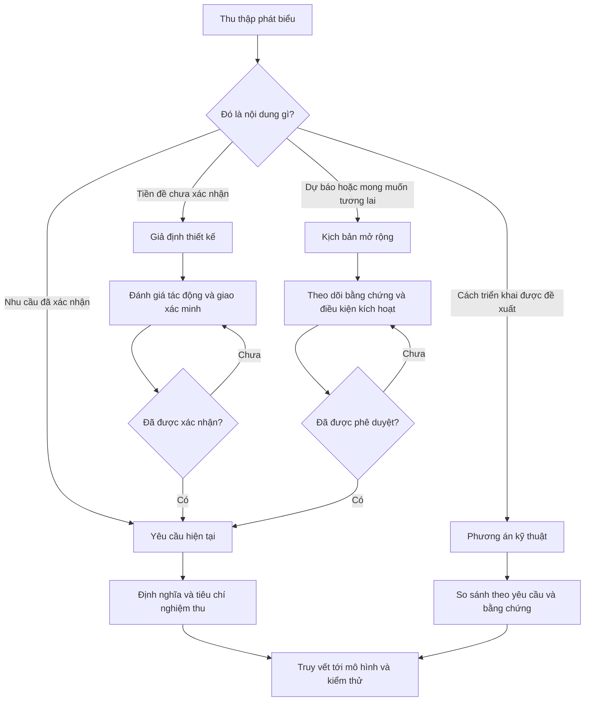

# Phân biệt yêu cầu hiện tại, giả định thiết kế và khả năng mở rộng chưa được xác nhận

Trong một dự án dữ liệu, thông tin được đưa ra trong buổi phỏng vấn, ý tưởng của nhóm kỹ thuật và dự đoán về quy mô tương lai thường xuất hiện xen kẽ. Nếu không phân biệt chúng, nhóm có thể biến một nhận xét chưa kiểm chứng thành yêu cầu bắt buộc, thiết kế quá phức tạp cho nhu cầu hiện tại hoặc bỏ qua giới hạn vận hành thực sự quan trọng.

Phân tích yêu cầu cần ghi rõ mức độ chắc chắn và nguồn gốc của từng phát biểu. **Yêu cầu hiện tại** mô tả điều người dùng hoặc tổ chức đã xác nhận cần hệ thống đáp ứng. **Giả định thiết kế** là điều nhóm tạm chấp nhận để tiếp tục phân tích hoặc xây dựng phương án, nhưng vẫn cần kiểm chứng. **Khả năng mở rộng chưa được xác nhận** là nhu cầu tương lai hoặc dự báo về tải, dung lượng và tăng trưởng chưa có căn cứ đủ mạnh để trở thành cam kết kỹ thuật.

Ba nhóm thông tin có thể liên quan với nhau nhưng có trạng thái bằng chứng và cách xử lý khác nhau. Phân loại rõ ràng giúp mô hình dữ liệu vừa đáp ứng công việc hiện tại, vừa giữ được khả năng thay đổi khi có dữ liệu mới.

## 1. Vì sao cần phân biệt mức độ chắc chắn?

Một câu nói như “hệ thống cần hỗ trợ hàng triệu đơn hàng” có thể mang nhiều ý nghĩa. Người dùng có thể đang nói về tổng số đơn lưu trong nhiều năm, số đơn phát sinh mỗi tháng, số đơn đang được xử lý đồng thời hoặc chỉ đang hình dung một quy mô lớn để tránh phải thay hệ thống sớm. Mỗi cách hiểu dẫn đến yêu cầu lưu trữ, chỉ mục, phân vùng và vận hành khác nhau.

Tương tự, “sau này có thể bán ở nhiều quốc gia” chưa đủ để kết luận rằng phiên bản đầu tiên phải hỗ trợ nhiều loại tiền, nhiều ngôn ngữ, thuế theo từng khu vực và lưu trữ dữ liệu ở nhiều vùng địa lý. Đó có thể là định hướng kinh doanh, một giả định cần xác minh hoặc một yêu cầu đã được phê duyệt. Nhóm phải hỏi rõ trước khi đưa nó vào thiết kế.

Phân loại sai thường gây ra bốn hậu quả:

- **Phạm vi phình to:** các khả năng mới chỉ là ý tưởng được triển khai ngay, làm chậm chức năng cốt lõi.
- **Thiết kế quá mức:** thêm tầng trừu tượng, phân tán dữ liệu hoặc cơ chế mở rộng khi chưa có tải hay yêu cầu vận hành chứng minh sự cần thiết.
- **Thiết kế thiếu:** bỏ qua yêu cầu hiện tại về lịch sử, tính nhất quán, bảo mật hoặc tích hợp vì nhầm chúng với lựa chọn kỹ thuật có thể trì hoãn.
- **Không kiểm chứng được:** nhóm không biết ai đã xác nhận con số, giả định nào còn hiệu lực và điều kiện nào buộc phải xem xét lại quyết định.

Mục tiêu của việc phân loại là làm cho quyết định có thể truy vết và điều chỉnh. Nó không nhằm loại bỏ mọi giả định hoặc dự báo; các giả định và dự báo vẫn cần thiết khi thông tin chưa đầy đủ.

## 2. Ba nhóm thông tin cốt lõi

### 2.1. Yêu cầu hiện tại

Yêu cầu hiện tại là nhu cầu đã được xác nhận bởi người có thẩm quyền hoặc nguồn nghiệp vụ đáng tin cậy, nằm trong phạm vi phiên bản hay giai đoạn đang phân tích. Yêu cầu phải mô tả điều hệ thống cần làm hoặc thuộc tính chất lượng cần đạt, độc lập ở mức hợp lý với cách triển khai.

Ví dụ:

- Nhân viên kho cần tra cứu các đơn được phân công cho kho của mình.
- Khi đơn hàng được xác nhận, hệ thống phải giữ lại đơn giá tại thời điểm mua.
- Mỗi giao dịch thanh toán từ cổng ngoài phải được nhận diện bằng mã tham chiếu của nhà cung cấp.
- Người dùng chỉ được xem dữ liệu thuộc phạm vi quyền đã cấp.
- Báo cáo cuối ngày phải sử dụng múi giờ nghiệp vụ đã thống nhất.

Một yêu cầu được xác nhận vẫn cần chi tiết hóa. “Tra cứu nhanh” chưa phải tiêu chí kiểm thử cho đến khi xác định loại truy vấn, tải dự kiến, môi trường đo và ngưỡng thời gian chấp nhận. “Lưu lịch sử” cũng cần chỉ rõ loại thay đổi, thời hạn lưu, ai được truy cập và cách xử lý dữ liệu hết hạn.

Yêu cầu hiện tại nên có mã định danh, người hoặc tài liệu xác nhận, phạm vi áp dụng, mức ưu tiên, tiêu chí nghiệm thu và liên kết tới câu hỏi nghiệp vụ liên quan.

### 2.2. Giả định thiết kế

Giả định thiết kế là một điều chưa được xác nhận đầy đủ nhưng nhóm tạm dùng làm tiền đề để phân tích, ước lượng hoặc so sánh phương án. Giả định có thể liên quan đến nghiệp vụ, dữ liệu, tích hợp, tải hoặc cách vận hành.

Ví dụ:

- Tạm giả định mỗi đơn hàng thuộc một cửa hàng bán hàng duy nhất.
- Tạm giả định mã khách hàng từ hệ thống hiện tại không thay đổi trong quá trình di chuyển dữ liệu.
- Tạm giả định webhook thanh toán có thể được gửi lại và cần xử lý lặp an toàn.
- Tạm giả định người dùng tra cứu đơn chủ yếu theo mã đơn và khoảng thời gian.
- Tạm giả định hệ thống có thể dùng một cơ sở dữ liệu quan hệ cho giao dịch ban đầu.

Các giả định trên không có cùng bản chất. Một số là giả định nghiệp vụ cần chủ sở hữu xác nhận; một số là giả định kỹ thuật cần thử nghiệm; một số là lựa chọn tạm thời có thể thay đổi sau khi đánh giá. Cần ghi rõ loại giả định và cách kiểm chứng thay vì gom mọi điều chưa rõ vào một danh sách chung.

Giả định tốt có phạm vi hẹp, có lý do, có người chịu trách nhiệm xác minh và có điều kiện xem xét lại. Không nên ghi “hệ thống sẽ có quy mô nhỏ” mà không định nghĩa nhỏ là bao nhiêu, dựa trên dữ liệu nào và ai xác nhận.

### 2.3. Khả năng mở rộng chưa được xác nhận

Đây là những dự đoán, mong muốn hoặc kịch bản tăng trưởng chưa được phê duyệt thành yêu cầu cho giai đoạn hiện tại. Chúng có thể liên quan đến số người dùng, số giao dịch, dung lượng, tốc độ truy vấn, số tổ chức, vùng địa lý hoặc độ phức tạp của nghiệp vụ.

Ví dụ:

- Có thể mở rộng sang nhiều quốc gia trong hai năm tới.
- Có thể tăng từ một chi nhánh lên hàng trăm chi nhánh.
- Có thể lưu hàng tỷ sự kiện lịch sử.
- Có thể cần phân tích dữ liệu gần thời gian thực trên toàn bộ giao dịch.
- Có thể tích hợp thêm nhiều kênh bán và nhà cung cấp thanh toán.

Những khả năng này nên được lưu trong danh sách kịch bản tương lai cùng với bằng chứng hiện có, độ tin cậy, tác động nếu xảy ra và tín hiệu cần theo dõi. Chúng không tự động trở thành yêu cầu phải thực hiện ngay.

Nếu một khả năng tương lai đã được lãnh đạo hoặc chủ sở hữu nghiệp vụ phê duyệt với thời hạn và tiêu chí rõ ràng, nó có thể trở thành yêu cầu của một giai đoạn xác định. Khi đó cần cập nhật phạm vi, ưu tiên và tiêu chí nghiệm thu tương ứng.

## 3. Phân biệt yêu cầu với giải pháp kỹ thuật

Yêu cầu mô tả kết quả cần đạt. Giải pháp kỹ thuật mô tả cách hệ thống sẽ đạt kết quả đó. Hai nội dung thường bị trộn lẫn khi người dùng hoặc kỹ sư đưa ra một công nghệ cụ thể trước khi thống nhất vấn đề.

| Phát biểu | Phân loại ban đầu | Câu hỏi cần làm rõ |
|---|---|---|
| Nhân viên cần tìm đơn theo mã đơn trong giờ làm việc | Yêu cầu chức năng | Ai được tìm? Có cần tìm theo nhiều tiêu chí khác không? |
| Phải dùng MongoDB | Ràng buộc công nghệ hoặc đề xuất thiết kế | Ai yêu cầu? Có lý do, tiêu chí và quyền phê duyệt nào? |
| Dữ liệu phải còn sau khi máy chủ khởi động lại | Yêu cầu về độ bền dữ liệu | Mức mất dữ liệu tối đa cho phép là bao nhiêu? |
| Dùng Kafka để xử lý mọi sự kiện | Đề xuất kiến trúc | Có yêu cầu thông lượng, thứ tự hoặc tách rời dịch vụ nào chứng minh lựa chọn này? |
| Hỗ trợ 10 triệu người dùng | Dự báo quy mô chưa rõ | Là tài khoản đăng ký, người dùng hoạt động hay người dùng đồng thời? |
| Báo cáo phải hoàn thành trước 8 giờ mỗi sáng | Yêu cầu vận hành | Dữ liệu của kỳ nào, độ mới và thời điểm bắt đầu tính ra sao? |

Nếu tổ chức có chính sách bắt buộc dùng một nền tảng, đó có thể là ràng buộc hiện tại. Cần ghi nguồn chính sách và phạm vi áp dụng. Nếu chỉ là đề xuất của một thành viên nhóm, nó vẫn là phương án cần đánh giá.

Ví dụ, yêu cầu “tra cứu đơn trong vòng một giây ở tải dự kiến” có thể được đáp ứng bằng nhiều phương án: tối ưu truy vấn quan hệ, thêm chỉ mục, cache, read replica hoặc thay đổi cách tổ chức dữ liệu. Không nên biến một phương án thành yêu cầu khi chưa chứng minh nó là ràng buộc bắt buộc.

## 4. Cách phân loại một phát biểu trong buổi khảo sát

Khi nghe một phát biểu, hãy làm rõ sáu điểm:

1. **Ai nói hoặc xác nhận?** Người dùng trực tiếp, chủ sở hữu nghiệp vụ, kiến trúc sư, nhà cung cấp hay một bên liên quan khác?
2. **Điều gì đang được mô tả?** Kết quả nghiệp vụ, chất lượng cần đạt, giới hạn chính sách, giải pháp kỹ thuật hay dự báo tương lai?
3. **Áp dụng khi nào?** Phiên bản hiện tại, giai đoạn tiếp theo hay một viễn cảnh chưa có thời hạn?
4. **Bằng chứng nào hỗ trợ?** Quy trình đang vận hành, số liệu đo, hợp đồng, chính sách, thử nghiệm hay chỉ là ý kiến?
5. **Nếu sai thì tác động gì?** Ảnh hưởng đến dữ liệu, chi phí, bảo mật, tiến độ, hiệu năng hay khả năng vận hành?
6. **Ai và khi nào xác minh?** Có người phụ trách, thời hạn hoặc sự kiện kích hoạt việc xem xét lại không?

Một phát biểu có thể cần tách thành nhiều mục. Chẳng hạn “chúng ta cần dùng cơ sở dữ liệu phân tán vì năm sau sẽ có hàng triệu người dùng” chứa ít nhất ba nội dung: một yêu cầu hiệu năng hoặc khả năng phục vụ chưa được định lượng, một dự báo người dùng chưa rõ cách tính và một đề xuất giải pháp. Ghi riêng từng nội dung sẽ giúp nhóm kiểm chứng chúng độc lập.

### 4.1. Những câu hỏi gợi mở hữu ích

| Khi nghe | Hãy hỏi |
|---|---|
| “Luôn luôn phải nhanh” | Truy vấn nào? Ngưỡng thời gian bao nhiêu? Đo ở phân vị nào và tải nào? |
| “Có rất nhiều dữ liệu” | Bao nhiêu bản ghi hiện tại, tăng bao nhiêu mỗi ngày, lưu trong bao lâu? |
| “Sẽ có nhiều người dùng” | Bao nhiêu tài khoản, bao nhiêu người hoạt động, bao nhiêu phiên đồng thời? |
| “Dữ liệu phải nhất quán” | Những trường hợp nào cần nhất quán tức thời? Trường hợp nào chấp nhận trễ? |
| “Sau này cần đa vùng” | Đa vùng để giảm độ trễ, tăng sẵn sàng, đáp ứng pháp lý hay phục hồi thảm họa? |
| “Cần hỗ trợ mọi loại báo cáo” | Ai sử dụng, câu hỏi nào quan trọng, độ mới và thời gian phản hồi mong muốn? |
| “Cứ lưu hết lịch sử” | Lịch sử của loại dữ liệu nào, thời hạn, quyền truy cập và chi phí lưu giữ ra sao? |

Không nên tự điền câu trả lời bằng kinh nghiệm cá nhân. Khi người được phỏng vấn chưa biết, hãy ghi “chưa xác nhận” và giao việc tìm bằng chứng.

## 5. Ghi nhận bằng chứng, độ tin cậy và người chịu trách nhiệm

Mỗi phát biểu quan trọng nên lưu cùng nguồn và bằng chứng. Một nhận xét từ người dùng vận hành có thể phản ánh chính xác khó khăn hàng ngày, nhưng không nhất thiết đủ để xác định quy mô toàn hệ thống. Một dashboard hiện tại có thể cho biết lưu lượng thực tế, nhưng không chứng minh được kế hoạch tăng trưởng trong hai năm.

### 5.1. Các loại bằng chứng

| Loại bằng chứng | Ví dụ | Điều cần kiểm tra |
|---|---|---|
| Quy định hoặc hợp đồng | Chính sách lưu giữ, thỏa thuận tích hợp | Phiên bản, phạm vi, ngày hiệu lực và chủ sở hữu |
| Quan sát quy trình | Phỏng vấn, theo dõi công việc, workshop | Vai trò, bối cảnh và trường hợp ngoại lệ |
| Dữ liệu vận hành | Log, metric, báo cáo tải, dung lượng | Khoảng thời gian, độ đại diện và chất lượng đo |
| Dữ liệu lịch sử | Tăng trưởng đơn hàng, người dùng hoạt động | Mùa vụ, chiến dịch và thay đổi nghiệp vụ |
| Thử nghiệm | Benchmark, prototype, kiểm thử tải | Môi trường, dữ liệu, cấu hình và cách lặp lại |
| Kế hoạch kinh doanh | Mục tiêu mở rộng thị trường, chi nhánh | Mức phê duyệt, thời hạn và nguồn lực |
| Ý kiến chuyên gia | Đánh giá của kiến trúc sư hoặc nhà cung cấp | Giả định, lợi ích, rủi ro và khả năng kiểm chứng |

### 5.2. Đánh giá độ tin cậy

Có thể dùng thang mô tả đơn giản:

- **Đã xác nhận:** Có nguồn có thẩm quyền và bằng chứng phù hợp với phạm vi yêu cầu.
- **Có cơ sở:** Có dữ liệu hoặc quan sát hỗ trợ nhưng vẫn còn giới hạn cần ghi rõ.
- **Tạm giả định:** Chưa có xác nhận; đang được dùng để tiếp tục phân tích.
- **Chưa có bằng chứng:** Mới là ý tưởng hoặc dự đoán, chưa đủ cơ sở để cam kết.
- **Mâu thuẫn:** Có các nguồn đưa ra thông tin khác nhau, cần phân xử.

Độ tin cậy không phải điểm số trang trí. Nó phải ảnh hưởng đến quyết định: mục nào có thể đưa vào baseline, mục nào cần thử nghiệm, mục nào cần người có thẩm quyền xác nhận và mục nào chỉ nên theo dõi.

### 5.3. Ghi nhận xung đột

Khi hai bên đưa ra thông tin khác nhau, đừng tự chọn con số thuận tiện. Hãy ghi từng phát biểu, nguồn, thời điểm, phạm vi và hệ quả. Ví dụ, bộ phận kinh doanh dự báo 20.000 đơn mỗi ngày trong chiến dịch, trong khi log hiện tại chỉ ghi nhận 2.000 đơn mỗi ngày. Hai con số có thể cùng đúng vì một con số là tải đỉnh theo kế hoạch, con số còn lại là tải trung bình hiện tại.

Người chịu trách nhiệm cần xác nhận định nghĩa và thời điểm sử dụng từng con số. Trong thời gian chờ xác nhận, mô hình và ước lượng nên thể hiện rõ các kịch bản thay vì giả vờ chỉ có một giá trị chắc chắn.

## 6. Định lượng khả năng mở rộng

“Có thể mở rộng” là một cụm từ quá rộng để dùng trực tiếp làm yêu cầu. Cần chuyển nó thành các chiều đo có thể quan sát và kiểm thử.

### 6.1. Phân biệt các đại lượng tải

| Đại lượng | Ý nghĩa | Ví dụ câu hỏi |
|---|---|---|
| Tổng số tài khoản | Số danh tính đã đăng ký | Có bao nhiêu tài khoản đang tồn tại? |
| Người dùng hoạt động | Người thực sự dùng trong một khoảng thời gian | Có bao nhiêu người hoạt động mỗi ngày hoặc mỗi tháng? |
| Người dùng đồng thời | Số phiên hoặc tác nhân hoạt động cùng lúc | Có bao nhiêu phiên trong giờ cao điểm? |
| Tốc độ giao dịch | Số thao tác hoặc sự kiện trên một đơn vị thời gian | Trung bình và đỉnh có bao nhiêu yêu cầu mỗi giây? |
| Dung lượng dữ liệu | Dữ liệu đang lưu và tốc độ tăng | Mỗi ngày thêm bao nhiêu bản ghi và byte? |
| Độ dài lưu giữ | Thời gian dữ liệu phải còn khả dụng | Dữ liệu giao dịch và log cần giữ bao lâu? |
| Kích thước truy vấn | Số bản ghi hoặc phạm vi dữ liệu được đọc | Một báo cáo quét một ngày, một tháng hay nhiều năm? |
| Tải nền | Tác vụ chạy không trực tiếp theo yêu cầu người dùng | Có bao nhiêu tác vụ tổng hợp, nhập hoặc đồng bộ chạy cùng lúc? |

Không thể suy ra tải đồng thời chỉ từ tổng số tài khoản. Cũng không thể suy ra dung lượng từ số giao dịch nếu chưa biết kích thước bản ghi, số quan hệ, chỉ mục, bản sao và thời hạn lưu.

### 6.2. Mô tả kịch bản tải

Một kịch bản hữu ích xác định:

- **Đối tượng đo:** Người dùng, đơn hàng, sự kiện, truy vấn hay dung lượng.
- **Mức bình thường:** Giá trị trung bình hoặc điển hình trong thời gian xác định.
- **Mức đỉnh:** Giá trị cao nhất trong cửa sổ thời gian cụ thể và tần suất xuất hiện.
- **Thời gian duy trì:** Đỉnh kéo dài vài giây, vài phút hay nhiều giờ.
- **Tăng trưởng:** Mức thay đổi theo tháng, quý hoặc năm.
- **Độ trễ chấp nhận:** Thời gian phản hồi hoặc độ trễ đồng bộ được phép.
- **Tỷ lệ đọc và ghi:** Các loại thao tác chiếm tỷ trọng nào.
- **Mức lưu giữ:** Dữ liệu còn trực tuyến, chuyển kho lạnh hoặc được xóa sau bao lâu.

Ví dụ về một kịch bản cần xác nhận:

| Chỉ tiêu | Giá trị minh họa | Trạng thái |
|---|---:|---|
| Đơn hàng trung bình mỗi ngày | 8.000 | Đã đo trong giai đoạn quan sát |
| Đơn hàng đỉnh mỗi ngày | 25.000 | Ghi nhận trong một chiến dịch |
| Đỉnh tạo đơn | 40 yêu cầu/giây | Cần đối chiếu log và kiểm thử tải |
| Người dùng đồng thời | 1.500 | Ước tính từ phiên đăng nhập, chưa xác nhận |
| Thời gian lưu đơn trực tuyến | 5 năm | Chính sách nghiệp vụ cần phê duyệt |

Các con số trên chỉ minh họa cách trình bày. Không được dùng chúng làm cam kết cho một dự án khác khi chưa có số liệu và người xác nhận tương ứng.

### 6.3. Ước tính dung lượng ở mức sơ bộ

Ước tính dung lượng giúp phát hiện giả định thiếu thực tế, nhưng phải nêu rõ những gì đã tính và chưa tính.

Một phép ước tính đơn giản cho dữ liệu phát sinh mới:

\[
V_{raw} = N_{day} \times S_{avg} \times D
\]

Trong đó:

- (N_{day}): số bản ghi phát sinh trung bình mỗi ngày.
- (S_{avg}): kích thước trung bình của một bản ghi ở dạng lưu trữ đang xét.
- (D): số ngày lưu giữ.
- (V_{raw}): dung lượng dữ liệu thô ước tính.

Ví dụ, nếu có 10.000 bản ghi mỗi ngày, kích thước trung bình 2 KB và lưu 365 ngày thì dung lượng thô xấp xỉ 7,3 GB theo cách tính thập phân. Con số thực tế có thể cao hơn vì chỉ mục, metadata, bản sao, log, dữ liệu lịch sử và chi phí của hệ quản trị.

Đây chỉ là ước tính ban đầu. Cần đo kích thước thực tế từ dữ liệu đại diện và tính riêng các phần như chỉ mục, bản sao, snapshot, tệp đính kèm và dữ liệu tăng trưởng theo mùa.

### 6.4. Chuyển dự báo thành ngưỡng xem xét lại

Không nhất thiết phải triển khai kiến trúc cho mọi kịch bản xa ngay lập tức. Có thể định nghĩa tín hiệu kích hoạt đánh giá lại, chẳng hạn:

- Tốc độ ghi duy trì vượt ngưỡng đã kiểm thử trong một khoảng thời gian.
- Thời gian phản hồi ở phân vị 95 hoặc 99 vượt mục tiêu.
- Dung lượng hoặc tốc độ tăng trưởng tiến gần giới hạn vận hành đã thống nhất.
- Cửa sổ sao lưu hoặc khôi phục vượt thời gian cho phép.
- Một truy vấn báo cáo bắt đầu ảnh hưởng đến giao dịch trực tuyến.
- Nghiệp vụ mở thêm chi nhánh, quốc gia hoặc loại giao dịch mới.

Ngưỡng phải lấy từ yêu cầu và kết quả đo của hệ thống. Khi đạt ngưỡng, nhóm mở lại quyết định thiết kế, đánh giá phương án và kiểm thử trên tải đại diện.

## 7. Tác động của sự không chắc chắn đến mô hình dữ liệu

Mức độ chắc chắn của yêu cầu cần được phản ánh trong quyết định mô hình. Không nên thêm cấu trúc chỉ để hỗ trợ mọi khả năng tưởng tượng, nhưng cũng không nên bỏ qua những đặc tính khó bổ sung sau khi dữ liệu đã phát sinh.

### 7.1. Những đặc tính khó thay đổi về sau

Một số quyết định có chi phí di chuyển cao hoặc ảnh hưởng đến tính đúng đắn của dữ liệu:

- Cách định danh một đối tượng và bảo đảm mã định danh ổn định.
- Quan hệ sở hữu dữ liệu giữa tổ chức, khách hàng, chi nhánh và giao dịch.
- Quy tắc giữ lịch sử và giá trị tại thời điểm phát sinh.
- Ngữ nghĩa của trạng thái và chuyển trạng thái.
- Quy tắc toàn vẹn, tính duy nhất và xử lý giao dịch đồng thời.
- Quyền truy cập và ranh giới dữ liệu nhạy cảm.
- Đơn vị đo, tiền tệ, múi giờ và cách biểu diễn thời gian.

Nếu các nội dung này là yêu cầu hiện tại hoặc ràng buộc pháp lý, cần giải quyết sớm. Chúng thường khó sửa hơn việc thêm một chỉ mục hoặc tối ưu một truy vấn.

### 7.2. Những khả năng có thể trì hoãn

Một số khả năng có thể được bổ sung khi có bằng chứng rõ hơn:

- Chỉ mục chuyên biệt cho một báo cáo ít dùng.
- Phân vùng dữ liệu khi dung lượng và tải thực tế chạm ngưỡng.
- Bảng tổng hợp hoặc kho dữ liệu khi nhu cầu phân tích được xác nhận.
- Cache cho truy vấn đọc lặp lại khi đo được lợi ích và chính sách nhất quán.
- Tách dịch vụ hoặc cơ sở dữ liệu khi có nhu cầu độc lập về tải, sở hữu hoặc vận hành.

Việc trì hoãn phải có lý do và điều kiện xem xét lại. Nếu một khả năng bị trì hoãn nhưng sau đó trở thành yêu cầu bắt buộc, nhóm cần đánh giá chi phí chuyển đổi và cập nhật kế hoạch.

### 7.3. Giữ khả năng tiến hóa bằng ranh giới rõ ràng

Một số nguyên tắc có thể giúp mô hình thay đổi dễ hơn mà không cần triển khai trước mọi công nghệ:

- Dùng định danh ổn định và tránh để khóa nội bộ phụ thuộc vào dữ liệu có thể thay đổi.
- Xác định rõ chủ sở hữu của từng loại dữ liệu và nguồn chuẩn.
- Giữ lịch sử nghiệp vụ khi có yêu cầu truy vết hoặc tái dựng trạng thái.
- Tách dữ liệu giao dịch khỏi các kết quả tổng hợp có thể tái tạo.
- Định nghĩa hợp đồng tích hợp và cách xử lý sự kiện lặp, trễ hoặc sai thứ tự.
- Ghi nhận thời gian theo quy ước thống nhất và xác định múi giờ nghiệp vụ.
- Theo dõi các truy vấn quan trọng để có bằng chứng khi cần thêm chỉ mục hoặc thay đổi cấu trúc.

Các nguyên tắc này không ép buộc một công nghệ lưu trữ cụ thể. Chúng giúp duy trì ngữ nghĩa và khả năng kiểm chứng khi cấu trúc triển khai thay đổi.

## 8. Quản lý giả định và kịch bản tương lai

### 8.1. Sổ đăng ký giả định

Sổ đăng ký giả định nên là một tài liệu có thể cập nhật, với mỗi mục có:

| Trường | Mục đích |
|---|---|
| ID | Định danh ổn định, ví dụ `ASM-ORDER-01` |
| Phát biểu | Điều đang tạm giả định, viết rõ và có thể kiểm chứng |
| Loại | Nghiệp vụ, dữ liệu, tích hợp, tải, vận hành hoặc kỹ thuật |
| Lý do | Vì sao cần giả định này để tiếp tục công việc |
| Nguồn / bằng chứng | Dữ liệu, tài liệu hoặc trao đổi làm cơ sở |
| Độ tin cậy | Đã xác nhận, có cơ sở, tạm giả định, chưa có bằng chứng hoặc mâu thuẫn |
| Tác động nếu sai | Phạm vi, dữ liệu, chi phí, bảo mật, hiệu năng hoặc tiến độ |
| Người xác minh | Vai trò hoặc cá nhân chịu trách nhiệm |
| Hạn xác minh | Ngày hoặc mốc dự án cần hoàn thành |
| Điều kiện kích hoạt | Sự kiện buộc phải xem xét lại |
| Trạng thái | Mở, đang xác minh, đã xác nhận, bị bác bỏ hoặc thay thế |

Giả định có tác động lớn và độ tin cậy thấp nên được ưu tiên xác minh. Một giả định ít ảnh hưởng có thể được theo dõi đến giai đoạn sau nếu chi phí kiểm chứng hiện tại cao.

### 8.2. Danh sách kịch bản mở rộng

Kịch bản tương lai nên ghi rõ:

- Mô tả khả năng hoặc sự thay đổi có thể xảy ra.
- Xác suất hoặc mức độ tin cậy nếu có căn cứ.
- Khoảng thời gian dự kiến.
- Tín hiệu sớm có thể quan sát.
- Thành phần dữ liệu và nghiệp vụ có thể bị ảnh hưởng.
- Chi phí nếu không chuẩn bị và chi phí nếu chuẩn bị quá sớm.
- Điều kiện để đưa kịch bản vào baseline yêu cầu.

Không nên gán xác suất giả tạo khi chưa có dữ liệu. Có thể dùng các mức định tính như thấp, trung bình, cao kèm giải thích và người đánh giá.

### 8.3. Quy tắc đóng hoặc chuyển trạng thái

Một giả định có thể được xử lý theo một trong các cách:

- **Xác nhận:** Có bằng chứng và người có thẩm quyền chấp thuận; chuyển thành yêu cầu hoặc ràng buộc chính thức nếu phù hợp.
- **Bác bỏ:** Bằng chứng cho thấy giả định sai; cập nhật phương án bị ảnh hưởng.
- **Thay thế:** Có giả định mới chính xác hơn; lưu liên kết tới mục cũ để giữ lịch sử.
- **Hoãn xác minh:** Chưa cần quyết định ngay; phải ghi lý do, người phụ trách và điều kiện xem xét lại.
- **Chuyển thành rủi ro:** Điều chưa chắc chắn có thể gây thiệt hại nếu xảy ra; cần kế hoạch giảm thiểu hoặc ứng phó.

Không xóa dấu vết của giả định đã bị bác bỏ nếu nó từng ảnh hưởng đến quyết định thiết kế. Lịch sử này giúp giải thích vì sao một phương án được chọn hoặc thay đổi.

## 9. Ví dụ tổng hợp: hệ thống bán hàng trực tuyến

Giả sử một cửa hàng muốn thay thế quy trình nhận đơn qua bảng tính bằng hệ thống trực tuyến. Trong workshop, nhóm nhận được các phát biểu sau:

1. “Nhân viên cần xem đơn đã thanh toán nhưng chưa giao.”
2. “Chúng ta nên dùng cơ sở dữ liệu phân tán để dễ mở rộng.”
3. “Năm sau có thể mở 50 chi nhánh.”
4. “Mỗi đơn phải giữ nguyên giá tại thời điểm khách đặt.”
5. “Chắc sẽ có khoảng một triệu khách hàng.”
6. “Nếu cổng thanh toán gửi cùng một thông báo nhiều lần, hệ thống không được ghi nhận thanh toán trùng.”

### 9.1. Phân loại ban đầu

| Phát biểu | Phân loại | Cách xử lý |
|---|---|---|
| Xem đơn đã thanh toán nhưng chưa giao | Yêu cầu chức năng hiện tại | Xác định định nghĩa thanh toán, trạng thái giao và quyền tra cứu |
| Nên dùng cơ sở dữ liệu phân tán | Đề xuất thiết kế | So sánh với tải, tính nhất quán, độ trễ và năng lực vận hành hiện có |
| Có thể mở 50 chi nhánh | Kịch bản mở rộng chưa xác nhận | Hỏi kế hoạch, thời hạn, mức phê duyệt và mô hình phân quyền chi nhánh |
| Giữ nguyên giá tại thời điểm đặt | Yêu cầu dữ liệu hiện tại | Lưu giá trị giao dịch trên dòng hàng và kiểm thử khi giá niêm yết thay đổi |
| Có khoảng một triệu khách hàng | Dự báo quy mô chưa rõ | Xác định tổng tài khoản hay người hoạt động, nguồn dự báo và thời gian đạt mức đó |
| Không ghi nhận thanh toán trùng khi webhook gửi lại | Yêu cầu toàn vẹn hiện tại | Định nghĩa khóa idempotency, mã tham chiếu duy nhất và hành vi xử lý sự kiện lặp |

### 9.2. Những câu hỏi bổ sung

Với yêu cầu tra cứu đơn, cần hỏi nhân viên có tra cứu theo mã đơn, khách hàng, thời gian, chi nhánh hay trạng thái không. Có cần sắp xếp theo thời điểm cập nhật và phân trang không? Kết quả có được giới hạn theo chi nhánh hay nhân viên phụ trách không?

Với dự báo một triệu khách hàng, cần hỏi đó là số tài khoản đăng ký sau bao lâu, có bao nhiêu người hoạt động hàng tháng và bao nhiêu phiên đồng thời trong chiến dịch. Cần lấy số liệu hiện tại, tốc độ tăng trưởng và dự báo kinh doanh để xây dựng các kịch bản bình thường, cao điểm và tăng trưởng dài hạn.

Với kế hoạch 50 chi nhánh, cần xác định chi nhánh có dữ liệu riêng hay cùng chia sẻ khách hàng và sản phẩm, người dùng có thể làm việc ở nhiều chi nhánh không, báo cáo cần tổng hợp toàn hệ thống hay giới hạn theo vùng. Đây là các câu hỏi về nghiệp vụ và quyền sở hữu dữ liệu; chúng cần được trả lời trước khi chọn cách phân vùng hoặc phân tách cơ sở dữ liệu.

### 9.3. Quyết định theo giai đoạn

Giai đoạn đầu có thể ưu tiên mô hình giao dịch đáp ứng đơn hàng, dòng hàng, thanh toán, giao hàng và phạm vi truy cập của chi nhánh hiện có. Nhóm ghi lại dự báo mở rộng như kịch bản cần theo dõi, đo tải thật và đặt ngưỡng đánh giá lại.

Nếu việc mở 50 chi nhánh được phê duyệt trước khi thiết kế hoàn tất, nhóm phải cập nhật yêu cầu hiện tại: bổ sung quy tắc sở hữu dữ liệu, phân quyền, định danh và báo cáo đa chi nhánh. Nếu chưa được phê duyệt, không nên đưa các giả định chưa xác nhận vào cam kết phiên bản hiện tại.

Lựa chọn cơ sở dữ liệu cần dựa trên kiểu truy vấn, yêu cầu toàn vẹn, tải đo được, khả năng vận hành và kế hoạch tăng trưởng đã có căn cứ. Quy mô lớn tự nó không chứng minh rằng hệ thống cần một kiến trúc phân tán ngay từ đầu.

## 10. Liên kết mức độ chắc chắn với quyết định mô hình

Một bảng truy vết giúp người thiết kế biết dữ liệu nào đã được xác nhận và quyết định nào còn phụ thuộc vào giả định.

| ID | Nội dung | Trạng thái bằng chứng | Hàm ý mô hình | Việc tiếp theo |
|---|---|---|---|---|
| REQ-01 | Đơn giữ giá tại thời điểm mua | Đã xác nhận | Dòng hàng lưu giá giao dịch | Thiết kế và kiểm thử |
| REQ-02 | Webhook lặp không tạo thanh toán trùng | Đã xác nhận | Định danh giao dịch ngoài và ràng buộc duy nhất | Xác định khóa chống lặp |
| ASM-01 | Mỗi đơn thuộc một cửa hàng | Tạm giả định | Có thể cần quan hệ đơn hàng với cửa hàng | Chủ nghiệp vụ xác minh |
| ASM-02 | Mã khách hàng nguồn ổn định | Có cơ sở | Ảnh hưởng khóa định danh khi di chuyển | Đối chiếu dữ liệu nguồn |
| FUT-01 | Mở 50 chi nhánh | Chưa được phê duyệt | Có thể ảnh hưởng phạm vi sở hữu và báo cáo | Theo dõi kế hoạch kinh doanh |
| FUT-02 | Một triệu tài khoản | Dự báo chưa rõ | Cần ước lượng dung lượng và tải | Thu thập số liệu và kịch bản |

Không phải mọi mục đều cần tạo bảng riêng. Một yêu cầu có thể dẫn đến thuộc tính, khóa, ràng buộc, chỉ mục, chính sách truy cập hoặc quy trình vận hành. Hàm ý mô hình cần được ghi ở mức phù hợp và liên kết đến quyết định cụ thể.

## 11. Tiêu chí để đưa một giả định thành yêu cầu

Trước khi nâng một giả định hoặc kịch bản tương lai thành yêu cầu, hãy kiểm tra:

1. Có người chịu trách nhiệm nghiệp vụ hoặc kỹ thuật xác nhận không?
2. Phạm vi và giai đoạn áp dụng đã rõ chưa?
3. Có bằng chứng, chính sách hoặc quyết định được phê duyệt không?
4. Phát biểu đã có định nghĩa và tiêu chí nghiệm thu chưa?
5. Tác động đến dữ liệu, tích hợp, bảo mật, vận hành và chi phí đã được đánh giá chưa?
6. Mức ưu tiên và nguồn lực thực hiện đã được chấp thuận chưa?
7. Các giả định phụ thuộc đã được kiểm tra chưa?

Nếu chưa đạt các điều kiện cần thiết, tiếp tục giữ trạng thái giả định hoặc kịch bản. Khi có thông tin mới, cập nhật trạng thái và truy vết các quyết định bị ảnh hưởng.

## 12. Mẫu ghi nhận có thể tái sử dụng

Mẫu dưới đây giúp lưu yêu cầu, giả định và kịch bản tương lai trong cùng một danh mục mà vẫn phân biệt trạng thái của chúng:

```yaml
items:
  - id: REQ-ORDER-01
    kind: requirement
    statement: "Đơn hàng giữ giá tại thời điểm đặt"
    scope: "Phiên bản hiện tại"
    source: "Chủ sở hữu nghiệp vụ bán hàng"
    evidence: "Quy trình xác nhận đơn đã phê duyệt"
    confidence: confirmed
    priority: must
    acceptance:
      - "Giá đơn không đổi khi giá niêm yết sản phẩm thay đổi"
    owner: "Product Owner"

  - id: ASM-DATA-01
    kind: assumption
    statement: "Mã khách hàng từ hệ thống cũ không thay đổi"
    scope: "Di chuyển dữ liệu"
    reason: "Đang dùng mã nguồn để đối chiếu đơn hàng lịch sử"
    evidence: "Chưa có xác nhận từ nhóm sở hữu hệ thống cũ"
    confidence: tentative
    impact_if_wrong: "Cần ánh xạ lại khóa và tham chiếu"
    verification_owner: "Data Owner"
    due: "Trước khi chốt kế hoạch migration"
    status: open

  - id: FUT-SCALE-01
    kind: future_scenario
    statement: "Có thể mở rộng lên 50 chi nhánh"
    time_horizon: "Chưa xác nhận"
    evidence: "Ý tưởng trong workshop"
    confidence: unverified
    affected_areas:
      - "Phân quyền và phạm vi dữ liệu"
      - "Báo cáo đa chi nhánh"
    trigger: "Kế hoạch mở rộng được phê duyệt"
    status: monitor
```

Đây là mẫu quản lý yêu cầu, không phải schema cơ sở dữ liệu bắt buộc. Tên trường và tập trạng thái có thể điều chỉnh theo quy trình quản lý dự án, nhưng cần giữ khả năng phân biệt yêu cầu đã xác nhận với giả định và kịch bản chưa được phê duyệt.

## 13. Sai lầm thường gặp

| Sai lầm | Hệ quả | Cách xử lý |
|---|---|---|
| Ghi ý kiến của một người thành yêu cầu chính thức | Phạm vi sai hoặc xung đột giữa các bên | Ghi nguồn, vai trò và người có thẩm quyền xác nhận |
| Đưa dự báo tương lai vào baseline ngay lập tức | Thiết kế quá mức và tăng chi phí | Quản lý thành kịch bản, đặt điều kiện kích hoạt |
| Dùng tổng số tài khoản để suy ra tải đồng thời | Ước lượng tài nguyên sai | Thu thập người hoạt động, phiên đồng thời và tốc độ giao dịch |
| Ghi “nhanh”, “lớn”, “nhiều” mà không định lượng | Không thể thiết kế và nghiệm thu | Định nghĩa chỉ số, phạm vi đo và tải thử nghiệm |
| Nhầm công nghệ với yêu cầu | Bỏ qua phương án phù hợp hơn | Tách kết quả cần đạt khỏi giải pháp đề xuất |
| Không ghi giả định phụ thuộc | Quyết định sai lan sang nhiều phần thiết kế | Ghi tác động, người xác minh và hạn xử lý |
| Không cập nhật khi giả định thay đổi | Tài liệu và mô hình trở nên mâu thuẫn | Duy trì lịch sử, trạng thái và truy vết quyết định |
| Chuẩn bị cho mọi khả năng xa | Tăng độ phức tạp trước khi có giá trị | Ưu tiên đặc tính khó thay đổi; trì hoãn phần có thể bổ sung |

## 14. Checklist trước khi chốt yêu cầu và mô hình

- [ ] Mỗi yêu cầu hiện tại có nguồn, người xác nhận, phạm vi và tiêu chí nghiệm thu.
- [ ] Phát biểu về kết quả nghiệp vụ được tách khỏi giải pháp kỹ thuật.
- [ ] Giả định được ghi rõ lý do, độ tin cậy, tác động nếu sai và người xác minh.
- [ ] Kịch bản tương lai được phân biệt với phạm vi đã phê duyệt.
- [ ] Các con số về người dùng, giao dịch và dung lượng có định nghĩa, khoảng thời gian và nguồn dữ liệu.
- [ ] Tải bình thường, tải đỉnh, thời gian duy trì và tỷ lệ đọc/ghi đã được xem xét.
- [ ] Thời hạn lưu giữ, lịch sử và tốc độ tăng trưởng đã có căn cứ.
- [ ] Các ngưỡng cần đo và điều kiện đánh giá lại kiến trúc đã được ghi nhận.
- [ ] Những quyết định mô hình khó thay đổi đã được kiểm tra với chủ sở hữu dữ liệu.
- [ ] Yêu cầu, giả định, kịch bản và quyết định thiết kế có liên kết truy vết.
- [ ] Xung đột và câu hỏi chưa giải quyết có người chịu trách nhiệm và thời hạn.



Một mô hình dữ liệu tốt bắt đầu từ yêu cầu có căn cứ và thể hiện rõ những điểm còn chưa chắc chắn. Khi nhóm biết điều gì đã được xác nhận, điều gì chỉ là giả định và khả năng nào cần theo dõi, họ có thể ưu tiên đúng các ràng buộc quan trọng, chọn giải pháp vừa đủ cho giai đoạn hiện tại và thay đổi có kiểm soát khi bằng chứng hoặc nhu cầu thực tế thay đổi.
