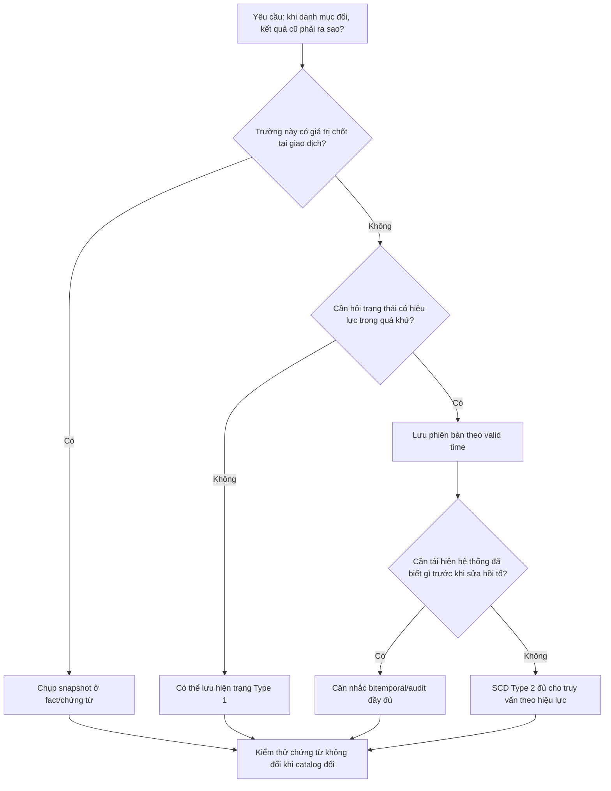

# Giữ đúng ngữ nghĩa khi danh mục hoặc thông tin tham chiếu thay đổi

## 1. Vấn đề: khóa ngoại còn đúng nhưng lịch sử đã sai nghĩa

Trong module `DATABASE_DATA_MODELING`, việc chuyển yêu cầu nghiệp vụ thành mô hình dữ liệu rõ ràng không dừng ở khóa, ràng buộc, chuẩn hóa hay chỉ mục. Dữ liệu còn phải **giữ được ý nghĩa khi thế giới nghiệp vụ thay đổi**. Ở chương **Thời gian và lịch sử**, một câu hỏi quan trọng là: *nếu danh mục hoặc thông tin được tham chiếu hôm nay thay đổi, các giao dịch của tháng trước có được phép thay đổi cách hiển thị, tính toán hoặc phân loại hay không?*

Giả sử:

1. Ngày 15/03/2026, sản phẩm `SKU-01` thuộc danh mục **Thiết bị gia dụng**, được bán với giá **800.000 VND**.
2. Ngày 01/07/2026, doanh nghiệp chuyển sản phẩm sang danh mục **Thiết bị thông minh**, đổi tên hiển thị và cập nhật giá niêm yết.
3. Tháng 08/2026, kế toán chạy báo cáo doanh thu tháng 03.

Nếu `order_line` chỉ chứa `product_id` và báo cáo luôn join sang bảng `product`/`category` **hiện tại**, doanh thu tháng 03 có thể bị gán sang danh mục mới; tên sản phẩm và giá niêm yết mới cũng có thể xuất hiện trên chứng từ cũ. Khóa ngoại vẫn hợp lệ về mặt SQL, nhưng **ngữ nghĩa lịch sử** không còn đúng theo câu hỏi báo cáo.

Cần phân biệt ba loại câu hỏi:

- **Hiện tại:** “Sản phẩm này *bây giờ* thuộc danh mục nào?”
- **Theo hiệu lực nghiệp vụ:** “Tại ngày 15/03, sản phẩm *được quy định là* thuộc danh mục nào?”
- **Theo hiểu biết ở thời điểm đó:** “Tại ngày 15/03, hệ thống *đang biết và đang sử dụng* phân loại nào, kể cả khi về sau phát hiện cần sửa hồi tố?”

Ba câu hỏi có thể có ba đáp án khác nhau. Thiết kế đáng tin cậy không ép chúng vào một cột `category_id` duy nhất rồi tùy lúc diễn giải.

### Kết quả học tập

Người học cần có thể:

1. Xác định thuộc tính nào là **danh tính ổn định**, thuộc tính nào thay đổi theo thời gian và thuộc tính nào phải được **chốt tại giao dịch**.
2. Phân biệt **thời gian hiệu lực** (*valid time*), **thời gian hệ thống biết/ghi nhận** (*recorded/system time*) và thời điểm phát sinh sự kiện.
3. So sánh ghi đè hiện trạng (SCD Type 1), lưu phiên bản (SCD Type 2), chụp snapshot giao dịch và mô hình hai trục thời gian (*bitemporal*).
4. Thiết kế phiên bản với khoảng `[from,to)`, truy vấn *as-of join*, kiểm tra không chồng lấn và xử lý phiên bản thiếu hoặc sửa hồi tố.
5. Nhận diện giới hạn của `PRIMARY KEY`, `FOREIGN KEY` và `UNIQUE` thông thường khi quy tắc phụ thuộc vào thời điểm.
6. Kiểm thử báo cáo lịch sử, chỉnh sửa danh mục, giao dịch đến muộn, đồng thời và migration dữ liệu cũ.

## 2. Viết hợp đồng ngữ nghĩa trước khi chọn bảng và cột

Không phải tất cả thay đổi đều cần lưu lịch sử ở cùng mức chi tiết.

| Thuộc tính/thông tin | Câu hỏi nghiệp vụ cần đặt | Cách lưu thường phù hợp |
|---|---|---|
| `product_id`, `category_id` | Có cùng đại diện một thực thể xuyên thời gian không? | Khóa kỹ thuật ổn định, không tái sử dụng |
| `sku`, `category_code` | Mã có thể đổi, chuyển chủ hoặc dùng lại không? | Chính sách bất biến/alias hoặc bảng lịch sử mã |
| Tên danh mục | Chỉ đổi cách trình bày hay là thay đổi định nghĩa? | Ghi đè nếu lịch sử không cần; version nếu cần *as-of* |
| Sản phẩm thuộc danh mục | Quan hệ có thời điểm bắt đầu/kết thúc hiệu lực không? | Bảng lịch sử quan hệ theo khoảng |
| Giá niêm yết | Hỏi giá đang áp dụng ở thời điểm nào? | Bảng giá có thời hạn hiệu lực, cơ chế chọn đúng giá |
| Giá bán thực tế, chiết khấu, tiền tệ | Hóa đơn có phải giữ nguyên số đã chấp nhận không? | Snapshot bất biến ở dòng giao dịch |
| Tên/địa chỉ người mua trên chứng từ | Phải hiển thị thông tin hiện tại hay thông tin tại lúc xuất chứng từ? | Snapshot cần thiết, theo luật lưu trữ và quyền riêng tư |
| Nhóm báo cáo, cấu trúc tổ chức | Báo cáo giữ nguyên phân loại lúc chốt hay tính lại theo cơ cấu mới? | Snapshot, version hoặc cả hai chế độ báo cáo |
| Sửa dữ liệu nhập sai hồi tố | Cần biết cả sự thật đã sửa lẫn giá trị hệ thống từng tin không? | Bitemporal hoặc audit log đủ thông tin |

Đặc biệt, **danh mục không phải lúc nào cũng chỉ là nhãn**. Đổi “Đồ gia dụng” thành “Thiết bị gia đình” có thể là sửa cách gọi cùng một danh tính; nhưng tách một danh mục thành hai danh mục mới hoặc sáp nhập nhiều danh mục có thể là thay đổi cấu trúc phân loại, không nên giả định chỉ là `UPDATE name`.

### Chốt ba quyết định độc lập

1. **Danh tính:** mã/ID nào biểu diễn cùng một sản phẩm hoặc danh mục khi tên và nhóm thay đổi?
2. **Thời điểm:** truy vấn lịch sử dựa trên thời điểm xảy ra, thời điểm hiệu lực hay thời điểm hệ thống biết?
3. **Chính sách chỉnh sửa:** khi sửa thông tin cũ, báo cáo đã phát hành có được phép thay đổi hay phải tái lập chính xác theo phiên bản từng sử dụng?

Nếu không trả lời ba câu hỏi này, một schema dù có `FOREIGN KEY` và index đầy đủ vẫn có thể trả lời sai nghiệp vụ.

## 3. Các loại thời gian không được trộn lẫn

| Khái niệm | Ý nghĩa | Ví dụ |
|---|---|---|
| **Event time** | Khi hoạt động thực sự diễn ra | Khách xác nhận đơn vào 09:10 |
| **Valid time** | Khoảng thời gian mà một thông tin được coi là đúng theo nghiệp vụ | Phân loại mới áp dụng từ 01/07 |
| **Recorded/system time** | Khi hệ thống ghi nhận hoặc biết một khẳng định | Ngày 12/07 mới nhập thay đổi có hiệu lực 01/07 |
| **Ingestion time** | Khi pipeline nhận dữ liệu | Sự kiện 15/03 được đồng bộ ngày 18/03 |
| **Transaction/commit time** | Khi giao dịch DB thực sự commit | Không nhất thiết bằng thời gian tạo ID hoặc `CURRENT_TIMESTAMP` |
| **Reporting/as-of time** | Thời điểm dùng để dựng câu trả lời | “Doanh thu theo phân loại hiệu lực ngày 31/03” |

Trong PostgreSQL, `CURRENT_TIMESTAMP` thường phản ánh thời điểm **bắt đầu giao dịch**, không phải bằng chứng mặc định về thời điểm commit thật. Nếu hệ thống cần thời gian commit hoặc một thứ tự tuần tự tuyệt đối, phải thiết kế/kiểm tra cơ chế phù hợp thay vì giả định cột timestamp tự giải quyết.

### Một ví dụ sửa hồi tố

| Ngày hệ thống ghi nhận | Khẳng định vừa ghi | Hiệu lực nghiệp vụ |
|---|---|---|
| 01/01 | Danh mục A có tên “Thiết bị gia dụng” | Từ 01/01 |
| 12/07 | Tên/nhóm mới thực tế bắt đầu từ 01/07 | Từ 01/07 |
| 20/08 | Kiểm toán phát hiện hiệu lực chính xác là 15/06 | Từ 15/06 |

Nếu chỉ lưu **một** trục `valid_from/valid_to` và cập nhật hồi tố, ta có thể trả lời trạng thái theo hiệu lực đã được sửa, nhưng **không thể tự suy ra trước ngày 20/08 hệ thống từng nghĩ hiệu lực là 01/07**. Để trả lời cả hai, cần lưu lịch sử các **khẳng định theo thời gian ghi nhận** (*bitemporal*) hoặc audit trail có đủ ngữ cảnh để tái dựng.

## 4. Khoảng hiệu lực: dùng `[start,end)` và quy tắc ranh giới

Một phiên bản danh mục có khoảng hiệu lực:

\[
[valid\_from,\ valid\_to)
\]

Nghĩa là phiên bản có hiệu lực tại thời điểm \(t\) khi:

\[
valid\_from \le t < valid\_to
\]

Với phiên bản cuối chưa có ngày kết thúc, `valid_to` có thể là một giá trị không giới hạn (*open-ended*) theo cơ chế của DBMS, không cần chọn một ngày giả như `9999-12-31` nếu kiểu khoảng hỗ trợ.

Ví dụ:

```text
Danh mục #101

01/01/2026                  01/07/2026
    |----------------------------|-------------------------->
    [Tên A, nhóm "Gia dụng")     [Tên B, nhóm "Thông minh")

Tại 30/06 23:59:59: phiên bản A.
Tại đúng 01/07 00:00: phiên bản B.
```

Lưu ý các nguyên tắc:

- **Không chồng lấn** nếu mô hình quy định mỗi danh mục chỉ có một phiên bản hợp lệ tại một thời điểm.
- **Không có khoảng trống** là một yêu cầu **khác**. Hai phiên bản không giao nhau vẫn có thể cách nhau nhiều ngày; exclusion/unique constraint không tự bảo đảm có phiên bản cho mọi thời điểm.
- **Múi giờ:** lưu mốc thời gian bằng `TIMESTAMPTZ` hoặc loại thời gian có ngữ nghĩa tương đương; ranh giới ngày nghiệp vụ cần quy đổi từ múi giờ nguồn sang thời điểm xác định.
- **Thời điểm có hiệu lực không phải thời điểm người dùng bấm lưu.** Có thể đặt hiệu lực tương lai hoặc sửa hồi tố theo quyền và quy trình đã duyệt.
- **Không nên tùy tiện đổi khóa phân loại tại hàng giao dịch cũ** chỉ để khớp với danh mục đang sử dụng hôm nay.

## 5. Bốn chiến lược giữ lịch sử và mức bảo đảm

| Chiến lược | Dữ liệu lưu | Trả lời được | Giới hạn |
|---|---|---|---|
| **Overwrite / SCD Type 1** | Chỉ giá trị hiện tại | Thực thể đang có thuộc tính gì? | Mất giá trị trước nếu không có audit/backup |
| **SCD Type 2** | Nhiều phiên bản có khoảng hiệu lực hoặc phiên bản hiện hành | Thuộc tính có hiệu lực tại thời điểm X là gì? | Nếu sửa hồi tố bằng ghi đè, không tái dựng được “hệ thống từng biết gì” |
| **Snapshot giao dịch** | Các giá trị quan trọng được chốt cùng fact | Hóa đơn/đơn hàng lúc ghi nhận đã sử dụng tên, giá và nhóm nào? | Có thể trùng dữ liệu, phải chốt trường nào có giá trị pháp lý |
| **Bitemporal** | Cả thời gian hiệu lực và lịch sử khẳng định/ghi nhận | Tại ngày X thực tế được coi là gì, và vào ngày Y hệ thống từng biết gì? | DDL, truy vấn, chỉnh sửa, bảo trì và test phức tạp hơn |

**Một bảng có `updated_at` không tự là SCD Type 2**, và một bảng SCD Type 2 cũng **không tự là bitemporal**. Audit log sự kiện thay đổi có thể hỗ trợ truy vết, nhưng muốn tái dựng chính xác mọi trạng thái vẫn phải kiểm soát thứ tự, nội dung, tính đầy đủ và chính sách lưu log.

### 5.1. Khi có thể ghi đè

Sửa lỗi gõ trong mô tả không bao giờ dùng trong chứng từ hay báo cáo lịch sử có thể chỉ cần `UPDATE`. Tuy nhiên, phải xác nhận không có consumer quá khứ phụ thuộc trường đó. Một giá trị được coi là “chỉ hiển thị” hôm nay có thể đã đi vào email hóa đơn, dữ liệu đối tác hoặc kiểm toán.

### 5.2. Khi cần phiên bản

Phân loại sản phẩm, chính sách thuế, bảng giá, phân cấp tổ chức hoặc trạng thái hợp đồng có khoảng hiệu lực rõ ràng thường cần lịch sử để trả lời *as-of*. Khi chuyển phân loại, không nên chép đè lên bản ghi duy nhất nếu báo cáo lịch sử vẫn phải phân loại theo mốc cũ.

### 5.3. Khi phải snapshot

`unit_price` đã chốt, `currency_code`, tên mặt hàng in trên hóa đơn và các giá trị tính tiền thường phải được lưu trong fact/chứng từ. Không tính lại giá giao dịch từ bảng giá **hiện tại**. Một snapshot là **sao chép có chủ đích** để bảo vệ ý nghĩa chứng từ, khác với nhân bản dữ liệu tùy tiện thiếu quy tắc đồng bộ.



## 6. Tách danh tính ổn định khỏi tên, mã và phiên bản

Một sản phẩm hoặc danh mục cần danh tính ổn định qua thay đổi thuộc tính:

- `category_id` là định danh kỹ thuật của **một thực thể danh mục**.
- `category_code` là mã nghiệp vụ trong phạm vi tenant, có thể cần chính sách bất biến, đổi mã hoặc alias.
- `category_label_period` chứa tên/nhóm báo cáo theo từng khoảng hiệu lực.
- `product_category_period` chứa **lịch sử quan hệ** sản phẩm → danh mục, tách khỏi lịch sử tên danh mục.

Vì sao cần tách lịch sử quan hệ và lịch sử thuộc tính? Sản phẩm có thể chuyển từ danh mục A sang B vào ngày 01/06, trong khi danh mục A chỉ đổi tên vào ngày 01/07. Hai loại sự kiện có lịch sử riêng. Nếu nhúng một `category_name` trong bảng product rồi cập nhật, sẽ không còn phân biệt “đổi quan hệ” với “đổi nhãn của cùng danh mục”.

**Khóa không được tái sử dụng tùy tiện:** nếu xóa danh mục #101 rồi tạo danh mục **khác nghĩa** cũng là #101, các bản ghi lịch sử tham chiếu sẽ bị diễn giải nhầm. Với mã nghiệp vụ có thể tái sử dụng, không dùng mã đơn thuần làm danh tính lịch sử; cần phiên bản/phạm vi nguồn hoặc một ID ổn định.

### Một ranh giới quan trọng: đổi tên, sáp nhập và tách danh mục

| Thay đổi | Cách diễn giải thường hợp lý |
|---|---|
| Sửa lỗi chính tả tên danh mục | Có thể sửa hiện trạng hoặc version theo nhu cầu tái dựng |
| Đổi tên marketing nhưng bản chất không đổi | Giữ `category_id`; version tên nếu có báo cáo quá khứ |
| Chuyển sản phẩm từ A sang B | Version quan hệ sản phẩm–danh mục |
| Sáp nhập A và B thành C | Có thể cần **danh tính C mới**, bản đồ chuyển đổi và ngày hiệu lực |
| Tách A thành B và C | Không thể suy ra bản ghi quá khứ thuộc B hay C chỉ từ A; cần quy tắc phân bổ/restatement |
| Đổi mã A01 thành A99 | Cần chính sách alias/validity; không nhất thiết đổi ID |

Các quyết định này là **nghiệp vụ**, không được suy ra chỉ từ kiểu khóa trong SQL.

## 7. Lược đồ PostgreSQL 16: danh tính, phiên bản và lịch sử quan hệ

Ví dụ dưới đây minh họa mô hình quan hệ có lịch sử theo thời gian hiệu lực. Giả định:

1. Một category thuộc một tenant, có ID ổn định và không được tái sử dụng cho danh tính khác.
2. Tại mỗi thời điểm, một category có **tối đa một** phiên bản tên/nhóm báo cáo.
3. Tại mỗi thời điểm, một product thuộc **tối đa một** category. Nếu nghiệp vụ cho phép nhiều category đồng thời, phải thay đổi mô hình và ràng buộc.
4. Thời gian được lưu theo mốc xác định trong `TIMESTAMPTZ`; khoảng hiệu lực dùng `TSTZRANGE` với ranh giới `[)`.
5. Ví dụ dùng tính năng PostgreSQL 16 và extension `btree_gist`; không áp nguyên DDL sang mọi DBMS.

```sql
CREATE EXTENSION IF NOT EXISTS btree_gist;

CREATE TABLE tenant (
    tenant_id BIGINT GENERATED ALWAYS AS IDENTITY PRIMARY KEY,
    tenant_name TEXT NOT NULL
);

CREATE TABLE category (
    category_id BIGINT GENERATED ALWAYS AS IDENTITY PRIMARY KEY,
    tenant_id BIGINT NOT NULL REFERENCES tenant (tenant_id),
    category_code VARCHAR(40) NOT NULL,
    CONSTRAINT uq_category_tenant_code UNIQUE (tenant_id, category_code),
    CONSTRAINT uq_category_tenant_id UNIQUE (tenant_id, category_id)
);

CREATE TABLE product (
    product_id BIGINT GENERATED ALWAYS AS IDENTITY PRIMARY KEY,
    tenant_id BIGINT NOT NULL REFERENCES tenant (tenant_id),
    sku VARCHAR(64) NOT NULL,
    current_display_name TEXT NOT NULL,
    CONSTRAINT uq_product_tenant_sku UNIQUE (tenant_id, sku),
    CONSTRAINT uq_product_tenant_id UNIQUE (tenant_id, product_id)
);

CREATE TABLE category_label_period (
    category_version_id BIGINT GENERATED ALWAYS AS IDENTITY PRIMARY KEY,
    tenant_id BIGINT NOT NULL,
    category_id BIGINT NOT NULL,
    valid_during TSTZRANGE NOT NULL,
    display_name TEXT NOT NULL,
    reporting_group VARCHAR(60) NOT NULL,
    CONSTRAINT fk_label_category_same_tenant
        FOREIGN KEY (tenant_id, category_id)
        REFERENCES category (tenant_id, category_id),
    CONSTRAINT ck_label_period_valid
        CHECK (
            NOT isempty(valid_during)
            AND NOT lower_inf(valid_during)
            AND lower_inc(valid_during)
            AND NOT upper_inc(valid_during)
        ),
    CONSTRAINT ex_label_no_overlap
        EXCLUDE USING GIST (
            tenant_id WITH =,
            category_id WITH =,
            valid_during WITH &&
        )
);

CREATE TABLE product_category_period (
    assignment_id BIGINT GENERATED ALWAYS AS IDENTITY PRIMARY KEY,
    tenant_id BIGINT NOT NULL,
    product_id BIGINT NOT NULL,
    category_id BIGINT NOT NULL,
    valid_during TSTZRANGE NOT NULL,
    CONSTRAINT fk_assignment_product_same_tenant
        FOREIGN KEY (tenant_id, product_id)
        REFERENCES product (tenant_id, product_id),
    CONSTRAINT fk_assignment_category_same_tenant
        FOREIGN KEY (tenant_id, category_id)
        REFERENCES category (tenant_id, category_id),
    CONSTRAINT ck_assignment_period_valid
        CHECK (
            NOT isempty(valid_during)
            AND NOT lower_inf(valid_during)
            AND lower_inc(valid_during)
            AND NOT upper_inc(valid_during)
        ),
    CONSTRAINT ex_product_one_category_at_a_time
        EXCLUDE USING GIST (
            tenant_id WITH =,
            product_id WITH =,
            valid_during WITH &&
        )
);
```

**Đọc cơ chế theo từng bất biến:**

- `category_id`/`product_id` là định danh ổn định; `category_code`/`sku` bảo vệ duy nhất theo tenant. Nếu mã có thể đổi hoặc tái sử dụng, cần bổ sung lịch sử/alias thay vì giả định các ràng buộc unique hiện trạng đủ trả lời lịch sử.
- FK ghép (`tenant_id`, `category_id`) và (`tenant_id`, `product_id`) bảo vệ **không tham chiếu chéo tenant**. Nhưng nó **không** bảo vệ “đúng phiên bản có hiệu lực tại `sold_at`”.
- `ex_label_no_overlap` và `ex_product_one_category_at_a_time` ngăn hai khoảng giao nhau cho cùng danh tính, kể cả khi có hai giao dịch ghi cạnh tranh được DBMS xử lý qua constraint.
- Các `CHECK` yêu cầu khoảng không rỗng, có mốc bắt đầu và dùng đầu đóng/cuối mở. Khoảng có đầu vào SQL `NULL` đã bị `NOT NULL` từ chối; khoảng `tstzrange(from, NULL, '[)')` là khoảng **không giới hạn phía trên**, không phải cột SQL NULL.
- **Không có ràng buộc “mọi thời điểm đều có phiên bản”** trong DDL này. Hai khoảng `[01/01,01/03)` và `[05/03,∞)` không giao nhau nhưng để hở bốn ngày. Phát hiện khoảng trống là một bài toán riêng, cần quy trình ghi và kiểm thử.
- `display_name` và `reporting_group` là các giá trị có hiệu lực theo thời gian. Không gắn trực tiếp chúng vào bảng `category` làm nguồn sự thật thứ hai nếu lịch sử là yêu cầu bắt buộc.

### 7.1. Dữ liệu phiên bản minh họa

Giả sử đã có category `category_id = 101` và product `product_id = 1001` trong `tenant_id = 42`. Trong môi trường thực, các ID phải được lấy từ thao tác tạo bản ghi hoặc ánh xạ migration; các lệnh sau **chỉ chạy khi những hàng cha này tồn tại**:

```sql
-- Phiên bản tên/nhóm của category #101.
INSERT INTO category_label_period (
    tenant_id, category_id, valid_during, display_name, reporting_group
)
VALUES
(
    42, 101,
    tstzrange('2026-01-01 00:00:00+00'::timestamptz,
              '2026-07-01 00:00:00+00'::timestamptz, '[)'),
    'Thiết bị gia dụng', 'Gia dụng'
),
(
    42, 101,
    tstzrange('2026-07-01 00:00:00+00'::timestamptz,
              NULL, '[)'),
    'Thiết bị gia đình', 'Thiết bị thông minh'
);

-- Quan hệ product #1001 thuộc category #101 từ ngày 01/01.
INSERT INTO product_category_period (
    tenant_id, product_id, category_id, valid_during
)
VALUES (
    42, 1001, 101,
    tstzrange('2026-01-01 00:00:00+00'::timestamptz,
              NULL, '[)')
);
```

Điểm cần xác nhận với nghiệp vụ: ví dụ chỉ đổi tên/nhóm báo cáo của **cùng category #101**. Nếu thực sự chuyển sản phẩm sang **category khác**, phải chốt phiên bản của `product_category_period` và bắt đầu một assignment mới. Không được gộp hai thay đổi vì chúng có ý nghĩa khác nhau.

## 8. As-of join: đọc trạng thái đúng tại một thời điểm

Để tìm tên danh mục và nhóm báo cáo mà một sản phẩm có hiệu lực tại một thời điểm cụ thể, cần join qua **hai lịch sử**:

```sql
-- Tìm thông tin tại ngày 15/03/2026 UTC cho sản phẩm #1001, tenant #42.
WITH context AS (
    SELECT
        42::bigint AS tenant_id,
        1001::bigint AS product_id,
        '2026-03-15 12:00:00+00'::timestamptz AS as_of
)
SELECT
    p.product_id,
    p.sku,
    a.category_id,
    cv.category_version_id,
    cv.display_name AS category_name_as_of,
    cv.reporting_group AS reporting_group_as_of
FROM context AS x
JOIN product AS p
  ON p.tenant_id = x.tenant_id
 AND p.product_id = x.product_id
JOIN product_category_period AS a
  ON a.tenant_id = p.tenant_id
 AND a.product_id = p.product_id
 AND a.valid_during @> x.as_of
JOIN category_label_period AS cv
  ON cv.tenant_id = a.tenant_id
 AND cv.category_id = a.category_id
 AND cv.valid_during @> x.as_of;
```

`@>` là toán tử chứa: một khoảng `TSTZRANGE` chứa thời điểm `as_of` hay không. Theo dữ liệu minh họa, kết quả ngày 15/03 dùng tên “Thiết bị gia dụng”; khi đổi `as_of` sang tháng 08, nó dùng tên/nhóm báo cáo mới của category #101.

**Hai vấn đề phải xử lý khi ứng dụng hóa truy vấn:**

1. **Không có hàng:** có thể sản phẩm/category chưa tồn tại, khoảng lịch sử có lỗ hổng, hoặc dữ liệu chưa được đồng bộ. Với một nghiệp vụ đòi phân loại bắt buộc, không nên tự chuyển sang tên danh mục **hiện tại** rồi im lặng coi là đúng.
2. **Có nhiều hàng:** DDL exclusion làm việc để ngăn chồng lấn trong từng bảng, nhưng vẫn cần kiểm tra dữ liệu legacy, bản nhập trước khi constraint được bật và tính hợp lệ của các đường migration. Trước khi áp ràng buộc, nhiều phiên bản có thể khiến join nhân đôi hàng giao dịch và làm phình doanh thu.

### Truy vấn lịch sử luôn cần định nghĩa mốc thời gian

`WHERE valid_from <= CURRENT_TIMESTAMP` không đủ cho “báo cáo tháng 03” vì `CURRENT_TIMESTAMP` là thời gian chạy báo cáo, không phải thời điểm cần hồi tưởng. Với tập fact, dùng chính `sold_at`/`booked_at` đã được định nghĩa rõ:

```sql
-- Mẫu chung: phân loại mỗi sự kiện theo thời điểm của sự kiện đó.
SELECT
    s.sale_line_id,
    s.sold_at,
    cv.reporting_group
FROM sale_line AS s
JOIN product_category_period AS a
  ON a.tenant_id = s.tenant_id
 AND a.product_id = s.product_id
 AND a.valid_during @> s.sold_at
JOIN category_label_period AS cv
  ON cv.tenant_id = a.tenant_id
 AND cv.category_id = a.category_id
 AND cv.valid_during @> s.sold_at;
```

Truy vấn này được minh họa **sau khi tạo bảng `sale_line` ở mục 9**. Quan trọng: nếu sửa hồi tố các khoảng hiệu lực, kết quả *as-of join* hiện tại có thể thay đổi. Nó diễn đạt **“theo lịch sử hiệu lực đang được chấp nhận”**, không nhất thiết là “đúng bản báo cáo đã chốt trước khi sửa”.

## 9. Snapshot ở giao dịch: bảo vệ chứng từ và phân loại đã chốt

Một đơn hàng hoặc hóa đơn có thể phải tái lập đúng giá trị ở thời điểm chấp nhận giao dịch. Khi đó nên lưu snapshot các trường có ý nghĩa tại giao dịch, ngay cả khi đã có FK để tham chiếu thực thể gốc.

```sql
CREATE TABLE sale_line (
    sale_line_id BIGINT GENERATED ALWAYS AS IDENTITY PRIMARY KEY,
    tenant_id BIGINT NOT NULL,
    product_id BIGINT NOT NULL,
    sold_at TIMESTAMPTZ NOT NULL,
    quantity INTEGER NOT NULL,
    unit_price NUMERIC(14, 2) NOT NULL,
    currency_code VARCHAR(3) NOT NULL,

    -- Snapshot được chốt khi nghiệp vụ chấp nhận giao dịch:
    sku_at_sale VARCHAR(64) NOT NULL,
    product_name_at_sale TEXT NOT NULL,
    category_id_at_sale BIGINT NOT NULL,
    category_name_at_sale TEXT NOT NULL,
    reporting_group_at_sale VARCHAR(60) NOT NULL,

    CONSTRAINT fk_sale_product_same_tenant
        FOREIGN KEY (tenant_id, product_id)
        REFERENCES product (tenant_id, product_id),
    CONSTRAINT fk_sale_category_same_tenant
        FOREIGN KEY (tenant_id, category_id_at_sale)
        REFERENCES category (tenant_id, category_id),
    CONSTRAINT ck_sale_qty_positive CHECK (quantity > 0),
    CONSTRAINT ck_sale_price_nonnegative
        CHECK (unit_price >= 0 AND unit_price <> 'NaN'::numeric),
    CONSTRAINT ck_sale_currency_format
        CHECK (currency_code ~ '^[A-Z]{3}$')
);
```

**Vì sao lưu cả ID và bản chụp?**

- `product_id` và `category_id_at_sale` giúp truy vết danh tính gốc, tìm thông tin hiện tại và liên kết nội bộ.
- `sku_at_sale`/`product_name_at_sale` giữ nội dung hàng hóa đã dùng tại thời điểm bán, ngay cả khi mã hoặc tên sau đó thay đổi.
- `category_name_at_sale`/`reporting_group_at_sale` giúp tái lập **chính xác phân loại đã chốt** cho chứng từ/báo cáo nguyên trạng.
- `unit_price` và `currency_code` là dữ liệu giao dịch. Không thay giá bán đã chốt bằng bảng giá hiện tại khi xem hóa đơn cũ.

Snapshot ở đây là **bất biến nghiệp vụ cần có quy tắc thực thi**, không tự “bất biến” chỉ vì cột mang hậu tố `_at_sale`. DBMS hiện cho phép `UPDATE` những cột đó nếu tài khoản có quyền. Hệ thống cần giới hạn đường ghi, xem xét bút toán điều chỉnh/phiên bản chứng từ, audit và cơ chế quản trị phù hợp để ngăn sửa âm thầm.

### 9.1. Tạo snapshot bằng cùng một thao tác đọc nhất quán

Ví dụ bên dưới lấy giá trị tên/nhóm **đúng theo hiệu lực tại `sold_at`**, rồi chép vào dòng bán. Những giá bán và số lượng là **giá trị giao dịch được cung cấp/chấp nhận**, không được suy ra từ bảng sản phẩm đang hiển thị.

```sql
-- Minh họa: tenant 42, product 1001 đã có trong dữ liệu mẫu.
WITH input AS (
    SELECT
        42::bigint AS tenant_id,
        1001::bigint AS product_id,
        '2026-03-15 12:00:00+00'::timestamptz AS sold_at,
        2::integer AS quantity,
        800000.00::numeric(14,2) AS unit_price,
        'VND'::varchar(3) AS currency_code
)
INSERT INTO sale_line (
    tenant_id, product_id, sold_at, quantity, unit_price, currency_code,
    sku_at_sale, product_name_at_sale, category_id_at_sale,
    category_name_at_sale, reporting_group_at_sale
)
SELECT
    i.tenant_id, p.product_id, i.sold_at, i.quantity, i.unit_price,
    i.currency_code,
    p.sku, p.current_display_name, a.category_id,
    cv.display_name, cv.reporting_group
FROM input AS i
JOIN product AS p
  ON p.tenant_id = i.tenant_id
 AND p.product_id = i.product_id
JOIN product_category_period AS a
  ON a.tenant_id = p.tenant_id
 AND a.product_id = p.product_id
 AND a.valid_during @> i.sold_at
JOIN category_label_period AS cv
  ON cv.tenant_id = a.tenant_id
 AND cv.category_id = a.category_id
 AND cv.valid_during @> i.sold_at
RETURNING sale_line_id, sku_at_sale, category_name_at_sale,
          reporting_group_at_sale, unit_price;
```

Trong ví dụ, một câu `INSERT ... SELECT` có snapshot nhất quán ở mức snapshot của câu lệnh theo cách hoạt động thông thường của PostgreSQL. Nhưng đây chưa phải **quy trình checkout đầy đủ**: cần chốt thời điểm bán có thẩm quyền, xử lý cạnh tranh với việc chỉnh sửa danh mục, xác nhận chính xác một dòng được thêm (`RETURNING`/row count), kiểm soát tồn kho/thanh toán và trạng thái giao dịch.

**Cảnh báo:** `current_display_name` trong `product` là tên **hiện tại**. Nếu đưa một giao dịch đến muộn ngày 15/03 vào hệ thống tháng 08 mà tên đã thay đổi, `product_name_at_sale` chép từ đây **không tái tạo được tên tại tháng 03**. Trong hệ có nhập trễ và yêu cầu đầy đủ “as-of product name”, phải version tên sản phẩm hoặc nhận snapshot đã được nguồn giao dịch xác nhận. Không để một truy vấn minh họa đánh tráo “tên hiện tại” thành “tên lịch sử”.

## 10. Hai cách làm báo cáo lịch sử phải được đặt tên rõ ràng

Với cùng dữ liệu tháng 03, có ít nhất ba kết quả hợp lệ tùy hợp đồng:

| Chế độ báo cáo | Nguồn phân loại | Thích hợp khi |
|---|---|---|
| **Nguyên trạng / as booked** | `sale_line.reporting_group_at_sale` | Khớp chứng từ, số liệu đã chốt, kiểm toán |
| **Theo hiệu lực hiện được chấp nhận / restated as-of** | Join phiên bản category tại `sale_line.sold_at` | Phân tích lịch sử sau khi sửa chính sách/hiệu lực hồi tố |
| **Theo cấu trúc danh mục hiện tại** | Mapping danh mục cũ sang nhóm hiện hành theo chính sách | So sánh hiệu quả sản phẩm theo tổ chức danh mục mới |

Ví dụ báo cáo **nguyên trạng**:

```sql
SELECT
    reporting_group_at_sale,
    SUM(quantity * unit_price) AS gross_amount
FROM sale_line
WHERE tenant_id = 42
  AND sold_at >= '2026-03-01 00:00:00+00'::timestamptz
  AND sold_at <  '2026-04-01 00:00:00+00'::timestamptz
GROUP BY reporting_group_at_sale
ORDER BY reporting_group_at_sale;
```

Ví dụ **tái phân loại theo lịch sử hiệu lực hiện tại**:

```sql
SELECT
    cv.reporting_group,
    SUM(s.quantity * s.unit_price) AS gross_amount
FROM sale_line AS s
JOIN product_category_period AS a
  ON a.tenant_id = s.tenant_id
 AND a.product_id = s.product_id
 AND a.valid_during @> s.sold_at
JOIN category_label_period AS cv
  ON cv.tenant_id = a.tenant_id
 AND cv.category_id = a.category_id
 AND cv.valid_during @> s.sold_at
WHERE s.tenant_id = 42
  AND s.sold_at >= '2026-03-01 00:00:00+00'::timestamptz
  AND s.sold_at <  '2026-04-01 00:00:00+00'::timestamptz
GROUP BY cv.reporting_group
ORDER BY cv.reporting_group;
```

Hai câu truy vấn có thể đưa ra số tiền phân nhóm **khác nhau** khi có sửa hồi tố. Điều đó không nhất thiết là lỗi: chúng trả lời hai câu hỏi khác nhau. Nhưng phải công khai tên chế độ và quy tắc tái lập, không xuất báo cáo “doanh thu tháng 03” mà không xác định cách phân loại.

**Không dùng `INNER JOIN` với dữ liệu lịch sử bị hở khoảng rồi coi tổng doanh thu giảm là chính xác.** Nếu không tìm thấy phiên bản, hàng `sale_line` biến mất khỏi kết quả join. Trong kiểm thử/đối soát, dùng `LEFT JOIN` để đếm fact không được ánh xạ, rồi chặn công bố hoặc đưa vào nhóm “chưa phân loại” theo chính sách được duyệt. Không im lặng loại hàng ra khỏi tổng.

## 11. Quy tắc sửa hồi tố: tính đúng theo hiệu lực và tái lập theo hiểu biết cũ

Giả sử ngày 20/08 phát hiện rằng nhóm “Thiết bị thông minh” có hiệu lực từ **15/06**, chứ không phải 01/07. Có hai yêu cầu:

1. Các phân tích tái trình bày (*restated*) cần gán doanh thu sau 15/06 vào nhóm mới.
2. Báo cáo đã phát hành tháng 07 phải có thể được tái hiện như lúc phát hành, khi hệ thống vẫn tin mốc 01/07.

Nếu chỉ sửa các `valid_during` trong bảng `category_label_period` theo mốc 15/06, ta đáp ứng yêu cầu 1 nhưng **mất trạng thái các khẳng định trước khi sửa**, trừ khi có audit đủ mạnh. Snapshot `reporting_group_at_sale` có thể giúp tái hiện giá trị đã chốt cho những giao dịch, nhưng không phải nhật ký hoàn chỉnh về mọi truy vấn/báo cáo hệ thống từng đưa ra.

### 11.1. Hai trục của mô hình bitemporal

Một bản ghi khẳng định có thể có:

- `valid_during`: khoảng thông tin **được cho là đúng trong thế giới nghiệp vụ**.
- `recorded_during`: khoảng trong đó **hệ thống đang coi khẳng định này là hiện hành**.

Ví dụ khái niệm:

| Tên nhóm | `valid_during` | `recorded_during` |
|---|---|---|
| Gia dụng | `[01/01, 01/07)` | `[12/07, 20/08)` |
| Thiết bị thông minh | `[01/07, ∞)` | `[12/07, 20/08)` |
| Gia dụng | `[01/01, 15/06)` | `[20/08, ∞)` |
| Thiết bị thông minh | `[15/06, ∞)` | `[20/08, ∞)` |

Những khoảng ở bảng là **dữ liệu minh họa**: toàn bộ trạng thái được mô tả từ ngày 12/07; nếu hệ thống có dữ liệu trước đó, phải có thêm các khẳng định tương ứng để không mất giai đoạn ghi nhận cũ.

Truy vấn bitemporal dạng khái niệm:

```sql
-- PSEUDOCODE: bảng category_assertion không thuộc DDL mục 7.
-- "Thông tin hợp lệ tại @business_time mà hệ thống biết ở @known_time".
SELECT *
FROM category_assertion
WHERE category_id = :category_id
  AND valid_during @> :business_time
  AND recorded_during @> :known_time;
```

**Lưu ý kỹ thuật:** PostgreSQL 16 không tự động cung cấp một hệ thống bitemporal hoàn chỉnh chỉ bằng cách thêm hai cột range. Muốn bảo đảm mọi sửa đổi đều giữ lịch sử, phải thiết kế trigger/procedure hoặc giao thức ghi chỉ-append/sửa giới hạn được kiểm soát; ghi nhận thời điểm theo nguồn có thẩm quyền; xử lý cạnh tranh; và có ràng buộc không tồn tại hai khẳng định trái nhau tại cùng một tọa độ (`business_time`, `known_time`). Không lấy `CURRENT_TIMESTAMP` như commit time mặc định.

### 11.2. Chọn cơ chế vừa đủ

Bitemporal có chi phí lớn: nhiều hàng, chỉ mục hai trục, truy vấn phức tạp và quản trị điều chỉnh hồi tố. Nếu chỉ cần hóa đơn đã chốt không đổi, **snapshot giao dịch + audit phù hợp** có thể đủ. Nếu cần báo cáo theo phân loại hiệu lực hiện tại nhưng không cần biết phiên bản hệ thống từng tin, **SCD Type 2** có thể phù hợp. Chỉ thiết kế cả hai trục khi câu hỏi nghiệp vụ thực sự yêu cầu.

## 12. Thêm và thay đổi phiên bản dưới tải đồng thời

Một exclusion constraint giúp ngăn phiên bản chồng lấn, nhưng chưa giải quyết toàn bộ quy tắc chỉnh sửa. Ví dụ muốn đổi tên category #101 từ 01/07 và đang có một phiên bản mở `[01/01,∞)`, cần:

1. **Đóng khoảng cũ** ở đúng ranh giới 01/07.
2. **Tạo khoảng mới** bắt đầu 01/07.
3. **Làm trong một transaction**, ngăn các writer khác đồng thời tạo phiên bản cạnh tranh.
4. **Xác nhận** đã cập nhật đúng một phiên bản cũ; không bỏ qua kết quả cập nhật 0 hàng.
5. **Quy định quyền sửa hồi tố** và cách ghi lại quyết định/người phê duyệt.

Minh họa PostgreSQL, **chỉ áp dụng khi category #101 có đúng một phiên bản hiện tại mở và không có phiên bản tương lai khác**:

```sql
BEGIN;

-- Khóa cùng một hàng category làm điểm điều phối cho mọi writer
-- tuân thủ giao thức này.
SELECT category_id
FROM category
WHERE tenant_id = 42 AND category_id = 101
FOR UPDATE;

UPDATE category_label_period
SET valid_during = tstzrange(
    lower(valid_during),
    '2026-07-01 00:00:00+00'::timestamptz,
    '[)'
)
WHERE tenant_id = 42
  AND category_id = 101
  AND upper_inf(valid_during)
  AND lower(valid_during) <
      '2026-07-01 00:00:00+00'::timestamptz;

-- Ứng dụng/procedure phải xác nhận UPDATE tác động đúng 1 hàng;
-- nếu không, ROLLBACK thay vì chèn bừa.

INSERT INTO category_label_period (
    tenant_id, category_id, valid_during, display_name, reporting_group
)
VALUES (
    42, 101,
    tstzrange('2026-07-01 00:00:00+00'::timestamptz, NULL, '[)'),
    'Thiết bị gia đình', 'Thiết bị thông minh'
);

COMMIT;
```

**Chỉ dùng đoạn trên như một kịch bản minh họa**, không chạy lại với dữ liệu mục 7 đã có phiên bản tháng 07: khi đó nó sẽ xung đột hoặc không có hàng mở phù hợp để đóng. Thực tế cần xử lý phiên bản hiệu lực tương lai, chỉnh sửa hồi tố cắt qua nhiều khoảng, khoảng trống và lược đồ audit.

Điều phối bằng `SELECT ... FOR UPDATE` trên hàng category chỉ an toàn khi **mọi đường ghi thay đổi phiên bản** cùng tuân thủ giao thức. Exclusion constraint vẫn là lớp bảo vệ chống chồng lấn trong DB, nhưng không tự bảo đảm không có lỗ hổng hoặc không có trường hợp chèn vào một khoảng trống ngoài ý muốn.

## 13. Ràng buộc toàn vẹn theo thời gian: giới hạn của FK thông thường

Ràng buộc:

```sql
FOREIGN KEY (tenant_id, category_id)
REFERENCES category(tenant_id, category_id)
```

trả lời: “Danh mục này có tồn tại trong tenant không?”. Nó **không** trả lời:

> “Danh mục này có một phiên bản hợp lệ tại `sold_at` không, và sản phẩm có thực sự thuộc danh mục đó đúng `sold_at` không?”

Để bảo vệ điều kiện phụ thuộc thời gian, cần:

- Truy vấn tìm phiên bản/assignment với điều kiện `valid_during @> event_time` khi chốt giao dịch.
- Ràng buộc không chồng lấn các phiên bản.
- Phát hiện thiếu khoảng và có quy trình quyết định khi không tìm thấy phiên bản.
- Giao thức transaction, khóa hoặc trigger khi hai luồng thay đổi phiên bản và tạo fact đồng thời.
- Chính sách xử lý sửa hồi tố: có cần cập nhật mapping phân tích, giữ snapshot giao dịch hay thêm bản điều chỉnh riêng?

**FK đến `category_version_id`** nếu được lưu ở fact giúp giữ tham chiếu đến **đúng một hàng phiên bản**, nhưng FK đơn thuần **vẫn không chứng minh** rằng `sold_at` nằm trong khoảng hiệu lực của hàng đó. Nếu version row có thể bị sửa/xóa, ý nghĩa tham chiếu cũng có thể thay đổi. Cần chính sách bất biến hoặc version theo khẳng định, quy tắc giao dịch và test thời gian bổ sung.

### Phạm vi unique và bản ghi lịch sử

Không áp `UNIQUE (category_id)` lên bảng version, vì mỗi category cần nhiều phiên bản. `UNIQUE (category_id, valid_from)` (nếu dùng hai cột thời gian) chỉ ngăn cùng ngày bắt đầu, **không ngăn hai khoảng chồng lấn**. PostgreSQL dùng exclusion constraint theo range cho trường hợp không giao nhau; DBMS khác có thể cần transaction có khóa hoặc giải pháp khác được chứng minh dưới ghi đồng thời.

## 14. Khi danh mục bị xóa, đổi mã, sáp nhập hoặc tái sử dụng

Những thao tác này đặc biệt nguy hiểm vì khiến **ý nghĩa của khóa tham chiếu** thay đổi.

### 14.1. Xóa mềm và ngừng hiệu lực

Thay vì xóa vật lý một category có fact lịch sử, có thể dùng trạng thái `retired_at` hoặc khoảng hiệu lực đóng, rồi ngăn dùng category trong giao dịch mới. Nhưng “xóa mềm” không tự là “cấm dùng sau ngày nghỉ”; API, trigger hoặc bảng lịch sử quan hệ phải kiểm tra mốc hiệu lực.

Một FK với `ON DELETE CASCADE` từ fact/chứng từ sang category có thể gây mất lịch sử nếu vô tình xóa danh mục. Cần chọn `RESTRICT`/`NO ACTION` hoặc chiến lược lưu trữ khác phù hợp. Dữ liệu cá nhân trong snapshot còn phải tuân thủ retention, quy định bảo vệ dữ liệu và quyền truy cập: “giữ lịch sử mãi mãi” không phải đáp án mặc định.

### 14.2. Đổi mã và alias

Nếu `category_code = 'HOME'` đổi thành `'LIVING'` nhưng ID không đổi, có thể giữ một bảng alias với thời hạn:

| category_id | external_code | valid_from | valid_to |
|---:|---|---|---|
| 101 | `HOME` | 01/01/2026 | 01/07/2026 |
| 101 | `LIVING` | 01/07/2026 | không giới hạn |

Nếu mã có thể tái sử dụng cho category khác, cần phạm vi duy nhất theo **nguồn/tenant/thời gian** và kiểm soát không chồng hiệu lực. Không suy ra đối tượng từ mã hiện tại khi giải mã sự kiện lịch sử chỉ có mã cũ.

### 14.3. Sáp nhập hoặc tách danh mục

Giả sử danh mục A và B sáp nhập thành C. Nếu cần báo cáo lịch sử theo C, có thể tạo bảng mapping `old_category_id → new_reporting_category_id` kèm thời hạn và **chính sách phân bổ**. Với tách A thành B và C, ánh xạ không phải một–một; thường cần thuộc tính sản phẩm, quy tắc được phê duyệt hoặc tỉ lệ phân bổ. Không gán toàn bộ doanh thu lịch sử của A vào B chỉ vì B nhận lại tên/mã gần giống A.

Các bảng mapping nên có source, version quy tắc và ngày hiệu lực nếu có nhiều lần tổ chức lại. Báo cáo phải ghi rõ dùng **phân loại theo lúc bán** hay **phân loại hiện hành đã tái trình bày**.

## 15. Giá bán, thuế, tỷ giá và thông tin tham chiếu có hiệu lực

Những dữ liệu này thường có yêu cầu chặt hơn tên danh mục:

| Dữ liệu | Nguy cơ khi join giá trị hiện tại | Nguyên tắc |
|---|---|---|
| Giá niêm yết | Tính lại đơn cũ theo giá mới | Lưu giá giao dịch chốt; bảng giá phiên bản nếu cần giải thích giá tại thời điểm đặt |
| Thuế suất | Áp thuế hiện tại vào hóa đơn lịch sử | Lưu thuế suất/cơ sở tính đã áp dụng, quy tắc thời điểm xác định thuế |
| Tỷ giá | Báo cáo giá trị gốc bằng tỷ giá hôm nay | Lưu số tiền gốc, tiền tệ, tỷ giá/nguồn và mốc áp dụng theo chính sách |
| Địa chỉ giao hàng | Khách đổi địa chỉ sau khi nhận hàng | Chụp địa chỉ giao tại thời điểm chốt, bảo vệ thông tin cá nhân |
| Tên/loại pháp nhân đối tác | Đối tác đổi tên, hợp nhất công ty | Xác định danh tính pháp lý, snapshot chứng từ, version quan hệ khi cần |
| Trạng thái hợp đồng | Hợp đồng hết hạn hoặc gia hạn | Lưu khoảng hiệu lực, sự kiện gia hạn và ràng buộc tại thời điểm thực thi |

**Không dùng `created_at` của bản ghi tham chiếu như `valid_from` nếu nghiệp vụ cho phép hiệu lực hồi tố hoặc tương lai.** Hai mốc mang hai ý nghĩa khác nhau. Với giao dịch tài chính, định nghĩa “tại lúc đặt”, “lúc thanh toán”, “lúc lập hóa đơn” hoặc “lúc giao hàng” có thể dẫn đến giá/thuế khác nhau. Đây là quyết định quy tắc nghiệp vụ phải được ký duyệt.

## 16. Chỉ mục, hiệu năng và mô hình phân tích lịch sử

Truy vấn *as-of* có thể tốn kém vì mỗi fact phải tìm phiên bản chứa một thời điểm. Với PostgreSQL, exclusion constraint `EXCLUDE USING GIST (... valid_during WITH &&)` tạo index GiST phục vụ kiểm tra không chồng lấn; nó có thể giúp một số truy vấn khoảng, nhưng không bảo đảm mọi join lịch sử chạy tối ưu.

Khi workload lớn, cần cân nhắc:

- **Chỉ mục theo khóa danh tính và khoảng:** kiểm tra `EXPLAIN` có sử dụng GiST/đường truy cập phù hợp cho điều kiện `valid_during @> sold_at` không.
- **Lọc và giới hạn fact trước khi join:** truy vấn báo cáo theo tháng nên lọc `sold_at`, `tenant_id` đúng phạm vi và áp index/partition có căn cứ.
- **Số phiên bản:** một category có hàng nghìn phiên bản nhỏ sẽ tốn join khác một category có vài phiên bản mỗi năm.
- **Dữ liệu snapshot:** báo cáo *as booked* có thể nhóm ngay theo `reporting_group_at_sale` mà không cần join thời gian phức tạp.
- **Kho phân tích:** dùng fact/dimension, khóa surrogate cho mỗi phiên bản dimension (SCD Type 2), xác định *grain* và **chính sách sửa hồi tố**.
- **Báo cáo đã chốt:** lưu phiên bản kết quả, thời gian chạy và tiêu chí phân loại khi phải có khả năng tái lập chính xác.

Ví dụ đo truy vấn:

```sql
EXPLAIN (ANALYZE, BUFFERS)
SELECT
    s.sale_line_id,
    cv.reporting_group
FROM sale_line AS s
JOIN product_category_period AS a
  ON a.tenant_id = s.tenant_id
 AND a.product_id = s.product_id
 AND a.valid_during @> s.sold_at
JOIN category_label_period AS cv
  ON cv.tenant_id = a.tenant_id
 AND cv.category_id = a.category_id
 AND cv.valid_during @> s.sold_at
WHERE s.tenant_id = 42
  AND s.sold_at >= '2026-03-01 00:00:00+00'::timestamptz
  AND s.sold_at <  '2026-04-01 00:00:00+00'::timestamptz;
```

`EXPLAIN (ANALYZE, BUFFERS)` thực thi truy vấn; chỉ chạy trong môi trường và điều kiện kiểm soát. Quan sát số hàng thực tế/ước lượng, loại scan, buffers, loops, thời gian, và đặc biệt **số hàng fact sau join**. Không chấp nhận kế hoạch “nhanh” nhưng làm mất fact có khoảng lịch sử bị hở hoặc nhân đôi fact vì dữ liệu phiên bản chưa sạch.

### SCD Type 2 trong kho phân tích

Một dimension có thể có:

```text
dim_category
  category_sk        -- surrogate key CHO PHIÊN BẢN dimension
  category_id        -- danh tính nghiệp vụ ổn định
  valid_from
  valid_to
  category_name
  reporting_group
  is_current
```

Fact có thể lưu `category_sk` đã được xác định tại thời điểm nghiệp vụ theo hợp đồng. Khi category có phiên bản mới, thêm dimension row mới với `category_sk` mới thay vì ghi đè hàng cũ nếu muốn truy vết lịch sử. `is_current` giúp tìm phiên bản hiện tại nhưng **không thay thế** khoảng hiệu lực và kiểm tra chồng lấn. Một số kho dữ liệu phân tích không cưỡng chế PK/FK như OLTP; pipeline phải kiểm tra tính duy nhất và ánh xạ fact–dimension.

## 17. Kiểm thử các ca biên và chứng minh không sai lịch sử

| Ca | Dữ liệu/thao tác | Kỳ vọng |
|---|---|---|
| 1 | Hai phiên bản cùng category giao nhau | Exclusion constraint từ chối |
| 2 | Phiên bản A kết thúc đúng lúc B bắt đầu | Cả hai hợp lệ với khoảng `[)` |
| 3 | Hai phiên bản tách nhau một ngày | Không giao nhau, nhưng **vẫn có lỗ hổng** cần phát hiện |
| 4 | Tại ranh giới `01/07 00:00 UTC` | Chỉ phiên bản mới có hiệu lực |
| 5 | Bản ghi transaction không có assignment tại `sold_at` | Không được âm thầm áp category hiện tại |
| 6 | Sản phẩm chuyển category, category đổi tên độc lập | *As-of join* chọn đúng hai trục quan hệ và thuộc tính |
| 7 | Product/category thuộc tenant khác | FK ghép chặn liên kết sai tenant |
| 8 | Đổi tên category sau khi phát hành hóa đơn | Snapshot chứng từ cũ không đổi |
| 9 | Báo cáo *as booked* và *restated* sau khi sửa hồi tố | Có thể khác phân nhóm; cả hai phải có tên và định nghĩa |
| 10 | Nhập sự kiện đến muộn khi product name đã đổi | Không chép tên hiện tại làm tên tại sự kiện cũ |
| 11 | Hai tác vụ cùng thêm phiên bản hiệu lực | Không chồng lấn; xử lý chờ/vi phạm constraint có kiểm soát |
| 12 | Ghi trực tiếp sửa các cột `_at_sale` | Phải bị ngăn theo chính sách bất biến chứng từ hoặc tạo bút toán điều chỉnh |
| 13 | Xóa category có fact tham chiếu | Không được làm mất lịch sử ngoài chính sách retention đã phê duyệt |
| 14 | Sáp nhập hai category thành một | Có bản đồ nguồn–đích và quy tắc báo cáo, không tự gộp ID |
| 15 | Truy vấn tháng khi một số fact thiếu phiên bản | Đối soát được số fact không ánh xạ; tổng tiền không âm thầm giảm |
| 16 | Sửa hồi tố sau khi báo cáo được duyệt | Có thể tái tạo bản báo cáo cũ hoặc chứng minh giới hạn hệ thống |

### Phát hiện khoảng lịch sử chồng lấn hoặc khoảng trống

PostgreSQL có thể dùng `LAG` để so mốc của các khoảng liên tiếp, hữu ích khi kiểm tra dữ liệu legacy/trước khi áp constraint:

```sql
WITH ordered_periods AS (
    SELECT
        tenant_id, category_id, category_version_id,
        lower(valid_during) AS valid_from,
        upper(valid_during) AS valid_to,
        LAG(upper(valid_during)) OVER (
            PARTITION BY tenant_id, category_id
            ORDER BY lower(valid_during), category_version_id
        ) AS previous_to
    FROM category_label_period
)
SELECT
    tenant_id, category_id, category_version_id,
    previous_to, valid_from,
    CASE
        WHEN previous_to < valid_from THEN 'GAP'
        WHEN previous_to > valid_from THEN 'OVERLAP'
        ELSE 'CONTIGUOUS'
    END AS finding
FROM ordered_periods
WHERE previous_to IS NOT NULL
  AND previous_to <> valid_from;
```

Truy vấn này dùng để **gợi ý kiểm tra** đối với các khoảng đã được chuẩn hóa `[)`; không phải constraint. Với các khoảng vô hạn, cách PostgreSQL biểu diễn upper bound và SQL `NULL` cần được xử lý riêng nếu muốn phát hiện mọi bất thường (ví dụ có phiên bản tiếp theo sau khoảng không giới hạn). Ngoài ra, truy vấn không chứng minh hệ thống đã có phiên bản trước mốc khởi đầu nghiệp vụ hoặc sau mốc kết thúc bắt buộc; kiểm tra coverage phải dựa trên khoảng mà nghiệp vụ yêu cầu.

### Đối soát số lượng và tổng tiền trước/sau as-of join

```sql
-- Các fact tháng 03 không tìm thấy cả assignment và category version.
SELECT
    COUNT(*) AS fact_missing_temporal_mapping,
    COALESCE(SUM(s.quantity * s.unit_price), 0) AS amount_missing_mapping
FROM sale_line AS s
LEFT JOIN product_category_period AS a
  ON a.tenant_id = s.tenant_id
 AND a.product_id = s.product_id
 AND a.valid_during @> s.sold_at
LEFT JOIN category_label_period AS cv
  ON cv.tenant_id = a.tenant_id
 AND cv.category_id = a.category_id
 AND cv.valid_during @> s.sold_at
WHERE s.tenant_id = 42
  AND s.sold_at >= '2026-03-01 00:00:00+00'::timestamptz
  AND s.sold_at <  '2026-04-01 00:00:00+00'::timestamptz
  AND cv.category_version_id IS NULL;
```

Với dữ liệu bảo đảm mỗi fact chỉ có nhiều nhất một assignment và một version, truy vấn xác định số fact chưa ánh xạ. Khi legacy chưa có ràng buộc không chồng lấn, **một fact có thể nhân thành nhiều hàng**; cần thêm kiểm tra số ánh xạ trên từng `sale_line_id` trước khi tin con số tổng. Mục tiêu là chứng minh dữ liệu không bị bỏ sót hoặc đếm lặp, không chỉ “join chạy được”.

## 18. Migration từ danh mục hiện trạng sang mô hình có lịch sử

Giả sử hệ thống cũ chỉ có `product.category_id` và `category.name`, không có bảng phiên bản. Việc tạo SCD Type 2 hôm nay không tự khôi phục được mọi thay đổi đã bị ghi đè trước đây.

Quy trình có thể kiểm chứng:

1. **Khảo sát nguồn và câu hỏi lịch sử:** báo cáo cần tái tạo từ thời điểm nào, có log thay đổi, chứng từ snapshot, backup hay nguồn đối tác hỗ trợ không?
2. **Phân loại mức độ tin cậy:** giá trị nào được chứng minh bởi dữ liệu gốc, giá trị nào chỉ suy đoán, khoảng nào hoàn toàn không biết.
3. **Chốt hợp đồng thời gian:** event time, valid time, recorded time, timezone, ranh giới và cách sửa hồi tố.
4. **Tạo danh tính/phiên bản:** giữ ID ổn định, thiết kế bảng khoảng hiệu lực và ràng buộc không chồng lấn.
5. **Backfill có nguồn gốc:** tạo phiên bản có mốc bắt đầu dựa trên bằng chứng; không tự gán giá trị hiện tại cho toàn bộ quá khứ rồi ghi nhãn “đúng lịch sử”.
6. **Chuyển luồng ghi:** tất cả thao tác đổi danh mục/tên phải cập nhật lịch sử qua giao thức giao dịch; không tiếp tục `UPDATE` hiện trạng ở một nhánh ứng dụng.
7. **Chuyển luồng đọc:** truy vấn hiện tại dùng phiên bản còn hiệu lực, truy vấn lịch sử dùng *as-of join*, chứng từ dùng snapshot hoặc nguồn đã chốt.
8. **Đối soát:** kiểm tra đủ phạm vi phiên bản, không trùng, không thiếu ánh xạ, tính nhất quán tenant, tổng tiền và số hàng fact trước/sau.
9. **Diễn tập rollback:** nếu cutover hỏng, có thể quay về mà không mất thay đổi đã nhận trong thời gian chuyển không?
10. **Vận hành:** quy định quyền sửa hồi tố, audit, retention, lịch phê duyệt thay đổi và cách xử lý các bản ghi đến muộn.

**Không thể khôi phục thông tin đã mất chỉ bằng đổi DDL.** Nếu lịch sử cũ đã bị overwrite và không có log/backup/snapshot đáng tin, phải ghi nhận thiếu hụt và xác định giới hạn chính thức của báo cáo trước thời điểm áp dụng mô hình lịch sử.

## 19. Khác biệt khi dùng DBMS, document, graph hoặc kho phân tích

| Mô hình | Cách lưu tham chiếu lịch sử | Điểm cần kiểm tra |
|---|---|---|
| PostgreSQL quan hệ | Bảng phiên bản, `TSTZRANGE`, GiST exclusion, FK và snapshot | FK không tự bảo vệ hiệu lực theo thời gian; extension/trigger/transaction tùy bất biến |
| MySQL/InnoDB | `valid_from`/`valid_to`, unique/FK và transaction/khóa phù hợp | Không sao chép cú pháp `TSTZRANGE`/`EXCLUDE`; phải tự thiết kế chống overlap và concurrency |
| SQL Server | Bảng phiên bản, temporal tables theo tính năng hệ quản trị, khóa/constraint tùy quy tắc | **System-versioned temporal** chủ yếu phản ánh lịch sử hàng theo hệ thống; không mặc định tương đương hiệu lực nghiệp vụ hồi tố |
| Document database | Document hiện tại, document version, event và snapshot | Ràng buộc unique, atomicity, transaction xuyên document và truy vấn as-of tùy DBMS |
| Graph database | Version node/edge hoặc thuộc tính hiệu lực trên quan hệ | Traverse theo thời điểm, tránh cạnh cũ bị hiểu là hiện tại, quản trị bậc node và hiệu năng |
| Kho dữ liệu phân tích | SCD Type 2 dimension, fact có version surrogate key hoặc snapshot | Đảm bảo grain, backfill, dữ liệu đến muộn và kiểm tra ánh xạ; PK/FK có thể chỉ là metadata tùy engine |

Một **system-versioned table** cho biết trạng thái bản ghi ở các mốc thời gian hệ thống theo cơ chế sản phẩm; nó không tự trả lời câu “chính sách thuế có hiệu lực hồi tố ngày nào” nếu nghiệp vụ dùng valid time khác thời gian lưu. Tương tự, document giữ lịch sử sửa đổi không có nghĩa truy vấn quan hệ và chống overlap được bảo vệ như exclusion constraint của PostgreSQL.

Chọn mô hình dựa trên **câu hỏi cần tái hiện và mức bảo đảm toàn vẹn**, không chỉ dựa trên tên tính năng “temporal”.

## 20. Bài thực hành: phân loại sản phẩm và báo cáo sau khi tái cơ cấu

**Bối cảnh:** một marketplace nhiều tenant có 25 triệu dòng đơn hàng, báo cáo doanh thu theo danh mục và đơn vị kinh doanh. Các sự kiện:

1. 01/01/2026: `SKU-A` thuộc category `C-OLD`, nhóm báo cáo `Gia dụng`.
2. 01/04/2026: tên category đổi từ “Đồ gia dụng” sang “Gia đình” nhưng doanh nghiệp nói đó vẫn là cùng danh tính.
3. 01/07/2026: `SKU-A` được chuyển sang category `C-SMART`, nhóm `Thiết bị thông minh`.
4. 20/08/2026: kiểm toán phát hiện việc chuyển category thực ra có hiệu lực **15/06/2026**.
5. Có 10.000 đơn phát sinh tháng 06 nhưng được nhập vào hệ thống trong tháng 09.
6. Báo cáo tháng 06 đã phát hành ngày 05/07 và phải có khả năng tái lập nguyên trạng.

**Nhiệm vụ:**

1. Xác định đâu là **danh tính** category/product, đâu là thay đổi tên và đâu là thay đổi quan hệ; mã category có được dùng lại không?
2. Lập bảng phiên bản theo `[valid_from,valid_to)` cho tên category và quan hệ sản phẩm–category theo thông tin **trước** và **sau** khi sửa hồi tố.
3. Thiết kế cách trả lời ba câu hỏi: “phân loại hiện tại”, “phân loại hiệu lực ngày 20/06 theo dữ liệu đã sửa”, và “báo cáo đã phát hành ngày 05/07 thực tế sử dụng phân loại nào”.
4. Chỉ ra trong thiết kế `sale_line` trường nào cần snapshot bất biến, trường nào có thể giữ FK, và khi nào cần version tên sản phẩm.
5. Xác định cơ chế chống hai phiên bản cùng hiệu lực và cách chặn khoảng trống khi nghiệp vụ yêu cầu mọi thời điểm có danh mục.
6. Đề xuất xử lý 10.000 đơn đến muộn: nguồn thời gian có thẩm quyền, cách phân loại theo hiệu lực, lỗi khi không có phiên bản và cách đối soát.
7. So sánh chi phí giữa SCD Type 2 + snapshot với bitemporal đầy đủ. Trường hợp nào chỉ cần loại thứ nhất, trường hợp nào buộc phải dùng hai trục thời gian?
8. Thiết kế truy vấn kiểm thử để phát hiện fact mất sau `INNER JOIN`, fact bị nhân đôi và tổng doanh thu bị chuyển nhóm không có chú thích.

### Checklist bàn giao mô hình lịch sử

- [ ] Mọi thuộc tính biến đổi đã được phân loại: hiện trạng, valid-time, recorded-time hay snapshot tại giao dịch.
- [ ] Khóa danh tính không bị tái sử dụng; đổi mã, đổi tên và đổi quan hệ có ngữ nghĩa riêng.
- [ ] Khoảng hiệu lực dùng ranh giới nhất quán, timezone rõ; không overlap và có chính sách gap.
- [ ] FK bảo vệ thực thể tham chiếu; hiệu lực theo thời điểm được kiểm tra bằng cơ chế riêng.
- [ ] Giá, thuế, tỷ giá, tên/nhóm trên chứng từ được chốt đúng thời điểm nghiệp vụ xác định.
- [ ] Báo cáo phân biệt *as booked*, *restated as-of* và cách nhìn theo danh mục hiện tại.
- [ ] Giao dịch đến muộn và sửa hồi tố không âm thầm làm thay đổi chứng từ/báo cáo đã chốt.
- [ ] Test đồng thời, test ranh giới, test nhập lại, đối soát tổng tiền và rollback đã được lên kế hoạch.
- [ ] Các giới hạn dữ liệu lịch sử không thể khôi phục được đã được công bố rõ.

**Giữ đúng lịch sử không chỉ là “lưu bản ghi cũ”, mà là giữ được ý nghĩa mà mỗi bản ghi có tại mốc thời gian và theo quy tắc nghiệp vụ đã xác định.** Khóa ổn định giúp biết đang nói về thực thể nào; phiên bản và khoảng hiệu lực giúp biết điều gì đúng ở thời điểm nào; snapshot bảo vệ thông tin đã chốt; và khi cần, thời gian ghi nhận giúp tái hiện hệ thống từng biết gì trước những lần sửa hồi tố.
