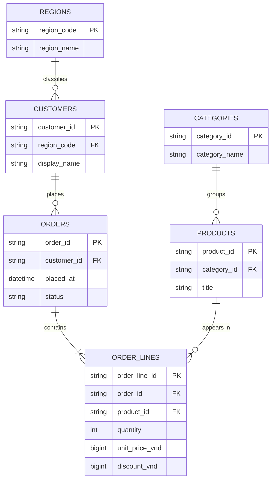
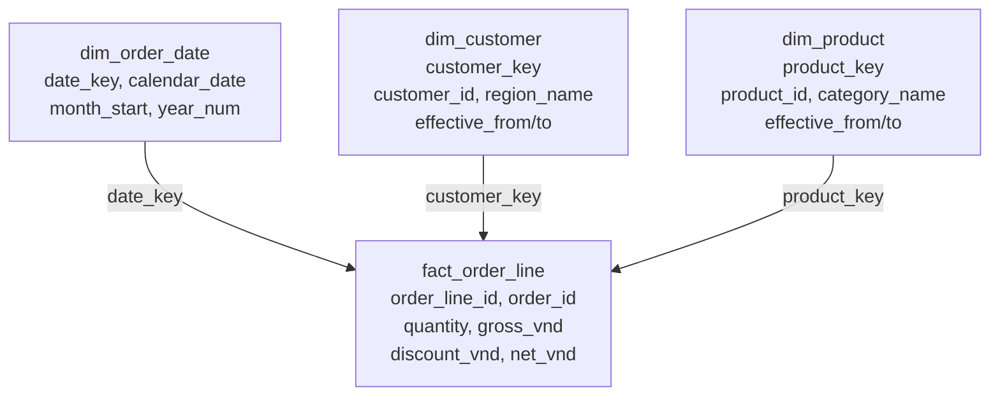
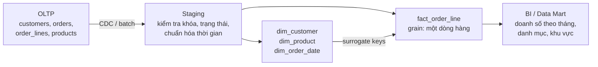
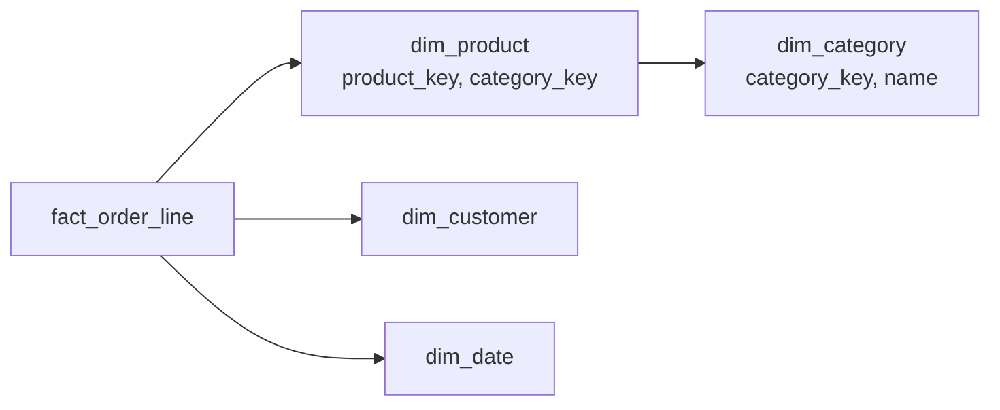

# Mô hình chiều so với mô hình quan hệ chuẩn hóa

Một hệ thống bán hàng có thể lưu rất chính xác **đơn hàng, khách hàng, sản phẩm, giá và trạng thái thanh toán** trong cơ sở dữ liệu quan hệ chuẩn hóa. Nhưng khi ban điều hành hỏi “Doanh số hàng hóa của những đơn đã thanh toán theo tháng, nhóm sản phẩm và khu vực khách hàng là bao nhiêu?”, truy vấn phải nối nhiều bảng, xử lý lịch sử thay đổi và thống nhất cách tính chỉ tiêu. Một **mô hình chiều** (*dimensional model*) có thể tổ chức lại cùng dữ liệu thành **bảng sự kiện (fact)** ở cấp hạt xác định và các **bảng chiều (dimension)** phục vụ phân tích.

Đây không phải là cuộc thi “mô hình nào đúng hơn”. Mô hình quan hệ chuẩn hóa thường ưu tiên **toàn vẹn dữ liệu và cập nhật giao dịch**, còn mô hình chiều thường ưu tiên **tính nhất quán của chỉ tiêu và khả năng lọc, nhóm, tổng hợp theo nhiều chiều**. Chúng có thể cùng tồn tại và cùng đúng vì phục vụ hai nhóm câu hỏi khác nhau.

Bài học nằm trong chương **Mô hình phân tích** của học phần **DATABASE_DATA_MODELING**. Mục tiêu của học phần là biến yêu cầu nghiệp vụ thành thực thể, quan hệ, ràng buộc, khóa, chỉ mục và cấu trúc vật lý; so sánh mô hình quan hệ, document, đồ thị và phân tích để lựa chọn giải pháp dễ kiểm chứng, dễ mở rộng. Ở đây, chúng ta đối chiếu **mô hình quan hệ chuẩn hóa** với **mô hình chiều**, bắt đầu từ đúng một bài toán, đúng một tập dữ liệu và những truy vấn có đáp án kiểm chứng được.

Sau bài học, bạn có thể:

- Giải thích mục tiêu của **chuẩn hóa quan hệ** và **mô hình chiều**, không nhầm mô hình chiều với một cơ sở dữ liệu không có quy tắc.
- Xác định **grain — cấp hạt dữ liệu** của một fact trước khi chọn dimension, khóa và measure.
- Thiết kế **star schema** cho doanh số theo ngày, sản phẩm và khách hàng; phân biệt fact, dimension, surrogate key và degenerate dimension.
- Chuyển dữ liệu từ lược đồ quan hệ chuẩn hóa sang star mà không nhân số dòng, mất giá lịch sử hoặc sai định nghĩa KPI.
- Biết khi nào cần **Slowly Changing Dimension (SCD)**, đặc biệt Type 1 và Type 2.
- So sánh chi phí truy vấn, cập nhật, toàn vẹn dữ liệu, lịch sử và nhu cầu vận hành giữa các mô hình.
- Nêu được các kiểm tra chất lượng cần có trước khi báo cáo phân tích được tin cậy.

## 1. Đặt bài toán và cố định định nghĩa số liệu

Một công ty bán hàng cần lưu những hoạt động sau:

1. Khách đặt đơn gồm một hoặc nhiều dòng hàng.
2. Mỗi dòng có **sản phẩm, số lượng, đơn giá tại lúc mua và giảm giá**.
3. Sản phẩm thuộc một danh mục; khách có một khu vực phục vụ.
4. Đơn có ngày đặt và trạng thái thanh toán.
5. Báo cáo cần tổng hợp theo **tháng đặt hàng, danh mục sản phẩm, khu vực khách và tenant**.
6. Khu vực của khách hoặc danh mục sản phẩm có thể đổi theo thời gian, nhưng báo cáo lịch sử phải có cách diễn giải rõ ràng.

Trước khi tạo bảng, cần định nghĩa **đơn vị tiền và chỉ tiêu**. Trong ví dụ này:

> **Doanh số hàng hóa thuần của đơn đang được ghi nhận là đã thanh toán**, phân bổ theo **ngày đặt hàng**, bằng tổng của `quantity × unit_price_at_purchase − line_discount` trên các dòng hợp lệ. Ví dụ chỉ có VND, chưa tính thuế, vận chuyển, hoàn hàng hay điều chỉnh kế toán.

Chỉ tiêu trên **không tự đồng nghĩa với doanh thu kế toán được ghi nhận**: ngày đặt khác ngày thanh toán; đơn đã thanh toán có thể được hoàn trả sau đó; ghi nhận doanh thu tuân theo chính sách khác. Nếu báo cáo phục vụ tài chính, phải xác định rõ chỉ tiêu nào được tính, trạng thái nào được chốt và cách xử lý điều chỉnh.

### 1.1. Tập dữ liệu xuyên suốt

Giả sử có hai khách, hai sản phẩm và hai đơn đã thanh toán trong tenant `T-01`:

| Dòng hàng | Đơn | Ngày đặt | Khách | Khu vực tại lúc đặt | Sản phẩm | Số lượng | Đơn giá VND | Giảm giá VND | Giá trị thuần VND |
| --- | --- | --- | --- | --- | --- | ---: | ---: | ---: | ---: |
| OL-1 | O-101 | 2026-10-01 | C-01 | Bắc | P-LAP | 1 | 12.000.000 | 0 | 12.000.000 |
| OL-2 | O-101 | 2026-10-01 | C-01 | Bắc | P-MOUSE | 2 | 300.000 | 0 | 600.000 |
| OL-3 | O-102 | 2026-10-03 | C-02 | Nam | P-MOUSE | 1 | 320.000 | 20.000 | 300.000 |

Cần kiểm chứng kết quả:

- **Tổng số dòng:** 3.
- **Số đơn phân biệt:** 2 (`O-101` và `O-102`).
- **Số khách phân biệt:** 2.
- **Tổng số lượng sản phẩm:** 4.
- **Tổng doanh số hàng hóa thuần:** **12.900.000 VND**.
- Theo ngày: 01/10 là **12.600.000 VND**, 03/10 là **300.000 VND**.

Những con số này sẽ làm **oracle** cho các truy vấn ở hai mô hình. Nếu báo cáo trả 3 đơn hoặc 13.200.000 VND, ta phải tìm nguyên nhân trước khi đánh giá hiệu năng.

## 2. Mô hình quan hệ chuẩn hóa nhằm bảo vệ điều gì?

**Chuẩn hóa quan hệ** là quá trình tổ chức dữ liệu thành những quan hệ (bảng) với các phụ thuộc dữ liệu và khóa phù hợp, nhằm hạn chế dư thừa không cần thiết và các **bất thường khi thêm, sửa, xóa**.

Trong nhiều hệ OLTP (*Online Transaction Processing*), nhóm thiết kế hướng tới các dạng chuẩn như **3NF** hoặc **BCNF**, nhưng lựa chọn mức chuẩn hóa phải dựa vào các phụ thuộc hàm và yêu cầu cụ thể. Không nên gọi mọi lược đồ có nhiều bảng là “3NF” nếu chưa kiểm tra các phụ thuộc hàm của nó.

### 2.1. Ví dụ về bất thường cập nhật

Nếu lưu `customer_name` và `region_name` lặp lại trên **mọi dòng hàng**:

- Khách đổi tên có thể buộc cập nhật hàng nghìn dòng giao dịch.
- Một dòng có tên mới, dòng khác có tên cũ mà không có chính sách lịch sử.
- Khó phân biệt **tên hiện tại** với **tên tại thời điểm đặt hàng**.

Lược đồ giao dịch chuẩn hóa thường tạo bảng `customers` với khóa `customer_id`, rồi `orders` tham chiếu đến nó. Sản phẩm, danh mục, đơn hàng và dòng hàng cũng có vai trò/khóa riêng.

Mục đích không phải “tách bảng càng nhiều càng tốt”, mà là **lưu mỗi sự thật theo đơn vị sở hữu và quy tắc cập nhật rõ ràng**.

### 2.2. Lược đồ quan hệ mẫu



Sơ đồ đơn giản hóa không hiển thị `tenant_id` ở mọi khóa. Trong hệ nhiều tenant, khóa chính/khóa ngoại phải có phạm vi tenant hoặc một chiến lược định danh toàn cục tương đương; không được nối đơn và khách của hai tenant chỉ vì mã trùng nhau.

### 2.3. SQL lược đồ OLTP minh họa

Ví dụ theo cú pháp SQL gần PostgreSQL. Để tập trung vào mô hình, ví dụ chỉ có VND, chưa gồm toàn bộ chính sách thanh toán, hoàn tiền và phân quyền.

```sql
CREATE TABLE regions (
    region_code VARCHAR(20) PRIMARY KEY,
    region_name VARCHAR(100) NOT NULL
);

CREATE TABLE categories (
    category_id VARCHAR(40) PRIMARY KEY,
    category_name VARCHAR(150) NOT NULL
);

CREATE TABLE customers (
    tenant_id VARCHAR(32) NOT NULL,
    customer_id VARCHAR(40) NOT NULL,
    display_name VARCHAR(150) NOT NULL,
    region_code VARCHAR(20) NOT NULL REFERENCES regions(region_code),
    PRIMARY KEY (tenant_id, customer_id)
);

CREATE TABLE products (
    tenant_id VARCHAR(32) NOT NULL,
    product_id VARCHAR(40) NOT NULL,
    title VARCHAR(200) NOT NULL,
    category_id VARCHAR(40) NOT NULL REFERENCES categories(category_id),
    current_price_vnd BIGINT NOT NULL,
    PRIMARY KEY (tenant_id, product_id),
    CHECK (current_price_vnd >= 0)
);

CREATE TABLE orders (
    tenant_id VARCHAR(32) NOT NULL,
    order_id VARCHAR(40) NOT NULL,
    customer_id VARCHAR(40) NOT NULL,
    placed_at TIMESTAMPTZ NOT NULL,
    status VARCHAR(30) NOT NULL,
    PRIMARY KEY (tenant_id, order_id),
    FOREIGN KEY (tenant_id, customer_id)
        REFERENCES customers(tenant_id, customer_id)
);

CREATE TABLE order_lines (
    tenant_id VARCHAR(32) NOT NULL,
    order_line_id VARCHAR(40) NOT NULL,
    order_id VARCHAR(40) NOT NULL,
    product_id VARCHAR(40) NOT NULL,
    quantity INTEGER NOT NULL,
    unit_price_vnd BIGINT NOT NULL,
    discount_vnd BIGINT NOT NULL DEFAULT 0,
    PRIMARY KEY (tenant_id, order_line_id),
    FOREIGN KEY (tenant_id, order_id)
        REFERENCES orders(tenant_id, order_id),
    FOREIGN KEY (tenant_id, product_id)
        REFERENCES products(tenant_id, product_id),
    CHECK (quantity > 0),
    CHECK (unit_price_vnd >= 0),
    CHECK (discount_vnd >= 0),
    CHECK (discount_vnd <= quantity * unit_price_vnd)
);
```

Các khóa ngoại giữ đúng quan hệ, nhưng ví dụ chưa có constraint trên luồng trạng thái, giá trị `status` hợp lệ hoặc ràng buộc “đơn đã xác nhận phải có ít nhất một dòng”. Một lược đồ dùng trong sản phẩm thật còn cần chính sách đồng thời, giao dịch và quyền truy cập.

**Điểm cốt lõi:** `order_lines.unit_price_vnd` ghi **giá của lần giao dịch**; `products.current_price_vnd` ghi **giá hiện tại**. Dùng giá hiện tại để tính lại đơn cũ sẽ làm số liệu lịch sử thay đổi sai.

### 2.4. Truy vấn phân tích trên các bảng chuẩn hóa

Muốn tổng hợp doanh số theo tháng và danh mục:

```sql
SELECT
    DATE_TRUNC('month', o.placed_at AT TIME ZONE 'Asia/Ho_Chi_Minh')
        AS order_month,
    c.category_name,
    SUM(ol.quantity * ol.unit_price_vnd - ol.discount_vnd)
        AS net_merchandise_vnd,
    COUNT(DISTINCT o.order_id) AS distinct_orders
FROM orders AS o
JOIN order_lines AS ol
  ON ol.tenant_id = o.tenant_id
 AND ol.order_id = o.order_id
JOIN products AS p
  ON p.tenant_id = ol.tenant_id
 AND p.product_id = ol.product_id
JOIN categories AS c
  ON c.category_id = p.category_id
WHERE o.tenant_id = :tenant_id
  AND o.status = 'PAID'
GROUP BY 1, 2
ORDER BY order_month, c.category_name;
```

Truy vấn có thể **đúng và hiệu quả** nếu dữ liệu/quy mô, chỉ mục và kế hoạch thực thi phù hợp. Vấn đề không phải SQL thiếu khả năng phân tích. Những thách thức bắt đầu xuất hiện khi:

- Có hàng chục chỉ tiêu với **định nghĩa hơi khác nhau** ở các nhóm.
- Phải nối nhiều cấp bảng cho mỗi báo cáo.
- Phải tái hiện **khu vực và danh mục tại thời điểm giao dịch**, trong khi bảng chuẩn chỉ lưu thuộc tính hiện tại.
- Cần phục vụ số lượng lớn truy vấn tổng hợp và lịch sử rất dài.
- Muốn công bố một **semantic layer** ổn định cho công cụ BI mà không buộc mọi nhóm hiểu toàn bộ lược đồ giao dịch.

Lưu ý: kết quả truy vấn trên phụ thuộc vào `products.category_id` **hiện tại**. Nếu sản phẩm đã chuyển danh mục, câu truy vấn mặc định có thể **phân loại lại doanh số quá khứ**. Đó có thể đúng cho báo cáo “theo danh mục hiện tại”, nhưng sai cho báo cáo “theo danh mục tại lúc mua”. Vấn đề cần giải bằng **ngữ nghĩa lịch sử**, không chỉ tăng số index.

## 3. Mô hình chiều ưu tiên trả lời câu hỏi phân tích

**Dimensional modeling** tổ chức dữ liệu để người dùng có thể nhìn một sự kiện kinh doanh qua các **chiều phân tích** như thời gian, khách hàng, sản phẩm, khu vực và kênh bán. Hai khái niệm quan trọng nhất là:

- **Fact table:** các dòng ghi nhận sự kiện, trạng thái định kỳ hoặc trạng thái tích lũy tại một **grain** xác định, chứa khóa tới dimension và các **measure**.
- **Dimension table:** ngữ cảnh dùng để lọc, nhóm, mô tả và phân loại fact, ví dụ tên sản phẩm, ngành hàng, khu vực, ngày/tháng/quý.

Trong **star schema (lược đồ hình sao)**, bảng fact nằm ở trung tâm và tham chiếu trực tiếp tới các bảng dimension. Dimension thường chứa nhiều thuộc tính mô tả **trong cùng bảng**, kể cả khi có thể tách chuẩn hóa thêm.

### 3.1. Sơ đồ hình sao tương ứng



Dữ liệu phân tích không nhất thiết chỉ có ba dimension. Có thể thêm `dim_channel`, `dim_promotion`, `dim_currency`, `dim_store`, `dim_salesperson` hoặc `dim_tenant` nếu chúng thật sự phục vụ truy vấn. **Không nên thêm dimension chỉ vì một cột có nhiều giá trị khác nhau**; phải xác định tính ổn định, nhu cầu lọc, lịch sử và nghĩa của nó.

### 3.2. Grain phải được định nghĩa trước khóa và measure

Một phát biểu grain chuẩn cho ví dụ:

> **Mỗi dòng trong `fact_order_line` đại diện cho đúng một dòng hàng nguồn `(tenant_id, order_line_id)` thuộc một đơn đủ điều kiện tính doanh số**, với thông tin được gắn vào ngày đặt, sản phẩm và phiên bản khách hàng áp dụng tại thời điểm đặt.

Từ grain này:

- Một đơn gồm ba dòng sẽ có **ba fact rows**, không phải một.
- `quantity` là số lượng của **dòng hàng**, không phải số đơn.
- `order_id` có thể lặp trên nhiều fact rows vì nhiều dòng cùng thuộc một đơn.
- Một fact row phải trỏ tới **một phiên bản customer**, **một phiên bản product** và **một ngày** theo quy tắc đã định.
- Không được nối các dimension theo quan hệ 1–n không có kiểm soát rồi coi mỗi dòng nhân ra là một sự kiện mới.

Nếu chọn grain **mỗi đơn**, các measure về sản phẩm theo từng dòng không còn cùng cấp. Nếu chọn grain **mỗi giao dịch thanh toán**, số tiền có thể liên quan tới nhiều đơn hoặc nhiều lần trả. Vì vậy grain là **quyết định nghiệp vụ đầu tiên**, không phải hậu quả của việc chọn khóa chính.

### 3.3. Measure và tính cộng được

| Measure | Cấp hạt | Tính cộng được | Lưu ý |
| --- | --- | --- | --- |
| `quantity` | Một dòng hàng | **Additive** theo các chiều phù hợp | Không cộng với fact cùng giao dịch bị nhân bản |
| `gross_amount_vnd` | Một dòng = `quantity × unit_price` | **Additive** | Chỉ cộng khi cùng VND, đúng phạm vi |
| `discount_amount_vnd` | Một dòng | **Additive** | Phân biệt giảm giá dòng với giảm giá cấp đơn chưa phân bổ |
| `net_merchandise_vnd` | `gross − discount` | **Additive** | Không đồng nghĩa lợi nhuận/doanh thu kế toán |
| `order_count` | Không phải cột số dòng hàng | **Cần đếm DISTINCT order_id** | `COUNT(*)` là số dòng, không phải số đơn |
| `average_unit_price` | Tỷ lệ/tính toán | **Non-additive** | Không `SUM` hay trung bình các trung bình khi trọng số khác |
| `inventory_balance` ở snapshot theo ngày | Số dư tại thời điểm | **Semi-additive** | Cộng được theo sản phẩm/kho, không cộng qua ngày |

Các thuật ngữ additive, semi-additive, non-additive mô tả **tính hợp lệ khi tổng hợp**, không phải chỉ là kiểu số của cột. Tỷ lệ chuyển đổi cần tử số và mẫu số theo cùng phạm vi; không thể cộng hai tỷ lệ phần trăm độc lập rồi gọi là tỷ lệ tổng.

## 4. Thiết kế dimension, khóa và fact trong lược đồ hình sao

### 4.1. Surrogate key và business key có nhiệm vụ khác nhau

Trong OLTP, `customer_id = C-01` nhận diện khách theo miền nghiệp vụ. Trong mô hình chiều, `dim_customer.customer_key` có thể là một **surrogate key** — khóa thay thế do warehouse cấp — để fact trỏ tới **đúng phiên bản thuộc tính của khách**.

Ví dụ:

| customer_key | tenant_id | customer_id | region_name | effective_from | effective_to | is_current |
| ---: | --- | --- | --- | --- | --- | --- |
| 101 | T-01 | C-01 | Bắc | 2026-01-01 | 2026-11-01 | false |
| 102 | T-01 | C-01 | Nam | 2026-11-01 | Không có | true |
| 201 | T-01 | C-02 | Nam | 2026-01-01 | Không có | true |

Đây là một ví dụ của **SCD Type 2**: một khách có **hai dòng dimension theo hai khoảng hiệu lực**, nhưng vẫn là **một khách nghiệp vụ**. Fact từ 01/10 trỏ `customer_key = 101`, không tự đổi sang 102 khi khách chuyển vùng vào tháng 11.

- `customer_id`: business key ổn định ở cấp tenant.
- `customer_key`: surrogate key cho **một phiên bản dimension**.
- `effective_from` và `effective_to`: khoảng thời gian áp dụng phiên bản (quy ước nửa mở).
- `is_current`: hỗ trợ lấy phiên bản hiện tại, nhưng phải nhất quán với khoảng hiệu lực.

Không nên dùng `customer_key` để xuất sang hệ thống ngoài như ID nghiệp vụ; nó có thể thay đổi khi dựng lại warehouse hoặc khi chiến lược khóa được chuyển đổi.

### 4.2. Dimension date thường có cấu trúc riêng

Ví dụ:

| date_key | calendar_date | month_start | year_num | month_num | quarter_num |
| ---: | --- | --- | ---: | ---: | ---: |
| 20261001 | 2026-10-01 | 2026-10-01 | 2026 | 10 | 4 |
| 20261003 | 2026-10-03 | 2026-10-01 | 2026 | 10 | 4 |

`date_key` dạng `YYYYMMDD` là một **quy ước khóa ngày** thường gặp, không phải bắt buộc cho mọi dimension. Date dimension có thể bổ sung tuần ISO, lịch tài chính, ngày lễ hoặc kỳ kinh doanh — những thuộc tính cần có định nghĩa theo địa phương/tổ chức. Nếu một sự kiện có **ngày đặt, ngày thanh toán, ngày giao**, có thể cùng một bảng `dim_date` đóng **nhiều vai trò (role-playing date)** thông qua các khóa `order_date_key`, `paid_date_key`, `shipped_date_key`.

Nếu thời gian có giờ/phút và múi giờ quan trọng, cần lưu thời điểm sự kiện hoặc dimension thời gian phù hợp, thay vì chỉ dùng ngày.

### 4.3. Dimension product thường mang danh mục để phân nhóm nhanh

Một dimension sản phẩm có thể gồm:

```text
product_key      -- surrogate key của phiên bản sản phẩm
tenant_id
product_id       -- business key trong tenant
product_name
category_id
category_name
brand_name
effective_from
effective_to
is_current
```

Trong OLTP, `category_name` có thể nằm ở bảng `categories`, `products` chỉ giữ `category_id`. Trong star, `category_name` thường được đặt trực tiếp trong `dim_product` để giúp công cụ BI tìm, lọc và nhóm dễ hơn.

Đây là **phi chuẩn hóa có chủ đích**. Nó có thể lặp lại chuỗi tên danh mục qua nhiều dòng dimension, nhưng đổi lại giảm nhu cầu join tới bảng danh mục và tạo một ngữ cảnh phân tích dễ hiểu. Không có nghĩa warehouse được phép chứa các giá trị danh mục mâu thuẫn không kiểm soát: pipeline phải có quy tắc xác định giá trị đúng theo nguồn và thời gian.

### 4.4. Degenerate dimension: mã đơn nằm trong fact

`order_id` và `order_line_id` có thể ở trực tiếp trên `fact_order_line` để lọc và truy vết tới giao dịch nguồn, dù chúng không có bảng dimension riêng chỉ chứa mỗi mã. Cách này thường được gọi là **degenerate dimension** đối với một định danh giao dịch không có thuộc tính mô tả cần dimension riêng.

Không nên tạo `dim_order` chỉ chứa mỗi `order_id` nếu không mang lại giá trị, nhưng cũng không cấm có dimension đơn nếu cần metadata/cấp sự kiện và có thiết kế phù hợp. Cần đặc biệt tránh lặp **tổng tiền đơn** trên mỗi dòng `fact_order_line` rồi cộng nó qua sản phẩm — sẽ bị nhân theo số dòng.

## 5. SQL mẫu cho mô hình chiều

Ví dụ dưới đây dùng cú pháp gần PostgreSQL để minh họa khóa và cột; một data warehouse dạng cột có thể thực thi primary key/foreign key theo cơ chế khác, hoặc chỉ dùng metadata và kiểm tra chất lượng ETL. Vì vậy, không được giả định mọi khai báo constraint trong ví dụ sẽ được mọi engine phân tích **enforce** như OLTP.

### 5.1. Các dimension

```sql
CREATE TABLE dim_order_date (
    date_key INTEGER PRIMARY KEY,
    calendar_date DATE NOT NULL UNIQUE,
    month_start DATE NOT NULL,
    year_num SMALLINT NOT NULL,
    month_num SMALLINT NOT NULL,
    quarter_num SMALLINT NOT NULL
);

CREATE TABLE dim_customer (
    customer_key BIGINT PRIMARY KEY,
    tenant_id VARCHAR(32) NOT NULL,
    customer_id VARCHAR(40) NOT NULL,
    customer_name VARCHAR(150) NOT NULL,
    region_name VARCHAR(100) NOT NULL,
    effective_from DATE NOT NULL,
    effective_to DATE NULL,
    is_current BOOLEAN NOT NULL,
    UNIQUE (tenant_id, customer_id, effective_from),
    CHECK (effective_to IS NULL OR effective_to > effective_from)
);

CREATE TABLE dim_product (
    product_key BIGINT PRIMARY KEY,
    tenant_id VARCHAR(32) NOT NULL,
    product_id VARCHAR(40) NOT NULL,
    product_name VARCHAR(200) NOT NULL,
    category_id VARCHAR(40) NOT NULL,
    category_name VARCHAR(150) NOT NULL,
    effective_from DATE NOT NULL,
    effective_to DATE NULL,
    is_current BOOLEAN NOT NULL,
    UNIQUE (tenant_id, product_id, effective_from),
    CHECK (effective_to IS NULL OR effective_to > effective_from)
);
```

**Quan trọng:** constraint `UNIQUE (tenant_id, customer_id, effective_from)` chỉ ngăn hai phiên bản **cùng ngày bắt đầu**; nó **không chặn hai khoảng lịch sử chồng lấn**. Cần cơ chế thêm (ví dụ constraint khoảng thời gian phù hợp với engine hoặc kiểm tra trong pipeline/giao dịch) để bảo đảm mỗi khóa nghiệp vụ có **tối đa một phiên bản tại một thời điểm**. Tương tự, `is_current` chỉ là cờ cần được duy trì đúng, không phải phép chứng minh hệ thống chỉ có một bản ghi hiện hành.

### 5.2. Fact ở cấp dòng hàng

```sql
CREATE TABLE fact_order_line (
    tenant_id VARCHAR(32) NOT NULL,
    order_line_id VARCHAR(40) NOT NULL,
    order_id VARCHAR(40) NOT NULL,
    order_date_key INTEGER NOT NULL,
    customer_key BIGINT NOT NULL,
    product_key BIGINT NOT NULL,
    quantity INTEGER NOT NULL,
    gross_amount_vnd BIGINT NOT NULL,
    discount_amount_vnd BIGINT NOT NULL,
    net_merchandise_vnd BIGINT NOT NULL,
    PRIMARY KEY (tenant_id, order_line_id),
    FOREIGN KEY (order_date_key) REFERENCES dim_order_date(date_key),
    FOREIGN KEY (customer_key) REFERENCES dim_customer(customer_key),
    FOREIGN KEY (product_key) REFERENCES dim_product(product_key),
    CHECK (quantity > 0),
    CHECK (gross_amount_vnd >= 0),
    CHECK (discount_amount_vnd >= 0),
    CHECK (discount_amount_vnd <= gross_amount_vnd),
    CHECK (net_merchandise_vnd =
           gross_amount_vnd - discount_amount_vnd)
);
```

Ở mô hình ví dụ, `PRIMARY KEY (tenant_id, order_line_id)` phù hợp vì **mỗi dòng bán hàng đủ điều kiện được biểu diễn một fact row**. Nếu thiết kế giữ nhiều phiên bản snapshot, giao dịch hoàn/điều chỉnh hoặc sự kiện trạng thái ở cùng order line, grain và khóa fact **phải thay đổi** cho phù hợp; không thể ép nhiều sự kiện thành cùng một khóa và mất lịch sử.

Đặt `tenant_id` ở fact và dimension giúp truy vấn phân vùng tenant. Tuy nhiên, khóa ngoại chỉ tới `customer_key` **chưa tự kiểm tra** `fact.tenant_id` bằng `dim_customer.tenant_id`. Pipeline hoặc ràng buộc tổ hợp bổ sung phải ngăn fact trỏ nhầm dimension của tenant khác.

### 5.3. Truy vấn KPI trên star

```sql
SELECT
    d.month_start,
    p.category_name,
    SUM(f.net_merchandise_vnd) AS net_merchandise_vnd,
    SUM(f.quantity) AS units_sold,
    COUNT(DISTINCT f.order_id) AS distinct_orders
FROM fact_order_line AS f
JOIN dim_order_date AS d
  ON d.date_key = f.order_date_key
JOIN dim_product AS p
  ON p.product_key = f.product_key
WHERE f.tenant_id = :tenant_id
  AND p.tenant_id = f.tenant_id
GROUP BY d.month_start, p.category_name
ORDER BY d.month_start, p.category_name;
```

Điểm khác so với SQL OLTP: **fact đã được chuẩn bị ở cấp dòng hàng**, measure `net_merchandise_vnd` đã có định nghĩa thống nhất, và danh mục nằm trong `dim_product`. Câu truy vấn BI thường không cần tái dựng cả chuỗi `orders → order_lines → products → categories` để biết doanh số theo danh mục.

Tuy vậy, việc `COUNT(DISTINCT order_id)` khi phân nhóm theo danh mục cần hiểu rõ ý nghĩa: nếu một đơn chứa nhiều danh mục, đơn đó có thể được **đếm một lần trong từng danh mục**, nên **tổng số đơn theo các danh mục** có thể lớn hơn **số đơn toàn cửa hàng**. Đó không nhất thiết là lỗi SQL; đó là **chỉ tiêu không cộng được qua chiều danh mục**.

### 5.4. Dữ liệu fact minh họa

Giả sử cả hai sản phẩm đều thuộc danh mục `TECH` tại thời điểm mua, dimension và fact có những mã khóa nội bộ như sau:

| order_line_id | order_id | order_date_key | customer_key | product_key | quantity | gross_amount_vnd | discount_amount_vnd | net_merchandise_vnd |
| --- | --- | ---: | ---: | ---: | ---: | ---: | ---: | ---: |
| OL-1 | O-101 | 20261001 | 101 | 501 | 1 | 12.000.000 | 0 | 12.000.000 |
| OL-2 | O-101 | 20261001 | 101 | 502 | 2 | 600.000 | 0 | 600.000 |
| OL-3 | O-102 | 20261003 | 201 | 502 | 1 | 320.000 | 20.000 | 300.000 |

Kết quả đúng theo grain này:

```text
COUNT(*)                              = 3 dòng hàng
COUNT(DISTINCT order_id)             = 2 đơn
SUM(quantity)                         = 4 sản phẩm
SUM(gross_amount_vnd)                = 12.920.000 VND
SUM(discount_amount_vnd)             = 20.000 VND
SUM(net_merchandise_vnd)             = 12.900.000 VND
```

Nếu query trả **3 đơn** vì dùng `COUNT(*)`, hoặc trả **12.920.000 VND** vì cộng gross mà không trừ discount, lỗi nằm ở **cách chọn measure**, không phải bản thân star schema.

## 6. Chuyển từ chuẩn hóa sang mô hình chiều

Bảng fact và dimension thường được tạo từ hệ thống nguồn qua **ETL/ELT** (*Extract–Transform–Load* / *Extract–Load–Transform*). Pipeline không chỉ sao chép cột; nó phải thực hiện **quy tắc chọn sự kiện, gán phiên bản dimension và bảo toàn số liệu**.



### 6.1. Quy tắc ánh xạ từ nguồn sang đích

| Từ OLTP | Sang mô hình chiều | Phép biến đổi hoặc kiểm tra |
| --- | --- | --- |
| `orders.order_id` | `fact_order_line.order_id` | Giữ mã giao dịch để truy vết, lặp theo dòng là hợp lệ |
| `order_lines.order_line_id` | `fact_order_line.order_line_id` | Khóa xác định grain; chống ghi lặp |
| `orders.placed_at` | `order_date_key` | Chuyển theo **múi giờ kinh doanh** đã chọn |
| `orders.customer_id` | `customer_key` | Tìm **phiên bản khách hiệu lực tại ngày đặt** |
| `order_lines.product_id` | `product_key` | Tìm **phiên bản sản phẩm tại ngày đặt** |
| `order_lines.quantity` | `quantity` | Xác nhận dương, đơn vị đo nhất quán |
| `unit_price_vnd × quantity` | `gross_amount_vnd` | Tính từ giá tại giao dịch, không lấy giá hiện tại |
| `order_lines.discount_vnd` | `discount_amount_vnd` | Không trừ hai lần; thống nhất chiết khấu cấp đơn |
| `gross − discount` | `net_merchandise_vnd` | Đối soát tổng sau chuyển đổi |
| `orders.status` | Điều kiện chọn fact | Định nghĩa rõ khi nào đơn đủ điều kiện được tính |

Nếu chỉ có `product_id` ở nguồn mà không biết sản phẩm thuộc danh mục nào **tại lúc mua**, quá trình dựng lịch sử không thể tự suy ra đúng từ bảng danh mục hiện tại. Phải có **snapshot, bảng lịch sử, CDC hoặc chính sách chấp nhận phân loại lại**. Đó là vấn đề chất lượng và tính sẵn có của dữ liệu nguồn.

### 6.2. Ánh xạ lịch sử theo ngày đặt

Giả sử `dim_customer` dùng SCD Type 2. Với đơn ngày 2026-10-01 của C-01, tìm dòng dimension sao cho:

```text
tenant_id = 'T-01'
customer_id = 'C-01'
effective_from <= 2026-10-01
effective_to vắng mặt hoặc 2026-10-01 < effective_to
```

Kết quả phải là `customer_key = 101` (khu vực Bắc). Nếu sau 01/11 khu vực đổi thành Nam, các fact tháng 10 **không tự chuyển** sang `customer_key = 102`.

Với **dữ liệu đến muộn**, thời điểm một dòng được warehouse **nạp** có thể khác thời điểm nghiệp vụ **xảy ra**. Cần dùng thời gian thích hợp với quy tắc lịch sử (ví dụ ngày đặt theo múi giờ kinh doanh), không đơn giản lấy phiên bản dimension “đang hiện hành hôm nay”.

### 6.3. Minh họa logic nạp fact bằng SQL

Đoạn sau là **một bước chuyển đổi minh họa**, không phải một pipeline hoàn chỉnh. Nó giả định dữ liệu dimension đã sẵn có, không có khoảng lịch sử chồng lấn và warehouse sử dụng cú pháp SQL tương thích PostgreSQL. Cần dùng transaction/upsert, chính sách lỗi và idempotency riêng khi triển khai.

```sql
SELECT
    o.tenant_id,
    ol.order_line_id,
    o.order_id,
    CAST(TO_CHAR(
        (o.placed_at AT TIME ZONE 'Asia/Ho_Chi_Minh')::DATE,
        'YYYYMMDD'
    ) AS INTEGER) AS order_date_key,
    dc.customer_key,
    dp.product_key,
    ol.quantity,
    ol.quantity * ol.unit_price_vnd AS gross_amount_vnd,
    ol.discount_vnd AS discount_amount_vnd,
    ol.quantity * ol.unit_price_vnd - ol.discount_vnd
        AS net_merchandise_vnd
FROM orders AS o
JOIN order_lines AS ol
  ON ol.tenant_id = o.tenant_id
 AND ol.order_id = o.order_id
JOIN dim_customer AS dc
  ON dc.tenant_id = o.tenant_id
 AND dc.customer_id = o.customer_id
 AND dc.effective_from <=
     (o.placed_at AT TIME ZONE 'Asia/Ho_Chi_Minh')::DATE
 AND (
     dc.effective_to IS NULL
     OR (o.placed_at AT TIME ZONE 'Asia/Ho_Chi_Minh')::DATE
        < dc.effective_to
 )
JOIN dim_product AS dp
  ON dp.tenant_id = ol.tenant_id
 AND dp.product_id = ol.product_id
 AND dp.effective_from <=
     (o.placed_at AT TIME ZONE 'Asia/Ho_Chi_Minh')::DATE
 AND (
     dp.effective_to IS NULL
     OR (o.placed_at AT TIME ZONE 'Asia/Ho_Chi_Minh')::DATE
        < dp.effective_to
 )
WHERE o.status = 'PAID';
```

Cần đối chiếu số dòng sau mỗi `JOIN`. Nếu một khách có **hai dimension versions chồng thời gian**, một dòng nguồn có thể khớp hai dòng dimension và bị **nhân đôi fact**. Nếu không tìm được dimension phù hợp, inner join có thể **làm mất fact**. Cả hai trường hợp phải phát hiện và xử lý; không được để chúng trở thành một báo cáo có vẻ hợp lý nhưng sai tiền.

## 7. Slowly Changing Dimension: hiện tại khác lịch sử

**Slowly Changing Dimension (SCD)** là tập các cách quản lý thuộc tính dimension thay đổi theo thời gian. “Slowly” là tên khái niệm, không có nghĩa mọi thay đổi đều ít xảy ra hoặc được cập nhật chậm.

### 7.1. Type 1 — ghi đè giá trị cũ

Ví dụ sửa lỗi chính tả trong tên sản phẩm:

```text
dim_product.product_name
"Chuot khong day" → "Chuột không dây"
```

Với **SCD Type 1**, dimension giữ một phiên bản và cập nhật thuộc tính. Báo cáo cũ khi đọc lại sẽ hiển thị tên mới. Điều này phù hợp với **sửa dữ liệu sai** hoặc một thuộc tính mà báo cáo chỉ cần giá trị hiện tại.

Không nên dùng Type 1 nếu nghiệp vụ yêu cầu tái hiện **khu vực/danh mục tại thời điểm quá khứ**. Ghi đè sẽ xóa dấu vết giá trị cũ khỏi dimension, trừ khi có lịch sử ở nơi khác.

### 7.2. Type 2 — lưu phiên bản theo khoảng thời gian

Giả sử khách C-01 chuyển từ Bắc sang Nam vào 01/11/2026:

```text
customer_key 101:
  customer_id = C-01
  region = Bắc
  valid = [2026-01-01, 2026-11-01)

customer_key 102:
  customer_id = C-01
  region = Nam
  valid = [2026-11-01, +infinity)
```

Warehouse đóng phiên bản cũ và thêm phiên bản mới. Fact ngày 01/10 vẫn trỏ tới **101**, còn fact ngày 05/11 có thể trỏ tới **102**. Nhờ đó báo cáo “khu vực tại lúc mua” ổn định.

Đối với khoảng hiệu lực `[effective_from, effective_to)`:

- **Bao gồm** `effective_from`.
- **Không bao gồm** `effective_to`.
- Hai phiên bản của cùng khóa nghiệp vụ không được chồng lấn.
- Nếu không có `effective_to`, hiểu là phiên bản đang mở về tương lai theo quy ước dữ liệu.
- Cần xử lý cả trường hợp thay đổi nhiều lần trong một ngày nếu dữ liệu đòi chính xác tới giờ/phút; sử dụng `DATE` sẽ không đủ cho các nghiệp vụ ấy.

### 7.3. “Theo lịch sử” và “theo hiện tại” là hai câu hỏi khác nhau

Với C-01 đổi vùng sau tháng 10:

- **As-was**: doanh số tháng 10 được gán cho **Bắc**, vì đó là vùng khi đơn được đặt.
- **As-is**: doanh số tháng 10 được phân tích theo **khu vực hiện tại của khách**, tức Nam.

Cả hai đều có thể là câu hỏi hợp lệ, nhưng **không được dùng cùng một tiêu đề KPI rồi trộn cách diễn giải**.

Cách as-was thường dựa trên `fact.customer_key` trỏ tới phiên bản Type 2 tại thời điểm sự kiện. Cách as-is có thể cần đi từ business key của phiên bản lịch sử tới **phiên bản dimension đang hiện hành**; phải làm rõ cách nối và kiểm tra không có nhiều phiên bản hiện hành cho cùng khách.

### 7.4. Thời gian hiệu lực khác thời gian hệ thống biết thông tin

Giả sử ngày 05/11, hệ thống nhận thông báo C-01 thực tế đã chuyển vùng từ **15/10**. Nếu báo cáo cần chính xác theo thời gian hiệu lực, dimension phải xử lý **thay đổi hồi tố**; các fact từ 15/10 trở đi có thể cần được **gán lại surrogate key**.

Nhưng nếu cần biết “báo cáo chạy ngày 20/10 khi đó hiển thị khu vực nào?”, chỉ có một trục thời gian hiệu lực chưa đủ. Có thể cần thêm **record/transaction time** (thời gian hệ thống ghi nhận), snapshot báo cáo hoặc mô hình **bitemporal**.

SCD Type 2 không tự bảo đảm mọi câu hỏi kiểm toán có thể được tái hiện; cần xác định rõ yêu cầu lịch sử nghiệp vụ và lịch sử ghi nhận.

### 7.5. Những trường hợp dữ liệu đến muộn

- **Late-arriving fact**: đơn của tháng 10 được đưa vào warehouse vào tháng 11; phải gắn ngày và phiên bản dimension theo **thời điểm sự kiện**, không theo ngày nạp.
- **Late-arriving dimension**: fact đến trước khi dimension tương ứng được tạo; có thể dùng **inferred member/unknown surrogate key** theo chính sách rồi sửa liên kết sau, hoặc đưa fact vào hàng chờ. Phải nêu cách đối soát, tránh làm mất dữ liệu.
- **Late-arriving correction**: giá giảm hoặc trạng thái đơn được sửa; cần cập nhật fact hiện tại, ghi reversal/adjustment hoặc giữ phiên bản theo grain đã công bố, không ngầm cộng cả bản cũ lẫn bản mới.

## 8. Các loại fact khác nhau dẫn đến những thiết kế khác nhau

**Fact table** không chỉ là một bảng đơn hàng. Có ba mẫu quan trọng:

| Loại fact | Grain ví dụ | Câu hỏi điển hình | Lưu ý |
| --- | --- | --- | --- |
| **Transaction fact** | Một dòng hàng, một lượt thanh toán, một sự kiện click | Các sự kiện đã xảy ra, tiền phát sinh theo giao dịch | Xác định sự kiện có ID, điều chỉnh và chống trùng |
| **Periodic snapshot fact** | Một sản phẩm–kho–ngày | Tồn cuối ngày, số dư hoặc chỉ tiêu theo chu kỳ | Số dư **không cộng được theo ngày** như doanh số |
| **Accumulating snapshot fact** | Một đơn hoặc hồ sơ đi qua quy trình | Từ tạo → thanh toán → giao, thời gian giữa các mốc | Cùng một dòng được **cập nhật** khi tiến độ thay đổi |

### 8.1. Tại sao không gộp mọi measure vào một fact?

Nếu fact `fact_order_line` ở cấp **dòng hàng** mà ta đưa thêm `order_total_vnd` (tổng tiền của cả đơn) lên mỗi dòng, rồi `SUM(order_total_vnd)`, đơn có ba dòng sẽ bị cộng ba lần. Muốn phân tích số tiền cấp đơn, có thể dùng **fact ở cấp đơn**, hoặc tổng hợp từ fact dòng theo một định nghĩa đã kiểm soát.

Tương tự, số dư tồn kho cuối ngày không thể cộng các snapshot qua 30 ngày để gọi là “tồn kho cuối tháng”. Thay vào đó phải chọn **snapshot cuối kỳ**, trung bình theo thời gian hoặc chỉ tiêu khác theo yêu cầu.

### 8.2. Có thể dùng nhiều fact chia sẻ dimension

Một mô hình có thể có:

```text
fact_order_line        -- một dòng hàng
fact_payment           -- một lần thanh toán
fact_inventory_daily   -- một sản phẩm/kho/ngày
fact_order_fulfillment -- một đơn/hành trình giao hàng
```

Các fact có thể cùng dùng `dim_product`, `dim_customer`, `dim_date` hoặc `dim_store` nếu các dimension có **định nghĩa và khóa phù hợp**. Chúng được gọi là **conformed dimensions** khi có ý nghĩa và quy ước nhất quán giữa những quy trình kinh doanh.

Không nên join trực tiếp hai fact chỉ trên `customer_key` rồi cộng measure: nếu mỗi khách có 10 dòng bán và 5 dòng thanh toán, phép nối có thể tạo **50 hàng** và nhân số tiền. Hãy tổng hợp **từng fact về cùng grain** rồi mới ghép, hoặc dùng kỹ thuật drill-across theo các chiều phù hợp.

## 9. Những vấn đề làm báo cáo sai dù SQL chạy thành công

### 9.1. Fan-out: join nhân hàng

Giả sử một sản phẩm thuộc **hai danh mục** trong dữ liệu nguồn. Nếu `dim_product` được nối qua bảng `product_categories` có hai hàng cho sản phẩm ấy, mỗi fact dòng hàng có thể xuất hiện hai lần khi báo cáo theo danh mục.

Ví dụ:

```text
Fact dòng OL-1: doanh số 12.000.000 VND
Danh mục: TECH và PROMOTION

JOIN vào cả hai danh mục:
  TECH       12.000.000
  PROMOTION  12.000.000
Cộng toàn bộ kết quả: 24.000.000  <-- đã nhân đôi
```

Nếu nghiệp vụ thật sự muốn phân bổ cùng một khoản tiền cho hai danh mục, phải định nghĩa cách phân bổ:

- **Primary category**: mỗi sản phẩm có một danh mục chính dùng cho KPI doanh số.
- **Bridge table**: nối phiên bản sản phẩm với nhiều danh mục, có **allocation_weight** theo quy tắc (ví dụ 0,5 và 0,5).
- **Multiple attribution**: cho phép toàn bộ doanh số xuất hiện ở từng danh mục, nhưng **không được cộng lại các danh mục để thành tổng toàn hệ thống**.

Không có một đáp án đúng cho mọi nghiệp vụ; bắt buộc phải đặt tên metric và cách phân bổ rõ.

### 9.2. Đếm dòng khác đếm đơn

Với tập dữ liệu ba dòng và hai đơn:

```sql
SELECT
    COUNT(*) AS line_count,
    COUNT(DISTINCT order_id) AS distinct_order_count,
    SUM(quantity) AS unit_count,
    SUM(net_merchandise_vnd) AS net_merchandise_vnd
FROM fact_order_line
WHERE tenant_id = 'T-01';
```

Đáp án lần lượt là **3**, **2**, **4**, **12.900.000**. Một dashboard dùng `COUNT(*)` rồi đặt tên “Số đơn” sẽ sai ngay cả khi dữ liệu nguồn không có lỗi nào.

### 9.3. Không cộng tiền khác đơn vị tiền

Mô hình ví dụ chỉ có VND. Nếu hệ thực tế có VND, USD, EUR:

- **Không cộng** những giá trị tiền khác đơn vị rồi gọi là tổng doanh thu.
- Lưu `currency_code`, nguồn và thời điểm tỷ giá nếu cần quy đổi.
- Phân biệt **số tiền nguyên tệ** và **số tiền đã quy đổi**.
- Quy định làm tròn, thập phân và thời điểm dùng tỷ giá.

Một fact có thể lưu measure nguyên tệ lẫn measure quy đổi theo một đơn vị báo cáo, nhưng phải có định nghĩa và khả năng truy vết. `BIGINT` theo đơn vị VND trong ví dụ chỉ phù hợp khi dữ liệu kinh doanh dùng **giá trị nguyên VND**; các loại tiền có phần thập phân cần kiểu số và scale phù hợp, tránh sai số do kiểu floating-point.

### 9.4. Múi giờ và “ngày bán”

Đơn được ghi lúc 23:45 UTC có thể thuộc **ngày hôm sau** tại Việt Nam. Nếu báo cáo theo ngày kinh doanh ở `Asia/Ho_Chi_Minh`, `order_date_key` phải được tính theo đúng múi giờ. Đồng thời nên lưu `placed_at` gốc với thông tin múi giờ hoặc quy ước UTC để xử lý lại khi cần.

Nếu ngành hàng tính ngày kinh doanh từ 04:00 hôm nay đến 03:59 ngày mai, **ngày kinh doanh** khác ngày lịch; không thể chỉ `DATE(timestamp)`. Cần định nghĩa và kiểm chứng đúng mốc ngày.

### 9.5. Đơn hủy, hoàn hàng và điều chỉnh

Một đơn `PAID` ngày hôm qua có thể được hoàn một phần hôm nay. Mô hình phải quyết định:

- `fact_order_line` là snapshot hiện tại và **sửa số tiền**?
- Lưu sự kiện hoàn hàng riêng trong `fact_refund` với khóa/thời gian và quy tắc tổng hợp?
- Lưu **reversal/adjustment entries** để có lịch sử bất biến?
- Có cần KPI “đơn đã thanh toán theo ngày đặt” hay “tiền đã thu theo ngày thanh toán” hoặc “doanh thu ròng sau hoàn trả”?

Đừng để mỗi dashboard tự chọn một cách xử lý. Cần một **hợp đồng metric** và bảng sự kiện/hạt dữ liệu phù hợp.

## 10. Star schema, snowflake schema và chuẩn hóa có thể cùng tồn tại

### 10.1. Star khác snowflake ở đâu?

**Star schema:** `fact_order_line` nối thẳng `dim_product` chứa `category_name`.

**Snowflake schema:** `dim_product` có thể nối tiếp tới `dim_category`, `dim_brand` hoặc những dimension phụ khác được chuẩn hóa thêm.



Snowflake có thể giảm lặp dữ liệu danh mục và thuận tiện quản trị một số phân cấp, nhưng tăng số join và độ phức tạp khi dựng semantic layer. Star thường giúp BI dễ hiểu hơn, còn snowflake có thể phù hợp khi dimension lớn, phân cấp phức tạp hoặc quy tắc quản trị yêu cầu. **Mô hình chiều không đồng nghĩa bắt buộc mọi dimension phải phi chuẩn hóa hoàn toàn.**

### 10.2. Không nhầm 3NF với một cấu trúc vật lý cụ thể

Chuẩn hóa là một **nguyên tắc logic dựa trên phụ thuộc dữ liệu**. Hệ quản trị có thể triển khai bảng quan hệ chuẩn hóa bằng row-store, column-store hoặc phương án lưu trữ khác. Tương tự, star schema có thể chạy trên SQL database truyền thống hoặc analytical warehouse dạng cột.

Tối ưu tốc độ phụ thuộc vào cách thực thi thực tế: scan, join, partition, clustering, materialized views, chỉ mục, phân phối dữ liệu, cache và khối lượng truy vấn. **Star schema không mặc nhiên nhanh hơn mọi lược đồ chuẩn hóa ở mọi truy vấn.**

### 10.3. Lựa chọn mô hình là lựa chọn nơi đặt độ phức tạp

- Trong **OLTP chuẩn hóa**, việc cập nhật nhiều thực thể thường được hỗ trợ bởi khóa, foreign key và transaction; truy vấn phân tích có thể cần nhiều join/logic.
- Trong **dimensional warehouse**, logic chuyển đổi, lịch sử, nạp fact, conformed dimensions và chất lượng dữ liệu được xử lý nhiều hơn trong **pipeline**, đổi lại truy vấn BI có thể đơn giản và nhất quán hơn.
- Trong **document**, mô hình có thể thuận tiện khi thao tác theo một đối tượng tổng hợp; phân tích xuyên nhiều tài liệu có thể yêu cầu aggregation/pipeline.
- Trong **graph**, mô hình thuận tiện khi câu hỏi chính là đường liên kết/lân cận; các bảng fact–dimension vẫn thường thích hợp hơn cho KPI cộng/tổng hợp quy mô lớn.

Không nên chọn công nghệ dựa trên số lượng bảng hoặc mũi tên trong sơ đồ.

## 11. Chất lượng dữ liệu và kiểm thử mô hình chiều

Một star schema có thể trông rất gọn nhưng vẫn trả báo cáo sai nếu **grain, history hoặc keys** không được kiểm tra.

### 11.1. Những bất biến cần có

| Bất biến | Kiểm tra |
| --- | --- |
| Fact không trùng theo grain | Mỗi `(tenant_id, order_line_id)` có tối đa một fact row trong mô hình snapshot đã khai báo |
| Fact không mất dòng | Số dòng đủ điều kiện ở nguồn bằng số fact sau nạp, trừ các ngoại lệ được ghi nhận |
| Key coverage | Mỗi fact trỏ tới đúng một dimension version của khách và sản phẩm |
| Không xuyên tenant | Fact và dimension liên quan cùng tenant |
| SCD không chồng lấn | Với mỗi business key, hai khoảng Type 2 không được giao nhau |
| Current flag hợp lệ | Mỗi business key có tối đa một phiên bản được đánh dấu hiện hành |
| Measure đúng định nghĩa | `net = gross − discount`, `gross = quantity × unit price` và discount hợp lệ |
| Tổng tiền đối soát | Tổng doanh số fact bằng tổng giao dịch nguồn trong cùng phạm vi và cùng thời điểm chốt |
| Timezone nhất quán | Ngày khóa dimension đúng múi giờ và lịch kinh doanh |
| Idempotent load | Chạy lại cùng batch/CDC không làm tăng số dòng và tổng tiền |
| Mục đích bảo mật | Tenant isolation và quyền truy cập BI không rò rỉ dữ liệu ngoài phạm vi |

### 11.2. Truy vấn phát hiện trùng fact

```sql
SELECT tenant_id, order_line_id, COUNT(*) AS row_count
FROM fact_order_line
GROUP BY tenant_id, order_line_id
HAVING COUNT(*) > 1;
```

Nếu bảng có primary key được engine **thực thi**, trùng khóa sẽ bị từ chối; nếu warehouse chỉ khai báo key như metadata, truy vấn kiểm tra vẫn cần có trong pipeline. Cần phân biệt “không thấy trùng” với “dữ liệu hoàn toàn đúng”: fact có thể thiếu, sai measure hoặc trỏ sai dimension dù không trùng.

### 11.3. Truy vấn phát hiện thiếu dimension

```sql
SELECT f.tenant_id, f.order_line_id,
       f.customer_key, f.product_key
FROM fact_order_line AS f
LEFT JOIN dim_customer AS c
  ON c.customer_key = f.customer_key
LEFT JOIN dim_product AS p
  ON p.product_key = f.product_key
WHERE c.customer_key IS NULL
   OR p.product_key IS NULL
   OR c.tenant_id <> f.tenant_id
   OR p.tenant_id <> f.tenant_id;
```

Một fact có khóa dimension không khớp cần được xử lý, không nên âm thầm loại bằng inner join trong báo cáo. Nếu dùng **unknown dimension member** có khóa đặc biệt, cần kiểm tra và đo tỷ lệ fact rơi vào giá trị unknown để phát hiện chất lượng dữ liệu xuống cấp.

### 11.4. Kiểm tra logic grain bằng ví dụ biên

- Một đơn có **hai dòng cùng một sản phẩm** do hai chính sách giá khác nhau: phải có **hai fact rows** nếu grain là dòng hàng.
- Một khách chuyển khu vực sau ngày đặt: fact cũ vẫn trỏ phiên bản khu vực tại ngày đặt theo quy tắc as-was.
- Một product có hai danh mục: metric doanh số không được nhân đôi nếu KPI yêu cầu phân bổ duy nhất.
- Một giao dịch nguồn được gửi lại: pipeline phải upsert/khử trùng theo khóa sự kiện.
- Một dòng hàng có giảm giá cấp đơn chưa được phân bổ: không được tự trừ toàn bộ giảm giá ấy trên từng dòng.
- Một khách có đơn ở hai tenant: báo cáo tenant T-01 không được nhìn hoặc tổng hợp đơn của T-02.

Kiểm thử nên gồm cả **số tiền, số dòng, số đơn, số khách phân biệt và lịch sử thuộc tính**, thay vì chỉ so số row.

## 12. Vận hành thực tế: nơi nào là nguồn sự thật?

### 12.1. Mô hình tham chiếu điển hình

```text
Ứng dụng / API
      |
      v
OLTP chuẩn hóa
      |
      | CDC, sự kiện hoặc batch có kiểm soát
      v
Staging / Landing
      |
      v
Chuẩn hóa thời gian, khóa, trạng thái,
quản lý lịch sử dimension và kiểm tra chất lượng
      |
      +--> Dimension tables
      |
      +--> Fact tables
      |
      v
Semantic layer / BI / Báo cáo
```

Trong kiến trúc này, OLTP thường là nguồn giao dịch **có thẩm quyền** cho đơn hàng, thanh toán và thay đổi đối tượng. Warehouse là bản mô hình hóa **phục vụ phân tích**. Nếu warehouse nhận dữ liệu không đồng bộ, cần đặt kỳ vọng về độ trễ và **watermark** của báo cáo.

### 12.2. Những yêu cầu dễ bị bỏ sót

1. **Dữ liệu đến sai thứ tự:** dòng hàng tới trước đơn, hoặc fact tới trước phiên bản dimension.
2. **Sự kiện gửi trùng:** cơ chế retry phải có idempotency key.
3. **Sửa bản ghi quá khứ:** cần biết phải cập nhật fact, dựng lại partition hay ghi adjustment.
4. **Schema evolution:** nguồn thêm thuộc tính hoặc thay đổi kiểu cần được kiểm soát và thử nghiệm.
5. **Quản lý phiên bản metric:** thay định nghĩa “doanh số đã thanh toán” có thể đổi toàn bộ báo cáo.
6. **Backfill:** nhập lại nhiều tháng phải bảo toàn khóa, phiên bản dimension và không tính lại sai.
7. **Xóa hoặc hạn chế dữ liệu:** cần quy tắc bảo mật, lưu trữ, quyền truy cập và tuân thủ yêu cầu áp dụng cho từng nguồn dữ liệu.
8. **Lineage:** từ một số tiền trên dashboard phải truy được về dòng fact, dòng nguồn, thời gian nạp và quy tắc tính.

Một mô hình chiều không tự xử lý các vấn đề này; độ tin cậy chủ yếu đến từ **hợp đồng dữ liệu và pipeline kiểm chứng được**.

## 13. Khi nào chọn chuẩn hóa, khi nào chọn mô hình chiều?

| Tình huống | Hướng thiết kế cần ưu tiên | Lý do |
| --- | --- | --- |
| Tạo, sửa, hủy đơn; cập nhật tồn kho, kiểm soát thanh toán | **Relational chuẩn hóa/OLTP** hoặc mô hình giao dịch phù hợp | Cần khóa, transaction, ràng buộc cập nhật đúng |
| Dashboard doanh số theo nhiều chiều, lịch sử dài | **Dimensional/star** trong môi trường phân tích | Fact–dimension giúp KPI nhất quán và lọc/nhóm dễ |
| Chỉ vài báo cáo SQL nhỏ, ít dữ liệu | Có thể dùng **OLTP với truy vấn/view phù hợp** | Chưa cần trả chi phí warehouse riêng |
| Phân tích theo cả lịch sử và thuộc tính hiện tại | **Dimension có chiến lược SCD** | Tách as-was/as-is để tránh báo cáo quá khứ đổi âm thầm |
| Đếm số dư tồn cuối ngày theo sản phẩm/kho | **Periodic snapshot fact** | Cấp hạt và tính semi-additive khác doanh số |
| Đo thời gian xử lý đơn qua nhiều trạng thái | **Accumulating snapshot** hoặc event fact theo yêu cầu | Thể hiện các mốc và vòng đời |
| Điều tra nhiều bước quan hệ tài khoản–thiết bị–đơn | **Graph** có thể phù hợp | Trọng tâm là chuỗi liên kết, không chỉ tổng hợp measure |
| Một document được đọc/ghi nguyên khối | **Document** có thể phù hợp | Tối ưu thao tác theo đối tượng tổng hợp |
| Tích hợp cả giao dịch và phân tích lớn | **Kết hợp có nguồn sự thật và đồng bộ** | Hai cấu trúc phục vụ workload khác nhau |

Câu trả lời thường là **“cả hai, ở những tầng khác nhau”**, chứ không phải thay thế mọi bảng giao dịch chuẩn hóa bằng star. Chỉ nên lập thêm tầng mô hình chiều khi nhu cầu truy vấn, lịch sử, semantic layer và khối lượng công việc đủ lớn để biện minh cho chi phí dữ liệu và vận hành.

## 14. Những hiểu lầm phổ biến

1. **“Star là bảng không chuẩn nên không đáng tin.”** Sai: phi chuẩn hóa dimension là một quyết định thiết kế có kiểm soát; chất lượng đến từ nguồn, grain, khóa và quy tắc đối soát.
2. **“OLTP chuẩn hóa không chạy được báo cáo.”** Sai: SQL có thể JOIN, GROUP BY và dùng CTE; vấn đề là workload, tính nhất quán metric và lịch sử.
3. **“Mỗi dòng fact là một đơn.”** Không đúng nếu grain đã chọn là **dòng hàng**.
4. **“Tổng các lần đếm đơn theo danh mục bằng số đơn toàn công ty.”** Không nhất thiết: một đơn chứa nhiều danh mục và có thể xuất hiện ở nhiều nhóm.
5. **“Dimension chỉ là bảng danh sách.”** Dimension còn chứa ngữ cảnh mô tả, phân cấp và có thể lưu phiên bản lịch sử.
6. **“Surrogate key thay thế luôn business key.”** Không: cần giữ business key để ánh xạ nguồn và đối soát.
7. **“Type 2 tự xử lý mọi lịch sử.”** Không: cần đúng khoảng hiệu lực, xử lý hồi tố và có thể cần transaction-time.
8. **“Đổi khu vực khách thì phải cập nhật mọi fact cũ.”** Chỉ đúng nếu báo cáo yêu cầu diễn giải theo hiện tại; với as-was, fact cũ giữ phiên bản lịch sử.
9. **“Có foreign key thì ETL không thể nhân tiền.”** Sai: join vào dimension trùng khoảng hoặc bridge nhiều giá trị vẫn có thể fan-out trước khi ghi.
10. **“Warehouse luôn bảo đảm constraint như OLTP.”** Tùy engine, nhiều hệ analytical không thực thi mọi khai báo khóa/foreign key; cần kiểm tra pipeline.
11. **“Đơn paid luôn là doanh thu kế toán.”** Sai: thời điểm ghi nhận, hoàn trả, thuế, phí và chính sách kế toán phải được định nghĩa.
12. **“Mô hình chiều lúc nào cũng nhanh hơn.”** Không: phải đo trên workload, engine, dữ liệu và chỉ mục/phân vùng thực.
13. **“Mô hình chiều chỉ là đổi tên bảng.”** Không: phải chọn grain, measure, dimension, lịch sử và hợp đồng KPI.
14. **“Đưa tổng đơn lên mọi dòng fact giúp tính nhanh.”** Dễ gây nhân số tiền khi SUM theo dòng.
15. **“SCD Type 1 và Type 2 chỉ khác số cột.”** Không: chúng có **ngữ nghĩa báo cáo lịch sử khác nhau**.

## 15. Bài tập thực hành và gợi ý đáp án

### Bài tập 1 — Chọn grain

Một đơn `O-201` có ba dòng hàng và hai lần thanh toán. Báo cáo cần doanh số theo sản phẩm, giảm giá từng dòng và ngày đặt.

**Câu hỏi:** nên chọn grain cho fact nào? Nếu chọn “một dòng cho mỗi lần thanh toán” thì khó khăn gì?

**Gợi ý:** chọn **một dòng hàng nguồn** cho `fact_order_line`. Nếu chọn một lần thanh toán, một khoản tiền có thể chi cho nhiều dòng, phải phân bổ về từng sản phẩm; dễ mất ngữ nghĩa đơn giá/giảm giá theo dòng. Hai lần thanh toán có thể được lưu trong **fact_payment** riêng theo grain mỗi lần thanh toán.

### Bài tập 2 — Đếm số đơn

Dữ liệu có OL-1 và OL-2 cùng `O-101`, OL-3 thuộc `O-102`.

**Câu hỏi:** kết quả của `COUNT(*)` và `COUNT(DISTINCT order_id)` trên `fact_order_line` khác nhau thế nào?

**Gợi ý:** `COUNT(*) = 3` là số **dòng hàng**; `COUNT(DISTINCT order_id) = 2` là số **đơn**. Nếu một đơn chứa sản phẩm ở nhiều danh mục, số đơn theo từng danh mục cũng không cộng được thành tổng toàn công ty.

### Bài tập 3 — Tính số tiền chính xác

OL-1: 1 × 12 triệu, không giảm giá. OL-2: 2 × 300 nghìn, không giảm giá. OL-3: 1 × 320 nghìn, giảm giá 20 nghìn.

**Câu hỏi:** gross, discount, net và tổng số lượng lần lượt là bao nhiêu?

**Gợi ý:** gross **12.920.000 VND**, discount **20.000 VND**, net **12.900.000 VND** và quantity **4**. Không được đọc `currentPrice` của sản phẩm để thay cho `unitPriceAtPurchase`.

### Bài tập 4 — Type 1 hay Type 2?

Khách C-01 chuyển khu vực từ Bắc sang Nam ngày 01/11/2026. Ban điều hành muốn xem cả “doanh số theo khu vực **tại lúc bán**” và “doanh số của khách được nhóm theo **khu vực hiện tại**”.

**Câu hỏi:** một dimension chỉ có Type 1 có đủ không?

**Gợi ý:** không nếu không có lịch sử ở nơi khác. Dùng **Type 2** cho khu vực để hỗ trợ as-was, fact cũ trỏ phiên bản Bắc. Báo cáo as-is có thể ánh xạ business key sang phiên bản hiện tại của khách. Cần phân biệt rõ hai metric và xử lý thay đổi hồi tố.

### Bài tập 5 — Fan-out do danh mục nhiều–nhiều

Một sản phẩm thuộc hai danh mục và một dòng fact có doanh số 100.000 VND. Sau khi join sang danh mục, xuất hiện hai dòng, mỗi dòng 100.000.

**Câu hỏi:** tổng bằng 200.000 có đúng không? Có những phương án nào?

**Gợi ý:** nếu tổng toàn công ty phải là **100.000**, thì 200.000 là lỗi double-counting. Có thể chọn danh mục chính, dùng bridge có trọng số được kiểm chứng (ví dụ 0,5 + 0,5), hoặc chấp nhận báo cáo **multiple attribution** nhưng không cộng các danh mục để ra tổng duy nhất.

### Bài tập 6 — Dimension đến muộn

Fact của O-301 đến trước bản ghi khách C-09. Pipeline dùng inner join `dim_customer` và bỏ dòng không tìm được khóa.

**Câu hỏi:** hậu quả gì và cách xử lý nào an toàn hơn?

**Gợi ý:** có thể **mất doanh số** mà dashboard không cảnh báo. Cần staging/quarantine, late-arriving dimension hoặc unknown member theo chính sách; khi dimension đến, phải gán lại khóa và đối soát số fact cũng như tổng tiền. Đừng âm thầm loại dữ liệu.

### Bài tập 7 — Tách hai fact khác grain

Hệ lưu `fact_order_line` và `fact_payment`; một đơn có hai dòng hàng và hai khoản thanh toán. Nhóm BI join hai fact trực tiếp qua `order_id` rồi tính `SUM(payment_amount)`.

**Câu hỏi:** điều gì có thể xảy ra?

**Gợi ý:** tạo **2 × 2 = 4 hàng** cho một đơn; mỗi khoản thanh toán bị lặp theo hai dòng hàng, dẫn tới cộng quá số tiền. Phải tổng hợp từng fact về cùng grain (ví dụ tổng theo đơn) trước khi ghép hoặc dùng mô hình phân bổ có quy tắc rõ ràng.

### Bài tập 8 — Chọn mô hình

Ứng dụng cần cập nhật đơn và tồn kho tức thời, đồng thời có dashboard lịch sử 3 năm theo sản phẩm, khu vực và chiến dịch marketing. Hệ còn cần phân tích chuỗi liên kết giữa khách và thiết bị.

**Câu hỏi:** có nên thay toàn bộ OLTP bằng star schema?

**Gợi ý:** thường **không**. Giữ hệ giao dịch đáp ứng ràng buộc OLTP; tạo mô hình chiều cho báo cáo lịch sử và semantic layer; cân nhắc graph cho các truy vấn nhiều bước nếu chúng tạo giá trị đo được. Cần nguồn sự thật, định danh chuẩn, đồng bộ và chính sách bảo mật giữa các tầng.

## Tổng kết

**Mô hình quan hệ chuẩn hóa** giúp tổ chức thực thể và phụ thuộc dữ liệu để cập nhật giao dịch nhất quán, hạn chế bất thường và thực thi khóa/quan hệ theo quy tắc. **Mô hình chiều** bắt đầu từ **grain**, sau đó tổ chức fact và dimension để các chỉ tiêu được tính nhất quán theo ngày, khách, sản phẩm, khu vực hay những chiều khác. Mô hình chiều không chỉ là “bảng phẳng cho nhanh”: nó cần surrogate key, chiến lược lịch sử dimension, định nghĩa measure, đối soát nguồn, kiểm soát fan-out và chính sách xử lý cập nhật muộn. Sự lựa chọn đúng thường không phải OLTP **hoặc** OLAP, mà là đặt **mỗi cấu trúc vào đúng tầng, đúng truy vấn và đúng yêu cầu kiểm chứng**.
