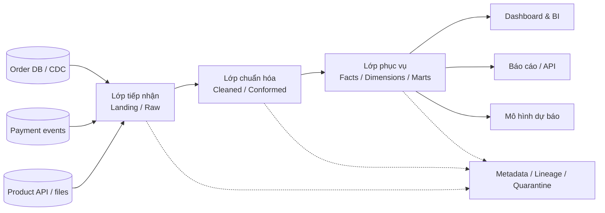
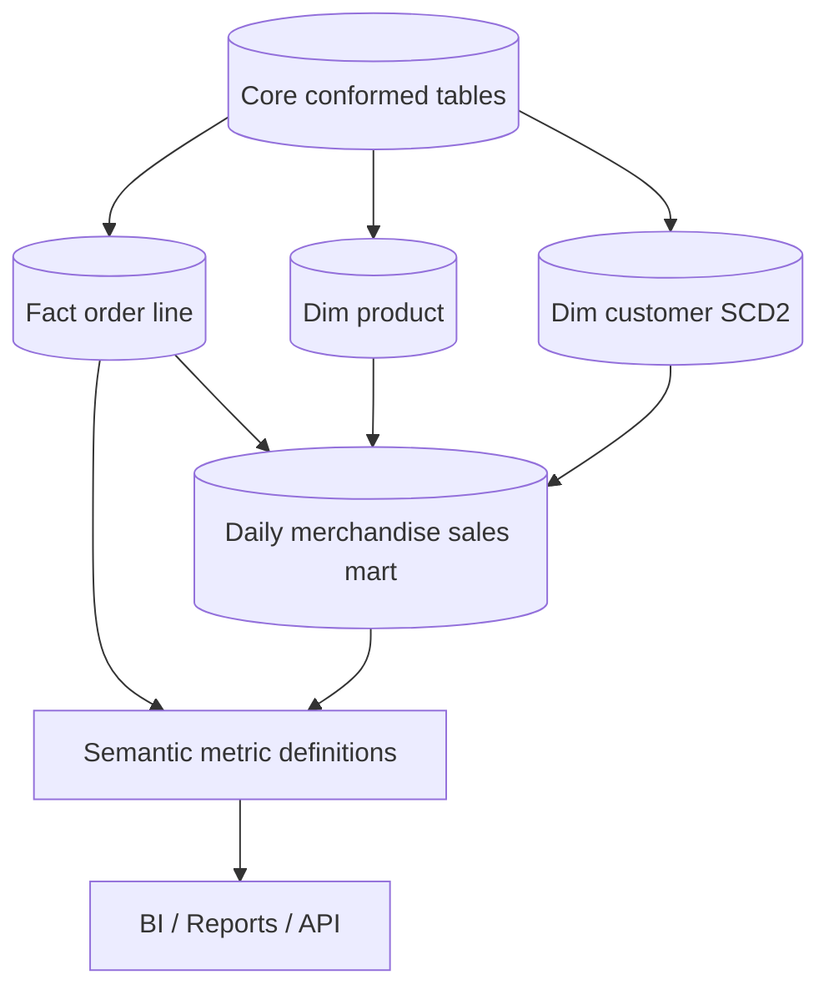

# Vai trò của lớp tiếp nhận, dữ liệu chuẩn hóa và dữ liệu phục vụ phân tích

## Mục tiêu học tập

Sau bài học, bạn có thể:

- Phân biệt **lớp tiếp nhận dữ liệu** (*ingestion/landing*), **lớp dữ liệu chuẩn hóa và thống nhất** (*cleaned/conformed/curated*) và **lớp phục vụ phân tích** (*serving/data mart*).
- Giải thích tại sao ba lớp được tách theo **trách nhiệm và hợp đồng dữ liệu**, không chỉ theo ba thư mục hoặc ba tên bảng.
- Thiết kế đường đi của dữ liệu từ hệ giao dịch, file, API hoặc sự kiện đến fact, dimension, bảng tổng hợp và dashboard.
- Định nghĩa **độ hạt (grain)**, khóa nghiệp vụ, kiểu dữ liệu, quy tắc làm sạch, khả năng truy vết, xử lý bản ghi trùng và dữ liệu đến muộn.
- Phân biệt **chuẩn hóa kiểu và ý nghĩa dữ liệu** với **chuẩn hóa quan hệ 1NF/2NF/3NF** và với **chuẩn hóa thang đo thống kê**.
- Chọn cách xử lý CDC, snapshot, sự kiện, dữ liệu bị xóa, lịch sử thay đổi, backfill và cập nhật tăng dần cho từng lớp.
- Xác định hệ kiểm thử chất lượng, chính sách bảo mật, quyền sở hữu dữ liệu và SLA theo lớp.
- Xây dựng một mô hình phục vụ chỉ số có thể kiểm chứng, tránh sai số do join nhân bản, cộng gộp sai ngữ nghĩa hoặc thay đổi định nghĩa KPI.

Trong module **DATABASE_DATA_MODELING**, mục tiêu là chuyển yêu cầu nghiệp vụ thành thực thể, quan hệ, ràng buộc, khóa, chỉ mục và lược đồ vật lý phù hợp. Khi làm **mô hình phân tích**, chúng ta còn phải đưa dữ liệu vận hành thành những tập dữ liệu có thể tái sử dụng và những chỉ số đáng tin cậy. Muốn vậy, cần xác định ranh giới giữa **tiếp nhận**, **chuẩn hóa** và **phục vụ phân tích**, thay vì để mỗi dashboard tự giải mã dữ liệu từ nguồn theo một cách riêng.

---

## 1. Tại sao cần phân lớp trong mô hình phân tích?

Một cơ sở dữ liệu vận hành được thiết kế tốt cho câu hỏi như “đơn hàng `ord_908` hiện ở trạng thái nào?”. Bộ phận kinh doanh lại đặt câu hỏi khác: “doanh số hàng hóa ròng theo ngày, shop và danh mục là bao nhiêu?” hoặc “khách lần đầu mua hàng có xu hướng quay lại trong 30 ngày không?”.

Dữ liệu nguồn có thể đến từ nhiều nơi:

- Hệ quản lý đơn hàng với `orders` và `order_items`.
- Hệ thanh toán thông báo giao dịch thành công, thất bại hoặc hoàn tiền.
- Hệ sản phẩm quản lý SKU và danh mục.
- Hệ người dùng quản lý hồ sơ, phân nhóm khách, vùng và quyền truy cập.
- File CSV do đối tác gửi, có cách đặt tên cột và đơn vị đo khác nhau.
- Luồng sự kiện hoạt động, có thể bị gửi trùng hoặc tới trễ.

Nếu từng dashboard truy vấn thẳng các nguồn này, mỗi nhóm có thể tự quyết định “đơn hoàn tất” là gì, chuyển đổi múi giờ theo cách nào, có tính hoàn tiền không, hoặc bỏ qua record lỗi ra sao. Hệ quả là **cùng một tên KPI có nhiều giá trị** và không thể giải thích số liệu khác nhau.

Một kiến trúc phân lớp chia công việc thành ba trách nhiệm:



Các tên **Bronze – Silver – Gold** thường được dùng để gợi nhớ ba lớp tương ứng trong một số kiến trúc lakehouse. Đây là **quy ước phổ biến, không phải chuẩn bắt buộc**: tổ chức có thể dùng staging, core, marts, raw, refined, curated hoặc những tên khác. Quan trọng là **định nghĩa trách nhiệm, mức bảo đảm và khả năng kiểm chứng** ở từng lớp.

### 1.1. Bảng so sánh nhanh

| Góc nhìn | Tiếp nhận / Raw | Chuẩn hóa / Conformed | Phục vụ / Serving |
| --- | --- | --- | --- |
| Câu hỏi chính | “Nguồn đã gửi dữ liệu gì, khi nào và từ đâu?” | “Dữ liệu có nghĩa thống nhất và hợp lệ là gì?” | “Người dùng hỏi chỉ số/truy vấn nào?” |
| Hướng tổ chức | Gần với nguồn, có metadata ingest | Thực thể và sự kiện chuẩn, grain và khóa rõ | Fact/dimension, bảng theo chủ đề, aggregate |
| Biến đổi | Tối thiểu để tiếp nhận an toàn | Parse, type cast, dedup, mapping, kiểm tra, lịch sử | Join theo grain, áp metric, tổng hợp, tối ưu đọc |
| Chất lượng | Kiểm tra hợp đồng đầu vào, ghi nhận lỗi | Kiểm tra kiểu, duy nhất, tham chiếu, bất biến | Đối soát KPI, độ đúng theo lát cắt và SLA |
| Khả năng tái dựng | Lưu payload/offset/phiên bản theo chính sách | Xây lại từ raw và quy tắc biến đổi | Xây lại từ dữ liệu chuẩn và phiên bản metric |
| Người dùng chính | Data engineering, vận hành pipeline | Data engineering, analytics engineering, nhóm dữ liệu | Analyst, BI, sản phẩm, nhà quản trị, ML |
| Bảo mật | Hạn chế nghiêm ngặt, có thể chứa PII thô | Khử/giảm nhạy cảm theo chính sách | Phân quyền theo người dùng, mục đích, tenant |

Không phải mọi trường đều cần đi qua **đúng một bảng ở mỗi lớp**. Có thể có nhiều tập nguồn raw, nhiều bảng core và nhiều data mart. Ranh giới phân lớp nhằm **tách các loại thay đổi**, chứ không tạo các bản sao không cần thiết.

## 2. Một bài toán cụ thể: báo cáo bán hàng đa shop

Giả sử nền tảng bán hàng cần cung cấp:

- Báo cáo **giá trị hàng hóa ròng** theo ngày, shop và danh mục.
- Danh sách đơn hoàn tất để kiểm tra và giải trình.
- Phân tích khách mới/khách quay lại theo tháng.
- Theo dõi dữ liệu nguồn chậm, đơn bị cập nhật hoặc hoàn tiền đến sau.
- Khả năng tính lại toàn bộ một tháng khi quy tắc báo cáo thay đổi.

Nguồn giao dịch minh họa:

| Hệ nguồn | Bảng / luồng | Nội dung | Đặc tính thay đổi |
| --- | --- | --- | --- |
| Order service | `orders` qua CDC | `orderId, shopId, customerId, status, createdAt, completedAt` | Update khi đơn đổi trạng thái |
| Order service | `order_items` qua CDC | `orderId, lineId, sku, qty, unitPriceMinor, discountMinor` | Có thể được chốt/chỉnh theo quy tắc |
| Payment service | `payment_events` | Thanh toán và hoàn tiền với ID sự kiện | At-least-once, có thể đến trễ |
| Catalog service | `products` snapshot/CDC | SKU, danh mục, thương hiệu | Danh mục có thể đổi theo thời gian |
| Customer service | `customers` CDC | ID khách, phân nhóm, vùng | Có lịch sử thay đổi và PII |

Một đơn ví dụ:

```json
{
  "shopId": "shop_17",
  "orderId": "ord_908",
  "customerId": "user_42",
  "status": "COMPLETED",
  "completedAt": "2026-11-22T02:30:00Z",
  "currency": "VND",
  "items": [
    {
      "lineId": "line_1",
      "sku": "A17",
      "quantity": 2,
      "unitPriceMinor": 95000,
      "discountMinor": 10000
    },
    {
      "lineId": "line_2",
      "sku": "B03",
      "quantity": 1,
      "unitPriceMinor": 29000,
      "discountMinor": 9000
    }
  ]
}
```

Ở đây `unitPriceMinor` và `discountMinor` được hiểu là **đơn vị tiền nhỏ nhất theo hợp đồng VND của hệ thống**, không phải số dấu phẩy động. Tổng giá hàng trước giảm giá bằng `2 × 95.000 + 29.000 = 219.000`; chiết khấu cấp dòng là `10.000 + 9.000 = 19.000`; giá trị hàng sau chiết khấu **trước hoàn tiền** là **200.000 VND**.

Trong bài, chỉ số minh họa sẽ là **net merchandise sales** theo quy tắc do chúng ta đặt ra, **không gọi là doanh thu kế toán được ghi nhận**. Thời điểm ghi nhận doanh thu, VAT, phí vận chuyển, đổi trả và tỷ giá phải tuân hợp đồng kế toán/nghiệp vụ cụ thể.

### 2.1. Grain của các bản ghi ngay từ đầu

| Tập dữ liệu | Grain dự kiến | Khóa nhận diện |
| --- | --- | --- |
| CDC sự kiện đơn | Một **thay đổi nguồn** trên một đơn | `sourceEventId` hoặc `(source, partition, offset)` theo hợp đồng |
| Trạng thái đơn hiện hành | Một **đơn** trong một shop | `(shopId, orderId)` |
| Dòng đơn hàng | Một **dòng hàng** thuộc đơn | `(shopId, orderId, lineId)` |
| Sự kiện hoàn tiền | Một **sự kiện hoàn tiền** có định danh ổn định | `refundEventId` |
| Fact bán hàng cấp dòng | Một **dòng hàng đã thỏa điều kiện báo cáo** | `(shopId, orderId, lineId)` hoặc fact phiên bản theo mô hình |
| Tổng hợp ngày–shop–danh mục | Một tổ hợp **ngày địa phương, shop, danh mục, tiền tệ, phiên bản định nghĩa** | Bộ khóa nhóm nêu trên |

**Grain** là câu trả lời cho “mỗi hàng đại diện cho đúng một đơn vị thực tế nào?”. Nếu không định nghĩa grain, việc join và `SUM` rất dễ đếm một đơn nhiều lần.

## 3. Lớp tiếp nhận: ghi nhận trung thực dữ liệu nguồn

Lớp tiếp nhận (*ingestion/landing/raw*) chịu trách nhiệm đưa dữ liệu nguồn vào nền tảng phân tích **có dấu vết và khả năng xử lý lại**, không phải biến dữ liệu thành KPI cuối cùng.

### 3.1. Đầu vào có thể là gì?

| Kiểu đầu vào | Cách tiếp nhận | Rủi ro đặc trưng |
| --- | --- | --- |
| Batch CSV/Parquet từ đối tác | Lấy file theo lịch, manifest/checksum, kiểm tra schema | Thiếu file, file lặp, thay tên cột hoặc encoding |
| Snapshot cơ sở dữ liệu | Đọc ảnh chụp tại mốc xác định | Khó kết hợp với cập nhật đang diễn ra |
| CDC từ log giao dịch | Đọc INSERT/UPDATE/DELETE cùng vị trí nguồn | Replay, mất thứ tự nếu xử lý sai, thay schema |
| Event stream | Consume theo topic/partition/offset | Giao trùng, đến trễ, rebalancing, event mất nếu retention quá ngắn |
| API phân trang | Gọi có rate limit, cursor và checkpoint | Pagination drift, token hết hạn, dữ liệu nguồn đổi trong lúc lấy |

Khi thiết kế pipeline, phải phân biệt **“đã nhận một lần”** với **“đã áp dụng đúng một lần vào mô hình đích”**. Hệ thống ở chế độ at-least-once có thể nhận lại dữ liệu; tính đúng đắn thường đến từ **idempotency**, checkpoint và xử lý lặp an toàn, không phải lời hứa “sẽ không bao giờ có event trùng”.

### 3.2. Dấu vết tối thiểu của một record raw

Ví dụ một thông điệp CDC được ghi vào raw:

```json
{
  "sourceSystem": "orders-db",
  "sourceEntity": "orders",
  "operation": "UPDATE",
  "sourceRecordKey": {"shopId": "shop_17", "orderId": "ord_908"},
  "sourcePosition": "db-log-position-000891",
  "sourceEventId": "orders-db:000891",
  "sourceCommittedAt": "2026-11-22T02:30:01Z",
  "ingestedAt": "2026-11-22T02:30:03Z",
  "schemaId": "orders.v3",
  "payload": {
    "status": "COMPLETED",
    "completedAt": "2026-11-22T02:30:00Z"
  }
}
```

Đây là **hợp đồng minh họa**, không phải định dạng CDC chuẩn cho mọi công cụ. Trong thực tế, cần biết event mang **đủ ảnh trạng thái sau thay đổi** hay chỉ là **delta**. Nếu chỉ có trường thay đổi, pipeline phải biết trạng thái trước đó hoặc có cách lấy snapshot để dựng bản ghi hoàn chỉnh.

Các trường hữu ích của raw:

- **Nguồn:** tên hệ thống, thực thể/topic, tenant, schema/contract version.
- **Định danh:** khóa record, ID message, ID business event nếu có.
- **Vị trí:** partition/offset, log sequence hoặc file+row number để checkpoint, replay và phân giải thứ tự theo bảo đảm nguồn.
- **Thời gian:** thời điểm nghiệp vụ, commit tại nguồn, tiếp nhận tại đích; không trộn lẫn.
- **Thao tác:** INSERT, UPDATE, DELETE, snapshot hoặc sự kiện nghiệp vụ.
- **Payload:** dữ liệu đúng dạng nhận được hoặc cách lưu có thể tái hiện payload gốc theo chính sách.
- **Trạng thái xử lý:** batch/run ID, checksum, lỗi parse và thông tin lineage.

Không phải nguồn nào cũng có đủ các trường trên. Nếu thiếu event ID đáng tin hoặc không có thứ tự tổng quát, phải **ghi rõ giới hạn** thay vì tự sinh một định danh rồi tuyên bố chống trùng tuyệt đối.

### 3.3. Giữ tính trung thực, không vội “sửa” dữ liệu

Raw nên giữ được bằng chứng nguồn đã gửi:

```text
Raw:
  {"order_id": "ord_908", "paid": "Y", "amount": "219000", "time": "22/11/2026 09:30"}

Không nên âm thầm biến thành:
  {"orderId": "ord_908", "isPaid": true, "amount": 219000, "timestamp": "...Z"}
  rồi xóa mất chuỗi gốc, khi format ngày hoặc nghĩa "paid" chưa được xác nhận.
```

Có thể nén, mã hóa, tổ chức partition hoặc thêm metadata ngay khi tiếp nhận, miễn là quy tắc lưu raw cho phép **truy vết và tái dựng**. Nếu dữ liệu chứa bí mật/PII, “giữ nguyên” không đồng nghĩa lưu không giới hạn hoặc để mọi analyst có quyền đọc: raw phải tuân phân quyền, mã hóa, retention và quy trình xóa.

### 3.4. Tính đầy đủ khi batch/stream

Một batch file 100.000 dòng chỉ được coi là tiếp nhận đầy đủ khi có tiêu chí:

- File nhận đúng tên/manifest, kích thước/checksum dự kiến.
- Kết thúc đọc file và ghi checkpoint ở trạng thái nhất quán.
- Tổng dòng được phân loại thành **hợp lệ, bị cách ly, bị loại theo chính sách** với số lượng đối soát được.
- Có thể chạy lại nếu hệ thống crash giữa chừng mà không nhân đôi nghiệp vụ.

Tương tự, với stream, checkpoint/offset chỉ nên được xác nhận khi dữ liệu cần phục hồi đã được ghi bền theo thiết kế. **Ack trước khi commit** có nguy cơ mất dữ liệu; **ack sau commit** có thể giao lại nhưng cho phép xử lý lặp an toàn.

## 4. Lớp chuẩn hóa: từ dữ liệu nguồn thành ý nghĩa có thể tái sử dụng

Lớp chuẩn hóa (*cleaned, conformed, refined, canonical*) không chỉ “đổi chữ hoa thành chữ thường” hay “bỏ các hàng lỗi”. Nó biến những dữ liệu không đồng nhất thành **thực thể, sự kiện và đơn vị đo có định nghĩa thống nhất** để nhiều nhóm cùng sử dụng.

Ví dụ:

```text
Nguồn Order A: amount = "219000", currency = "VND", status = "DONE"
Nguồn Order B: total_cents = 219000, currency = "VND", state = "FULFILLED"
Nguồn Payment: status = "SUCCESS", amount = 219000

Lớp chuẩn:
  order_id, shop_id, order_status,
  amount_minor, currency,
  completed_at_utc, source_system, source_version
```

Không thể tự kết luận `DONE` và `FULFILLED` tương đương “đã thanh toán” hoặc “đã hoàn tất giao hàng” chỉ vì tên gần giống. **Mapping trạng thái** cần được xác nhận bởi chủ sở hữu nghiệp vụ. Dữ liệu thanh toán có nghĩa khác với dữ liệu đặt hàng; không gộp thành một trường chung nếu làm mất ý nghĩa.

### 4.1. Ba nghĩa của “chuẩn hóa” cần phân biệt

| Cụm từ | Nghĩa | Liên quan ở bài này |
| --- | --- | --- |
| **Conformance/canonicalization** | Thống nhất tên, kiểu, mã trạng thái, đơn vị, timezone, khóa và quy tắc giữa nguồn | **Trọng tâm** của lớp chuẩn hóa |
| **Chuẩn hóa quan hệ 1NF–3NF** | Phân tách bảng theo phụ thuộc hàm để giảm bất thường cập nhật | Có thể dùng trong core, nhưng **không bắt buộc mọi bảng conformed là 3NF** |
| **Chuẩn hóa thống kê** | Biến đổi thang đo như z-score, min-max scaling | Là bước feature engineering, không đồng nghĩa xây lớp conformed |

Một core model có thể dùng cấu trúc quan hệ chuẩn hóa, data vault, bảng sự kiện hoặc các đối tượng conformed khác. Điều quyết định là **độ đúng, grain, quyền sở hữu và khả năng tái sử dụng**, không phải tên kiến trúc.

### 4.2. Hợp đồng schema chuẩn

Một bảng `core_order` có thể định nghĩa:

| Trường | Kiểu logic | Quy tắc |
| --- | --- | --- |
| `shop_id` | ID nội bộ không null | Phạm vi tenant/shop rõ ràng |
| `order_id` | ID nội bộ không null | Duy nhất trong `shop_id` |
| `customer_id` | ID ổn định | Khớp nguồn hợp lệ, không dùng email làm khóa chính |
| `order_status` | Enum | Mapping có version; không suy từ thanh toán nếu khác nghĩa |
| `created_at_utc` | Instant | Parse theo timezone nguồn, lưu UTC |
| `completed_at_utc` | Instant tùy chọn | Chỉ có khi đủ điều kiện nghiệp vụ |
| `currency_code` | Mã tiền | Chuẩn mã và phạm vi được hỗ trợ |
| `source_sequence` | Version/position có thể so sánh trong phạm vi nguồn | Bảo vệ cập nhật đến sai thứ tự |
| `last_ingested_at` | Instant | Dùng để giám sát, không thay thời gian nghiệp vụ |

Với `core_order_item`:

```text
grain    = một dòng hàng trong một đơn
business_key = (shop_id, order_id, line_id)

quantity        = số nguyên dương theo hợp đồng
unit_price_minor = số nguyên theo đơn vị tiền nhỏ nhất
discount_minor   = số nguyên >= 0 và <= gross_line_minor
gross_line_minor = quantity * unit_price_minor
```

Các ràng buộc về tiền, giảm giá, giao hàng và thuế chỉ được áp khi hợp đồng nguồn xác nhận chúng. Không suy ra trường `amount` của mọi hệ đều có cùng định nghĩa.

### 4.3. Pipeline làm sạch có phân loại lỗi

Một pipeline không nên có một lệnh “`WHERE everything_is_valid`” rồi làm biến mất dữ liệu sai.

| Loại lỗi | Ví dụ | Cách xử lý thường dùng |
| --- | --- | --- |
| Lỗi giải mã/cú pháp | JSON hỏng, encoding sai | Quarantine, giữ metadata và nguồn để sửa |
| Thiếu khóa định danh | Không có `orderId` | Chặn vào core hoặc áp quy trình bổ sung được phép |
| Kiểu không hợp lệ | `quantity = "many"` | Quarantine hoặc kiểm tra mapping đã công bố |
| Giá trị ngoài miền | `status = "UNKNOWN_X"` | Dùng trạng thái unknown có kiểm soát hoặc chặn theo chính sách |
| Tham chiếu thiếu | SKU chưa có trong catalog | Ghi nhận lỗi/unknown member, retry late dimension nếu phù hợp |
| Bản ghi lặp | Cùng CDC event được gửi lại | Khử trùng dựa trên định danh nguồn đáng tin |
| Dữ liệu đến sai thứ tự | Version 8 tới trước version 7 | Chỉ áp bản mới hơn trong phạm vi định nghĩa version |
| Xóa tại nguồn | CDC `DELETE` | Cập nhật trạng thái/tombstone và downstream theo chính sách |

**Quarantine** không nên là “thùng rác mãi mãi”. Cần chủ sở hữu lỗi, thời hạn lưu, cơ chế sửa và phát lại, số lượng lỗi theo nguồn và điều kiện chặn phát hành dữ liệu ở lớp serving.

## 5. Khử trùng và tái chạy an toàn (idempotency)

Một pipeline có thể chạy lại do retry, restart, backfill hoặc người vận hành chạy thủ công. Mục tiêu không phải “record chỉ được đọc một lần”, mà là **kết quả sau khi xử lý lại vẫn đúng** theo hợp đồng.

### 5.1. Phân biệt event ID và business key

Có ba loại định danh:

1. **Message/event ID:** phân biệt một lần thay đổi được nguồn phát ra. Dùng để chống áp cùng thông điệp hai lần.
2. **Business key:** `(shopId, orderId)` phân biệt một đơn qua nhiều phiên bản.
3. **Source ordering token:** LSN/sequence/version giúp biết thay đổi nào mới hơn **trong phạm vi được bảo đảm**.

Ví dụ:

```text
event_id=evt_7,  orderId=ord_908, version=7, status=PAID
event_id=evt_8,  orderId=ord_908, version=8, status=COMPLETED
event_id=evt_8,  orderId=ord_908, version=8, status=COMPLETED  # retry
event_id=evt_7,  orderId=ord_908, version=7, status=PAID       # late delivery
```

Lớp raw có thể lưu dấu vết nhiều lần giao nếu chính sách cần quan sát delivery; lớp core `orders_current` chỉ nên phản ánh **version 8**, không bị event v7 ghi đè. Chỉ dedup theo `orderId` và giữ hàng “đến sau cùng” sẽ làm mất những thay đổi hợp lệ hoặc chọn nhầm bản cũ.

### 5.2. Giả mã cập nhật core theo phiên bản nguồn

```text
applyChange(event):
    validateSourceContract(event)
    key = (event.shopId, event.orderId)

    old = core_orders.get(key)

    if old exists and event.sourceVersion <= old.sourceVersion:
        return NO_OP

    # Điều kiện so sánh version + ghi phải nguyên tử hoặc
    # có điều phối thứ tự đủ tin cậy theo engine đích.
    core_orders.conditionalUpsert(
        key,
        event.afterState,
        expectedOlderThan=event.sourceVersion
    )
```

Giả mã trên mô tả **bất biến cần bảo vệ**. Việc đọc `old` rồi ghi `UPSERT` vô điều kiện có thể đua tranh khi hai worker chạy cùng lúc. Nếu engine không hỗ trợ ghi điều kiện, cần chọn cơ chế serial processing, transaction hoặc reconciliation phù hợp.

Khi `DELETE` đến từ CDC, không chỉ xóa hàng rồi quên version: có nguy cơ một event `UPDATE` cũ phát lại làm sống lại dữ liệu. Có thể cần **deletion fence/tombstone ứng dụng** hoặc lịch sử phiên bản để ngăn tái tạo ngoài ý muốn.

## 6. Dữ liệu chuẩn hóa không nhất thiết là dữ liệu hiện hành duy nhất

Có ít nhất hai kiểu dữ liệu chuẩn cần phân biệt:

- **Trạng thái hiện hành (current state):** mỗi đơn xuất hiện một lần với version mới nhất.
- **Lịch sử thay đổi (history):** mỗi sự kiện hoặc mỗi khoảng hiệu lực biểu diễn một trạng thái tại thời điểm tương ứng.

Câu hỏi “đơn hiện đang ở trạng thái gì?” dùng current state. Câu hỏi “tại 18:00 ngày hôm qua đơn đang ở trạng thái nào?” đòi lịch sử hoặc snapshot/as-of, không thể suy từ hàng current duy nhất.

### 6.1. Loại thời gian nào đang được dùng?

| Trường thời gian | Ý nghĩa | Dùng cho |
| --- | --- | --- |
| `createdAt` | Đơn được tạo | Phân tích đơn mới |
| `completedAt` | Đơn thỏa trạng thái hoàn tất | Chỉ số theo ngày hoàn tất |
| `paidAt` | Thanh toán thành công theo định nghĩa nguồn | Phân tích thanh toán |
| `eventOccurredAt` | Sự kiện xảy ra | Fact event, đường thời gian |
| `sourceCommittedAt` | Giao dịch đã commit tại nguồn | CDC ordering/freshness nếu đủ bảo đảm |
| `ingestedAt` | Nền tảng nhận dữ liệu | Theo dõi độ trễ ingest |
| `processedAt` | Core/serving áp quy tắc xong | Quan sát pipeline, không thay thời gian nghiệp vụ |

Nếu dashboard theo **ngày hoàn tất** nhưng transform lại nhóm theo **ngày tiếp nhận**, đơn bị gửi muộn sẽ nằm sai ngày. Mọi metric cần công bố **business time** và timezone sử dụng.

### 6.2. Dữ liệu đến muộn và watermark

Một sự kiện có thể được ingest ngày 23/11 dù nó xảy ra ngày 21/11. Tùy sản phẩm, pipeline streaming dùng **watermark** để đánh giá cửa sổ có thể hoàn tất hoặc chấp nhận bổ sung dữ liệu đến muộn.

Không nên hiểu watermark là “sự kiện đến sau mốc sẽ tự biến mất” trong mọi engine; mỗi công cụ có cách xử lý late event, cập nhật/retraction và output mode khác nhau. Thiết kế phải nói rõ:

- Mức trễ thông thường và cực đại theo nguồn.
- Cửa sổ nào có thể sửa lại sau khi công bố.
- Có cho phép cập nhật bảng tổng hợp ngày cũ không?
- Khi phát sinh hoàn tiền sau 30 ngày, ghi điều chỉnh ở ngày hoàn tiền hay điều chỉnh ngày bán ban đầu?
- Backfill sửa số liệu đã công bố cần audit/phiên bản ra sao?

**Độ đúng của metric** quan trọng hơn việc cố khóa một ngày quá sớm mà không xử lý các giao dịch bù trừ.

## 7. Thống nhất khóa, danh mục và đơn vị giữa nguồn

Trong phân tích đa hệ, khóa của một thực thể có thể khác nhau:

```text
Order system:  customer_id = "user_42"
CRM:           contact_id = "c-0199"
Loyalty:       member_no  = "L-778"

Có thể cùng một người, nhưng không thể nối bằng chuỗi ID
nếu chưa có bảng mapping được quản lý và xác minh.
```

Lớp chuẩn hóa cần chính sách **identity resolution**:

- Dùng khóa nghiệp vụ bền vững, xác định phạm vi duy nhất.
- Có bảng mapping nguồn → ID chuẩn với nguồn chứng cứ và thời gian hiệu lực.
- Không hợp nhất hai người chỉ vì cùng email/số điện thoại nếu nghiệp vụ chưa cho phép.
- Xác định xử lý khi tài khoản được hợp nhất/tách hoặc mapping đổi.
- Bảo vệ PII, không phát tán định danh nhạy cảm chỉ để tiện join.

### 7.1. Các dimension dùng chung (conformed dimensions)

Ví dụ `dim_product` có SKU, thương hiệu, danh mục và version hiệu lực; nhiều fact bán hàng, tồn kho và hành vi xem sản phẩm cùng tham chiếu một định nghĩa phân loại.

Một **dimension thống nhất** giúp các báo cáo so sánh được với nhau. Nếu mỗi dashboard tự map SKU vào danh mục, cùng một SKU có thể được tính vào “Gia dụng” trên báo cáo A nhưng “Đời sống” trên báo cáo B khi nguồn thay đổi.

Tuy nhiên, danh mục có thể đổi qua thời gian. Cần phân biệt:

- **Phân loại hiện hành:** “Doanh số lịch sử nếu xem theo danh mục sản phẩm hiện nay”.
- **Phân loại tại thời điểm bán:** “Doanh số theo danh mục có hiệu lực lúc đơn hoàn tất”.

Hai câu hỏi khác nhau nên có thể dùng **hai cách join** hoặc hai metric có tên rõ ràng.

### 7.2. SCD Type 1 và Type 2

Trong dimensional modeling:

- **Type 1:** ghi đè thuộc tính cũ; phù hợp sửa lỗi mô tả không cần lịch sử.
- **Type 2:** giữ nhiều phiên bản dimension với khoảng hiệu lực, phục vụ phân tích *as-of*.

Ví dụ:

| customer_sk | customer_id | segment | valid_from | valid_to |
| --- | --- | --- | --- | --- |
| 101 | `user_42` | STANDARD | 2026-01-01 | 2026-11-15 |
| 205 | `user_42` | VIP | 2026-11-15 | null (đang hiệu lực) |

Quy tắc khoảng **`[valid_from, valid_to)`** (bao gồm đầu, không bao gồm cuối) giúp tránh hai phiên bản cùng hợp lệ ở ranh giới. Để join một đơn hoàn tất ngày 10/11, chọn `customer_sk = 101`; hoàn tất ngày 22/11, chọn `customer_sk = 205`.

Nếu thay đổi được ghi nhận ngày 20/11 nhưng có hiệu lực từ 15/11, cần quyết định có **sửa hồi tố** các fact liên quan hay chỉ phân tích theo thông tin đã biết lúc báo cáo chạy. Bài toán có thể cần thêm **system time** nếu yêu cầu truy vấn theo cả “khi nào có hiệu lực” và “khi nào hệ thống biết”.

## 8. Lớp phục vụ: thiết kế từ câu hỏi phân tích

Lớp phục vụ (*serving/semantic/data marts*) chuyển dữ liệu chuẩn thành cấu trúc phù hợp cho người dùng cuối: fact, dimension, bảng tổng hợp, dữ liệu theo chủ đề, semantic metric hoặc tập feature có hợp đồng.

Điểm khác biệt với lớp chuẩn hóa:

- **Core** ưu tiên ý nghĩa thống nhất, tái sử dụng và bảo tồn chi tiết thích hợp.
- **Serving** ưu tiên **trả lời truy vấn cụ thể** nhanh, ổn định, có tên metric và quyền truy cập phù hợp.

Một kiến trúc thường có:



**Serving không bắt buộc luôn là tổng hợp**. Một fact chi tiết cấp dòng đã được tối ưu bằng partition/index cho BI cũng là dữ liệu phục vụ. Một bảng tổng hợp chỉ là một loại read model phục vụ nhu cầu truy vấn nhiều lần.

### 8.1. Fact và dimension

| Loại mô hình | Grain / vai trò | Ví dụ |
| --- | --- | --- |
| **Transaction fact** | Một sự kiện/giao dịch ở mức chi tiết cố định | `fact_order_line` |
| **Periodic snapshot fact** | Trạng thái tại một mốc định kỳ | Tồn kho cuối ngày theo kho/SKU |
| **Accumulating snapshot** | Theo dõi các mốc của một quy trình | Tạo đơn → đóng gói → giao → hoàn tất |
| **Dimension** | Bối cảnh mô tả fact | Sản phẩm, khách, shop, ngày |
| **Aggregate mart** | Kết quả nhóm theo tập chiều đã chọn | Net merchandise sales theo ngày–shop–danh mục–currency |

Không nên dùng cùng một bảng fact vừa biểu diễn mỗi lần chuyển trạng thái, vừa biểu diễn trạng thái cuối cùng của đơn mà không nêu rõ grain. Nếu một đơn có năm sự kiện trạng thái, join trực tiếp với dòng hàng có thể nhân mỗi dòng lên năm lần.

### 8.2. Ranh giới giữa 3NF và mô hình hình sao (star schema)

Một core model có thể tách `orders`, `order_items`, `products`, `customers` theo phụ thuộc dữ liệu, giảm dữ liệu lặp và hỗ trợ tái sử dụng. Ở serving, mô hình **star schema** thường đặt các phép đo ở fact và thuộc tính mô tả ở dimension để BI join có kiểm soát.

Đây không phải đối lập “3NF đúng, star schema sai” hoặc ngược lại. Hai cách tổ chức phục vụ **những ràng buộc và đường đọc khác nhau**. Lược đồ phục vụ có thể có dữ liệu lặp có chủ đích, nhưng cần giữ một định nghĩa đo lường và lineage đáng tin cậy.

## 9. Ví dụ đầy đủ: từ raw sang core và mart bán hàng

Ta đặt **hợp đồng metric minh họa**:

> **Net merchandise sales (NMS)** là tổng `quantity × unit_price_minor − discount_minor − refund_allocated_minor` của các dòng thuộc đơn `COMPLETED`, không tính thuế và phí vận chuyển, trong **ngày địa phương của `completedAt` theo `Asia/Ho_Chi_Minh`**, theo shop, danh mục có hiệu lực tại ngày hoàn tất và currency. Hoàn tiền xử lý theo chính sách điều chỉnh được nêu riêng.

Đây chỉ là **một định nghĩa báo cáo**. Không tự gọi chỉ số này là revenue accounting. Nếu mục tiêu là doanh thu kế toán, phải xem điều kiện ghi nhận, phân bổ nghĩa vụ, thuế, trả hàng và chuẩn mực áp dụng.

### 9.1. Raw

Luồng nguồn cung cấp một thay đổi đơn:

```json
{
  "sourceEventId": "orders:891",
  "sourcePosition": 891,
  "op": "UPDATE",
  "shopId": "shop_17",
  "orderId": "ord_908",
  "after": {
    "status": "COMPLETED",
    "completedAt": "2026-11-22T02:30:00Z"
  },
  "ingestedAt": "2026-11-22T02:30:03Z"
}
```

Một snapshot hoặc CDC riêng cho `order_items` cung cấp các dòng hàng. Lớp raw giữ khóa/position/thông tin nguồn để có thể chứng minh dữ liệu từ đâu mà ra và chạy lại sau sửa mapping.

### 9.2. Core

Sau parse/khử trùng/mapping:

```text
core_orders_current
  (shop_17, ord_908, user_42, COMPLETED,
   completed_at_utc=2026-11-22 02:30:00Z, currency=VND, version=8)

core_order_items
  (shop_17, ord_908, line_1, A17, qty=2,
   unit_price_minor=95000, discount_minor=10000)
  (shop_17, ord_908, line_2, B03, qty=1,
   unit_price_minor=29000, discount_minor=9000)
```

Mỗi dòng có định danh ổn định, các khoản tiền dùng đơn vị tiền nhỏ nhất và thời gian được chuẩn theo UTC. `core_orders_current` lưu một trạng thái hiện hành theo khóa đơn; muốn phân tích *as-of* phải có lịch sử hợp lệ bổ sung.

### 9.3. Fact

Fact cấp dòng:

| shop_id | order_id | line_id | completed_day_local | sku | currency | gross_minor | discount_minor | refund_allocated_minor | nms_minor |
| --- | --- | --- | --- | --- | --- | ---: | ---: | ---: | ---: |
| shop_17 | ord_908 | line_1 | 2026-11-22 | A17 | VND | 190000 | 10000 | 0 | 180000 |
| shop_17 | ord_908 | line_2 | 2026-11-22 | B03 | VND | 29000 | 9000 | 0 | 20000 |

Tổng `nms_minor` = **200.000 VND**. Fact này giả định **đã áp đúng điều kiện COMPLETED** và không nhân các dòng khi join với payment/refund events. Nếu có nhiều refund event, trước hết cần **tổng hợp số tiền hoàn phân bổ theo đúng khóa dòng hàng** rồi mới join vào fact, không join trực tiếp một quan hệ 1:n vào fact và `SUM` bừa bãi.

### 9.4. SQL minh họa cho biến đổi fact

Đây là SQL khái niệm dùng để diễn giải **grain và tính toán**. Tên hàm đổi timezone, kiểu date, cách incremental merge và từ khóa SQL có thể khác nhau theo warehouse; triển khai thực tế phải điều chỉnh theo engine.

```sql
-- Grain của item là (shop_id, order_id, line_id).
-- Bảng refund_by_line đã tổng hợp thành tối đa 1 hàng/dòng.
WITH completed_lines AS (
    SELECT
        o.shop_id,
        o.order_id,
        i.line_id,
        i.sku,
        o.currency_code,
        o.completed_at_utc,
        i.quantity * i.unit_price_minor AS gross_minor,
        i.discount_minor,
        COALESCE(r.refund_minor, 0) AS refund_allocated_minor
    FROM core_orders_current AS o
    JOIN core_order_items AS i
      ON i.shop_id = o.shop_id
     AND i.order_id = o.order_id
    LEFT JOIN core_refunds_by_line AS r
      ON r.shop_id = i.shop_id
     AND r.order_id = i.order_id
     AND r.line_id = i.line_id
    WHERE o.order_status = 'COMPLETED'
)
SELECT
    shop_id,
    order_id,
    line_id,
    sku,
    currency_code,
    completed_at_utc,
    gross_minor,
    discount_minor,
    refund_allocated_minor,
    gross_minor - discount_minor - refund_allocated_minor
        AS nms_minor
FROM completed_lines;
```

Bộ kiểm thử phải bảo đảm `core_refunds_by_line` là **duy nhất trên (shop_id, order_id, line_id)**. Nếu một dòng có ba refund event, bảng này phải cộng/giải quyết trạng thái hoàn tiền theo nghiệp vụ trước, sau đó mới có một hàng để join.

**Lưu ý về chỉ số âm:** một khoản hoàn sau nhiều tháng có thể làm `nms_minor` điều chỉnh giảm, và trong một số trường hợp hệ thống có thể ghi credit hoặc adjustment. Nếu metric không cho phép giá trị âm cấp dòng, phải xác định quy tắc phân bổ, đối soát và xử lý bất thường; không tự cắt âm về 0 vì sẽ làm sai tổng.

### 9.5. Tổng hợp ngày–shop–danh mục

Sau khi ánh xạ SKU sang dimension sản phẩm tại **thời điểm completedAt** và chuyển thời gian sang ngày địa phương đã định nghĩa:

```sql
SELECT
    completed_day_local,
    shop_id,
    category_id_at_completion,
    currency_code,
    COUNT(DISTINCT order_id) AS distinct_orders,
    SUM(gross_minor) AS gross_minor,
    SUM(discount_minor) AS discount_minor,
    SUM(refund_allocated_minor) AS refund_minor,
    SUM(nms_minor) AS nms_minor
FROM fact_order_line
GROUP BY
    completed_day_local,
    shop_id,
    category_id_at_completion,
    currency_code;
```

**Cảnh báo quan trọng về `COUNT(DISTINCT order_id)`:** một đơn có dòng thuộc hai danh mục sẽ được tính là **một đơn ở mỗi danh mục**. Khi cộng `distinct_orders` xuyên các danh mục, tổng có thể lớn hơn số đơn thật. Vì vậy metric “số đơn” theo danh mục có định nghĩa khác với “số đơn toàn shop”; không được tổng hợp số distinct một cách tùy ý.

Nếu cần số đơn chính xác cho shop/ngày, nên dùng **fact cấp đơn** hoặc aggregate riêng tại grain `(day, shop, currency)`; còn doanh số tiền tệ ở dòng hàng thường có tính cộng được theo danh mục khi không bị double-count.

## 10. Tránh các lỗi join khiến KPI sai

### 10.1. Nhân bản dòng do join nhiều quan hệ 1:n

Một đơn có hai dòng hàng và ba sự kiện thanh toán. Join trực tiếp:

```sql
SELECT
    o.order_id,
    SUM(i.quantity * i.unit_price_minor) AS wrong_gross
FROM core_orders_current AS o
JOIN core_order_items AS i
  ON i.shop_id = o.shop_id AND i.order_id = o.order_id
JOIN core_payment_events AS p
  ON p.shop_id = o.shop_id AND p.order_id = o.order_id
WHERE o.order_status = 'COMPLETED'
GROUP BY o.order_id;
```

Số dòng trung gian có thể là `2 × 3 = 6`, khiến mỗi dòng hàng bị tính ba lần nếu không có điều kiện/nhóm phù hợp.

Cách đúng phụ thuộc câu hỏi:

- Nếu cần tổng tiền dòng hàng: **không join payment events** nếu không cần.
- Nếu cần điều kiện “có thanh toán thành công”: cân nhắc `EXISTS`/semi-join với điều kiện trạng thái có thẩm quyền.
- Nếu cần số tiền thanh toán: tổng hợp payment/refund tại **grain một đơn** hoặc **một dòng** trước khi join.
- Nếu cần số giao dịch thanh toán: tạo fact payment transaction với grain riêng.

Nguyên tắc: **mỗi bước join cần chứng minh quan hệ cardinality và grain kết quả**. Không vá sai số bằng `SUM(DISTINCT amount)`: hai dòng có số tiền giống nhau là hai giao dịch hợp lệ và có thể bị đếm thiếu.

### 10.2. Tổng tiền qua nhiều loại tiền tệ

Không cộng trực tiếp:

```text
1.000.000 VND + 100 USD = 1.000.100 "tiền"
```

Bảng mart nên **giữ `currency_code` trong grain**, hoặc áp tỷ giá đã được định nghĩa: nguồn tỷ giá, thời điểm tỷ giá, chiều quy đổi, rounding, chính sách xử lý thiếu tỷ giá, và có lưu cả tiền gốc lẫn tiền quy đổi.

### 10.3. Tham chiếu dimension thay đổi

Nếu danh mục của SKU A17 đổi từ “Phụ kiện” sang “Gia dụng”, báo cáo lịch sử cần biết nó dùng danh mục **hiện hành** hay **tại lúc bán**. Không cập nhật mọi báo cáo quá khứ một cách âm thầm chỉ vì dimension hiện hành đổi.

## 11. Serving phải định nghĩa chỉ số, không chỉ đặt tên cột

Một dashboard có ô “Doanh thu” nhưng bảng chỉ có `amount` sẽ gây tranh cãi nếu các nhóm có cách hiểu khác nhau.

**Metric contract** tối thiểu:

| Thuộc tính | Ví dụ |
| --- | --- |
| `metric_id` | `net_merchandise_sales_minor_v1` |
| Tên hiển thị | Giá trị hàng hóa ròng (theo định nghĩa sản phẩm) |
| Grain nguồn | Một dòng đơn hoàn tất |
| Điều kiện | `order_status = COMPLETED` theo mapping v3 |
| Công thức | `qty × unitPriceMinor − allocatedDiscountMinor − allocatedRefundMinor` |
| Thời gian | Ngày địa phương theo `completedAt` tại `Asia/Ho_Chi_Minh` |
| Các chiều | Shop, ngày, danh mục hiệu lực, currency |
| Loại trừ | Thuế, phí vận chuyển; các khoản khác theo hợp đồng |
| Hoàn tiền trễ | Điều chỉnh vào ngày bán ban đầu trong phiên bản metric này |
| Độ mới kỳ vọng | Ví dụ: dữ liệu cập nhật trong 15 phút sau commit nguồn, trừ ngoại lệ được công bố |
| Chủ sở hữu | Product/Finance và Data chịu trách nhiệm chung về nghĩa và thực thi |
| Cách kiểm chứng | Đối soát order lines/refunds, test grain và ngày mẫu |

Con số “15 phút” chỉ là **ví dụ SLA**, không phải bảo đảm của một công nghệ. Nếu dữ liệu hoàn tiền đến sau, mart ngày cũ có thể bị điều chỉnh: báo cáo cần thể hiện thời điểm tính/phiên bản để người dùng hiểu vì sao số liệu thay đổi.

### 11.1. Semantic layer và bảng vật lý

Một **semantic layer** có thể định nghĩa metric và dimension dùng chung bên trên nhiều bảng, giúp các dashboard không tự viết lại công thức. Nhưng semantic layer không thay thế được:

- Quy tắc chuẩn hóa và chất lượng ở core.
- Grain được bảo đảm ở fact.
- Khoảng thời gian và đơn vị tiền phù hợp.
- Kiểm tra quyền xem dữ liệu của từng tenant/nhóm.
- Trạng thái cập nhật/backfill và việc thay đổi metric definition.

Semantic layer giúp **tập trung cách diễn đạt**, còn việc tính đúng đòi cả ba lớp làm đúng trách nhiệm.

## 12. ELT, ETL và biên giới biến đổi

Có hai chiến lược lớn:

- **ETL:** extract → transform → load vào đích; một số kiểm tra/biến đổi xảy ra trước khi dữ liệu tới kho.
- **ELT:** extract → load → transform; giữ raw trong nền tảng rồi chuẩn hóa/phục vụ bằng compute của kho hoặc engine xử lý.

Không có nghĩa “ETL không có raw” hoặc “ELT luôn tốt hơn”. Quyết định phụ thuộc độ nhạy dữ liệu, khả năng compute, tốc độ, chi phí vận hành, network và chính sách lưu trữ.

### 12.1. Chuyển đổi nào nên làm ở đâu?

| Việc cần làm | Lớp ưu tiên | Lý do |
| --- | --- | --- |
| Xác thực kết nối, giải mã giao thức, checksum | Tiếp nhận | Đảm bảo nhận đủ và an toàn |
| Đánh dấu nguồn, offset, schemaId, ingest time | Tiếp nhận | Phục vụ trace và replay |
| Parse sang kiểu chuẩn, kiểm tra enum | Chuẩn hóa | Giữ logic dùng chung |
| Map business key/đơn vị/timezone | Chuẩn hóa | Tránh mỗi mart định nghĩa lại |
| Dedup + áp CDC đúng thứ tự | Chuẩn hóa | Tạo trạng thái/hợp đồng tin cậy |
| Ánh xạ SCD dimension | Chuẩn hóa hoặc bước chuẩn bị fact | Cần lịch sử hiệu lực |
| Định nghĩa KPI và filter nghiệp vụ | Phục vụ/semantic | Gắn với câu hỏi báo cáo |
| Aggregate theo ngày/shop/danh mục | Phục vụ | Tối ưu query lặp |
| Mask PII, giới hạn quyền | **Mọi lớp**, theo mức cần thiết | Không để dữ liệu nhạy cảm lọt qua đường khác |

Có thể xử lý bước bảo vệ dữ liệu ở biên trước khi landing nếu chính sách cấm lưu PII thô; khi đó phải giữ đủ metadata để truy vết hợp lệ. Phân lớp không phải lý do bỏ qua bảo mật ở bất kỳ bước nào.

## 13. Batch, streaming, incremental và backfill

Dữ liệu phục vụ có thể được cập nhật theo batch hàng giờ, theo micro-batch, streaming hoặc kết hợp. Điểm cốt lõi là **tính đúng đắn khi chạy nhiều lần**.

### 13.1. Full refresh và incremental

| Kiểu cập nhật | Cách làm | Khi phù hợp | Rủi ro |
| --- | --- | --- | --- |
| Full refresh | Tính lại toàn bộ bảng đích từ nguồn chuẩn | Tập nhỏ, ít thay đổi, muốn đơn giản | Tốn compute, downtime/độ trễ nếu thay bảng không nguyên tử |
| Incremental append | Chỉ thêm fact mới | Sự kiện thật sự bất biến, ID ổn định | Trùng event, chỉnh sửa/xóa quá khứ không được phản ánh |
| Incremental upsert | Ghi đè hàng theo business key/version | Current state, late corrections | Phải bảo vệ thứ tự/version và khóa đồng thời |
| Recompute affected partitions | Tính lại các ngày/nhóm bị ảnh hưởng | Aggregate có dữ liệu đến muộn | Cần xác định partition bị ảnh hưởng và publish nhất quán |
| Streaming projection | Xử lý event và cập nhật mart gần realtime | SLA độ mới ngắn | Duplicate, out-of-order, checkpoint và retractions |

Một sự kiện hoàn tiền cho đơn ngày 10/11 đến ngày 22/11 có thể làm thay đổi mart ngày 10/11. Nếu pipeline chỉ “quét dữ liệu của hôm nay”, nó **không sửa được quá khứ**. Cần theo dõi tập **affected business dates** và tính lại hoặc áp delta idempotent theo hợp đồng.

### 13.2. Kế hoạch backfill có kiểm soát

Ví dụ sửa mapping trạng thái hoặc công thức chiết khấu cho ba tháng trước:

1. Xác nhận **phiên bản hợp đồng dữ liệu** và những khoảng thời gian/tenant bị ảnh hưởng.
2. Giữ nguyên nguồn raw/core hoặc dùng snapshot đáng tin, lưu checkpoint nguồn.
3. Tạo staging/mart mới hoặc phiên bản song song, tránh làm dashboard đọc trạng thái tính dở.
4. Backfill theo partition với công việc có thể chạy lại; không cộng tổng vô điều kiện khi retry.
5. Bắt kịp những thay đổi đang phát sinh trong lúc backfill.
6. Đối soát số lượng, tổng tiền theo currency, khóa bị thiếu/thừa và mẫu nghiệp vụ.
7. Chuyển traffic/semantic layer theo kế hoạch; ghi nhận run ID, logic version và thời điểm publish.
8. Giám sát sau phát hành; giữ khả năng rollback nếu phát hiện số liệu lệch.

Không nên chỉ kiểm tra tổng số hàng bằng nhau: hai tập có thể cùng một triệu hàng nhưng khác ID, status hoặc số tiền. Cần so chi tiết theo **grain và các số đo trọng yếu**.

### 13.3. Đổi schema ở nguồn

Nếu nguồn đổi `order_total` thành `total_minor` hoặc đổi kiểu timestamp:

- Raw lưu schema version và nhận diện thay đổi.
- Lớp chuẩn có decoder/mapping hỗ trợ version cũ và mới trong giai đoạn chuyển tiếp.
- Kiểm thử fixture các version còn được hỗ trợ.
- Serving giữ metric contract ổn định nếu ý nghĩa không đổi.
- Nếu ý nghĩa đổi, công bố metric version mới và phương án so sánh số liệu.

Một cột đổi tên không nhất thiết làm thay đổi KPI; một thay đổi **ngữ nghĩa** không thể được che giấu chỉ bằng cách giữ cùng tên cột.

## 14. Lineage: đi từ một ô dashboard về dữ liệu gốc

Khi một nhà quản lý hỏi “vì sao doanh số ngày 22/11 của shop 17 là 200.000?”, cần trả lời bằng chuỗi truy vết:

```text
Dashboard cell:
  shop_17, 2026-11-22, VND, NMS = 200000

  -> mart_daily_merchandise_sales
     metric_version = nms_v1, build_run = run_120

  -> fact_order_line
     (ord_908, line_1) = 180000
     (ord_908, line_2) = 20000

  -> core_order_items + core_orders_current
     ord_908 status COMPLETED, completedAt 02:30Z
     unit prices, qty, discount, refund allocation

  -> raw CDC events/snapshots + source positions
     orders event, order_items snapshot/CDC
```

**Lineage** gồm cả đường dữ liệu và đường **logic biến đổi**:

- Source system, khóa và vị trí/phiên bản raw.
- Job/model version và tham số chạy.
- Công thức metric, mapping enum, timezone, danh mục/SCD.
- Quy tắc kiểm tra chất lượng và những hàng bị quarantine.
- Thời điểm dữ liệu được công bố ở serving.

Đối với dữ liệu nhạy cảm, lineage nên lưu metadata và tham chiếu có phân quyền, không sao chép payload cá nhân vào log truy vết không được bảo vệ.

### 14.1. Mô hình sở hữu dữ liệu

| Lớp | Chủ trách nhiệm điển hình | Ví dụ câu hỏi phải giải đáp |
| --- | --- | --- |
| Nguồn & tiếp nhận | Source owner + data platform | Event nào đã commit? Pipeline có bỏ sót không? |
| Chuẩn hóa | Data engineering/analytics engineering + domain owner | Mapping nào đúng? Khóa/kiểu/grain có hợp lệ? |
| Phục vụ | Analytics engineer + metric owner | KPI tính thế nào, theo ngày nào, có so được giữa report? |
| Quản trị | Security, privacy, governance | Ai được xem trường nào? Giữ/xóa ở đâu, trong bao lâu? |

Phân định owner giúp lỗi được sửa ở **đúng lớp**: lỗi parse timestamp nên sửa ở core, chứ không thêm một phép bù trừ cục bộ trong từng dashboard.

## 15. Chất lượng dữ liệu theo từng lớp

Một pipeline tốt kiểm tra lỗi **càng gần nơi phát sinh càng hợp lý**, đồng thời có kiểm thử đầu cuối.

### 15.1. Lớp raw

- File/message có thể giải mã và được ghi nhận đủ theo manifest/offset.
- Không bỏ sót batch/partition nguồn không có cảnh báo.
- Có thông tin source schema và lineage cần thiết.
- Quarantine có thống kê và có cách xử lý lại.
- Quyền đọc raw được giới hạn; không lộ token hoặc PII trong log.

### 15.2. Lớp chuẩn hóa

| Kiểm thử | Ví dụ |
| --- | --- |
| `NOT NULL` | `shop_id, order_id, line_id` không rỗng ở nơi bắt buộc |
| `UNIQUE` | Mỗi `(shop_id, order_id, line_id)` chỉ có một hàng hiện hành |
| Allowed values | `order_status` thuộc enum/mapping đã định nghĩa |
| Domain constraint | `quantity > 0`, `discount_minor >= 0` |
| Referential integrity logic | Mỗi item có order hợp lệ theo chính sách độ trễ |
| Monotonic version | Event cũ không ghi đè version mới hơn của cùng business key |
| SCD no overlap | Không có hai version dimension cùng hiệu lực trên một khoảng |
| Currency/time | Không cộng khác currency, timestamp parse theo timezone đúng |
| Privacy contract | Trường nhạy cảm đã được xử lý phù hợp trước khi mở quyền dùng chung |

Trong hệ warehouse không thực thi tất cả constraint tự động, đây vẫn phải là **kiểm thử pipeline** có lịch chạy, kết quả và người chịu trách nhiệm.

### 15.3. Lớp serving

- Kiểm tra số dòng fact theo grain và số dòng bị nhân trong join.
- Đối soát `gross − discount − refund = NMS` trên tập kiểm thử phù hợp.
- Kiểm tra tổng theo shop/ngày/currency khớp fact và các nguồn đã chốt.
- Test distinct count không bị cộng ngang dimension không cộng được.
- Test dữ liệu đến muộn và hoàn tiền làm cập nhật đúng ngày theo metric contract.
- Kiểm tra dữ liệu hiển thị chỉ trong phạm vi tenant và quyền.
- Theo dõi freshness, latency truy vấn, chi phí scan/partition và các trường hợp trống.

### 15.4. Bảng theo dõi chất lượng minh họa

| Metric vận hành | Ý nghĩa | Hành động khi lỗi |
| --- | --- | --- |
| `raw_ingest_lag_seconds` | Commit nguồn → nhận raw | Kiểm tra source connector, backlog |
| `raw_bad_record_rate` | Tỷ lệ record lỗi decode/contract | Quarantine, báo source owner |
| `core_duplicate_business_keys` | Trùng khóa ở grain hiện hành | Chặn publish hoặc sửa logic dedup |
| `core_missing_reference_rate` | Fact thiếu dimension theo SLA cho phép | Kiểm tra data arrival/mapping |
| `core_version_regression_count` | Có record cũ ghi đè mới | Chặn cập nhật, sửa concurrency |
| `serving_metric_reconciliation_delta` | Chênh so với dữ liệu có thẩm quyền | Xác định impacted partitions, backfill |
| `serving_freshness_minutes` | Độ trễ dữ liệu ở bảng phục vụ | Thông báo stale/báo động theo SLA |
| `serving_query_p95_ms` | Độ trễ truy vấn BI/API | Xem partition/index/aggregate |

Ngưỡng phải xuất phát từ SLA và đặc tính nguồn. Không tự quảng bá một pipeline là “real time” nếu chưa định nghĩa rõ thời điểm đo và phần trăm record thực sự đáp ứng.

## 16. Bảo mật, quyền riêng tư và thời hạn giữ dữ liệu xuyên lớp

Phân lớp tạo nhiều biểu diễn dữ liệu; nếu chỉ bảo vệ database nguồn mà không bảo vệ raw, core và serving, quyền truy cập thực tế có thể bị mở rộng ngoài ý định.

| Rủi ro | Biện pháp thiết kế |
| --- | --- |
| Raw chứa email, địa chỉ, token | Hạn chế quyền, mã hóa, che/redact bí mật không cần, tránh log payload |
| Core hợp nhất ID đa hệ | Quản lý identity mapping và quyền theo mục đích; audit truy cập |
| Serving chứa dữ liệu nhiều tenant | Row-level access policy hoặc đường truy vấn ràng buộc tenant đáng tin |
| Dimension chứa thuộc tính nhạy cảm | Tách trường nhạy cảm; không sao chép vào mọi mart |
| Dữ liệu cần xóa | Xác định nguồn và tất cả bản sao, áp sự kiện xóa/deletion fence và đối soát |
| Raw giữ vô hạn để “replay được” | Retention có chính sách, có phương án tái dựng hợp lệ hoặc chấp nhận giới hạn |
| Backup/restore chứa dữ liệu đã xóa | Có quy trình phục hồi rồi áp các xóa/phiên bản cần thiết trước khi phục vụ |

**Retention và replay là một đánh đổi cần thiết kế**: nếu raw chỉ lưu 7 ngày, không thể mặc định backfill một năm chỉ từ raw. Nếu raw lưu rất lâu, phải xử lý chi phí, bảo mật, phân quyền và nghĩa vụ xóa theo chính sách.

### 16.1. Xóa dữ liệu tại nguồn phải được phản ánh đúng

CDC `DELETE` có thể cần:

1. Đánh dấu hoặc xóa thực thể ở core theo quy tắc nghiệp vụ.
2. Xóa/ẩn dữ liệu liên quan khỏi fact/mart khi chính sách yêu cầu.
3. Ngăn event cũ replay làm sống lại dữ liệu đã xóa.
4. Cập nhật index, cache, export và hệ thống phân tích phụ thuộc.
5. Lưu bằng chứng xử lý phù hợp mà không tái lưu PII đã xóa.

Không mặc định rằng TTL ở một lớp tự lan sang lớp khác hoặc rằng lệnh `DELETE` ở một warehouse đã xử lý xong mọi backup và downstream.

## 17. Một cách thiết kế lược đồ vật lý cho ba lớp

Giả sử kiến trúc sử dụng object storage cho raw và warehouse/lakehouse cho core + serving. Một phương án:

```text
raw/
  source=orders_db/
    entity=orders/
      ingest_date=2026-11-22/
        batch_or_files...

core/
  orders_current
  orders_history
  order_items_current
  refunds_by_line
  customers_scd2
  products_scd2

serving/
  fact_order_line
  dim_customer
  dim_product
  mart_daily_merchandise_sales
  mart_customer_retention
```

Các đường dẫn là **ví dụ tổ chức**, không phải tên file được yêu cầu tạo. Grain, physical partition, clustering và index phải được xác định riêng:

| Lớp | Khóa/partition khả dĩ | Mục tiêu |
| --- | --- | --- |
| Raw | `source, entity, ingest_date, batchId` | Ghi/đọc lại, truy vết nguồn |
| Core orders current | `(shopId, orderId)`, index theo thời điểm thay đổi nếu cần | Upsert trạng thái hiện hành |
| Core order items | `(shopId, orderId, lineId)` | Grain một dòng đơn |
| Core SCD2 | Natural key + effective interval, surrogate key | Join as-of và kiểm tra trùng khoảng |
| Serving fact order line | Partition theo business date, cluster/index theo shop/SKU theo workload | Truy vấn BI ở grain cấp dòng |
| Serving daily mart | `(localDay, shopId, categoryId, currency)` | Truy vấn tổng hợp lặp lại |

**Không sử dụng một quy tắc partition duy nhất cho cả ba lớp.** Partition theo `ingest_date` giúp raw nạp/replay, nhưng không bảo đảm báo cáo theo `completed_day` nhanh. Core có thể cần partition theo business key/changedAt, serving tối ưu theo filter của dashboard. Chọn vật lý phải dựa vào workload, thống kê kích thước, độ lệch dữ liệu, cost và công nghệ cụ thể.

### 17.1. Khi nào dữ liệu nên nằm ở lớp nào?

| Câu hỏi | Lớp trả lời chính |
| --- | --- |
| “Nguồn đã gửi chuỗi timestamp nào?” | Raw |
| “Timestamp hợp lệ theo quy tắc nào?” | Core conformed |
| “Số tiền hôm đó được tính theo timezone và công thức nào?” | Serving + semantic contract |
| “Tại sao hệ nhận event trùng?” | Raw metadata/log nguồn |
| “Đơn hiện hành có version nào?” | Core current |
| “Doanh số shop theo danh mục tháng 11?” | Serving mart |
| “Khách được phân nhóm VIP tại thời điểm đơn hoàn tất?” | Core SCD + serving fact/as-of join |
| “Có thể tính lại tháng trước sau đổi mapping không?” | Raw/core lineage + pipeline backfill |

## 18. Những sai lầm thường gặp

| Sai lầm | Hệ quả | Cách sửa |
| --- | --- | --- |
| Tạo bảng `raw_orders` rồi sửa ngay giá trị không hợp lệ mà không giữ dấu vết | Không tái dựng được lỗi nguồn | Giữ lineage/payload gốc theo chính sách; chuẩn hóa ở bước rõ ràng |
| Dedup theo `orderId` mà bỏ qua version | Mất các cập nhật hợp lệ | Phân biệt business key, event ID và thứ tự nguồn |
| Dùng `ingestedAt` làm ngày bán | Event tới muộn bị đẩy sang ngày sai | Định nghĩa business time và timezone |
| Để mỗi mart tự map status và currency | Dashboard bất nhất | Core mapping conformed có version |
| Core chỉ có current row | Không giải đáp as-of, khó kiểm toán thay đổi | Bổ sung lịch sử/SCD nếu nghiệp vụ cần |
| Join order items với payment events trực tiếp rồi SUM | Nhân giá trị theo số event thanh toán | Giữ grain, aggregate/semi-join trước |
| `SUM(DISTINCT amount)` để chống nhân dòng | Hai dòng cùng số tiền bị tính thiếu | Sửa join cardinality, không vá công thức |
| Gộp USD và VND trong cùng SUM | Con số không có đơn vị | Giữ currency trong grain hoặc có FX contract |
| Dùng SCD Type 1 để báo cáo danh mục tại ngày bán | Lịch sử thay đổi theo phân loại mới ngoài ý định | SCD2/as-of join hoặc định nghĩa metric hiện hành |
| Mart append-only với dữ liệu thường bị sửa | Corrections và hoàn tiền không phản ánh | Incremental upsert/recompute affected partitions |
| Backfill trong khi dashboard đang đọc bảng tính dở | Kết quả tạm sai | Staging/version, đối soát, atomic publish nếu engine hỗ trợ |
| Đặt TTL raw ngắn hơn yêu cầu backfill | Không tái tạo được dữ liệu cũ | Thiết kế retention và nguồn phục hồi |
| Cho mọi analyst truy cập raw để tiện debug | Rò rỉ PII/bí mật | Phân quyền, dataset đã che và audit |
| Chỉ kiểm tra dashboard tổng khớp | Các dòng lệch nhưng tổng trùng có thể bị bỏ qua | Đối soát theo grain, key, version và mẫu |
| Nghĩ Gold luôn phải là bảng aggregate | Mất dữ liệu chi tiết cần drill-down | Cho phép serving fact chi tiết có hợp đồng |

## 19. Quy trình triển khai từ yêu cầu phân tích đến ba lớp

Có thể dùng quy trình sau cho một chỉ số mới:

1. **Xác nhận mục tiêu nghiệp vụ.** KPI nào, dùng ra quyết định gì, ai là owner?
2. **Định nghĩa metric contract.** Grain, điều kiện, công thức, ngày, timezone, currency, cách xử lý đổi trả và phiên bản.
3. **Lập bản đồ nguồn.** Hệ nào có dữ liệu, định danh, schema, CDC/snapshot, thời gian và khả năng replay?
4. **Thiết kế landing.** Payload/metadata, checkpoint, quarantine, bảo mật, retention.
5. **Thiết kế core.** Các thực thể/sự kiện chuẩn, khóa duy nhất, mapping và lịch sử, quy tắc xử lý late event.
6. **Thiết kế serving.** Fact/dimension/mart, partition/index theo filter và đường drill-down.
7. **Viết kiểm thử mỗi lớp.** Đúng grain, no duplicates, domain constraints, SCD no overlap, reconciliation, freshness.
8. **Xây incremental + backfill.** Idempotency, version, affected partitions, phương án publish/rollback.
9. **Đặt quyền và SLA.** Who can access, mục đích, độ trễ, xử lý lỗi, dữ liệu cũ.
10. **Đo với workload thật.** Query latency, scanned bytes, cost, cardinality, skew, rebuild duration và data quality.
11. **Ghi lineage và runbook.** Có thể giải thích kết quả, phát hiện sai lệch và tái tạo một kỳ báo cáo.
12. **Rà soát khi nguồn hoặc KPI đổi.** So sánh phiên bản, thông báo người dùng và di trú có kiểm soát.

## 20. Bài tập vận dụng

### Bài tập A — Một tên trường, ba nghĩa

Nguồn A gửi `created_at` là thời điểm tạo đơn UTC; nguồn B gửi `created_at` là thời điểm file được nhập; nguồn C gửi ngày theo giờ địa phương không có offset.

**Câu hỏi:** dữ liệu raw nên ghi gì? Core nên đặt những trường thời gian nào? Mart báo cáo đơn mới theo ngày phải chọn mốc nào?

**Gợi ý:** raw giữ chuỗi/mốc và metadata nguồn; core phân biệt `order_created_at_utc`, `source_received_at`, `ingested_at` sau khi parse có kiểm chứng; mart chọn business time, timezone và định nghĩa ngày theo metric contract. Không gán chung `created_at` nếu nghĩa khác.

### Bài tập B — CDC đến sai thứ tự

Core nhận:

```text
order ord_908, version 9, status=REFUNDED
order ord_908, version 8, status=COMPLETED
order ord_908, version 9, status=REFUNDED (retry)
```

**Câu hỏi:** lớp raw và core nên xử lý khác nhau như thế nào? Chỉ dùng `ingestedAt` để chọn record mới nhất có đúng không?

**Gợi ý:** raw giữ dấu vết phù hợp về ba lần nhận; core chỉ áp version mới nhất của cùng business key với thao tác tránh race, không quay về version 8. Thứ tự nhận không phản ánh thứ tự commit nguồn.

### Bài tập C — Join làm nhân doanh số

Một đơn có 2 dòng hàng, 3 payment events. Analyst join `orders -> order_items -> payment_events` rồi SUM giá trị dòng hàng.

**Câu hỏi:** vì sao số bị nhân? Hãy đưa hai cách sửa phù hợp với grain.

**Gợi ý:** join 1:n × 1:n tạo 6 hàng trung gian; có thể không join payment nếu metric không cần hoặc dùng điều kiện `EXISTS`; nếu cần payment amount, tổng hợp payment về grain order/line trước khi join. Không dùng `SUM(DISTINCT amount)` để vá.

### Bài tập D — Danh mục đổi theo thời gian

SKU A17 chuyển từ danh mục “Đồ dùng” sang “Gia dụng” ngày 15/11. Đơn bán ngày 10/11 được nhập vào kho phân tích ngày 22/11.

**Câu hỏi:** dùng dimension hiện hành hay SCD Type 2? Khi join, chọn thời gian nào?

**Gợi ý:** nếu KPI báo cáo theo danh mục tại lúc bán, join version dimension có hiệu lực tại thời gian nghiệp vụ của fact, không dùng ngày ingest. Nếu báo cáo theo danh mục hiện hành, cần đặt tên metric phù hợp.

### Bài tập E — Hoàn tiền đến muộn

Đơn hoàn tất ngày 10/11, thanh toán và fact ban đầu đúng. Một khoản hoàn tiền cho dòng `line_1` được ghi ngày 22/11.

**Câu hỏi:** nếu KPI “NMS theo ngày hoàn tất” phải điều chỉnh ngày 10/11 thì incremental pipeline cần làm gì?

**Gợi ý:** nhận event hoàn tiền, map đúng grain `(orderId, lineId)`, cập nhật refund allocation trong core, xác định partition ngày hoàn tất chịu ảnh hưởng, tính lại hoặc áp delta idempotent, đối soát và công bố lại. Nếu business muốn báo cáo hoàn tiền theo ngày xử lý, đó là **metric khác**.

### Bài tập F — Bảo vệ dữ liệu giữa ba lớp

Raw chứa email, số điện thoại; core có mapping khách hàng và số liệu; serving chỉ cần số lượng đơn theo vùng.

**Câu hỏi:** nên sao chép những trường nào, ai có quyền truy cập raw, và dữ liệu cần xóa sẽ tác động đến những nơi nào?

**Gợi ý:** tối thiểu hóa PII, dùng ID nội bộ/nhóm tổng hợp nơi có thể, phân quyền theo mục đích, kiểm kê raw/core/mart/cache/export/backup và có deletion workflow chống tái tạo từ event cũ.

### Bài tập G — Có cần ba lớp vật lý cố định?

Một dự án nhỏ có một file CSV hàng ngày và một báo cáo doanh số cơ bản. Nhóm đề xuất tạo hàng chục bảng Bronze, Silver, Gold ngay lập tức.

**Câu hỏi:** có nhất thiết cần ba hệ lưu trữ riêng? Nguyên tắc phân lớp nào vẫn cần giữ?

**Gợi ý:** không. Có thể cùng một warehouse với staging/core/mart hoặc pipeline đơn giản phù hợp. Điều tối thiểu vẫn là hợp đồng nguồn, quy tắc chuẩn hóa, định nghĩa metric, lineage, kiểm thử và khả năng chạy lại.

## Tổng kết kiến thức

Ba lớp trong mô hình phân tích giải quyết **ba câu hỏi khác nhau**:

- **Tiếp nhận (raw):** dữ liệu từ nguồn đã tới như thế nào, có đủ dấu vết và được lưu an toàn để xử lý lại không?
- **Chuẩn hóa (conformed/core):** dữ liệu có cùng định danh, kiểu, đơn vị, ngữ nghĩa, lịch sử và ràng buộc để nhiều nhóm dùng chung chưa?
- **Phục vụ (serving/mart):** những câu hỏi kinh doanh cụ thể được trả lời bằng fact, dimension, aggregate và định nghĩa metric nào, với độ mới và quyền truy cập ra sao?

Giá trị lớn nhất của phân lớp không nằm ở tên Bronze–Silver–Gold, mà ở **sự phân định trách nhiệm và khả năng kiểm chứng**. Raw giúp truy vết, core giúp thống nhất nghĩa, serving giúp tính và truy vấn ổn định. Nếu dữ liệu đổi, pipeline phải xử lý version, event trùng, cập nhật muộn, xóa và backfill mà không làm mất khả năng giải thích chỉ số.

Trước khi chốt kiến trúc, hãy tự hỏi: **“Khi một số liệu trên dashboard bị chất vấn, tôi có thể lần ngược về từng bản ghi nguồn, công thức và phiên bản quy tắc; sửa một lớp mà không phải sửa tất cả dashboard; và tái dựng kết quả đúng sau sự cố hay không?”**
