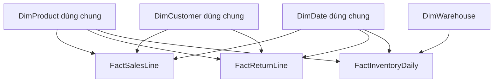

# Chiều dùng chung và định nghĩa nhất quán giữa các quy trình

Một doanh nghiệp có thể báo cáo **doanh thu** từ hệ thống bán hàng, **giá trị hoàn trả** từ hệ thống hậu mãi và **tồn kho** từ hệ thống quản lý kho. Cả ba quy trình đều nói đến “sản phẩm”, “ngày” và đôi khi “cửa hàng”. Nhưng nếu quy trình bán hàng coi một sản phẩm là một biến thể SKU, quy trình hoàn trả dùng mã mẫu sản phẩm, còn kho dùng mã thùng hàng, thì việc ghép số liệu theo một cột cùng tên có thể tạo ra kết quả sai dù truy vấn SQL chạy thành công.

Trong **mô hình phân tích** (*analytical/dimensional modeling*), **chiều dùng chung** (*conformed dimension*) là một chiều có danh tính, cấp độ chi tiết (*grain*), thuộc tính và cách diễn giải thống nhất để **nhiều quy trình nghiệp vụ có thể phân tích theo cùng một hệ quy chiếu**. Chiều đó có thể được chia sẻ dưới dạng một bảng vật lý hoặc được phân phối thành các bản triển khai tương thích về ngữ nghĩa; điều quyết định là **tính nhất quán đã được kiểm chứng**, không phải việc các bảng cùng tên hay cùng khóa số.

Bài thuộc module **DATABASE_DATA_MODELING**, tập trung rèn kỹ năng chuyển yêu cầu nghiệp vụ thành thực thể, quan hệ, khóa, chỉ mục, lược đồ vật lý và lựa chọn mô hình lưu trữ phù hợp. Ta sẽ xây dựng một **bus matrix** cho nhiều quy trình, định nghĩa các chiều dùng chung, triển khai ví dụ SQL, xử lý **Slowly Changing Dimensions (SCD)**, thực hiện **drill-across** an toàn giữa các fact và thiết kế quy trình đối soát khi định nghĩa giữa các hệ thống lệch nhau.

## 1. Tại sao cần chiều dùng chung?

Giả sử công ty muốn trả lời:

> Trong tháng 10, từng nhóm sản phẩm bán được bao nhiêu, bị trả lại bao nhiêu và còn tồn kho cuối tháng bao nhiêu?

Có ba nguồn dữ liệu:

| Quy trình | Dữ liệu gốc thường có | Câu hỏi thường trả lời |
|---|---|---|
| **Bán hàng (Sales)** | Đơn, dòng đơn, thời điểm bán, SKU, doanh thu | Giá trị và số lượng đã bán theo ngày/nhóm |
| **Trả hàng (Returns)** | Phiếu trả, dòng trả, đơn gốc, lý do, số tiền hoàn | Giá trị và số lượng trả theo ngày/nhóm |
| **Tồn kho (Inventory)** | Số lượng tồn theo SKU, kho và thời điểm chụp | Tồn cuối kỳ, xu hướng tồn, khả năng đáp ứng |

Nếu mỗi đội tự định nghĩa “Điện thoại”:

- Sales dùng `category = 'PHONE'` cho điện thoại và phụ kiện.
- Returns dùng `category = 'MOBILE'` cho điện thoại, không gồm phụ kiện.
- Inventory dùng tên “Thiết bị cầm tay” và một SKU có thể đại diện cho **hộp 10 chiếc**.

Thì báo cáo “đã bán 1.000, đã trả 100, tồn 300” **không có ý nghĩa đối soát** nếu chưa xác nhận 1.000, 100 và 300 là cùng tập đối tượng và cùng đơn vị đo.

Chiều dùng chung giải quyết phần **tập đối tượng và trục phân tích**: một định nghĩa sản phẩm, danh mục, ngày, đơn vị tổ chức... giữa các quy trình. Nhưng nó **không tự giải quyết định nghĩa thước đo** (*measure*). “Doanh thu gộp”, “doanh thu ròng”, “số lượng trả” và “tồn cuối ngày” vẫn cần công thức, thời điểm và tính cộng được riêng.

### Ba lớp nhất quán

1. **Danh tính:** cùng một mã chuẩn phải chỉ cùng một thực thể/phiên bản; hai mã khác nhau không bị ghép tùy tiện.
2. **Ngữ nghĩa chiều:** thuộc tính, hierarchy, cách chuẩn hóa và hiệu lực theo thời gian phải tương thích.
3. **Ngữ nghĩa fact:** mỗi quy trình có grain, dấu, đơn vị đo và thời điểm ghi nhận riêng, dù dùng chung chiều.

Không đủ nếu chỉ hoàn thành (1). Ví dụ cùng `product_id` nhưng sales ghi nhóm hàng tại thời điểm bán, returns ghi nhóm hàng hiện tại thì báo cáo theo nhóm vẫn có thể sai khi sản phẩm đổi phân loại.

## 2. Phân biệt dimension, fact, grain và conformance

**Fact** ghi nhận một sự kiện, giao dịch hoặc ảnh chụp trạng thái có thể đo lường. **Dimension** cung cấp ngữ cảnh để lọc, nhóm và diễn giải fact.



Trong sơ đồ này:

- `DimProduct` định nghĩa một **biến thể sản phẩm có thể bán/ghi kho**, được dùng bởi cả ba fact.
- `DimDate` định nghĩa ngày theo cùng lịch doanh nghiệp; mỗi fact dùng ngày trong **vai trò** của nó: ngày bán, ngày trả hoặc ngày snapshot.
- `DimCustomer` dùng chung giữa bán và trả hàng nếu định danh khách thực sự tương thích. Inventory có thể **không có chiều khách hàng**.
- `DimWarehouse` chỉ thuộc quá trình tồn kho; không ép mọi fact đều phải có đủ mọi chiều.

### “Dùng chung” không nhất thiết “mọi quy trình đều sử dụng”

Một chiều conform có thể chỉ xuất hiện trong **một tập con** các quy trình. Một chiều `DimCustomer` được Sales và Returns dùng chung vẫn là conform dù không liên quan đến Inventory.

Ngược lại, không nên tạo một chiều chung “`DimStatus`” cho mọi trạng thái chỉ vì các nguồn đều có cột `status`. `CONFIRMED` của đơn, `APPROVED` của hoàn tiền và `AVAILABLE` của tồn kho là những **nghĩa nghiệp vụ khác nhau**. Chúng có thể có bảng trạng thái riêng, hoặc phải xây một phân loại chuẩn ở mức cao hơn với hợp đồng rõ ràng nếu thực sự có nhu cầu so sánh.

### Hai mức conformance

- **Conformed dimension dùng cùng bảng/khóa:** các fact tham chiếu một bảng `dim_product`, cùng `product_sk` và cùng thuộc tính.
- **Conformed dimension được phân phối:** các data mart giữ bản sao/giả phần (*shrunken dimension*) với cùng mã chuẩn, định nghĩa, hierarchy và quy tắc tạo thành viên. Một bản sao có thể chỉ giữ tập cột con, nhưng các thuộc tính chung phải có cùng nghĩa và giá trị tại cùng phiên bản hợp lệ.

Nếu hai data mart độc lập tự sinh `product_sk = 42` cho **hai sản phẩm khác nhau**, con số 42 không phải khóa dùng chung. Cần ánh xạ qua danh tính chuẩn hoặc phân phối khóa surrogate theo một hợp đồng nhất quán.

## 3. Bắt đầu bằng bus matrix thay vì ghép các fact tùy tiện

**Bus matrix** (*enterprise data warehouse bus matrix*) đặt **quy trình nghiệp vụ ở hàng** và **các chiều có thể dùng chung ở cột**. Nó giúp xác định phạm vi conformance trước khi thiết kế bảng vật lý.

| Quy trình / grain fact | Ngày | Sản phẩm | Khách hàng | Cửa hàng/kho | Đơn vị tiền |
|---|---|---|---|---|---|
| Dòng bán hàng — **1 dòng bán** | Ngày bán | Có | Có | Cửa hàng bán, nếu biết | Có |
| Dòng trả hàng — **1 dòng trả** | Ngày trả; có thể thêm ngày bán gốc | Có | Có, nếu xác định được | Điểm nhận trả, nếu biết | Có |
| Tồn kho cuối ngày — **1 SKU × kho × ngày** | Ngày chốt tồn | Có | Không áp dụng | Kho | Không nhất thiết là thước đo tiền |
| Thanh toán — **1 giao dịch thanh toán** | Ngày thanh toán | Có thể không có sản phẩm trực tiếp | Có hoặc không tùy nguồn | Có thể có | Có |

“Cửa hàng” và “kho” **chưa chắc là cùng loại địa điểm**. Có thể có một dimension `DimLocation` với phân loại rõ ràng nếu địa điểm là một thực thể chuẩn chung; nếu kho và cửa hàng có danh tính/quan hệ khác nhau, giữ hai chiều riêng và một cấu trúc ánh xạ để tổng hợp theo vùng khi cần.

Các cột trong bus matrix là **khả năng dùng chung về ngữ nghĩa**, không phải lệnh tạo một FK cho mọi ô. Đánh dấu “không áp dụng” tốt hơn là ép một `customer_sk = 0` cho toàn bộ ảnh chụp tồn kho khiến người dùng hiểu lầm rằng kho có khách hàng.

### Viết grain bằng một câu trước mỗi fact

| Fact | Grain chính xác | Khóa nghiệp vụ/định danh điển hình |
|---|---|---|
| `fact_sales_line` | Một dòng bán của một đơn trong một tenant | `tenant_id + source_system + source_sale_line_id` |
| `fact_return_line` | Một dòng hoàn trả đã được ghi nhận | `tenant_id + source_system + source_return_line_id` |
| `fact_inventory_daily` | Tồn cuối ngày của một sản phẩm chuẩn trong một kho | `tenant_id + warehouse_id + product_bk + date_key` |

**Grain không đồng nhất:** không thể nối `fact_sales_line` trực tiếp với `fact_return_line` theo `product_sk` rồi cộng số tiền như thể mỗi bên chỉ có một dòng. Một sản phẩm có 20 dòng bán và 5 dòng trả sẽ tạo **100 dòng ghép** nếu join theo sản phẩm, khiến số liệu nhân lên.

Trước khi xem dimension, phải xác định mỗi hàng fact đang biểu diễn điều gì, những đơn vị đo nào được phép cộng và dưới điều kiện nào.

## 4. Định nghĩa hợp đồng cho từng chiều dùng chung

Một conformed dimension cần **hợp đồng dữ liệu**, không chỉ sơ đồ cột.

| Thành phần hợp đồng | Ví dụ với `DimProduct` | Câu hỏi cần xác nhận |
|---|---|---|
| **Grain** | Một biến thể SKU có thể bán và kiểm kê | Một mã thùng 10 chiếc có cùng grain với một chiếc không? |
| **Business identity** | `(tenant_id, canonical_product_id)` | Nguồn nào cấp danh tính, có tái sử dụng ID không? |
| **Surrogate identity** | `product_sk` theo phiên bản SCD | Khóa này có dùng được xuyên mart không? |
| **Thuộc tính chuẩn** | SKU, tên, nhãn hàng, nhóm hàng | “Nhóm hàng” là nhóm bán lẻ hay nhóm kế toán? |
| **Hierarchy** | Ngành hàng → nhóm → phân nhóm | Có một hay nhiều cha? Có lịch sử thay đổi cây không? |
| **Quy tắc chuẩn hóa** | Trim/mã chuẩn/canonical mapping | SKU có phân biệt hoa thường, số 0 đầu không? |
| **Thời gian hiệu lực** | `[valid_from, valid_to)` | Nhóm hàng tại ngày bán hay nhóm hiện tại? |
| **Unknown/late member** | Key “chưa xác định” được quản lý | Có được tự gộp nhiều unknown thành một sản phẩm? |
| **Nguồn thẩm quyền** | Product master/MDM | Ai xử lý hai nguồn mâu thuẫn? |
| **Owner và chất lượng** | Product data steward | Ai chấp thuận đổi định nghĩa, kiểm tra gì? |

Các hợp đồng của `DimCustomer`, `DimDate`, `DimOrganization` cần được mô tả tương tự. “Khách hàng” phải xác định là **tài khoản bán lẻ**, **cá nhân** hay **pháp nhân**; không được dùng email làm bằng chứng duy nhất rằng hai hồ sơ là cùng người. “Ngày” phải xác định múi giờ, lịch tài chính, tuần bắt đầu ngày nào và cách chuyển sự kiện UTC về ngày kinh doanh.

### Đừng ép các nguồn khác grain vào một dimension bằng cách bỏ mất thông tin

Ví dụ kho dùng `case_sku` (một thùng chứa 10 chiếc) còn bán hàng dùng `each_sku` (một chiếc). Hai mã này không nhất thiết là **cùng một thành viên `DimProduct`**. Cần ánh xạ đơn vị đóng gói, số lượng chuyển đổi có hiệu lực và sự kiện quy đổi; có thể giữ thêm `DimPackage` hoặc một bridge giải nghĩa `case_sku → each_sku × 10`. Nhân/ chia lượng tồn **phải có quy tắc đơn vị** trước khi so với số lượng bán.

Nếu một SKU tái sử dụng cho sản phẩm khác theo thời gian, khóa tự nhiên chỉ dựa trên SKU không còn ổn định. Cần định danh sản phẩm chuẩn và lịch sử mapping; không coi “cùng chuỗi SKU” là “cùng sản phẩm” mặc định.

## 5. Chuẩn hóa danh tính qua nhiều nguồn

Một quy trình thực tế thường có nhiều mã:

| Nguồn | Mã nguồn | Chủ thể thực tế | Mã chuẩn |
|---|---|---|---|
| POS | `SKU-0007` | Điện thoại phiên bản đen 128GB | `PRD-100` |
| ERP | `ITEM-782` | Cùng biến thể điện thoại | `PRD-100` |
| WMS | `W-552` | Cùng biến thể ở cấp từng chiếc | `PRD-100` |
| WMS | `CASE-552` | Thùng chứa 10 chiếc đó | **Không tự gộp**; cần mapping gói |

Không nên chọn mã POS làm ID chuẩn chỉ vì sales là nguồn lớn nhất. Phải xác nhận ai có **quyền định nghĩa danh tính** và cách xử lý trường hợp hợp nhất/tách sản phẩm. Một bảng ánh xạ nguồn có thể chứa:

```text
ProductIdentityMap
  tenant_id
  source_system
  source_product_id
  canonical_product_id
  effective_from
  effective_to
  status
  match_method
  approved_by
```

Khi `source_product_id` có thể được sử dụng lại, mapping cũng phải **có hiệu lực theo thời gian** và tránh khoảng chồng nhau không chủ đích. Dòng fact phải được giải mã theo **nguồn + mã nguồn + thời điểm** để chọn đúng danh tính chuẩn.

Cách ghép “hai tên giống nhau thì là một” hoặc “hai email giống nhau thì là một khách” có thể gộp nhầm dữ liệu. Nếu chưa đủ bằng chứng, nên đưa bản ghi vào **vùng chờ đối soát** hoặc thành viên không xác định với lineage rõ, thay vì tạo một conformed key sai.

### Surrogate key khác business key

- `canonical_product_id`: định danh nghiệp vụ chuẩn, ổn định qua các nguồn (nếu chính sách MDM bảo đảm).
- `product_sk`: khóa kỹ thuật của **một phiên bản dòng dimension**; khi SCD Type 2 thay đổi thuộc tính cần theo dõi lịch sử, cùng một product có thể có nhiều `product_sk`.
- `source_product_id`: định danh do hệ thống đầu vào cấp, thường không duy nhất trên toàn doanh nghiệp.

Một báo cáo theo **sản phẩm chuẩn hiện tại** có thể nhóm theo `canonical_product_id`. Một báo cáo theo **nhóm hàng tại thời điểm bán** có thể nhóm theo thuộc tính của `product_sk` mà fact đã tham chiếu. Hai cách diễn giải cùng đúng trong những ngữ cảnh khác nhau, nhưng không được trộn vào một báo cáo mà không ghi chú.

## 6. Slowly Changing Dimensions và định nghĩa “tại thời điểm T”

Giả sử sản phẩm `PRD-100` trước tháng 10 thuộc nhóm “Điện thoại”, sau ngày 01/10 được chuyển sang “Thiết bị di động”. Có ít nhất hai yêu cầu báo cáo:

- **Theo phân loại tại thời điểm giao dịch:** Doanh thu tháng 9 vẫn nằm ở “Điện thoại”.
- **Theo phân loại hiện tại:** Mọi doanh thu, kể cả tháng 9, được gom về “Thiết bị di động”.

Đây là hai góc nhìn nghiệp vụ khác nhau. Không có một `category_name` duy nhất đủ mô tả cả hai nếu thuộc tính thay đổi.

### 6.1. SCD Type 1, Type 2 và Type 0

| Chính sách | Hành vi | Phù hợp khi |
|---|---|---|
| **Type 1** | Ghi đè thuộc tính trong dòng dimension hiện tại | Sửa lỗi chính tả, không cần lịch sử thay đổi |
| **Type 2** | Thêm phiên bản mới với khóa `product_sk` khác và khoảng hiệu lực | Cần nhóm fact theo phân loại tại thời điểm xảy ra |
| **Type 0** | Giữ thuộc tính không thay đổi sau khi tạo | Dữ liệu nguồn gốc phải giữ nguyên, ví dụ ngày tạo ban đầu |

Có thể phối hợp các chính sách **theo từng thuộc tính**. Ví dụ sửa lỗi hiển thị tên có thể Type 1, thay nhóm hàng theo quyết định nghiệp vụ Type 2. Nhưng nếu Type 1 ghi đè một cột trên **mọi phiên bản Type 2**, báo cáo lịch sử sẽ thấy giá trị sửa lại; đó có thể là chủ đích hoặc là sai khác cần phê duyệt.

### 6.2. Khóa hiệu lực nửa mở

Dùng khoảng `[valid_from, valid_to)`: bắt đầu bao gồm, kết thúc không bao gồm. Một phiên bản có `valid_to = NULL` nghĩa là còn hiệu lực vô thời hạn trong ví dụ.

```text
PRD-100 / product_sk=501 / category=PHONE
  valid_from: 2026-01-01 00:00 UTC
  valid_to:   2026-10-01 00:00 UTC

PRD-100 / product_sk=888 / category=MOBILE
  valid_from: 2026-10-01 00:00 UTC
  valid_to:   NULL
```

Giao dịch lúc 23:59 ngày 30/09 UTC ánh xạ tới `501`. Giao dịch lúc 00:00 ngày 01/10 UTC ánh xạ tới `888`. Nếu nhóm hàng có hiệu lực theo **ngày kinh doanh ở Việt Nam** chứ không phải UTC, phải chuyển mốc hiệu lực chính xác trước khi load; không mặc định giờ lưu trữ là cùng mốc kinh doanh.

### 6.3. Nguyên tắc giải mã fact tới một phiên bản

Với mỗi event, tra cứu:

\[
(\text{tenant},\ \text{canonical product},\ \text{event time})
\rightarrow \text{exactly one product\_sk}.
\]

Nếu có **0 phiên bản** khớp, dữ liệu dimension thiếu hoặc đến muộn. Nếu có **2 phiên bản** khớp, các khoảng SCD chồng nhau — lỗi cần xử lý. Không được âm thầm chọn dòng đầu tiên để che việc mapping không xác định.

## 7. Lược đồ SQL minh họa chiều dùng chung

Ví dụ sau dùng **PostgreSQL 15+** và intentionally tách lớp phân tích với hệ giao dịch nguồn. Các bảng fact lưu ở grain đã định nghĩa; không yêu cầu nguồn OLTP phải có cùng schema.

### 7.1. Dimension ngày và sản phẩm Type 2

```sql
CREATE TABLE dim_date (
    date_key INTEGER PRIMARY KEY,       -- Ví dụ 20261005
    calendar_date DATE NOT NULL UNIQUE,
    calendar_year INTEGER NOT NULL,
    calendar_month INTEGER NOT NULL,
    month_key INTEGER NOT NULL,         -- Ví dụ 202610
    CONSTRAINT ck_date_month CHECK (calendar_month BETWEEN 1 AND 12)
);

CREATE TABLE dim_product (
    product_sk BIGINT GENERATED ALWAYS AS IDENTITY PRIMARY KEY,
    tenant_id BIGINT NOT NULL,
    canonical_product_id TEXT NOT NULL,
    sku TEXT NOT NULL,
    product_name TEXT NOT NULL,
    category_code TEXT NOT NULL,
    category_name TEXT NOT NULL,
    valid_from TIMESTAMPTZ NOT NULL,
    valid_to TIMESTAMPTZ,
    is_current BOOLEAN NOT NULL,

    CONSTRAINT uq_product_version
        UNIQUE (tenant_id, canonical_product_id, valid_from),
    CONSTRAINT uq_product_tenant_sk
        UNIQUE (tenant_id, product_sk),
    CONSTRAINT ck_product_bk
        CHECK (btrim(canonical_product_id) <> ''),
    CONSTRAINT ck_product_name
        CHECK (btrim(product_name) <> ''),
    CONSTRAINT ck_product_interval
        CHECK (valid_to IS NULL OR valid_to > valid_from),
    CONSTRAINT ck_product_current
        CHECK (is_current = (valid_to IS NULL))
);

CREATE UNIQUE INDEX uq_current_product_per_tenant
    ON dim_product (tenant_id, canonical_product_id)
    WHERE is_current = TRUE;

CREATE INDEX ix_product_asof
    ON dim_product (tenant_id, canonical_product_id, valid_from);
```

**Các ràng buộc này bảo vệ:**

- `product_sk` duy nhất cho từng phiên bản; `(tenant_id, canonical_product_id, valid_from)` không trùng.
- Mỗi sản phẩm chuẩn có **tối đa một** phiên bản `is_current=TRUE` nhờ unique index từng phần.
- `valid_to` lớn hơn `valid_from` nếu có.
- `is_current` nhất quán với việc khoảng hiệu lực chưa có ngày kết thúc.

**Chưa bảo vệ:** hai phiên bản **đã kết thúc** có khoảng giao nhau; khoảng trống thời gian; một mã chuẩn có ít nhất một phiên bản. FK và unique thông thường không giải quyết hết bài toán khoảng thời gian.

PostgreSQL có thể bổ sung một **exclusion constraint** nếu extension/operator class và quy trình triển khai cho phép:

```sql
-- Tùy chọn PostgreSQL: kiểm tra khoảng hiệu lực không chồng nhau.
-- Cần quyền cài extension và đánh giá chỉ mục GiST khi triển khai.
CREATE EXTENSION IF NOT EXISTS btree_gist;

ALTER TABLE dim_product
ADD CONSTRAINT ex_product_versions_no_overlap
EXCLUDE USING gist (
    tenant_id WITH =,
    canonical_product_id WITH =,
    tstzrange(valid_from, valid_to, '[)') WITH &&
);
```

`tstzrange(valid_from, NULL, '[)')` có biên trên không giới hạn, phù hợp với bản hiện hành. Constraint này chặn **khoảng chồng** trong cùng tenant/sản phẩm; nó **không** bắt buộc các khoảng phải liền mạch. Khi triển khai trên bảng lớn, cần đo chi phí index và xử lý dữ liệu cũ không hợp lệ trước.

### 7.2. Dimension khách hàng dùng chung ở mức tài khoản

```sql
CREATE TABLE dim_customer (
    customer_sk BIGINT GENERATED ALWAYS AS IDENTITY PRIMARY KEY,
    tenant_id BIGINT NOT NULL,
    canonical_customer_id TEXT NOT NULL,
    customer_segment TEXT NOT NULL,
    display_name TEXT NOT NULL,

    CONSTRAINT uq_customer_tenant_bk
        UNIQUE (tenant_id, canonical_customer_id),
    CONSTRAINT uq_customer_tenant_sk
        UNIQUE (tenant_id, customer_sk),
    CONSTRAINT ck_customer_identity
        CHECK (btrim(canonical_customer_id) <> ''),
    CONSTRAINT ck_customer_segment
        CHECK (btrim(customer_segment) <> ''),
    CONSTRAINT ck_customer_name
        CHECK (btrim(display_name) <> '')
);
```

Trong ví dụ này `DimCustomer` là **Type 1**, không có lịch sử phân khúc. Vì vậy báo cáo doanh thu quá khứ theo `customer_segment` sẽ dùng **phân khúc hiện tại**. Nếu nghiệp vụ cần phân khúc **tại thời điểm mua**, phải chuyển thuộc tính đó sang phiên bản SCD Type 2 hoặc lưu snapshot hợp lệ; không được tuyên bố báo cáo đã giữ lịch sử khi chỉ có bảng Type 1.

`canonical_customer_id` phải được định nghĩa bằng quy trình nhận dạng có kiểm soát, không tự suy từ email/điện thoại trùng nhau. Trường hợp POS giao dịch ẩn danh có thể cần một unknown/special member theo tenant, nhưng phải ghi rõ đây là **khách không xác định**, không phải mọi người mua ẩn danh là một cá nhân duy nhất.

### 7.3. Ba fact với grain khác nhau

```sql
CREATE TABLE fact_sales_line (
    sales_line_sk BIGINT GENERATED ALWAYS AS IDENTITY PRIMARY KEY,
    tenant_id BIGINT NOT NULL,
    source_sale_line_id TEXT NOT NULL,
    sale_date_key INTEGER NOT NULL REFERENCES dim_date(date_key),
    product_sk BIGINT NOT NULL,
    customer_sk BIGINT NOT NULL,
    currency_code CHAR(3) NOT NULL,
    quantity NUMERIC(18, 3) NOT NULL,
    gross_amount_minor NUMERIC(20, 0) NOT NULL,
    discount_amount_minor NUMERIC(20, 0) NOT NULL,
    net_sales_amount_minor NUMERIC(20, 0) NOT NULL,

    CONSTRAINT uq_sale_source
        UNIQUE (tenant_id, source_sale_line_id),
    CONSTRAINT uq_sale_tenant_sk
        UNIQUE (tenant_id, sales_line_sk),
    CONSTRAINT fk_sale_product
        FOREIGN KEY (tenant_id, product_sk)
        REFERENCES dim_product (tenant_id, product_sk),
    CONSTRAINT fk_sale_customer
        FOREIGN KEY (tenant_id, customer_sk)
        REFERENCES dim_customer (tenant_id, customer_sk),
    CONSTRAINT ck_sale_qty CHECK (quantity > 0),
    CONSTRAINT ck_sale_gross CHECK (gross_amount_minor >= 0),
    CONSTRAINT ck_sale_discount CHECK (
        discount_amount_minor >= 0
        AND discount_amount_minor <= gross_amount_minor
    ),
    CONSTRAINT ck_sale_net CHECK (
        net_sales_amount_minor = gross_amount_minor - discount_amount_minor
    )
);

CREATE TABLE fact_return_line (
    return_line_sk BIGINT GENERATED ALWAYS AS IDENTITY PRIMARY KEY,
    tenant_id BIGINT NOT NULL,
    source_return_line_id TEXT NOT NULL,
    return_date_key INTEGER NOT NULL REFERENCES dim_date(date_key),
    original_sales_line_sk BIGINT NOT NULL,
    product_sk BIGINT NOT NULL,
    customer_sk BIGINT NOT NULL,
    currency_code CHAR(3) NOT NULL,
    returned_quantity NUMERIC(18, 3) NOT NULL,
    refund_amount_minor NUMERIC(20, 0) NOT NULL,

    CONSTRAINT uq_return_source
        UNIQUE (tenant_id, source_return_line_id),
    CONSTRAINT fk_return_original_sale
        FOREIGN KEY (tenant_id, original_sales_line_sk)
        REFERENCES fact_sales_line (tenant_id, sales_line_sk),
    CONSTRAINT fk_return_product
        FOREIGN KEY (tenant_id, product_sk)
        REFERENCES dim_product (tenant_id, product_sk),
    CONSTRAINT fk_return_customer
        FOREIGN KEY (tenant_id, customer_sk)
        REFERENCES dim_customer (tenant_id, customer_sk),
    CONSTRAINT ck_return_qty CHECK (returned_quantity > 0),
    CONSTRAINT ck_return_amount CHECK (refund_amount_minor >= 0)
);

CREATE TABLE fact_inventory_daily (
    tenant_id BIGINT NOT NULL,
    snapshot_date_key INTEGER NOT NULL REFERENCES dim_date(date_key),
    warehouse_id TEXT NOT NULL,
    product_sk BIGINT NOT NULL,
    on_hand_units NUMERIC(18, 3) NOT NULL,

    CONSTRAINT pk_inventory_daily
        PRIMARY KEY (
            tenant_id, snapshot_date_key, warehouse_id, product_sk
        ),
    CONSTRAINT fk_inventory_product
        FOREIGN KEY (tenant_id, product_sk)
        REFERENCES dim_product (tenant_id, product_sk),
    CONSTRAINT ck_warehouse_id CHECK (btrim(warehouse_id) <> '')
);
```

**Giả định công thức minh họa:** sales có `net_sales_amount_minor = gross - discount`; không gồm thuế/phí vận chuyển. Return lưu số tiền hoàn **không âm**; khi tính chênh lệch sẽ **trừ** tiền hoàn, không ghi giá trị âm rồi trừ thêm lần nữa.

**Giả định nguồn trả hàng:** mỗi dòng trả gắn được với một dòng bán gốc. Với nhiều lần trả từng phần, nhiều `fact_return_line` có thể cùng trỏ một `original_sales_line_sk`. Bộ FK **chưa** khẳng định `product_sk`, `customer_sk` và `currency_code` trên return bằng các giá trị của dòng bán gốc; điều này cần hợp đồng ETL, kiểm thử hoặc cơ chế ràng buộc bổ sung. Nếu nghiệp vụ cho phép trả không có chứng từ bán gốc, phải chọn grain và cơ chế mapping khác, không nhập tùy tiện một ID gốc giả.

**Giả định tồn kho:** mỗi ngày có đúng một ảnh chụp **cuối ngày** cho mỗi tenant/kho/sản phẩm. `on_hand_units` không có `CHECK >= 0` vì một số hệ cho phép số âm tạm thời khi đối soát; nếu nghiệp vụ cấm tồn âm, thêm bất biến rõ ràng. Một snapshot là **trạng thái tại một thời điểm**, không phải số lượng nhập/xuất trong ngày.

### Khóa ghép bảo vệ tenant nhưng không tự bảo vệ tất cả định nghĩa

Các FK `(tenant_id, product_sk)` và `(tenant_id, customer_sk)` bảo vệ mỗi fact trỏ đúng chiều của tenant mình. Tuy vậy, chúng **không chứng minh** fact đã trỏ đúng **phiên bản SCD tại thời điểm event**. Một dòng bán ngày 01/09 vẫn có thể trỏ version sản phẩm hiệu lực từ 01/10 mà FK không báo lỗi. Đó là lý do cần quy tắc giải mã temporal key và kiểm tra riêng.

Ở hệ phân tích khác, FK có thể chỉ được dùng làm **metadata cho optimizer** hoặc không được engine thực thi. Trong trường hợp đó, pipeline và kiểm thử dữ liệu phải bảo đảm những bất biến mà nguồn OLTP thường giao cho database.

## 8. ETL/ELT giải mã phiên bản chiều tại thời điểm sự kiện

Giả sử nguồn Sales gửi:

```text
tenant_id = 42
source_sale_line_id = POS-2026-001
source_product_id = SKU-0007
occurred_at = 2026-09-30T14:30:00Z
quantity = 2
```

Trước khi ghi fact:

1. Ánh xạ `(tenant_id, source_system, source_product_id, occurred_at)` thành `canonical_product_id` thông qua bảng nhận dạng chuẩn.
2. Tra cứu `DimProduct` có cùng tenant và mã chuẩn, sao cho thời điểm sự kiện nằm trong khoảng hiệu lực.
3. Phải có **đúng một** `product_sk`; không chấp nhận 0 hoặc hơn 1 mà không ghi lỗi.
4. Ánh xạ khách hàng theo định nghĩa `DimCustomer` và chính sách unknown đã phê duyệt.
5. Quy đổi `occurred_at` sang **ngày kinh doanh** theo múi giờ/lịch đã chọn để xác định `sale_date_key`.
6. Chuẩn hóa đơn vị đo, đồng tiền, giá trị thuế/giảm, dấu amount theo contract fact.
7. Upsert theo **khóa nguồn duy nhất** với chính sách sửa/late event; không nạp trùng một dòng bán vì retry.

### Truy vấn tra phiên bản sản phẩm

```sql
-- product_id chuẩn đã được phân giải ở bước mapping nguồn.
SELECT p.product_sk
FROM dim_product AS p
WHERE p.tenant_id = 42
  AND p.canonical_product_id = 'PRD-100'
  AND p.valid_from <= TIMESTAMPTZ '2026-09-30 14:30:00+00'
  AND (
      p.valid_to IS NULL
      OR TIMESTAMPTZ '2026-09-30 14:30:00+00' < p.valid_to
  );
```

Điều kiện `[valid_from, valid_to)` khớp với hợp đồng SCD. Đối với mỗi input, ETL **bắt buộc kiểm tra số dòng trả về**. Dùng `LIMIT 1` để “tránh lỗi” khi có hai khoảng chồng nhau chỉ che dấu nguồn dữ liệu sai.

### Sự kiện đến muộn và chiều đến muộn

**Late-arriving fact:** dòng bán ngày 15/09 chỉ đến kho phân tích vào ngày 05/10. Nếu phiên bản sản phẩm đổi ngày 01/10, fact vẫn phải ánh xạ theo **15/09**, không theo ngày nạp.

**Late-arriving dimension:** fact đến trước thông tin sản phẩm chuẩn. Có thể giữ fact ở staging cho tới khi giải mã được, hoặc dùng **inferred member** có ID/version rõ và bổ sung sau. Không tự lấy sản phẩm có tên gần giống để lấp chỗ trống.

**Sửa lịch sử SCD:** nếu nguồn thông báo một thay đổi hiệu lực từ 15/09 nhưng hệ thống đã nạp phiên bản 01/10, việc thêm phiên bản mới có thể **chia khoảng** và làm một số fact trước đó trỏ sai `product_sk`. Phải có chương trình xác định các fact bị ảnh hưởng, cập nhật surrogate key hoặc chốt lại quy tắc lịch sử đã công bố. Một lần thay dimension không tự làm FK trong fact chọn lại phiên bản đúng.

## 9. Trả hàng: ngày trả hay ngày bán, nhóm hàng cũ hay mới?

Returns là nơi dễ lộ ra sự thiếu nhất quán giữa các quy trình. Một sản phẩm được bán ngày 29/09 khi thuộc nhóm `PHONE`; khách trả ngày 08/10 khi sản phẩm đã được chuyển sang `MOBILE`.

Có ít nhất bốn quyết định:

| Trục | Phương án | Ý nghĩa |
|---|---|---|
| **Ngày đo return** | Ngày trả | Giá trị hoàn phát sinh trong tháng 10 |
| **Ngày đo return** | Ngày bán gốc | Điều chỉnh kết quả kinh doanh của kỳ bán tháng 9 |
| **Nhóm sản phẩm** | Nhóm tại ngày bán gốc | Hoàn trả được quy về cùng phân loại với doanh số ban đầu |
| **Nhóm sản phẩm** | Nhóm tại ngày trả | Hoàn trả được quy về phân loại đang hiệu lực khi nhận trả |

Các cách đo này **không thể tráo đổi** mà không thay đổi kết quả. Hãy chọn theo câu hỏi báo cáo và ghi vào contract. Không nhất thiết một bảng fact duy nhất phải phục vụ tất cả góc nhìn; có thể lưu đủ khóa thời gian và liên kết dòng bán gốc để suy ra các biến thể báo cáo.

Trong ví dụ này ta **quy ước `fact_return_line.product_sk` bằng `product_sk` của dòng bán gốc**, để phân loại return theo **nhóm tại thời điểm bán**. `return_date_key` vẫn là **ngày hoàn trả thực tế**. Quy ước này giúp đối chiếu doanh số bán với hoàn trả theo **cùng định nghĩa lịch sử sản phẩm** mà không ép hoàn trả vào tháng bán.

**Cần biết giới hạn của quy ước:** một thống kê “hoàn trả theo nhóm đang có hiệu lực tại ngày trả” cần thêm phép phân giải product dimension tại ngày trả hoặc một chiều riêng. Không được lấy query cũ rồi tự đổi nhãn nhóm trong UI mà không kiểm tra logic thời gian.

### Điều kiện không thể hiện qua FK của ví dụ

Nếu return có `original_sales_line_sk`, ETL cần xác nhận:

- Return dùng đúng `product_sk` của sales line gốc theo policy trên.
- Return cùng tenant với sales line gốc.
- Return thuộc khách hoặc tài khoản hoàn tiền được phê duyệt.
- Refund currency và quy tắc số tiền phù hợp với sale gốc; có thể có phí, coupon hoặc điều chỉnh.
- Tổng lượng trả của nhiều dòng return không vượt lượng đã bán nếu chính sách không cho vượt.
- Return bị hủy/đổi trạng thái có được tính vào fact hay không.

FK của lược đồ bảo vệ **sự tồn tại và tenant** của dòng gốc, nhưng không tự xác thực các điều kiện tổng hợp và tương ứng cột. Các quy tắc đó cần ETL/nguồn giao dịch và kiểm thử có thể truy vết.

## 10. Drill-across: so các quy trình mà không tạo nhân bản dòng

**Drill-across** là tổng hợp riêng từng fact tới **cùng khóa nhóm và cùng quy tắc chiều**, rồi ghép các kết quả tổng hợp theo tập khóa đó.

Ví dụ yêu cầu báo cáo:

> Trong tháng, theo nhóm sản phẩm tại thời điểm bán, doanh số ròng và giá trị hoàn trả phát sinh trong tháng là bao nhiêu?

Với contract của bài, sales và returns đều dùng `DimProduct` với `category_code` của phiên bản gắn trong fact. Cả hai có `dim_date.month_key`, nhưng là **ngày bán** và **ngày trả** tương ứng. Ta **không nối hai fact thô**.

### 10.1. Ví dụ truy vấn an toàn

```sql
WITH sales_by_month AS (
    SELECT
        s.tenant_id,
        d.month_key,
        p.category_code,
        s.currency_code,
        SUM(s.net_sales_amount_minor) AS sales_minor
    FROM fact_sales_line AS s
    JOIN dim_date AS d ON d.date_key = s.sale_date_key
    JOIN dim_product AS p
      ON p.tenant_id = s.tenant_id AND p.product_sk = s.product_sk
    WHERE s.tenant_id = 42
      AND s.currency_code = 'VND'
    GROUP BY
        s.tenant_id, d.month_key, p.category_code, s.currency_code
),
returns_by_month AS (
    SELECT
        r.tenant_id,
        d.month_key,
        p.category_code,
        r.currency_code,
        SUM(r.refund_amount_minor) AS returns_minor
    FROM fact_return_line AS r
    JOIN dim_date AS d ON d.date_key = r.return_date_key
    JOIN dim_product AS p
      ON p.tenant_id = r.tenant_id AND p.product_sk = r.product_sk
    WHERE r.tenant_id = 42
      AND r.currency_code = 'VND'
    GROUP BY
        r.tenant_id, d.month_key, p.category_code, r.currency_code
)
SELECT
    COALESCE(s.tenant_id, r.tenant_id) AS tenant_id,
    COALESCE(s.month_key, r.month_key) AS month_key,
    COALESCE(s.category_code, r.category_code) AS category_code,
    COALESCE(s.currency_code, r.currency_code) AS currency_code,
    COALESCE(s.sales_minor, 0) AS sales_minor,
    COALESCE(r.returns_minor, 0) AS returns_minor,
    COALESCE(s.sales_minor, 0)
        - COALESCE(r.returns_minor, 0) AS net_activity_minor
FROM sales_by_month AS s
FULL OUTER JOIN returns_by_month AS r
  ON s.tenant_id = r.tenant_id
 AND s.month_key = r.month_key
 AND s.category_code = r.category_code
 AND s.currency_code = r.currency_code
ORDER BY month_key, category_code;
```

**Vì sao truy vấn này tránh fan-out?** Mỗi CTE có **tối đa một dòng** cho `(tenant, month, category, currency)`. Chúng được ghép theo **chính tập khóa nhóm** ấy; không có phép nhân số dòng bán với số dòng trả.

**Vì sao cần `FULL OUTER JOIN`?** Một nhóm có thể có doanh số nhưng không có hoàn trả, hoặc có hoàn trả trong tháng mà không có doanh số mới trong tháng. Dùng `INNER JOIN` sẽ loại các trường hợp không xuất hiện ở cả hai bên.

**Vì sao còn phân chia theo `currency_code`?** 100.000 minor unit VND và 100.000 minor unit USD **không cùng đơn vị đo**. Câu ví dụ lọc VND; báo cáo đa tiền tệ cần phân nhóm currency hoặc quy đổi theo chính sách tỷ giá, ngày và cách làm tròn đã chốt.

**Vì sao tên `net_activity_minor`?** Phép tính sales trong tháng trừ refunds **phát sinh trong tháng**, không nhất thiết là “doanh thu thuần kế toán” cho tháng ấy. Returns tháng 10 có thể thuộc doanh số tháng 9. Nếu muốn **restatement theo kỳ bán gốc**, phải gắn return về sale_date và có hợp đồng kế toán riêng.

### 10.2. Ví dụ phản diện: join fact thô theo sản phẩm

```sql
-- Sai nếu dùng để cộng tổng bán và trả:
SELECT
    s.product_sk,
    SUM(s.net_sales_amount_minor),
    SUM(r.refund_amount_minor)
FROM fact_sales_line AS s
JOIN fact_return_line AS r
  ON r.tenant_id = s.tenant_id
 AND r.product_sk = s.product_sk
GROUP BY s.product_sk;
```

Nếu một `product_sk` có 4 dòng bán và 3 dòng trả, join sinh **12 dòng**. Mỗi dòng bán bị lặp 3 lần và mỗi dòng trả bị lặp 4 lần. `SUM` của cả hai phía đều sai.

`DISTINCT` không phải cách sửa tổng quát: hai giao dịch khác nhau có thể cùng số tiền và bị gộp nhầm nếu chỉ distinct theo amount. Cần **tổng hợp từng fact ở grain báo cáo trước khi join** hoặc dùng phép phân tích đã xác định rõ quan hệ tương ứng từng sự kiện.

### 10.3. Nếu hai fact chỉ có chung một phần chiều

Inventory không có customer, nên không thể drill-across inventory theo customer nếu không có **quy tắc phân bổ** hoặc quan hệ nghiệp vụ thực tế. Hãy nhóm Sales và Inventory theo các chiều chung như `date_key` và `product`/`warehouse` đã xác nhận, hoặc lùi về cấp nhóm sản phẩm/ngày. Đừng nhân bản toàn bộ tồn kho cho từng khách rồi gọi đó là tồn kho theo khách.

## 11. Thước đo cộng được, bán cộng được và không cộng được

Một conformed dimension tạo ra **trục so sánh**, nhưng các fact có quy tắc cộng khác nhau.

| Measure | Grain nguồn | Cộng qua sản phẩm? | Cộng qua ngày? | Ghi chú |
|---|---|---|---|---|
| `net_sales_amount_minor` | Dòng bán | Có, trong cùng currency/chính sách | Có, theo cửa sổ sự kiện | Trừ discount theo công thức xác định |
| `refund_amount_minor` | Dòng trả | Có, trong cùng currency | Có, theo ngày trả | Cần định nghĩa return hợp lệ |
| `quantity` bán | Dòng bán | Có nếu cùng đơn vị sản phẩm | Có | Phải chuẩn hóa chiếc/thùng/kg |
| `on_hand_units` | Ảnh chụp tồn cuối ngày | Có nếu cùng đơn vị | **Không được cộng qua nhiều ngày** để gọi là tồn kỳ | Semi-additive theo thời gian |
| `inventory_coverage_days` | Chỉ số suy ra | Không trực tiếp | Không trực tiếp | Là tỷ số, phải tính từ số đo nền đúng |

Ví dụ tồn kho cuối tháng là **ảnh chụp ngày cuối cùng trong tháng có dữ liệu hợp lệ**, không phải `SUM(on_hand_units)` qua 31 ngày. Lấy snapshot gần nhất cần có chính sách ngày thiếu dữ liệu: “không có snapshot” khác với “tồn bằng 0”.

Nếu stock snapshot dùng 24:00 cuối ngày địa phương còn Sales dùng UTC calendar day, hai trục ngày có thể lệch. Cần thống nhất `DimDate` và ý nghĩa của **ngày kinh doanh** trước khi so các chỉ số trên biểu đồ.

### Một truy vấn tồn kho cuối tháng mang tính minh họa

```sql
-- Ví dụ cho tenant 42, tháng 202610, giả định snapshot mỗi ngày.
WITH last_day AS (
    SELECT MAX(date_key) AS date_key
    FROM dim_date
    WHERE month_key = 202610
)
SELECT
    p.category_code,
    SUM(i.on_hand_units) AS ending_on_hand_units
FROM fact_inventory_daily AS i
JOIN last_day AS ld
  ON ld.date_key = i.snapshot_date_key
JOIN dim_product AS p
  ON p.tenant_id = i.tenant_id
 AND p.product_sk = i.product_sk
WHERE i.tenant_id = 42
GROUP BY p.category_code
ORDER BY p.category_code;
```

Câu này chọn **ngày cuối theo lịch**. Nếu thiếu snapshot ngày đó, một số SKU/kho sẽ không được tính và báo cáo không đại diện tồn cuối tháng. Trong production, phải kiểm tra **độ đầy đủ snapshot ở từng tenant/kho/SKU**, rồi quyết định chờ dữ liệu, dùng ngày gần nhất theo từng key (với chính sách stale rõ ràng) hoặc báo trạng thái thiếu.

Ngoài ra, nếu `on_hand_units` của các SKU có đơn vị khác nhau (cái, kg, thùng), không thể cộng một con số `ending_on_hand_units` theo category nếu chưa quy đổi về đơn vị chung phù hợp. Một chiều dùng chung không thay thế hệ đơn vị đo (*unit of measure*).

## 12. Conformed hierarchy: nhóm hàng, vùng và tổ chức

Chiều dùng chung không chỉ là một khóa ID. Nhiều dashboard cần cùng **cây phân cấp**:

```text
Hàng tiêu dùng
  └── Điện tử
        ├── Điện thoại
        └── Máy tính
```

Các quy trình phải thống nhất “Điện thoại” thuộc nhóm nào, tại thời điểm nào và dùng mã nào khi một nhóm được tách/nhập.

### Cùng một mã category chưa đủ nếu hierarchy khác nhau

Sales có thể dùng hierarchy **trưng bày** (*merchandising hierarchy*), Finance dùng hierarchy **hạch toán** (*financial reporting hierarchy*). Cùng sản phẩm có thể được phân loại khác theo hai mục tiêu hợp lệ. Không nên ép vào một cột `category_code` mơ hồ. Hãy định nghĩa các hierarchy riêng, hoặc một dimension có nhiều phân cấp được đặt tên rõ ràng, với mapping/version tương ứng.

Nếu một sản phẩm thuộc **nhiều danh mục đồng thời**, quan hệ không còn đơn trị tại thời điểm đó. Khi join fact qua bridge sản phẩm–danh mục, số tiền có thể nhân lên. Cần xác định:

- **Nhóm chính:** dùng một category primary để báo cáo không nhân.
- **Phân bổ:** bridge có trọng số, tổng trọng số theo sản phẩm/thời điểm bằng 1 nếu đo phân bổ tiền.
- **Báo cáo đếm theo nhiều nhãn:** chấp nhận cùng một fact xuất hiện trong nhiều nhóm và **không coi tổng các nhóm bằng tổng chung**; phải ghi chú.

### Thay đổi hierarchy theo lịch sử

Nếu node “Điện thoại” được chuyển dưới nhóm khác, một báo cáo “theo cây hiện tại” khác với báo cáo “theo cây tại ngày bán”. Với SCD Type 2 của product, có thể lưu nhóm ở phiên bản sản phẩm; nếu cây sâu và biến động, có thể cần bảng hierarchy/bridge có hiệu lực thời gian. Phải tránh suy ra lịch sử cây từ `parent_id` hiện tại của danh mục.

## 13. Role-playing dimension: cùng chiều ngày, nhiều ý nghĩa

Một `DimDate` có thể được sử dụng **nhiều vai trò**:

- `sale_date_key`: ngày phát sinh giao dịch bán.
- `return_date_key`: ngày ghi nhận trả hàng.
- `original_sale_date_key`: ngày bán của dòng đang được trả.
- `snapshot_date_key`: ngày chốt tồn.
- `payment_date_key`: ngày thanh toán.

Đây là **role-playing dimension**: cùng một bảng định nghĩa ngày/lịch, nhưng các FK khác nhau mang **ý nghĩa khác nhau**. Không gộp chúng thành một cột `date_key` trong mọi bảng rồi coi tất cả sự kiện “trong ngày” như nhau.

Ví dụ:

```sql
SELECT d.month_key AS return_month,
       SUM(r.refund_amount_minor) AS refunded_minor
FROM fact_return_line AS r
JOIN dim_date AS d
  ON d.date_key = r.return_date_key
WHERE r.tenant_id = 42
  AND r.currency_code = 'VND'
GROUP BY d.month_key;
```

Đây là **hoàn tiền theo tháng trả**. Nếu muốn “hoàn trả của doanh số tháng bán”, cần đi theo `r.original_sales_line_sk` tới `fact_sales_line.sale_date_key` hoặc lưu date role rõ ràng và kiểm thử. Không thể chỉ đổi tên alias `return_month` thành `sales_month` để thay đổi nghĩa.

### Lịch tài chính và múi giờ

`DimDate` có thể chứa lịch năm-tháng dương, tuần ISO và kỳ tài chính 4-4-5. Các quy trình phải dùng **cùng quy tắc kỳ tài chính** khi so. Nếu các đơn vị kinh doanh có lịch tài chính khác nhau, key kỳ cần gồm tổ chức/lịch hoặc một dimension lịch riêng; không tuyên bố `month_key=202610` là cùng kỳ tài chính nếu chính sách không giống nhau.

## 14. Quản trị định nghĩa nhất quán giữa các đội

Một hệ thống khó giữ chiều conform nếu mỗi team tự thay đổi mã danh mục, phạm vi khách hàng hoặc công thức mà không thông báo.

### Từ điển nghiệp vụ và data contract

Mỗi dimension nên có tài liệu tối thiểu:

| Trường hợp đồng | Nội dung ví dụ |
|---|---|
| Tên chính thức | `ConformedProduct` |
| Nghĩa | Biến thể hàng hóa có thể bán và ghi kho ở cấp **một đơn vị chuẩn** |
| Grain | `tenant_id + canonical_product_id + SCD effective version` |
| Mã danh tính | `canonical_product_id` do Product Master quản lý |
| Quy tắc conformance | Source POS/ERP/WMS phải qua bảng ánh xạ đã phê duyệt |
| Thuộc tính lịch sử | `category_code` Type 2; tên hiển thị theo chính sách riêng |
| Unknown policy | Không ghép bản ghi thiếu nguồn; giữ lineage và hàng chờ |
| SLA | Độ trễ nạp, giờ công bố và xử lý late event |
| Đối soát | Count key, uniqueness, thời gian hiệu lực, coverage và giá trị thuộc tính |
| Owner | Data steward của Product và đội Data Platform |
| Thay đổi | Phiên bản hợp đồng, người phê duyệt, lịch migration, thông báo mart dùng |

Một **semantic layer** có thể định nghĩa metric “Net Sales” và trục “Product Category (as sold)” tập trung để dashboard cùng dùng. Nhưng chỉ thêm semantic layer bên trên dữ liệu sai mapping **không thể chữa** một fact đã trỏ nhầm product_sk.

### Quản lý thay đổi

Khi nhóm hàng mới xuất hiện, quy trình nên gồm:

1. Xác nhận định nghĩa và mã, tránh trùng nghĩa.
2. Kiểm tra ảnh hưởng tới hierarchy và báo cáo.
3. Chọn Type 1 hay Type 2, mốc hiệu lực và cách phân xử dữ liệu quá khứ.
4. Cập nhật mapping các nguồn, dictionary và test.
5. Bảo đảm pipeline/consumer tương thích trước khi đổi dữ liệu công bố.
6. Rebuild/restate những fact bị ảnh hưởng nếu chính sách yêu cầu.
7. Công bố phiên bản contract mới và đối soát kết quả theo các quy trình.

Không nên cho mỗi đội tự sửa `category_name` trong data mart rồi chờ dashboard “tự khớp” sau kỳ ETL.

## 15. Đối soát conformance qua nhiều quy trình

**Đối soát** ở đây không chỉ so tổng số dòng. Nó phải kiểm tra cả định danh, sự phù hợp của thời gian và tính đầy đủ của phân giải dimension.

| Nhóm kiểm tra | Bất biến/điều kiện | Dấu hiệu lỗi |
|---|---|---|
| **Danh tính** | Một mã nguồn + thời điểm có tối đa một canonical ID hợp lệ | Mapping chồng/ghép nhầm |
| **Tính duy nhất SCD** | Một tenant + product + timestamp có tối đa một phiên bản | Hai khoảng hiệu lực chồng nhau |
| **Coverage** | Mọi fact bắt buộc có dimension member hoặc chính sách unknown rõ | Fact mồ côi/khóa không tìm thấy |
| **Tenant** | Fact không trỏ dimension khác tenant | Rò rỉ/mapping chéo tổ chức |
| **Granularity** | Sales theo SKU chiếc, inventory theo đơn vị đã chuẩn hóa | Số lượng lệch bội 10, 12, 1000 |
| **Definition** | `category_code` giống nhau có cùng nghĩa và hierarchy được phê duyệt | POS và WMS cùng mã nhưng khác tập hàng |
| **Temporal** | SCD key khớp thời điểm nghiệp vụ đã chọn | Fact tháng 9 gắn version tháng 10 |
| **Role/date** | Ngày bán, trả, snapshot có định nghĩa riêng | Doanh thu tháng bị trộn theo ngày hoàn |
| **Measures** | Dấu amount, currency, tax/discount được định nghĩa | Hoàn tiền bị trừ hai lần |
| **Completeness** | Snapshot có đủ kho/SKU kỳ chốt | Kho thiếu dòng bị hiểu thành 0 |
| **Lineage** | Truy ngược được fact về nguồn và rule version | Không giải thích được số liệu dashboard |

### Kiểm tra fact trỏ sai phiên bản sản phẩm

```sql
SELECT
    s.tenant_id,
    s.source_sale_line_id,
    s.product_sk,
    p.canonical_product_id,
    d.calendar_date,
    p.valid_from,
    p.valid_to
FROM fact_sales_line AS s
JOIN dim_product AS p
  ON p.product_sk = s.product_sk
JOIN dim_date AS d
  ON d.date_key = s.sale_date_key
WHERE NOT (
    p.tenant_id = s.tenant_id
    AND p.valid_from <= (d.calendar_date::TIMESTAMP AT TIME ZONE 'UTC')
    AND (
        p.valid_to IS NULL
        OR (d.calendar_date::TIMESTAMP AT TIME ZONE 'UTC') < p.valid_to
    )
);
```

**Giới hạn rất quan trọng của truy vấn minh họa:** fact mẫu chỉ lưu **ngày bán**, trong khi SCD hiệu lực theo **timestamp**. Một giao dịch xảy ra lúc 18:00 trên đúng ngày đổi phân loại có thể khác phiên bản tại 00:00. Truy vấn trên kiểm tra **mốc đầu ngày UTC**, không chứng minh đúng phiên bản theo timestamp giao dịch. Trong triển khai chính xác, nên lưu `occurred_at`/`sale_occurred_at` ở fact hoặc bảng nguồn có thể truy vấn, rồi so trực tiếp với `[valid_from,valid_to)`. Múi giờ nghiệp vụ cũng phải được xác định.

Nếu fact đã chuẩn hóa `sale_date_key` theo ngày địa phương trong khi SCD theo UTC, dùng ngày 00:00 UTC càng có thể cho kết quả sai. Vì vậy, kiểm thử temporal conformance phải dựa trên **timestamp gốc hoặc mốc hiệu lực đủ độ chính xác**, không chỉ ngày đã rút gọn.

### So mức độ ánh xạ được theo nguồn

Một chỉ số hữu ích:

\[
\text{dimension\_resolution\_rate} =
\frac{\text{số fact được ánh xạ đúng một thành viên}}
{\text{tổng số fact bắt buộc phải ánh xạ}}.
\]

Không chỉ báo “99,9% mapped” rồi bỏ qua 0,1% còn lại. Nên nhóm theo nguồn, tenant, thời gian, giá trị tiền và lý do lỗi, vì một nhóm fact giá trị lớn bị bỏ sót có thể làm sai báo cáo trọng yếu. Cần tách **unresolved** và **deliberately unknown** (theo chính sách) để đo đúng chất lượng.

### Kiểm tra kết quả kinh doanh, không chỉ dimension

Tổng doanh số của một tháng trước và sau khi áp mã product_sk chuẩn nên được đối soát với nguồn bán hàng ở cùng currency/trạng thái. Nếu đổi category chỉ là thay chiều nhóm, tổng tiền toàn tenant **không được tăng**; nếu tăng, có thể do fan-out hoặc nạp trùng fact. Tuy nhiên tổng tiền toàn tenant bằng nhau không chứng minh các nhóm sản phẩm đều đúng — chênh lệch giữa hai nhóm có thể bù nhau.

## 16. Những ngoại lệ và sai lệch thường gặp

| Tình huống | Không nên làm | Hướng xử lý |
|---|---|---|
| POS có `SKU-7`, WMS có `W-7` | Ghép vì số 7 trùng | Dùng mapping đã xác nhận danh tính |
| Một SKU tương ứng hộp 10 chiếc | Cộng trực tiếp vào lượng bán từng chiếc | Thiết kế UOM conversion theo thời gian |
| Product đổi nhóm từ A sang B | Ghi đè toàn bộ lịch sử mà không hỏi | Chốt policy Type 1/2 và báo cáo as-was/as-is |
| Hai SCD version chồng khoảng | `ORDER BY valid_from DESC LIMIT 1` rồi chọn đại | Chặn/đối soát overlap, sửa nguồn |
| Fact đến muộn | Gán product_sk đang current | Tra theo event time |
| Return thuộc sale tháng trước | Coi return và sale cùng ngày | Phân biệt role của ngày trả/ngày bán |
| Hai fact cùng product_sk | Join trực tiếp rồi sum | Aggregate riêng rồi drill-across |
| Inventory thiếu ngày chốt | Dùng 0 thay cho thiếu dữ liệu | Kiểm tra snapshot completeness |
| Sales theo khách, kho không theo khách | Nhân tồn cho từng khách | Chỉ drill-across theo chiều thật sự dùng chung |
| Hai “status” khác nghiệp vụ | Ép vào một `DimStatus` | Giữ nghĩa riêng hoặc định nghĩa trục quy đổi |
| Report theo nhiều nhóm của cùng sản phẩm | Sum các nhãn rồi coi bằng tổng | Quy tắc primary/bridge weight hoặc không cộng |
| Số tiền khác currency | Cộng trực tiếp minor unit | Nhóm currency hoặc conversion có policy |
| Customer dùng chung email | Gộp thành một khách | Quản lý danh tính/MDM có phê duyệt |
| Dimension bị sửa trực tiếp trong mart | Bản sao lệch định nghĩa | Quy trình change management và kiểm thử đồng bộ |

Các ngoại lệ này cần được ghi rõ trong **hợp đồng dữ liệu và kiểm thử tự động**, không chỉ truyền miệng giữa các đội BI.

## 17. Đánh giá lựa chọn lưu trữ: quan hệ, document, graph và phân tích

### Quan hệ

Dimension và fact thường được lưu trong mô hình **star schema** hoặc **fact constellation**. Một `dim_product` dùng chung được nhiều bảng fact tham chiếu bằng khóa surrogate; FK, unique và index giúp giữ cấu trúc. Tùy data warehouse, các FK có thể chỉ mang tính khai báo, nên công cụ kiểm thử ETL vẫn phải đối soát.

### Document

Một document đơn hàng có thể nhúng thông tin sản phẩm tại lúc mua để đọc nhanh. Đó là **snapshot có ý nghĩa**, không nhất thiết là bản sao conformed dimension hiện tại. Khi cần báo cáo liên quy trình, nên có pipeline ánh xạ các mã nguồn sang **danh tính chuẩn**; nếu bỏ qua, các collection có tên `product` giống nhau vẫn có thể dùng định nghĩa khác nhau.

### Graph

Graph có thể mô tả mối quan hệ `SOURCE_SKU → CANONICAL_PRODUCT`, `PRODUCT → CATEGORY` và lịch sử ánh xạ theo thời gian. Điều này hữu ích khi có nhiều hệ thống và mối quan hệ phức tạp, nhưng vẫn cần kiểm tra tính duy nhất/không chồng hiệu lực và định nghĩa metric. Graph không làm cho hai node trùng tên trở thành một danh tính đáng tin cậy.

### Analytics

Conformed dimensions là nền tảng cho **drill-across**, shared semantic model và dashboard nhiều quy trình. Nhưng phải bảo vệ grain fact, vai trò ngày, tính cộng được và lịch sử. Việc dùng chung bảng chiều không biến các fact thành một bảng duy nhất cũng không làm các số liệu từ các quy trình tự động có thể cộng với nhau.

## 18. Quy trình triển khai từng bước

### Bước 1 — Lập inventory các quy trình và câu hỏi báo cáo

Liệt kê sales, returns, inventory, fulfillment... cùng những câu hỏi cần so sánh thật. Viết rõ “đã bán”, “đã trả”, “tồn” theo mốc và trạng thái nào.

### Bước 2 — Chốt grain từng fact

Một dòng bán, một dòng trả, một SKU–kho–ngày. Nếu đơn hàng có nhiều dòng, không dùng doanh thu cấp đơn rồi join vào dòng mà không thiết kế phân bổ.

### Bước 3 — Tạo bus matrix và xác định các chiều thật sự dùng chung

Đánh dấu Date, Product, Customer, Location, Currency... theo từng quy trình. Không cố ép chiều không áp dụng; xác định role-playing và hierarchy nếu cần.

### Bước 4 — Viết hợp đồng conformed dimension

Chốt business identity, grain, thuộc tính, canonical mapping, SCD policy, valid-time, unknown handling, người sở hữu và SLA. Phân biệt ID chuẩn với surrogate key phiên bản.

### Bước 5 — Xây pipeline mapping và dimension trước fact

Nhập dữ liệu chuẩn, đối soát mã nguồn, ngăn overlap. Với fact đến muộn, giải mã theo event time; không âm thầm chọn current member.

### Bước 6 — Xây fact và áp kiểm thử

Kiểm tra khóa nguồn duy nhất, FK cùng tenant, tính đúng amount, currency, đơn vị, status và timestamp. Với return, xác định mối quan hệ tới sale gốc và chính sách phân loại.

### Bước 7 — Xây truy vấn drill-across

Tổng hợp từng fact tới **cùng cấp dimension và thời gian**, sau đó join các tập đã group; kiểm tra các dòng không có đối ứng ở một fact và kiểm tra fan-out.

### Bước 8 — Công bố semantic layer và kiểm soát thay đổi

Định nghĩa “Net Sales”, “Refunds”, “Ending Inventory” và góc nhìn lịch sử/current. Mọi thay đổi mapping, hierarchy hay metric phải có version, owner, impact analysis, kiểm thử và phương án backfill/restate.

### Bước 9 — Đối soát và giám sát liên tục

Đo resolution rate, unknown rate, overlap, late fact lag, tổng tiền theo nguồn, snapshot completeness và chênh theo nhóm. Kiểm thử lại khi onboarding nguồn mới hoặc thay đổi mã sản phẩm.

## 19. Bài tập thực hành: hợp nhất dữ liệu chuỗi bán lẻ

Một chuỗi có ba hệ thống:

- POS ghi dòng bán theo `pos_sku` và thời gian UTC; giá trị bán là giá đã trừ coupon nhưng **chưa** trừ phí giao hàng.
- WMS ghi tồn cuối ngày theo `warehouse_item_code` và đơn vị **thùng**, có trường `units_per_case` thay đổi theo sản phẩm/nhà cung cấp.
- Returns ghi phiếu trả theo `erp_item_code` và liên kết đến dòng bán gốc khi có chứng từ; đôi khi không có chứng từ.
- Product Master lưu `canonical_product_id`, tên, nhãn hàng và nhóm sản phẩm; nhóm có thể đổi từ ngày hiệu lực.
- Công ty muốn có dashboard doanh thu bán, hoàn trả, tồn cuối tháng theo **nhóm sản phẩm, tenant và tháng**, đồng thời hỗ trợ cả **phân loại lúc bán** và **phân loại hiện tại**.

Hãy thực hiện:

1. Viết **grain** cho ba fact và chỉ ra khác biệt giữa số lượt bán, số sản phẩm bán, số thùng và tồn cuối kỳ.
2. Vẽ **bus matrix**; nêu chiều Product, Date, Customer, Warehouse, Currency dùng ở đâu và vai trò ngày nào.
3. Viết hợp đồng `DimProduct`: grain, business key, mapping ba nguồn, UOM, hierarchy, quy tắc Type 2, unknown và owner.
4. Thiết kế bảng ánh xạ `source_system + source_product_id + effective_period → canonical_product_id`. Giải thích cách ngăn mapping chồng hiệu lực.
5. Thiết kế cách gắn `product_sk` cho dòng bán đến muộn, dòng trả không có chứng từ gốc và snapshot tồn kho. Ghi rõ nơi cần quarantining nếu không đủ thông tin.
6. Viết truy vấn hoặc pseudocode **drill-across** an toàn cho sales và returns; không join fact thô theo product. Chọn ngày trả hay ngày bán gốc cho hoàn trả và giải thích.
7. Đề xuất phép tính tồn cuối tháng **không cộng qua ngày**, kiểm soát snapshot thiếu và chuẩn hóa đơn vị thùng → chiếc.
8. Thiết kế báo cáo “theo nhóm lúc giao dịch” và “theo nhóm hiện tại” với cùng `canonical_product_id` nhưng chính sách phân nhóm khác nhau.
9. Lập ít nhất 10 ca kiểm thử cho: trùng mã nguồn, thay nhóm, sự kiện đến muộn, return trước/sau chuyển nhóm, mã thùng, snapshot thiếu, khác currency, overlap SCD, join fan-out và khách không xác định.
10. Đề xuất cách quản trị dictionary/semantic layer, quyền sửa mapping, versioning, backfill và cảnh báo khi resolution rate giảm.

**Tiêu chí đạt:** các quy trình chia sẻ **đúng danh tính và định nghĩa chiều**, không nhầm grain sự kiện, không cộng tồn kho qua thời gian, không nhân bản doanh thu vì join N:M và giải thích được **chính sách lịch sử** của từng số liệu.

## 20. Tổng kết

- **Conformed dimension** là chiều có danh tính, thuộc tính và hierarchy thống nhất giữa nhiều quy trình; cùng tên cột hoặc cùng con số surrogate key **không đủ**.
- **Bus matrix** giúp xác định các quy trình và chiều dùng chung, nhưng mỗi fact vẫn có grain và phép đo riêng.
- Muốn báo cáo liên quy trình chính xác, cần thống nhất **business identity, canonical mapping, đơn vị tính, lịch ngày, trạng thái và chính sách SCD**.
- **Type 2** giữ phân loại lịch sử theo thời điểm; **Type 1** ghi đè theo hiện tại. Cần ghi rõ góc nhìn “as-was” và “as-is”.
- Return có thể đo theo ngày trả hoặc ngày bán gốc, nhóm tại lúc bán hoặc lúc trả; phải chọn theo contract, không tự ghép.
- **Drill-across**: tổng hợp từng fact riêng ở cùng nhóm, rồi ghép kết quả. Không join fact thô theo dimension nếu quan hệ tạo fan-out.
- **Tồn kho snapshot là semi-additive theo thời gian**: lấy kỳ chốt, không cộng số tồn của nhiều ngày.
- Conformance phải được **kiểm thử và quản trị liên tục**: xử lý unknown, late facts, mapping chồng, thay đổi hierarchy, unit conversion, metric version và lineage.
