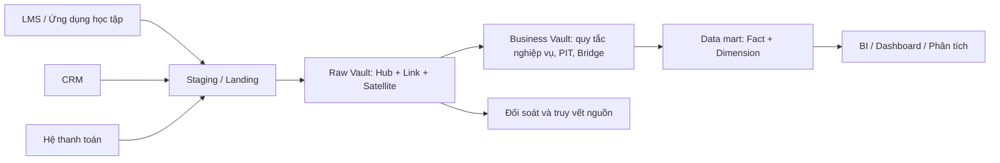
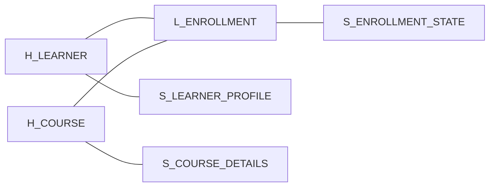
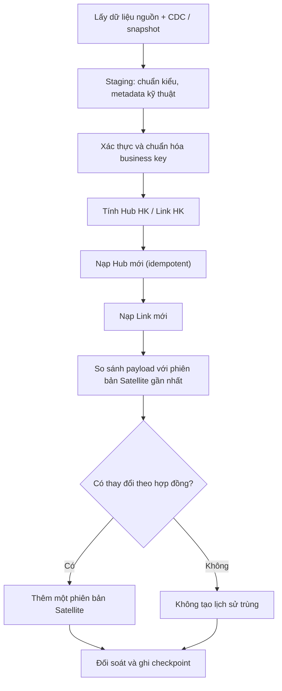
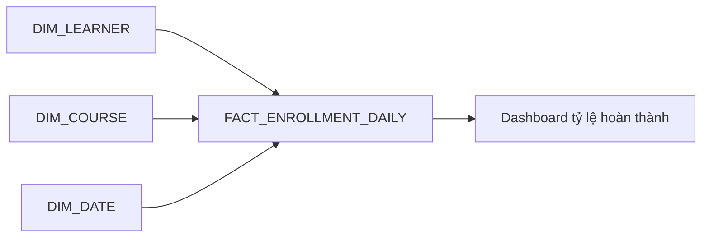

# Tổng quan Data Vault với hub, link và satellite

## 1. Data Vault giải quyết bài toán gì?

Một nền tảng dữ liệu phân tích thường nhận dữ liệu từ nhiều hệ thống: ứng dụng đăng ký học, CRM, thanh toán, hệ thống quản lý khóa học và các luồng sự kiện. Nguồn dữ liệu thay đổi liên tục: thêm trường, đổi cấu trúc, chỉnh lại định nghĩa trạng thái, sửa lịch sử hoặc gửi dữ liệu đến trễ. Trong khi đó, báo cáo cần trả lời những câu hỏi nhất quán như:

- Tại ngày 01/11, học viên nào đang ghi danh vào khóa học nào?
- Thông tin khóa học được hệ thống nào cung cấp và được kho dữ liệu ghi nhận khi nào?
- Khi nguồn gửi lại một bản ghi hoặc thay đổi cách đặt tên, dữ liệu lịch sử có còn truy xuất được không?
- Làm sao thêm nguồn CRM mới mà không phải thiết kế lại toàn bộ kho phân tích?

**Data Vault** là một phương pháp mô hình hóa dữ liệu cho kho dữ liệu tích hợp và có lịch sử, đặc biệt khi có nhiều nguồn và yêu cầu truy vết cao. Ba thành phần cấu trúc nền tảng là:

- **Hub:** quản lý danh tính nghiệp vụ ổn định (*business key*).
- **Link:** quản lý quan hệ hoặc sự kết hợp giữa các danh tính nghiệp vụ.
- **Satellite:** lưu thuộc tính mô tả, trạng thái và sự thay đổi theo thời gian của hub hoặc link.

Trọng tâm của Data Vault là **tách danh tính, quan hệ và thuộc tính biến đổi** để dữ liệu có thể nạp tăng dần, truy vết nguồn và mở rộng mà không làm mất lịch sử một cách vô tình.

Bài này thuộc chương **Mô hình phân tích** của phạm vi **DATABASE_DATA_MODELING**. Mục tiêu là rèn kỹ năng chuyển yêu cầu nghiệp vụ thành mô hình dữ liệu rõ ràng, từ thực thể, quan hệ và ràng buộc đến khóa, chỉ mục và lược đồ vật lý; đồng thời so sánh mô hình quan hệ, tài liệu, đồ thị và phân tích để lựa chọn cấu trúc phù hợp, có thể tiến hóa và kiểm chứng.

**Sau bài học, bạn có thể:**

1. Giải thích Data Vault là gì, dùng ở tầng nào và không nên dùng cho việc gì.
2. Nhận diện business key để thiết kế hub, xác định quan hệ để thiết kế link và nhóm thuộc tính để tạo satellite.
3. Phân biệt `load_dts`, thời điểm hiệu lực ở nguồn, phiên bản dữ liệu và thông tin truy vết (*record source*).
4. Giải thích khóa hash, hashdiff, nạp dữ liệu tăng dần, xử lý dữ liệu đến trễ và khử trùng.
5. Phác thảo mô hình Raw Vault, Business Vault, PIT/Bridge và data mart dạng star schema.
6. Đọc ví dụ SQL, xây truy vấn “trạng thái được biết tại thời điểm T” và xác định các giới hạn của nó.
7. Đánh giá khi nào Data Vault đáng dùng so với star schema trực tiếp, mô hình quan hệ chuẩn hóa hoặc document store.

## 2. Bức tranh tổng thể: Data Vault nằm ở đâu trong kiến trúc phân tích?

Data Vault thường nằm **giữa nguồn dữ liệu và lớp tiêu thụ báo cáo**, chứ không nhất thiết là cấu trúc mà dashboard truy vấn trực tiếp.



Các lớp có vai trò khác nhau:

| Lớp | Vai trò | Câu hỏi cần giải quyết |
| --- | --- | --- |
| **Landing/Staging** | Tiếp nhận dữ liệu nguồn và metadata kỹ thuật | Bản ghi nào đến, từ đâu, thuộc batch nào, có thay đổi hay không? |
| **Raw Vault** | Tích hợp danh tính, quan hệ và lịch sử mô tả; bảo toàn truy vết | Nguồn đã cung cấp dữ liệu gì và kho đã biết điều đó khi nào? |
| **Business Vault** | Bổ sung quy tắc nghiệp vụ, dẫn xuất, hợp nhất và cấu trúc hỗ trợ đọc | Khái niệm “ghi danh hợp lệ”, “hoàn thành” được định nghĩa thế nào? |
| **Information Mart** | Cung cấp fact/dimension hoặc mô hình đọc hướng người dùng | Tỷ lệ hoàn thành theo tháng và giảng viên là bao nhiêu? |
| **BI/Analytics** | Trực quan, phân tích, báo cáo | Người dùng cần xem chỉ số nào, với độ trễ và chi phí nào? |

Đây là kiến trúc tham khảo, không phải bắt buộc mọi dự án đều phải có đủ số tầng hay công nghệ khác nhau. **Data Vault 2.0** bao gồm nhiều khía cạnh về mô hình, kiến trúc và phương pháp triển khai; hub/link/satellite là **nền tảng mô hình hóa**, không phải toàn bộ phương pháp.

### 2.1. Data Vault không thay thế tất cả mô hình khác

- **OLTP quan hệ:** phù hợp giao dịch, cập nhật đồng thời và ràng buộc nghiệp vụ ở hệ vận hành.
- **Document model:** phù hợp dữ liệu lồng nhau theo đơn vị đọc/ghi, với giới hạn kích thước và truy vấn tương ứng.
- **Graph model:** phù hợp khi cần duyệt quan hệ nhiều bước, đường đi hoặc kết nối mạng.
- **Star schema:** phù hợp nhiều truy vấn BI theo fact và dimension.
- **Data Vault:** phù hợp khi cần **tích hợp nhiều nguồn có lịch sử, lineage và khả năng mở rộng cấu trúc**.

Một nền tảng có thể dùng **OLTP làm nguồn dữ liệu**, **Data Vault để tích hợp lịch sử**, rồi tạo **star schema phục vụ dashboard**. Việc tồn tại nhiều mô hình không có nghĩa dữ liệu có nhiều nguồn sự thật không kiểm soát: phải xác định nguồn có thẩm quyền, quy tắc chuyển đổi và cách đối soát.

## 3. Ba khái niệm nền tảng: business key, load time và record source

Trước khi tạo hub/link/satellite, phải định nghĩa chính xác ba khái niệm.

### 3.1. Business key: danh tính của nghiệp vụ, không phải tên hiển thị

**Business key (BK)** là giá trị hoặc tổ hợp giá trị giúp nhận diện một đối tượng nghiệp vụ trong phạm vi đã quy định.

Ví dụ:

- Mã học viên do LMS cấp: `learner_code`.
- Mã khóa học do hệ quản lý khóa cấp: `course_code`.
- Mã đơn thanh toán của hệ thanh toán: `payment_reference`.
- Một quan hệ ghi danh giữa học viên và khóa học, nếu quy tắc nghiệp vụ xác nhận mỗi cặp chỉ có một quan hệ hiện hành.

Business key **phải được đặt trong đúng ngữ cảnh duy nhất**. Nếu hai tổ chức đều có học viên `U-100`, chỉ `learner_code = U-100` không đủ; có thể cần:

```text
Business key học viên = (tenant_id, learner_code)

Ví dụ:
(ORG-07, U-100) ≠ (ORG-12, U-100)
```

**Không mặc định** email, tên người học hoặc tên khóa học là business key ổn định: chúng có thể trùng, đổi hoặc bị xóa vì quyền riêng tư. Cần kiểm tra quy tắc cấp định danh của nguồn và những trường hợp đổi mã, tái sử dụng mã, hợp nhất hoặc tách thực thể.

### 3.2. Load timestamp: lúc kho dữ liệu ghi nhận bản ghi

Trong các ví dụ, `load_dts` là thời điểm dữ liệu **được nạp vào Data Vault** theo quy ước đã chọn. Nó phục vụ truy vết lịch sử nạp dữ liệu.

Không đánh đồng:

- `source_created_at`: thời điểm bản ghi được tạo ở hệ nguồn.
- `source_effective_at`: thời điểm một thay đổi có hiệu lực về nghiệp vụ.
- `source_updated_at`: thời điểm hệ nguồn ghi thay đổi gần nhất.
- `load_dts`: thời điểm kho tiếp nhận/nạp một phiên bản dữ liệu theo thiết kế.
- `report_as_of`: mốc thời gian mà báo cáo muốn tái dựng.

Các giá trị có thể khác nhau vì batch, hàng đợi, lỗi mạng, CDC và dữ liệu đến muộn.

### 3.3. Record source: nguồn xuất xứ của bản ghi

`record_source` chỉ ra hệ nguồn hoặc luồng tiếp nhận có trách nhiệm cung cấp dữ liệu, ví dụ:

```text
LMS.ENROLLMENTS
LMS.COURSES
CRM.LEARNERS
PAYMENT.TRANSACTIONS
```

Thông tin này phục vụ:

- Truy vết bản ghi trở về hệ nguồn.
- Giải thích khi nhiều nguồn đưa thông tin khác nhau.
- Đối soát số lượng và các thay đổi bị thiếu.
- Hỗ trợ kiểm toán và di trú.

Định nghĩa record source cần đủ **ổn định và chi tiết** để phân biệt luồng dữ liệu. Có thể cần thêm `batch_id`, `source_record_id`, `ingested_at` hoặc checksum khi nghiệp vụ yêu cầu. `record_source` không tự chứng minh nguồn đó đúng hơn nguồn khác.

## 4. Hub: lưu danh tính nghiệp vụ

**Hub** biểu diễn một loại danh tính nghiệp vụ. Hub thường chứa:

- Khóa kỹ thuật của hub, chẳng hạn `learner_hk`.
- Business key theo hợp đồng của nguồn hoặc miền nghiệp vụ.
- `load_dts`.
- `record_source`.

Ví dụ Hub Learner:

```text
H_LEARNER
+------------------------------------------------------------------+
| learner_hk | tenant_id | learner_bk | load_dts | record_source     |
+------------------------------------------------------------------+
| HK-001     | ORG-07    | U-100      | 01/11    | LMS.LEARNERS      |
| HK-002     | ORG-07    | U-101      | 01/11    | LMS.LEARNERS      |
| HK-003     | ORG-12    | U-100      | 02/11    | CRM.LEARNERS      |
+------------------------------------------------------------------+
```

Các mã `HK-001` ở bảng minh họa là **ký hiệu rút gọn**, không phải hash SHA-256 thực. Hai học viên `U-100` thuộc hai tenant khác nhau nhận danh tính khác nhau vì BK được xác định theo tổ hợp.

### 4.1. Hub thường không chứa thuộc tính mô tả hay trạng thái đổi liên tục

Không nên lưu:

```text
H_LEARNER(learner_hk, learner_bk, display_name, email,
          city, membership_status, last_login, ...)
```

nếu các trường mô tả trên thay đổi theo thời gian. Đặt chúng vào hub khiến bản thân danh tính phải liên tục cập nhật hoặc không giữ được lịch sử.

Thay vào đó:

```text
H_LEARNER(learner_hk, tenant_id, learner_bk, load_dts, record_source)

S_LEARNER_PROFILE(
  learner_hk, load_dts, record_source,
  hashdiff, display_name, city, ...
)
```

**Nguyên tắc:** hub trả lời **“đây là đối tượng nghiệp vụ nào?”**; satellite trả lời **“nguồn đã mô tả đối tượng ấy thế nào qua các lần nạp?”**.

### 4.2. Chọn đúng hạt (grain) của Hub

Một hub có một loại định danh nghiệp vụ cụ thể. Nếu ghép cả `course_id`, `learner_id` và `enrollment_id` vào một “hub đa dụng”, rất khó xác định grain và liên hệ giữa các nguồn.

Ví dụ một lượt đăng ký có mã `enrollment_id` riêng, có vòng đời thanh toán/hoàn tiền và được các hệ thống khác tham chiếu. Khi đó **Enrollment** có thể là một Hub riêng, còn quan hệ giữa Enrollment, Learner, Course sẽ được thể hiện bằng Link.

Ngược lại, nếu nghiệp vụ chỉ cần biết một **cặp learner–course** có quan hệ hiện hành và không có ID ghi danh độc lập, một Link trực tiếp giữa hai Hub có thể đủ.

**Chỉ được gộp BK từ nhiều nguồn vào một Hub nếu đã xác định rằng chúng đại diện cho cùng một đối tượng.** Trùng chuỗi không tự chứng minh cùng danh tính.

## 5. Link: biểu diễn quan hệ giữa các danh tính

**Link** lưu một quan hệ giữa hai hoặc nhiều hub, thường chứa:

- Khóa kỹ thuật của Link, ví dụ `enrollment_hk`.
- Khóa hub của những thực thể tham gia.
- `load_dts`.
- `record_source`.

Ví dụ quan hệ ghi danh:

```text
H_LEARNER (learner_hk)
        |
        | 1
        | 
        | N
L_ENROLLMENT (enrollment_hk, learner_hk, course_hk, load_dts, record_source)
        | N
        |
        | 1
H_COURSE (course_hk)
```

Một Link cơ bản trả lời câu hỏi **“mối quan hệ này có được ghi nhận không?”**. Nó thường không chứa một danh sách dài thuộc tính mô tả như `status`, `payment_state` hoặc `completed_at`; các thuộc tính ấy có thể nằm trong **satellite gắn với Link**.

### 5.1. Link không chỉ dành cho quan hệ nhiều–nhiều

Link có thể biểu diễn:

- Người học ghi danh vào khóa.
- Đơn hàng thuộc khách hàng.
- Thanh toán áp dụng cho đơn.
- Nhân viên thuộc đơn vị.
- Sản phẩm được xếp vào danh mục.
- Một quan hệ có nhiều vai trò giữa hơn hai Hub.

Điều cốt lõi là **grain của quan hệ**. Nếu mỗi cặp `(learner_hk, course_hk)` chỉ có một mối liên hệ xuyên suốt, khóa Link có thể được xác định từ cặp đó.

Nhưng nếu học viên có thể **ghi danh nhiều lần** vào cùng khóa trong các học kỳ khác nhau, mô hình chỉ dựa vào cặp learner–course sẽ **không phân biệt được từng lượt**. Phương án có thể là:

1. Tạo Hub Enrollment theo `enrollment_bk` duy nhất cho mỗi lượt, rồi liên kết tới Learner và Course.
2. Hoặc thiết kế transaction Link có định danh của lần ghi danh như một thành phần grain.

Đừng khắc phục bằng cách thêm `load_dts` vào hash key của Link khi điều đó làm danh tính quan hệ đổi theo mỗi lần nạp.

### 5.2. Link có thể nối nhiều Hub

Ví dụ một lượt học có lớp, giáo viên và khóa học:

```text
L_CLASS_ASSIGNMENT(
  assignment_hk,
  class_hk,
  teacher_hk,
  course_hk,
  load_dts,
  record_source
)
```

Tuy nhiên, Link nhiều đầu phải biểu diễn **một quan hệ nghiệp vụ có nghĩa**, không ghép mọi thực thể trong cùng một batch để giảm số bảng.

### 5.3. Link có cần xóa khi quan hệ kết thúc?

Trong Raw Vault lưu lịch sử, sự tồn tại của một Link có thể mang nghĩa **quan hệ từng được nguồn ghi nhận**. Khi học viên hủy ghi danh, thường không xóa hàng Link chỉ để thể hiện trạng thái hiện hành; thay đổi trạng thái được ghi trong satellite hoặc cấu trúc hiệu lực phù hợp.

Cần tách hai câu hỏi:

- **Đã từng có liên hệ?** Link có thể trả lời.
- **Liên hệ có hiệu lực ở thời điểm T không?** Cần trạng thái/hiệu lực theo thời gian.

Xóa vật lý có thể vẫn được yêu cầu bởi chính sách lưu giữ hoặc quyền riêng tư; điều đó cần quy trình quản trị riêng, không mâu thuẫn với mục tiêu giữ lịch sử kỹ thuật trong phạm vi được phép.

## 6. Satellite: lưu mô tả và lịch sử thay đổi

**Satellite** gắn với Hub hoặc Link để lưu nhóm thuộc tính thay đổi theo thời gian. Các trường phổ biến gồm:

- Khóa cha: `course_hk` hoặc `enrollment_hk`.
- `load_dts` của phiên bản satellite.
- `record_source`.
- `hashdiff` (tùy thiết kế) để nhận diện thay đổi payload.
- Các trường mô tả.
- Metadata thời gian nguồn hoặc hiệu lực nếu nguồn cung cấp.

Ví dụ Satellite Course:

```text
S_COURSE_DETAILS
+--------------------------------------------------------------------------------+
| course_hk | load_dts   | record_source | title          | source_status          |
+--------------------------------------------------------------------------------+
| HK-C1     | 01/11 09h  | LMS.COURSES   | Nhập môn SQL   | DRAFT                  |
| HK-C1     | 05/11 10h  | LMS.COURSES   | Nhập môn SQL   | PUBLISHED              |
| HK-C1     | 09/11 08h  | LMS.COURSES   | SQL căn bản    | PUBLISHED              |
+--------------------------------------------------------------------------------+
```

Cùng `course_hk` có ba dòng lịch sử; chỉ Hub Course có một danh tính. Satellite giúp truy vấn cách hệ thống đã **biết mô tả đó ở các thời điểm khác nhau**.

### 6.1. Satellite nên nhóm thuộc tính theo đặc tính đổi và nguồn

Nếu thuộc tính thay đổi với tần suất khác nhau, có thể tách satellite:

```text
S_COURSE_DESCRIPTION:
  title, summary, category, ...

S_COURSE_PUBLICATION:
  source_status, source_published_at, ...

S_COURSE_PRICING:
  currency, amount_minor, ...
```

Điều này có thể giảm ghi lịch sử thừa và giúp tách nguồn có thẩm quyền, nhưng quá nhiều satellite cũng làm truy vấn, ETL và quản trị phức tạp.

Khi chia nhóm, xem:

- **Nguồn:** cùng hệ nguồn hay từ các hệ khác nhau?
- **Tần suất thay đổi:** cùng thay đổi hay độc lập?
- **Ngữ nghĩa:** dữ liệu cùng một nhóm mô tả không?
- **Độ nhạy cảm:** có chính sách bảo mật/lưu giữ riêng không?
- **Grain:** mỗi phiên bản ghi nhận điều gì?

Không có quy tắc “mỗi cột một satellite”; mục tiêu là phân tách vừa đủ để giữ lịch sử có nghĩa và khả năng nạp độc lập.

### 6.2. Multi-active satellite và dữ liệu nhiều giá trị

Một nguồn có thể cho phép một học viên có nhiều số liên hệ đang hoạt động cùng lúc, hoặc một sản phẩm có nhiều mã định danh hợp lệ. Nếu nhiều giá trị **đồng thời hợp lệ** cho cùng cha và cùng thời điểm, satellite đơn trị có thể không đủ.

Một **multi-active satellite** có thể dùng thêm khóa phân biệt phần tử, ví dụ `contact_type` hoặc một ID liên hệ ổn định. Cần quy định:

- Mỗi giá trị khác nhau bằng khóa gì?
- Có cho phép nhiều `HOME` hoặc nhiều giá trị cùng loại không?
- Khi một giá trị bị loại bỏ, hệ thống nhận tín hiệu xóa như thế nào?
- Có đủ thông tin từ nguồn để tái dựng tập giá trị tại một thời điểm không?

Không dùng multi-active satellite chỉ vì dữ liệu JSON có một mảng; cần xác định grain và sự tồn tại đồng thời của những giá trị.

### 6.3. Satellite gắn với Link

Ví dụ trạng thái của một quan hệ ghi danh:

```text
S_ENROLLMENT_STATE(
  enrollment_hk,
  load_dts,
  record_source,
  hashdiff,
  source_status,
  source_effective_at
)
```

Các trạng thái `ACTIVE`, `COMPLETED` hoặc `CANCELLED` không cần tạo một Link khác nếu danh tính **quan hệ** không đổi. Lịch sử mô tả của quan hệ nằm trong satellite. Khi đã có nhiều lượt ghi danh khác nhau cần phân biệt, phải đổi grain như phần 5.1.

## 7. Ví dụ đầy đủ: nền tảng học tập với Hub, Link, Satellite

Giả sử hệ LMS phát những dữ liệu sau:

```text
LMS learners:
  tenant_id, learner_code, full_name, city, updated_at

LMS courses:
  tenant_id, course_code, title, status, updated_at

LMS enrollments:
  tenant_id, learner_code, course_code,
  enrollment_status, status_effective_at, updated_at
```

Mục tiêu phân tích:

- Đếm học viên ghi danh theo khóa.
- Tái dựng trạng thái ghi danh theo thời điểm kho biết thông tin.
- Truy vết giá trị trạng thái đến hệ nguồn.
- Bổ sung dữ liệu CRM và thanh toán sau này mà không trộn dữ kiện mô tả vào khóa định danh.

### 7.1. Phác mô hình



Diễn giải:

| Thành phần | Grain | Các trường chính |
| --- | --- | --- |
| `H_LEARNER` | Một học viên theo BK trong tenant | `learner_hk`, `tenant_id`, `learner_bk`, `load_dts`, `record_source` |
| `H_COURSE` | Một khóa theo BK trong tenant | `course_hk`, `tenant_id`, `course_bk`, `load_dts`, `record_source` |
| `L_ENROLLMENT` | Một quan hệ learner–course theo giả định mỗi cặp một quan hệ | `enrollment_hk`, `learner_hk`, `course_hk`, metadata |
| `S_LEARNER_PROFILE` | Một phiên bản mô tả học viên đã nạp | tên, thành phố, hashdiff, thời gian |
| `S_COURSE_DETAILS` | Một phiên bản mô tả khóa đã nạp | tiêu đề, trạng thái gốc, hashdiff |
| `S_ENROLLMENT_STATE` | Một phiên bản trạng thái của quan hệ | trạng thái gốc, source_effective_at, hashdiff |

**Giả định quan trọng:** một cặp learner–course đại diện cho một quan hệ có lịch sử trạng thái, không phải nhiều lượt ghi danh độc lập. Nếu yêu cầu có nhập học lại theo nhiều kỳ và mỗi kỳ là một giao dịch độc lập, phải thay đổi grain.

### 7.2. Dữ liệu đầu vào minh họa

| Ngày nguồn | Learner | Course | Trạng thái nguồn |
| --- | --- | --- | --- |
| 01/11 | `U-100` | `C-SQL` | `ACTIVE` |
| 05/11 | `U-100` | `C-SQL` | `COMPLETED` |
| 07/11 | `U-101` | `C-SQL` | `ACTIVE` |
| 10/11 | `U-100` | `C-DATA` | `ACTIVE` |

Hub Learner tạo tối đa hai danh tính trong tenant; Hub Course tạo hai danh tính; Link Enrollment tạo ba quan hệ cặp. Satellite Enrollment ghi trạng thái theo những thay đổi được nguồn gửi và bộ nạp nhận biết. Nếu bản ghi `U-100/C-SQL/ACTIVE` được gửi lại mà payload không đổi, **không nên tạo thêm phiên bản lịch sử mô tả giống hệt** chỉ vì có một batch mới, trừ khi hợp đồng nguồn yêu cầu ghi từng sự kiện khác nhau như giao dịch riêng.

### 7.3. Vì sao các giá trị mô tả không nằm trong Hub?

Nếu tên khóa học `C-SQL` đổi từ “Nhập môn SQL” sang “SQL căn bản”, Hub Course vẫn là một danh tính. Vùng satellite bổ sung phiên bản mô tả mới. Các Link từ học viên tới khóa không phải sửa khóa tham chiếu vì tiêu đề đổi.

Đây là ưu điểm của việc tách **identity** khỏi **descriptive history**.

## 8. Hash key và business key: sử dụng đúng bản chất

Nhiều triển khai Data Vault 2.0 dùng **hash key** để tạo khóa kỹ thuật có thể tính độc lập từ business key. Hash key không bắt buộc trong mọi biến thể Data Vault, nhưng thường được dùng để hỗ trợ nạp song song và tạo liên kết nhất quán.

Ví dụ khái niệm:

```text
Learner BK        = (ORG-07, U-100)
Canonical BK      = "LEARNER|ORG-07|U-100"  (giả định có quy tắc escape)
Learner HK        = SHA-256(Canonical BK)

Course BK         = (ORG-07, C-SQL)
Canonical BK      = "COURSE|ORG-07|C-SQL"
Course HK         = SHA-256(Canonical BK)

Enrollment HK     = SHA-256("ENROLLMENT|" + Learner HK + "|" + Course HK)
```

**Cảnh báo:** các chuỗi trên chỉ minh họa. Nếu BK có thể chứa dấu phân cách `|`, phải có quy tắc escape, độ dài tiền tố hoặc cách mã hóa có cấu trúc. Nếu không, hai bộ khóa khác nhau có thể trở thành cùng một chuỗi trước khi băm.

### 8.1. Hợp đồng chuẩn hóa trước khi băm

Bộ tạo hash phải thống nhất:

1. Trường nào tạo nên BK và thứ tự của chúng.
2. Phạm vi như `tenant_id` hoặc namespace nguồn.
3. Kiểu dữ liệu, chuẩn mã hóa ký tự và Unicode.
4. Có chuẩn hóa khoảng trắng hoặc chữ hoa/thường không — **chỉ khi nghiệp vụ cho phép**.
5. Cách xử lý `null`, thiếu trường và chuỗi rỗng.
6. Cách phân biệt vai trò của các thành phần Link.
7. Thuật toán hash, định dạng đầu ra và phiên bản quy tắc.
8. Cách đối soát khi nguồn đổi BK.

Không được tự ý `UPPER(TRIM(business_key))` nếu mã nghiệp vụ **phân biệt chữ hoa/thường** hoặc khoảng trắng có ý nghĩa. Ngược lại, nếu mã không phân biệt hoa/thường, cần áp dụng cùng một quy tắc ở tất cả pipeline.

### 8.2. Vì sao thường có hashdiff trong Satellite?

**Hashdiff** là giá trị băm của các thuộc tính mô tả dùng để phát hiện payload thay đổi. Ví dụ:

```text
hashdiff = SHA-256(
  canonical(title, status, source_updated_at_if_part_of_payload)
)
```

Danh sách trường trong hashdiff phải được xác định theo **ngữ nghĩa thay đổi**. Không luôn đưa `load_dts` vào hashdiff: nếu làm vậy, payload không đổi nhưng mỗi batch mới tạo ra hashdiff khác, mất ý nghĩa phát hiện thay đổi.

Trong một satellite theo dõi tiêu đề/trạng thái, hashdiff có thể được tính từ `title` và `status`; thời điểm nguồn và metadata nạp có thể lưu riêng. Nếu thời điểm hiệu lực của nguồn là dữ kiện nghiệp vụ cần historize, thiết kế có thể đưa nó vào phần thay đổi được theo dõi; cần quyết định dựa trên grain của satellite.

**Hashdiff không thay thế kiểm tra dữ liệu nguồn**: nếu hai payload khác nhau vô tình có cùng hash, bộ so sánh có thể bỏ sót thay đổi. Với thuật toán mạnh như SHA-256, va chạm ngẫu nhiên là cực kỳ khó xảy ra nhưng không có phép băm hữu hạn nào được chứng minh không có va chạm trên mọi đầu vào. Hệ thống quan trọng cần kiểm soát quy trình chuẩn hóa và có khả năng đối soát.

### 8.3. Hash key không phải mã hóa bảo mật

Hash business key giúp tạo ID kỹ thuật, **không biến thông tin nhạy cảm thành an toàn**. Nếu BK chỉ là số điện thoại hoặc email từ một tập có thể đoán, hash không có salt có thể bị dò bằng từ điển. Cần bảo vệ quyền truy cập và dữ liệu cá nhân theo chính sách; không dùng hash key làm lý do công khai dữ liệu.

### 8.4. Business key đổi thì sao?

Nếu hệ nguồn cấp lại mã cho cùng người học, hash dựa trên mã cũ và mã mới sẽ khác. Cần xác định cách xử lý:

- Có thực sự cùng một người nghiệp vụ không?
- Nguồn có mã định danh bền vững hơn hoặc bảng ánh xạ không?
- Có sự kiện merge/split hồ sơ không?
- Có cần cấu trúc business mapping hoặc same-as link được quản lý ở Business Vault?

Không nên âm thầm sửa business key của hub đã được sử dụng làm khóa của nhiều lịch sử; phải lưu dấu vết và quy tắc hợp nhất phù hợp.

## 9. Ví dụ SQL: lược đồ vật lý tối thiểu

Dưới đây là **lược đồ minh họa bằng PostgreSQL**, không phải bộ DDL chuẩn bắt buộc cho mọi Data Vault. Hash key lưu dưới dạng chuỗi 64 ký tự hex để dễ đọc; triển khai thực tế có thể chọn `bytea` hoặc kiểu khác và cần kiểm tra hiệu năng.

```sql
-- Grain: một học viên theo (tenant_id, learner_bk).
CREATE TABLE hub_learner (
    learner_hk    char(64) PRIMARY KEY,
    tenant_id     text NOT NULL,
    learner_bk    text NOT NULL,
    load_dts      timestamptz NOT NULL,
    record_source text NOT NULL,
    UNIQUE (tenant_id, learner_bk)
);

-- Grain: một khóa học theo (tenant_id, course_bk).
CREATE TABLE hub_course (
    course_hk     char(64) PRIMARY KEY,
    tenant_id     text NOT NULL,
    course_bk     text NOT NULL,
    load_dts      timestamptz NOT NULL,
    record_source text NOT NULL,
    UNIQUE (tenant_id, course_bk)
);

-- Grain: một quan hệ learner-course.
CREATE TABLE link_enrollment (
    enrollment_hk char(64) PRIMARY KEY,
    learner_hk    char(64) NOT NULL REFERENCES hub_learner(learner_hk),
    course_hk     char(64) NOT NULL REFERENCES hub_course(course_hk),
    load_dts      timestamptz NOT NULL,
    record_source text NOT NULL,
    UNIQUE (learner_hk, course_hk)
);

-- Các phiên bản mô tả khóa học.
CREATE TABLE sat_course_details (
    course_hk      char(64) NOT NULL REFERENCES hub_course(course_hk),
    load_dts       timestamptz NOT NULL,
    record_source  text NOT NULL,
    hashdiff       char(64) NOT NULL,
    title_raw      text,
    status_raw     text,
    source_updated_at timestamptz,
    PRIMARY KEY (course_hk, load_dts)
);

-- Các phiên bản trạng thái của quan hệ ghi danh.
CREATE TABLE sat_enrollment_state (
    enrollment_hk     char(64) NOT NULL
                      REFERENCES link_enrollment(enrollment_hk),
    load_dts          timestamptz NOT NULL,
    record_source     text NOT NULL,
    hashdiff          char(64) NOT NULL,
    status_raw        text,
    source_effective_at timestamptz,
    PRIMARY KEY (enrollment_hk, load_dts)
);

CREATE INDEX sat_course_details_lookup
    ON sat_course_details (course_hk, load_dts DESC);

CREATE INDEX sat_enrollment_state_lookup
    ON sat_enrollment_state (enrollment_hk, load_dts DESC);
```

### 9.1. Những giả định mà DDL đang áp đặt

- Mỗi cặp learner–course có **một quan hệ Link** theo grain đã xác định.
- Mỗi parent satellite có tối đa **một phiên bản cho mỗi `load_dts`**. Nếu hai thay đổi độc lập cùng được nạp vào một timestamp với cùng độ chính xác, hoặc có nhiều record source cùng ghi vào một satellite, khóa này **không đủ**.
- Hash key 64 ký tự tương ứng một giá trị SHA-256 dạng hex; phải có bộ tạo hash nhất quán ở mọi pipeline.
- Ràng buộc `UNIQUE (tenant_id, business_key)` trong hai hub dựa trên giả định BK ổn định và được chuẩn hóa.
- Khóa ngoại trong ví dụ giúp diễn đạt cấu trúc; một số kiến trúc dữ liệu lớn không thực thi toàn bộ FK vật lý vì chi phí nạp và phân tán, khi đó phải có kiểm tra toàn vẹn tương ứng.
- DDL minh họa **chưa** áp đặt điều kiện `tenant_id` của học viên và khóa học phải trùng nhau trong `link_enrollment`. Nếu nghiệp vụ cấm liên kết xuyên tenant, bộ nạp cần kiểm tra và/hoặc thiết kế khóa ghép/ràng buộc vật lý phù hợp; chỉ có hai khóa ngoại trên hash key là chưa đủ.

**Thiết kế cho thực tế:** có thể cần thêm `batch_id`, `load_sequence`, `record_source` vào khóa phiên bản satellite theo grain và quy tắc đồng thời; hoặc tách satellite theo nguồn. Không chọn một khóa ghép chỉ vì “thấy ví dụ trên mạng”.

### 9.2. Cách sinh hash ở PostgreSQL

Khi dùng `pgcrypto` (cần có extension và quyền cài đặt phù hợp), một cách gọi:

```sql
-- Minh họa phép băm. Chuỗi đầu vào phải được chuẩn hóa trước.
-- SELECT encode(digest('LEARNER|ORG-07|U-100', 'sha256'), 'hex');
```

Lệnh comment chỉ là biểu thức minh họa, không tự đảm bảo quy tắc escape/Unicode, kiểm tra thiếu BK hoặc không nhập nhằng giữa các thành phần. Tốt hơn nên có **một hợp đồng tạo hash dùng chung**, kiểm thử bằng bộ test vector và kiểm tra độc lập giữa các pipeline, thay vì mỗi job tự nối chuỗi tùy ý.

### 9.3. Lược đồ chưa chứa hồ sơ học viên

Để không làm ví dụ quá dài, DDL trên chưa tạo `sat_learner_profile`; nó có thể được xây theo mẫu `sat_course_details` với khóa `learner_hk`. Bộ mô hình đầy đủ ở phần 7 có satellite này.

## 10. Nạp dữ liệu tăng dần vào Hub, Link, Satellite

Không nên tạo một quy trình chỉ biết “đổ lại toàn bộ bảng” mỗi đêm. Data Vault được thiết kế để hỗ trợ **nạp tăng dần, lịch sử và truy vết**.

### 10.1. Luồng nạp điển hình



Thứ tự chi tiết phụ thuộc khả năng nạp song song và xử lý tài liệu cha chưa tới. Data Vault 2.0 thường hướng tới nạp Hub/Link/Satellite hiệu quả và có thể song song khi hash key đã tính trước; quy tắc phụ thuộc và các tham chiếu vẫn phải được giữ đúng.

### 10.2. Nạp Hub: chỉ thêm danh tính mới

Đầu vào từ staging:

```text
(ORG-07, U-100)  xuất hiện lần đầu trong batch 001
(ORG-07, U-100)  xuất hiện lại trong batch 002
(ORG-07, U-101)  xuất hiện lần đầu trong batch 002
```

Kết quả mong muốn:

- Hub Learner chỉ có một dòng cho `(ORG-07, U-100)`.
- Batch 002 không tạo lại danh tính cũ.
- `(ORG-07, U-101)` là danh tính mới.
- Dữ liệu nguồn mới và batch xử lý vẫn được ghi nhận ở metadata staging/lineage theo thiết kế.

Việc chống trùng cần dựa trên BK chuẩn và khóa duy nhất, không dựa chỉ trên “batch này khác batch trước”.

### 10.3. Nạp Link: chỉ thêm tổ hợp quan hệ mới

Ví dụ với learner U-100 và course C-SQL đã tồn tại, quan hệ được quan sát lại trong nhiều batch không tự tạo Link mới.

Khi nguồn gửi trạng thái hủy, thường **không xóa Link**; ghi sự kiện thay đổi trạng thái trong satellite.

Nếu hai nguồn có mô tả khác nhau về một quan hệ, phải xác định liệu chúng mô tả **cùng quan hệ** hay hai quan hệ có grain khác. Việc có cùng learner và course không tự đủ chứng minh hai giao dịch ghi danh độc lập là một.

### 10.4. Nạp Satellite: chỉ thêm khi payload thay đổi

Giả sử:

| `load_dts` | `status_raw` | `hashdiff` (minh họa) | Hành động |
| --- | --- | --- | --- |
| 01/11 09:00 | ACTIVE | H-A | Insert phiên bản đầu |
| 02/11 09:00 | ACTIVE | H-A | Bỏ qua thay đổi mô tả trùng |
| 05/11 10:00 | COMPLETED | H-C | Insert phiên bản mới |
| 06/11 10:00 | COMPLETED | H-C | Bỏ qua thay đổi mô tả trùng |

Các ký hiệu `H-A`, `H-C` là rút gọn; trong thực tế cần hashdiff theo hợp đồng canonical payload. Cũng phải xác định nguồn snapshot có biểu diễn **xóa** hoặc **không còn quan hệ** hay không; “không xuất hiện trong batch hôm nay” chưa chắc có nghĩa bản ghi đã bị xóa.

### 10.5. Dữ liệu đến trễ và dữ liệu sai thứ tự

Nếu bản ghi có `source_effective_at = 03/11` nhưng tới kho ngày 09/11, `load_dts` vẫn phản ánh thời điểm kho ghi nhận, không nên tự sửa thành 03/11.

Hai trục thời gian có mục đích khác nhau:

- Truy vấn **“kho biết gì vào ngày 05/11?”** dựa trên lịch sử thời điểm nạp.
- Truy vấn **“nghiệp vụ có hiệu lực gì ở ngày 05/11?”** phải xét thời gian hiệu lực của nguồn và quy tắc xử lý dữ liệu đến muộn.

Một truy vấn dùng `MAX(load_dts)` không tự trả lời câu hỏi thứ hai. Nếu yêu cầu bitemporal hoặc hiệu lực theo nghiệp vụ, cần mô hình và quy tắc thêm cho nguồn thay đổi, sửa ngược và thứ tự ưu tiên.

### 10.6. Bảo vệ lịch sử khi nguồn phát lại snapshot

Một số nguồn mỗi đêm gửi toàn bộ bảng, không có CDC. Nếu bộ nạp chỉ dựa trên thời điểm nhận để insert satellite, nó có thể ghi vô số bản giống nhau. Hãy dùng:

- Business key để biết đối tượng đã tồn tại.
- Hashdiff để biết payload mô tả có thay đổi.
- Load timestamp để ghi thời điểm nhận phiên bản mới.
- Batch/checkpoint để hỗ trợ retry.
- Các quy tắc riêng về **xóa, hiệu lực và snapshot completeness**.

Đảm bảo job **idempotent**: phát lại cùng batch không làm nhân đôi Hub/Link và không tạo lịch sử sai.

## 11. Truy vấn “as-of”: hai câu hỏi khác nhau

### 11.1. As-known-at: bản ghi mới nhất kho đã biết trước mốc T

Giả sử cần lấy trạng thái ghi danh theo những gì Data Vault **đã nạp tính đến** một thời điểm.

Ví dụ SQL PostgreSQL dùng `LATERAL`:

```sql
-- :as_of là tham số timestamptz do ứng dụng truyền.
SELECT
    h_learner.tenant_id,
    h_learner.learner_bk,
    h_course.course_bk,
    s.status_raw,
    s.load_dts AS state_loaded_at,
    s.source_effective_at
FROM link_enrollment AS l
JOIN hub_learner AS h_learner
  ON h_learner.learner_hk = l.learner_hk
JOIN hub_course AS h_course
  ON h_course.course_hk = l.course_hk
LEFT JOIN LATERAL (
    SELECT x.status_raw, x.load_dts, x.source_effective_at
    FROM sat_enrollment_state AS x
    WHERE x.enrollment_hk = l.enrollment_hk
      AND x.load_dts <= :as_of
    ORDER BY x.load_dts DESC
    LIMIT 1
) AS s ON true
WHERE l.load_dts <= :as_of
  AND h_learner.tenant_id = 'ORG-07'
  AND h_course.tenant_id = 'ORG-07';
```

Câu truy vấn trả **phiên bản trạng thái được nạp gần nhất** cho từng quan hệ tính đến `:as_of`. Nó **không** tự loại quan hệ `CANCELLED`, `COMPLETED` hay không có satellite; phải áp dụng định nghĩa nghiệp vụ riêng.

Giả định: mỗi `enrollment_hk` có tối đa một trạng thái ở mỗi `load_dts` theo khóa chính mẫu. Khi một satellite có nhiều nguồn hoặc nhiều phiên bản cùng timestamp, cần quy tắc chọn có thể xác định và mô hình khóa phù hợp.

### 11.2. Business-valid-at: trạng thái có hiệu lực vào ngày T

Giả sử trạng thái `COMPLETED` từ ngày 05/11 được kho nhận ngày 06/11, sau đó nguồn gửi một bản hiệu chỉnh có hiệu lực từ 04/11 nhưng tới kho ngày 10/11.

Một báo cáo “đến thời điểm ngày 07/11, kho biết gì?” và một báo cáo “sau tất cả hiệu chỉnh hiện biết, nghiệp vụ có hiệu lực gì ngày 07/11?” có thể khác nhau.

Muốn truy vấn **business-valid-at** phải xác định:

- Nguồn cung cấp mốc bắt đầu/kết thúc hiệu lực hay chỉ có `updated_at`?
- Một trạng thái mới có thay thế trạng thái cũ hay là sự kiện bổ sung?
- Những sự kiện đến trễ được áp dụng theo `source_effective_at`, sequence, revision hay quy tắc nghiệp vụ nào?
- Có trường hợp sửa dữ liệu lịch sử và hủy sự kiện cũ không?
- Tại một thời điểm có thể có nhiều trạng thái đồng thời hợp lệ không?

Không thể chỉ đổi điều kiện SQL từ `load_dts` sang `source_effective_at` mà đảm bảo kết quả đúng. Cần một **Business Vault** hoặc mô hình thời gian hiệu lực có hợp đồng và quy trình giải quyết xung đột rõ ràng.

### 11.3. Đếm ghi danh ACTIVE theo as-known-at

Có thể dùng kết quả xác định trạng thái mới nhất cho từng quan hệ, rồi lọc:

```sql
WITH latest_state AS (
    SELECT
        l.enrollment_hk,
        l.course_hk,
        s.status_raw
    FROM link_enrollment AS l
    LEFT JOIN LATERAL (
        SELECT x.status_raw
        FROM sat_enrollment_state AS x
        WHERE x.enrollment_hk = l.enrollment_hk
          AND x.load_dts <= :as_of
        ORDER BY x.load_dts DESC
        LIMIT 1
    ) AS s ON true
    WHERE l.load_dts <= :as_of
)
SELECT
    hc.tenant_id,
    hc.course_bk,
    count(*) AS active_enrollments
FROM latest_state AS ls
JOIN hub_course AS hc
  ON hc.course_hk = ls.course_hk
WHERE hc.tenant_id = 'ORG-07'
  AND ls.status_raw = 'ACTIVE'
GROUP BY hc.tenant_id, hc.course_bk;
```

Đây là ví dụ với **trạng thái LMS** đã có nghĩa nhất quán và một nguồn. Trong thực tế `ACTIVE` ở hai nguồn có thể không tương đương; báo cáo phân tích cần một quy tắc chuẩn hóa ở Business Vault trước khi tính.

Một chi tiết khác: truy vấn này không giới hạn `h_course.load_dts <= :as_of`, nhưng trong quy trình nạp thông thường Hub đã tồn tại khi Link được nạp. Nếu hệ thống chấp nhận dữ liệu đến thiếu thứ tự hoặc placeholder, cần quy tắc riêng để tái dựng snapshot đầy đủ và kiểm chứng mối quan hệ thời gian.

## 12. Business Vault: nơi áp dụng quy tắc nghiệp vụ

**Raw Vault** nhấn mạnh ghi nhận dữ kiện nguồn, truy vết và bảo toàn lịch sử theo quy tắc kỹ thuật đã thiết kế. **Business Vault** bổ sung những quy tắc dẫn xuất hoặc cấu trúc nhằm phục vụ phân tích có ý nghĩa.

Ví dụ:

- Chuẩn hóa trạng thái ghi danh khác nhau từ LMS và CRM thành một tập hợp `ACTIVE`, `COMPLETED`, `CANCELLED` theo quy tắc thống nhất.
- Xác định bản ghi đại diện khi nhiều nguồn cùng mô tả một người học.
- Xác định thời gian hiệu lực của quan hệ hoặc trạng thái.
- Tính quy tắc “học viên đang hoạt động trong tháng”.
- Xây cấu trúc hỗ trợ truy vấn lịch sử như PIT/Bridge.
- Tạo dữ liệu dẫn xuất phục vụ dimension hoặc fact.

**Không nên biến Raw Vault thành một tập bảng chỉ giữ trạng thái đã làm sạch, rồi loại bỏ thông tin nguồn cần kiểm toán.** Những chuẩn hóa kỹ thuật cần thiết để nạp an toàn có thể có trong Raw Vault, nhưng **quy tắc nghiệp vụ chủ quan** thường nên được thể hiện và phiên bản hóa rõ ở lớp dẫn xuất.

### 12.1. Ví dụ quy tắc khác nhau giữa hai nguồn

LMS có `enrollment_status = COMPLETED`. CRM có `lifecycle_stage = Alumni`.

Không thể mặc định hai trạng thái là như nhau. Có thể có học viên đã hoàn tất khóa nhưng chưa chuyển lifecycle stage; ngược lại, Alumni có thể chỉ một nhóm đối tượng khác.

Một mapping có thể được phê duyệt:

```text
Nguồn: LMS.ENROLLMENTS
COMPLETED   -> completion_state = COMPLETED
ACTIVE      -> completion_state = IN_PROGRESS
CANCELLED   -> completion_state = CANCELLED

Nguồn: CRM.LEARNERS
Alumni      -> profile_segment = ALUMNI

Không dùng profile_segment để suy ra completion_state
trừ khi có quy tắc nghiệp vụ được xác nhận.
```

Dữ liệu nguồn và bản diễn giải mới cần có lineage và phiên bản logic, để khi định nghĩa thay đổi có thể xây lại kết quả.

## 13. PIT và Bridge: tăng tốc truy vấn phức tạp

### 13.1. PIT (Point-in-Time)

Khi một Hub có nhiều Satellite thay đổi với tần suất khác nhau, truy vấn “các thuộc tính của học viên tại ngày T” có thể cần tìm phiên bản mới nhất **của từng Satellite**.

Ví dụ:

```text
H_LEARNER
  |
  +-- S_LEARNER_PROFILE
  +-- S_LEARNER_ADDRESS
  +-- S_LEARNER_SEGMENT
```

Một **PIT table** có thể lưu các khóa/điểm tham chiếu tới phiên bản satellite áp dụng ở một tập mốc thời gian đã chọn:

```text
PIT_LEARNER_DAILY
  snapshot_date
  learner_hk
  profile_load_dts
  address_load_dts
  segment_load_dts
```

Nhờ đó, đường đọc không phải tự tính lại `MAX(load_dts <= T)` trên nhiều satellite mỗi lần.

**Đánh đổi:** PIT là **cấu trúc dẫn xuất** cần được nạp, tái tạo và đối soát. PIT phải xác định rõ dựa trên thời gian nạp hay thời gian hiệu lực nghiệp vụ; nó không tự giải quyết lịch sử bitemporal.

### 13.2. Bridge

**Bridge table** có thể hỗ trợ tập hợp quan hệ và đường liên kết đã được tính trước, chẳng hạn những khóa học liên quan qua nhiều Link hoặc những tổ hợp cần cho một báo cáo.

```text
BR_LEARNER_COURSE_CONTEXT
  learner_hk
  course_hk
  enrollment_hk
  snapshot_date
  ...
```

Ví dụ chỉ nhằm diễn giải ý tưởng; bảng Bridge thực tế có thể có nhiều khóa và cấu trúc khác tùy truy vấn. Nó giúp giảm số bước nối khi có báo cáo phức tạp nhưng mang chi phí cập nhật và tính đúng đắn của dữ liệu dẫn xuất.

**Không nên mặc định mọi dự án Data Vault cần PIT và Bridge ngay từ ngày đầu.** Hãy tạo chúng khi có query shape và bằng chứng hiệu năng hoặc yêu cầu sử dụng cụ thể.

## 14. Từ Data Vault sang star schema: phục vụ báo cáo

Hub, Link, Satellite tối ưu tổ chức lịch sử và thay đổi cấu trúc, nhưng báo cáo BI thường muốn các bảng có grain rõ ràng:

- **Dimension:** mô tả học viên, khóa học, thời gian.
- **Fact:** sự kiện ghi danh, hoàn thành, thanh toán, lượt học.

Ví dụ một star schema:



Một fact giả định:

```text
FACT_ENROLLMENT_DAILY
  date_key
  learner_key
  course_key
  is_active
  is_completed
  enrollment_count
```

**Grain của fact phải được ghi rõ**, ví dụ “một học viên–khóa học–ngày”, chứ không chỉ “bảng lưu các ghi danh”. Nếu dùng Link learner–course chỉ đại diện cho quan hệ qua mọi thời kỳ, fact theo ngày cần lấy trạng thái hiệu lực đúng từ satellite/Business Vault.

### 14.1. Raw Vault và Dimension SCD Type 2 có giống nhau không?

Cả hai đều có thể lưu lịch sử thuộc tính, nhưng mục đích khác nhau:

- **Satellite trong Raw Vault:** ghi lịch sử các payload nguồn có truy vết, thường theo thời điểm nạp và cấu trúc gắn với Hub/Link.
- **Dimension Type 2:** tạo phiên bản dimension theo quy tắc nghiệp vụ và thời gian hiệu lực phục vụ phân tích, thường có surrogate key và khoảng hiệu lực.

Không nên suy ra `load_dts` của Satellite là `effective_from` của Dimension Type 2. Khi dữ liệu đến muộn hoặc nguồn sửa lịch sử, hai trục thời gian có thể khác đáng kể.

### 14.2. Một câu hỏi phân tích cụ thể

“Trong tháng 11, tỷ lệ hoàn thành khóa học theo nhóm tuổi là bao nhiêu?”

Truy vấn cần:

1. Danh tính người học và khóa học.
2. Định nghĩa thế nào là hoàn thành, thời điểm hoàn thành và điều kiện ghi danh hợp lệ.
3. Nhóm tuổi được tính ở mốc nào và dựa trên dữ liệu nào.
4. Grain của fact và phép đếm không bị nhân đôi khi có nhiều lượt ghi danh.
5. Quy tắc quyền riêng tư, tổng hợp và mức độ hiển thị dữ liệu cá nhân.

Hub/Link/Satellite giúp lưu và truy vết đầu vào; **Business Vault cùng data mart** giúp giải thích và cung cấp chỉ số có nghĩa. Không thể trả lời báo cáo đúng chỉ từ việc tạo ba loại bảng.

## 15. Nhiều nguồn dữ liệu: hợp nhất danh tính không đơn giản là ghép mã

### 15.1. Cùng khóa nhưng khác thực thể

Giả sử LMS có `learner_code = U-100` và CRM cũng có `customer_code = U-100`. Hai mã cùng chuỗi chưa chắc là cùng người.

Cần phân biệt:

- Hai nguồn có dùng **chung một cơ chế định danh có thẩm quyền** không?
- Mã có cùng phạm vi tenant/organization không?
- Có một bảng mapping xác nhận sự tương ứng giữa hai hệ không?
- Có tình huống hai người gộp tài khoản hoặc một người tách thành hai hồ sơ không?

Nếu chưa có bằng chứng, mỗi nguồn có thể cần **namespace BK riêng** hoặc cơ chế ghi nhận hai định danh khác nhau, sau đó tạo liên hệ tương đương có quản trị.

### 15.2. Same-as link và Business Vault

Khi hai danh tính được xác nhận cùng đại diện cho một thực thể nghiệp vụ, có thể dùng cơ chế **same-as** hoặc mapping với lineage để hỗ trợ hợp nhất.

Nhưng cần xác định:

- Ai có thẩm quyền xác nhận same-as?
- Quy tắc đó có hiệu lực từ khi nào?
- Nếu mapping bị rút lại thì sao?
- Có trường hợp một mã được tái sử dụng cho người khác không?
- Báo cáo lịch sử có tính lại theo mapping mới hay bảo toàn cách hiểu cũ?

Không nên xóa các Hub gốc chỉ để hợp nhất; dữ liệu lịch sử nguồn có thể cần giữ theo quyền và chính sách đã xác định.

### 15.3. Nhiều nguồn có thuộc tính xung đột

LMS ghi thành phố là `Da Nang`, CRM ghi `Ha Noi`. Raw Vault có thể giữ cả hai dữ kiện với record source. Nhưng báo cáo muốn “thành phố chính thức hiện nay” phải có quy tắc:

- Nguồn nào có thẩm quyền cho thuộc tính ấy?
- Có cần sử dụng thời điểm hiệu lực và độ tin cậy?
- Có trường hợp giá trị bị giữ để phục vụ lịch sử, nhưng không dùng cho trạng thái hiện hành?
- Có thể đối soát và giải thích vì sao chọn một nguồn không?

Đây là **business rule**, không phải bài toán có thể giải chỉ bằng hash key.

## 16. Kiểm soát chất lượng, lineage và vận hành

Data Vault giúp lưu nhiều lịch sử, nhưng **không tự bảo đảm dữ liệu nguồn đúng, đầy đủ hoặc không trùng**. Chất lượng cần được đo ở từng bước.

### 16.1. Bảng kiểm tra theo thành phần

| Thành phần | Kiểm tra tối thiểu | Nguy cơ nếu bỏ qua |
| --- | --- | --- |
| Staging | Dòng trùng, thiếu BK, kiểu lỗi, thời điểm nguồn, checkpoint | Tạo danh tính giả hoặc mất bản ghi |
| Hub | Một BK chuẩn có một HK, scope tenant đúng | Hai người bị gộp hoặc một người thành nhiều hub |
| Link | HK các Hub tham gia hợp lệ, grain và vai trò đúng | Quan hệ sai hoặc trùng |
| Satellite | So sánh payload, phiên bản load, nguồn, thứ tự | Mất lịch sử hoặc ghi quá nhiều bản giống nhau |
| Business Vault | Mapping trạng thái, quy tắc ưu tiên, thời gian hiệu lực | Báo cáo giải thích sai nguồn |
| PIT/Bridge | Đồng bộ với nguồn và mốc snapshot | Trả bản ghi cũ/sai |
| Data mart | Grain của fact, định nghĩa metric, kiểm tra đếm trùng | KPI sai và khó đối soát |

### 16.2. Những số liệu vận hành nên theo dõi

- Tổng bản ghi nhận/nạp theo batch và theo record source.
- Số BK thiếu/không hợp lệ; số bản ghi bị cách ly.
- Số Hub mới, Link mới, Satellite mới và số payload không đổi.
- Số trường hợp HK/BK không nhất quán do quy tắc hash khác nhau.
- Số Link không tìm thấy Hub hợp lệ theo hợp đồng.
- Dữ liệu đến muộn, thứ tự sự kiện bất thường và độ trễ xử lý.
- Chênh lệch số đếm giữa nguồn, Raw Vault, Business Vault và mart.
- Thời gian dựng lại PIT/Bridge/mart khi logic biến đổi.
- Chi phí lưu trữ, tốc độ tăng lịch sử và khả năng nạp lại từ checkpoint.

Các ngưỡng cảnh báo phải dựa trên SLA và khối lượng thật; không có ngưỡng phổ quát cho mọi kho dữ liệu.

### 16.3. Thông tin truy vết hữu ích

Có thể gắn thêm metadata:

```text
batch_id
source_record_id
record_source
source_extracted_at
load_dts
pipeline_run_id
payload_checksum
schema_version
```

Không nhất thiết đặt tất cả trường ở mọi Hub/Link/Satellite; chọn theo kiến trúc và yêu cầu đối soát. Cần có cách từ một số liệu trong dashboard lần ngược về fact, business rule, satellite, Link/Hub và bản ghi nguồn.

## 17. Những đánh đổi và giới hạn của Data Vault

### 17.1. Số lượng bảng và độ phức tạp

Một nghiệp vụ đơn giản ban đầu có thể trở thành nhiều bảng Hub, Link, Satellite. Điều này giúp mở rộng và truy vết, nhưng cũng tăng:

- Số model và logic nạp cần quản lý.
- Nhu cầu chuẩn hóa business key và hash key.
- Số phép nối khi dựng báo cáo.
- Chi phí vận hành, tài liệu hóa và đào tạo.
- Khả năng sai nếu quản trị grain hoặc thời gian không tốt.

Với một hệ thống nhỏ, chỉ có một nguồn ổn định và vài KPI, việc xây star schema trực tiếp có thể đơn giản hơn.

### 17.2. Truy vấn BI trực tiếp trên Raw Vault thường không thuận tiện

Để lấy danh sách học viên, khóa học và trạng thái mới nhất, có thể phải nối Hub–Link–Satellite và tìm phiên bản theo thời gian. Với nhiều Satellite, chi phí và độ phức tạp tăng.

Vì vậy Data Vault thường được kết hợp với **Business Vault, PIT/Bridge hoặc mart dạng dimensional**. Đánh giá tổng chi phí **cả pipeline**, không chỉ chi phí nạp Raw Vault.

### 17.3. Lịch sử nhiều không có nghĩa bitemporal đúng

Ghi mọi thay đổi của nguồn khi kho tiếp nhận chưa đủ để tái dựng lịch sử nghiệp vụ nếu:

- Nguồn chỉ gửi snapshot và không có tín hiệu xóa.
- Dữ liệu đến trễ hoặc sửa ngược thời gian.
- Không có source-effective time.
- Một bản ghi mô tả nhiều trạng thái đồng thời.
- Các nguồn dùng mốc thời gian khác nhau.

Phải định nghĩa rõ hai trục thời gian và quy tắc đồng bộ/đối soát khi báo cáo yêu cầu.

### 17.4. Không phù hợp làm mô hình giao dịch mặc định

Data Vault nhấn mạnh nạp dữ liệu tích hợp, lịch sử và truy vết. Nó không phải phương án mặc định cho:

- Cập nhật giỏ hàng và đơn giao dịch yêu cầu độ trễ thấp.
- Thao tác kiểm tra tồn kho theo thời gian thực.
- Truy vấn đường đi mạng nhiều bước cần graph algorithms chuyên biệt.
- API đọc một aggregate JSON/lồng nhau cho ứng dụng giao dịch.

Hãy đặt Data Vault ở **vai trò phân tích và tích hợp** khi có nhu cầu tương ứng, không thay toàn bộ OLTP bằng Hub/Link/Satellite chỉ vì yêu cầu lưu lịch sử.

## 18. So sánh Data Vault với 3NF, star schema và mô hình tài liệu

| Tiêu chí | 3NF/quan hệ chuẩn hóa | Data Vault | Star schema | Document model |
| --- | --- | --- | --- | --- |
| Trọng tâm | Giảm dư thừa, giữ ràng buộc và cấu trúc quan hệ | Tách BK, quan hệ, lịch sử nguồn và lineage | Tối ưu phân tích fact–dimension | Gom dữ liệu theo đơn vị đọc/ghi |
| Đơn vị chính | Bảng thực thể và liên kết | Hub, Link, Satellite | Fact và Dimension | Document, đối tượng lồng/mảng |
| Lịch sử | Thiết kế thêm temporal/audit | Là mục tiêu mô hình hóa cốt lõi | SCD/snapshot theo nhu cầu báo cáo | Cần cấu trúc version/event riêng |
| Thêm nguồn mới | Cần mapping và thay đổi schema tùy thiết kế | Có thể mở rộng nguồn/satellite có kiểm soát | Thường phải thống nhất về metric/chiều | Phù hợp một số dạng dữ liệu; tích hợp đa nguồn vẫn cần rule |
| Truy vấn BI | Có thể cần nhiều join | Thường cần mart/PIT/Bridge | Thường thuận tiện nhất cho dashboard | Tùy chỉ mục/aggregation và khối lượng |
| Giao dịch OLTP | Thường là thế mạnh | Không phải mục đích chính | Không phải mục đích chính | Phụ thuộc DB và ranh giới document |
| Chi phí triển khai | Vừa phải theo hệ thống | Có thể cao vì nhiều cấu trúc và pipeline | Tốt khi định nghĩa phân tích ổn định | Có lợi khi document phù hợp workload |

Không có mô hình nào “luôn tốt nhất”. Quyết định cần dựa trên số lượng nguồn, biến động schema, yêu cầu lineage, lịch sử, thời gian nạp, mức độ truy vấn và năng lực vận hành.

## 19. Bài tập thực hành: tích hợp LMS, CRM và thanh toán

### 19.1. Đề bài

Một nền tảng đào tạo có ba hệ thống:

- **LMS:** `learner_code`, `course_code`, `enrollment_status`, `status_effective_at`.
- **CRM:** `crm_contact_id`, `email`, `city`, `customer_segment`.
- **Payment:** `payment_id`, `order_id`, `amount_minor`, `currency`, `paid_at`, `payment_status`.

Các yêu cầu phân tích:

1. Xem trạng thái ghi danh một học viên theo lịch sử.
2. Đếm số học viên hoàn thành khóa theo tháng.
3. Đếm số thanh toán thành công theo khóa.
4. Biết bản ghi nguồn nào tạo ra một giá trị trên dashboard.
5. Không ghép nhầm học viên từ hai nguồn chỉ vì cùng tên hoặc email.
6. Hỗ trợ nguồn gửi dữ liệu thanh toán đến trễ và có thể sửa trạng thái giao dịch.

### 19.2. Phác mô hình ứng viên

Một cách tiếp cận:

```text
H_LEARNER       (BK: tenant + learner_code từ LMS)
H_CRM_CONTACT   (BK: CRM namespace + crm_contact_id)
H_COURSE        (BK: tenant + course_code)
H_PAYMENT       (BK: payment namespace + payment_id)
H_ORDER         (BK: order namespace + order_id)

L_ENROLLMENT    (H_LEARNER ↔ H_COURSE)
L_PAYMENT_ORDER (H_PAYMENT ↔ H_ORDER)
L_ORDER_COURSE  (H_ORDER ↔ H_COURSE)      -- chỉ nếu nguồn có quan hệ này
L_LEARNER_CRM   (H_LEARNER ↔ H_CRM_CONTACT) -- chỉ khi mapping xác nhận

S_ENROLLMENT_STATE  -> trạng thái/hiệu lực từ LMS
S_CRM_PROFILE       -> email, city, segment từ CRM
S_PAYMENT_STATE     -> amount, currency, status, paid_at từ Payment
```

**Lưu ý quan trọng:** dữ liệu Payment ở đề bài chỉ chứa `order_id`, chưa nói `order_id` thuộc khóa học nào. Không được tự tạo `L_ORDER_COURSE` nếu nguồn không có dữ kiện/quan hệ được xác nhận. Mô hình trên ghi rõ Link đó **chỉ tồn tại nếu có nguồn có thẩm quyền**.

Tương tự, `L_LEARNER_CRM` không được suy từ việc email trùng nhau nếu chưa có quy tắc xác nhận danh tính.

### 19.3. Một số quyết định cần bảo vệ

| Câu hỏi | Lập luận cần có |
| --- | --- |
| `learner_code` có duy nhất toàn nền tảng không? | Nếu không, thêm tenant/namespace vào BK |
| Thanh toán bị hoàn tiền có tạo Hub Payment mới không? | Tùy định danh giao dịch; có thể là trạng thái mới trong Satellite hoặc giao dịch refund độc lập |
| Một đơn chứa nhiều khóa học thì sao? | Link Order–Course có thể có nhiều dòng; cần grain item/đơn nếu cần đếm tiền theo khóa |
| Có thể lấy doanh thu theo khóa trực tiếp từ `amount_minor` ở Payment không? | Chưa chắc; cần quy tắc phân bổ theo dòng, hoàn tiền, thuế và trạng thái |
| Nguồn gửi `paid_at` đến trễ có thay đổi `load_dts` không? | Không nên đánh đồng hai mốc |
| Khi CRM và LMS khác thành phố của học viên, chọn gì? | Bảo toàn nguồn ở Raw Vault, dùng Business Vault chọn theo rule |
| Khi cùng batch chạy lại, số Hub/Link/Satellite có tăng không? | Chỉ tăng khi có BK, quan hệ hoặc payload mới theo hợp đồng |
| Cách đối soát tỷ lệ hoàn thành? | Xác định nguồn, mapping trạng thái, thời gian và grain fact |

### 19.4. Câu hỏi tự kiểm tra

1. Nếu học viên học lại cùng khóa ở ba học kỳ, Hub/Link nào cần thay đổi để phân biệt từng lần?
2. Nếu CRM đổi `crm_contact_id` sau hợp nhất tài khoản, có nên sửa hash key cũ không?
3. Nếu trạng thái `COMPLETED` được kho nhận ngày 10 nhưng có hiệu lực từ ngày 07, báo cáo as-known-at ngày 08 và business-valid-at ngày 08 có giống nhau không?
4. Nếu một satellite có ba nguồn với ba trạng thái bất đồng, liệu chọn `MAX(load_dts)` có trả “trạng thái chính thức” không?
5. Nếu BI cần lọc hàng triệu học viên theo tên và ngày hoàn thành, có nên truy vấn trực tiếp Raw Vault hay tạo mart/PIT?
6. Nếu một BK chỉ có giá trị `NULL` trong nguồn, có nên băm chuỗi chữ `"NULL"` rồi coi mọi bản ghi đó là một học viên không?
7. Cần những test nào để kiểm chứng nạp lại batch không làm thay đổi số đếm?
8. Khi nguồn yêu cầu xóa dữ liệu cá nhân, việc Raw Vault giữ lịch sử cần tuân thủ những quy tắc nào?

**Tiêu chí bài làm:** nêu grain từng Hub/Link/Satellite, business key và phạm vi, metadata nạp, cách historize, cách xử lý dữ liệu đến trễ, nguồn chịu trách nhiệm và đường từ Raw Vault tới chỉ số báo cáo.

## 20. Những lỗi mô hình hóa thường gặp

**Lỗi 1: Đặt tên, email hoặc trạng thái trong Hub.**  
Hub nên lưu danh tính nghiệp vụ; thông tin mô tả đổi theo thời gian thường thuộc Satellite. Nếu email thực sự là BK, cần quy tắc ổn định/đổi mã và quyền riêng tư chặt chẽ.

**Lỗi 2: Chọn business key chưa kiểm tra phạm vi.**  
`U-100` ở hai tenant khác nhau có thể là hai người. Phải xác định tổ hợp BK và nguồn có thẩm quyền.

**Lỗi 3: Tạo Link theo mọi lần nạp dữ liệu.**  
Quan hệ cùng grain bị tạo trùng theo batch. Link nên đại diện cho danh tính quan hệ; lịch sử trạng thái ở Satellite.

**Lỗi 4: Lưu toàn bộ payload lặp lại ở Satellite mỗi đêm.**  
Snapshot không đổi gây lịch sử phình to. Dùng hashdiff/so sánh payload đúng hợp đồng và xử lý trường hợp sự kiện có ý nghĩa riêng.

**Lỗi 5: Dùng `load_dts` như thời gian hiệu lực nghiệp vụ.**  
Dữ liệu đến trễ làm báo cáo lịch sử sai. Phân biệt thời gian nhận và thời gian hiệu lực, thiết kế logic bitemporal nếu cần.

**Lỗi 6: Coi hash key là một nguồn sự thật của danh tính.**  
Hash chỉ là định danh kỹ thuật tính từ BK đã chọn. Nếu BK thay đổi hoặc mapping sai, hash không tự sửa ngữ nghĩa.

**Lỗi 7: Mọi nguồn cùng ghi vào một satellite rồi lấy dòng mới nhất.**  
Nguồn khác nhau có thể không có cùng mức thẩm quyền; dòng nạp mới nhất chưa chắc là giá trị chính thức. Cần phân nhóm nguồn và quy tắc Business Vault.

**Lỗi 8: Không phân biệt nhiều lần ghi danh với một quan hệ có trạng thái thay đổi.**  
Nếu grain là cặp learner–course mà nghiệp vụ có nhiều enrollment độc lập, số liệu sẽ bị gộp sai.

**Lỗi 9: Cho rằng có Raw Vault thì dashboard đã sẵn sàng.**  
KPI cần định nghĩa, mô hình đọc và kiểm tra grain. Data mart thường giúp truy vấn dễ hơn.

**Lỗi 10: Dùng thuật toán hash nhưng không chuẩn hóa đầu vào nhất quán.**  
Cùng BK được hai pipeline băm ra khác HK, làm mất liên kết. Cần hợp đồng và test vectors.

**Lỗi 11: Không có quy tắc xóa/hủy quan hệ.**  
Nguồn thiếu một bản ghi trong snapshot không chắc nghĩa là đã xóa; xóa Link trong Raw Vault có thể làm mất lịch sử.

**Lỗi 12: Thiếu đối soát và khả năng rebuild.**  
Nạp song song, dữ liệu đến muộn và nhiều nguồn đều tạo nguy cơ sai lệch; cần số liệu vận hành và đường tái tạo cấu trúc dẫn xuất.

## 21. Quy trình triển khai Data Vault theo từng bước

Một quy trình thực tế có thể như sau:

1. **Khảo sát nguồn:** bảng, API, sự kiện, định dạng thời gian, khóa, độ trễ, snapshot/CDC và chính sách xóa.
2. **Xác định business key:** miền duy nhất, độ ổn định, namespace và cách xử lý thiếu/sai.
3. **Chọn Hub:** mỗi danh tính nghiệp vụ ổn định cần thiết, với grain rõ.
4. **Chọn Link:** quan hệ được nguồn xác nhận, vai trò của từng Hub và tính duy nhất theo grain.
5. **Chọn Satellite:** nhóm thuộc tính mô tả, source, lịch sử thay đổi, multi-active/effectivity khi phù hợp.
6. **Định nghĩa metadata:** load timestamp, record source, batch ID, quy tắc hash/lưu lịch sử và checkpoint.
7. **Viết pipeline staging:** validation kỹ thuật, chuẩn hóa BK, cách xử lý null, dữ liệu lỗi và bản ghi trùng.
8. **Nạp Raw Vault:** Hub/Link/Satellite theo thứ tự hoặc cơ chế song song đã kiểm chứng; bảo đảm idempotency.
9. **Đối soát:** số BK, số quan hệ, số phiên bản, quan hệ mồ côi, độ trễ và lịch sử nguồn.
10. **Định nghĩa Business Vault:** mapping, nguồn ưu tiên, trạng thái chính thức, thời gian hiệu lực.
11. **Dựng PIT/Bridge khi có nhu cầu:** giảm chi phí as-of join và quan hệ phức tạp.
12. **Dựng data mart:** xác định grain fact/dimension, metric, SCD và thời điểm báo cáo.
13. **Benchmark:** đo tốc độ nạp, dung lượng, lịch sử, p95/p99 truy vấn mart và thời gian rebuild.
14. **Vận hành:** giám sát lỗi, schema nguồn mới, cập nhật rule và chính sách truy cập/xóa.
15. **Đánh giá lại:** Data Vault còn mang lại lợi ích lớn hơn chi phí quản trị không?

### Checklist duyệt thiết kế

- [ ] Hub có **business key ổn định** và phạm vi duy nhất rõ ràng.
- [ ] Link có grain và vai trò các đầu mối chính xác; không bị nhân bản khi nạp lại.
- [ ] Satellite chứa thuộc tính mô tả/trạng thái với lịch sử theo nguồn và thời gian.
- [ ] `load_dts` được phân biệt với thời gian sự kiện và thời gian hiệu lực nghiệp vụ.
- [ ] Mọi record source, batch và quy tắc tạo hash đều được mô tả/kiểm thử.
- [ ] Quy tắc hash canonical phân biệt null, kiểu, thứ tự và dấu phân cách.
- [ ] Không hợp nhất BK từ nhiều nguồn khi chưa có mapping danh tính có thẩm quyền.
- [ ] Dữ liệu multi-active và nhiều lượt giao dịch có grain riêng nếu cần.
- [ ] Nạp lại batch không sinh Hub/Link/Satellite trùng theo hợp đồng.
- [ ] Nguồn snapshot/CDC có quy tắc riêng cho xóa và dữ liệu đến muộn.
- [ ] Có kế hoạch cho khóa satellite khi một cha có nhiều thay đổi cùng timestamp.
- [ ] Phân biệt Raw Vault, Business Vault và data mart; không trộn rule nghiệp vụ tùy tiện vào nguồn thô.
- [ ] Truy vấn as-known-at và business-valid-at được định nghĩa riêng.
- [ ] PIT/Bridge được xây vì đường truy vấn thực tế, có nguồn và quy tắc rebuild.
- [ ] Fact/dimension có grain, các chỉ số không bị đếm đôi.
- [ ] Quyền riêng tư, phân quyền và thời hạn lưu áp dụng cho cả lịch sử/bản sao.
- [ ] Có kiểm thử dữ liệu đến trễ, thiếu BK, đổi BK, gửi trùng, nguồn xung đột và sửa lịch sử.
- [ ] Có kế hoạch đo throughput, storage growth, truy vấn và vận hành.

**Điểm cần nhớ:** Data Vault không chỉ là ba loại bảng. **Hub giữ danh tính, Link giữ quan hệ, Satellite giữ mô tả và lịch sử**, nhưng mô hình chỉ thực sự hữu ích khi business key, grain, thời gian nạp, nguồn dữ liệu và quy tắc thay đổi được định nghĩa rõ. Raw Vault giúp tích hợp và truy vết; Business Vault diễn giải nghiệp vụ; data mart cung cấp cấu trúc phù hợp cho BI. Sự phù hợp của Data Vault phải được kiểm chứng bằng yêu cầu lịch sử, nhiều nguồn, lineage và chi phí thực tế.
