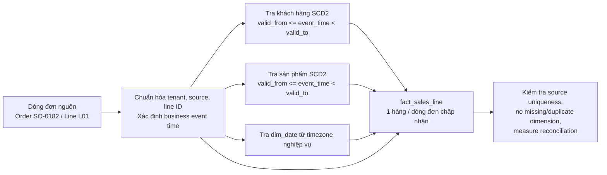

# Khóa chiều, thời điểm và định danh giao dịch trong bảng dữ kiện

## 1. Vì sao ba nhóm khóa quyết định độ tin cậy của bảng dữ kiện?

Trong module `DATABASE_DATA_MODELING`, người học rèn kỹ năng chuyển yêu cầu nghiệp vụ thành mô hình dữ liệu có thể kiểm chứng: từ thực thể, quan hệ, ràng buộc, chuẩn hóa, khóa, chỉ mục đến cách triển khai quan hệ, document, đồ thị và phân tích. Ở chương **Bảng dữ kiện**, trọng tâm không còn chỉ là “bảng có khóa chính nào” mà là **mỗi hàng dữ kiện đại diện điều gì**, **thuộc về những chiều nào** và **xảy ra ở thời điểm nào**.

Xét một marketplace có dữ kiện bán hàng:

- Khách hàng mua sản phẩm A ngày 15/03, khi khách thuộc phân khúc **Bạc** và sản phẩm thuộc nhóm **Gia dụng**.
- Ngày 01/07, khách chuyển sang phân khúc **Vàng**; sản phẩm được phân loại lại thành **Thiết bị thông minh**.
- Tháng 08, bộ phận tài chính chạy lại doanh thu tháng 03 theo phân khúc và nhóm sản phẩm **có hiệu lực khi bán**.

Nếu bảng dữ kiện lưu `customer_id` rồi luôn join sang bản ghi khách hàng hiện tại, báo cáo tháng 03 sẽ bị gán sang phân khúc Vàng. Nếu chỉ lưu ngày tải dữ liệu mà không có ngày bán, đơn đến muộn sẽ bị cộng vào sai tháng. Nếu không có định danh dòng đơn ổn định, chạy lại pipeline có thể nhân đôi doanh thu.

Ba nhóm thông tin vì vậy giữ những vai trò khác nhau:

1. **Khóa chiều** (*dimension foreign keys*): nói hàng dữ kiện gắn với **phiên bản nào** của khách hàng, sản phẩm, cửa hàng hoặc trạng thái kinh doanh.
2. **Thời điểm** (*event/business time, date/time keys, load time*): nói sự kiện thuộc kỳ nghiệp vụ nào, phiên bản chiều nào có hiệu lực và dữ liệu được biết/nhập lúc nào.
3. **Định danh giao dịch** (*transaction identity, source event/line identity*): nói hàng dữ kiện biểu diễn chính xác **giao dịch/dòng/sự kiện nguồn nào**, để truy vết, loại trùng và xử lý điều chỉnh.

Nếu bỏ sót một trong ba, có thể tạo ra bảng chạy SQL rất nhanh nhưng tổng hợp sai hoặc không thể đối soát với nguồn.

### Mục tiêu học tập

Sau bài này, người học có thể:

- Định nghĩa **grain** của fact và chọn khóa dữ kiện, khóa chiều, khóa ngày đúng với grain đó.
- Phân biệt khóa nghiệp vụ của dimension với **surrogate key của phiên bản dimension** khi dùng SCD Type 2.
- Xác định event time, business date, recorded time, load time và các khóa ngày theo từng vai trò.
- Chọn định danh nguồn đủ để nạp lại/idempotency và phân biệt giao dịch mới, sự kiện cập nhật, hoàn tiền và dữ kiện snapshot.
- Ánh xạ khóa chiều theo thời điểm bằng **as-of lookup**, xử lý dimension đến muộn và phát hiện bản ghi không khớp.
- Viết DDL, quy trình nạp và bộ kiểm thử/đối soát có thể kiểm chứng trên PostgreSQL 16; biết các giới hạn khi chuyển sang kho dữ liệu phân tích khác.

## 2. Grain đi trước mọi khóa

**Grain** là một câu mô tả đầy đủ ý nghĩa **một hàng fact đại diện cho cái gì**. Nó quyết định khóa nào có thể duy nhất, measure nào được cộng và dimension nào liên quan.

Ba ví dụ có grain khác nhau:

| Loại fact | Grain tuyên bố | Định danh hợp lý | Những lỗi thường gặp |
|---|---|---|---|
| Transaction fact bán hàng | Một **dòng đơn hàng đã được chấp nhận** từ hệ nguồn | (`source_system`, `order_ref`, `line_ref`), cộng tenant nếu mã theo tenant | Nhầm đơn hàng với dòng đơn; một đơn có nhiều sản phẩm |
| Event fact thanh toán | Một **sự kiện trạng thái thanh toán** do nguồn phát ra | (`source_system`, `payment_event_id`) hoặc có thêm version/sequence | Dùng `payment_id` làm unique trong khi một payment có nhiều event |
| Periodic snapshot tồn kho | Số dư **một sản phẩm tại một kho cuối một ngày nghiệp vụ** | (`snapshot_date_key`, `warehouse_key`, `product_key`), tùy phạm vi | Cộng số dư nhiều ngày như số lượng bán |
| Accumulating snapshot quy trình đơn | Một **đơn** qua nhiều mốc xử lý | Định danh đơn ổn định; nhiều date role | Coi mỗi lần trạng thái đổi là một đơn mới |
| Factless fact | Một sự kiện/quan hệ có hay không, ví dụ lần dự lớp | (`student_key`, `class_key`, `session_date_key`) nếu đúng grain | Dùng measure không tồn tại hoặc tính trùng lượt |

**Không có một mẫu khóa chuẩn áp cho tất cả bảng fact.** Trước khi thiết kế, hãy viết một câu như:

> Mỗi hàng `fact_sales_line` biểu diễn một dòng bán được chấp nhận, duy nhất theo tenant, hệ thống nguồn, mã đơn nguồn và mã dòng nguồn; chỉ các điều chỉnh hợp lệ sau đó được ghi theo quy tắc riêng.

Từ câu này suy ra:

- Một đơn có ba dòng → **ba hàng** fact.
- Cùng một dòng được đồng bộ lại → **không tạo hàng thứ tư**.
- Một thay đổi giao dịch sau khi đã chấp nhận phải theo chính sách **cập nhật bản chụp, phát sinh điều chỉnh hay event revision**, không tự chèn thêm hàng cùng grain.
- Khóa chính vật lý `fact_line_sk` có thể dùng trong kho, nhưng **không thay thế ràng buộc duy nhất của nguồn**.

### Grain với các dimension

Sự kiện có thể tham chiếu nhiều dimension: ngày bán, khách hàng, sản phẩm, cửa hàng, kênh, chương trình khuyến mãi. Điều đó không khiến grain trở thành “một khách hàng/ngày”; grain vẫn là **một dòng bán**. Khi join dimension một-nhiều ngoài grain, phải kiểm soát nhân hàng trước khi cộng measure.

## 3. Ba lớp định danh: nguồn, fact và phiên bản chiều

Trong thiết kế star schema, ít nhất ba lớp khóa có thể xuất hiện đồng thời:

| Lớp | Ví dụ | Ý nghĩa | Có thể thay thế lớp khác không? |
|---|---|---|---|
| **Business/natural key của nguồn** | `(tenant_id, source_system, customer_ref)` | Khách hàng mà hệ nguồn định danh | Không tự chỉ ra phiên bản SCD2 của khách |
| **Dimension surrogate key** | `customer_sk = 10204` | **Một hàng phiên bản** trong `dim_customer` | Không phải ID giao dịch và không ổn định giữa các lần rebuild nếu không có ánh xạ |
| **Fact surrogate key** | `fact_line_sk = 890001` | Định danh nội bộ của **một hàng fact** | Không chứng minh dữ kiện đã được nạp đúng một lần từ nguồn |
| **Degenerate dimension / transaction reference** | `source_order_ref = 'SO-2027-0182'` | Mã đơn để truy vết và nhóm dòng; không có thuộc tính dimension riêng | Không phải khóa chiều và không duy nhất ở grain dòng nếu thiếu `line_ref` |
| **Date key** | `sold_date_key = 20270315` | Ngày lịch mà dimension date biểu diễn | Không lưu đủ giờ/phút/giây hoặc thời gian nhập |

Không nên join fact trực tiếp sang bản ghi `customer` hiện tại rồi tin rằng phân khúc lịch sử sẽ đúng. Với SCD Type 2, một khách hàng có nhiều **version rows**, mỗi hàng có `customer_sk` riêng và khoảng hiệu lực riêng.

### Ví dụ thay đổi phân khúc khách hàng

| `customer_sk` | `customer_ref` | `segment` | `valid_from` | `valid_to` |
|---:|---|---|---|---|
| 1001 | `CUS-08` | Bạc | 01/01/2027 | 01/07/2027 |
| 2088 | `CUS-08` | Vàng | 01/07/2027 | Không giới hạn |

Một dòng bán vào 15/03/2027 cần lưu `customer_sk = 1001` nếu chính sách là phân khúc **có hiệu lực lúc bán**. Đơn vào 10/07/2027 dùng `customer_sk = 2088`.

Nếu cả hai dòng chỉ lưu `customer_ref = 'CUS-08'` và join phiên bản hiện hành, lịch sử tháng 03 sẽ bị gán Vàng. Nếu join cả hai phiên bản mà thiếu điều kiện thời gian, một dòng có thể thành **hai dòng** rồi nhân đôi doanh thu.

## 4. SCD Type 2 và khóa chiều theo thời điểm sự kiện

**Slowly Changing Dimension Type 2** lưu mỗi thay đổi cần giữ lịch sử thành hàng phiên bản mới. Một mô hình thường có:

- Khóa surrogate riêng của phiên bản: `customer_sk`.
- Danh tính nghiệp vụ ổn định trong một namespace: (`tenant_id`, `source_system`, `customer_ref`).
- Thuộc tính tại phiên bản: `segment`, `region`, `customer_tier`...
- Khoảng hiệu lực: `[valid_from, valid_to)`.
- Tùy chọn mã lô, nguồn thay đổi, thời gian ghi nhận và dữ liệu kiểm toán.

Với bản ghi sự kiện tại \(t\), quy tắc tìm version hợp lệ thường là:

\[
\mathrm{valid\_from}\le t<\mathrm{valid\_to}
\]

và bản ghi cuối có thể dùng đầu trên không giới hạn. Mốc đầu **bao gồm**, mốc cuối **loại trừ**, nên một sự kiện đúng 01/07 00:00 thuộc phiên bản mới.

### Tính đúng đắn cần tách làm ba ràng buộc

1. **Danh tính:** các version cùng (`tenant_id`, `source_system`, `customer_ref`) là cùng một khách hàng nguồn.
2. **Không chồng phiên bản:** không có hai version cùng danh tính hợp lệ tại một thời điểm.
3. **Độ phủ:** có đủ version để mọi fact cần nạp đều tìm thấy đúng một version hay không.

Ràng buộc **không chồng lấn** chưa tự bảo đảm **không có khoảng trống**. Nếu một version kết thúc 01/03 và version sau bắt đầu 05/03, fact ngày 03/03 không có version dù cả hai hàng hợp lệ về riêng lẻ.

### Phân biệt SCD2 với bitemporal

`valid_from/valid_to` nói một thông tin **có hiệu lực nghiệp vụ** khi nào. Nếu ngày 20/08 phát hiện phân khúc thực tế đã đổi từ 15/06 thay vì 01/07, việc sửa hồi tố có thể thay đổi các as-of lookup trong quá khứ. Muốn trả lời “tại ngày 10/07 hệ thống **từng tin** gì” còn phải lưu thời gian ghi nhận/khẳng định hoặc audit/bitemporal phù hợp. **Không gọi mọi bảng có `updated_at` là bitemporal.**

## 5. Thời điểm trong fact: ít nhất ba mốc khác nhau

Fact thường cần phân biệt:

| Mốc | Ý nghĩa | Khi dùng |
|---|---|---|
| `occurred_at` / event time | Thời điểm sự kiện thật sự xảy ra theo hợp đồng nguồn | Phân bổ vào ngày/giờ bán, chọn dimension version hợp lệ |
| `accepted_at` / business recognition time | Khi nghiệp vụ công nhận/chốt giao dịch | Có thể là mốc áp dụng giá, thuế, doanh thu, tùy quy tắc |
| `loaded_at` / ingestion time | Khi pipeline ghi hàng vào kho | Theo dõi trễ dữ liệu, SLA, đối soát lô |
| `source_recorded_at` | Khi hệ nguồn ghi nhận/đăng ký sự kiện | Đối chiếu độ trễ nguồn, xử lý sự kiện đến muộn |
| `corrected_at` / adjustment time | Khi hệ thống nhận hoặc ghi điều chỉnh | Tách khoản điều chỉnh khỏi ngày giao dịch gốc |

Không có quy tắc chung rằng `created_at` hay `loaded_at` luôn chính là ngày báo cáo doanh thu. Hợp đồng nghiệp vụ phải chỉ ra lấy thời điểm **đặt đơn**, **xác nhận đơn**, **thanh toán**, **xuất hóa đơn** hay **giao hàng** tùy measure và loại báo cáo.

### Ví dụ sự kiện đến muộn

Một đơn được chấp nhận lúc 23:50 ngày 31/03 theo giờ Việt Nam nhưng chỉ được pipeline nạp lúc 01:00 ngày 02/04.

- Nếu doanh thu được ghi nhận tại thời điểm chấp nhận đơn, `sold_date_key` thuộc **31/03**.
- `loaded_at` thuộc **02/04**; có thể dùng để đo độ trễ nạp, không tự đổi ngày bán.
- Nếu hệ thống định nghĩa doanh thu ghi nhận khi thanh toán thành công ngày 01/04, dùng date role của **thanh toán**, không mặc định ngày chốt đơn.

**Thời điểm không chỉ để sắp xếp**: nó định nghĩa kỳ báo cáo và dimension version được dùng. Một lựa chọn sai có thể khiến tổng tháng khớp số hàng nhưng lệch phân khúc, ngày hoặc tỷ giá.

## 6. Date dimension, time dimension và các khóa ngày có vai trò

Trong kho dữ liệu phân tích, `dim_date` thường chứa một hàng cho mỗi ngày: `date_key`, `calendar_date`, năm, tháng, quý, tuần ISO, ngày làm việc/ngày lễ theo lịch nghiệp vụ. Fact lưu FK ngày để nhóm và lọc tiện lợi.

```text
dim_date
date_key | calendar_date | year | month | is_workday
---------+---------------+------+-------+-----------
20270315 | 2027-03-15    | 2027 | 3     | true
20270316 | 2027-03-16    | 2027 | 3     | true
...

fact_sales_line
source_order_ref | source_line_ref | sold_date_key | occurred_at (UTC)
-----------------+-----------------+---------------+-------------------------
SO-0182          | L01             | 20270315      | 2027-03-15 15:30:00+00
```

`date_key = 20270315` là một **quy ước phổ biến**, không phải kiểu ngày của DBMS. Nếu dùng khóa số theo dạng `YYYYMMDD`, cần kiểm tra giá trị hợp lệ, tạo dữ liệu date dimension nhất quán và có test để `date_key` khớp ngày thực. Chỉ có `FOREIGN KEY(date_key)` chưa tự bảo đảm `date_key` khớp với `occurred_at` ở một timezone cụ thể.

### Một mốc thời gian có nhiều vai trò

Đơn hàng có thể cần `ordered_date_key`, `paid_date_key`, `shipped_date_key`, `delivered_date_key` đều tham chiếu **cùng `dim_date`**, nhưng có **vai trò khác nhau** (*role-playing dimension*). Không nén các mốc này vào một `date_key` vì:

- Có thể đặt đơn vào 31/03, thanh toán vào 01/04, giao vào 03/04.
- Báo cáo số đơn đặt khác với báo cáo doanh thu đã thanh toán và giao hàng đúng hạn.
- Với mốc chưa xảy ra, phải quyết định `NULL` hoặc một hàng đặc biệt “chưa biết/chưa áp dụng”; không tự dùng ngày 01/01/1970 hay 9999-12-31 mà không có hợp đồng.

### Date key và timestamp có cần cùng tồn tại?

Có. `date_key` dễ join vào lịch và group by; timestamp giữ độ chính xác tới thời điểm, thứ tự sự kiện, điều kiện late arrival và as-of dimension. Ngay cả khi có `sold_date_key`, fact có thể vẫn cần `occurred_at` và `accepted_at`.

Trong PostgreSQL `TIMESTAMPTZ` đại diện thời điểm tuyệt đối; cách hiển thị phụ thuộc múi giờ phiên. Ngày nghiệp vụ có thể tính bằng:

```sql
(occurred_at AT TIME ZONE 'Asia/Ho_Chi_Minh')::date
```

Nếu doanh nghiệp có tenant ở nhiều múi giờ, timezone phải được chốt **theo tenant/tại giao dịch**, có thể đổi theo thời gian. Không giả định `::date` từ timestamp ở session timezone bất kỳ sẽ khớp lịch báo cáo.

## 7. Định danh giao dịch: degenerate dimension và idempotency

Một mã đơn như `SO-2027-0182` thường không có bảng dimension riêng nếu chỉ dùng để:

- Drill-through từ báo cáo về chứng từ nguồn.
- Nhóm nhiều dòng vào cùng một giao dịch.
- Đối soát, điều tra và hỗ trợ khách hàng.
- Phát hiện sự kiện/dòng nguồn đã nạp.

Khi lưu mã đó trực tiếp trên fact, nó thường được gọi là **degenerate dimension**. Đây không phải “dimension sai” mà là thuộc tính định danh có ý nghĩa phân tích nhưng không cần bảng dimension độc lập.

Một mã đơn **không phải khóa duy nhất của fact dòng đơn**. Có thể phải kết hợp:

```text
(tenant_id, source_system, source_order_ref, source_line_ref)
```

Nếu `source_line_ref` không ổn định hoặc hệ nguồn chỉ có `line_no` có thể sắp xếp lại, phải chốt nguồn định danh bền vững. Dùng số thứ tự dòng có thể thay đổi như khóa duy nhất xuyên lần đồng bộ sẽ làm hệ thống tưởng một dòng cũ là dòng mới. Nếu thực sự là **event fact**, thường cần `event_id`/`event_sequence` riêng để ghi nhận nhiều sự kiện của cùng một dòng.

### Khóa surrogate của fact không thay thế idempotency

`fact_line_sk BIGINT GENERATED ... IDENTITY PRIMARY KEY` giúp định danh hàng trong kho, nhưng mỗi lần nạp lại cùng dữ liệu vẫn có thể sinh ID mới. Cần **unique constraint theo định danh nguồn**, hoặc một ledger/idempotency table có cơ chế cạnh tranh an toàn.

Một hash của payload không phải định danh nguồn lý tưởng: hai event hợp lệ có thể trùng nội dung; cùng một event có thể thay biểu diễn/field không quan trọng. Nếu dùng hash để tăng tốc đối chiếu, phải xác minh thêm khóa nguồn, version và ngữ nghĩa bản ghi.

## 8. Mối quan hệ giữa khóa chiều và định danh nguồn



Mỗi dòng nguồn phải đi qua **hai kiểm tra độc lập**:

1. **Đúng bản ghi nguồn:** không nạp hai lần cùng một dòng, không bỏ dòng hợp lệ.
2. **Đúng các chiều tại thời điểm hợp lệ:** mỗi tham chiếu SCD2 phải khớp **chính xác một version**, hoặc rơi vào quy trình ngoại lệ đã được xác định.

Lưu `customer_sk` và `product_sk` **không** tự chứng minh version được chọn là đúng thời điểm: FK chỉ xác nhận hàng dimension **tồn tại**. Việc version có hiệu lực tại `occurred_at` cần được kiểm tra trong pipeline/transaction và có test riêng.

## 9. DDL PostgreSQL 16: dimensions, khóa chiều và fact dòng bán

Ví dụ triển khai sau dùng PostgreSQL 16. Mục tiêu là minh họa một bản star schema nhỏ với tính duy nhất nguồn, SCD2 và FK có tenant. Đây **không** phải toàn bộ hệ thống tài chính, thuế, thanh toán hay xử lý trạng thái đơn hàng.

Các giả định:

- Mỗi hàng `fact_sales_line` là **một dòng bán đã được chấp nhận**; chỉnh sửa/hoàn trả sau đó có pipeline điều chỉnh riêng.
- Mã dòng nguồn ổn định và duy nhất **trong một đơn**, mã đơn duy nhất trong (`tenant_id`, `source_system`).
- Dòng đã chấp nhận có `occurred_at` chứa thời điểm nghiệp vụ có thẩm quyền; `sold_date_key` được tính theo timezone báo cáo `Asia/Ho_Chi_Minh` chỉ để minh họa.
- Khách hàng và sản phẩm có version theo thời gian hiệu lực, và **mỗi sự kiện phải ánh xạ đúng một version**. Chưa dùng unknown member trong lược đồ này; các hàng thiếu chiều được đưa vào xử lý ngoại lệ trước khi nạp.
- Giá dòng là số tiền gốc đã chấp nhận; ví dụ không có chiết khấu và thuế. Khi có chúng, phải mô hình hóa measure riêng và không suy ra net = quantity × unit price một cách máy móc.

### 9.1. Date dimension

```sql
CREATE TABLE dim_date (
    date_key INTEGER PRIMARY KEY,
    calendar_date DATE NOT NULL UNIQUE,
    calendar_year INTEGER NOT NULL,
    calendar_month INTEGER NOT NULL,
    CONSTRAINT ck_date_key_matches_calendar
        CHECK (
            date_key =
                EXTRACT(YEAR FROM calendar_date)::INTEGER * 10000
                + EXTRACT(MONTH FROM calendar_date)::INTEGER * 100
                + EXTRACT(DAY FROM calendar_date)::INTEGER
        ),
    CONSTRAINT ck_calendar_month
        CHECK (calendar_month BETWEEN 1 AND 12),
    CONSTRAINT ck_calendar_month_consistent
        CHECK (calendar_month = EXTRACT(MONTH FROM calendar_date)::INTEGER),
    CONSTRAINT ck_calendar_year_consistent
        CHECK (calendar_year = EXTRACT(YEAR FROM calendar_date)::INTEGER)
);
```

Trong ETL, `dim_date` được nạp trước với những ngày cần dùng. Ràng buộc kiểm tra `YYYYMMDD` và năm/tháng giúp tránh ngày khóa không khớp. Nếu có ngày nghỉ/lịch tài chính, phải chọn **lịch nghiệp vụ có phiên bản/quy tắc rõ**; ngày nghỉ của tenant A có thể khác tenant B.

### 9.2. Hai dimension SCD2

```sql
CREATE EXTENSION IF NOT EXISTS btree_gist;

CREATE TABLE dim_customer (
    customer_sk BIGINT GENERATED BY DEFAULT AS IDENTITY PRIMARY KEY,
    tenant_id BIGINT NOT NULL,
    source_system VARCHAR(40) NOT NULL,
    customer_ref VARCHAR(80) NOT NULL,
    customer_name VARCHAR(200) NOT NULL,
    segment_code VARCHAR(40) NOT NULL,
    valid_from TIMESTAMPTZ NOT NULL,
    valid_to TIMESTAMPTZ,

    CONSTRAINT uq_customer_tenant_sk UNIQUE (tenant_id, customer_sk),
    CONSTRAINT uq_customer_version_start
        UNIQUE (tenant_id, source_system, customer_ref, valid_from),
    CONSTRAINT ck_customer_version_interval
        CHECK (valid_to IS NULL OR valid_from < valid_to),
    CONSTRAINT ex_customer_one_version_at_time
        EXCLUDE USING gist (
            tenant_id WITH =,
            source_system WITH =,
            customer_ref WITH =,
            tstzrange(valid_from, valid_to, '[)') WITH &&
        )
);

CREATE TABLE dim_product (
    product_sk BIGINT GENERATED BY DEFAULT AS IDENTITY PRIMARY KEY,
    tenant_id BIGINT NOT NULL,
    source_system VARCHAR(40) NOT NULL,
    product_ref VARCHAR(80) NOT NULL,
    product_name VARCHAR(200) NOT NULL,
    reporting_category VARCHAR(80) NOT NULL,
    valid_from TIMESTAMPTZ NOT NULL,
    valid_to TIMESTAMPTZ,

    CONSTRAINT uq_product_tenant_sk UNIQUE (tenant_id, product_sk),
    CONSTRAINT uq_product_version_start
        UNIQUE (tenant_id, source_system, product_ref, valid_from),
    CONSTRAINT ck_product_version_interval
        CHECK (valid_to IS NULL OR valid_from < valid_to),
    CONSTRAINT ex_product_one_version_at_time
        EXCLUDE USING gist (
            tenant_id WITH =,
            source_system WITH =,
            product_ref WITH =,
            tstzrange(valid_from, valid_to, '[)') WITH &&
        )
);
```

Các hàng SCD2 không được ghi đè `segment_code` hoặc `reporting_category` của phiên bản đã dùng trong lịch sử nếu hợp đồng yêu cầu giữ nguyên. Khi thay đổi có hiệu lực, đóng khoảng cũ và thêm hàng mới trong transaction đã kiểm soát đồng thời.

`EXCLUDE USING gist` (kèm `btree_gist`) ngăn **overlap** cùng identity, nhưng **không bảo đảm coverage**: vẫn có thể thiếu version ở một ngày. Constraint cũng không tự ngăn ứng dụng chọn version **sai sự kiện** nếu không dùng điều kiện thời gian.

Ràng buộc `UNIQUE (tenant_id, customer_sk)` là dư thừa về tính duy nhất khi `customer_sk` đã là PK toàn cục, nhưng được khai báo để làm **đích FK ghép** ngăn fact của tenant này trỏ tới dimension row của tenant khác. Nó tạo thêm index thật, nên phải tính vào dung lượng và chi phí ghi.

### 9.3. Transaction fact

```sql
CREATE TABLE fact_sales_line (
    fact_line_sk BIGINT GENERATED ALWAYS AS IDENTITY PRIMARY KEY,
    tenant_id BIGINT NOT NULL,
    source_system VARCHAR(40) NOT NULL,
    source_order_ref VARCHAR(80) NOT NULL,
    source_line_ref VARCHAR(80) NOT NULL,

    -- Thời điểm nghiệp vụ và thời điểm nhận vào kho.
    occurred_at TIMESTAMPTZ NOT NULL,
    accepted_at TIMESTAMPTZ NOT NULL,
    loaded_at TIMESTAMPTZ NOT NULL DEFAULT clock_timestamp(),
    sold_date_key INTEGER NOT NULL,

    -- Khóa tới đúng hàng dimension version.
    customer_sk BIGINT NOT NULL,
    product_sk BIGINT NOT NULL,

    -- Số liệu giao dịch trong ví dụ không có thuế/chiết khấu.
    quantity NUMERIC(14, 3) NOT NULL,
    unit_price NUMERIC(18, 2) NOT NULL,
    gross_amount NUMERIC(20, 2) NOT NULL,
    currency_code VARCHAR(3) NOT NULL,
    load_batch_id VARCHAR(80) NOT NULL,

    CONSTRAINT uq_fact_source_line
        UNIQUE (tenant_id, source_system, source_order_ref, source_line_ref),
    CONSTRAINT fk_fact_sold_date
        FOREIGN KEY (sold_date_key) REFERENCES dim_date(date_key),
    CONSTRAINT fk_fact_customer_same_tenant
        FOREIGN KEY (tenant_id, customer_sk)
        REFERENCES dim_customer (tenant_id, customer_sk),
    CONSTRAINT fk_fact_product_same_tenant
        FOREIGN KEY (tenant_id, product_sk)
        REFERENCES dim_product (tenant_id, product_sk),
    CONSTRAINT ck_fact_quantity_positive CHECK (quantity > 0),
    CONSTRAINT ck_fact_price_nonnegative
        CHECK (unit_price >= 0 AND unit_price <> 'NaN'::numeric),
    CONSTRAINT ck_fact_amount_nonnegative
        CHECK (gross_amount >= 0 AND gross_amount <> 'NaN'::numeric),
    CONSTRAINT ck_fact_currency_format
        CHECK (currency_code ~ '^[A-Z]{3}$'),
    CONSTRAINT ck_fact_source_order_nonblank
        CHECK (char_length(btrim(source_order_ref)) > 0),
    CONSTRAINT ck_fact_source_line_nonblank
        CHECK (char_length(btrim(source_line_ref)) > 0)
);

-- Phục vụ mẫu đọc doanh thu theo ngày và chiều.
CREATE INDEX idx_fact_date_customer
    ON fact_sales_line (sold_date_key, customer_sk);

CREATE INDEX idx_fact_date_product
    ON fact_sales_line (sold_date_key, product_sk);
```

**Phân tích giới hạn của các ràng buộc:**

1. PK surrogate xác định một hàng fact; `UNIQUE` bốn cột đảm bảo **cùng dòng nguồn không nạp trùng** theo grain đã chốt.
2. FK ghép theo tenant ngăn trỏ sang version dimension của tenant khác. Tuy nhiên, FK **không biết** `customer_sk` có phù hợp với `occurred_at` hay không; việc đó do nạp dữ liệu và test kiểm chứng.
3. `fk_fact_sold_date` chỉ chứng minh ngày khóa tồn tại ở `dim_date`. Nó **không chứng minh** khóa đó tương ứng với `occurred_at` trong múi giờ nghiệp vụ.
4. `gross_amount` và `unit_price` được giả định không âm. Khoản hoàn tiền/điều chỉnh có thể cần fact khác hoặc kiểu event riêng; không ép dữ kiện âm hợp lệ vào một `CHECK` không thích hợp với grain.
5. `currency_code` được kiểm tra **định dạng**, chưa có FK danh mục tiền tệ hoặc quy tắc quy đổi. Tổng tiền khác loại tiền không được cộng trực tiếp mà không xác định chính sách.
6. PostgreSQL sử dụng `NUMERIC` có những giá trị đặc biệt như `NaN`; ví dụ có điều kiện chặn rõ ở measure tương ứng. Với dữ liệu tiền tệ thực, phải kiểm soát cả cách làm tròn và giới hạn số lẻ đầu vào.
7. Các index phục vụ đọc, không có nghĩa chúng phù hợp mọi workload. Khi tải fact tăng lớn, nên benchmark theo điều kiện ngày/tenant và thống kê thực.

## 10. Quy tắc nạp: chọn đúng dimension version bằng as-of lookup

Hàng nguồn chứa các natural keys, không nên tự giả định chúng chính là các surrogate keys trong kho. Một bước nạp thường làm:

1. Chuẩn hóa (`tenant_id`, `source_system`, `customer_ref`, `product_ref`) theo namespace nguồn.
2. Chọn **thời điểm nghiệp vụ có thẩm quyền** để tra SCD2, ví dụ `occurred_at`.
3. Join `dim_customer`/`dim_product` với **điều kiện khoảng hiệu lực**.
4. Xác định `sold_date_key` theo timezone báo cáo được phê duyệt.
5. Kiểm tra **đúng một** version mỗi chiều và ngày, kiểm tra khóa nguồn chưa tồn tại hoặc có payload giống hệt.
6. Nạp fact trong transaction, ghi ID lô và đối soát số liệu.

### 10.1. Truy vấn tìm version

```sql
-- Giả định tenant 42, một dòng nguồn bán 15/03/2027.
SELECT
    c.customer_sk,
    c.segment_code,
    p.product_sk,
    p.reporting_category
FROM dim_customer AS c
JOIN dim_product AS p
  ON p.tenant_id = c.tenant_id
WHERE c.tenant_id = 42
  AND c.source_system = 'CRM'
  AND c.customer_ref = 'CUS-08'
  AND c.valid_from <= '2027-03-15 10:00:00+00'::timestamptz
  AND (
      c.valid_to > '2027-03-15 10:00:00+00'::timestamptz
      OR c.valid_to IS NULL
  )
  AND p.source_system = 'ERP'
  AND p.product_ref = 'SKU-A'
  AND p.valid_from <= '2027-03-15 10:00:00+00'::timestamptz
  AND (
      p.valid_to > '2027-03-15 10:00:00+00'::timestamptz
      OR p.valid_to IS NULL
  );
```

Đây là *as-of join* giữa **hai dimension có namespace nguồn khác nhau**. Không giả định `source_system` của đơn bán bằng `source_system` của bản ghi khách hàng hoặc sản phẩm; nếu nguồn đơn dùng ID tham chiếu khác, phải có lớp ánh xạ natural key đáng tin cậy.

PostgreSQL hỗ trợ biểu diễn khoảng `TSTZRANGE` và toán tử chứa `@>`, có thể viết ngắn hơn:

```sql
AND tstzrange(c.valid_from, c.valid_to, '[)') @> :occurred_at
```

Phần `:occurred_at` biểu thị tham số của ứng dụng, **không phải cú pháp bind param chạy trực tiếp trong psql**. Dù dùng điều kiện hai cột hay range, vẫn phải bảo đảm thời điểm nguồn và phiên bản chứa nó theo cùng định nghĩa timezone.

### 10.2. Ví dụ chèn một dòng fact

Đoạn sau chỉ chạy khi đã nạp `dim_date` và hai dimension SCD2 tương ứng; giả định mỗi join trả **chính xác một version**. Một lệnh `INSERT ... SELECT` rỗng **không có nghĩa nạp thành công**, và nếu join trả nhiều hàng có thể thử chèn nhiều fact rồi va `UNIQUE`. Ứng dụng cần kiểm tra số hàng trả về và đưa dữ liệu bất thường vào quy trình xử lý lỗi.

```sql
WITH incoming AS (
    SELECT
        42::bigint AS tenant_id,
        'ORDER_API'::varchar(40) AS source_system,
        'SO-0182'::varchar(80) AS source_order_ref,
        'L01'::varchar(80) AS source_line_ref,
        '2027-03-15 10:00:00+00'::timestamptz AS occurred_at,
        '2027-03-15 10:01:00+00'::timestamptz AS accepted_at,
        'CUS-08'::varchar(80) AS customer_ref,
        'SKU-A'::varchar(80) AS product_ref,
        2.000::numeric(14,3) AS quantity,
        800000.00::numeric(18,2) AS unit_price,
        'VND'::varchar(3) AS currency_code,
        'batch-20270316-01'::varchar(80) AS load_batch_id
)
INSERT INTO fact_sales_line (
    tenant_id, source_system, source_order_ref, source_line_ref,
    occurred_at, accepted_at, sold_date_key, customer_sk, product_sk,
    quantity, unit_price, gross_amount, currency_code, load_batch_id
)
SELECT
    i.tenant_id, i.source_system, i.source_order_ref, i.source_line_ref,
    i.occurred_at, i.accepted_at, d.date_key, c.customer_sk, p.product_sk,
    i.quantity, i.unit_price,
    ROUND(i.quantity * i.unit_price, 2),
    i.currency_code, i.load_batch_id
FROM incoming AS i
JOIN dim_date AS d
  ON d.calendar_date =
     (i.occurred_at AT TIME ZONE 'Asia/Ho_Chi_Minh')::date
JOIN dim_customer AS c
  ON c.tenant_id = i.tenant_id
 AND c.source_system = 'CRM'
 AND c.customer_ref = i.customer_ref
 AND tstzrange(c.valid_from, c.valid_to, '[)') @> i.occurred_at
JOIN dim_product AS p
  ON p.tenant_id = i.tenant_id
 AND p.source_system = 'ERP'
 AND p.product_ref = i.product_ref
 AND tstzrange(p.valid_from, p.valid_to, '[)') @> i.occurred_at
RETURNING fact_line_sk, source_order_ref, source_line_ref,
          customer_sk, product_sk, sold_date_key;
```

Đây là ví dụ không có discount/tax, không phải phép tính doanh thu áp dụng cho mọi đơn hàng. Quy tắc ghi nhận doanh thu, tiền tệ, làm tròn, thuế và hoàn trả phải được doanh nghiệp xác nhận riêng.

**Vấn đề cạnh tranh:** dimension version có thể đổi trong khi pipeline đang tra khóa. Một câu `INSERT ... SELECT` sử dụng snapshot đọc nhất quán theo mức cô lập thường dùng, nhưng việc **cho phép sửa hồi tố** version sau khi fact được tạo có thể khiến `customer_sk`/`product_sk` trong fact không còn tương ứng với “lịch sử hiệu lực mới nhất”. Cần chính sách **as-booked** (giữ SK đã chốt), **restated** (tính lại mapping), hoặc bitemporal nếu cần tái lập trạng thái từng được biết.

## 11. Dữ kiện đến muộn và dimension đến muộn là hai vấn đề khác nhau

### 11.1. Late-arriving fact

Một dòng được bán ngày 15/03 nhưng vào kho ngày 10/04. Nếu báo cáo theo **ngày bán**, sử dụng ngày 15/03 và phiên bản dimension có hiệu lực tại 15/03. `loaded_at = 10/04` chỉ giúp theo dõi độ trễ.

Đừng nạp hàng đó với `customer_sk` của tháng 04 chỉ vì dimension hiện tại là Vàng. Đó là lỗi as-of lookup. Nếu ngày bán hoặc timezone của nguồn không đáng tin, phải có chính sách chuẩn hóa/ngoại lệ trước khi tổng hợp.

### 11.2. Late-arriving dimension

Một đơn nguồn có `customer_ref = CUS-99` nhưng dimension khách hàng chưa tới. Có ba phương án chính:

| Phương án | Cách xử lý | Đánh đổi |
|---|---|---|
| **Giữ ở staging/quarantine** | Chưa nạp fact, chờ dimension và retry có kiểm soát | Báo cáo có độ trễ; phải có SLA/cảnh báo |
| **Unknown member** | Ánh xạ vào một hàng chiều “chưa biết” có SK thật | Dễ nạp fact đủ số hàng nhưng phân nhóm “Unknown”; cần quy trình hoàn thiện |
| **Inferred member** | Tạo hàng dimension tối thiểu cho natural key đã biết rồi hoàn thiện | Phải xử lý phiên bản, dữ liệu thiếu, FK và sự kiện đến ngược thứ tự |

Đừng tự gán `customer_sk = 0` trong hệ multi-tenant khi DDL đòi FK (`tenant_id`, `customer_sk`), trừ khi tồn tại **hàng dimension Unknown phù hợp từng tenant** và FK thật sự trỏ đúng hàng. Với PK surrogate toàn cục, một hàng `customer_sk=0` không thể tự nhiên đại diện Unknown riêng của mọi tenant; phải thiết kế key và phạm vi rõ ràng.

### 11.3. Sửa dimension sau khi fact đã nạp

Khi dimension đến trễ, cần quyết định:

- Chỉ bổ sung **thuộc tính** vào inferred member mà vẫn giữ đúng phiên bản? Nếu quy tắc cho phép và chưa phá lịch sử, có thể cập nhật có kiểm soát.
- Bổ sung một **phiên bản có hiệu lực hồi tố** làm thay đổi mapping? Có thể phải sửa `customer_sk` của fact hoặc lưu một bảng cầu ánh xạ cho chế độ báo cáo restated.
- Báo cáo đã chốt có được phép thay đổi? Nếu không, cần snapshot/phiên bản dữ liệu đã xuất hoặc quy tắc bút toán điều chỉnh.

Không âm thầm “sửa mọi fact cho giống dimension hiện tại”. Đó có thể là lỗi tái phân loại lịch sử và phá khả năng tái lập số liệu đã công bố.

## 12. CDC, sự kiện sửa đổi và loại trùng

**Change Data Capture (CDC)** thường phát ra nhiều bản thay đổi của **cùng một hàng nguồn**. Nếu bảng fact có grain **dòng đơn đã được chấp nhận**, thì:

- `INSERT` nguồn tạo dòng mới khi đạt điều kiện chấp nhận theo hợp đồng.
- `UPDATE` đơn chưa chấp nhận có thể là dữ liệu staging, chưa thành fact.
- `UPDATE` sau khi đã chấp nhận có thể cần cập nhật snapshot, tạo fact điều chỉnh hoặc phát sự kiện hiệu chỉnh theo chính sách.
- `DELETE` nguồn không nhất thiết nghĩa là xóa lịch sử fact; có thể là cancellation/refund được ghi bằng sự kiện kinh doanh riêng.

Nếu bảng fact có grain **một event trong log CDC**, khóa phải gồm `source_event_id`/`LSN`/sequence hoặc một định danh event bền vững, chứ không chỉ `order_ref + line_ref`. Chỉ dùng `order_ref` làm unique rồi xóa các event tiếp theo sẽ làm mất lịch sử thay đổi.

### At-least-once delivery không được biến thành double counting

Nhiều hệ queue và pipeline có **at-least-once delivery**: cùng event có thể đến nhiều lần khi retry. Một giải pháp có thể dùng unique key nguồn:

```sql
-- Minh họa chiến lược nạp immutable fact nếu nguồn đã chuẩn hóa.
-- Cần dùng đúng các cột khác từ pipeline thực tế.
INSERT INTO fact_sales_line (
    tenant_id, source_system, source_order_ref, source_line_ref,
    occurred_at, accepted_at, sold_date_key,
    customer_sk, product_sk, quantity, unit_price, gross_amount,
    currency_code, load_batch_id
)
VALUES (
    42, 'ORDER_API', 'SO-0182', 'L01',
    '2027-03-15 10:00:00+00'::timestamptz,
    '2027-03-15 10:01:00+00'::timestamptz,
    20270315, 1001, 2001, 2, 800000, 1600000,
    'VND', 'batch-retry-01'
)
ON CONFLICT (
    tenant_id, source_system, source_order_ref, source_line_ref
)
DO NOTHING;
```

**Đây chỉ là minh họa cơ chế DB, không phải script an toàn để chạy nguyên trạng.** Các giá trị `customer_sk = 1001`, `product_sk = 2001` và `sold_date_key = 20270315` cần tồn tại thật, đúng tenant và đúng hiệu lực; dòng ví dụ đã có `SO-0182/L01` từ mục 10 thì `DO NOTHING` sẽ không thêm hàng.

Quan trọng hơn, `ON CONFLICT DO NOTHING` **bỏ qua cả xung đột có payload khác**. Nếu bản gửi lại cùng định danh nguồn nhưng tiền/số lượng thay đổi, im lặng bỏ qua có thể che mất sửa đổi hợp lệ hoặc gian lận dữ liệu. Hệ thống cần so sánh bản ghi hiện hữu với dữ liệu mới, phân loại:

1. **Retry giống hệt** → đã xử lý, xác nhận thành công idempotent.
2. **Cùng ID nhưng payload khác** → chuyển tới quy trình revision/correction hoặc báo lỗi contract.
3. **Event mới có ID mới** → thêm fact theo grain event nếu được thiết kế.

Có thể dùng `IS DISTINCT FROM` ở PostgreSQL để so sánh giá trị có `NULL` khi kiểm tra sai khác. Không chỉ so số lượng dòng rồi kết luận pipeline idempotent.

### Định danh phải có namespace

`order_ref = '0001'` có thể tồn tại ở hai tenant hoặc hai hệ nguồn. Unique key cần bao gồm namespace có thể lặp:

```text
(tenant_id, source_system, source_order_ref, source_line_ref)
```

Nếu một hệ nguồn còn phân biệt theo chi nhánh/cửa hàng, thêm phạm vi đó hoặc chuẩn hóa ID trước khi nạp. Nhưng không nhét một cột vào unique key chỉ để tránh báo trùng nếu nó không thuộc danh tính thật: điều đó có thể làm mất khả năng phát hiện duplicate.

## 13. Measure và khóa: tránh cộng sai dù FK đều hợp lệ

Fact có thể có measure:

- **Additive:** `quantity_sold`, `gross_amount` thường cộng được qua nhiều chiều phù hợp, nhưng tiền phải xét currency.
- **Semi-additive:** `inventory_balance` cộng theo sản phẩm/kho tại **cùng thời điểm**, nhưng không cộng số dư ngày 1 và ngày 2 để suy ra tổng tồn kho.
- **Non-additive:** tỷ lệ chuyển đổi, tỷ suất lợi nhuận %, số dư bình quân... không được cộng trực tiếp; cần numerator/denominator hoặc quy tắc tổng hợp.

Với fact dòng bán, một measure được ghi đúng một lần theo grain dòng đơn. Một thay đổi trong bảng dimension **không được tạo thêm dòng fact** chỉ vì khách chuyển phân khúc. Nếu báo cáo join sang bảng lịch sử có hai version không được lọc thời gian, một fact có thể lặp trong kết quả:

```sql
-- SAI cho báo cáo lịch sử: thiếu điều kiện thời gian/đúng version.
SELECT c.segment_code, SUM(f.gross_amount)
FROM fact_sales_line AS f
JOIN dim_customer AS c
  ON c.tenant_id = f.tenant_id
 -- Không được chỉ join natural key hoặc một bảng version không có as-of.
 AND c.customer_ref = 'CUS-08'
WHERE f.tenant_id = 42
GROUP BY c.segment_code;
```

Truy vấn sai trên có thể nhân một fact thành nhiều hàng nếu cùng tenant có nhiều version của `CUS-08`, và còn có nguy cơ gán **fact của khách khác** vào `CUS-08` vì không join đúng định danh fact. Nó được viết cố ý để nhận diện lỗi.

Truy vấn đúng theo **dimension surrogate key đã lưu**:

```sql
SELECT
    d.calendar_year,
    d.calendar_month,
    c.segment_code,
    f.currency_code,
    SUM(f.gross_amount) AS gross_amount
FROM fact_sales_line AS f
JOIN dim_date AS d
  ON d.date_key = f.sold_date_key
JOIN dim_customer AS c
  ON c.tenant_id = f.tenant_id
 AND c.customer_sk = f.customer_sk
WHERE f.tenant_id = 42
GROUP BY d.calendar_year, d.calendar_month,
         c.segment_code, f.currency_code
ORDER BY d.calendar_year, d.calendar_month,
         c.segment_code, f.currency_code;
```

Giữ `currency_code` trong nhóm để không cộng trực tiếp các loại tiền khác nhau. Nếu cần tổng quy đổi, tạo measure hoặc fact FX conversion có nguồn tỷ giá, thời điểm áp dụng, cách làm tròn và chính sách phê duyệt.

## 14. Các kiểu fact và cách đặt khóa thời gian khác nhau

### 14.1. Transaction fact

Grain là **một giao dịch/dòng/sự kiện**. Thường có một event date/time chính, một số role dates bổ sung và degenerate transaction ID. Với immutable transaction fact, điều chỉnh sau đó thường được mô hình hóa thành event điều chỉnh hoặc fact riêng để bảo vệ lịch sử.

### 14.2. Periodic snapshot fact

Ví dụ tồn kho cuối ngày:

```text
fact_inventory_daily
  snapshot_date_key
  warehouse_sk
  product_sk
  on_hand_qty

Grain = một sản phẩm tại một kho ở cuối một ngày nghiệp vụ.
Khóa duy nhất = (snapshot_date_key, warehouse_sk, product_sk)
```

`on_hand_qty` là **số dư tại thời điểm chụp**, không phải số lượng phát sinh trong ngày. Nếu dữ liệu snapshots thưa, phải định nghĩa có nghĩa là 0, chưa nhận dữ liệu hay giữ giá trị gần nhất. Không được lấy tổng số dư hàng ngày để báo cáo số dư “cuối kỳ”.

### 14.3. Accumulating snapshot fact

Một hàng thể hiện **một quy trình** có nhiều mốc:

```text
fact_fulfillment_process
  source_order_ref
  ordered_date_key
  paid_date_key
  packed_date_key
  shipped_date_key
  delivered_date_key
  status
  elapsed_hours
```

Một hàng thường được cập nhật khi quy trình tiến triển. Đây là lựa chọn khác transaction fact bất biến. Một `paid_date_key` chưa có giá trị không có nghĩa là 01/01/1970; phải dùng chính sách `NULL`/unknown role đã thống nhất.

### 14.4. Factless fact

Ghi nhận sự tham gia lớp học, đăng ký chiến dịch hay các quan hệ có thời điểm mà không có measure số. Mỗi hàng vẫn cần **grain**, **khóa chiều**, **ngày** và **định danh sự kiện hoặc quy tắc uniqueness**. `COUNT(*)` chỉ đúng khi sự kiện không bị duplicate theo grain.

## 15. Kiểm thử toàn vẹn khác với kiểm tra FK đơn thuần

Các ràng buộc SQL bảo vệ những mệnh đề có thể khai báo trực tiếp, nhưng nhiều thuộc tính của fact phải được xác minh trong pipeline.

| Bất biến cần chứng minh | Cơ chế DB | Kiểm thử hoặc điều phối bổ sung |
|---|---|---|
| Mỗi dòng nguồn xuất hiện tối đa một lần | `UNIQUE` theo source identity | Đối chiếu retry, payload drift, hàng bị bỏ |
| Mọi dimension FK tồn tại | `FOREIGN KEY` | Kiểm tra mapping theo tenant, nguồn và thời gian |
| Khóa chiều có hiệu lực ở event time | FK **không đủ** | As-of join và test interval cho từng hàng |
| Mỗi natural key có tối đa một version ở một mốc | GiST exclusion trong ví dụ PostgreSQL | Kiểm tra concurrency, backfill và các chiều khác |
| Mỗi fact có đúng một version | Unique/overlap chưa bảo đảm coverage | Đếm 0/1/>1 matches trước khi nạp |
| `sold_date_key` đúng ngày nghiệp vụ | FK tới `dim_date` **không đủ** | So với timestamp + timezone chuẩn |
| Không lặp, không thiếu fact khi join | PK/FK chỉ là một phần | Đối soát số hàng và measure trước/sau join |
| Định danh nguồn ổn định qua retry/CDC | `UNIQUE` chỉ ngăn trùng khóa | Xác minh hợp đồng hệ nguồn, revision/sequence |
| Không cộng khác currency không quy đổi | Không thể suy ra từ FK | Kiểm thử tập hợp theo currency và quy tắc FX |
| Báo cáo lịch sử không bị sửa bất ngờ | FK/SCD2 chưa đủ cho mọi trường hợp | Quy tắc restatement, snapshot, version và audit |

### 15.1. Kiểm tra dimension lookup bằng truy vấn đếm

Một bản ghi nguồn phải khớp đúng một phiên bản. Để phát hiện dimension thiếu hoặc overlap trên các dữ liệu staging, có thể dùng:

```sql
-- Minh họa bảng staging_sale_line có các trường từ nguồn.
-- Bảng staging này không được tạo trong DDL mục 9.
SELECT
    s.tenant_id,
    s.source_system,
    s.source_order_ref,
    s.source_line_ref,
    COUNT(c.customer_sk) AS matching_customer_versions
FROM staging_sale_line AS s
LEFT JOIN dim_customer AS c
  ON c.tenant_id = s.tenant_id
 AND c.source_system = 'CRM'
 AND c.customer_ref = s.customer_ref
 AND tstzrange(c.valid_from, c.valid_to, '[)') @> s.occurred_at
GROUP BY s.tenant_id, s.source_system, s.source_order_ref, s.source_line_ref
HAVING COUNT(c.customer_sk) <> 1;
```

Đây là truy vấn cho **staging giả định**. Với pipeline thật, cần kiểm tra cả `dim_product`, `dim_date` và định danh dòng nguồn. Nếu staging chứa nhiều dòng trùng ID, `GROUP BY` phía trên có thể che/cộng số matches; hãy loại trùng hoặc gắn staging row ID trước khi kiểm tra để biết chính xác từng bản ghi được ánh xạ.

### 15.2. Kiểm tra khóa ngày khớp thời điểm

```sql
SELECT
    f.fact_line_sk,
    f.sold_date_key,
    d.calendar_date,
    (f.occurred_at AT TIME ZONE 'Asia/Ho_Chi_Minh')::date
        AS expected_local_date
FROM fact_sales_line AS f
JOIN dim_date AS d
  ON d.date_key = f.sold_date_key
WHERE d.calendar_date IS DISTINCT FROM
      (f.occurred_at AT TIME ZONE 'Asia/Ho_Chi_Minh')::date;
```

Với môi trường đa múi giờ, phải thay timezone cố định bằng **timezone có thẩm quyền tại thời điểm giao dịch**; nếu chính sách dùng `accepted_at` thay `occurred_at` thì sửa cả logic kiểm tra, không chỉ đổi tên cột.

### 15.3. Kiểm tra FK đã khớp version as-of hay chưa

```sql
SELECT
    f.fact_line_sk, f.tenant_id, f.occurred_at,
    f.customer_sk, c.valid_from, c.valid_to
FROM fact_sales_line AS f
JOIN dim_customer AS c
  ON c.tenant_id = f.tenant_id
 AND c.customer_sk = f.customer_sk
WHERE NOT (
    tstzrange(c.valid_from, c.valid_to, '[)') @> f.occurred_at
);
```

Với lược đồ ví dụ, kết quả khác rỗng chỉ ra fact đang trỏ tới version không còn chứa event time. Nguyên nhân có thể do nạp sai, sửa hồi tố hoặc chính sách chốt version khác thời gian đã lưu. Không tự động cập nhật các FK trước khi xác định hệ thống muốn báo cáo **as-booked** hay **restated**.

### 15.4. Kiểm tra định danh và measure

```sql
-- Không nên có hàng; UNIQUE đã ngăn trùng khi constraint còn hiệu lực.
SELECT
    tenant_id, source_system, source_order_ref, source_line_ref,
    COUNT(*) AS row_count
FROM fact_sales_line
GROUP BY tenant_id, source_system, source_order_ref, source_line_ref
HAVING COUNT(*) > 1;

-- Số dòng và tổng tiền theo ngày, tenant và currency để đối soát.
SELECT
    tenant_id, sold_date_key, currency_code,
    COUNT(*) AS fact_rows,
    SUM(gross_amount) AS gross_amount
FROM fact_sales_line
GROUP BY tenant_id, sold_date_key, currency_code
ORDER BY tenant_id, sold_date_key, currency_code;
```

Nếu báo cáo ở fact đúng nhưng không khớp nguồn, phải so cùng **grains, timezone, trạng thái chấp nhận, currency, logic refunds/adjustments và cut-off**. Không sửa tổng fact để ép khớp mà không biết nguyên nhân.

## 16. Vấn đề “unknown” và khóa 0/−1 trong dimension

Nhiều mô hình dimensional dùng hàng `Unknown`, `Not applicable`, `Missing source` với các khóa surrogate quy ước như 0 hoặc −1. Đây là **một lựa chọn vận hành**, không phải luật bắt buộc của star schema.

Phải tách ít nhất:

| Tình huống | Ý nghĩa | Xử lý gợi ý |
|---|---|---|
| Không có khách hàng vì bán lẻ vô danh | **Không áp dụng** hoặc khách ẩn danh | Dimension member “Anonymous” có định nghĩa rõ |
| Có mã khách nhưng dimension chưa về | **Chưa biết/chậm đồng bộ** | Quarantine hoặc inferred member, hoàn thiện sau |
| Mã khách không tồn tại trong hệ nguồn hợp lệ | **Lỗi dữ liệu** | Chặn và điều tra, không trộn với khách vô danh |
| Thông tin khách có nhưng đang ẩn vì quyền riêng tư | **Đã có danh tính nhưng bị hạn chế truy cập** | Chính sách privacy/anonymization; không tự làm mất quan hệ fact |

Nếu quy ước tất cả vào `customer_sk = -1`, thống kê phân khúc có thể trộn nhiều nguyên nhân khác nhau và rất khó sửa đúng khi dữ liệu đến. Với khóa FK ghép theo tenant trong ví dụ, surrogate ID đặc biệt phải có **hàng đích phù hợp** cho từng tenant hoặc thay mô hình; không thể tự coi một hàng Unknown duy nhất là cùng tenant với mọi fact.

Một cách đơn giản và an toàn cho bài này là **giữ fact ở staging cho đến khi ánh xạ được đúng version**, có SLA và bảng lỗi rõ ràng. Khi yêu cầu báo cáo gần thời gian thực mạnh hơn, mới cân nhắc unknown/inferred member với quy trình restatement và đối soát.

## 17. Khóa và chỉ mục fact theo mẫu truy vấn

Thường có hàng trăm triệu đến hàng tỷ fact; số index phải dựa trên workload đọc và tốc độ ghi.

| Truy vấn | Khóa/index có thể hữu ích | Đánh đổi |
|---|---|---|
| Tra một dòng theo nguồn | `UNIQUE(tenant_id, source_system, order_ref, line_ref)` | Chỉ mục rộng, phải duy trì khi nạp; cần thiết cho idempotency |
| Tổng doanh thu theo ngày, khách | `(sold_date_key, customer_sk)` | Trợ giúp lọc/join; có thể lớn và trùng đường khác |
| Tổng doanh thu theo ngày, sản phẩm | `(sold_date_key, product_sk)` | Hữu ích nếu thường lọc theo ngày và sản phẩm |
| Drill-through theo đơn nguồn | Index có tiền tố namespace + `source_order_ref` | Unique bốn cột đã có thể phục vụ prefix; tránh tạo bản sao vô ích |
| Báo cáo toàn năm đọc hầu hết fact | Partition, columnar/warehouse hoặc aggregate | B-tree không thay thế mô hình quét rộng |
| Join theo dimension version trên nhiều ngày | Khóa SK đã nằm trong fact | Có thể cần chỉ mục đảo thứ tự `(customer_sk, sold_date_key)` nếu workload khởi đầu từ khách |

**Partition theo ngày/tháng** giúp giảm phạm vi truy vấn và xử lý retention trong DBMS phù hợp, nhưng làm phát sinh giới hạn `UNIQUE` toàn cục nếu unique key không bao gồm partition key, tùy sản phẩm. Trên PostgreSQL 16, không được tự chuyển `fact_sales_line` sang `PARTITION BY RANGE(occurred_at)` rồi giữ nguyên `UNIQUE(tenant_id, source_system, source_order_ref, source_line_ref)` ở bảng cha: PostgreSQL yêu cầu khóa phân vùng xuất hiện trong unique/PK cấp bảng phân vùng. Nếu cố thêm `occurred_at` vào unique chỉ để DDL chạy, một dòng nguồn có thể bị nhập trùng với timestamp khác và **mất ý nghĩa idempotency**. Cần ledger toàn cục, thiết kế lại partition/grain hoặc DBMS có cơ chế phù hợp.

### Tối ưu truy vấn star schema phải bảo vệ grain

Một dimension có nhiều version là điều hợp lệ. Nhưng fact đang giữ **khóa surrogate của một version**, nên join thẳng tới `customer_sk` của hàng đó thường là một-nhiều fact → một dimension, tránh nhân dòng. Đừng join trực tiếp qua natural key khi không có điều kiện thời gian.

Với mô hình phân tích columnar, join strategies, sort key, clustering và partition pruning có thể quan trọng hơn việc tạo B-tree cho mọi FK. Một số kho dữ liệu phân tích **không thực thi PK/FK** như PostgreSQL; có thể coi chúng là metadata/giả định optimizer, nên pipeline và test đối soát phải chịu trách nhiệm tính đúng.

## 18. So sánh dữ kiện quan hệ, document, event log và mô hình phân tích

| Mô hình | Cách mang định danh nguồn | Cách tham chiếu chiều/lịch sử | Cần thận trọng |
|---|---|---|---|
| **OLTP quan hệ** | PK/FK nghiệp vụ, ID giao dịch | Join đến thực thể và phiên bản theo hợp đồng | Schema OLTP có thể phản ánh hiện trạng, không luôn chứa SCD2 đầy đủ |
| **Star schema OLAP** | Degenerate order/event ID + fact SK/unique source key | FK đến dimension surrogate key, date roles, snapshot | Grain, double counting, late data, sửa hồi tố |
| **Document** | ID document và ID của phần tử/event bên trong | Snapshot thuộc tính nhúng hoặc tham chiếu document/version | Một document có nhiều dòng phải xác định identity từng dòng; updated document không tự là event |
| **Event log/stream** | Event ID, stream ID, offset/sequence | Enrichment tại event time hoặc lúc xử lý, cần version policy | Offset là vị trí trong partition/stream, không luôn là ID toàn cục |
| **Graph** | Node/edge identity và event reference | Relationship phiên bản hoặc thuộc tính hiệu lực | Traversal theo hiện trạng có thể sai lịch sử nếu cạnh được thay đổi |
| **Columnar warehouse** | Source transaction ID + stable event key | Dimension SK, fact grain, ETL/ELT as-of | Unique/FK đôi khi không cưỡng chế; cần kiểm thử dữ liệu đầu vào và kết quả |

Ví dụ, một document đơn hàng có mảng `lines` có thể lưu toàn bộ số liệu trong một document. Nếu chuyển sang fact dòng đơn, phải đảm bảo **mỗi phần tử mảng** có định danh bền vững; thứ tự array không phải lúc nào cũng là ID dòng. Nếu nguồn phát event log thay vì bản chụp cuối cùng của đơn, phải xác định event nào làm phát sinh fact bán hàng và event nào chỉ là thay đổi kỹ thuật.

## 19. Những lỗi thiết kế thường gặp

| Lỗi | Hệ quả | Cách sửa |
|---|---|---|
| Chưa định nghĩa grain đã tạo fact | Trộn cấp đơn và dòng đơn; số tiền bị nhân | Viết câu grain và thử nhiều dòng/đơn |
| Dùng `customer_ref` làm FK trực tiếp vào version dimension mà không lọc thời gian | Một khách nhiều version, join nhân doanh thu | Lưu `customer_sk` đã chọn bằng as-of lookup |
| Tra dimension **hiện tại** cho đơn quá khứ | Phân khúc/nhóm sản phẩm lịch sử bị viết lại | Tra version theo event time, phân biệt restatement |
| Chỉ dùng `loaded_at` làm ngày kinh doanh | Đơn đến muộn vào sai kỳ | Giữ cả event time và load time, chọn business date có thẩm quyền |
| Dùng `order_ref` làm unique ở fact dòng | Chỉ nạp một dòng của đơn nhiều dòng | Thêm line ID theo grain |
| Chỉ dùng `fact_line_sk` để chống trùng | Nạp lại sinh fact mới và double count | Unique source identity, idempotency/CDC contract |
| `ON CONFLICT DO NOTHING` cho mọi payload khác nhau | Che sửa đổi hoặc sai nguồn | So sánh payload và xử lý correction/revision |
| Giả định FK sang version SK chứng minh đúng ngày | FK chỉ xác nhận version tồn tại | Test `valid_from <= occurred_at < valid_to` |
| Dùng một hàng Unknown chung cho mọi tenant | Vi phạm FK tenant hoặc gộp nghĩa không phù hợp | Namespace unknown/inferred rõ ràng hoặc quarantine |
| Cộng `gross_amount` khác currency | Tổng tiền không có ý nghĩa | Group theo currency hoặc quy đổi theo hợp đồng FX |
| Cộng số dư tồn kho qua nhiều ngày | Sai tính chất semi-additive | Chọn số dư tại mốc hoặc tính bình quân đúng quy tắc |
| Phân vùng fact rồi thêm partition key vào unique một cách tùy tiện | Một sự kiện nguồn trùng có thời điểm khác vẫn lọt | Bảo vệ idempotency bằng cơ chế toàn cục phù hợp |
| Join SCD2 mà thiếu điều kiện version | Fact nhân thành nhiều hàng | FK tới version SK hoặc as-of join đúng |
| Sửa hồi tố dimension và âm thầm remap fact | Báo cáo đã phát hành đổi kết quả | Quy định as-booked/restated, audit và phiên bản kết quả |

## 20. Bài thực hành: bảng dữ kiện bán hàng nhiều nguồn

**Bối cảnh:** một doanh nghiệp có 200 triệu dòng bán hàng từ `POS`, `WEB` và `MARKETPLACE`. Mỗi nguồn có quy tắc mã đơn riêng; POS có thể lặp mã đơn giữa cửa hàng, WEB gửi lại event khi retry, MARKETPLACE có nhiều lần sửa số lượng dòng trước khi đơn được chấp nhận. Khách có thể chuyển phân khúc, sản phẩm có thể chuyển nhóm báo cáo và có 3% dữ kiện đến kho muộn hơn 10 ngày.

Yêu cầu phân tích:

- Doanh thu theo **ngày bán**, tenant, phân khúc khách và nhóm sản phẩm **có hiệu lực lúc bán**.
- Báo cáo **nguyên trạng theo snapshot đã chốt** để so với dữ liệu tài chính tháng trước.
- Tra một dòng nguồn để giải thích chênh lệch và tránh nạp trùng.
- Phân biệt đơn đặt, thanh toán, hoàn tiền và điều chỉnh sau bán.

### Nhiệm vụ

1. **Grain:** Viết câu grain cho một bảng transaction fact bán hàng và một bảng fact hoàn tiền riêng. Chỉ ra vì sao `order_ref` hoặc `payment_id` đơn lẻ có thể không đủ định danh mọi event.
2. **Khóa nguồn:** Đề xuất unique key có tenant, nguồn, chi nhánh/cửa hàng nếu cần, mã đơn và mã dòng bền vững. Xác định cách xử lý trường hợp nguồn không cung cấp line ID ổn định.
3. **Khóa chiều:** Thiết kế `dim_customer` và `dim_product` theo SCD2, minh họa một khách chuyển từ Bạc sang Vàng và cách hai dòng bán ở hai mốc thời gian nhận hai `customer_sk` khác nhau.
4. **Ngày/thời điểm:** Chọn `occurred_at`, `accepted_at`, `paid_at`, `loaded_at`, các date keys và quy tắc timezone. Xây một test cho giao dịch lúc 23:59 địa phương và sự kiện đến muộn.
5. **Dữ kiện thiếu dimension:** So sánh quarantine, Unknown và inferred member. Thiết kế cách hoàn thiện khi hồ sơ khách đến sau fact, không làm trộn dữ liệu chéo tenant.
6. **Idempotency:** Thiết kế thử nghiệm gửi cùng bản ghi hai lần, cùng ID nhưng payload khác, hai event cập nhật hợp lệ cùng order line và retry ở hai worker đồng thời.
7. **Đối soát:** Viết SQL đếm dòng nguồn trước/sau join, tìm bản ghi thiếu/multiple dimension match và so tổng doanh thu theo ngày/currency.
8. **Tính mở rộng:** Đề xuất chỉ mục, partition hay mô hình columnar theo top queries; lý giải vì sao một unique source key không được mất ngữ nghĩa khi partition theo ngày.
9. **Sửa hồi tố:** Doanh nghiệp sửa phân loại sản phẩm từ ngày 15/06 thay vì 01/07. Giải thích kết quả nào phải giữ nguyên và kết quả nào được phép restated.

### Checklist bàn giao fact table

- [ ] Grain được nêu bằng một câu độc lập, có quy tắc một event hay một snapshot trên mỗi hàng.
- [ ] Khóa nguồn có namespace/định danh dòng hoặc event đủ để chống trùng theo grain.
- [ ] Fact SK, dimension SK và natural keys được phân biệt, không đánh tráo vai trò.
- [ ] Mỗi khóa chiều phiên bản được chọn tại đúng mốc nghiệp vụ; không có 0 hoặc nhiều version matches không được xử lý.
- [ ] Event time, date role, timezone, load time và correction time được xác định rõ.
- [ ] Khóa ngày khớp ngày nghiệp vụ theo nguồn có thẩm quyền, không chỉ tồn tại trong `dim_date`.
- [ ] Có chính sách dimension đến muộn, fact đến muộn, Unknown/inferred member và sửa hồi tố.
- [ ] Measure, currency, refund và tính cộng được của từng fact được mô tả.
- [ ] Idempotency, CDC, concurrency, đối soát và kiểm thử ranh giới được kiểm chứng.
- [ ] Lược đồ và chỉ mục phục vụ truy vấn phổ biến nhưng không làm mất unique source identity.

**Một bảng dữ kiện đáng tin phải trả lời đồng thời ba câu hỏi: “đây là sự kiện/dòng nào”, “điều gì và những chiều nào đúng ở thời điểm đó”, và “hệ thống ghi nhận nó khi nào”.** Khóa chiều đúng phiên bản bảo vệ ngữ nghĩa lịch sử; mốc thời gian đúng bảo vệ kỳ báo cáo; định danh giao dịch đúng bảo vệ tính không trùng lặp. Chỉ khi cả ba được thiết kế theo grain rõ ràng và kiểm chứng cùng nguồn dữ liệu, kết quả phân tích mới có thể được tin cậy và tái lập.
