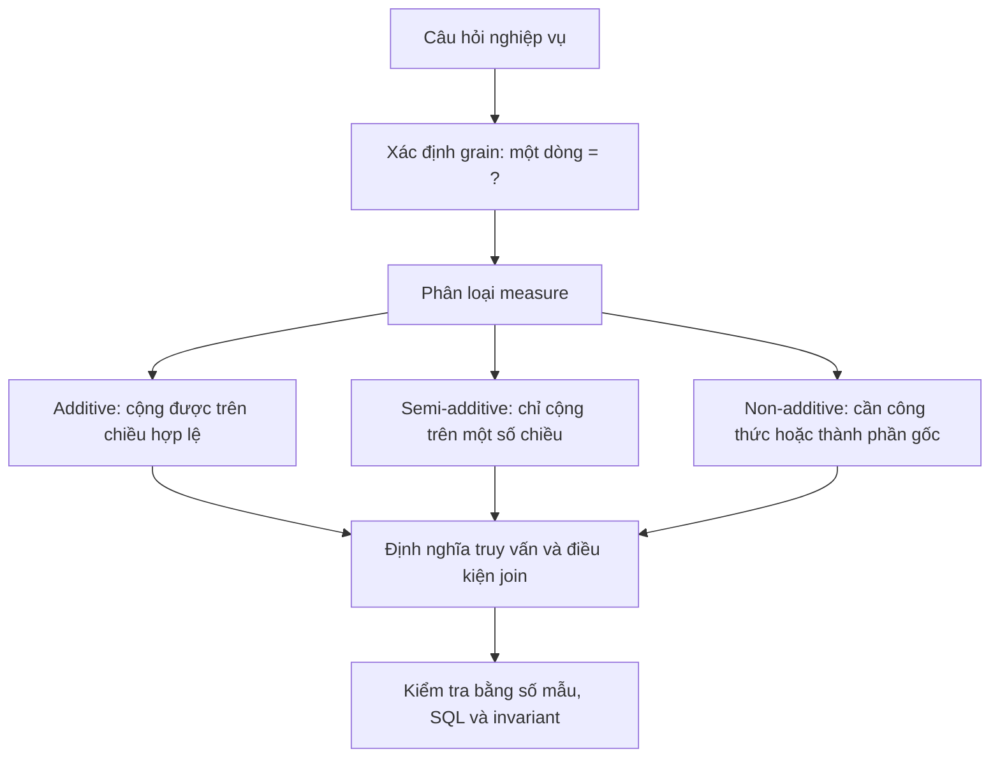

# Lưu số dư, tỷ lệ, đơn giá và quy tắc tổng hợp đúng

Giả sử báo cáo tài chính có hai tài khoản, mỗi tài khoản được chụp **số dư cuối ngày**; báo cáo marketing có **tỷ lệ chuyển đổi** theo chiến dịch; báo cáo bán hàng có **đơn giá** và **doanh thu**. Cả ba đều hiển thị dưới dạng con số, nhưng chúng không có cùng quy tắc cộng.

- Cộng doanh thu của các dòng bán hàng **không chồng lấn** có thể cho tổng doanh thu.
- Cộng số dư cuối ngày của cùng tài khoản qua 30 ngày **không** cho “số dư tháng”.
- Cộng hoặc lấy trung bình đơn giản các tỷ lệ chuyển đổi **không** cho tỷ lệ của toàn bộ các phiên.
- Cộng các đơn giá **không** cho giá bình quân; giá bình quân thực hiện thường cần doanh thu và số lượng.

Đó là vấn đề cốt lõi của **fact table**: không chỉ lưu *một measure có kiểu số*, mà phải biết **một dòng fact biểu diễn điều gì**, measure có thể tổng hợp qua chiều nào, và công thức nào vẫn đúng sau khi lọc, nhóm hoặc gộp kỳ.

Bài học thuộc chương **Bảng dữ kiện** của module **DATABASE_DATA_MODELING**. Module rèn kỹ năng chuyển yêu cầu nghiệp vụ thành thực thể, quan hệ và ràng buộc, từ chuẩn hóa, khóa, chỉ mục đến lược đồ vật lý; so sánh mô hình quan hệ, document, đồ thị và phân tích để thiết kế có thể tiến hóa và kiểm chứng. Ta sẽ bắt đầu từ định nghĩa nghiệp vụ, phân loại đại lượng, xây lược đồ fact, viết truy vấn đúng và thiết kế kiểm thử chống cộng nhầm.

## 1. Định nghĩa hạt dữ liệu (*grain*) trước khi nói về SUM

**Grain** là phát biểu chính xác “một dòng của bảng này tương ứng với một điều gì”. Nếu thiếu phát biểu đó, không thể biết phép `SUM` có cộng lại cùng một thực thể, sự kiện hoặc thời điểm nhiều lần hay không.

| Fact table | Grain minh họa | Khóa nhận diện một dòng | Measure |
| --- | --- | --- | --- |
| `fact_sales_line` | Một dòng hàng của một giao dịch bán hợp lệ | `(order_id, line_no)` | `quantity`, `net_revenue`, `list_unit_price` |
| `fact_account_balance_daily` | Số dư chốt tại cuối một ngày cho một tài khoản trong một đơn vị tiền | `(account_id, currency_code, snapshot_date)` | `closing_balance` |
| `fact_campaign_daily` | Kết quả một chiến dịch trong một ngày theo chính sách gán nguồn xác định | `(campaign_id, report_date)` | `sessions`, `converted_sessions` |
| `fact_inventory_daily` | Tồn kho cuối ngày cho một SKU tại một kho | `(warehouse_id, sku_id, snapshot_date)` | `on_hand_units` |

Mỗi loại grain dẫn đến một phép tổng hợp khác:

- Dòng giao dịch bán là **sự kiện/luồng (flow)**: nhiều dòng không trùng nhau có thể cộng lại.
- Số dư và tồn kho cuối ngày là **trạng thái tại thời điểm (stock)**: có thể cộng các tài khoản hoặc kho phù hợp **trong cùng một thời điểm**, nhưng không cộng các snapshot qua thời gian để lấy trạng thái cuối kỳ.
- Tỷ lệ và đơn giá có thể là **chỉ số dẫn xuất**: cần giữ **các thành phần gốc** giúp tính lại ở cấp nhóm mới.

### Tách grain khỏi dimension

Một dòng `fact_sales_line` có thể có nhiều dimension: sản phẩm, khách hàng, cửa hàng, ngày bán, tiền tệ, chương trình khuyến mãi. Thêm một dimension để phân tích **không được tự ý nhân số dòng sự kiện**. Nếu một dòng hàng gắn ba tag và ta join thẳng sang bảng tag, doanh thu có thể xuất hiện ba lần. Vì vậy grain phải được công bố độc lập với số bảng dimension được join.



## 2. Ba nhóm measure: cộng được, bán cộng được và không cộng được

### 2.1. Additive — cộng được theo những chiều đã xác định

Một measure **additive** có thể cộng qua các chiều phân tích phù hợp **khi các dòng fact đại diện các phần không trùng nhau**.

Ví dụ tổng doanh thu thuần từ các dòng bán hàng:

\[
\mathrm{Revenue}(G) = \sum_{i \in G} \mathrm{netRevenue}_i
\]

Điều kiện quan trọng là mọi giá trị dùng **cùng đơn vị**, chính sách ghi nhận và kỳ kế toán, đồng thời tập dòng không chứa duplicate hoặc tổng lồng tổng. Hai dòng bán cùng sản phẩm nhưng thuộc hai giao dịch hợp lệ vẫn phải được tính cả hai; hai bản ghi lặp của **cùng dòng giao dịch** thì không.

`quantity` thường cộng được nếu cùng đơn vị cơ sở: 2 chiếc + 3 chiếc = 5 chiếc. Nhưng cộng “2 kg gạo + 3 chiếc điện thoại” thành “5 sản phẩm” không có ý nghĩa về lượng vật lý nếu không định nghĩa “đơn vị sản phẩm” riêng.

### 2.2. Semi-additive — chỉ cộng qua một số chiều

`closing_balance` hay `on_hand_units` là measure **semi-additive**:

- Có thể cộng số dư của **những tài khoản độc lập**, cùng đơn vị tiền và **cùng thời điểm chốt**, nếu báo cáo được định nghĩa là tổng số dư các tài khoản đó.
- Không thể cộng số dư cùng một tài khoản tại **các ngày khác nhau** để thu được số dư cuối kỳ.
- Có thể cộng tồn kho của cùng SKU tại các kho độc lập ở cùng thời điểm, nếu hàng không bị đếm hai lần và trạng thái tồn kho nhất quán; không cộng tồn kho qua từng ngày để lấy lượng hàng cuối tháng.

Từ “semi-additive” không có nghĩa *cứ cộng trên mọi dimension trừ ngày*. Ví dụ cộng số dư qua các tài khoản trung gian của cùng một hệ thống có thể **đếm lặp cùng tiền**; cộng khoản phải thu và phải trả hoặc các đơn vị tiền khác nhau có thể sai ý nghĩa. Cần kiểm tra tập thực thể và phép đo cụ thể.

### 2.3. Non-additive — không cộng trực tiếp

Các measure như **tỷ lệ chuyển đổi**, **phần trăm lỗi**, **biên lợi nhuận %**, **đơn giá**, **giá trung bình**, **lãi suất** thường không cộng được theo nghĩa thông thường.

Ví dụ:

\[
\mathrm{ConversionRate}
=\frac{\mathrm{ConvertedSessions}}{\mathrm{EligibleSessions}}
\]

Để tính tỷ lệ trên nhiều nhóm **không trùng nhau**, cần tổng tử số và tổng mẫu số **trước khi chia**, không lấy trung bình không trọng số của các tỷ lệ con.

| Measure | Nhóm | Có thể SUM trên thời gian? | Cách tổng hợp thường đúng |
| --- | --- | --- | --- |
| `net_revenue` của dòng bán | Additive flow | Có, trên những dòng không trùng nhau | `SUM(net_revenue)` theo tiền tệ/quy tắc ghi nhận |
| `quantity` của dòng bán | Additive trong một đơn vị đồng nhất | Có, trong phạm vi hợp lệ | `SUM(quantity)` |
| `closing_balance` cuối ngày | Semi-additive stock | **Không** để lấy số dư cuối kỳ | Chọn snapshot cuối kỳ hoặc tính average balance được định nghĩa |
| `on_hand_units` cuối ngày | Semi-additive stock | **Không** để lấy tồn kho cuối kỳ | Chọn snapshot cuối kỳ; có thể tính mức tồn bình quân theo thời gian |
| `conversion_rate` | Non-additive ratio | Không | `SUM(converted_sessions)/SUM(sessions)` nếu mẫu số cộng được |
| `unit_price` | Non-additive price | Không | `SUM(revenue)/SUM(quantity)` hoặc weighted price theo định nghĩa |
| `gross_margin_pct` | Non-additive ratio | Không | `SUM(gross_profit)/SUM(revenue)` nếu cùng cơ sở |
| `distinct_customers` theo ngày | Thường không additive qua ngày | Không nếu khách xuất hiện nhiều ngày | Đếm distinct trên tập gốc hoặc dùng cấu trúc mergeable có hợp đồng rõ |

**Lưu ý:** Ngay cả một measure trông additive, ví dụ `converted_sessions`, chỉ cộng được nếu cùng một phiên **không được ghi nhận vào nhiều nhóm** trong phép tổng hợp đó. Điều này là thuộc tính của mô hình sự kiện/attribution, không phải của kiểu `BIGINT`.

## 3. Số dư: phép cộng đúng theo thực thể, sai theo thời gian

Giả sử cuối ngày có hai tài khoản cùng đơn vị VND:

| Ngày chốt | Tài khoản A | Tài khoản B | Tổng tại ngày đó |
| --- | ---: | ---: | ---: |
| 20/11 | 1.000 | 500 | 1.500 |
| 21/11 | 1.100 | 400 | 1.500 |

Để biết tổng số dư **cuối ngày 21/11**, ta cộng các tài khoản tại **21/11**:

\[
B_{\mathrm{21/11}} = 1100 + 400 = 1500
\]

Nếu cộng cả bốn snapshot, kết quả 3.000 **không phải** số dư “của hai ngày” hay số dư cuối kỳ. Nó chỉ là phép cộng các số đo trạng thái lặp ở hai thời điểm, thường không có ý nghĩa tài chính như mong muốn.

### 3.1. Số dư cuối kỳ

Với một tài khoản `a` và kỳ kết thúc tại `T`:

\[
\mathrm{EndingBalance}(a,T)=B_{a,T}
\]

Nếu có snapshot đúng thời điểm `T`, sử dụng đúng snapshot đó. Nếu không có, cần **quy tắc nghiệp vụ**:

- **Strict:** thiếu snapshot cuối kỳ thì báo thiếu dữ liệu.
- **As-of / carry-forward:** chọn snapshot cuối gần nhất không sau `T` nếu bản đó còn trong ngưỡng freshness cho phép.
- **Reconstruction:** lấy số dư mở đầu và cộng biến động (flow) hợp lệ đến `T`; cách này cần ledger và quy tắc nhận diện giao dịch chặt chẽ.

Không ngầm lấy “hàng cuối cùng đang có” rồi gọi đó là số dư cuối kỳ nếu báo cáo yêu cầu chốt chính xác. Nếu dùng as-of, nên trả kèm `snapshot_date` thực tế để người đọc biết dữ liệu cũ bao lâu.

### 3.2. Số dư bình quân là một chỉ số khác

Nếu có snapshot **mỗi cuối ngày** đầy đủ trong 30 ngày và định nghĩa “bình quân của 30 số dư cuối ngày”, công thức có thể là:

\[
\mathrm{AverageDailyBalance}
=\frac{\sum_{d=1}^{30} B_d}{30}
\]

Đây không phải “cộng số dư để lấy tổng”, mà là **tính trung bình các trạng thái theo thời gian** với mẫu số rõ ràng. Nếu thiếu 5 ngày, `AVG` trên 25 snapshot chỉ cho **trung bình của 25 ngày quan sát**, không phải trung bình 30 ngày; phải báo thiếu, tái dựng hoặc áp quy tắc carry-forward được phê duyệt.

Với snapshot không đều, một phép **trung bình theo thời lượng** có thể phù hợp hơn:

\[
\overline{B}
= \frac{\sum_i B_i\,\Delta t_i}{\sum_i \Delta t_i}
\]

Trong đó `B_i` là số dư được xem là có hiệu lực trong khoảng `\Delta t_i`. Chỉ dùng công thức này nếu định nghĩa nghiệp vụ cho phép giả thiết giữ nguyên giá trị giữa hai lần đo; không tự suy rằng số dư ngân hàng thực tế không đổi giữa các snapshot.

### 3.3. Số dư không thay thế dòng biến động

Nếu bắt đầu ngày với 1.000, nạp thêm 200 và rút 100, cuối ngày còn 1.100. Báo cáo “nạp tiền trong ngày” lấy **flow +200**, không lấy `closing_balance=1100`. Báo cáo “biến động ròng” có thể lấy `closing_balance - opening_balance = 100` nếu không có điều chỉnh khác và hai snapshot được định nghĩa tương thích; trong hệ sổ cái, phải cân nhắc bút toán điều chỉnh, đảo bút toán, timezone chốt và ngày hiệu lực.

Tách **transaction fact** khỏi **periodic snapshot fact** giúp không dùng nhầm một stock measure như một flow measure.

## 4. Tỷ lệ: cộng tử số và mẫu số trước khi chia

Giả sử hai chiến dịch có phiên đủ điều kiện và phiên chuyển đổi như sau:

| Chiến dịch | Phiên chuyển đổi | Phiên đủ điều kiện | Tỷ lệ |
| --- | ---: | ---: | ---: |
| A | 9 | 10 | 90% |
| B | 20 | 100 | 20% |

Trung bình tỷ lệ A và B theo số học:

\[
\frac{90\% + 20\%}{2} = 55\%
\]

Nhưng tỷ lệ **trên toàn bộ 110 phiên** là:

\[
\mathrm{Rate}_{A \cup B}
= \frac{9+20}{10+100}
= \frac{29}{110}
\approx 26{,}36\%
\]

Con số 55% chỉ trả lời **“một chiến dịch được chọn đều xác suất thì tỷ lệ trung bình của hai chiến dịch là bao nhiêu?”**, không trả lời **“xác suất chuyển đổi của một phiên trong toàn bộ các phiên là bao nhiêu?”**.

### 4.1. Công thức tổng quát

Cho các nhóm `i` không trùng nhau, tử số `n_i` và mẫu số `d_i`:

\[
r_{\mathrm{combined}}
=\frac{\sum_i n_i}{\sum_i d_i}
=\frac{\sum_i d_i r_i}{\sum_i d_i}
\quad (\sum_i d_i>0)
\]

Tỷ lệ gộp là **trung bình có trọng số theo mẫu số** của các tỷ lệ con, nếu chúng dùng cùng định nghĩa mẫu số và mỗi phần tử mẫu số chỉ được tính một lần. Nếu các nhóm chồng lấn hoặc định nghĩa phiên khác nhau, công thức gộp có thể không có ý nghĩa.

### 4.2. Định nghĩa cả tử số và mẫu số

Trước khi lưu tỷ lệ, phải thống nhất:

- **Một chuyển đổi là gì?** Mua hàng thành công, hoàn thành đăng ký hay phát sinh ít nhất một conversion event?
- **Mẫu số là gì?** Phiên, lượt truy cập, người dùng duy nhất, impression đủ điều kiện hay số yêu cầu?
- **Một phiên có thể chuyển đổi nhiều lần không?** Nếu tử số là `converted_sessions`, một phiên chỉ được tính tối đa một lần. Nếu tử số là `orders`, có thể có nhiều order trên một phiên; `orders/sessions` là **số đơn trên phiên**, không nhất thiết là tỷ lệ chuyển đổi giới hạn trong 0–100%.
- **Cách gán attribution?** Một phiên đi qua hai chiến dịch được ghi cho chiến dịch nào? Nếu tính ở cả hai, không thể gộp bằng tổng đơn giản để báo “tỷ lệ tất cả phiên duy nhất”.
- **Mẫu số bằng 0?** Khi không có phiên, tỷ lệ **không xác định**, không tự động là 0%.

Trong fact table, nên lưu `converted_sessions` và `eligible_sessions` là **base measures** đã có grain rõ, rồi tính `rate` khi query. Có thể materialize tỷ lệ để phục vụ hiển thị, nhưng không được coi nó là đại lượng cộng được khi drill-up.

## 5. Đơn giá: giá từng dòng khác giá bình quân toàn nhóm

Giả sử cùng một loại hàng và cùng đơn vị tiền:

| Dòng bán | Số lượng | Đơn giá thực hiện | Doanh thu |
| --- | ---: | ---: | ---: |
| A | 2 | 100 | 200 |
| B | 8 | 20 | 160 |
| **Tổng** | **10** | — | **360** |

Trung bình không trọng số của hai đơn giá là `(100 + 20)/2 = 60`. Nhưng **giá bán thực hiện bình quân trên mỗi đơn vị** là:

\[
\mathrm{RealizedUnitPrice}
=\frac{\sum_i \mathrm{NetRevenue}_i}
       {\sum_i \mathrm{Quantity}_i}
=\frac{360}{10}=36
\]

Nó tương đương trung bình có trọng số theo lượng khi `revenue_i = price_i \times quantity_i` và tất cả cùng cơ sở định giá:

\[
\overline{p}
=\frac{\sum_i p_i q_i}{\sum_i q_i}
\]

### 5.1. Phân biệt các loại “đơn giá”

| Tên measure | Ý nghĩa | Quy tắc |
| --- | --- | --- |
| `list_unit_price` | Giá niêm yết của một đơn vị theo bảng giá | Không SUM; nếu muốn bình quân cần xác định trọng số/cách lấy mẫu |
| `contract_unit_price` | Giá thỏa thuận theo hợp đồng/thời hiệu | Tra theo hợp đồng, sản phẩm và thời điểm hiệu lực |
| `realized_unit_price` | Giá thực thu trên số đơn vị, sau các điều chỉnh được chọn | `SUM(net_revenue)/SUM(quantity)` trên dữ liệu cùng cơ sở |
| `average_selling_price` | KPI nghiệp vụ thường gọi ASP | Phải công bố rõ revenue, quantity, thuế, khuyến mãi, trả hàng, currency |
| `unit_cost` | Chi phí một đơn vị theo chính sách kế toán | Không SUM; có thể dùng chi phí xuất kho/số lượng theo kỳ |

Một số lưu ý quan trọng:

- `0` có thể là đơn giá hợp lệ (hàng tặng, khuyến mãi 100%); không đồng nhất với `NULL` hay “không có dữ liệu”.
- Nếu `quantity=0`, tỷ lệ `revenue/quantity` không xác định; cần dữ liệu hoặc logic sản phẩm xử lý riêng.
- Đơn vị “cái”, “kg”, “lít”, “giờ công” không tự cộng được; cần chuẩn hóa đơn vị và chọn cohort đồng nhất.
- Giá bán bình quân của một chiếc laptop và một kg gạo trong cùng nhóm thường **không phải KPI có ý nghĩa**, dù công thức SQL vẫn trả số.
- Hoàn hàng, giảm giá sau bán, thuế, phí giao hàng và currency conversion phải có **quy tắc ghi nhận thống nhất**. Không dùng công thức trên một tập có dòng sale và return ký dấu tùy tiện mà không kiểm tra mẫu số và nghĩa kinh tế của nó.

## 6. Chọn loại fact: giao dịch, snapshot định kỳ hay snapshot tích lũy

Ba kiểu fact table thường gặp được phân biệt bởi grain và vòng đời của row.

| Kiểu fact | Grain ví dụ | Hành vi cập nhật | Measure tiêu biểu |
| --- | --- | --- | --- |
| **Transaction fact** | Một dòng đơn hàng, một bút toán ledger, một event chuyển đổi | Chủ yếu thêm sự kiện/hiệu chỉnh có kiểm soát | `quantity`, `net_revenue`, `movement_amount` |
| **Periodic snapshot fact** | Một tài khoản × một ngày chốt; một SKU × kho × ngày | Chụp trạng thái định kỳ | `closing_balance`, `on_hand_units` |
| **Accumulating snapshot fact** | Một đơn hàng/đơn vận chuyển, cập nhật khi đi qua milestone | Cập nhật một row theo tiến trình | `created_at`, `packed_at`, `delivered_at`, `days_to_deliver` |

Một **accumulating snapshot** có các mốc thời gian trong cùng row; số ngày từ mở đến đóng đơn không phải measure có thể SUM để được “thời gian trung bình” mà không chia số đơn hợp lệ. Hệ thống vẫn phải chọn đơn đang mở/đã đóng và quy tắc xử lý thiếu milestone.

### 6.1. Fact cần có danh tính sự kiện và idempotency

Không dùng việc “hai dòng có cùng số tiền” để deduplicate. Hai khách có thể mua cùng sản phẩm cùng giá ở cùng phút nhưng là hai giao dịch thật. Ngược lại, một sự kiện nguồn `order_id=O1, line_no=2` gửi lại sau retry phải không được ghi thành hai dòng bán.

Mô hình nên bảo vệ unique key của **grain**, lưu nguồn và version/correction khi cần. Đối với snapshot, khóa cần cả **ngày chốt** để hai trạng thái của cùng tài khoản ở hai ngày không đè lên nhau.

## 7. Lược đồ quan hệ mẫu: lưu các thành phần gốc, không chỉ KPI

Các ví dụ sau sử dụng **PostgreSQL**. Mục tiêu là minh họa cách đặt khóa, `CHECK`, `FK` và grain; không giả định đã có schema nào khác.

### 7.1. Dimension tối thiểu

```sql
CREATE TABLE dim_account (
    account_id BIGINT NOT NULL,
    currency_code CHAR(3) NOT NULL,
    account_category VARCHAR(32) NOT NULL,
    PRIMARY KEY (account_id, currency_code)
);

CREATE TABLE dim_product (
    product_id BIGINT PRIMARY KEY,
    product_name TEXT NOT NULL,
    unit_code VARCHAR(16) NOT NULL
);

CREATE TABLE dim_campaign (
    campaign_id BIGINT PRIMARY KEY,
    campaign_name TEXT NOT NULL
);
```

Ở đây `dim_account` dùng khóa ghép để minh họa tài khoản có các “ngăn” tiền tệ tách biệt; trong một hệ thực tế, danh tính account/currency có thể là một surrogate key. Điều kiện bắt buộc là không gộp tiền của hai currency thành một số không có đơn vị.

### 7.2. Snapshot số dư cuối ngày

```sql
CREATE TABLE fact_account_balance_daily (
    account_id BIGINT NOT NULL,
    currency_code CHAR(3) NOT NULL,
    snapshot_date DATE NOT NULL,
    closing_balance NUMERIC(24, 2) NOT NULL,
    measured_at TIMESTAMPTZ NOT NULL,
    source_version BIGINT NOT NULL DEFAULT 1,

    PRIMARY KEY (account_id, currency_code, snapshot_date),
    FOREIGN KEY (account_id, currency_code)
        REFERENCES dim_account(account_id, currency_code),
    CONSTRAINT ck_balance_version CHECK (source_version > 0)
);
```

Grain: **một số dư chốt cho một tài khoản-currency trong một ngày**. `closing_balance` có thể âm nếu miền cho phép thấu chi; đừng thêm `CHECK (closing_balance >= 0)` chỉ vì “số dư thường dương”. Cột `measured_at` ghi lúc đo/chốt để đối soát; `snapshot_date` là ngày nghiệp vụ, không được lấy bằng cách cắt ngày tùy tiện từ timestamp của server.

Khóa chính ngăn hai snapshot cùng grain xuất hiện đồng thời nhưng **không tự bảo đảm chốt đúng giờ, đủ mọi ngày hoặc dữ liệu nguồn đã được khóa sổ**. Những điều đó cần workflow và quality rule. Một correction có thể sửa version cùng key hoặc ghi revision history riêng; không được cộng các revision như các snapshot độc lập.

### 7.3. Fact bán hàng theo dòng

```sql
CREATE TABLE fact_sales_line (
    order_id BIGINT NOT NULL,
    line_no INTEGER NOT NULL CHECK (line_no > 0),
    sold_at TIMESTAMPTZ NOT NULL,
    product_id BIGINT NOT NULL REFERENCES dim_product(product_id),
    currency_code CHAR(3) NOT NULL,
    quantity NUMERIC(20, 3) NOT NULL CHECK (quantity > 0),
    list_unit_price NUMERIC(22, 4) NOT NULL
        CHECK (list_unit_price >= 0),
    net_revenue NUMERIC(24, 2) NOT NULL
        CHECK (net_revenue >= 0),

    PRIMARY KEY (order_id, line_no)
);
```

Trong bảng **minh họa này**, chỉ lưu dòng bán hợp lệ với lượng dương và doanh thu không âm; hoàn trả/refund chưa được biểu diễn, cần bảng riêng hoặc quy tắc ký dấu và event type riêng nếu bài toán yêu cầu. `list_unit_price` là giá niêm yết; `net_revenue` là doanh thu đã ghi nhận theo định nghĩa bài toán, nên giá thực hiện `net_revenue/quantity` có thể khác `list_unit_price`.

Lưu doanh thu ở cấp dòng giúp gộp được khi biết unit/currency và scope; lưu cả đơn giá chỉ để tra cứu/giải thích, **không dùng `SUM(list_unit_price)` để làm KPI giá**.

### 7.4. Fact chuyển đổi theo chiến dịch và ngày

```sql
CREATE TABLE fact_campaign_daily (
    campaign_id BIGINT NOT NULL REFERENCES dim_campaign(campaign_id),
    report_date DATE NOT NULL,
    eligible_sessions BIGINT NOT NULL
        CHECK (eligible_sessions >= 0),
    converted_sessions BIGINT NOT NULL
        CHECK (converted_sessions >= 0),

    PRIMARY KEY (campaign_id, report_date),
    CONSTRAINT ck_converted_within_eligible
        CHECK (converted_sessions <= eligible_sessions)
);
```

Grain: **một chiến dịch × một ngày trong một phiên bản quy tắc attribution thống nhất**. Dòng lưu các **count gốc**, không cần lưu `conversion_rate` như một measure additive. Ràng buộc `converted_sessions <= eligible_sessions` chỉ đúng nếu mỗi phiên chuyển đổi được đếm nhiều nhất một lần. Nếu business metric khác, phải đổi tên trường và invariant, không tùy tiện giữ ràng buộc trên số đơn phát sinh.

Lược đồ cũng giả định mỗi phiên được gán cho một chiến dịch nếu báo cáo cần gộp toàn bộ số phiên giữa các chiến dịch. Nếu một phiên thuộc nhiều chiến dịch, việc cộng count theo chiến dịch sẽ đếm lặp; cần attribution và mô hình bridge hoặc metric khác.

## 8. SQL tổng hợp số dư: chọn đúng thời điểm trước khi SUM

### 8.1. Tổng số dư ở một ngày chốt xác định

```sql
SELECT
    currency_code,
    SUM(closing_balance) AS total_closing_balance,
    COUNT(*) AS observed_accounts
FROM fact_account_balance_daily
WHERE snapshot_date = DATE '2026-11-21'
GROUP BY currency_code
ORDER BY currency_code;
```

Lệnh này cộng các tài khoản có snapshot tại ngày **21/11/2026** theo từng currency. Nó **không** chứng minh mọi tài khoản đáng lẽ có snapshot đều đã được chốt. Nếu cần số dư tổng của toàn bộ danh mục, hãy so sánh số account quan sát với danh sách account có hiệu lực vào ngày đó và xử lý missing snapshot.

### 8.2. Đọc as-of “bản gần nhất không sau ngày T”

Khi nghiệp vụ chấp nhận mang số dư chốt gần nhất về thời điểm báo cáo, có thể:

```sql
WITH ranked AS (
    SELECT
        b.*,
        ROW_NUMBER() OVER (
            PARTITION BY account_id, currency_code
            ORDER BY snapshot_date DESC
        ) AS rn
    FROM fact_account_balance_daily AS b
    WHERE b.snapshot_date <= DATE '2026-11-21'
)
SELECT
    currency_code,
    SUM(closing_balance) AS balance_as_of,
    COUNT(*) AS accounts_with_a_snapshot,
    MIN(snapshot_date) AS oldest_used_snapshot
FROM ranked
WHERE rn = 1
GROUP BY currency_code;
```

`ROW_NUMBER` chọn **một snapshot gần nhất cho mỗi tài khoản-currency**, sau đó mới cộng. Không dùng `SUM` trên toàn bộ dòng đã chụp qua nhiều ngày. Query này:

1. **Không hiện** tài khoản chưa từng có snapshot: cần danh sách master account để biết thiếu bao nhiêu account.
2. Có thể giữ snapshot quá cũ: cần quy tắc freshness, ví dụ từ chối nếu quá 1 ngày trong một báo cáo daily close.
3. Không tự giải quyết account đóng/mở hoặc đổi nhóm theo thời gian; cần thông tin hiệu lực dimension.
4. Dựa vào dữ liệu ngày chốt đã được kiểm soát; correction cùng grain phải được xử lý trước khi query.

### 8.3. Chọn giữa END, AVG và FLOW

Ba yêu cầu sau cần ba cách tính khác nhau:

| Câu hỏi | Đáp án đúng về ý nghĩa |
| --- | --- |
| “Ngày cuối tháng còn bao nhiêu tiền?” | Ending balance as-of ngày chốt |
| “Bình quân số dư mỗi ngày trong tháng là bao nhiêu?” | Average daily balance theo số ngày/quy tắc missing |
| “Tháng này tiền vào/ra bao nhiêu?” | `SUM` các **transaction movements** trong tháng |

Một mô hình có thể chứa cả `fact_account_balance_daily` và `fact_account_movement`; không biến mọi câu hỏi thành một truy vấn `SUM(closing_balance)`.

## 9. SQL tổng hợp tỷ lệ và đơn giá

### 9.1. Tỷ lệ chuyển đổi toàn kỳ

```sql
SELECT
    SUM(converted_sessions) AS converted_sessions,
    SUM(eligible_sessions) AS eligible_sessions,
    100.0 * SUM(converted_sessions)::NUMERIC
        / NULLIF(SUM(eligible_sessions), 0)
        AS conversion_rate_pct
FROM fact_campaign_daily
WHERE report_date >= DATE '2026-11-01'
  AND report_date < DATE '2026-12-01';
```

`NULLIF(SUM(eligible_sessions), 0)` ngăn chia cho 0 và để tỷ lệ thành `NULL` khi mẫu số không có ý nghĩa. `0` chuyển đổi trên 100 phiên tạo **0% hợp lệ**; 0 phiên với 0 chuyển đổi phải được hiểu là **không có phép đo tỷ lệ**, không gán mặc định 0%.

Không viết:

```sql
-- Không đúng nếu mục tiêu là tỷ lệ của toàn bộ phiên:
SELECT AVG(
    converted_sessions::NUMERIC
    / NULLIF(eligible_sessions, 0)
)
FROM fact_campaign_daily;
```

`AVG` của các tỷ lệ ngày/chiến dịch chỉ là trung bình theo **số dòng fact có mẫu số khác 0**, không tự phản ánh trọng số số phiên. Nó có thể hữu ích cho một câu hỏi nghiên cứu *khác*, nhưng không thay thế công thức tổng thể.

### 9.2. Giá bán thực hiện bình quân của cùng một sản phẩm

```sql
SELECT
    product_id,
    currency_code,
    SUM(quantity) AS sold_quantity,
    SUM(net_revenue) AS recognized_revenue,
    SUM(net_revenue)
        / NULLIF(SUM(quantity), 0)
        AS realized_unit_price
FROM fact_sales_line
WHERE sold_at >= TIMESTAMPTZ '2026-11-01 00:00:00+00'
  AND sold_at < TIMESTAMPTZ '2026-12-01 00:00:00+00'
GROUP BY product_id, currency_code
ORDER BY product_id, currency_code;
```

Query nhóm theo `product_id` và `currency_code` để tránh trộn giá của các mặt hàng hay tiền tệ khác nhau. Nếu một sản phẩm được bán theo nhiều `unit_code`/đơn vị trong lịch sử, cần quy tắc quy đổi số lượng trước khi tính; `product_id` đơn lẻ không bảo đảm cùng mẫu số.

Đừng dùng `AVG(list_unit_price)` nếu mỗi dòng có số lượng khác nhau mà KPI muốn giá trên **một đơn vị bán**. Khi muốn giá niêm yết trung bình có trọng số, công thức có thể là:

```sql
SELECT
    product_id,
    currency_code,
    SUM(list_unit_price * quantity)
        / NULLIF(SUM(quantity), 0)
        AS quantity_weighted_list_price
FROM fact_sales_line
GROUP BY product_id, currency_code;
```

`quantity_weighted_list_price` và `realized_unit_price` có thể khác nhau do khuyến mãi, chiết khấu và cách ghi nhận revenue.

### 9.3. Cộng tỷ lệ theo thời gian không đúng

Nếu mỗi ngày có 10% chuyển đổi, tổng bảy ngày **không** là 70%. Đó là bảy tỷ lệ đo trên bảy nhóm riêng. Tỷ lệ toàn tuần được tính từ tổng chuyển đổi và tổng phiên; có thể vẫn là 10% nếu mẫu số đều khác nhau nhưng tỷ lệ từng ngày giống hệt. Chỉ cộng **các count gốc**, không cộng kết quả phép chia.

## 10. Thử ngay với bộ số liệu nhỏ

Một kiểm thử “bằng tay” rất hữu ích để phát hiện sai công thức trước khi chạy trên hàng tỷ dòng. Ví dụ SQL PostgreSQL tự chứa:

```sql
WITH sales(line_id, quantity, unit_price, revenue) AS (
    VALUES
        (1, 2::NUMERIC, 100::NUMERIC, 200::NUMERIC),
        (2, 8::NUMERIC, 20::NUMERIC, 160::NUMERIC)
)
SELECT
    AVG(unit_price) AS unweighted_price,
    SUM(revenue) / NULLIF(SUM(quantity), 0)
        AS realized_unit_price
FROM sales;
-- unweighted_price = 60; realized_unit_price = 36
```

```sql
WITH campaigns(name, converted_sessions, eligible_sessions) AS (
    VALUES
        ('A', 9::NUMERIC, 10::NUMERIC),
        ('B', 20::NUMERIC, 100::NUMERIC)
)
SELECT
    AVG(converted_sessions / eligible_sessions) * 100
        AS unweighted_rate_pct,
    SUM(converted_sessions)
        / NULLIF(SUM(eligible_sessions), 0) * 100
        AS combined_rate_pct
FROM campaigns;
-- unweighted_rate_pct = 55
-- combined_rate_pct ~= 26.3636
```

```sql
WITH balances(account_id, snapshot_date, closing_balance) AS (
    VALUES
        ('A', DATE '2026-11-20', 1000::NUMERIC),
        ('B', DATE '2026-11-20', 500::NUMERIC),
        ('A', DATE '2026-11-21', 1100::NUMERIC),
        ('B', DATE '2026-11-21', 400::NUMERIC)
)
SELECT
    SUM(closing_balance) AS sum_of_all_snapshots,
    SUM(closing_balance) FILTER (
        WHERE snapshot_date = DATE '2026-11-21'
    ) AS ending_balance
FROM balances;
-- sum_of_all_snapshots = 3000 (không phải số dư cuối kỳ)
-- ending_balance = 1500
```

Đây là các ví dụ **chứng minh bằng số**. Với dữ liệu thật cần thêm quy định về missing rows, duplicate, currency, thời điểm chốt và các dòng return/correction.

## 11. Đơn vị tiền, đơn vị lượng và tỷ giá

### 11.1. Không cộng các đơn vị tiền như một số thuần

`100 USD + 100 VND` không phải `200` của một đơn vị có nghĩa. Nếu cần báo cáo theo VND, hãy áp dụng chính sách tỷ giá phù hợp **cho từng dòng tiền** trước khi tổng hợp:

\[
\mathrm{RevenueVND}
=\sum_i \mathrm{RevenueOriginal}_i
\times \mathrm{Rate}_{\mathrm{currency}_i \to \mathrm{VND},\,t_i}
\]

Ở đây `t_i` là thời điểm/điều kiện chọn tỷ giá theo **quy tắc kế toán** (ngày giao dịch, ngày chốt, ngày ghi nhận, tỷ giá được phê duyệt...). Không được lấy một tỷ giá hiện tại rồi nhân với tất cả giao dịch lịch sử nếu báo cáo cần tỷ giá tại thời điểm giao dịch.

Thiết kế có thể lưu:

- `amount_original` + `currency_original`;
- `fx_rate`, nguồn, thời điểm hiệu lực và version tỷ giá dùng;
- `amount_reporting` + `currency_reporting` được tính theo chính sách làm tròn;
- provenance để đối soát hoặc tính lại nếu có điều chỉnh.

`fx_rate` **không additive**. Cộng tỷ giá các ngày không tạo “tỷ giá tháng”. “Tỷ giá bình quân” chỉ có nghĩa khi định nghĩa trọng số và mục đích: bình quân theo giao dịch, theo khối lượng tiền, theo thời gian hoặc theo quy định kế toán.

### 11.2. Quy tắc làm tròn là một phần của measure

Với tiền, ưu tiên `NUMERIC/DECIMAL` trong SQL và `BigDecimal` trong Java thay vì dựa vào số thực nhị phân cho các phép tính yêu cầu độ chính xác thập phân. Quy tắc làm tròn phải được xác định ở đâu:

1. Làm tròn giá một đơn vị trước khi nhân lượng?
2. Tính số tiền từng dòng và làm tròn mỗi dòng?
3. Cộng số tiền chính xác rồi mới làm tròn khi hiển thị?

Ba lựa chọn có thể cho kết quả khác nhau. Hệ thống phải thống nhất policy, scale, cách áp thuế/khuyến mãi và phiên bản quy tắc; tránh chỉ để BI tự đoán. `NUMERIC(24,2)` trong lược đồ mẫu là lựa chọn minh họa, không phù hợp mọi đơn vị tiền hoặc mọi giá có độ chính xác nhỏ hơn hai chữ số thập phân.

### 11.3. Tỷ lệ lãi không phải dòng tiền lãi

Một khoản vay có số dư gốc, lãi suất năm và số ngày tính lãi. `interest_rate` không được SUM theo ngày để ra tiền lãi. Với **một** quy ước tính lãi đơn giản (ví dụ ACT/365) có thể mô hình minh họa:

\[
\mathrm{InterestAccrued}
=\sum_i \mathrm{Principal}_i
\times \mathrm{AnnualRate}_i
\times \frac{\mathrm{ActualDays}_i}{365}
\]

Muốn dùng đúng phải chia khoảng khi gốc hoặc lãi suất thay đổi, chọn day-count convention và policy làm tròn của hợp đồng, xử lý năm nhuận/định kỳ khi cần. Không dùng công thức minh họa như một quy tắc tài chính phổ quát. Dòng `interest_accrued` đã tính đúng có thể cộng theo kỳ theo cơ sở kế toán phù hợp; `annual_rate` thì không.

## 12. Join gây nhân dòng: lỗi làm SUM đúng cú pháp nhưng sai nghĩa

Giả sử một dòng bán có doanh thu 100 và sản phẩm của dòng đó có **ba tag**. Join trực tiếp từ fact sang bảng `product_tags` tạo ba dòng trung gian:

```text
fact_sales_line (order 17, line 1, revenue 100)
       |
       +-- tag: SALE       -> 100
       +-- tag: FEATURED   -> 100
       +-- tag: WINTER     -> 100

SUM(revenue) sau JOIN = 300  (sai nếu hỏi tổng doanh thu thật)
```

SQL gây lỗi:

```sql
-- product_tags: nhiều dòng cho một product_id.
-- KHÔNG dùng để tính tổng doanh thu toàn bộ:
SELECT SUM(f.net_revenue)
FROM fact_sales_line AS f
JOIN product_tags AS t
  ON t.product_id = f.product_id;
```

Cách sửa phụ thuộc câu hỏi:

- Nếu chỉ hỏi “doanh thu của những sản phẩm có tag WINTER”, dùng `WHERE EXISTS` để lọc fact mà **không nhân dòng**.
- Nếu cần phân bổ doanh thu cho **từng tag**, phải xác định chính sách allocation (ví dụ phần trăm cho mỗi tag, tổng trọng số bằng 1 cho mỗi dòng) hoặc chấp nhận có thể trùng khi drill-across.
- Nếu join dimension có lịch sử **SCD Type 2**, phải join đúng version có hiệu lực tại `sold_at`; join chỉ theo mã nghiệp vụ không có điều kiện thời gian có thể nhân dòng qua nhiều version.

Ví dụ lọc bằng `EXISTS`:

```sql
SELECT SUM(f.net_revenue) AS revenue
FROM fact_sales_line AS f
WHERE EXISTS (
    SELECT 1
    FROM product_tags AS t
    WHERE t.product_id = f.product_id
      AND t.tag_code = 'WINTER'
);
```

Hai ví dụ giả định bảng `product_tags(product_id, tag_code)` đã tồn tại; chúng minh họa hình dạng truy vấn, không phải toàn bộ schema chạy độc lập. Đừng xử lý lỗi nhân dòng bằng `SUM(DISTINCT net_revenue)`: hai dòng bán hợp lệ có cùng số tiền 100 sẽ bị gộp thành một, làm sai theo hướng ngược lại.

### Kiểm tra grain trước và sau join

```sql
-- Đếm số dòng fact gốc trong cùng phạm vi.
SELECT COUNT(*) AS original_fact_rows
FROM fact_sales_line;

-- Đếm số dòng sau join (nếu có bảng product_tags).
SELECT COUNT(*) AS joined_rows
FROM fact_sales_line AS f
JOIN product_tags AS t
  ON t.product_id = f.product_id;
```

`joined_rows > original_fact_rows` có thể do quan hệ 1–N hợp lệ, nhưng nếu dùng để SUM measure của fact gốc thì cần xem lại. Đếm distinct grain key trước/sau join cùng với tổng measure gốc giúp xác định mất dòng hoặc nhân dòng.

## 13. Missing, zero, correction và snapshot không đầy đủ

Một thiết kế fact còn phải phân biệt những trạng thái dễ nhầm trong báo cáo:

| Trạng thái | Ví dụ | Xử lý đúng |
| --- | --- | --- |
| **Không có dòng fact** | Không nhận số dư ngày 21 của tài khoản A | Missing snapshot; không tự suy là 0 |
| **Measure = 0** | Tài khoản chốt thật bằng 0; chiến dịch có 0 chuyển đổi trên 100 phiên | Giá trị hợp lệ |
| **Measure NULL** | Nhiệt độ chưa đo được hoặc giá chưa xác định | Chính sách unknown/missing riêng; `SUM` và `AVG` bỏ qua NULL |
| **Mẫu số = 0** | 0 phiên đủ điều kiện | Tỷ lệ không xác định; dùng `NULLIF` và trạng thái hiển thị rõ |
| **Sự kiện đến muộn** | Giao dịch xảy ra hôm qua nhưng vừa được tải hôm nay | Ghi vào event date đúng, cập nhật aggregate/snapshot theo policy |
| **Correction** | Giá dòng hàng được sửa vì hoàn tiền | Dùng bản hiệu lực hay bản điều chỉnh theo quy tắc, không cộng cả bản cũ và mới |
| **Replay/duplicate** | Event `E123` bị gửi lại sau retry | Idempotency theo event/grain key, không nhân doanh thu |
| **Chưa khóa sổ** | Số dư cuối ngày vẫn đang chạy batch | Gắn trạng thái chốt/watermark; báo cáo có quy tắc chỉ đọc phiên đã hoàn tất |

Điểm rất quan trọng: một bảng snapshot có thể chỉ chứa **những thực thể hoạt động** hoặc **những thực thể phát sinh biến động**. Nếu giả định thiếu dòng là 0, báo cáo tài sản và tồn kho có thể sai nghiêm trọng. Cần ghi rõ snapshot là **dense** (đủ mọi thực thể trong phạm vi mỗi kỳ) hay **sparse** (chỉ một phần), và cách khôi phục trạng thái cho phần còn lại.

### Thời điểm nghiệp vụ khác thời điểm xử lý

Một fact có thể có:

- `event_time`: thời điểm sự kiện xảy ra;
- `effective_date`: kỳ nghiệp vụ/kế toán mà fact được ghi nhận;
- `ingested_at`: thời điểm kho nhận dữ liệu;
- `snapshot_date`: mốc chốt của stock;
- `version` hoặc `updated_at`: lần hiệu chỉnh.

Đừng lấy `ingested_at` làm ngày bán hoặc ngày số dư nếu yêu cầu nghiệp vụ dùng thời điểm khác. Khi cần báo cáo “as originally published” so với “latest corrected”, thiết kế nên có revision/provenance hoặc bảng phiên bản để tái lập kết quả.

## 14. Tổ chức vật lý và mô hình lưu khác nhau

Lược đồ logic đúng vẫn cần đường truy cập, chỉ mục và tổ chức vật lý phù hợp với truy vấn:

- **Fact giao dịch** thường lớn, tăng theo thời gian. Có thể partition theo ngày/tháng của `sold_at` hoặc ngày nghiệp vụ, và tạo đường truy cập theo `order_id`, `product_id` theo workload. PostgreSQL partitioned unique constraint có quy tắc liên quan partition key; không tự áp mẫu PK của bảng thường vào partitioning mà chưa thiết kế uniqueness toàn cục.
- **Fact snapshot** thường cần đọc theo `snapshot_date` (toàn bộ tài khoản) hoặc theo `account_id` qua một dải ngày. Index/partition phải hỗ trợ cả hai đường nếu tần suất lớn; primary key bắt đầu bằng `account_id` không tự tối ưu mọi truy vấn chỉ lọc `snapshot_date`.
- **Fact KPI theo ngày** thường nhỏ hơn và cần scan theo kỳ/campaign; có thể thêm index phù hợp khi query chứng minh nhu cầu.
- **Kho columnar** như Parquet/ClickHouse/warehouse phục vụ đọc nhiều dòng và vài cột cho aggregation; partition pruning và column pruning có thể giảm chi phí. Nó không thay thế định nghĩa grain, đơn vị đo và measure aggregation.
- **Document/wide-column** có thể lưu các bản ghi theo khóa để phục vụ nghiệp vụ; khi đưa sang warehouse, vẫn phải phân loại stock/flow/rate trước khi dùng `SUM`.
- **Graph** phù hợp mô tả quan hệ; nếu gắn measure lên cạnh, phải kiểm tra một sự kiện có được biểu diễn nhiều cạnh hay không trước khi tổng hợp.

Không chọn mô hình vật lý chỉ dựa vào việc dữ liệu “có nhiều cột” hay “phải tạo dashboard”. Trước hết xác định những truy vấn chính, độ trễ, khối lượng dữ liệu và yêu cầu tính lại lịch sử; sau đó benchmark với dữ liệu gần thực tế.

## 15. Kiểm thử tính cộng được bằng ví dụ đối chứng

Không nên chỉ kiểm tra cú pháp SQL. Hãy kiểm tra **quy tắc nghiệp vụ qua những trường hợp cố tình làm lộ sai số**.

| Kiểm thử | Kết quả mong đợi |
| --- | --- |
| Hai tài khoản cùng ngày có 1.100 và 400 VND | Tổng cuối ngày = 1.500 VND nếu hai tài khoản độc lập |
| Cùng hai tài khoản có snapshot ngày trước 1.000 và 500 | Không cộng cả hai ngày thành số dư cuối kỳ 3.000 |
| Tài khoản A thiếu snapshot đúng ngày T | Báo thiếu hoặc chọn as-of theo policy, có thông tin freshness |
| Hai chiến dịch 9/10 và 20/100 phiên | Gộp = 29/110 ≈ 26,36%, không phải 55% |
| 0 conversion trên 100 phiên | Rate = 0% |
| 0 conversion trên 0 phiên | Rate không xác định, không tự gán 0% |
| Hai dòng giá 100×2 và 20×8 | ASP = 36, không phải 60 |
| Hai dòng có `net_revenue=100` nhưng khác grain key | Tổng = 200, không dùng `SUM(DISTINCT revenue)` |
| Một dòng fact join sang ba tag | Tổng revenue không được nhân 3 |
| Đổi dimension theo SCD2 | Join đúng version hiệu lực tại event date |
| Có 100 USD và 100 VND | Không SUM thành “200”; cần báo riêng hoặc quy đổi có policy |
| Return hoặc correction cùng order line | Theo quy tắc ghi nhận không đếm cả bản cũ và bản mới |
| Missing snapshot được map thành 0 | Test phải bắt và từ chối cách diễn giải sai |
| Chạy cùng query trước/sau tải late event | Aggregate được cập nhật hoặc được đánh dấu freshness khác nhau |
| Tỷ lệ ngày có mẫu số không đồng đều | Ratio-of-sums khác simple AVG; giữ count gốc |

### Các invariant nên tự động kiểm tra

1. **Uniqueness của grain:** không có hai row đang hiệu lực cùng `(order_id,line_no)`; không có hai snapshot hiệu lực cùng `(account_id,currency,snapshot_date)`.
2. **Độ đầy đủ snapshot:** số account/sản phẩm cần chốt so với số row đã chốt ở mỗi kỳ.
3. **Tính nhất quán đơn vị:** nhóm SUM có currency và unit hợp lệ; không trộn measure khác nghĩa.
4. **Tử/mẫu đúng định nghĩa:** trong ví dụ `converted_sessions <= eligible_sessions` và count không âm.
5. **Đối soát nguồn:** `SUM(net_revenue)` có thể reconciled với sổ bán hàng hoặc ledger ở phạm vi đã thống nhất.
6. **Không nhân dòng join:** đo row count/unique grain key trước và sau mỗi join có khả năng 1–N.
7. **Tính tái lập:** cùng snapshot version và policy metric phải cho cùng kết quả, hoặc có giải thích correction.

## 16. Bài tập vận dụng

### Bài tập A — Dashboard số dư tài khoản

Một ngân hàng có 200.000 tài khoản và bảng chốt số dư cuối mỗi ngày. Dashboard cần: (1) số dư toàn hệ thống tại cuối ngày, (2) số dư bình quân trong tháng, (3) dòng tiền ròng của tháng.

Hãy chọn fact table cho mỗi nhu cầu, mô tả grain và công thức. Xử lý trường hợp 5% tài khoản thiếu snapshot một ngày; cho biết khi nào có thể carry-forward và khi nào phải báo dữ liệu chưa hoàn tất.

**Gợi ý:** (1) chọn snapshot theo ngày T rồi SUM trên tài khoản cùng currency; (2) trung bình daily balance theo thời gian với chính sách missing; (3) lấy transaction movement fact, không SUM snapshot.

### Bài tập B — KPI chuyển đổi chiến dịch

Ba ngày lần lượt có `1/2`, `10/100` và `0/0` phiên chuyển đổi. Hãy tính tỷ lệ toàn kỳ theo **ratio-of-sums**, so với `AVG` của tỷ lệ ngày, và giải thích ngày `0/0` nên tham gia thế nào vào mẫu số.

**Gợi ý:** tổng converted = 11, tổng eligible = 102, tỷ lệ toàn kỳ ≈ 10,78%. Ngày 0/0 không đóng góp tử hay mẫu; bản thân rate ngày đó là không xác định, không phải 0%.

### Bài tập C — Đơn giá theo sản phẩm và hoàn hàng

Cửa hàng bán 2 cái giá thực hiện 100, rồi 8 cái giá thực hiện 20, sau đó khách trả lại 1 cái từ lô giá 100. Hãy thiết kế cách ghi return, chính sách doanh thu ròng và số lượng ròng. Tính ASP trên lượng ròng theo định nghĩa đã chọn, rồi chỉ ra trường hợp quantity ròng bằng 0 khiến ASP không còn nghĩa.

**Gợi ý:** nếu return được ghi âm đúng 100 doanh thu và âm 1 số lượng, revenue ròng = 260, lượng ròng = 9, ASP ≈ 28,89. Đây chỉ là một policy; báo cáo gross selling price có thể cần loại trừ return thay vì net như thế.

### Bài tập D — SCD Type 2 và nhân dòng

Một khách hàng thay đổi khu vực từ Bắc sang Nam giữa năm. Dimension khách hàng lưu hai phiên bản SCD2; fact đơn hàng có thời điểm mua. Một truy vấn join chỉ theo `customer_id` cho mỗi giao dịch khớp cả hai phiên bản.

Hãy viết điều kiện join đúng theo **khoảng hiệu lực** (ví dụ `valid_from <= sold_at < valid_to`), xác định invariant không chồng lấn version và mô tả cách kiểm tra doanh thu trước/sau join.

**Gợi ý:** sự kiện phải được gắn với phiên bản dimension tại thời điểm nghiệp vụ hoặc dùng surrogate key đã được gán ở ingestion. Không dùng `SUM(DISTINCT revenue)` để sửa lỗi nhân dòng.

### Bài tập E — Đa tiền tệ và tỷ giá

Một bảng bán hàng có các dòng bằng USD và VND. Báo cáo được yêu cầu trả doanh thu VND theo tỷ giá lúc ghi nhận, và một báo cáo khác tính lại theo tỷ giá ngày khóa sổ.

Hãy thiết kế bảng tỷ giá, khóa theo currency pair + thời điểm hiệu lực + source/version, chính sách làm tròn, provenance và công thức cho cả hai loại báo cáo. Giải thích vì sao không cộng các `fx_rate` hoặc áp một tỷ giá hiện hành cho mọi lịch sử.

**Gợi ý:** chọn một tỷ giá có hiệu lực cụ thể cho từng dòng theo từng policy, quy đổi trước khi SUM, lưu version để đối soát. Tỷ lệ quy đổi là hệ số, không phải tiền.

## 17. Checklist trước khi công bố fact table hoặc KPI

- [ ] Mỗi fact table có định nghĩa **grain** một câu, khóa duy nhất và thời điểm nghiệp vụ rõ ràng.
- [ ] Từng measure được phân loại **additive, semi-additive hoặc non-additive** theo các dimension hợp lệ.
- [ ] Phân biệt **stock cuối kỳ** với **flow trong kỳ**; không SUM snapshot qua thời gian để lấy số dư.
- [ ] Với số dư bình quân, đã xác định thời gian, trọng số, chính sách missing và completeness.
- [ ] Với tỷ lệ, đã lưu/giữ được tử số và mẫu số đúng nghĩa, gộp bằng ratio-of-sums và xử lý mẫu số 0.
- [ ] Với đơn giá, đã phân biệt list/contract/realized price, số lượng, cùng sản phẩm/đơn vị và các return.
- [ ] Đã quy định currency, unit of measure, scale, tỷ giá và làm tròn trước khi cộng.
- [ ] Không dùng `AVG(rate)`, `AVG(unit_price)` hoặc `SUM(DISTINCT money)` như mẹo thay cho mô hình dữ liệu đúng.
- [ ] Các JOIN tới dimension/bridge không nhân dòng fact hoặc có cơ chế phân bổ được định nghĩa.
- [ ] Snapshot có quy tắc dense/sparse, as-of, late data, correction và freshness rõ ràng.
- [ ] PK/FK/UNIQUE/CHECK hỗ trợ grain và invariant; bổ sung test chất lượng cho những điều không thể kiểm tra chỉ bằng constraint.
- [ ] Đã chọn partition/index/layout theo query vận hành và phân tích, không để lưu trữ quyết định nghĩa metric.
- [ ] Có bộ ví dụ số nhỏ làm chuẩn, đối soát nguồn và kiểm thử khi thay đổi schema hay định nghĩa KPI.

**Ghi nhớ:** Measure không tự trở thành cộng được chỉ vì được lưu trong cột `NUMERIC`. **Doanh thu** là dòng phát sinh, **số dư** là trạng thái tại thời điểm, còn **tỷ lệ và đơn giá** là đại lượng dẫn xuất cần tử/mẫu hoặc trọng số thích hợp. Xác định grain, phạm vi không trùng lặp, đơn vị đo và quy tắc gộp trước khi viết `SUM` hay `AVG` sẽ giúp fact table và KPI không bị sai khi báo cáo chuyển từ dòng chi tiết lên ngày, tháng, khách hàng hoặc toàn doanh nghiệp.
