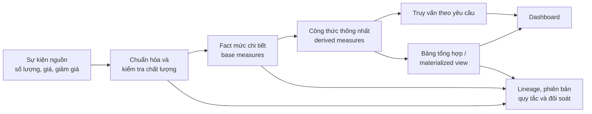
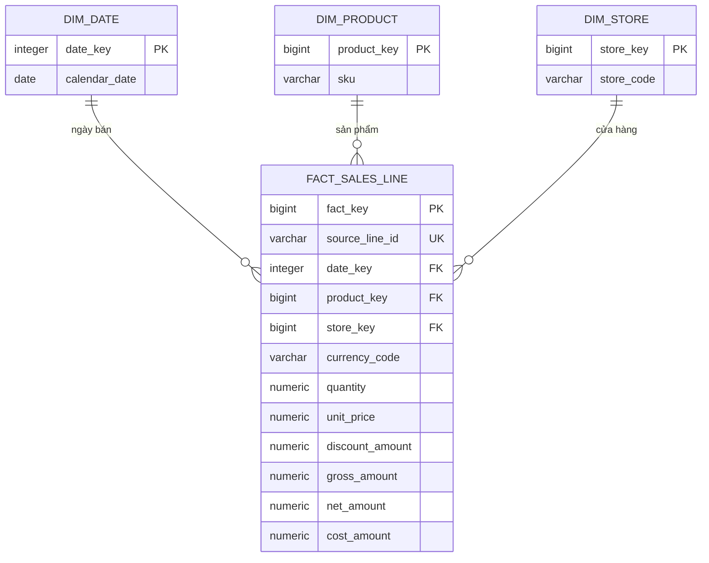

# Số đo gốc so với số đo suy ra hoặc tính sẵn

Khi thiết kế bảng dữ kiện (*fact table*) cho hệ thống phân tích, một câu hỏi rất thực tế là: **nên lưu những số liệu được ghi nhận tại sự kiện, tính chỉ số khi truy vấn, hay tính trước rồi lưu để báo cáo chạy nhanh hơn?** Ví dụ, dòng bán hàng có số lượng 2, đơn giá 100.000 đồng và giảm giá 20.000 đồng. Doanh thu trước giảm giá, doanh thu thuần, tỷ lệ giảm giá và biên lợi nhuận đều có thể suy ra, nhưng chúng không có cùng khả năng cộng gộp hay cùng yêu cầu lưu trữ.

Nếu chỉ lưu số tiền thuần, báo cáo sau này có thể không giải thích được số tiền ấy hình thành thế nào. Nếu lưu mọi phép tính và mọi tổng hợp, dữ liệu dễ trở nên dư thừa và lệch nhau khi quy tắc nghiệp vụ đổi hoặc sự kiện đến muộn. Nếu tính mọi thứ tại thời điểm đọc, truy vấn trên hàng tỷ dòng có thể không đạt thời gian phản hồi yêu cầu.

Bài thuộc chương **Bảng dữ kiện** trong module **DATABASE_DATA_MODELING**. Mục tiêu là chuyển yêu cầu đo lường nghiệp vụ thành **grain** (mức chi tiết của một hàng), số đo gốc, số đo suy ra, số đo tính sẵn, ràng buộc, khóa và cấu trúc tổng hợp có thể kiểm chứng. Trọng tâm không phải “lưu càng nhiều càng tốt”, mà là chọn nơi tính và nơi lưu sao cho chỉ số **đúng ngữ nghĩa, cộng gộp đúng, truy vết được và dễ tiến hóa**.

## 1. Bốn khái niệm cần tách bạch

| Khái niệm | Câu hỏi | Ví dụ trong bán hàng |
|---|---|---|
| **Số đo gốc** (*base/atomic measure*) | Giá trị nào được ghi nhận tại mức chi tiết của sự kiện và có nguồn đối chiếu? | Số lượng đã bán, đơn giá tại lúc bán, tiền giảm giá được phân bổ cho dòng |
| **Số đo suy ra** (*derived/calculated measure*) | Công thức nào biến các giá trị thành một chỉ số khác? | Doanh thu gộp = số lượng × đơn giá; biên lợi nhuận = lợi nhuận / doanh thu thuần |
| **Số đo tính sẵn** (*precomputed/materialized measure*) | Kết quả tính toán nào được lưu vật lý thay vì tính mỗi lần đọc? | `net_amount` đã tính trong fact; tổng doanh thu theo ngày/cửa hàng trong aggregate table |
| **Nguồn sự thật** (*source of truth*) | Dữ liệu nào và quy tắc phiên bản nào được dùng để giải quyết sai lệch? | Sự kiện thanh toán đã chốt, hóa đơn, bản ghi bán hàng, chính sách làm tròn đã công bố |

**“Gốc” nói về nguồn gốc và mức chi tiết; “suy ra” nói về quan hệ công thức; “tính sẵn” nói về cách thực thi và lưu trữ.** Chúng không phải ba nhóm loại trừ nhau. Một số đo có thể **vừa suy ra vừa được tính sẵn**, chẳng hạn `net_amount = gross_amount - discount_amount` đã được lưu ngay trên fact.

Ngược lại, giá trị `net_amount` do hệ thống thanh toán phát hành có thể là **giá trị gốc có thẩm quyền** nếu thực tế đã gồm phụ phí, thuế, quy tắc phân bổ và làm tròn không thể phục dựng từ đơn giá hiển thị. Khi đó không được tùy tiện coi công thức đơn giản ở kho dữ liệu là chân lý.

### Luồng hình thành chỉ số



Ví dụ: cùng một số đo **doanh thu thuần** có thể được tính tại mức dòng và lưu trong fact, rồi cộng lên mức ngày/cửa hàng trong bảng tính sẵn. Khi giải thích kết quả, phải biết **công thức, grain, thời điểm, đơn vị tiền và quy tắc xử lý thay đổi**.

## 2. Grain là quyết định đầu tiên của fact table

**Grain** là định nghĩa chính xác “mỗi hàng biểu diễn điều gì”. Nếu chưa xác định grain, sẽ rất khó kết luận phép cộng, trung bình, đếm hay phân bổ là đúng.

Ví dụ ba fact có grain khác nhau:

| Fact | Một hàng biểu diễn | Các số đo điển hình |
|---|---|---|
| `fact_sales_line` | Một **dòng bán hàng đã chốt** từ hệ thống nguồn | Số lượng, giá tại lúc bán, giảm giá, doanh thu, giá vốn |
| `fact_inventory_daily` | Số dư tồn kho của **một sản phẩm tại một kho cuối một ngày** | Số lượng tồn cuối ngày |
| `fact_order_lifecycle` | Một đơn ở **trạng thái tích lũy của quy trình** | Thời gian từ tạo đến giao, số ngày chờ, mốc xử lý |

Đây lần lượt là các kiểu fact giao dịch (*transaction fact*), ảnh chụp định kỳ (*periodic snapshot*) và ảnh chụp tích lũy (*accumulating snapshot*). Chúng khác nhau về grain và cách cập nhật. Không nên gộp tất cả vào cùng một bảng chỉ vì các số đo liên quan đến đơn hàng.

### 2.1. Grain một dòng bán hàng

Với `fact_sales_line`, ta đặt quy ước:

> Một hàng = một dòng bán hàng đã ghi nhận từ hệ thống nguồn, tại thời điểm giao dịch, được nhận diện bởi `source_line_id` duy nhất trong phạm vi nguồn đã chuẩn hóa.

Các chiều (dimension) đi cùng có thể gồm ngày bán, sản phẩm, cửa hàng và tiền tệ. Số đo `quantity` và `unit_price` phải tương ứng **chính dòng đó**. Nếu một đơn có ba dòng thì nó sinh ba hàng, không phải một.

Hãy đặt câu hỏi:

- Một mã dòng nguồn có thể được cập nhật sau khi bán không, hay mọi điều chỉnh đều là sự kiện mới?
- Hàng đổi trả có grain riêng không?
- Giảm giá cấp đơn được phân bổ xuống từng dòng như thế nào?
- Đơn vị số lượng là “cái”, “kg”, “giờ” hay loại khác?
- Tiền tệ, tỷ giá và kỳ ghi nhận được xác định tại thời điểm nào?

Nếu các câu hỏi chưa có đáp án, phép tính chỉ số dù đúng số học vẫn có thể sai nghiệp vụ.

### 2.2. Trộn grain gây đếm trùng

Giả sử đơn `O-1001` có hai dòng, và mức phí giao hàng của **toàn đơn** là 30.000 đồng. Nếu ghi `shipping_fee = 30000` trên **mỗi** dòng rồi cộng `SUM(shipping_fee)`, kết quả sẽ là 60.000 đồng, gấp đôi phí thực.

Hai cách thiết kế hợp lý hơn:

1. Giữ phí giao hàng ở **fact cấp đơn** với grain “một đơn”, không cộng trực tiếp cùng fact dòng hàng.
2. **Phân bổ phí** xuống từng dòng theo quy tắc minh bạch, lưu `allocated_shipping_fee`; tổng phân bổ phải đúng bằng phí gốc.

Không có cách nào đúng cho mọi báo cáo. Cần chọn từ mục đích phân tích: doanh thu theo sản phẩm có cần bao gồm phí giao hàng không, và nếu có, phí được phân bổ dựa trên giá trị, số lượng, trọng lượng hay quy tắc riêng?

## 3. Nhận diện số đo gốc: dữ liệu nào thực sự được quan sát?

Trong dòng bán hàng đã chốt, ta có thể định nghĩa:

| Trường | Vai trò | Nguồn và thời điểm |
|---|---|---|
| `quantity` | Số đo gốc | Số lượng được bán/chốt ở dòng |
| `unit_price` | Số đo gốc hoặc giá snapshot | Giá áp dụng tại thời điểm bán, không phải giá catalog hiện tại |
| `unit_cost_at_sale` | Giá vốn snapshot | Giá vốn theo chính sách kế toán tại thời điểm ghi nhận |
| `discount_amount` | Số đo gốc đã phân bổ | Tiền giảm giá thuộc dòng, sau quy tắc phân bổ |
| `gross_amount` | Số đo suy ra, có thể tính sẵn | `ROUND(quantity × unit_price, 2)` theo quy tắc ví dụ |
| `net_amount` | Số đo suy ra, có thể tính sẵn | `gross_amount - discount_amount` |
| `cost_amount` | Số đo suy ra, có thể tính sẵn | `ROUND(quantity × unit_cost_at_sale, 2)` |
| `gross_profit` | Số đo suy ra | `net_amount - cost_amount` |
| `gross_margin_rate` | Tỷ lệ suy ra | `gross_profit / net_amount`, khi mẫu số khác 0 |

Trong ví dụ này, tất cả tiền tính bằng **đơn vị tiền tệ của giao dịch**, đã được xử lý về mức lẻ phù hợp để tính từng dòng. Doanh thu thuần ở đây được định nghĩa **sau giảm giá, trước hoàn/đổi trả, không bao gồm thuế và phí giao hàng**. Đây là **định nghĩa của bài tập**, không phải định nghĩa pháp lý/kế toán phổ quát.

### 3.1. “Gốc” không có nghĩa luôn nhập tay hoặc không thể tính

`unit_cost_at_sale` có thể được truy ra từ lô hàng và phương pháp tính giá vốn của hệ thống nguồn. Nó vẫn là một số đo gốc trong fact phân tích nếu được **chốt thành giá trị có thể đối chiếu** ở từng giao dịch. Nếu chỉ join sang bảng giá vốn *hiện tại*, báo cáo lợi nhuận quá khứ có thể đổi mỗi khi chi phí được cập nhật.

Tương tự, hệ thống thanh toán có thể xuất ra tổng tiền cuối cùng là giá trị có thẩm quyền. Khi tổng này lệch phép tính đơn giản do phân bổ coupon, điều chỉnh, thuế, phí hoặc làm tròn, ta phải giải quyết bằng **quy tắc đối soát**, không được xóa dấu vết bằng cách tự tính lại mọi dữ liệu nguồn theo công thức tùy tiện.

### 3.2. Không lẫn số đo với thuộc tính chiều

`status`, `currency_code`, `product_key` và `date_key` thường là thuộc tính/khóa phân tích, không phải số đo chỉ vì chúng được lưu dưới dạng số hoặc mã. Ví dụ `date_key = 20261122` là một mã ngày, không phải đại lượng để cộng.

Ngược lại, `quantity` có thể không cộng được giữa những sản phẩm có đơn vị khác nhau. Giá trị của một số đo chỉ có ý nghĩa khi đi kèm **đơn vị, grain, phạm vi áp dụng và chính sách tổng hợp**.

## 4. Số đo suy ra: công thức phải gắn với ngữ nghĩa

Ở grain dòng bán hàng, đặt:

```text
gross_amount = round(quantity × unit_price, 2)
net_amount   = gross_amount - discount_amount
cost_amount  = round(quantity × unit_cost_at_sale, 2)
gross_profit = net_amount - cost_amount
```

Ở cấp một nhóm dòng cùng tiền tệ và cùng chính sách ghi nhận:

```text
gross_revenue  = SUM(gross_amount)
net_revenue    = SUM(net_amount)
total_cost     = SUM(cost_amount)
total_profit   = SUM(net_amount) - SUM(cost_amount)
discount_rate  = SUM(discount_amount) / SUM(gross_amount)
gross_margin   = total_profit / SUM(net_amount)
net_unit_price = SUM(net_amount) / SUM(quantity)
```

Với phép chia, phải định nghĩa hành vi khi mẫu số bằng 0: trả `NULL`/không xác định, không tự gán 0% vì hai ý nghĩa khác nhau. Cũng phải xác định tỷ lệ tính ở **cấp nhóm** chứ không lấy trung bình số học của tỷ lệ mỗi dòng.

### 4.1. Ví dụ tính đầy đủ với ba dòng

Đơn vị tiền là một đồng tiền thống nhất; số lượng là đơn vị sản phẩm có thể cộng được trong phạm vi ví dụ.

| Dòng | Đơn | Số lượng | Đơn giá | Gross | Giảm giá | Net | Giá vốn tổng |
|---|---|---:|---:|---:|---:|---:|---:|
| A | O-1001 | 2 | 100 | 200 | 20 | 180 | 120 |
| B | O-1001 | 1 | 200 | 200 | 0 | 200 | 120 |
| C | O-1002 | 3 | 50 | 150 | 30 | 120 | 90 |
| **Tổng** | | **6** | | **550** | **50** | **500** | **330** |

Từ các số đo gốc và số đo đã tính:

- **Doanh thu gộp** = 200 + 200 + 150 = **550**.
- **Giảm giá** = 20 + 0 + 30 = **50**.
- **Doanh thu thuần** = 550 − 50 = **500**.
- **Lợi nhuận gộp** = 500 − 330 = **170**.
- **Biên lợi nhuận gộp** = 170 / 500 = **34%**.
- **Tỷ lệ giảm giá** = 50 / 550 ≈ **9,09%**.
- **Giá bán thuần bình quân mỗi đơn vị** = 500 / 6 ≈ **83,33**.
- **Giá trị đơn hàng trung bình** nếu chỉ có đúng hai đơn và không có điều chỉnh khác = 500 / 2 = **250**.

Giá bán thuần trên từng dòng sau giảm giá là 90, 200 và 40. Trung bình đơn giản ba con số này bằng **110**, *không phải* giá bán thuần bình quân mỗi đơn vị (83,33) vì số lượng ở ba dòng khác nhau.

### 4.2. Vì sao không được lấy trung bình của trung bình?

Với nhóm A gồm 2 đơn vị bán ở giá thuần 90/đơn vị và nhóm B gồm 1 đơn vị ở giá thuần 200/đơn vị:

```text
Sai: (90 + 200) / 2 = 145
Đúng: (2 × 90 + 1 × 200) / (2 + 1) = 126,67
```

Tỷ lệ và trung bình cần **mẫu số đúng**. Muốn cộng gộp qua nhiều cửa hàng/ngày, hãy lưu hoặc cung cấp **tử số và mẫu số** (ví dụ `net_amount` và `quantity`), rồi tính tỷ lệ sau khi cộng chúng. Chỉ lưu một cột `average_price` ở bảng tổng hợp không đủ để tính đúng bình quân của nhiều nhóm có trọng số khác nhau.

### 4.3. Làm tròn ở cấp nào?

Giả sử có hai dòng, mỗi dòng là một đơn vị có đơn giá 0,335 theo đồng tiền cho phép làm tròn tới 2 chữ số. Nếu làm tròn **từng dòng**, mỗi dòng thành 0,34 và tổng bằng **0,68**. Nếu cộng trước rồi mới làm tròn `0,335 + 0,335 = 0,670`, kết quả là **0,67**.

Đây không phải sai số SQL ngẫu nhiên; đó là **hai quy tắc nghiệp vụ khác nhau**. Phải xác định cấp làm tròn và cách xử lý phần dư, dùng kiểu `NUMERIC/DECIMAL` thích hợp, và dùng đúng quy tắc đó khi tính lại hoặc đối soát. Không dùng `FLOAT` cho khoản tiền cần chính xác số thập phân.

## 5. Tính cộng gộp: additive, semi-additive và non-additive

Một số đo đúng ở cấp hàng vẫn có thể trở nên sai khi cộng theo chiều không phù hợp.

| Loại | Ví dụ | Tổng hợp hợp lý | Tổng hợp sai thường gặp |
|---|---|---|---|
| **Additive** | Doanh thu dòng, tiền giảm giá, chi phí dòng | `SUM` theo ngày, cửa hàng, sản phẩm **nếu cùng tiền tệ và cùng định nghĩa** | Cộng VND với USD mà không chuyển đổi |
| **Semi-additive** | Tồn kho cuối ngày, số dư tài khoản cuối ngày | Cộng các kho/sản phẩm trong **cùng thời điểm** nếu đơn vị phù hợp | Cộng tồn kho cuối ngày của 30 ngày thành “tồn kho tháng” |
| **Non-additive** | Biên lợi nhuận %, tỷ lệ giảm giá, đơn giá bình quân | Tính lại từ các tổng tử số/mẫu số | `SUM(rate)` hoặc trung bình đơn giản giữa các tỷ lệ |
| **Distinct count** | Số khách mua duy nhất | `COUNT(DISTINCT customer_id)` trong phạm vi được hỏi | Cộng số khách duy nhất từng ngày rồi coi là khách duy nhất cả tháng |

Tính cộng gộp phụ thuộc **chiều và ngữ cảnh**. Ví dụ `quantity` có thể additive khi mọi dòng cùng đơn vị “sản phẩm”, nhưng cộng `5 kg` và `3 hộp` thành “8 đơn vị” chưa chắc mang ý nghĩa phân tích.

### 5.1. Tồn kho là ví dụ semi-additive

Ngày 20, một kho có 10 sản phẩm X; ngày 21 còn 8; ngày 22 còn 7. Cộng `10 + 8 + 7 = 25` **không** phải lượng tồn cuối kỳ. Số tồn cuối kỳ là **7** theo snapshot ngày 22.

Có thể tính tồn bình quân theo ngày từ `AVG(stock_on_hand)` nếu định nghĩa đó phù hợp, nhưng phải nói rõ là **bình quân các snapshot ngày**, không phải tổng dòng giao dịch. Nếu một ngày thiếu snapshot, phép bình quân phải có chính sách thiếu dữ liệu rõ ràng.

### 5.2. Distinct count không phân phối qua các nhóm chồng lấn

Ngày 1 có khách A và B; ngày 2 có khách A và C. Mỗi ngày có 2 khách duy nhất. Cộng hai kết quả thành 4 là **số khách-ngày**, còn số khách duy nhất trong cả hai ngày là **3**.

Để báo cáo distinct user ở cấp tháng, cần tính lại trên tập định danh gốc, hoặc dùng một cấu trúc đếm tập hợp phù hợp và hiểu sai số nếu dùng thuật toán xấp xỉ. Một con số `daily_distinct_customers` đơn lẻ không đủ để khôi phục `monthly_distinct_customers` chính xác.

### 5.3. Bảng tổng hợp phải giữ đủ thành phần tính toán

Ví dụ `daily_store` nên giữ:

```text
sum_net_amount
sum_cost_amount
sum_discount_amount
sum_gross_amount
sum_quantity
line_count
```

Khi hiển thị biên lợi nhuận, tính `(SUM(sum_net_amount) - SUM(sum_cost_amount)) / SUM(sum_net_amount)`. Không lấy `AVG(daily_margin_percent)` nếu các ngày có doanh thu khác nhau.

## 6. Chọn nơi tính: tại nguồn, tại fact, lúc query hay ở aggregate?

Một phép tính có thể được thực thi ở nhiều thời điểm:

| Nơi tính | Cách thực hiện | Ưu điểm | Giới hạn |
|---|---|---|---|
| **Hệ thống nguồn** | Đơn/hóa đơn chốt số tiền, phát sự kiện | Thể hiện quy tắc giao dịch thật | Cần truyền đủ nguồn gốc/công thức để kiểm chứng |
| **ETL/ELT khi tạo fact** | Tính `gross/net/cost` rồi ghi cột | Query đơn giản, giữ kết quả theo phiên bản quy tắc | Backfill khi quy tắc sai hoặc dữ liệu sửa |
| **Cột sinh ở DB** | `GENERATED ... AS (...) STORED` với công thức trong cùng hàng | DB duy trì tính nhất quán biểu thức cục bộ | Không phù hợp join dimension/hàm biến động, phụ thuộc DB |
| **View/truy vấn** | Tính công thức khi đọc | Dễ cập nhật định nghĩa, ít dư thừa | Tính lặp trên nhiều hàng, cần tối ưu |
| **Materialized view/bảng aggregate** | Lưu các `SUM` theo ngày/cửa hàng | Dashboard nhanh, ít phải quét fact chi tiết | Có độ trễ, phải refresh/cập nhật khi fact đổi |

Không phải cứ “số đo suy ra” là **phải** lưu, cũng không phải cứ công thức đơn giản là **không bao giờ** lưu. Quyết định phụ thuộc: tần suất truy vấn, độ lớn dữ liệu, tính bất biến của đầu vào, mức độ dễ đổi công thức, chi phí backfill, mục tiêu freshness và khả năng kiểm chứng.

### 6.1. Khi nên lưu kết quả ở mức dòng

Với giao dịch đã chốt, `gross_amount` và `net_amount` được tính theo **quy tắc làm tròn tại lúc bán**. Lưu số tiền kết quả ở fact có thể có lợi vì:

- Báo cáo tái hiện **con số đã được chốt** thay vì tính lại theo giá hiện tại.
- Có thể so sánh với hóa đơn/payment của hệ thống nguồn.
- `SUM(net_amount)` nhanh và đơn giản hơn việc mọi báo cáo phải lặp lại công thức.
- Nếu sau này thay quy tắc, dữ liệu cũ giữ được giá trị theo `metric_rule_version`.

Nhưng cần giữ các đầu vào gốc hoặc tham chiếu lineage đủ mạnh để giải thích vì sao có kết quả ấy. **Lưu một kết quả không có dữ liệu kiểm chứng** là rủi ro khi đối soát.

### 6.2. Khi nên tính lúc đọc

Biên lợi nhuận phần trăm, tỷ lệ chiết khấu và giá bình quân thay đổi theo **nhóm báo cáo**. Thường nên tính sau khi đã tổng hợp các thành phần cộng được:

```sql
SELECT
    SUM(net_amount) AS net_revenue,
    SUM(cost_amount) AS total_cost,
    ROUND(
        100 * (SUM(net_amount) - SUM(cost_amount))
        / NULLIF(SUM(net_amount), 0),
        2
    ) AS gross_margin_pct
FROM fact_sales_line
WHERE currency_code = 'VND';
```

`NULLIF` tránh phép chia cho 0. Kết quả `NULL` khi không có mẫu số có ý nghĩa “không xác định theo công thức này”, không nên tự động thay bằng 0 nếu chưa có hợp đồng chỉ số.

## 7. Thiết kế star schema giữ số đo gốc và số đo tính sẵn

Giả sử kho dữ liệu có ba dimension đơn giản: ngày, sản phẩm và cửa hàng. Fact bán hàng giữ một hàng trên mỗi dòng đã chốt. Các khóa dimension trong kho phân tích là **surrogate keys** cho phép join và có thể quản lý lịch sử dimension, khác với mã nghiệp vụ của hệ thống nguồn.



### 7.1. DDL cho một ví dụ PostgreSQL

```sql
CREATE TABLE dim_date (
    date_key INTEGER PRIMARY KEY,
    calendar_date DATE NOT NULL UNIQUE
);

CREATE TABLE dim_product (
    product_key BIGINT PRIMARY KEY,
    sku VARCHAR(64) NOT NULL UNIQUE
);

CREATE TABLE dim_store (
    store_key BIGINT PRIMARY KEY,
    store_code VARCHAR(50) NOT NULL UNIQUE
);

CREATE TABLE fact_sales_line (
    fact_key BIGINT GENERATED ALWAYS AS IDENTITY PRIMARY KEY,
    source_line_id VARCHAR(100) NOT NULL UNIQUE,
    source_order_id VARCHAR(100) NOT NULL,
    date_key INTEGER NOT NULL REFERENCES dim_date(date_key),
    store_key BIGINT NOT NULL REFERENCES dim_store(store_key),
    product_key BIGINT NOT NULL REFERENCES dim_product(product_key),
    currency_code CHAR(3) NOT NULL,
    quantity NUMERIC(18, 3) NOT NULL CHECK (quantity > 0),
    unit_price NUMERIC(19, 4) NOT NULL CHECK (unit_price >= 0),
    unit_cost_at_sale NUMERIC(19, 4) NOT NULL
        CHECK (unit_cost_at_sale >= 0),
    discount_amount NUMERIC(19, 2) NOT NULL
        CHECK (discount_amount >= 0),
    gross_amount NUMERIC(19, 2) NOT NULL,
    net_amount NUMERIC(19, 2) NOT NULL,
    cost_amount NUMERIC(19, 2) NOT NULL,
    metric_rule_version VARCHAR(20) NOT NULL,
    captured_at TIMESTAMPTZ NOT NULL,
    CONSTRAINT ck_discount_within_gross
        CHECK (discount_amount <= gross_amount),
    CONSTRAINT ck_line_gross_formula
        CHECK (gross_amount = ROUND(quantity * unit_price, 2)),
    CONSTRAINT ck_line_net_formula
        CHECK (net_amount = gross_amount - discount_amount),
    CONSTRAINT ck_line_cost_formula
        CHECK (cost_amount = ROUND(quantity * unit_cost_at_sale, 2))
);

CREATE INDEX idx_fact_sales_date_store_currency
    ON fact_sales_line(date_key, store_key, currency_code);

CREATE INDEX idx_fact_sales_product_date
    ON fact_sales_line(product_key, date_key);
```

**Phạm vi giả định:** một `source_line_id` đã được chuẩn hóa để duy nhất trên toàn nguồn đưa vào bảng; nếu có nhiều hệ thống phát cùng ID, cần thêm `source_system` vào khóa tự nhiên/unique. Fact chỉ chứa **dòng bán hàng đã chốt**, chưa chứa đổi trả, thuế, phí vận chuyển hay đa đơn vị tiền quy đổi. Các bảng dimension phải được nạp khóa tương ứng trước khi thêm fact. `metric_rule_version` trong ví dụ dùng cùng công thức ở mọi hàng; nếu một phiên bản mới đổi định nghĩa, các constraint công thức phải được điều chỉnh/version hóa theo quy tắc tương ứng.

Trong kho dữ liệu lớn, không phải mọi hệ quản trị analytical columnar đều thực thi FK và `CHECK` giống PostgreSQL. Các ràng buộc ở ví dụ là **hợp đồng chất lượng mô hình**; khi nền tảng không cưỡng chế vật lý, phải triển khai kiểm tra trong pipeline và semantic layer.

### 7.2. Vì sao vừa có cột đầu vào vừa có cột tính sẵn?

Để lưu `gross_amount` đã chốt nhưng vẫn tái tính/đối soát được:

```text
quantity, unit_price, discount_amount, unit_cost_at_sale
                    |
                    v
ROUND(quantity * unit_price, 2)        -> gross_amount
gross_amount - discount_amount         -> net_amount
ROUND(quantity * unit_cost_at_sale, 2) -> cost_amount
```

Các cột tính sẵn trong fact ở đây **dư thừa có chủ đích**. Dư thừa này chỉ an toàn khi có:

1. Công thức và cấp làm tròn đã được định nghĩa.
2. Cơ chế nạp đảm bảo tất cả cột cùng thay đổi nguyên tử.
3. Kiểm tra phát hiện chênh lệch so với đầu vào.
4. Phiên bản quy tắc để biết dữ liệu cũ được tính theo định nghĩa nào.

Nếu `unit_price` thay đổi mà `gross_amount` không được tính lại, fact trở nên mâu thuẫn. Do đó không được để nhiều hệ thống ghi các cột khác nhau mà không có cơ chế duy trì nhất quán.

### 7.3. Khóa định danh fact và tính idempotent

`fact_key` là surrogate PK của kho dữ liệu; `source_line_id` là khóa nghiệp vụ để nhận biết cùng một dòng nguồn khi pipeline chạy lại. Hai vai trò khác nhau:

- **PK fact** giúp join/định danh hàng trong warehouse.
- **Unique source key** ngăn nạp trùng sự kiện khi retry và hỗ trợ cập nhật do nguồn sửa chính thức.

Nếu nguồn có thể phát **nhiều phiên bản** của cùng một giao dịch, cần quyết định bảng chứa bản ghi hiệu lực cuối cùng hay lưu lịch sử phiên bản riêng. Không tự đánh đồng “đã nhận cùng source ID” với “nội dung chắc chắn giống hệt”.

## 8. Quy trình ETL/ELT: tính sẵn ở grain dòng thế nào?

Giả sử staging `stg_captured_sales` có các cột cùng tên `source_line_id`, `source_order_id`, `date_key`, `store_key`, `product_key`, `currency_code`, `quantity`, `unit_price`, `unit_cost_at_sale`, `discount_amount` và `captured_at`. Dữ liệu staging đã qua quy trình xác định dòng đã chốt, giá trị không null và phương pháp phân bổ giảm giá.

Ví dụ SQL nạp:

```sql
INSERT INTO fact_sales_line (
    source_line_id, source_order_id, date_key,
    store_key, product_key, currency_code,
    quantity, unit_price, unit_cost_at_sale,
    discount_amount, gross_amount, net_amount,
    cost_amount, metric_rule_version, captured_at
)
SELECT
    s.source_line_id,
    s.source_order_id,
    s.date_key,
    s.store_key,
    s.product_key,
    s.currency_code,
    s.quantity,
    s.unit_price,
    s.unit_cost_at_sale,
    s.discount_amount,
    ROUND(s.quantity * s.unit_price, 2),
    ROUND(s.quantity * s.unit_price, 2) - s.discount_amount,
    ROUND(s.quantity * s.unit_cost_at_sale, 2),
    'v1',
    s.captured_at
FROM stg_captured_sales AS s
WHERE s.is_finalized = TRUE;
```

`stg_captured_sales` là **bảng staging giả định**, không phải một trong các bảng được tạo ở DDL trên. Query minh họa công thức; trong triển khai thật phải định nghĩa cơ chế tránh trùng khóa khi retry, kiểm tra giá trị đầu vào và thực hiện ghi theo transaction/batch thích hợp.

### 8.1. Idempotency và upsert

Một nguồn có thể gửi cùng sự kiện nhiều lần vì retry. Nếu cứ `INSERT` mới, doanh thu sẽ bị đếm hai lần. Ràng buộc `UNIQUE(source_line_id)` giúp chặn trùng, nhưng pipeline còn phải quyết định cách xử lý:

- **Cùng ID, cùng nội dung:** bỏ qua hoặc xác nhận trùng.
- **Cùng ID, nội dung sửa hợp lệ:** cập nhật dòng tương ứng theo cơ chế correction và ghi lại lineage.
- **Cùng ID, nội dung mâu thuẫn bất thường:** cách ly để điều tra thay vì tự ghi đè.

Ví dụ triển khai dùng `INSERT ... ON CONFLICT ... DO UPDATE` cần cập nhật **đồng thời tất cả số đo gốc và tính sẵn**, không chỉ `quantity`, đồng thời cập nhật/đánh dấu lại các aggregate phụ thuộc. Một lệnh ghi fact thành công **không tự làm materialized view hay dashboard đã cache trở nên mới**.

### 8.2. Nguồn có số tiền tổng làm chuẩn

Giả sử hệ thống thanh toán đã chốt `charged_amount = 19.99` nhưng công thức warehouse từ đơn giá và discount ra 20.00. Nếu hợp đồng nghiệp vụ nói `charged_amount` là số tiền có thẩm quyền, không được ép `net_amount = 20.00` chỉ để thỏa `CHECK` ví dụ.

Cách xử lý là **kiểm kê sai lệch**: bổ sung thành phần làm tròn/điều chỉnh, sửa định nghĩa hoặc lưu giá trị authoritative cùng phép tính đối soát. Không coi constraint trong ví dụ là luật áp dụng cho mọi hóa đơn.

## 9. Bảng tổng hợp và materialized view: tính sẵn ở grain khác

Fact `fact_sales_line` có grain một dòng bán hàng. Một dashboard lại thường hỏi “doanh thu thuần hôm nay của cửa hàng A là bao nhiêu?”. Nếu dữ liệu có hàng trăm triệu dòng, chạy `SUM` trên fact gốc cho mọi lần tải trang có thể đắt.

Ta có thể tạo một **bảng tổng hợp** với grain:

> Một hàng = một ngày × một cửa hàng × một mã tiền tệ.

### 9.1. Một materialized view minh họa

```sql
CREATE MATERIALIZED VIEW mv_sales_daily_store_currency AS
SELECT
    date_key,
    store_key,
    currency_code,
    SUM(quantity) AS units_sold,
    SUM(gross_amount) AS gross_amount,
    SUM(discount_amount) AS discount_amount,
    SUM(net_amount) AS net_amount,
    SUM(cost_amount) AS cost_amount,
    COUNT(*) AS line_count
FROM fact_sales_line
GROUP BY date_key, store_key, currency_code;

CREATE UNIQUE INDEX uq_mv_sales_daily_store_currency
ON mv_sales_daily_store_currency(
    date_key, store_key, currency_code
);
```

Đây là cú pháp PostgreSQL. Materialized view lưu **kết quả** của truy vấn tại lần tạo/refresh, không tự cập nhật sau mỗi `INSERT`/`UPDATE` trên fact.

Khi cần làm mới:

```sql
REFRESH MATERIALIZED VIEW
mv_sales_daily_store_currency;
```

PostgreSQL còn hỗ trợ `REFRESH MATERIALIZED VIEW CONCURRENTLY` trong những điều kiện nhất định: view đã có dữ liệu, có unique index thích hợp bao phủ hàng và lệnh được chạy trong bối cảnh hỗ trợ. Nó không phải một cơ chế incremental refresh tự động. Với warehouse lớn, có thể thay bằng bảng aggregate do pipeline cập nhật theo partition/ngày và dùng quy trình swap/rebuild bảo đảm tính nhất quán.

### 9.2. Đọc chỉ số suy ra từ số đo tính sẵn

```sql
SELECT
    store_key,
    currency_code,
    SUM(net_amount) AS net_revenue,
    SUM(net_amount) - SUM(cost_amount) AS gross_profit,
    ROUND(
        100 * (SUM(net_amount) - SUM(cost_amount))
        / NULLIF(SUM(net_amount), 0),
        2
    ) AS gross_margin_pct,
    ROUND(
        SUM(net_amount) / NULLIF(SUM(units_sold), 0),
        2
    ) AS net_unit_price
FROM mv_sales_daily_store_currency
WHERE date_key BETWEEN :from_date_key AND :to_date_key
GROUP BY store_key, currency_code;
```

View lưu **tử số và mẫu số** thay vì chỉ lưu margin %. Khi gom nhiều ngày, tỷ lệ vẫn được tính đúng từ tổng. Một báo cáo nhiều tiền tệ vẫn phải nhóm theo `currency_code` hoặc quy đổi theo chính sách rõ ràng; không được bỏ cột tiền tệ rồi cộng gộp vô điều kiện.

### 9.3. Materialized view không thay thế fact gốc

Nếu chỉ giữ `daily net revenue`, ta sẽ khó:

- Phân tích theo sản phẩm hoặc khách khi grain tổng hợp không có các chiều đó.
- Đối chiếu một giao dịch cụ thể hoặc giải thích biến động lớn.
- Tính lại metric theo quy tắc sửa sau này.
- Xử lý correction nguồn một cách kiểm chứng.

Bảng tổng hợp là **bản sao phục vụ truy vấn**. Fact nguyên tử hoặc nguồn sự thật cần được giữ theo chính sách để có thể tái dựng kết quả.

### 9.4. Tổng hợp sai grain không thể “sửa” bằng GROUP BY

Từ `mv_sales_daily_store_currency` không thể suy ra doanh thu theo Product vì `product_key` đã bị loại khỏi grain. Cũng không thể tính số khách duy nhất tháng nếu view chỉ có `line_count`. Muốn hỗ trợ những câu hỏi đó, dùng fact gốc hoặc một aggregate khác có đủ chiều/thành phần cần thiết.

Không nên tạo một aggregate với mọi tổ hợp 20 dimension chỉ để dự phòng mọi query: số tổ hợp và chi phí lưu/update có thể tăng rất mạnh. Hãy xuất phát từ workload thực tế.

## 10. Trường hợp số đo không cộng được: tỷ lệ, tồn kho, khách duy nhất

### 10.1. Tỷ lệ không cộng và không lấy trung bình tùy tiện

Hai cửa hàng:

| Cửa hàng | Net revenue | Cost | Gross profit | Margin |
|---|---:|---:|---:|---:|
| A | 100 | 80 | 20 | 20% |
| B | 900 | 540 | 360 | 40% |
| **Gộp** | **1.000** | **620** | **380** | **38%** |

Lấy trung bình hai tỷ lệ là 30% sẽ **sai**. Biên gộp phải là `(20 + 360) / (100 + 900) = 38%`. Nếu báo cáo nhóm lưu `margin_percent` nhưng không lưu `net_amount` và `cost_amount`, không thể gộp đúng.

### 10.2. Tồn kho cuối ngày: chỉ cộng theo không gian cùng thời điểm

Một bảng snapshot minh họa:

```sql
CREATE TABLE fact_inventory_daily (
    date_key INTEGER NOT NULL REFERENCES dim_date(date_key),
    store_key BIGINT NOT NULL REFERENCES dim_store(store_key),
    product_key BIGINT NOT NULL REFERENCES dim_product(product_key),
    stock_on_hand NUMERIC(18, 3) NOT NULL,
    PRIMARY KEY (date_key, store_key, product_key)
);
```

Muốn tồn kho cuối kỳ, chọn **snapshot cuối kỳ còn hợp lệ** cho từng store/product, không cộng mọi `stock_on_hand` của từng ngày:

```sql
WITH ranked AS (
    SELECT
        store_key, product_key, stock_on_hand, date_key,
        ROW_NUMBER() OVER (
            PARTITION BY store_key, product_key
            ORDER BY date_key DESC
        ) AS rn
    FROM fact_inventory_daily
    WHERE date_key <= :to_date_key
)
SELECT store_key, SUM(stock_on_hand) AS closing_stock
FROM ranked
WHERE rn = 1
GROUP BY store_key;
```

Ví dụ dùng snapshot mới nhất **không sau ngày kết thúc** cho mỗi store/product. Nếu yêu cầu một snapshot **đúng ngày kết thúc** thay vì lấy số gần nhất, phải kiểm tra ngày hiện diện và chính sách thiếu dữ liệu. Nếu một sản phẩm dùng kg còn sản phẩm khác dùng hộp, tổng `stock_on_hand` cần chuẩn hóa đơn vị hoặc phân nhóm phù hợp.

### 10.3. Khách duy nhất theo tháng

Nếu fact có `customer_key` ở grain giao dịch, truy vấn:

```sql
SELECT COUNT(DISTINCT customer_key) AS unique_customers
FROM fact_sales_line
WHERE date_key BETWEEN :from_date_key AND :to_date_key;
```

chỉ là **ví dụ ý tưởng** nếu bảng fact đã được **bổ sung cột customer_key** trong một phiên bản lược đồ khác; DDL ở mục 7 chưa có trường này. Không thể chạy nguyên câu trên lược đồ đó. Nếu dashboard cần distinct customer thường xuyên, phải thiết kế dữ liệu định danh khách và phương án aggregate thích hợp, không tự cộng số khách từng ngày.

## 11. Phân bổ số đo gốc cấp đơn xuống dòng fact

Giảm giá cấp đơn 10,01 đồng cho hai dòng có giá trị trước giảm lần lượt 100 và 200. Nếu quyết định phân bổ **tỷ lệ theo gross**:

```text
Dòng A: 10,01 × 100 / 300 ≈ 3,3367 -> 3,34
Dòng B: 10,01 × 200 / 300 ≈ 6,6733 -> 6,67
Tổng phân bổ = 3,34 + 6,67 = 10,01
```

Trong trường hợp khác, làm tròn từng dòng có thể tạo chênh vài đơn vị tiền nhỏ nhất. Cần phân bổ phần dư cho dòng cuối hoặc dùng thuật toán phân bổ phần dư có thứ tự xác định; sau đó kiểm tra:

```text
SUM(line_allocated_discount) = authoritative_order_discount
```

Chỉ sau bước này `discount_amount` cấp dòng mới có thể cộng lại thành số tiền cấp đơn mà không trùng đếm.

### 11.1. Lưu cả nguồn và phần phân bổ

Nếu cần báo cáo đối soát, có thể giữ:

- `order_discount_amount` trong fact cấp đơn hoặc bản ghi nguồn có grain đơn.
- `allocated_discount_amount` ở grain dòng.
- Mã/phương pháp phân bổ (theo gross, số lượng, trọng lượng, thứ tự phần dư).
- Phiên bản quy tắc và thời điểm áp dụng.

Nếu chỉ sao chép toàn bộ `order_discount_amount` lên mọi dòng, mọi báo cáo `SUM` theo sản phẩm sẽ phóng đại số giảm giá.

### 11.2. Giảm giá, thuế và doanh thu phải có định nghĩa thống nhất

“Doanh thu thuần” trong báo cáo tài chính, báo cáo vận hành, báo cáo thu tiền và báo cáo khuyến mãi có thể không cùng định nghĩa. Thuế, phí vận chuyển, voucher do đối tác tài trợ và hàng trả lại cần được phân loại rõ.

Không giải quyết khác biệt tên gọi bằng cách thêm nhiều cột gần giống nhau như `net_amount2` hay `real_revenue` mà không có công thức. Hãy xuất bản hợp đồng metric: công thức, nguồn dữ liệu, mức chi tiết, bộ lọc và người chịu trách nhiệm.

## 12. Đơn vị tiền, tỷ giá và thời điểm ghi nhận

Một cửa hàng có thể bán bằng VND và USD. `SUM(net_amount)` chỉ có ý nghĩa khi các giá trị được tính trên **cùng hệ đơn vị tiền tệ**, hoặc đã quy đổi theo một chính sách nhất quán.

Ví dụ một dòng có:

```text
net_amount = 100.00
transaction_currency = USD
fx_rate_to_vnd_at_sale = 25_400.00 VND / USD
reporting_amount_vnd = 2_540_000.00 VND
```

`reporting_amount_vnd` là **số đo suy ra**, có thể được tính sẵn để truy vấn nhanh. Nhưng phải lưu hoặc truy xuất được:

- Tỷ giá nào: tại thời điểm đặt hàng, thanh toán, ghi nhận doanh thu hay tỷ giá cuối ngày?
- Nguồn tỷ giá, kiểu tỷ giá và phiên bản chính sách.
- Cấp làm tròn, số chữ số thập phân và cách xử lý phí chuyển đổi.
- Cách điều chỉnh khi một giao dịch sau đó bị hoàn tiền hoặc được hạch toán lại.

Một tỷ giá **hiện tại** không thể dùng để lặng lẽ tính lại kết quả báo cáo quá khứ nếu yêu cầu là tái hiện số đã ghi nhận. Ngược lại, báo cáo “định giá lại theo tỷ giá hôm nay” là một metric khác, nên được đặt tên khác và có logic riêng.

### 12.1. Không cộng số đo ở nhiều đơn vị

Sai:

```sql
-- Sai về ngữ nghĩa khi chứa nhiều loại tiền:
SELECT SUM(net_amount) FROM fact_sales_line;
```

Đúng hơn cho doanh thu theo tiền giao dịch:

```sql
SELECT currency_code, SUM(net_amount) AS net_revenue
FROM fact_sales_line
GROUP BY currency_code;
```

Muốn một tổng VND, phải có dữ liệu/logic quy đổi được định nghĩa. Việc cột đều có kiểu `NUMERIC` không khiến phép cộng giữa hai đơn vị trở nên có nghĩa.

### 12.2. Thời gian sự kiện khác thời gian nạp

`date_key` trong `fact_sales_line` được hiểu là **ngày bán theo chính sách thời gian nghiệp vụ**; `captured_at` có thể là thời điểm nguồn ghi hoặc kho tiếp nhận. Nếu dữ liệu bán ngày 20 tới kho ngày 22, báo cáo ngày 20 có thể đổi sau khi đã được dashboard tính sẵn.

Phải quy định loại thời gian dùng cho dashboard, timezone, ngày đóng sổ và cơ chế làm mới aggregate khi có dữ liệu muộn.

## 13. Đổi trả, correction và các sự kiện đến muộn

Số đo trong fact có thể thay đổi vì **nguồn gửi lại thông tin**, vì **hàng bị trả**, hoặc vì **quy tắc metric được sửa**. Không nên dùng cùng một thao tác cho cả ba tình huống.

### 13.1. Bán hàng và trả hàng có thể là hai sự kiện

Fact bán hàng ở mục 7 chỉ chứa dòng đã bán, với `quantity > 0`. Nếu một khách trả lại một sản phẩm, ta có thể:

1. Tạo một **fact trả hàng** ở grain “một dòng trả hàng”, mang mã dòng bán gốc để đối chiếu.
2. Hoặc dùng một **fact sự kiện thương mại** có `event_type`, số đo signed và quy tắc cộng gộp được thiết kế từ đầu.

Không được chèn lượng trả âm vào `fact_sales_line` ví dụ mà không đổi ràng buộc `CHECK(quantity > 0)` và định nghĩa metric. Cũng không nên xóa doanh thu bán gốc nếu nghiệp vụ cần thấy cả bán và trả.

Giả sử doanh thu bán thuần ban đầu là **500**, sau đó hoàn tiền **200**. Một báo cáo doanh thu ròng sau hoàn có thể cho kết quả **300** theo công thức:

```text
net_after_returns = net_sales - refunded_sales_amount
                  = 500 - 200 = 300
```

Nhưng thời gian ghi nhận trả hàng có thể thuộc kỳ sau, và khoản hoàn không nhất thiết trùng từng đồng với doanh thu dòng do phí/thuế. Các quy tắc ấy phải được định nghĩa trước khi trộn hai fact.

### 13.2. Correction khác với refund

Nếu nguồn thông báo một dòng bán đã chốt có giá sai vì lỗi tích hợp, đó có thể là **correction** của sự kiện ban đầu. Có thể cập nhật bản ghi hiện tại trong fact theo khóa nguồn và lưu vết chỉnh sửa ở bảng lịch sử riêng. Nếu nghiệp vụ yêu cầu sổ cái bất biến, cần một **sự kiện bù trừ** thay vì ghi đè.

Không chọn update hay append theo sự tiện lợi của ETL; hãy dựa vào ý nghĩa lịch sử và yêu cầu tái dựng số liệu.

### 13.3. Late-arriving facts và aggregate cũ

Một dòng bán phát sinh ngày 20 nhưng đến warehouse ngày 22 cần được thêm vào đúng `date_key` của sự kiện. Nếu đã tính `mv_sales_daily_store_currency` cho ngày 20, dashboard không tự đổi trừ khi view được refresh hoặc partition aggregate tương ứng được tính lại.

Đối với pipeline incremental, cần danh sách **những ngày/cửa hàng bị ảnh hưởng**, không chỉ ngày ETL chạy. Một correction chuyển dòng từ store A sang store B phải trừ đóng góp ở nhóm cũ và thêm ở nhóm mới, hoặc tính lại cả hai nhóm từ fact gốc.

### 13.4. Vì sao incremental `+=` dễ gây đếm trùng?

Giả sử ngày 20 đã tổng hợp net 500. Pipeline retry một dòng giá trị 100. Nếu cứ:

```text
daily_net_amount = daily_net_amount + incoming_net_amount
```

mỗi retry sẽ cộng thêm 100 dù nguồn không có giao dịch mới. Với correction từ 100 thành 90, phải áp dụng **delta -10** đúng một lần hoặc dựng lại tổng từ tập fact hiện hành.

Hai chiến lược có thể kiểm chứng:

- **Rebuild nhóm/partition bị ảnh hưởng** từ fact nguyên tử sau khi nạp dữ liệu đã được deduplicate.
- **Incremental có changelog/delta** với khóa và thứ tự sự kiện rõ ràng, xử lý exactly-once ở cấp hiệu ứng hoặc idempotent update.

Một materialized view refresh toàn phần có thể đơn giản hơn logic delta phức tạp khi khối lượng và cửa sổ refresh còn chấp nhận được.

## 14. Phần giá phải trả khi tính sẵn

Tính sẵn làm dashboard nhanh hơn, nhưng tạo ra ba loại trách nhiệm.

### 14.1. Tính mới của dữ liệu (*freshness*)

Dashboard phải trả lời được “số này cập nhật đến đâu?”. Một báo cáo dùng aggregate lúc 08:00 không thể mặc nhiên được mô tả là realtime lúc 08:05. Cần có `last_refreshed_at`, watermark nguồn, độ trễ chấp nhận và trạng thái pipeline; các giá trị này thường được quản lý ở metadata của pipeline/bảng tổng hợp.

### 14.2. Tính đúng (*correctness*)

Một aggregate có thể tính nhanh nhưng sai vì:

- Dòng nguồn bị nạp trùng.
- Mã tiền tệ bị bỏ khỏi `GROUP BY`.
- Correction/late event chưa được xử lý.
- Một tỷ lệ bị cộng như số tiền.
- Dữ liệu cùng một metric nhưng thuộc hai phiên bản công thức bị gộp vô điều kiện.
- Join vào dimension nhiều hàng lịch sử làm nhân bản fact.

Tính đúng phải được **đối chiếu định kỳ** với fact gốc hoặc nguồn có thẩm quyền.

### 14.3. Chi phí vận hành

Tính sẵn cần storage, lịch refresh, invalidation cache, job backfill, thử lại khi lỗi và quản trị metric version. Nếu một metric ít được hỏi, tính trên demand có thể rẻ hơn duy trì một aggregate riêng.

Thường nên bắt đầu từ **fact nguyên tử đúng và semantic definition rõ**, đo dashboard rồi mới materialize những nhóm truy vấn có lợi ích đủ lớn.

## 15. Đối soát và kiểm thử chất lượng số đo

Một thiết kế fact có thể kiểm chứng cần nêu rõ test từ mức dòng đến mức tổng hợp.

### 15.1. Kiểm tra công thức ở mức dòng

Với DDL ở mục 7, PostgreSQL đã có `CHECK` cho công thức. Trong warehouse không cưỡng chế constraint, có thể chạy query kiểm tra:

```sql
SELECT source_line_id, quantity, unit_price,
       gross_amount, discount_amount, net_amount,
       unit_cost_at_sale, cost_amount
FROM fact_sales_line
WHERE gross_amount <> ROUND(quantity * unit_price, 2)
   OR net_amount <> gross_amount - discount_amount
   OR cost_amount <> ROUND(quantity * unit_cost_at_sale, 2)
   OR discount_amount > gross_amount;
```

Kỳ vọng **không có hàng** nếu mọi dòng đang theo `metric_rule_version = 'v1'` của ví dụ. Với nhiều phiên bản, test phải áp đúng công thức từng phiên bản, không dùng công thức mới để coi dữ liệu cũ hợp lệ là sai.

### 15.2. Kiểm tra trùng khóa nguồn

```sql
SELECT source_line_id, COUNT(*) AS copies
FROM fact_sales_line
GROUP BY source_line_id
HAVING COUNT(*) > 1;
```

Trong PostgreSQL đã có `UNIQUE(source_line_id)`, kết quả phải rỗng. Trong các warehouse hỗ trợ constraint khai báo nhưng không enforce, test này đặc biệt quan trọng.

### 15.3. Đối chiếu aggregate với fact nguyên tử

```sql
WITH expected AS (
    SELECT date_key, store_key, currency_code,
           SUM(net_amount) AS net_amount
    FROM fact_sales_line
    GROUP BY date_key, store_key, currency_code
)
SELECT
    COALESCE(e.date_key, a.date_key) AS date_key,
    COALESCE(e.store_key, a.store_key) AS store_key,
    COALESCE(e.currency_code, a.currency_code) AS currency_code,
    e.net_amount AS expected_net,
    a.net_amount AS aggregated_net
FROM expected e
FULL OUTER JOIN mv_sales_daily_store_currency a
  ON a.date_key = e.date_key
 AND a.store_key = e.store_key
 AND a.currency_code = e.currency_code
WHERE e.net_amount IS DISTINCT FROM a.net_amount;
```

`IS DISTINCT FROM` là phép so sánh có xét `NULL` của PostgreSQL. Query cũng phát hiện nhóm chỉ có ở một phía qua `FULL OUTER JOIN`. Nếu view được thiết kế có độ trễ, chỉ đối chiếu các phân vùng đã qua watermark/được công bố là hoàn tất hoặc ghi nhận sai lệch tạm thời, không báo lỗi giả cho ngày đang nạp.

### 15.4. Đối soát nguồn theo ngày và tiền tệ

Ngoài nội bộ warehouse, nên so sánh `SUM(net_amount)` của các giao dịch đã chốt với **nguồn bán hàng/hóa đơn có thẩm quyền** theo ngày và tiền tệ. Cần quy tắc khớp timezone, trạng thái, refund và làm tròn. Tổng đúng **không chứng minh mọi dòng đúng**: hai lỗi +100 và −100 có thể triệt tiêu. Vì vậy cần kiểm tra cả khóa, số lượng bản ghi, các nhóm theo cửa hàng/sản phẩm và một số mẫu truy vết từ dashboard xuống giao dịch.

### 15.5. Kiểm tra thông tin lineage

Một fact đáng tin cậy thường cần metadata như:

- Hệ thống nguồn và mã sự kiện/đơn/dòng.
- Thời điểm phát sinh, thời điểm nạp, watermark hoặc batch ID.
- Phiên bản công thức, chính sách tỷ giá và làm tròn.
- Khóa dimension theo lịch sử phù hợp (ví dụ SCD Type 2 khi cần).
- Trạng thái bản ghi: đã chốt, sửa chính thức, bù trừ hoặc hủy theo nghiệp vụ.

Không nhất thiết nhét mọi metadata vào bảng fact chính; có thể để ở tầng pipeline, audit hoặc lineage. Quan trọng là có đường giải thích một giá trị báo cáo được hình thành từ những dữ liệu nào.

## 16. Hiệu năng: tối ưu nơi tốn chi phí, không tăng dư thừa mù quáng

### 16.1. Tính sẵn cấp dòng

Lưu `net_amount` ở fact giúp tránh tính `quantity × unit_price − discount` cho mọi lần báo cáo; có thể hiệu quả khi quét rất nhiều dòng. Nhưng với warehouse columnar, phép nhân số học đơn giản cũng có thể rất rẻ. Lợi ích chính có thể là **ổn định quy tắc và dễ đối soát**, không chỉ giảm CPU.

Nếu lưu nhiều cột suy ra, mỗi phép nạp/sửa phải cập nhật tất cả cột liên quan. Cần đo storage, khả năng nén và thời gian ghi.

### 16.2. Tính sẵn cấp aggregate

Dashboard truy vấn thường xuyên theo ngày/cửa hàng/tiền tệ có thể hưởng lợi lớn từ `mv_sales_daily_store_currency` vì số nhóm nhỏ hơn số dòng nhiều bậc độ lớn. Nhưng một báo cáo ad hoc theo Product hoặc cohort vẫn cần fact khác/chiều khác.

Không nên tạo một bảng `agg_everything` quá rộng và thay thế mọi fact nguyên tử. Grain không rõ sẽ khiến dữ liệu vừa khó hiểu vừa dễ đếm trùng.

### 16.3. Phân vùng và clustering

Với dữ liệu lớn, có thể phân vùng theo `date_key`/ngày sự kiện hoặc chọn clustering theo khóa lọc phổ biến. Các nền tảng warehouse khác nhau hỗ trợ partition, sort key, index và materialized view khác nhau.

Chọn từ truy vấn thực tế: báo cáo quét theo tháng hay theo Product, có cần refresh partition cũ do late event không, và chi phí ghi/cập nhật sẽ thế nào. Đừng coi chỉ mục ví dụ ở PostgreSQL là công thức chung cho mọi engine OLAP.

### 16.4. Bộ tiêu chí chọn lưu hay tính

| Tình huống | Hướng ưu tiên ban đầu | Lý do |
|---|---|---|
| Công thức dòng đã chốt, cần đối soát | Có thể lưu kết quả và đầu vào tại fact | Tái hiện giao dịch và kiểm tra công thức |
| Chỉ số tỷ lệ trên nhóm linh hoạt | Tính từ tổng tử số/mẫu số lúc query | Tránh trung bình tỷ lệ sai |
| Dashboard ngày/cửa hàng chạy liên tục trên fact rất lớn | Aggregate/materialized view | Giảm quét fact, kiểm soát freshness |
| Truy vấn phân tích hiếm, chiều thay đổi liên tục | Tính từ fact khi cần | Tránh duy trì quá nhiều tổ hợp aggregate |
| Số tồn cuối ngày | Snapshot fact + truy vấn cuối kỳ | Không cộng dọc thời gian |
| Khách duy nhất tháng | Distinct từ định danh hoặc cấu trúc tập hợp | Không thể cộng daily distinct |
| Số tiền đa tiền tệ | Nhóm theo currency hoặc lưu giá trị quy đổi có chính sách | Không cộng số ở đơn vị khác nhau |

## 17. Những sai lầm phổ biến

**Sai lầm 1 — “Số đo nào là phép tính thì không được lưu.”** Một số đo suy ra có thể tính sẵn có chủ đích ở fact hoặc aggregate nếu công thức và lineage được quản lý.

**Sai lầm 2 — “Đã có net_amount thì có thể bỏ quantity và discount.”** Khi cần giải thích hoặc tính metric mới, thiếu đầu vào làm việc đối soát và thay đổi quy tắc trở nên khó khăn.

**Sai lầm 3 — “Cứ lưu gross, net, margin % và cộng tất cả.”** Tiền thường cộng được trong cùng currency; tỷ lệ không cộng được.

**Sai lầm 4 — “Trung bình của trung bình là trung bình chung.”** Chỉ đúng trong một số điều kiện trọng số đồng đều. Hãy giữ tử số/mẫu số.

**Sai lầm 5 — “Tồn kho cuối ngày cộng qua 30 ngày là tồn tháng.”** Snapshot tồn kho chỉ semi-additive theo thời gian.

**Sai lầm 6 — “Tổng khách duy nhất tháng bằng tổng khách duy nhất từng ngày.”** Một khách xuất hiện nhiều ngày sẽ bị đếm nhiều lần.

**Sai lầm 7 — “Một đơn có ba dòng thì phí giao hàng cấp đơn phải xuất hiện đủ ba lần.”** Làm vậy khiến `SUM` nhân ba phí; cần fact đúng grain hoặc phân bổ.

**Sai lầm 8 — “Lưu tiền kiểu FLOAT sẽ đủ chính xác.”** Tiền cần decimal và quy tắc làm tròn rõ để tránh sai số đối soát.

**Sai lầm 9 — “Đã tạo materialized view thì nó tự realtime.”** Phải có refresh/invalidation và metadata freshness.

**Sai lầm 10 — “Cộng VND và USD được vì cả hai đều NUMERIC.”** Giá trị chỉ cộng có nghĩa khi đơn vị tiền giống nhau hoặc đã quy đổi đúng.

**Sai lầm 11 — “Đổi công thức là sửa view, mọi số cũ tự đúng.”** Số đã materialize và báo cáo có thể cần backfill/version migration.

**Sai lầm 12 — “Chạy lại batch thì cứ cộng thêm doanh thu.”** Retry/correction dễ dẫn đến double count nếu không có khóa nguồn và idempotent processing.

**Sai lầm 13 — “Chỉ cần đối soát tổng là đủ.”** Sai lệch cấp dòng có thể triệt tiêu; cần kiểm tra khóa, công thức, số bản ghi và lineage.

**Sai lầm 14 — “Join fact với mọi phiên bản dimension vẫn ổn.”** Một fact nối nhiều hàng SCD cho cùng thực thể có thể nhân doanh thu. Phải dùng dimension key/điều kiện hiệu lực phù hợp.

**Sai lầm 15 — “Dữ liệu đến muộn thuộc ngày pipeline chạy.”** Ngày sự kiện và ngày nạp khác nhau; báo cáo phải dùng thời gian theo định nghĩa metric.

## 18. Quy trình thiết kế số đo và bảng tính sẵn

**Bước 1 — Viết câu hỏi nghiệp vụ.** “Doanh thu theo ngày/cửa hàng”, “lãi gộp theo nhóm sản phẩm”, “tồn cuối kỳ”, “khách duy nhất tháng” là bốn câu hỏi có ngữ nghĩa tổng hợp khác nhau.

**Bước 2 — Xác định grain từng fact.** Một dòng bán, một giao dịch hoàn, một snapshot tồn, một lần chuyển trạng thái; không trộn grain khi chưa có phương pháp phân bổ.

**Bước 3 — Liệt kê số đo gốc, đơn vị và nguồn.** Mỗi số có định nghĩa, loại tiền/đơn vị, thời điểm ghi nhận, trạng thái và mã nguồn đủ truy vết.

**Bước 4 — Viết công thức số đo suy ra.** Nêu rõ cấp làm tròn, bộ lọc, xử lý null/zero, loại trừ thuế/phí, refund và tỷ giá.

**Bước 5 — Phân loại cộng gộp.** Additive, semi-additive, non-additive; xác định chiều nào được cộng, chiều nào phải chọn snapshot, tỷ lệ nào cần tử số/mẫu số.

**Bước 6 — Chọn khóa và ràng buộc.** PK kỹ thuật, unique nguồn, FK dimension và các `CHECK`/data tests tương ứng với công thức.

**Bước 7 — Chọn nơi tính.** Tại nguồn, ELT, generated column, query view hoặc materialized aggregate dựa vào workload/freshness/lineage.

**Bước 8 — Thiết kế incremental và correction.** Dùng khóa nguồn, dedup, nhận biết dữ liệu muộn, xác định nhóm aggregate bị ảnh hưởng và cơ chế rebuild/delta đúng một lần.

**Bước 9 — Kiểm thử đối soát.** Cấp dòng, cấp nhóm, đối chiếu hệ thống nguồn, tỷ lệ trọng số, tiền tệ và tình huống retry/backfill.

**Bước 10 — Công bố semantic contract.** Gắn tên metric, công thức, owner, phiên bản, grain, mức freshness và hướng truy vết. Đo chi phí chạy báo cáo rồi điều chỉnh cấu trúc vật lý.

### Bảng kiểm trước khi đưa metric vào dashboard

| Câu hỏi | Dấu hiệu cần sửa |
|---|---|
| Mỗi hàng fact biểu diễn điều gì? | Vừa lưu dữ liệu cấp đơn vừa cấp dòng không có phân bổ |
| Dữ liệu nào là gốc có thẩm quyền? | Không giải thích được net khác hóa đơn vì sao |
| Tỷ lệ có đủ tử số/mẫu số không? | Chỉ lưu margin % ở tổng hợp ngày |
| Các dòng có cùng đơn vị không? | Cộng tiền đa currency, cộng kg với hộp |
| Cấp làm tròn có ổn định không? | Backfill ra số khác dữ liệu từng được công bố |
| Có nhận biết correction/late event không? | Dashboard quá khứ không đổi dù nguồn đã sửa |
| Tính sẵn có freshness rõ không? | Gắn nhãn “hôm nay” mà watermark còn ở hôm qua |
| Mọi phép nạp có idempotent không? | Retry làm doanh thu tăng dù không có giao dịch mới |
| Aggregate có thể đối soát với fact không? | Không có query so sánh và lineage |
| Metric có được quản lý phiên bản không? | Đổi công thức âm thầm khiến hai dashboard báo hai số |

## 19. Bài tập thực hành: xây mô hình đo hiệu quả bán hàng

**Bối cảnh:** một chuỗi bán lẻ có cửa hàng A và B, bán bằng VND. Mỗi dòng hóa đơn có số lượng, đơn giá áp dụng, giảm giá cấp dòng, giá vốn tại lúc bán và mã khách. Mỗi đêm warehouse nhận batch giao dịch đã chốt; một số giao dịch có thể đến trễ 2–3 ngày. Dashboard hỏi doanh thu/lãi gộp theo cửa hàng/ngày, tỷ lệ giảm giá toàn chuỗi, giá bán thuần bình quân mỗi đơn vị, số khách duy nhất theo tháng và số tồn cuối tháng.

### Yêu cầu

1. Đề xuất ít nhất hai fact với grain rõ: bán hàng và tồn kho.
2. Phân loại từng trường `quantity`, `unit_price`, `discount_amount`, `net_amount`, `gross_margin_pct`, `stock_on_hand`, `distinct_customer_count` thành gốc/suy ra/tính sẵn và additive/semi-additive/non-additive khi thích hợp.
3. Dùng ba dòng A/B/C ở mục 4 để tính gross, net, cost, profit, margin và giá bán bình quân. Giải thích vì sao không lấy trung bình giá bán từng dòng.
4. Đề xuất grain và các trường cho aggregate dashboard theo ngày/cửa hàng/tiền tệ. Có cần lưu `gross_margin_pct` ở aggregate không?
5. Nếu cửa hàng A có 100 khách ngày 1 và 120 khách ngày 2, số khách duy nhất cả hai ngày có phải 220 không? Cần dữ liệu gì để trả lời chính xác?
6. Nếu một dòng net 200 của ngày 20 đến kho ngày 22, aggregate ngày nào phải được làm mới?
7. Nếu nguồn gửi lại cùng `source_line_id` vì retry, làm gì để không tăng doanh thu lần nữa?
8. Vì sao số tồn cuối ngày không được cộng qua ngày? Viết truy vấn chọn snapshot cuối kỳ.
9. Nếu thêm USD, phải thay đổi cách tính tổng doanh thu toàn chuỗi như thế nào?
10. Nếu quy tắc phân bổ giảm giá thay đổi từ `v1` sang `v2`, cần xử lý lịch sử, backfill, semantic version và đối soát ra sao?

### Hướng giải

- Fact bán hàng có grain “một dòng đã chốt”, số đo gốc như `quantity`/`unit_price`/`discount_amount`; `gross/net/cost` là số đo suy ra có thể tính sẵn. Fact tồn kho có grain “một ngày–một cửa hàng–một sản phẩm tại cuối ngày”.
- `quantity` và tiền dòng là additive trong phạm vi đơn vị/tiền tệ phù hợp. `stock_on_hand` semi-additive theo thời gian. `gross_margin_pct` là non-additive. Số khách duy nhất là distinct count, không cộng giữa các khoảng thời gian chồng lấn. `unit_price` bản thân không phải số tiền để `SUM` thành doanh thu; phải nhân số lượng và xử lý discount trước.
- Ví dụ ba dòng có **gross 550**, giảm giá **50**, **net 500**, **cost 330**, **profit 170**, **margin 34%**, **giá thuần bình quân 83,33/đơn vị**.
- Aggregate ngày/cửa hàng/currency nên giữ `SUM(quantity)`, `SUM(gross_amount)`, `SUM(discount_amount)`, `SUM(net_amount)`, `SUM(cost_amount)` và số dòng; margin tính khi đọc từ tổng.
- Hai ngày có thể có khách mua lặp; cần tập `customer_id`/`customer_key` cùng định nghĩa khách duy nhất và thời gian, không thể suy ra từ 100 và 120.
- Dòng đến muộn vẫn thuộc **ngày bán 20** nếu metric dùng event date; pipeline phải refresh/rebuild nhóm tương ứng ngày 20, không chỉ nhóm ngày 22.
- Dùng unique source key và idempotent ingestion. Với correction thật, cập nhật/bù trừ theo chính sách rồi rebuild hoặc áp delta đúng một lần.
- Tồn cuối tháng là snapshot cuối hợp lệ trong kỳ/chốt kỳ, không phải `SUM` mọi snapshot ngày; phải quy định trường hợp thiếu snapshot và đơn vị đo.
- Tách doanh thu VND và USD hoặc quy đổi theo tỷ giá được phê duyệt với thời điểm, cách làm tròn và mục đích báo cáo rõ ràng.
- `v2` cần mô tả chính xác thay đổi, định nghĩa có áp dụng hồi tố không, backfill những nhóm nào, giữ lineage `v1` và đối chiếu với các số đã công bố; không âm thầm sửa dashboard.

### Bài kiểm tra tối thiểu

Tạo ba dòng A/B/C theo bảng ở mục 4 trong môi trường thử nghiệm, tính aggregate theo ngày/cửa hàng và đối chiếu với truy vấn trực tiếp trên fact. Thêm một dòng trùng khóa nguồn để kiểm chứng unique/dedup; sửa một dòng rồi tính lại nhóm ảnh hưởng; chuyển một dòng sang ngày khác để xác minh cả nhóm cũ lẫn mới; cuối cùng tạo hai snapshot tồn kho khác ngày và chứng minh phép cộng hai snapshot không phải tồn cuối kỳ.

## 20. Ghi nhớ

**Số đo gốc** cho biết điều gì đã được ghi nhận ở grain của fact; **số đo suy ra** mô tả công thức; **số đo tính sẵn** mô tả việc kết quả đã được lưu vật lý ở mức dòng hoặc mức tổng hợp. Một số đo suy ra có thể được tính sẵn, nhưng sự dư thừa chỉ đáng giá khi có công thức, lineage, đối soát và cơ chế làm mới đáng tin cậy.

Thiết kế đúng phải bắt đầu từ **grain, nguồn có thẩm quyền, đơn vị đo và khả năng cộng gộp**. Doanh thu thường cộng được khi cùng tiền tệ và định nghĩa; tồn kho cuối ngày không cộng qua thời gian; tỷ lệ và giá bình quân phải tính lại từ tử số/mẫu số; số khách duy nhất không được cộng mù giữa các ngày. Khi thêm materialized view hoặc aggregate table, phải xử lý **freshness, dữ liệu đến muộn, correction, retry, version công thức và backfill**.

Một bảng fact đáng tin cậy không chỉ trả kết quả nhanh, mà còn cho phép đi ngược từ con số trên dashboard về giao dịch, công thức và thời điểm ghi nhận. Đó là nền tảng để mô hình dữ liệu phân tích vừa chính xác, vừa dễ tiến hóa và có thể kiểm chứng theo yêu cầu nghiệp vụ.
