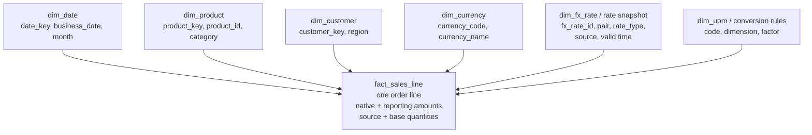
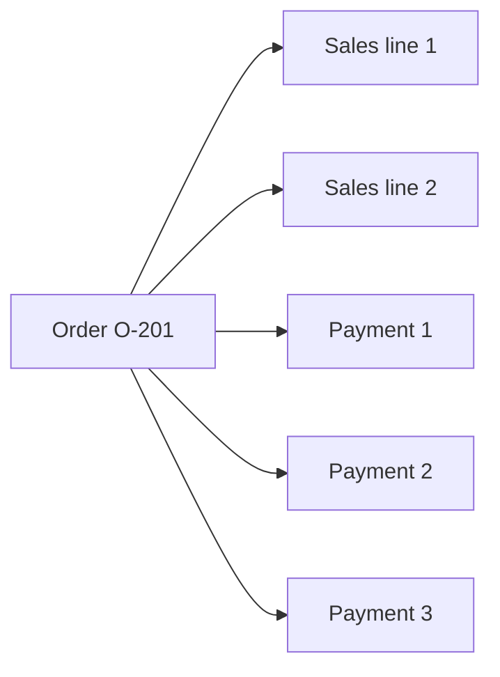
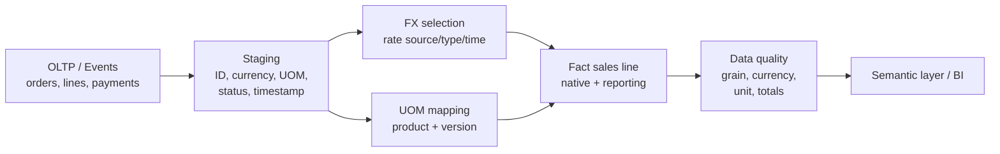

# Dữ kiện có nhiều tiền tệ, đơn vị hoặc mức chi tiết

Một bảng dữ kiện (*fact table*) có thể ghi doanh số bằng USD, EUR và VND; số lượng bằng chiếc, kg, hộp hoặc lít; và cùng lúc chứa thông tin **dòng hàng**, **đơn hàng**, **thanh toán** và **tồn kho cuối ngày**. Nếu chỉ đặt tất cả vào các cột `amount`, `quantity` rồi dùng `SUM`, SQL có thể chạy hoàn toàn hợp lệ nhưng kết quả **không còn ý nghĩa nghiệp vụ**.

Trong chương **Bảng dữ kiện** của học phần **DATABASE_DATA_MODELING**, ta cần chuyển yêu cầu nghiệp vụ thành **cấp hạt, measure, dimension, khóa, ràng buộc, đơn vị đo và quy tắc tổng hợp** có thể kiểm chứng. Đồng thời phải so sánh mô hình phân tích với lược đồ quan hệ giao dịch, document và graph khi lựa chọn cấu trúc. Bài này tập trung vào ba vấn đề thường đi cùng nhau:

1. **Nhiều tiền tệ:** số tiền có **đơn vị tiền**, chính sách tỷ giá và thời điểm quy đổi.
2. **Nhiều đơn vị đo:** quantity có **loại đại lượng**, đơn vị, hệ số chuyển đổi và ngữ cảnh sản phẩm.
3. **Nhiều cấp hạt:** một fact row đại diện cho **một dòng hàng**, **một đơn**, **một thanh toán** hay **một snapshot theo ngày**; không được cộng những dữ kiện khác cấp như thể chúng đồng nhất.

Sau bài học, bạn có thể xác định grain trước khi thiết kế fact, tính đúng số tiền theo từng loại tiền và theo đồng tiền báo cáo, chuẩn hóa đơn vị đo mà vẫn giữ số liệu nguồn, tránh nhân bản measure khi join các bảng khác grain, và xây dựng bộ kiểm thử đối soát cho pipeline ETL/ELT.

## 1. Bắt đầu từ một câu hỏi dễ sai

Ban quản lý một nền tảng bán hàng hỏi:

> “Doanh số hàng hóa thuần, tổng số lượng bán và số đơn của tháng 10/2026 là bao nhiêu?”

Nghe đơn giản, nhưng để trả lời đúng phải hỏi rõ:

- **Doanh số** là tổng tiền trước hay sau chiết khấu, thuế và hoàn hàng? Ngày đặt, ngày thanh toán hay ngày ghi nhận doanh thu?
- Có **những đồng tiền nào**? Nếu cần một tổng duy nhất, quy đổi theo tỷ giá nào, thời điểm nào và có làm tròn không?
- **Số lượng** là chiếc, hộp, kg hay lít? Có cần quy về một đơn vị chuẩn, và có hợp lý khi cộng số lượng giữa các sản phẩm không?
- **Số đơn** khác **số dòng hàng** và **số thanh toán** như thế nào?
- Mỗi dòng fact đại diện cho sự kiện nào? Dữ liệu có được sửa sau khi giao dịch phát sinh không?
- Báo cáo được tính theo **trạng thái hiện tại** hay phải tái hiện đúng những gì hệ thống biết tại một thời điểm?

Một hợp đồng chỉ tiêu dùng trong bài:

**Doanh số hàng hóa thuần** = `quantity × unit_price_native − line_discount_native`, chỉ xét đơn `PAID`, **chưa bao gồm thuế, phí vận chuyển, hoàn trả và điều chỉnh kế toán**. Ngày phân tích là **ngày đặt hàng** theo múi giờ nghiệp vụ; đồng tiền báo cáo là **VND**; mỗi dòng bán được quy đổi bằng **tỷ giá đã chọn cho chính giao dịch đó**.

Định nghĩa này chỉ dành cho ví dụ học tập. Nó **không tự tương đương doanh thu kế toán**, số tiền thực thu hay dòng tiền. Trong hệ thống thật, quy tắc xác nhận giao dịch, refund, settlement và ghi nhận kế toán phải được định nghĩa riêng.

## 2. Một tập dữ liệu có ba loại tiền và ba cách đếm số lượng

Giả sử tenant `T-01` có bốn dòng hàng thuộc ba đơn:

| Dòng hàng | Đơn | Ngày đặt | Sản phẩm | Số lượng gốc | Đơn giá theo tiền gốc | Giảm giá gốc | Tỷ giá sang VND |
| --- | --- | --- | --- | --- | ---: | ---: | ---: |
| OL-1 | O-101 | 01/10/2026 | P-LAP | 2 chiếc | 100 USD/chiếc | 10 USD | 25.000 VND/USD |
| OL-2 | O-101 | 01/10/2026 | P-MOUSE | 1 chiếc | 25 USD/chiếc | 0 USD | 25.000 VND/USD |
| OL-3 | O-102 | 02/10/2026 | P-COFFEE | 3 kg | 80 EUR/kg | 15 EUR | 27.000 VND/EUR |
| OL-4 | O-103 | 03/10/2026 | P-PEN | 4 hộp | 150.000 VND/hộp | 100.000 VND | 1 VND/VND |

Các mức giá, sản phẩm và tỷ giá đều là **dữ liệu giả định**, không phải tỷ giá thị trường thực tế.

Tính cho từng dòng:

| Dòng | Gross tiền gốc | Discount tiền gốc | Net tiền gốc | Net quy VND |
| --- | ---: | ---: | ---: | ---: |
| OL-1 | 200 USD | 10 USD | 190 USD | 4.750.000 |
| OL-2 | 25 USD | 0 USD | 25 USD | 625.000 |
| OL-3 | 240 EUR | 15 EUR | 225 EUR | 6.075.000 |
| OL-4 | 600.000 VND | 100.000 VND | 500.000 VND | 500.000 |

Bộ đáp án đối chứng:

- **4 dòng hàng**, **3 đơn phân biệt**.
- **Doanh số gốc theo tiền tệ:** 215 USD; 225 EUR; 500.000 VND. **Không có một tổng “500.440 tiền tệ” hợp lệ**.
- **Gross quy VND:** 12.705.000; **discount quy VND:** 755.000; **net quy VND:** **11.950.000**.
- **Số lượng gốc:** 3 chiếc, 3 kg, 4 hộp. Không gọi `3 + 3 + 4 = 10` là “10 sản phẩm” vì các đơn vị khác loại.
- Nếu một **hộp P-PEN** theo quy cách tại lúc bán chứa **6 chiếc**, OL-4 tương đương **24 chiếc bút**; vẫn không được cộng 3 kg cà phê với số chiếc bút.

Đây là **oracle nghiệp vụ**: mọi phép biến đổi và báo cáo sau đó phải giải thích được vì sao cho các kết quả trên.

## 3. Grain là quyết định đầu tiên của fact table

**Grain (cấp hạt)** trả lời: “**Một dòng của fact đại diện chính xác cho một điều gì?**” Cần viết grain thành một câu trước khi đặt cột hoặc khóa.

Trong ví dụ này:

> **Mỗi hàng `fact_sales_line` biểu diễn đúng một dòng hàng nguồn `(tenant_id, order_line_id)` của một đơn đủ điều kiện báo cáo, với số lượng, đơn giá, giảm giá và quy đổi được xác định cho chính dòng đó.**

Từ đó suy ra:

- `order_id` **được phép lặp** trên các dòng: O-101 có hai dòng.
- `order_line_id` phải duy nhất trong tenant nếu đây là fact snapshot một dòng nguồn.
- `currency_code` và `order_uom_code` phải diễn giải đúng measure của **chính dòng**.
- Fact trỏ tới các phiên bản dimension sản phẩm, khách và ngày theo chính sách lịch sử.
- Một lần thanh toán, một lần hoàn tiền hay snapshot tồn kho **không phải một dòng hàng bán**; chúng có grain riêng.

### 3.1. Đừng trộn cấp đơn vào fact cấp dòng

Một đơn O-101 có hai dòng và tổng tiền 215 USD. Nếu chép `order_total_native = 215 USD` vào **cả hai dòng**, rồi tính `SUM(order_total_native)`, báo cáo sẽ trả **430 USD** cho riêng O-101. Lệnh SQL không sai; **measure đặt sai grain**.

Giải pháp thường là:

- Lưu những measure **dòng hàng** trong `fact_sales_line`.
- Tổng đơn bằng `SUM` các dòng đủ điều kiện nếu mọi khoản tiền đã được phân bổ đúng.
- Nếu cần measure chỉ tồn tại ở cấp đơn (ví dụ phí đơn hàng chưa phân bổ), tạo **fact cấp đơn** hoặc có chính sách phân bổ rõ ràng.
- Khi nối hai fact khác grain, **tổng hợp từng fact về grain chung trước**, không join trực tiếp rồi cộng.

### 3.2. Fact giao dịch, snapshot định kỳ và snapshot tích lũy

| Mẫu fact | Grain ví dụ | Measure tiêu biểu | Có thể cộng theo thời gian không? |
| --- | --- | --- | --- |
| **Transaction fact** | Một dòng bán | Quantity, gross, discount, net | Thường cộng được nếu đơn vị và phạm vi nhất quán |
| **Transaction fact** | Một lần thanh toán | Số tiền thực thanh toán, tiền tệ thanh toán | Cộng được theo tiền tệ hoặc sau quy đổi đúng chính sách |
| **Periodic snapshot fact** | Một sản phẩm–kho–ngày | Tồn cuối ngày, giá trị tồn | **Không** cộng tồn cuối ngày qua các ngày |
| **Accumulating snapshot fact** | Một đơn trải qua quy trình | Mốc đặt, thanh toán, đóng gói, giao | Thường cập nhật cùng dòng theo tiến độ; các measure cần ngữ nghĩa riêng |
| **Fact sự kiện hoàn tiền** | Một lượt hoàn/refund | Số tiền hoàn, quantity hoàn | Cộng theo đúng quy tắc và đối chiếu với dòng gốc |

Một bản fact snapshot không tự biến thành event history. Nếu cần biết “tại ngày 10/10 hệ thống **từng ghi nhận** giao dịch ra sao”, phải thiết kế lịch sử ghi nhận hoặc snapshot/CDC phù hợp.

## 4. Tiền tệ là một phần của measure, không phải một nhãn trang trí

Giá trị `100` chỉ có ý nghĩa khi biết đó là **100 USD, EUR hay VND**. Không thể cộng trực tiếp hai giá trị money có đơn vị khác nhau rồi gắn một nhãn tiền tệ bất kỳ lên tổng.

### 4.1. Giữ số tiền gốc và đơn vị tiền gốc

Tối thiểu, một dòng bán cần có những thành phần như:

```text
native_currency_code      = USD
ordered_quantity          = 2
ordered_uom_code          = PCS
unit_price_native         = 100.00
gross_amount_native       = 200.00
discount_amount_native    = 10.00
net_amount_native         = 190.00
```

Cùng dòng đó có thể lưu số tiền **đã quy đổi theo chính sách báo cáo**:

```text
reporting_currency_code   = VND
fx_rate_to_reporting      = 25000
gross_amount_reporting    = 5000000
discount_amount_reporting = 250000
net_amount_reporting      = 4750000
fx_rate_id                = FX-20261001-USD-VND-REPORT
```

Định danh tỷ giá là ví dụ; thực tế nó cần liên kết tới bản ghi rate/version có nguồn, loại tỷ giá, thời điểm hiệu lực và chính sách làm tròn. Giá trị tiền gốc vẫn phải được giữ để **đối soát**, phục vụ điều chỉnh và xây dựng những báo cáo theo đồng tiền giao dịch.

### 4.2. Không có một “tỷ giá đúng” cho mọi câu hỏi

Một công ty có thể sử dụng các tỷ giá khác nhau:

| Mục đích | Câu hỏi | Quy tắc cần định nghĩa |
| --- | --- | --- |
| Báo cáo vận hành | Quy doanh số gốc về VND để so sánh tháng | Rate nguồn nào, ngày nào, cut-off và quy tắc làm tròn? |
| Thanh toán/settlement | Khách/đơn vị thanh toán thực nhận bao nhiêu VND? | Tỷ giá settlement và phí áp dụng trong giao dịch thực |
| Báo cáo kế toán | Báo cáo theo chính sách kế toán nào? | Loại rate, ngày ghi nhận, đánh giá lại và điều chỉnh |
| Phân tích giả định | Nếu dùng tỷ giá cố định để so sánh tăng trưởng? | Mức tỷ giá chuẩn cho kỳ và định nghĩa constant currency |
| Quy đổi tùy chọn trên dashboard | Xem báo cáo bằng tiền đích người dùng chọn | Rate as-of, nguồn và mức tái lập kết quả |

Không được **thay thế** số tiền quy VND phục vụ phân tích bằng số thực thu settlement rồi gọi cả hai cùng một metric. Một đơn có thể có **tiền đơn**, **tiền thanh toán**, **tiền được hoàn**, **tiền được ghi nhận doanh thu** và các **đồng tiền khác nhau**. Nếu chúng là sự kiện khác grain, nên tách fact.

### 4.3. Tỷ giá phải có hướng và quy ước nhân/chia

Hãy ghi đầy đủ cặp tiền và chiều quy đổi. Trong ví dụ:

```text
1 USD = 25.000 VND
1 EUR = 27.000 VND
1 VND = 1 VND

net_reporting_vnd = net_native * vnd_per_native_unit
```

Nếu hệ khác lưu `USD per VND` thì công thức phải **đảo chiều**. Không được dùng tên chung `fx_rate` mà không nêu `from_currency`, `to_currency` và đơn vị. Với tiền tệ đích khác VND, cần chính sách chuyển cặp chéo, nguồn và thời điểm, không mặc định lấy tích hai tỷ giá ở các thời điểm không khớp.

### 4.4. Chọn thời điểm tỷ giá: valid time và record time

Ví dụ O-101 đặt lúc 09:00 ngày 01/10 và hệ nhận bảng tỷ giá ngày hôm đó vào 10:00. Cần xác định:

- Tỷ giá dùng **ngày đặt**, **ngày thanh toán**, hay **ngày chốt báo cáo**?
- Có dùng **tỷ giá mới nhất đã được phê duyệt tại thời điểm quyết định** không?
- Nếu bảng rate được sửa hồi tố ngày 03/10, báo cáo cũ có được **restatement** hay giữ bản đã khóa?
- Khi yêu cầu “báo cáo mà hệ thống đã xuất ngày 02/10”, có cần giữ phiên bản rate **đã được biết tại ngày ấy** không?

Hai trục này thường được gọi là **thời gian hiệu lực nghiệp vụ** và **thời gian ghi nhận/hệ thống biết**. Chỉ có `valid_from` mà không lưu phiên bản/record time có thể không đủ để tái lập một báo cáo lịch sử đã phát hành.

### 4.5. Quy đổi và làm tròn ở cấp nào?

Giả sử có hai dòng giá trị nhỏ trong một đồng tiền cần làm tròn sang tiền đích theo **0 chữ số thập phân**. Kết quả có thể khác nhau giữa:

```text
Cách A: ROUND(từng dòng đã quy đổi) rồi SUM
Cách B: SUM(tiền gốc) rồi quy đổi và ROUND một lần
```

Nếu các dòng có **khác ngày, khác rate hoặc khác rate type**, cách B còn có thể dùng **sai tỷ giá**. Công ty phải xác định **granularity của quy đổi và quy tắc làm tròn**: theo dòng, theo đơn, theo payment hoặc theo kỳ.

Để đối soát một đơn, có thể phải ghi **khoản chênh lệch làm tròn** được phân bổ có kiểm soát. Không tự sửa measure tiền gốc để ép báo cáo khớp. Tài liệu hóa precision, scale, chế độ làm tròn và thứ tự phép tính.

### 4.6. Chọn kiểu số tránh sai số

- Tiền thường nên dùng **decimal/NUMERIC** với precision/scale phù hợp, hoặc đơn vị nhỏ nhất dạng số nguyên khi chính sách cho phép.
- Không dùng `FLOAT/DOUBLE` cho phép tính tiền cần đối soát chính xác nếu có thể tránh.
- Không giả định mọi đồng tiền có hai chữ số thập phân hoặc mọi khoản tiền nội bộ không có phân số.
- Tỷ giá cần độ chính xác đủ lớn; phép nhân có thể cần precision mở rộng trước khi làm tròn thành reporting amount.

Ví dụ SQL ở phần sau dùng `NUMERIC`; các giới hạn precision/scale thực tế phải dựa vào doanh số tối đa, đồng tiền và quy ước tính.

## 5. Đơn vị đo: quantity phải đi cùng dimension ngữ nghĩa

Trong dữ liệu bán hàng có thể có:

```text
OL-1: 2 PCS  (máy tính xách tay)
OL-2: 1 PCS  (chuột)
OL-3: 3 KG   (cà phê)
OL-4: 4 BOX  (bút, 6 chiếc/hộp)
```

`SUM(quantity) = 10` không mô tả được một đại lượng có ý nghĩa. Số lượng dùng `KG` là khối lượng; `PCS` là số chiếc; `BOX` là **đơn vị đóng gói** có quy cách phụ thuộc sản phẩm. Chúng không phải các giá trị cùng một thứ nguyên vật lý.

### 5.1. Phân biệt measurement dimension và đơn vị thể hiện

Một số nhóm đại lượng:

| Nhóm đại lượng | Đơn vị thường gặp | Quy đổi có thể chuẩn hóa không? |
| --- | --- | --- |
| **Count / số chiếc** | PCS, EACH | Có cùng ngữ nghĩa nếu đều là số vật phẩm cùng loại |
| **Mass / khối lượng** | g, kg, tấn | Có, với hệ số vật lý xác định |
| **Volume / thể tích** | mL, L, m³ | Có, với hệ số xác định |
| **Duration / thời lượng** | giây, phút, giờ | Có, theo định nghĩa đơn vị |
| **Length / chiều dài** | mm, cm, m | Có, theo định nghĩa |
| **Packaging / đóng gói** | hộp, thùng, kiện | **Phụ thuộc quy cách sản phẩm, phiên bản và thời điểm** |
| **Ratios / tỷ lệ** | %, điểm phần trăm | Không cộng như count hoặc money; cần công thức riêng |

Không được suy ra rằng **1 kg = 1 L** nếu không có **mật độ** phù hợp với mặt hàng, điều kiện đo và yêu cầu nghiệp vụ. Chuyển kilogram sang liter không phải phép đổi cùng một thứ nguyên; cần thuộc tính sản phẩm hoặc phép đo bổ sung.

### 5.2. Lưu cả quantity nguồn và quantity chuẩn hóa

Một fact có thể giữ:

```text
source_quantity          = 4
source_uom_code          = BOX
base_quantity            = 24
base_uom_code            = PCS
conversion_factor        = 6
conversion_rule_id       = PKG-P-PEN-2026
```

Quy tắc `4 BOX × 6 PCS/BOX = 24 PCS` chỉ hợp lệ cho **sản phẩm P-PEN và quy cách được dùng khi giao dịch**. Nếu năm sau hãng chuyển thành 10 chiếc/hộp, **fact lịch sử** không được tự tính lại thành 40 chiếc từ quy cách hiện tại.

Số lượng đã chuẩn hóa hữu ích cho tính tồn kho hoặc sản lượng, nhưng vẫn phải giới hạn phạm vi cộng. Tổng 24 chiếc bút và 2 chiếc laptop = 26 chiếc vật phẩm **có thể** có nghĩa nếu KPI là “số vật phẩm theo chiếc”, nhưng sẽ vô nghĩa nếu người xem tưởng đó là “số hộp” hoặc “khối lượng bán”. Đếm đơn, đếm dòng và số chiếc vật lý là ba metric khác nhau.

### 5.3. Quy đổi đơn vị phụ thuộc sản phẩm và thời gian

Một bảng quy tắc chuyển đổi có thể dùng:

| product_id | from_uom | to_uom | factor | valid_from | valid_to |
| --- | --- | --- | ---: | --- | --- |
| P-PEN | BOX | PCS | 6 | 2026-01-01 | 2027-01-01 |
| P-PEN | BOX | PCS | 10 | 2027-01-01 | Không có |
| P-COFFEE | KG | G | 1000 | 2026-01-01 | Không có |

Chú ý:

- `factor` có **chiều**: `base_quantity = source_quantity × factor`.
- Một khóa quy tắc nên bao gồm **sản phẩm hoặc loại hàng** khi đơn vị là packaging đặc thù.
- Các khoảng hiệu lực theo quy ước `[valid_from, valid_to)` không được chồng nhau cho cùng khóa chuyển đổi.
- Dữ liệu sự kiện phải **giữ snapshot factor/rule_id**, hoặc có cách bất biến để truy lại factor lúc xử lý.
- Đổi đơn vị có thể cần làm tròn theo quy tắc tồn kho và mức chính xác cho phép; không được âm thầm cắt phần lẻ.

Nếu một đơn vị không đổi được, phải có trạng thái **missing/not convertible**; không thay bằng hệ số `1` để “cứ có số liệu”.

### 5.4. Unit price phải đi cùng đơn vị của quantity

Trong ví dụ:

```text
OL-3: 80 EUR / KG × 3 KG = 240 EUR (gross)
OL-4: 150.000 VND / BOX × 4 BOX = 600.000 VND (gross)
```

Nếu `OL-4` được chuyển sang `24 PCS` nhưng vẫn nhân với **150.000 VND/BOX**, gross sẽ thành **3.600.000 VND** — lỗi nghiêm trọng do thay quantity mà không đổi **đơn vị của đơn giá**.

Muốn tính giá theo chiếc, phải chuẩn hóa cả tỷ lệ:

```text
unit_price_per_piece = 150.000 VND/BOX ÷ 6 PCS/BOX
                     = 25.000 VND/PCS

24 PCS × 25.000 VND/PCS = 600.000 VND
```

Vì vậy, fact nên giữ **quantity và unit price gốc có cùng hệ quy chiếu**, đồng thời tạo measure chuẩn hóa riêng khi cần. Không thay nghĩa cột `quantity` hoặc `unit_price` giữa chừng mà không đổi hợp đồng dữ liệu.

## 6. Thiết kế lược đồ fact nhiều tiền tệ và đơn vị

### 6.1. Star schema tham khảo



Đây là sơ đồ khái niệm. Trong thực tế, một bảng fact có thể lưu trực tiếp `currency_code`, `source_uom_code` và `reporting_currency_code` như các **degenerate/code attributes** nếu tập mã nhỏ và không cần dimension mô tả; vẫn phải xác định chúng là đơn vị của measure nào. Tỷ giá có thể lưu dưới dạng **snapshot trong fact**, khóa tới một **bảng rate bất biến**, hoặc cả hai nếu cần đối soát.

### 6.2. Bảng fact SQL minh họa

Ví dụ gần với PostgreSQL; chọn đơn vị tiền đích VND cho báo cáo và giả định `order_line_id` duy nhất trong tenant. Đây là một **fact snapshot hiện hành theo dòng bán đủ điều kiện**; nếu cần event log cho nhiều điều chỉnh trên cùng dòng, phải thay grain/khóa.

```sql
CREATE TABLE fact_sales_line (
    tenant_id VARCHAR(32) NOT NULL,
    order_line_id VARCHAR(40) NOT NULL,
    order_id VARCHAR(40) NOT NULL,
    product_key BIGINT NOT NULL,
    customer_key BIGINT NOT NULL,
    order_date_key INTEGER NOT NULL,

    -- Quantity và giá theo đơn vị nhập ban đầu
    source_quantity NUMERIC(24,6) NOT NULL,
    source_uom_code VARCHAR(16) NOT NULL,
    unit_price_native NUMERIC(24,6) NOT NULL,

    -- Số lượng chuẩn hóa theo một quy tắc của sản phẩm
    base_quantity NUMERIC(24,6),
    base_uom_code VARCHAR(16),
    quantity_conversion_factor NUMERIC(24,10),
    quantity_rule_id VARCHAR(80),

    -- Money gốc
    native_currency_code CHAR(3) NOT NULL,
    gross_native NUMERIC(28,6) NOT NULL,
    discount_native NUMERIC(28,6) NOT NULL,
    net_native NUMERIC(28,6) NOT NULL,

    -- Money báo cáo (ví dụ: VND)
    reporting_currency_code CHAR(3) NOT NULL,
    fx_rate_id VARCHAR(100),
    fx_rate_to_reporting NUMERIC(28,12),
    gross_reporting NUMERIC(28,2),
    discount_reporting NUMERIC(28,2),
    net_reporting NUMERIC(28,2),

    -- Khả năng kiểm toán đường nạp
    source_event_id VARCHAR(100),
    loaded_at TIMESTAMPTZ NOT NULL,

    PRIMARY KEY (tenant_id, order_line_id),
    CHECK (source_quantity > 0),
    CHECK (unit_price_native >= 0),
    CHECK (discount_native >= 0),
    CHECK (gross_native = source_quantity * unit_price_native),
    CHECK (net_native = gross_native - discount_native),
    CHECK (net_native >= 0),
    CHECK (
      (base_quantity IS NULL
       AND base_uom_code IS NULL
       AND quantity_conversion_factor IS NULL)
      OR
      (base_quantity IS NOT NULL
       AND base_uom_code IS NOT NULL
       AND quantity_conversion_factor IS NOT NULL
       AND quantity_conversion_factor > 0)
    ),
    CHECK (fx_rate_to_reporting IS NULL
           OR fx_rate_to_reporting > 0)
);
```

Một số lưu ý khi triển khai:

1. Constraint trên chỉ minh họa cấu trúc; **một số analytical warehouse không thực thi mọi CHECK/FK/PRIMARY KEY như hệ OLTP**. Pipeline vẫn phải kiểm tra.
2. Nếu `unit_price_native` có nhiều chữ số phần thập phân, `gross_native = quantity × unit_price` chỉ đúng khi chọn **quy tắc làm tròn theo cấp hạt** tương ứng. Trong hệ thực tế, cần chính sách và kiểm tra sai lệch có dung sai hợp lý thay vì ép bằng chính xác ở mọi trường hợp.
3. Những cột reporting có thể vắng khi **thiếu tỷ giá**; fact vẫn có thể được giữ ở trạng thái chưa quy đổi kèm cờ chất lượng. **Báo cáo tổng đã quy đổi không được âm thầm bỏ những dòng chưa có rate**.
4. `fx_rate_id`, `quantity_rule_id` cần được liên kết với bảng tham chiếu/quy tắc bất biến có bảo đảm tương ứng; `VARCHAR` đơn lẻ không tự xác minh ID.
5. Fact có các khóa surrogate tới dimension; cần kiểm tra chúng thuộc **đúng tenant và phiên bản lịch sử**.

Cột `source_event_id` hỗ trợ kiểm tra import và nguồn gốc; nó **không** thay thế `(tenant_id, order_line_id)` làm khóa fact snapshot nếu sự kiện nguồn có thể phát sinh nhiều lần cho cùng một dòng.

### 6.3. Bảng tỷ giá và chính sách phiên bản

Một bảng rate có thể biểu diễn:

```sql
CREATE TABLE fx_rate_snapshot (
    fx_rate_id VARCHAR(100) PRIMARY KEY,
    from_currency CHAR(3) NOT NULL,
    to_currency CHAR(3) NOT NULL,
    rate_type VARCHAR(32) NOT NULL,
    rate_source VARCHAR(100) NOT NULL,
    valid_from TIMESTAMPTZ NOT NULL,
    valid_to TIMESTAMPTZ,
    recorded_at TIMESTAMPTZ NOT NULL,
    units_of_to_per_one_from NUMERIC(28,12) NOT NULL,
    CHECK (units_of_to_per_one_from > 0),
    CHECK (valid_to IS NULL OR valid_to > valid_from)
);
```

Trong dữ liệu thực tế, một rate có thể có phiên bản sửa hồi tố, batch/chứng từ chốt và trạng thái phê duyệt. Khóa `fx_rate_id` nhận diện một **phiên bản tỷ giá** dùng được để tái hiện kết quả, không chỉ một cặp tiền.

Ràng buộc theo hàng như `valid_to > valid_from` **không chặn hai bản rate chồng lấn** cho cùng cặp tiền, cùng rate type và source. Quy tắc chọn một rate phù hợp cần được đảm bảo bằng constraint khoảng thời gian nếu hệ hỗ trợ, logic ETL và kiểm tra chất lượng dữ liệu.

### 6.4. Số tiền báo cáo là measure dẫn xuất có chính sách

Nếu chọn cách tính **riêng từng dòng**:

```sql
SELECT
    tenant_id,
    order_line_id,
    native_currency_code,
    net_native,
    reporting_currency_code,
    fx_rate_to_reporting,
    ROUND(net_native * fx_rate_to_reporting, 0)
        AS expected_net_reporting_vnd
FROM fact_sales_line
WHERE tenant_id = 'T-01'
  AND reporting_currency_code = 'VND'
  AND fx_rate_to_reporting IS NOT NULL;
```

Đây là ví dụ làm tròn về **đơn vị VND nguyên**. Chỉ dùng đúng công thức này khi hợp đồng đã xác nhận chính sách làm tròn và rate áp dụng. Nếu chính sách chốt khoản tiền ở cấp đơn, không thể tự dùng kết quả làm tròn theo dòng rồi mặc định luôn khớp tổng đơn mà không có cơ chế điều chỉnh chênh lệch.

## 7. Truy vấn đúng khi có nhiều tiền tệ

### 7.1. Báo cáo số tiền gốc phải nhóm theo currency

```sql
SELECT
    native_currency_code,
    SUM(gross_native) AS gross_native,
    SUM(discount_native) AS discount_native,
    SUM(net_native) AS net_native
FROM fact_sales_line
WHERE tenant_id = 'T-01'
GROUP BY native_currency_code
ORDER BY native_currency_code;
```

Đáp án mẫu:

| currency_code | gross_native | discount_native | net_native |
| --- | ---: | ---: | ---: |
| EUR | 240 | 15 | 225 |
| USD | 225 | 10 | 215 |
| VND | 600.000 | 100.000 | 500.000 |

**Không có dòng tổng cộng gộp ba currency**. Nếu công cụ BI tự thêm “Grand total” cho cột `net_native` mà không chuyển đổi, phải tắt tổng đó hoặc đổi cấu hình metric để tránh thông tin sai.

### 7.2. Báo cáo quy VND mới được cộng xuyên tiền gốc

```sql
SELECT
    reporting_currency_code,
    SUM(gross_reporting) AS gross_reporting,
    SUM(discount_reporting) AS discount_reporting,
    SUM(net_reporting) AS net_reporting
FROM fact_sales_line
WHERE tenant_id = 'T-01'
  AND reporting_currency_code = 'VND'
  AND net_reporting IS NOT NULL
GROUP BY reporting_currency_code;
```

Trên dữ liệu mẫu, kết quả tổng lần lượt là **12.705.000**, **755.000** và **11.950.000 VND**.

**Cảnh báo:** điều kiện `net_reporting IS NOT NULL` có thể **loại các dòng thiếu rate**. Trước khi công bố KPI, phải đối soát **số dòng đủ điều kiện ở nguồn** với **số dòng có số tiền reporting**, và quy định liệu báo cáo có được phát hành khi còn missing FX hay không.

Ví dụ kiểm tra:

```sql
SELECT
    COUNT(*) AS all_fact_rows,
    COUNT(net_reporting) AS converted_rows,
    COUNT(*) - COUNT(net_reporting) AS missing_conversion_rows,
    COUNT(DISTINCT order_id) AS distinct_orders
FROM fact_sales_line
WHERE tenant_id = 'T-01';
```

Nếu `missing_conversion_rows > 0`, kết quả `SUM(net_reporting)` chưa chứng minh là **đầy đủ**. Trong một hệ sản xuất, báo cáo cần gắn trạng thái dữ liệu hoặc dừng publish theo quy tắc chất lượng.

### 7.3. Đừng cộng rồi nhân bằng một tỷ giá bất kỳ

Cách sau là **sai ngữ nghĩa** khi một nhóm chứa nhiều currency hoặc nhiều rate:

```sql
-- Ví dụ sai: tiền tệ của net_native khác nhau,
-- và có thể mỗi dòng cùng currency cũng dùng rate khác nhau.
SELECT
    SUM(net_native) * MAX(fx_rate_to_reporting) AS wrong_total
FROM fact_sales_line
WHERE tenant_id = 'T-01';
```

Đúng theo chính sách quy đổi tại mỗi dòng thường là **cộng những số đã chuyển về cùng tiền báo cáo**. Nếu rate giống nhau cho mọi dòng trong **cùng cặp tiền và cùng policy**, đôi lúc có thể tổng hợp gốc rồi nhân, nhưng không được mặc định điều kiện ấy khi dữ liệu thay đổi theo ngày, kênh thanh toán hay rate type.

### 7.4. Một khách có thể có cả tiền gốc lẫn tiền báo cáo

Nếu cần danh sách khách đã mua hàng:

```sql
SELECT
    customer_key,
    reporting_currency_code,
    SUM(net_reporting) AS net_reporting,
    COUNT(DISTINCT order_id) AS distinct_orders
FROM fact_sales_line
WHERE tenant_id = :tenant_id
  AND reporting_currency_code = 'VND'
GROUP BY customer_key, reporting_currency_code;
```

Truy vấn có thể đúng về số tiền nhưng việc phân nhóm `customer_key` cần kiểm tra **SCD Type 2**: một khách nghiệp vụ có thể có nhiều `customer_key` theo phiên bản lịch sử. Nếu KPI là **khách duy nhất**, phải nhóm/đếm theo **business key** có phạm vi tenant hoặc qua một dimension định danh chung, không tùy tiện đếm surrogate versions.

## 8. Truy vấn đúng khi có nhiều đơn vị đo

### 8.1. Nhóm theo loại đại lượng và đơn vị nguồn

```sql
SELECT
    source_uom_code,
    SUM(source_quantity) AS quantity_in_source_uom
FROM fact_sales_line
WHERE tenant_id = 'T-01'
GROUP BY source_uom_code
ORDER BY source_uom_code;
```

Kết quả theo dữ liệu mẫu: `BOX = 4`, `KG = 3`, `PCS = 3`. Đây là những tổng **theo đúng đơn vị nguồn**.

Đối với một mã `BOX` dùng cho nhiều sản phẩm có **số chiếc mỗi hộp khác nhau**, `SUM(source_quantity)` vẫn chỉ trả “bao nhiêu **hộp**”, không nói “bao nhiêu chiếc”. Việc cộng hộp có thể có ích cho vận hành, nhưng phải giải thích đúng đại lượng và không thể lấy một conversion factor chung cho tất cả hộp.

### 8.2. Tổng số lượng chuẩn hóa phải có phạm vi đúng

```sql
SELECT
    product_key,
    base_uom_code,
    SUM(base_quantity) AS base_quantity
FROM fact_sales_line
WHERE tenant_id = :tenant_id
  AND base_quantity IS NOT NULL
GROUP BY product_key, base_uom_code
ORDER BY product_key, base_uom_code;
```

Truy vấn này đặt `product_key` và `base_uom_code` trong nhóm để bảo đảm các số cộng được xét trong một phạm vi có nghĩa. Nếu mục tiêu là tổng trọng lượng tất cả sản phẩm tính bằng kg, trước hết phải xác nhận **mỗi dòng đóng góp measure khối lượng** đã chuyển về cùng đơn vị và cùng định nghĩa; không dùng `SUM(base_quantity)` cho cả chiếc, kg và lít.

### 8.3. Giá trên đơn vị: tỷ số cần tính lại sau tổng hợp

Giả sử mỗi dòng có `net_native` và `base_quantity`. Giá bình quân theo đơn vị **không phải** trung bình các `unit_price_native` khi số lượng khác nhau hoặc currency khác nhau.

Một metric hợp lệ có thể là:

```text
average_net_price_per_base_unit
  = SUM(net_reporting_vnd) / SUM(base_quantity)
```

Nhưng chỉ khi:

- `base_quantity` cùng loại đơn vị, ví dụ cùng kg hoặc cùng chiếc **với phạm vi sản phẩm có ý nghĩa**.
- `net_reporting_vnd` được quy đổi cùng tiền và chính sách.
- Không có số lượng bằng 0 hoặc thiếu quy đổi trong tập được xét.
- Khấu trừ/discount có quy tắc và fact không bị nhân bản.

Trong SQL cần chống chia cho 0:

```sql
SELECT
    product_key,
    base_uom_code,
    SUM(net_reporting) / NULLIF(SUM(base_quantity), 0)
        AS weighted_net_price_per_base_unit_vnd
FROM fact_sales_line
WHERE tenant_id = :tenant_id
  AND reporting_currency_code = 'VND'
  AND net_reporting IS NOT NULL
  AND base_quantity IS NOT NULL
GROUP BY product_key, base_uom_code;
```

Đây là **giá thuần bình quân có trọng số**, không phải đơn giá niêm yết hay giá gốc một đơn. `AVG(unit_price_native)` sẽ có thể sai ngay cả khi tiền tệ đồng nhất, vì mỗi dòng có thể bán lượng khác nhau.

## 9. Nhiều cấp hạt: vì sao join fact trực tiếp dễ nhân số liệu?

Giả sử một đơn có **2 dòng hàng** và **3 lần thanh toán**.

```text
fact_sales_line: 2 hàng cho O-201
fact_payment:    3 hàng cho O-201

JOIN hai fact qua order_id → 2 × 3 = 6 hàng
```

Nếu mỗi khoản thanh toán bị lặp hai lần trên kết quả join, `SUM(payment_amount)` có thể **gấp đôi** số thực thu. Nếu mỗi dòng bán bị lặp ba lần, `SUM(net_sales)` có thể **gấp ba**. Đây là hiện tượng **fan-out** do nhiều–nhiều giữa hai tập fact.



### 9.1. Cách đúng: tổng hợp mỗi fact về cùng grain

Một ví dụ SQL:

```sql
WITH sales_by_order AS (
    SELECT
        tenant_id,
        order_id,
        reporting_currency_code,
        SUM(net_reporting) AS sales_vnd
    FROM fact_sales_line
    WHERE reporting_currency_code = 'VND'
    GROUP BY tenant_id, order_id, reporting_currency_code
),
payments_by_order AS (
    SELECT
        tenant_id,
        order_id,
        settlement_currency_code,
        SUM(settlement_amount) AS settlement_total
    FROM fact_payment
    GROUP BY tenant_id, order_id, settlement_currency_code
)
SELECT
    s.tenant_id,
    s.order_id,
    s.sales_vnd,
    p.settlement_currency_code,
    p.settlement_total
FROM sales_by_order AS s
LEFT JOIN payments_by_order AS p
  ON p.tenant_id = s.tenant_id
 AND p.order_id = s.order_id;
```

Đây là **khuôn mẫu**, giả định có `fact_payment` riêng và `settlement_amount` đi kèm đồng tiền thanh toán. Một đơn có thể có **nhiều đồng tiền settlement**, nên `payments_by_order` vẫn có thể có nhiều hàng cho một `order_id` nếu nhóm theo `settlement_currency_code`. Khi ấy muốn một hàng mỗi đơn, phải **quy đổi từng payment** về cùng tiền báo cáo theo chính sách settlement rồi tổng hợp về **(tenant_id, order_id)**, hoặc giữ kết quả nhiều currency và **không cộng xuyên currency**.

Thông điệp quan trọng: **tổng hợp về grain chung mới có thể join**, và phải bảo đảm mỗi phía thật sự có **tối đa một hàng cho khóa join** ở grain đó.

### 9.2. Không ghép fact tồn kho với fact bán ở cấp dòng

Một snapshot tồn kho `(product, warehouse, day)` có thể ghi 100 chiếc cuối ngày. Nếu join trực tiếp vào 20 dòng bán của cùng sản phẩm trong ngày, số dư 100 bị lặp 20 lần, rồi `SUM(stock_on_hand)` cho 2.000 — sai.

Nếu cần báo cáo “đơn vị bán trong ngày và tồn cuối ngày”, phải:

1. Tổng hợp bán tới grain **(product, warehouse, day)** nếu dữ liệu nguồn thực sự xác định được warehouse.
2. Giữ snapshot tồn kho duy nhất tại chính grain đó.
3. Join hai tập **đã tổng hợp và kiểm tra duy nhất**.
4. Hiển thị số lượng bán trong ngày và tồn cuối ngày như **hai measure khác ngữ nghĩa**; không cộng tồn qua các ngày.

Không tự gán warehouse cho dòng bán nếu nghiệp vụ không có thông tin nơi xuất hàng; việc giả định sai chiều kho làm phép đối soát tồn kho vô nghĩa.

### 9.3. Measure bán được cộng theo thời gian, số dư thì không

| Measure | Cộng qua sản phẩm? | Cộng qua thời gian? | Giải thích |
| --- | --- | --- | --- |
| `net_reporting_vnd` của dòng bán | Có, nếu cùng tiền và phạm vi | Thường có | Dòng giao dịch tại các thời điểm |
| `quantity_kg` | Có giữa mặt hàng cùng đại lượng nếu KPI phù hợp | Thường có | Khối lượng đã bán |
| `quantity_pcs` | Có khi số chiếc là metric đã định nghĩa | Thường có | Số vật phẩm đã bán |
| `inventory_on_hand_pcs` | Có theo kho/sản phẩm phù hợp | **Không cộng snapshot qua ngày** | Số dư tại thời điểm |
| `conversion_rate` | Không | Không | Tỷ lệ phải tính từ tử số/mẫu số |
| `fx_rate` | Không | Không | Tỷ giá là tham số/chỉ số, không phải money |

Nói `net_reporting_vnd` “additive” chỉ đúng **trong phạm vi kỳ, sự kiện và đơn vị đã xác định**. Nếu fact chứa **bản gốc lẫn adjustment** hoặc hoàn tiền, phải xác định dấu và cách cộng. Nếu trộn doanh số với settlement trong cùng tổng, có thể đếm hai lần cùng hoạt động kinh tế.

## 10. Sự kiện nhiều tiền tệ thực chất có thể là nhiều fact

Một giao dịch thương mại có thể tạo nhiều loại dữ kiện:

- **Order line fact:** số lượng mua và tiền hàng theo **currency của đơn**.
- **Payment fact:** một lần khách trả tiền, có thể bằng currency khác với đơn.
- **Settlement fact:** tiền đơn vị xử lý thanh toán chuyển về, có phí và rate settlement.
- **Refund fact:** một lần hoàn, có currency và rate khi hoàn.
- **Ledger fact:** bút toán kế toán theo quy tắc ghi nhận.

Đừng gom các sự kiện khác nhau chỉ vì chúng có cùng `order_id`. Ví dụ khách mua 100 USD, trả bằng EUR và merchant nhận VND không tạo ra “ba doanh số” để cộng. Đó là **các thước đo của các giai đoạn khác nhau**, có thể phải đối chiếu, không phải cộng lại.

### 10.1. Fact thanh toán có grain riêng

Một mẫu lược đồ:

```text
fact_payment
-----------
payment_id             -- một lần thanh toán
order_id
occurred_at
charged_currency_code
charged_amount
settlement_currency_code
settlement_amount
settlement_fx_rate_id
fee_currency_code
fee_amount
status
```

`charged_amount`, `settlement_amount` và `fee_amount` có thể khác nhau không chỉ bởi tỷ giá mà còn do **phí và chính sách xử lý**. Nếu phí bằng tiền thứ ba, không được trừ trực tiếp khỏi settlement khi chưa đổi về cùng đơn vị.

### 10.2. Fact hoàn tiền và xử lý dấu

Nếu một dòng bán giá trị thuần 190 USD sau đó hoàn 50 USD, có một số phương án:

- Fact bán giữ nguyên 190 USD, fact refund lưu riêng 50 USD; báo cáo doanh số **sau hoàn** kết hợp hai fact theo quy tắc.
- Ghi **adjustment âm** tại một grain có định danh sự kiện và thời gian rõ; khi tổng hợp phải biết đó là khoản điều chỉnh, không phải dòng bán mới.
- Cập nhật snapshot dòng bán để còn 140 USD nếu yêu cầu chỉ xem trạng thái hiện hành; cách này không đủ tái hiện lịch sử nếu không có event log khác.

Không có phương án duy nhất. Điều cần tránh là **giữ đồng thời snapshot đã giảm và adjustment âm rồi cùng trừ hai lần**.

### 10.3. Cấp hạt của tỷ giá và giá vốn cũng cần ghi rõ

Giá vốn có thể là chi phí của **lô nhập**, **đơn vị hàng**, **dòng xuất kho** hoặc **phân bổ cuối kỳ**. Nếu lấy một tỷ giá cấp ngày ghép vào hàng triệu dòng theo currency mà không đảm bảo duy nhất đúng thời điểm/rate type, fan-out có thể khiến toàn bộ doanh số bị nhân đôi.

Một bảng rate có nhiều nguồn hoặc rate type cho cùng ngày cần bộ khóa chọn rõ: **cặp tiền + loại rate + nguồn + thời điểm hiệu lực/phiên bản**. Không chỉ join bằng ngày và currency rồi kỳ vọng đúng một hàng.

## 11. Thiết kế pipeline ETL/ELT có thể kiểm chứng

### 11.1. Quy trình tham chiếu



Mỗi bước có hợp đồng rõ: dòng nào đủ điều kiện, xử lý ID trùng ra sao, dùng rate nào, chuyển đơn vị nào, làm tròn khi nào và nếu thiếu dữ liệu thì đưa vào trạng thái nào.

### 11.2. Chọn đúng bản tỷ giá

Một phép chọn theo thời điểm cần bảo đảm:

```text
rate.from_currency = fact.native_currency
rate.to_currency   = fact.reporting_currency
rate.rate_type     = policy.rate_type
rate.source        = policy.rate_source
rate.valid_from   <= event_time
event_time < rate.valid_to (nếu có)
```

Nếu **hai bản rate** cùng thỏa điều kiện vì khoảng hiệu lực chồng lấn, một fact có thể bị nhân hai dòng trong phép join. Không dùng `SELECT DISTINCT` để che lỗi đó; hai tỷ giá khác giá trị sẽ tạo hai kết quả không tương thích. Phải có chính sách chọn phiên bản và kiểm tra rằng **mỗi fact khớp đúng một rate**.

### 11.3. Chọn đúng quy tắc đơn vị

```text
rule.product_id    = fact.product_id
rule.from_uom      = fact.source_uom_code
rule.to_uom        = product.base_uom
rule.valid_from   <= event_time
event_time < rule.valid_to (nếu có)
```

Với quy đổi vật lý phổ quát như kg → g có thể dùng danh mục unit chung; với quy đổi packaging như hộp → chiếc cần **quy cách riêng sản phẩm/phiên bản**. Không chọn hệ số 6 từ quy cách hiện tại cho một giao dịch năm trước nếu lúc đó mỗi hộp có 10 chiếc.

### 11.4. Dữ liệu không đủ rate hoặc conversion

Khi thiếu tỷ giá hoặc quy cách:

- **Giữ nguyên amount/quantity nguồn** nếu chúng đáng tin và được phép nạp.
- Đánh dấu `MISSING_FX`, `INVALID_UOM`, `UNKNOWN_PRODUCT_RULE` hoặc trạng thái chất lượng tương đương.
- Không thay tỷ giá bằng 1 trừ khi hai currency thật sự giống nhau **và chính sách cho phép**.
- Không mặc định 1 hộp = 1 chiếc, hoặc 1 kg = 1 lít.
- Không âm thầm drop fact qua `INNER JOIN` khiến doanh số bị thiếu.
- Quyết định liệu báo cáo có được phát hành ở trạng thái **partial** hay phải chặn cho tới khi xử lý xong.

### 11.5. Idempotency và các sự kiện đến muộn

Dòng OL-3 có thể được nguồn gửi lại; nếu pipeline chỉ `INSERT` không có khóa, doanh số EUR sẽ bị tính hai lần. Chọn **khóa idempotency** dựa trên định danh sự kiện hoặc khóa fact snapshot đã định nghĩa.

Những thay đổi tới muộn:

- Rate được công bố/sửa sau khi đã phát hành báo cáo.
- Quy cách sản phẩm được sửa hồi tố.
- Refund đến sau kỳ báo cáo.
- Đơn đổi từ `PENDING` sang `PAID`, hoặc từ `PAID` sang `REFUNDED`.
- Một phần dữ liệu có thời điểm event khác thời điểm ingest.

Cần định nghĩa **watermark**, thời điểm chốt, phiên bản tính và chính sách **restatement**. Một dashboard “tháng 10” chạy ngày 05/11 có thể khác khi chạy 05/12 nếu dữ liệu được sửa hồi tố; khác biệt phải giải thích được, không âm thầm đổi định nghĩa chỉ tiêu.

## 12. Bộ kiểm tra chất lượng dữ liệu tối thiểu

### 12.1. Kiểm tra grain và trùng dữ liệu

Với grain một dòng nguồn:

```sql
SELECT tenant_id, order_line_id, COUNT(*) AS row_count
FROM fact_sales_line
GROUP BY tenant_id, order_line_id
HAVING COUNT(*) > 1;
```

Nếu kết quả không rỗng, có dữ liệu trùng theo định nghĩa fact. Không được gọi hai event điều chỉnh khác nhau là cùng một dòng snapshot nếu grain thực tế đã thay đổi; lúc đó cần sửa fact design chứ không chỉ xóa một bản.

### 12.2. Kiểm tra arithmetic của money gốc

```sql
SELECT
    tenant_id,
    order_line_id,
    native_currency_code,
    source_quantity,
    unit_price_native,
    gross_native,
    discount_native,
    net_native
FROM fact_sales_line
WHERE gross_native <> source_quantity * unit_price_native
   OR net_native <> gross_native - discount_native
   OR net_native < 0;
```

Query này giả định **các phép tính chính xác theo quy tắc đã chốt**. Nếu nghiệp vụ cho phép làm tròn, phải dùng so sánh có dung sai/round theo cấp hạt thay vì đánh dấu mọi chênh lệch thập phân nhỏ là lỗi.

### 12.3. Kiểm tra thiếu hoặc trộn currency reporting

```sql
SELECT
    native_currency_code,
    reporting_currency_code,
    COUNT(*) AS line_count,
    SUM(CASE WHEN net_reporting IS NULL THEN 1 ELSE 0 END)
        AS missing_reporting_count
FROM fact_sales_line
WHERE tenant_id = :tenant_id
GROUP BY native_currency_code, reporting_currency_code
ORDER BY native_currency_code, reporting_currency_code;
```

Nếu mục tiêu báo cáo là VND, những dòng có `reporting_currency_code` khác VND không thể nhập chung vào `SUM(net_reporting)`. Nếu thiếu reporting amount, phải có cảnh báo và quy tắc chốt.

### 12.4. Kiểm tra snapshot rate với reporting amount

```sql
SELECT
    tenant_id, order_line_id,
    net_native, fx_rate_to_reporting, net_reporting
FROM fact_sales_line
WHERE reporting_currency_code = 'VND'
  AND fx_rate_to_reporting IS NOT NULL
  AND net_reporting IS NOT NULL
  AND ABS(
      net_reporting -
      ROUND(net_native * fx_rate_to_reporting, 0)
  ) > 0;
```

Đây là truy vấn **minh họa** cho chính sách làm tròn **từng dòng về VND nguyên**. Nếu có chênh lệch làm tròn được phân bổ theo đơn, query phải được điều chỉnh để không báo sai. Ngoài phép tính, cần xác minh `fx_rate_id` và dữ liệu snapshot khớp đúng bản rate đã phê duyệt.

### 12.5. Kiểm tra quantity conversion

```sql
SELECT
    tenant_id, order_line_id,
    source_quantity, source_uom_code,
    base_quantity, base_uom_code,
    quantity_conversion_factor
FROM fact_sales_line
WHERE base_quantity IS NOT NULL
  AND quantity_conversion_factor IS NOT NULL
  AND ABS(
      base_quantity -
      source_quantity * quantity_conversion_factor
  ) > 0.000001;
```

Mức `0.000001` là **dung sai ví dụ** theo scale số học đã chọn, không phải chuẩn chung. Dữ liệu khối lượng, thể tích, số chiếc nguyên và quy tắc chia gói có độ chính xác khác nhau; cần kiểm tra theo chính sách riêng của từng loại đại lượng.

### 12.6. Đối soát xuyên tầng

| Chỉ tiêu đối soát | Dữ liệu mẫu mong đợi | Vì sao quan trọng |
| --- | --- | --- |
| Số dòng fact | 4 | Không nhân/mất dòng khi join tỷ giá và UOM |
| Số đơn phân biệt | 3 | Không nhầm grain dòng với đơn |
| Net native theo USD | 215 USD | Đối soát tiền gốc |
| Net native theo EUR | 225 EUR | Đối soát tiền gốc |
| Net native theo VND | 500.000 VND | Đối soát tiền gốc |
| Gross reporting VND | 12.705.000 | Kiểm tra quy đổi gross |
| Discount reporting VND | 755.000 | Kiểm tra quy đổi discount |
| Net reporting VND | 11.950.000 | Kiểm tra net = gross − discount |
| Source quantity | 3 PCS, 3 KG, 4 BOX | Không cộng sai thứ nguyên |
| Pen base quantity | 24 PCS | Kiểm tra factor sản phẩm |
| Missing FX / UOM | 0 trong dữ liệu mẫu | Bảo đảm số liệu hoàn chỉnh |

Cần chạy các kiểm tra ở **cùng phạm vi tenant, kỳ, trạng thái nguồn và thời điểm chốt**. Nếu source đã cập nhật trong lúc ETL chưa hoàn tất, hai tập có thể khác do latency; sử dụng watermark và snapshot nhất quán khi so.

## 13. Mô hình quan hệ, document, graph và analytical

Dù bài tập trung fact table, thiết kế dữ liệu đúng còn phụ thuộc vào hệ thống nguồn và kiểu truy vấn.

| Mối quan tâm | Relational/OLTP | Document | Graph | Dimensional/analytical |
| --- | --- | --- | --- | --- |
| Đơn có nhiều dòng và thanh toán | Bảng `orders`, `order_lines`, `payments` với FK/transaction | Document đơn có thể nhúng dòng | Đỉnh sự kiện và cạnh theo vai trò | **Fact khác grain** cho dòng, payment, refund |
| Tiền tệ và đơn vị | Lưu currency/UOM gốc trong giao dịch | Lưu trong mỗi document/line | Thuộc tính trên đỉnh/cạnh sự kiện đúng ngữ cảnh | Native + reporting measures, rate/convert lineage |
| Giữ giá/đơn vị lịch sử | Snapshot transaction và lịch sử | Snapshot lồng trong document | Đỉnh event/thuộc tính có thời điểm | Fact + conversion version + dimension lịch sử |
| Truy vấn doanh số theo tháng | SQL JOIN/GROUP BY | Aggregation/pipeline | Có thể tổng hợp nhưng không là ưu thế duy nhất | Star schema, warehouse, semantic layer |
| Truy vấn đường liên kết khách–thiết bị | JOIN/CTE tùy độ sâu | Tham chiếu và aggregation | Thuận tiện cho traversal nhiều bước | Có thể xuất tập kết quả sang warehouse |
| Đối soát tiền và số lượng | Constraint/transaction ứng dụng | Validation và xử lý ghi | Kiểm tra theo mô hình sự kiện | ETL QA, grain, completeness và reconciliations |

Một kiến trúc phổ biến giữ **OLTP làm nguồn giao dịch**, chuyển dữ liệu qua CDC/ETL sang warehouse fact–dimension. Property graph có thể dùng riêng cho phân tích mạng liên kết. Document có thể phù hợp với thao tác theo đối tượng tổng hợp. Không nên coi fact table là nguồn cập nhật nghiệp vụ chính khi nó là bản mô hình hóa phân tích được nạp trễ từ hệ khác.

## 14. Những sai lầm dễ gây số liệu sai

1. **Cộng money khác currency.** `100 USD + 100 EUR` không có tổng duy nhất nếu chưa quy đổi đúng chính sách.
2. **Đổi rate bằng giá trị hiện tại để tính lại lịch sử mà không có chính sách restatement.** Báo cáo cũ có thể biến đổi không giải thích được.
3. **Không lưu hướng của tỷ giá.** `VND per USD` khác `USD per VND`.
4. **Chọn rate bằng ngày mà bỏ nguồn, loại rate và phiên bản.** Join có thể khớp nhiều rate và nhân dòng.
5. **Lấy tỷ giá bình quân rồi nhân tổng money hỗn hợp.** Sai nếu rate/currency không đồng nhất.
6. **Dùng FLOAT cho money cần kiểm toán.** Dễ có sai lệch số học và làm tròn khó truy vết.
7. **SUM số lượng kg, hộp và chiếc.** Không tạo đại lượng hợp lệ.
8. **Quy ước 1 BOX = một số chiếc cho mọi sản phẩm.** Packaging phụ thuộc sản phẩm và phiên bản.
9. **Chuẩn hóa quantity nhưng giữ unit price nguồn.** Sai doanh số khi nhân số lượng đã quy đổi với giá còn theo đơn vị cũ.
10. **Lưu tổng tiền đơn trên mọi dòng bán rồi SUM.** Nhân tiền theo số dòng.
11. **Join fact dòng với fact payment qua `order_id` trực tiếp.** Fan-out nhiều–nhiều.
12. **Cộng snapshot tồn kho qua các ngày.** Tồn kho là measure semi-additive theo thời gian.
13. **Đếm `COUNT(*)` là số đơn.** Grain dòng hàng trả số dòng, không phải số đơn.
14. **Dùng `DISTINCT` để che bảng dimension/rate chồng phiên bản.** Không sửa được nguyên nhân mất tính duy nhất.
15. **Dùng `INNER JOIN` làm rơi fact thiếu rate/dimension mà không báo lỗi.** Doanh số bị giảm âm thầm.
16. **Gộp tiền đơn, tiền thanh toán, tiền settlement và refund trong một measure.** Chúng là các sự kiện và chính sách khác nhau.
17. **Không phân biệt tiền gốc và tiền báo cáo.** Người xem có thể nhìn một tổng không rõ đơn vị.
18. **Không có source event ID/idempotency.** Retry tạo dòng trùng và nhân KPI.
19. **Không ghi nhận ngày chốt, watermark, quy tắc sửa hồi tố.** Khó tái tạo dashboard đã phát hành.
20. **Tin một bảng fact rộng giải quyết mọi mức chi tiết.** Grain mơ hồ khiến mọi tổng hợp đều có nguy cơ sai.

## 15. Bài tập thực hành và gợi ý đáp án

### Bài tập 1 — Tính tiền gốc và tiền báo cáo

OL-1 có 2 chiếc × 100 USD, giảm 10 USD, rate 25.000 VND/USD. OL-2 có 1 chiếc × 25 USD, không giảm, cùng rate.

**Yêu cầu:** tính net USD và VND cho mỗi dòng, rồi tổng của O-101.

**Gợi ý:** OL-1 net **190 USD = 4.750.000 VND**; OL-2 net **25 USD = 625.000 VND**; O-101 net **215 USD = 5.375.000 VND** theo chính sách rate mẫu. Đây là tổng của **cùng một đơn, cùng currency gốc**; nếu rate dòng khác nhau, tổng quy VND phải tuân chính sách quy đổi theo dòng.

### Bài tập 2 — Vì sao không có “tổng tiền gốc” chung?

Có 215 USD, 225 EUR và 500.000 VND.

**Yêu cầu:** báo cáo một số tổng money chung bằng cách nào? Tổng VND theo rate mẫu là bao nhiêu?

**Gợi ý:** không cộng số học trực tiếp. Dùng rate và chính sách thời gian đã chốt để chuyển từng khoản sang VND; tổng **11.950.000 VND**. Nếu một dòng thiếu rate thì báo cáo phải đánh dấu thiếu/chặn publish theo chính sách, không tự bỏ.

### Bài tập 3 — Chuyển hộp sang chiếc

OL-4 có 4 hộp bút, mỗi hộp 6 chiếc tại ngày bán, giá 150.000 VND/hộp.

**Yêu cầu:** số lượng chuẩn hóa và giá/chiếc là bao nhiêu? Nếu hệ chuyển thành 10 chiếc/hộp năm sau, có thay đổi fact cũ không?

**Gợi ý:** **24 chiếc**, **25.000 VND/chiếc**. Fact lịch sử giữ rule/factor 6 tại thời điểm bán, không dùng factor mới 10 để tính lại giao dịch cũ. Nếu cần sửa dữ liệu cũ vì nguồn sai, phải có quy trình điều chỉnh có truy vết.

### Bài tập 4 — Phân biệt count và quantity

Bốn dòng thuộc ba đơn; số lượng lần lượt là 2 PCS, 1 PCS, 3 KG và 4 BOX.

**Yêu cầu:** trả lời số dòng, số đơn, số lượng theo đơn vị; có được trả “tổng lượng bán = 10” không?

**Gợi ý:** **4 dòng**, **3 đơn**, **3 PCS**, **3 KG**, **4 BOX**. `10` là phép cộng số nhưng không có đơn vị chung; không báo là tổng lượng bán trừ khi KPI cố ý đếm một đại lượng khác có định nghĩa phù hợp.

### Bài tập 5 — Join hai fact

Một đơn có 2 dòng bán và 3 payment. Câu SQL join `fact_sales_line` và `fact_payment` trực tiếp bằng `order_id`.

**Yêu cầu:** số hàng có thể xuất hiện? Rủi ro khi SUM tiền?

**Gợi ý:** **6 hàng** (2×3); measure dòng bán lặp 3 lần, measure thanh toán lặp 2 lần. Tổng hợp từng fact về **grain đơn** trước khi join; nếu payment còn nhiều currency, tổng hợp theo currency hoặc quy đổi đúng chính sách để đạt một hàng mỗi đơn.

### Bài tập 6 — Tỷ giá theo phiên bản

Đơn O-105 đặt ngày 01/10. Bảng rate có hai dòng USD→VND cùng ngày: `REPORTING` từ nhà cung cấp X và `SETTLEMENT` từ nhà cung cấp Y, rate khác nhau.

**Yêu cầu:** có được join chỉ bằng `currency_code` và `date` không? Chọn rate theo thông tin nào?

**Gợi ý:** không. Phải có `from_currency`, `to_currency`, `rate_type`, `rate_source`, thời điểm hiệu lực, phiên bản hoặc quy tắc ưu tiên đã duyệt. Một fact phải khớp **đúng một rate** theo chính sách; thiếu hoặc nhiều kết quả phải bị phát hiện.

### Bài tập 7 — Báo cáo doanh số và tồn cuối ngày

`fact_sales_line` có ba dòng bán sản phẩm P-01 trong ngày, tổng 12 chiếc. `fact_inventory_daily` có một snapshot tồn cuối ngày 100 chiếc.

**Yêu cầu:** tại sao join rồi SUM tất cả không được? Báo cáo đúng gồm gì?

**Gợi ý:** join trực tiếp có thể lặp snapshot 100 ba lần và báo tồn 300. Tổng hợp bán về **(product, warehouse, date)** nếu biết warehouse, join với một snapshot duy nhất; trả **12 chiếc bán trong ngày** và **100 chiếc tồn cuối ngày** là hai measure khác ngữ nghĩa.

### Bài tập 8 — Refund sau ngày chốt

Một dòng đã bán 190 USD, tháng sau hoàn 50 USD với tỷ giá thời điểm refund khác ngày mua.

**Yêu cầu:** có nên giảm trực tiếp doanh số lịch sử bằng 50 USD quy theo tỷ giá ngày mua không?

**Gợi ý:** chưa thể quyết định nếu chưa có hợp đồng metric. Refund là **sự kiện riêng**, có amount, currency, thời điểm và tỷ giá theo chính sách. Báo cáo “doanh số sau hoàn theo ngày đặt” và “số tiền hoàn theo ngày thực hiện” có thể dùng cách phân bổ khác nhau. Không tự áp một rate hoặc ghi đè quá khứ khi chưa rõ yêu cầu.

### Bài tập 9 — Không dùng giá theo đơn vị sai

Có 4 BOX bút, mỗi BOX chứa 6 PCS và giá 150.000 VND/BOX. Một pipeline đổi quantity sang 24 PCS nhưng vẫn nhân với đơn giá 150.000.

**Yêu cầu:** vì sao kết quả 3.600.000 VND sai? Cách sửa?

**Gợi ý:** hệ đã nhân **số chiếc với giá/hộp**. Cần giữ 4 BOX × 150.000 VND/BOX = **600.000 VND** hoặc đổi cả đơn giá thành 25.000 VND/PCS để nhân với 24 PCS.

### Bài tập 10 — Chọn kiến trúc dữ liệu

Một doanh nghiệp dùng OLTP cho đơn hàng và thanh toán, cần BI đa tiền tệ, so sánh tỷ lệ hoàn hàng theo quốc gia và nghiên cứu mạng liên kết khách hàng–thiết bị.

**Yêu cầu:** có nên dồn tất cả vào một fact table hoặc một graph duy nhất?

**Gợi ý:** không mặc định như vậy. OLTP giữ giao dịch và ràng buộc chính, warehouse tổ chức **các fact có grain rõ** với tỷ giá, currency, UOM và dimension thích hợp; graph có thể phục vụ đường đi khách–thiết bị nếu workload chứng minh cần thiết. Cần định danh chuẩn, đồng bộ có thể truy vết, đối soát và chính sách riêng tư.

## Tổng kết

**Một fact đáng tin phải có grain, đơn vị đo và ngữ nghĩa measure rõ ràng.** Với nhiều tiền tệ, cần giữ **số tiền gốc + currency**, quy đổi theo **rate được xác định bằng nguồn, thời điểm, loại và phiên bản**, rồi chỉ cộng các số đã cùng đơn vị báo cáo. Với nhiều đơn vị đo, cần giữ **quantity nguồn + UOM**, dùng quy tắc chuyển đổi có chiều, đúng sản phẩm và thời gian, đồng thời nhất quán giữa quantity và đơn giá. Với nhiều mức chi tiết, cần **tách fact theo đúng sự kiện**, tổng hợp mỗi fact về grain chung trước khi join và không cộng số dư/tỷ lệ như giao dịch. Thiết kế đúng phải được chứng minh bằng bộ số liệu đối chứng, kiểm tra completeness, trùng grain, conversion, fan-out và khả năng tái lập báo cáo — chứ không chỉ bằng một câu `SUM` cho ra số.
