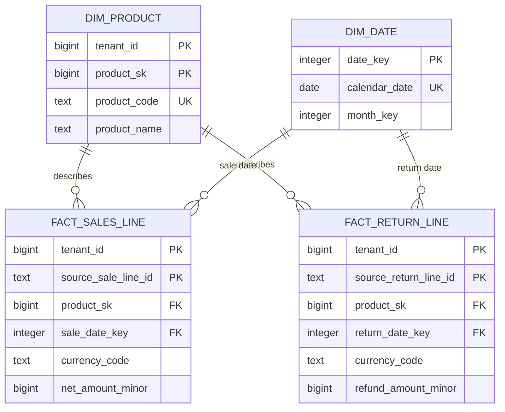

# Phát hiện nhân đôi số đo khi nối nhiều bảng dữ kiện

Một bảng báo cáo có thể trả về kết quả SQL hoàn toàn hợp lệ nhưng lại cho **doanh thu lớn gấp nhiều lần thực tế**. Lỗi này thường xuất hiện khi hai bảng dữ kiện (*fact tables*) có nhiều dòng cho cùng một sản phẩm, đơn hàng, khách hàng hoặc ngày được nối trực tiếp với nhau. Trong kết quả join, mỗi dòng của bảng thứ nhất bị lặp theo số dòng khớp ở bảng thứ hai, rồi `SUM` cộng lại những bản sao ấy.

Hiện tượng đó được gọi là **fan-out** hay **nhân bản số đo do join** (*measure duplication / double counting*). Đây không đơn thuần là vấn đề tối ưu SQL: nó bắt nguồn từ việc bỏ qua **grain** — định nghĩa chính xác một dòng dữ liệu đại diện cho sự kiện hoặc trạng thái nào — và bỏ qua lực lượng kết hợp (*cardinality*) giữa các bảng.

Bài học thuộc chương **Bảng dữ kiện** của module **DATABASE_DATA_MODELING**. Mục tiêu là chuyển các yêu cầu phân tích thành mô hình dữ liệu với khóa, quan hệ, ràng buộc, grain và đơn vị đo rõ ràng; biết phát hiện, chứng minh và xử lý fan-out giữa những fact trong mô hình quan hệ, rồi áp dụng nguyên tắc tương đương trong document, graph và kho phân tích. Ví dụ dùng **PostgreSQL 15+**, nhưng cách suy luận về số dòng và tính đúng của số đo không phụ thuộc một hệ quản trị cụ thể.

## 1. Khi nào một phép join làm nhân đôi số đo?

Xét yêu cầu:

> Trong tháng 10, theo từng sản phẩm, báo cáo số tiền bán, số tiền hoàn trả và chênh lệch giữa hai số tiền.

Hệ thống có hai fact:

- `fact_sales_line`: **một dòng** ứng với một dòng bán hàng; mỗi dòng có `net_amount_minor`.
- `fact_return_line`: **một dòng** ứng với một lần trả hàng/hoàn tiền; mỗi dòng có `refund_amount_minor`.

Cả hai đều có khóa tới sản phẩm. Nhưng **“cùng product” không có nghĩa “một dòng bán tương ứng đúng một dòng trả”**. Một sản phẩm có thể được bán nhiều lần và trả nhiều lần.

Giả sử trong tháng:

| `product` | Số dòng bán | Số dòng trả | Số dòng sau `JOIN` theo product |
|---|---:|---:|---:|
| P1 — Điện thoại | 2 | 3 | **6** |
| P2 — Laptop | 1 | 1 | 1 |
| P3 — Giày | 0 | 1 | 0 với `INNER JOIN` |
| P4 — Máy tính bảng | 0 | 0 | 0 với `INNER JOIN` |

Với P1, mỗi dòng bán khớp với **cả ba dòng trả**; mỗi dòng trả khớp với **cả hai dòng bán**. Kết quả là `2 × 3 = 6` cặp, dù nguồn chỉ có 5 sự kiện độc lập.

### Công thức đằng sau fan-out

Với một giá trị khóa nhóm \(k\), đặt:

- \(m_k\): số dòng của fact A có khóa \(k\).
- \(n_k\): số dòng của fact B có khóa \(k\).

Nếu join theo **chỉ khóa \(k\)** bằng `INNER JOIN`, số cặp tạo ra là:

\[
\text{joined\_rows}(k) = m_k \times n_k.
\]

Mỗi giá trị đo của A được lặp \(n_k\) lần, còn mỗi giá trị đo của B được lặp \(m_k\) lần. Nếu không có các điều kiện lọc khác:

\[
\begin{aligned}
\mathrm{SUM\_joined}(A,k) &= n_k \times \mathrm{SUM\_source}(A,k),\\
\mathrm{SUM\_joined}(B,k) &= m_k \times \mathrm{SUM\_source}(B,k).
\end{aligned}
\]

Đây là công thức dành cho các giá trị cùng khóa trong phép join đang xét, không phải tuyên bố mọi join đều nhân theo cùng một hệ số. Với `LEFT JOIN`, key không có đối ứng có hành vi khác; với thêm điều kiện về ngày, trạng thái hay khoảng thời gian, số cặp khớp cũng thay đổi.

**Câu hỏi đầu tiên khi thấy tổng tiền tăng bất thường:** trước khi `SUM`, có bao nhiêu dòng kết quả so với bao nhiêu sự kiện gốc thực sự khác nhau?

## 2. Bắt đầu từ grain chứ không bắt đầu từ câu lệnh JOIN

Một fact chỉ có ý nghĩa khi xác định **một dòng là gì**.

| Bảng | Grain | ID dòng | Số đo phù hợp |
|---|---|---|---|
| `fact_sales_line` | Một dòng bán được ghi nhận | `source_sale_line_id` trong tenant | Số lượng bán, tiền bán ròng |
| `fact_return_line` | Một dòng hoàn trả được ghi nhận | `source_return_line_id` trong tenant | Số lượng trả, tiền hoàn |
| `fact_payment` | Một giao dịch thanh toán/đợt trả tiền | `payment_id` | Số tiền thanh toán |
| `fact_inventory_daily` | Một SKU × kho × ngày snapshot | Bộ `(tenant,sku,kho,ngày)` | Tồn cuối ngày |
| `fact_order_accumulating` | Một đơn hàng xuyên vòng đời | `order_id` | Các mốc tiến trình, thời gian xử lý |

Từ các grain này, ta không thể suy ra quan hệ 1:1 giữa sale line và return line chỉ từ `product_id`. Cũng không thể suy ra quan hệ 1:1 giữa order line và payment chỉ từ `order_id`: một đơn có thể có nhiều dòng hàng và nhiều lần thanh toán.

### Một khóa ở mức thực thể cha không phải khóa của fact con

`product_id` có thể là khóa duy nhất của bảng `dim_product`, nhưng **không duy nhất** trong `fact_sales_line` hay `fact_return_line`. Nối hai fact theo `product_id` vì thấy cả hai cùng tham chiếu dimension sẽ tạo quan hệ **N:M** giữa các dòng sự kiện.

Cùng một logic xảy ra khi nối:

- Dòng đơn hàng với dòng thanh toán theo `order_id`.
- Giao dịch click với đơn hàng theo `customer_id`.
- Dòng bán với lượt xem quảng cáo theo `product_id` và ngày.
- Fact tồn kho cuối ngày với từng giao dịch xuất kho theo sản phẩm/kho/ngày.

**Một chiều dùng chung (*conformed dimension*) cung cấp trục so sánh; nó không biến các fact khác grain thành quan hệ 1:1.**

## 3. Dữ liệu thử nhỏ nhưng đủ để lộ lỗi

Để chứng minh fan-out bằng SQL, dùng bốn sản phẩm P1–P4, hai ngày trong tháng 10 và các sự kiện bán/trả. Toàn bộ ví dụ dùng tenant 42 và đồng tiền VND để tránh thêm nhiễu do quy đổi tiền.

### 3.1. Bảng dimension và hai fact



Trong ví dụ này, `DimProduct` là một dimension **không phiên bản hóa** (*Type 1*) để tập trung vào lỗi join. Khi sử dụng SCD Type 2, mỗi phiên bản có một `product_sk` khác nhau và cần xử lý lịch sử như phần sau.

```sql
CREATE TABLE dim_product (
    tenant_id BIGINT NOT NULL,
    product_sk BIGINT NOT NULL,
    product_code TEXT NOT NULL,
    product_name TEXT NOT NULL,

    CONSTRAINT pk_dim_product
        PRIMARY KEY (tenant_id, product_sk),
    CONSTRAINT uq_dim_product_code
        UNIQUE (tenant_id, product_code),
    CONSTRAINT ck_dim_product_code
        CHECK (btrim(product_code) <> ''),
    CONSTRAINT ck_dim_product_name
        CHECK (btrim(product_name) <> '')
);

CREATE TABLE dim_date (
    date_key INTEGER PRIMARY KEY,
    calendar_date DATE NOT NULL UNIQUE,
    month_key INTEGER NOT NULL,
    CONSTRAINT ck_dim_date_month
        CHECK (month_key BETWEEN 190001 AND 999912)
);

CREATE TABLE fact_sales_line (
    tenant_id BIGINT NOT NULL,
    source_sale_line_id TEXT NOT NULL,
    product_sk BIGINT NOT NULL,
    sale_date_key INTEGER NOT NULL,
    currency_code CHAR(3) NOT NULL,
    sold_units INTEGER NOT NULL,
    net_amount_minor BIGINT NOT NULL,

    CONSTRAINT pk_fact_sales_line
        PRIMARY KEY (tenant_id, source_sale_line_id),
    CONSTRAINT fk_sales_product
        FOREIGN KEY (tenant_id, product_sk)
        REFERENCES dim_product (tenant_id, product_sk),
    CONSTRAINT fk_sales_date
        FOREIGN KEY (sale_date_key)
        REFERENCES dim_date (date_key),
    CONSTRAINT ck_sales_units CHECK (sold_units > 0),
    CONSTRAINT ck_sales_amount CHECK (net_amount_minor >= 0)
);

CREATE TABLE fact_return_line (
    tenant_id BIGINT NOT NULL,
    source_return_line_id TEXT NOT NULL,
    product_sk BIGINT NOT NULL,
    return_date_key INTEGER NOT NULL,
    currency_code CHAR(3) NOT NULL,
    returned_units INTEGER NOT NULL,
    refund_amount_minor BIGINT NOT NULL,

    CONSTRAINT pk_fact_return_line
        PRIMARY KEY (tenant_id, source_return_line_id),
    CONSTRAINT fk_returns_product
        FOREIGN KEY (tenant_id, product_sk)
        REFERENCES dim_product (tenant_id, product_sk),
    CONSTRAINT fk_returns_date
        FOREIGN KEY (return_date_key)
        REFERENCES dim_date (date_key),
    CONSTRAINT ck_return_units CHECK (returned_units > 0),
    CONSTRAINT ck_return_amount CHECK (refund_amount_minor >= 0)
);
```

**Ý nghĩa của khóa:**

- `(tenant_id, source_sale_line_id)` là danh tính của **một dòng bán**, không phải một sản phẩm.
- `(tenant_id, source_return_line_id)` là danh tính của **một dòng trả**.
- `(tenant_id, product_sk)` là khóa của **một dòng dimension sản phẩm**; FK cho phép nhiều dòng fact cùng tham chiếu.
- Các cột ngày đều trỏ tới `DimDate`, nhưng `sale_date_key` và `return_date_key` là **hai vai trò ngày khác nhau**.
- `currency_code` là một phần **đơn vị đo của số tiền**: không được cộng hoặc trừ tiền khác đồng tiền mà không có chính sách chuyển đổi.

DDL này bảo vệ cấu trúc cơ bản, nhưng **không** bảo đảm mọi khoản hoàn trả đều gắn với một dòng bán gốc. Nếu nghiệp vụ yêu cầu truy vết bán–trả, cần thêm quan hệ và quy tắc riêng. Việc không có `original_sale_line_id` trong ví dụ là chủ đích để kiểm tra câu hỏi báo cáo **theo sản phẩm/tháng**, không phải đối soát chi tiết hoàn tiền theo từng hóa đơn.

### 3.2. Seed data có thể đối soát bằng tay

```sql
INSERT INTO dim_product
    (tenant_id, product_sk, product_code, product_name)
VALUES
    (42, 101, 'P1', 'Điện thoại'),
    (42, 102, 'P2', 'Laptop'),
    (42, 103, 'P3', 'Giày'),
    (42, 104, 'P4', 'Máy tính bảng');

INSERT INTO dim_date (date_key, calendar_date, month_key)
VALUES
    (20261001, DATE '2026-10-01', 202610),
    (20261002, DATE '2026-10-02', 202610);

INSERT INTO fact_sales_line
    (tenant_id, source_sale_line_id, product_sk,
     sale_date_key, currency_code, sold_units, net_amount_minor)
VALUES
    (42, 'S1', 101, 20261001, 'VND', 1, 10000),
    (42, 'S2', 101, 20261001, 'VND', 2, 20000),
    (42, 'S3', 102, 20261002, 'VND', 1, 30000);

INSERT INTO fact_return_line
    (tenant_id, source_return_line_id, product_sk,
     return_date_key, currency_code, returned_units, refund_amount_minor)
VALUES
    (42, 'R1', 101, 20261002, 'VND', 1, 1000),
    (42, 'R2', 101, 20261002, 'VND', 1, 2000),
    (42, 'R3', 101, 20261002, 'VND', 1, 3000),
    (42, 'R4', 102, 20261002, 'VND', 1, 5000),
    (42, 'R5', 103, 20261002, 'VND', 1, 4000);
```

P3 có hoàn trả nhưng **không có bán trong tháng 10** — có thể vì hàng được bán từ một kỳ trước; đó không phải dữ liệu lỗi. P4 không có hoạt động trong hai fact.

### 3.3. Kết quả đúng cần đạt

| Sản phẩm | Số dòng bán | Tiền bán | Số dòng trả | Tiền hoàn | Bán trừ hoàn |
|---|---:|---:|---:|---:|---:|
| P1 | 2 | 30.000 | 3 | 6.000 | 24.000 |
| P2 | 1 | 30.000 | 1 | 5.000 | 25.000 |
| P3 | 0 | 0 | 1 | 4.000 | -4.000 |
| P4 | 0 | 0 | 0 | 0 | 0 |
| **Tổng** | **3** | **60.000** | **5** | **15.000** | **45.000** |

Đơn vị của ba cột tiền là **đơn vị nhỏ nhất theo quy ước VND của bài**. Phép “bán trừ hoàn” là **hoạt động tiền phát sinh trong tháng 10**, không mặc định bằng doanh thu thuần theo một chuẩn kế toán cụ thể: khoản hoàn tháng 10 có thể thuộc doanh số của kỳ trước.

## 4. Truy vấn sai: nối hai bảng fact thô theo product

Một truy vấn dễ được viết ra khi cả hai bảng đều có `product_sk`:

```sql
SELECT
    p.product_code,
    COUNT(*) AS joined_rows,
    SUM(s.net_amount_minor) AS reported_sales_minor,
    SUM(r.refund_amount_minor) AS reported_refunds_minor
FROM fact_sales_line AS s
JOIN fact_return_line AS r
  ON r.tenant_id = s.tenant_id
 AND r.product_sk = s.product_sk
JOIN dim_product AS p
  ON p.tenant_id = s.tenant_id
 AND p.product_sk = s.product_sk
WHERE s.tenant_id = 42
GROUP BY p.product_code
ORDER BY p.product_code;
```

Kết quả trên dữ liệu mẫu:

| `product_code` | `joined_rows` | `reported_sales_minor` | `reported_refunds_minor` |
|---|---:|---:|---:|
| P1 | **6** | **90.000** | **12.000** |
| P2 | 1 | 30.000 | 5.000 |

Ở P1:

- Dòng `S1 = 10.000` xuất hiện ba lần vì khớp R1, R2, R3.
- Dòng `S2 = 20.000` cũng xuất hiện ba lần.
- Mỗi dòng hoàn R1–R3 xuất hiện **hai lần** vì khớp S1, S2.
- Tổng bán bị tính là `3 × (10.000 + 20.000) = 90.000` thay vì 30.000.
- Tổng hoàn bị tính là `2 × (1.000 + 2.000 + 3.000) = 12.000` thay vì 6.000.
- P3 biến mất vì không có dòng bán tương ứng trong tháng.

Nếu cộng kết quả sai, **tiền bán được báo là 120.000**, tiền hoàn là **17.000**, chênh lệch thành **103.000** thay vì kết quả đúng **45.000**. Sai lệch không đến từ công thức cộng mà đến từ **tập dòng trước khi cộng**.

### Vì sao thêm điều kiện ngày chưa chắc sửa được?

Nếu thêm `sale_date_key = return_date_key`, một sản phẩm có nhiều dòng bán và nhiều dòng trả **cùng ngày** vẫn tạo tích Descartes có điều kiện. Trái lại, khoản hoàn xảy ra sau ngày bán có thể bị loại mất, dù nghiệp vụ vẫn muốn tính nó trong tháng hoàn.

Cần thống nhất **vai trò thời gian** trước khi join. Không sử dụng điều kiện ngày tùy ý chỉ để làm số liệu có vẻ nhỏ hơn.

## 5. Minh họa phép nhân bằng bảng cặp

Với P1:

| Dòng bán | Số tiền bán | Dòng trả khớp | Tiền hoàn |
|---|---:|---|---:|
| S1 | 10.000 | R1 | 1.000 |
| S1 | 10.000 | R2 | 2.000 |
| S1 | 10.000 | R3 | 3.000 |
| S2 | 20.000 | R1 | 1.000 |
| S2 | 20.000 | R2 | 2.000 |
| S2 | 20.000 | R3 | 3.000 |

`JOIN` trả về các **cặp dòng khớp**. Nó không tự hiểu rằng “tiền bán chỉ được tính một lần trên mỗi S1/S2” và “tiền hoàn chỉ được tính một lần trên mỗi R1/R2/R3”.

Tổng sau join là tổng trên **sáu cặp**, chứ không phải tổng trên hai tập sự kiện độc lập. Muốn báo cáo ở grain `(tenant, tháng, sản phẩm, currency)`, phải **đưa từng fact về grain ấy trước**, rồi mới kết hợp.

## 6. Cách sửa nền tảng: tổng hợp từng fact trước khi ghép

Phương pháp chuẩn cho bài toán so sánh nhiều quy trình thường gọi là **drill-across**:

1. Xác nhận các chiều dùng chung và cấp nhóm cần báo cáo.
2. Lọc mỗi fact theo **thời gian và trạng thái đúng của quy trình đó**.
3. Tổng hợp **riêng** từng fact về cùng grain báo cáo.
4. Ghép các **kết quả đã tổng hợp**, không ghép những sự kiện thô độc lập.
5. Xử lý những nhóm chỉ có ở một fact và những số đo không cộng được.

### 6.1. Truy vấn an toàn ở grain tháng × sản phẩm × tiền tệ

```sql
WITH sales_by_key AS (
    SELECT
        s.tenant_id,
        d.month_key,
        s.product_sk,
        s.currency_code,
        COUNT(*) AS sales_lines,
        SUM(s.net_amount_minor) AS sales_minor
    FROM fact_sales_line AS s
    JOIN dim_date AS d
      ON d.date_key = s.sale_date_key
    WHERE s.tenant_id = 42
      AND d.month_key = 202610
    GROUP BY
        s.tenant_id, d.month_key, s.product_sk, s.currency_code
),
returns_by_key AS (
    SELECT
        r.tenant_id,
        d.month_key,
        r.product_sk,
        r.currency_code,
        COUNT(*) AS return_lines,
        SUM(r.refund_amount_minor) AS refunds_minor
    FROM fact_return_line AS r
    JOIN dim_date AS d
      ON d.date_key = r.return_date_key
    WHERE r.tenant_id = 42
      AND d.month_key = 202610
    GROUP BY
        r.tenant_id, d.month_key, r.product_sk, r.currency_code
),
combined AS (
    SELECT
        COALESCE(s.tenant_id, r.tenant_id) AS tenant_id,
        COALESCE(s.month_key, r.month_key) AS month_key,
        COALESCE(s.product_sk, r.product_sk) AS product_sk,
        COALESCE(s.currency_code, r.currency_code) AS currency_code,
        COALESCE(s.sales_lines, 0) AS sales_lines,
        COALESCE(s.sales_minor, 0) AS sales_minor,
        COALESCE(r.return_lines, 0) AS return_lines,
        COALESCE(r.refunds_minor, 0) AS refunds_minor
    FROM sales_by_key AS s
    FULL OUTER JOIN returns_by_key AS r
      ON r.tenant_id = s.tenant_id
     AND r.month_key = s.month_key
     AND r.product_sk = s.product_sk
     AND r.currency_code = s.currency_code
)
SELECT
    c.month_key,
    p.product_code,
    c.currency_code,
    c.sales_lines,
    c.sales_minor,
    c.return_lines,
    c.refunds_minor,
    c.sales_minor - c.refunds_minor AS net_activity_minor
FROM combined AS c
JOIN dim_product AS p
  ON p.tenant_id = c.tenant_id
 AND p.product_sk = c.product_sk
ORDER BY c.month_key, p.product_code, c.currency_code;
```

Kết quả có ba sản phẩm P1, P2, P3 với số tiền đúng như phần 3.3. P4 **không xuất hiện** vì không có hoạt động ở cả hai fact; nếu yêu cầu hiển thị P4 với các số 0, cần **bắt đầu từ tập sản phẩm/lịch báo cáo mục tiêu** rồi `LEFT JOIN` các nhóm đã tổng hợp vào, có chính sách rõ khi dữ liệu thiếu.

### 6.2. Vì sao `FULL OUTER JOIN` ở đây hợp lý?

Một sản phẩm có thể chỉ có tiền bán trong kỳ, hoặc chỉ có tiền hoàn trong kỳ. `FULL OUTER JOIN` giữ cả hai trường hợp. `COALESCE(..., 0)` biến sự **vắng mặt của một nhóm sự kiện** thành số đo bằng 0 theo định nghĩa.

Nhưng **thiếu dữ liệu nguồn do pipeline chưa nạp** không đồng nghĩa “0 giao dịch”. Nếu sự hoàn chỉnh của fact chưa được xác nhận, thay thiếu dữ liệu bằng 0 sẽ che lỗi. Vì vậy báo cáo production cần watermark, kiểm soát kỳ chốt hoặc cờ chất lượng dữ liệu.

### 6.3. Điều kiện bắt buộc trước khi ghép

Mỗi CTE sau `GROUP BY` phải có **tối đa một dòng** trên bộ:

\[
(\text{tenant\_id},\ \text{month\_key},\
\text{product\_sk},\ \text{currency\_code}).
\]

Nếu một trong hai tập còn nhiều dòng trên bộ khóa nhóm, việc ghép vẫn có thể tạo fan-out. Kiểm tra khóa nhóm của cả hai phía bằng unique test trong pipeline hoặc truy vấn so đếm trước khi coi kết quả an toàn.

Ngoài ra `product_sk` ở ví dụ là khóa của dimension **Type 1** ổn định. Nếu các fact dùng phiên bản `product_sk` khác nhau của cùng sản phẩm theo SCD Type 2, ghép trực tiếp trên `product_sk` có thể tách các số đo cần tổng hợp cùng nhau. Hãy xác định góc nhìn “theo phân loại lúc sự kiện” hay “theo sản phẩm chuẩn hiện tại” trước khi chọn khóa nhóm — xem phần 12.

## 7. Kiểm tra fan-out trước khi nhìn vào tổng tiền

Đừng chỉ phát hiện lỗi bằng việc “báo cáo lớn hơn dự đoán”. Nên kiểm tra **số dòng và định danh sự kiện** ngay sau các phép join có rủi ro.

### 7.1. Kiểm tra số lần lặp của từng dòng bán

```sql
SELECT
    s.source_sale_line_id,
    COUNT(*) AS joined_rows
FROM fact_sales_line AS s
LEFT JOIN fact_return_line AS r
  ON r.tenant_id = s.tenant_id
 AND r.product_sk = s.product_sk
WHERE s.tenant_id = 42
GROUP BY s.source_sale_line_id
HAVING COUNT(*) > 1
ORDER BY joined_rows DESC, s.source_sale_line_id;
```

Với dữ liệu mẫu, S1 và S2 đều có `joined_rows = 3`. Đây là bằng chứng trực tiếp cho thấy mỗi sự kiện bán đang bị **nhân ba**. Không cần đợi tới phép `SUM` mới biết sai.

`COUNT(*)` của `LEFT JOIN` luôn có ít nhất một dòng cho mỗi sales line, kể cả khi không có return. Điều đó phù hợp khi đo **bao nhiêu bản sao của mỗi dòng bán sau join**; nhưng không được dùng `COUNT(*)` ấy như “số return”, vì dòng không có return vẫn tạo một hàng với cột phía return bằng `NULL`.

### 7.2. So số dòng trước và sau join

```sql
WITH before_join AS (
    SELECT COUNT(*) AS source_rows
    FROM fact_sales_line
    WHERE tenant_id = 42
),
after_join AS (
    SELECT
        COUNT(*) AS joined_rows,
        COUNT(DISTINCT s.source_sale_line_id) AS distinct_sales
    FROM fact_sales_line AS s
    JOIN fact_return_line AS r
      ON r.tenant_id = s.tenant_id
     AND r.product_sk = s.product_sk
    WHERE s.tenant_id = 42
)
SELECT
    b.source_rows,
    a.joined_rows,
    a.distinct_sales
FROM before_join AS b
CROSS JOIN after_join AS a;
```

Trong ví dụ, `source_rows = 3`, `joined_rows = 7` và `distinct_sales = 3`. `joined_rows` là 6 cho P1 cộng 1 cho P2; cả ba dòng bán có ít nhất một return khớp.

**Cẩn trọng:** nếu dùng `INNER JOIN` và một dòng bán không có return, `distinct_sales` sẽ **giảm**, đồng thời dòng còn lại có thể bị nhân. Hai sai lệch có thể bù nhau khi chỉ nhìn tổng số dòng. Vì vậy phải kiểm tra **cả multiplicity lẫn nhóm bị mất**, không chỉ so `COUNT(*)`.

### 7.3. Tìm khóa trùng trong một tập được cho là “một dòng mỗi nhóm”

```sql
-- Mẫu cho một bảng/CTE staging đã được aggregate theo
-- tenant_id, month_key, product_sk, currency_code.
SELECT
    tenant_id, month_key, product_sk, currency_code,
    COUNT(*) AS rows_per_key
FROM report_sales_stage
GROUP BY tenant_id, month_key, product_sk, currency_code
HAVING COUNT(*) > 1;
```

`report_sales_stage` là **bảng staging minh họa**, không được tạo trong DDL phần 3. Nếu truy vấn trả dòng, lời hứa “một dòng trên mỗi bộ khóa nhóm” chưa đúng; cần điều tra trước khi nối sang fact khác.

Trong phép thử độc lập, cũng cần xác minh dimension được nối có đúng **một dòng trên khóa tham chiếu**. Nếu dimension trả hai dòng cho cùng một business key vì SCD, chính join fact–dimension cũng có thể làm phình số đo.

## 8. Tại sao `SUM(DISTINCT ...)` không phải cách chữa?

Một sửa lỗi phổ biến:

```sql
-- KHÔNG phải công thức tổng bán đáng tin cậy:
SUM(DISTINCT s.net_amount_minor)
```

`DISTINCT` ở đây loại các **giá trị tiền trùng**, không loại **bản sao của cùng một sự kiện**.

Ví dụ hai dòng bán thật của cùng sản phẩm đều có `net_amount_minor = 10.000`. Doanh số đúng là **20.000**, nhưng `SUM(DISTINCT net_amount_minor)` chỉ được **10.000**. Ngược lại, nếu mỗi dòng bán có số tiền khác nhau và bị lặp bởi join, `SUM(DISTINCT ...)` có thể tình cờ cho kết quả đúng ở bộ dữ liệu nhỏ, khiến bug khó phát hiện.

Tương tự:

- `SELECT DISTINCT` sau khi join có thể bỏ một số dòng trông giống nhau nhưng là **giao dịch độc lập**.
- `COUNT(DISTINCT sale_line_id)` có thể tính đúng **số giao dịch bán**, nhưng không tự làm đúng `SUM(sale_amount)` trong cùng kết quả.
- `ROW_NUMBER()` rồi chọn một dòng sau join có thể hữu ích nếu bạn thực sự đang chọn **một đối tượng duy nhất** theo quy tắc rõ ràng. Nó không thay thế quyết định grain cho hai nguồn đo độc lập.

**Cách đúng:** giữ danh tính của từng sự kiện, quyết định grain cần tổng hợp, và thực hiện aggregation ở đúng grain trước khi kết hợp.

## 9. Dùng `EXISTS` khi chỉ cần biết một quan hệ có tồn tại

Đôi khi câu hỏi không phải “tổng tiền của hai fact” mà chỉ là:

> Có sản phẩm nào được bán trong tháng 10 và cũng có ít nhất một lượt trả trong tháng 10?

Ở đây chỉ cần **điều kiện tồn tại**, không cần nhân mọi dòng bán với mọi dòng trả:

```sql
SELECT DISTINCT
    s.tenant_id,
    s.product_sk
FROM fact_sales_line AS s
JOIN dim_date AS sale_day
  ON sale_day.date_key = s.sale_date_key
WHERE s.tenant_id = 42
  AND sale_day.month_key = 202610
  AND EXISTS (
      SELECT 1
      FROM fact_return_line AS r
      JOIN dim_date AS return_day
        ON return_day.date_key = r.return_date_key
      WHERE r.tenant_id = s.tenant_id
        AND r.product_sk = s.product_sk
        AND return_day.month_key = 202610
  );
```

Kết quả là P1 và P2, mỗi sản phẩm một lần. `EXISTS` kiểm tra có đối ứng, không xuất ra một bản sao của dòng bán cho **mỗi** return.

Tuy nhiên, nếu hỏi “tổng số tiền đã bán của các sản phẩm từng bị trả”, vẫn phải quyết định **cấp độ nhóm** và tính `SUM` trên tập sự kiện bán không nhân bản, hoặc dùng subquery `EXISTS` làm bộ lọc rồi cộng trực tiếp sales rows. Không phải lúc nào `DISTINCT` ở đầu truy vấn cũng giải quyết được phần đo.

## 10. Fan-out không chỉ đến từ nối hai fact theo sản phẩm

### 10.1. Dòng đơn hàng × thanh toán theo đơn

Một đơn có **3 dòng hàng** và **2 lần thanh toán**:

```text
Order O1
  Lines: L1, L2, L3       (3 dòng)
  Payments: PAY1, PAY2   (2 lần)
```

Nối `fact_order_line` với `fact_payment` theo `order_id` tạo **6 cặp**. Nếu tổng doanh thu dựa trên dòng hàng là 300.000, nó có thể xuất hiện **hai lần** trong `SUM`. Nếu tổng thanh toán là 300.000, nó có thể bị cộng **ba lần**.

Cách đúng để xem tổng theo đơn:

```sql
-- Lược đồ minh họa: fact_order_line(order_id,line_amount),
-- fact_payment(order_id,paid_amount).
WITH line_total AS (
    SELECT order_id, SUM(line_amount) AS ordered_amount
    FROM fact_order_line
    GROUP BY order_id
),
payment_total AS (
    SELECT order_id, SUM(paid_amount) AS paid_amount
    FROM fact_payment
    GROUP BY order_id
)
SELECT
    COALESCE(l.order_id, p.order_id) AS order_id,
    COALESCE(l.ordered_amount, 0) AS ordered_amount,
    COALESCE(p.paid_amount, 0) AS paid_amount
FROM line_total AS l
FULL OUTER JOIN payment_total AS p
  ON p.order_id = l.order_id;
```

Đoạn SQL sử dụng **tên bảng minh họa**, không phải các bảng ở phần 3. Trong hệ đa tenant, mọi khóa nhóm/join cần thêm `tenant_id` hoặc cơ chế định danh tenant tương đương; không triển khai nguyên bản `GROUP BY order_id` nếu `order_id` có thể lặp giữa tenant.

### 10.2. Fact sự kiện × fact snapshot

`fact_inventory_daily` có grain **một SKU × kho × ngày cuối kỳ**. `fact_shipments` có grain **một lần xuất kho**. Nếu cùng ngày một SKU có 8 lần xuất, join snapshot với shipments theo `(SKU,kho,ngày)` sẽ lặp số tồn cuối ngày **8 lần**.

Số tồn là **semi-additive**: có thể cộng qua các kho/sản phẩm khi đơn vị đo tương thích, nhưng không cộng số tồn của nhiều ngày rồi gọi đó là tồn cuối tháng. Do đó cần giải quyết **hai vấn đề**:

1. Không nhân số tồn do join với nhiều sự kiện shipment.
2. Không cộng số tồn qua thời gian như một flow measure.

Cách đọc tồn cuối tháng thường chọn snapshot cuối kỳ (và kiểm tra tính đầy đủ), trong khi số lượng xuất trong tháng được tổng hợp từ shipment events. Sau đó mới ghép **hai số đo đã chuẩn hóa**, có thể ở grain SKU–kho–tháng.

### 10.3. Clickstream × conversion

Một người có 10 lượt xem trang và 2 đơn hàng trong ngày. Join theo `(customer_id,date)` tạo 20 cặp. Nếu muốn “số lượt xem và số đơn theo khách/ngày”, cần cộng từng nguồn riêng. Nếu muốn **quy công một lượt click cho đơn hàng**, đó là một quan hệ attribution có điều kiện, cửa sổ thời gian, ưu tiên và có thể trọng số — cần mô hình riêng, không phải join thô mặc định.

## 11. Khi dimension cũng làm nhân đôi số đo

Lỗi không giới hạn ở fact–fact. Một fact có thể bị nhân khi join tới **dimension không duy nhất theo điều kiện nối**.

### 11.1. Join sai vào SCD Type 2

Ví dụ `dim_product` theo Type 2 có:

| `product_sk` | `canonical_product_id` | `category` | `valid_from` | `valid_to` |
|---:|---|---|---|---|
| 501 | PRD-100 | PHONE | 2026-01-01 | 2026-10-01 |
| 888 | PRD-100 | MOBILE | 2026-10-01 | NULL |

Nếu `fact_sales_line` đang có một dòng bán ngày 20/09, join vào dimension **chỉ theo `canonical_product_id`** sẽ trả **hai** phiên bản, làm số tiền bị nhân đôi.

Các cách phù hợp tùy hợp đồng:

- Fact lưu đúng `product_sk` đã giải mã theo **thời điểm giao dịch**; join fact–dimension theo surrogate key duy nhất.
- Hoặc join theo `canonical_product_id` **và điều kiện thời gian** nằm trong khoảng hiệu lực `[valid_from, valid_to)`, đồng thời bảo đảm các khoảng không chồng nhau.
- Nếu báo cáo **phân loại hiện tại**, ánh xạ về đúng **một** bản hiện hành (có ràng buộc duy nhất current), không ghép vào mọi phiên bản.

**Chỉ dùng `WHERE is_current = TRUE` không phải sửa lỗi chung:** điều đó có thể đổi câu hỏi “theo nhóm tại lúc bán” thành “theo nhóm hiện tại”, làm thay đổi lịch sử phân loại dù đã hết nhân số tiền.

### 11.2. Bảng bridge nhiều-nhiều giữa sản phẩm và nhóm hàng

Một sản phẩm được gắn hai nhóm A và B. Bảng bridge có hai dòng:

| `product_id` | `category` | `allocation_weight` |
|---|---|---:|
| P1 | A | 0,60 |
| P1 | B | 0,40 |

Nếu join một dòng doanh số P1 = 100.000 vào bridge rồi `SUM(sales_amount)` theo category, cả A và B đều nhận 100.000; cộng lại là **200.000**.

Nếu nghiệp vụ đòi **phân bổ**, có thể tính:

\[
allocated\_sales = sales\_amount \times allocation\_weight.
\]

A nhận 60.000, B nhận 40.000 và tổng vẫn là 100.000. Nhưng điều này chỉ đúng khi **tổng trọng số các nhóm cho mỗi sản phẩm/thời điểm bằng 1** và không có mapping trùng/chồng thời gian. Một truy vấn kiểm tra tổng trọng số theo grain áp dụng là bắt buộc.

Nếu nghiệp vụ muốn **gắn nhãn không phân bổ** (“doanh số sản phẩm nào liên quan nhóm A/B”), mỗi nhóm có thể chứa toàn bộ 100.000 nhưng **không được cộng tổng các nhóm** rồi coi là doanh thu toàn công ty. Hai loại báo cáo có ý nghĩa khác nhau.

### 11.3. Dimension tên giống nhau nhưng business key không cùng nghĩa

Hai hệ thống cùng có mã `P100` nhưng một bên là “sản phẩm” và bên khác là “gói 10 sản phẩm”. Join dựa trên chuỗi mã có thể tạo kết quả trông hợp lý mà sai về grain/đơn vị tính. Phải có conformed dimension hoặc bảng mapping mã nguồn được phê duyệt, gồm `source_system`, tenant và hiệu lực khi mã có thể đổi/tái sử dụng.

**Một câu JOIN chạy được không chứng minh hai chiều có cùng danh tính nghiệp vụ.**

## 12. SCD, ngày sự kiện và khóa nhóm dùng chung

Khi so Sales với Returns qua thời gian, cần quyết định **hai quy trình đang dùng “cùng sản phẩm” theo nghĩa nào**.

Giả sử sản phẩm PRD-100 đổi nhóm từ PHONE sang MOBILE ngày 01/10:

- Sale ngày 30/09 gắn `product_sk = 501`.
- Return ngày 05/10 có thể gắn `product_sk = 888` nếu ánh xạ theo **ngày trả**.
- Nếu return có chứng từ bán gốc, nghiệp vụ có thể yêu cầu giữ `product_sk = 501` để phân loại cùng với sale ban đầu.

Nếu ghép aggregate theo `product_sk`, hai phiên bản 501 và 888 được xem là **hai nhóm khác nhau**. Điều đó đúng nếu mục tiêu là **“theo phiên bản phân loại ở thời điểm sự kiện”**, nhưng không đúng nếu mục tiêu là **“theo cùng sản phẩm chuẩn bất kể phiên bản”**.

### Hai hợp đồng báo cáo khác nhau

| Góc nhìn | Khóa nhóm nên xét | Quy tắc giải thích |
|---|---|---|
| **As-was** — theo phân loại lúc giao dịch | `product_sk` theo thời điểm sale/return đã chọn | Lịch sử theo phiên bản của sự kiện |
| **As-is** — theo sản phẩm/nhóm hiện tại | `canonical_product_id` và **một** mapping current hợp lệ | Các giao dịch cũ được phân loại lại theo hiện tại |
| **Theo nhóm lúc bán để đối chiếu return** | Khóa/nhóm của sale gốc | Return tháng này được đưa về nhóm của sự kiện bán gốc |

Không ép cả ba loại báo cáo vào một column `category_code` không có ghi chú thời gian. Khóa grouping phải phản ánh đúng **ngữ nghĩa báo cáo**.

### Kiểm tra conformance trước drill-across

- Sales và Returns có cùng canonical identity hay chỉ cùng mã hiển thị?
- Các thuộc tính nhóm hàng có version/time policy tương thích?
- `sale_date_key` và `return_date_key` thuộc cùng lịch và timezone?
- Nếu một process dùng package SKU, process kia dùng each SKU, đã chuẩn hóa UOM chưa?
- Có trường hợp unknown/late-arriving dimension cần giữ lại thay vì bỏ fact?
- Tất cả amount đã có currency rõ và chính sách thuế/giảm giá tương thích?

Những sai lệch này không nhất thiết tạo **nhân dòng**; một truy vấn vẫn có thể trả đúng số hàng mà số liệu ghép lại sai về ý nghĩa. Vì vậy kiểm thử fan-out phải đi cùng kiểm thử định nghĩa.

## 13. Điều kiện an toàn để join hai fact ở mức chi tiết

**Không phải mọi fact-to-fact join đều sai.** Có những quan hệ thật sự rõ ràng ở cấp giao dịch.

### Trường hợp 1: có quan hệ một-một đã được cưỡng chế

Nếu bảng `fact_payment_header` có **đúng tối đa một** dòng mỗi `payment_id`, còn bảng `fact_payment_settlement` cũng có đúng tối đa một dòng cùng `payment_id`, và mỗi bên đều được thiết kế với `UNIQUE(payment_id)` trong cùng phạm vi tenant, join một-một có thể không nhân dòng.

Cần phân biệt:

- **Bảo đảm ở schema:** unique/PK và FK khi engine thực thi.
- **Bảo đảm ở pipeline:** assertion kiểm tra uniqueness và key coverage nếu warehouse không cưỡng chế FK.
- **Bảo đảm theo nghiệp vụ:** không có trạng thái hay lịch sử khiến một payment có nhiều settlement.

### Trường hợp 2: mỗi dòng return tham chiếu một sale line gốc

Nếu một return line có `original_sale_line_id`, có thể join để **lấy thuộc tính của sale gốc** như đơn giá chốt và sản phẩm. Nhưng một sale line vẫn có thể có **nhiều return line từng phần**, nên số tiền sale bị lặp khi join từ sale sang returns.

Để báo cáo số tiền sale và tổng tiền hoàn trên một sale line:

```sql
-- Minh họa biến thể schema:
-- returns(original_sale_line_id, refund_amount_minor, ...).
WITH refunds_per_sale AS (
    SELECT
        tenant_id,
        original_sale_line_id,
        SUM(refund_amount_minor) AS total_refund_minor
    FROM returns
    GROUP BY tenant_id, original_sale_line_id
)
SELECT
    s.tenant_id,
    s.source_sale_line_id,
    s.net_amount_minor,
    COALESCE(r.total_refund_minor, 0) AS total_refund_minor
FROM fact_sales_line AS s
LEFT JOIN refunds_per_sale AS r
  ON r.tenant_id = s.tenant_id
 AND r.original_sale_line_id = s.source_sale_line_id;
```

`returns` trong ví dụ là **tên bảng giả định của một mô hình khác**, không phải `fact_return_line` đã tạo ở phần 3. Không chạy nguyên đoạn nếu chưa bổ sung quan hệ bán–trả và kiểm soát khóa gốc.

Với `refunds_per_sale` chỉ có **một dòng mỗi sale line**, phép join không nhân bản `s.net_amount_minor`. Tuy vậy, các return **không có sale gốc** phải được xử lý theo policy riêng; không được âm thầm mất chúng trong một phép `LEFT JOIN` lấy sales làm gốc.

### Trường hợp 3: join để liên hệ, không phải cộng độc lập hai fact

Có thể join hai fact để nghiên cứu chuỗi sự kiện, ví dụ mỗi lần hoàn trả liên hệ tới lần bán gốc. Khi đó **một dòng output là một cặp quan hệ**, không phải một dòng doanh thu. Có thể hợp lệ nếu người sử dụng biết grain mới và không cộng lại số đo như ở grain ban đầu.

**Quy tắc:** trước mỗi `JOIN` fact-to-fact, ghi rõ **grain kết quả sau join**. Nếu không thể mô tả nó bằng một câu, không nên đặt `SUM` trên kết quả ấy.

## 14. Đối soát số đo độc lập với báo cáo sau join

Một báo cáo liên quy trình cần có **số kiểm soát (control totals)** trực tiếp từ từng nguồn fact.

### 14.1. Tổng kiểm soát từ bảng bán và trả

```sql
SELECT
    'SALES' AS source_name,
    COUNT(*) AS source_rows,
    SUM(net_amount_minor) AS amount_minor
FROM fact_sales_line
WHERE tenant_id = 42

UNION ALL

SELECT
    'RETURNS' AS source_name,
    COUNT(*) AS source_rows,
    SUM(refund_amount_minor) AS amount_minor
FROM fact_return_line
WHERE tenant_id = 42;
```

Dữ liệu mẫu cho:

| Nguồn | Số dòng | Tổng tiền |
|---|---:|---:|
| SALES | 3 | 60.000 |
| RETURNS | 5 | 15.000 |

Các tổng này chỉ là số kiểm soát đúng **trong phạm vi toàn bộ dữ liệu thử đều thuộc tháng 10 và VND**. Trong production phải dùng **cùng bộ lọc tenant, ngày, trạng thái hợp lệ, đơn vị tiền** với báo cáo cần kiểm tra.

Nếu tổng tiền báo cáo sau join khác tổng nguồn đã được lọc cùng điều kiện, có thể có fan-out, lọc sai hoặc thiếu nhóm. Nếu các tổng **bằng nhau**, vẫn chưa chứng minh mọi nhóm đúng: lỗi tăng ở nhóm A có thể bù lỗi giảm ở nhóm B. Cần đối soát **ở grain báo cáo**, không chỉ ở tổng cuối.

### 14.2. Kiểm tra cả số tiền, số lượng sự kiện và key coverage

| Kiểm tra | Câu hỏi phát hiện |
|---|---|
| `COUNT(*)` của từng fact | Có bao nhiêu sự kiện thật được nạp? |
| `COUNT(DISTINCT source_event_id)` theo phạm vi | Có sự kiện nguồn bị nạp trùng không? |
| Row multiplicity sau join | Một sự kiện nguồn bị lặp bao nhiêu lần? |
| Pre/post `SUM` theo grain | Số tiền có tăng sau join không? |
| Anti-join các nhóm không đối ứng | Nhóm chỉ có ở một quy trình có bị mất không? |
| Unique keys của dimension | Join fact–dimension có làm một sự kiện xuất hiện hai lần không? |
| SCD temporal resolution | Một event có khớp đúng một phiên bản chiều không? |
| Unit/currency consistency | Có đang cộng khác đồng tiền/đơn vị không? |
| Snapshot completeness | Dữ liệu trạng thái có thiếu kỳ chốt không? |

### 14.3. So sánh tỷ lệ nhân dòng có ý nghĩa thế nào?

Một chỉ số giám sát thô:

\[
\text{fanout factor}
=\frac{\text{joined rows}}{\text{source rows}}.
\]

Nếu kiểm tra `LEFT JOIN` từ một tập sự kiện A, `fanout factor > 1` cho thấy một số dòng A đã bị nhân (trong trường hợp không có các phép lọc loại bớt nguồn). Với `INNER JOIN`, tỷ lệ này **không đủ** vì sự kiện không có đối ứng bị mất trong khi những sự kiện khác bị nhân; tỷ lệ tình cờ bằng 1 vẫn có thể sai.

Nên ghi thêm:

- Số sự kiện nguồn không có đối ứng.
- Số sự kiện nguồn có hơn một đối ứng.
- Số lần xuất hiện lớn nhất trên một sự kiện.
- Chênh tiền tuyệt đối và chênh theo nhóm.
- Mốc ETL và phiên bản quy tắc khi tạo báo cáo.

Không dùng một tỷ lệ tổng duy nhất để kết luận mọi dòng đều an toàn.

## 15. Kiểm thử tự động để không tái diễn fan-out

Nên viết kiểm thử ở **ba tầng**: khóa/grain, dữ liệu sau join và kết quả nghiệp vụ.

### 15.1. Kiểm tra uniqueness của khóa sự kiện

```sql
-- Không được có hai dòng bán với cùng ID nguồn trong tenant.
SELECT tenant_id, source_sale_line_id, COUNT(*) AS n
FROM fact_sales_line
GROUP BY tenant_id, source_sale_line_id
HAVING COUNT(*) > 1;
```

Với DDL mẫu, PK đã ngăn lỗi này trong PostgreSQL. Trong hệ warehouse chỉ khai báo ràng buộc mà **không thực thi**, assertion trên vẫn cần chạy. Cần làm kiểm tra tương tự với `source_return_line_id`.

### 15.2. Kiểm tra expected key của báo cáo

Ở grain `(tenant,month,product,currency)`, bảng kết quả đã tổng hợp phải có tối đa một dòng trên một bộ khóa. Nếu báo cáo cần hiển thị sản phẩm chưa có giao dịch, hãy xác định **tập key chuẩn** (ví dụ tháng đang xét × danh sách sản phẩm hoạt động) và kiểm tra không có nhóm thiếu/thừa trái hợp đồng.

Không được dùng `COUNT(DISTINCT product_id)` để che một output có nhiều dòng cho cùng sản phẩm khi nguồn của báo cáo đòi **một dòng/product/tháng**.

### 15.3. Kiểm tra bất biến tổng tiền

Đối với cùng tenant, tháng, currency và cùng định nghĩa trạng thái:

\[
\sum_{\text{report groups}} sales
=
\sum_{\text{source sales rows}} net\_amount
\]

và:

\[
\sum_{\text{report groups}} refunds
=
\sum_{\text{source return rows}} refund\_amount.
\]

Điều này yêu cầu **mỗi dòng nguồn thuộc đúng một nhóm báo cáo** hoặc có chính sách phân bổ trọng số được kiểm chứng. Nếu một sản phẩm được gắn nhiều nhóm mà báo cáo chủ đích cho phép xuất hiện ở nhiều nhóm, tổng theo nhóm có thể không bằng tổng nguồn; khi đó phải đổi **hợp đồng tổng hợp**, không đơn giản coi mọi khác biệt là lỗi.

### 15.4. Bộ tình huống kiểm thử phản ví dụ

| Ca thử | Kết quả mong đợi |
|---|---|
| Một sản phẩm có 2 sale × 3 return | Kết quả đúng chỉ có sales 30.000, refund 6.000 |
| Hai sale thật có cùng số tiền | Không mất một sale do `SUM(DISTINCT amount)` |
| Một sản phẩm chỉ có sale | Vẫn xuất hiện trong báo cáo activity |
| Một sản phẩm chỉ có return | Vẫn xuất hiện, ví dụ P3 |
| Sản phẩm không có activity | Xuất hiện 0 chỉ nếu hợp đồng yêu cầu |
| Hai tenant có cùng `product_sk` cục bộ | Không ghép chéo tenant |
| Hai currency cùng sản phẩm | Không cộng minor unit trước quy đổi |
| Nhiều payment một order | Không nhân tiền order lines |
| Một sale line có nhiều return từng phần | Sale amount chỉ tính một lần |
| Dimension SCD2 có hai phiên bản một business key | Không nhân sale vì join thiếu temporal condition |
| SCD2 có khoảng chồng nhau | ETL/assertion phát hiện, không `LIMIT 1` |
| Một SKU thuộc hai category bridge | Không nhân tiền nếu contract yêu cầu phân bổ tổng 100% |
| Inventory có 31 snapshot trong tháng | Không cộng thành 31 lần tồn cuối tháng |
| Return phát sinh tháng sau sale | Báo cáo dùng đúng vai trò ngày/công thức |
| Dữ liệu chưa nạp đủ ở một fact | Không âm thầm coi thiếu pipeline là số 0 |
| Dữ liệu source bị retry nạp trùng | Unique/business key và đối soát phát hiện |
| Join 1:1 có unique/FK đúng | Không có multiplicity bất thường |
| Sửa mapping product hiện tại | Có đối soát/restatement nếu ảnh hưởng kết quả lịch sử |

Những ca có lỗi constraint nên chạy trong transaction hoặc savepoint riêng. Kiểm thử phép join cần so **giá trị chính xác**, không chỉ khẳng định truy vấn chạy không lỗi.

## 16. Quy trình debug một báo cáo bị thổi phồng doanh thu

Khi dashboard báo doanh thu cao bất thường, có thể điều tra theo trình tự có thể lặp lại.

### Bước 1 — Chốt định nghĩa report

Ghi tenant, tháng, timezone, currency, trạng thái giao dịch, cách xử lý hoàn trả và grain mong đợi của mỗi dòng. Nếu người sử dụng muốn doanh số theo **ngày bán gốc**, không so với một truy vấn refund theo **ngày trả** mà chưa quy đổi.

### Bước 2 — Tính control totals từ từng fact nguồn

Không join fact nào; tính `COUNT`, `SUM` và số lượng distinct event theo cùng filter. Lưu kết quả vào nhật ký kiểm thử/incident với thời điểm và watermark để đối soát lại.

### Bước 3 — Xem grain và các cột join

Với mỗi bảng, trả lời “một dòng là gì?”, “khóa dòng gồm gì?”, “bộ cột trong `ON` có unique ở phía nào?”. Nếu bộ cột `ON` không unique ở **cả hai** fact, giả định mặc định phải là **N:M**.

### Bước 4 — Đo multiplicity ở từng bước

Chạy CTE tách từng join và so row count, distinct event key, max rows per event. Phân biệt dòng nguồn bị lặp với dòng nguồn bị mất bởi `INNER JOIN` hay predicate đặt trong `WHERE` sau `LEFT JOIN`.

### Bước 5 — Kiểm tra dimension join và temporal mapping

Xem có join SCD2 theo business key thiếu ngày hiệu lực, bridge nhiều nhóm, duplicate dimension member hoặc tenant bị bỏ khỏi FK/join không. Nhiều trường hợp “join fact-to-fact sai” thực tế còn kèm một lỗi **dimensional fan-out**.

### Bước 6 — Viết lại ở grain đúng

Aggregate Sales và Returns riêng theo chiều chung, vai trò ngày và currency; sau đó drill-across. Nếu cần đối chiếu theo giao dịch gốc, aggregate return về sale line trước khi join.

### Bước 7 — Đối soát theo từng nhóm và khóa nguồn

So tổng với nguồn, số nhóm, key coverage, số chênh tuyệt đối và những nhóm âm/dương. Đảm bảo không dùng `SUM(DISTINCT amount)` hoặc loại bỏ return-only groups để “làm khớp”.

### Bước 8 — Đưa ca lỗi vào kiểm thử và tài liệu hóa

Ghi nguyên nhân, ví dụ dataset tối thiểu tái hiện, SQL an toàn, metric kiểm soát và contract report. Nếu cần thay một metric đã công bố, đánh giá lịch sử dashboard, consumer, cache và dữ liệu tổng hợp cần rebuild.

## 17. Hiệu năng: sửa đúng grain trước, tối ưu sau

**Preaggregation** không chỉ đúng về mặt số đo mà thường còn giảm kích thước join. Thay vì join 10 triệu sale lines với 5 triệu return lines theo product/ngày, hệ thống có thể tổng hợp mỗi bên thành hàng nghìn nhóm rồi ghép nhóm.

Tuy nhiên, kế hoạch thực thi phụ thuộc dữ liệu và DBMS. Một số điều cần đo:

| Quyết định | Câu hỏi đo thực tế |
|---|---|
| Chỉ mục fact | Điều kiện lọc phổ biến là tenant, ngày hay product? |
| Khóa join dimension | Có unique/index phù hợp với `tenant_id + product_sk`? |
| Partition | Có thể prune partition theo ngày/tenant mà không mất dữ liệu late? |
| Aggregate | Hash aggregate/sort có tràn bộ nhớ ra đĩa không? |
| Materialized aggregate | Kết quả có đủ tươi và có thể rebuild sau backfill không? |
| FULL OUTER JOIN | Chi phí so với việc tạo tập key chuẩn rồi `LEFT JOIN` hai phía |
| SCD Type 2 | Khoảng hiệu lực có chỉ mục/ràng buộc không chồng phù hợp? |
| Bridge | Ánh xạ trọng số có đúng phiên bản và phân bổ đủ 100% không? |

Với PostgreSQL, có thể kiểm tra kế hoạch thực thi một truy vấn bằng:

```sql
EXPLAIN (ANALYZE, BUFFERS)
SELECT
    tenant_id, product_sk, SUM(net_amount_minor)
FROM fact_sales_line
WHERE tenant_id = 42
GROUP BY tenant_id, product_sk;
```

Đây là phép đo **aggregate đơn giản**, không thay cho việc benchmark đầy đủ truy vấn drill-across theo tháng và tiền tệ. Chọn chỉ mục/partition dựa vào workload thật; nhiều chỉ mục có thể làm tăng chi phí nạp và bảo trì fact.

**Không tối ưu câu join sai chỉ vì nó chạy nhanh.** Một bảng kết quả nhỏ từ `INNER JOIN` có thể là do **đã làm mất** tất cả các nhóm chỉ có ở một bên, chứ không phải do truy vấn “hiệu quả”.

## 18. Khi chuyển sang document, graph và hệ phân tích khác

Hiện tượng nhân bản số đo là vấn đề của **quan hệ giữa các tập sự kiện**, không chỉ SQL quan hệ.

### 18.1. Document

Một document đơn hàng có thể nhúng `lines` và `payments` thành hai mảng. Nếu pipeline `unwind` cả hai mảng trong cùng document, 3 lines × 2 payments vẫn thành **6 dòng**. Phải aggregate từng mảng riêng hoặc giữ đúng grain khi flatten.

Ví dụ, một pipeline xuất bảng fact từ document phải chọn **một dòng cho một order line** và **một dòng cho một payment**; không flatten chéo rồi gộp chúng vào cùng một fact chỉ vì nằm trong một document.

### 18.2. Graph

Trong graph, một sản phẩm có nhiều cạnh `SOLD_IN` và nhiều cạnh `RETURNED_IN`. Pattern matching cả hai loại cạnh trong cùng truy vấn có thể tạo mọi tổ hợp cặp sale–return. Tổng doanh thu trên kết quả pattern đó sẽ bị nhân giống relational join.

Cần tổng hợp từng tập cạnh/sự kiện theo node hoặc khóa business được chọn, rồi kết hợp số đo đã tổng hợp. Graph thuận tiện cho tìm đường và quan hệ nhưng không tự sửa grain của phép cộng.

### 18.3. Warehouse/OLAP

Columnar warehouse có thể tối ưu scan và aggregate, nhưng không tự hiểu rằng doanh thu ở grain sale line không được nhân bởi return line. Các bảng fact constellation thường dùng conformed dimensions và **drill-across** ở cùng trục nhóm, hoặc semantic layer định nghĩa metric rõ ràng.

Một semantic layer có thể phát hiện hay ngăn một số join quan hệ có fan-out nếu metadata mô tả cardinality đúng. Nhưng nếu metadata sai hoặc fact nguồn đã nạp trùng, dashboard vẫn sai. Data contract, uniqueness test và reconciliation phải được duy trì bên dưới.

## 19. Bài tập thực hành: doanh thu, thanh toán và hoàn tiền

Một nền tảng đa tenant có:

- `fact_order_line`: một dòng sản phẩm bán trong đơn, có `order_id`, `line_id`, SKU, số lượng và tiền bán.
- `fact_payment`: một lần khách thanh toán đơn, có `payment_id`, `order_id`, thời điểm và tiền thực thu.
- `fact_refund`: một lần hoàn tiền, có `refund_id`, tham chiếu payment hoặc order, thời điểm và tiền hoàn.
- `fact_inventory_daily`: một SKU × kho × ngày với tồn cuối ngày.
- `dim_product` có lịch sử Type 2; SKU có thể đổi nhóm hàng.
- Một sản phẩm có thể được gắn nhiều nhãn tiếp thị qua bridge.

Yêu cầu báo cáo: theo **tenant, nhóm sản phẩm và tháng**, hiển thị tiền bán, tiền đã thu, tiền hoàn và tồn cuối tháng. Những payment có thể trả cho **nhiều dòng hàng**, và một đơn có thể được thanh toán một phần trong nhiều lần.

Hãy thực hiện:

1. Viết **grain và khóa sự kiện** cho từng fact; nêu rõ `order_id` không duy nhất trong các bảng dòng/payment/refund.
2. Vẽ ERD hoặc bus matrix, xác định chiều dùng chung và những dimension không áp dụng cho một số quy trình.
3. Tạo bộ dữ liệu nhỏ có một đơn **3 dòng hàng × 2 payments × 2 refunds**. Chứng minh số dòng và số đo bị nhân khi join thô theo order.
4. Xác định **khóa nhóm đúng** cho doanh thu theo tháng bán và hoàn tiền theo tháng hoàn. Nêu cách xử lý return/refund chỉ có ở một tháng mà không có sale cùng tháng.
5. Viết SQL hoặc pseudocode tổng hợp từng fact riêng và drill-across. Nếu muốn phân bổ tiền payment về product, phải thiết kế **quy tắc allocation** rõ, không tự chia đều nếu nghiệp vụ chưa chấp thuận.
6. Thiết kế phép truy vấn tồn cuối tháng, tránh cộng snapshot theo ngày và xác định cách nhận biết thiếu snapshot.
7. Đề xuất phương án nhóm **theo phân loại lúc bán** và **theo phân loại hiện tại**, với Type 2 và thời điểm giải mã dimension.
8. Nếu sản phẩm có hai nhãn tiếp thị, đề xuất bridge với trọng số hoặc báo cáo đa nhãn, nêu vì sao tổng các nhãn có thể vượt tổng toàn bộ.
9. Viết tập **kiểm thử đối soát**: key uniqueness, row multiplicity, tổng tiền nguồn–báo cáo, nhóm chỉ có một quy trình, tiền tệ, tenant, dữ liệu đến muộn và SCD overlap.
10. Trình bày một chiến lược chạy kiểm thử định kỳ hoặc sau mỗi lần ETL, cùng tiêu chí cảnh báo khi fanout factor/amount delta tăng bất thường.

**Tiêu chí đạt:** không nối trực tiếp các fact khác grain để `SUM` số đo; biết khi nào có thể join fact theo quan hệ đã xác định; phân biệt amount theo event time, currency, allocation và tính cộng được của snapshot.

## 20. Tóm tắt

- **Fan-out xảy ra khi join sinh nhiều dòng cho cùng một sự kiện nguồn.** Với hai fact có \(m\) và \(n\) dòng cùng khóa, join thô theo khóa đó có thể tạo \(m\times n\) cặp.
- **Grain quyết định khả năng nối và cộng số đo.** Cùng `product_id`, `order_id` hay `date_key` không có nghĩa hai fact cùng grain.
- **Cách xử lý thường đúng nhất cho báo cáo liên quy trình là drill-across:** lọc và tổng hợp từng fact riêng theo bộ chiều chung, rồi ghép các kết quả đã aggregate.
- Kiểm tra **mất nhóm** bên cạnh nhân dòng; `INNER JOIN` có thể loại những nhóm chỉ có ở một fact.
- **`SUM(DISTINCT amount)` không sửa được lỗi grain**, vì những giao dịch thật có thể có cùng số tiền.
- SCD Type 2, bridge N:M và sai danh tính dimension đều có thể tạo fan-out hoặc làm sai ý nghĩa báo cáo dù chỉ nối fact với dimension.
- Tiền phải so trong **cùng currency**, số lượng phải cùng UOM, snapshot tồn kho **không cộng qua thời gian** như flow measures.
- Kiểm thử phải bao gồm **khóa sự kiện, row multiplicity, control totals, key coverage, temporal mapping và đối soát theo nhóm**, không chỉ kiểm tra truy vấn chạy được.
- Khi cần join fact ở chi tiết, hãy chứng minh quan hệ 1:1 hoặc tổng hợp phía nhiều về đúng khóa đối ứng trước khi cộng số đo.
