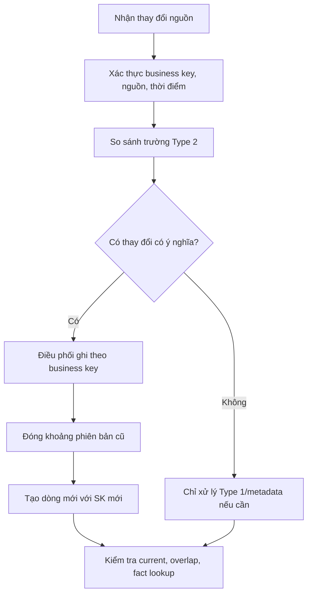
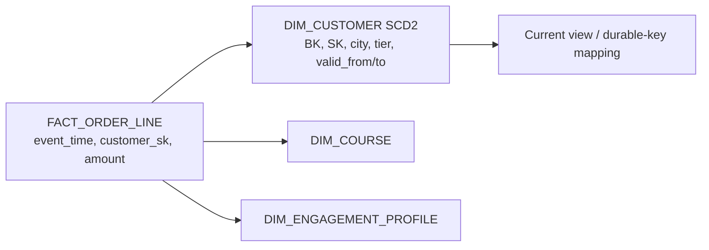

# Chọn cách lưu lịch sử theo từng thuộc tính và yêu cầu phân tích

## 1. Vì sao không nên áp một kiểu lưu lịch sử cho cả bảng chiều?

Trong kho dữ liệu phân tích, **bảng chiều (dimension)** mô tả ngữ cảnh của các sự kiện được ghi ở bảng fact: khách hàng, sản phẩm, giảng viên, khóa học, địa điểm hoặc tổ chức. Khi một thuộc tính chiều thay đổi, hệ thống phải quyết định báo cáo quá khứ nên hiển thị **giá trị đã có lúc sự kiện xảy ra** hay **giá trị mới nhất**.

Ví dụ: khách hàng từng sống ở Đà Nẵng, nay chuyển đến Hà Nội. Đồng thời, tên hiển thị của khách có lỗi chính tả vừa được sửa. Cách xử lý hai trường này phải khác nhau:

- `city`: cần lưu lịch sử nếu báo cáo “doanh thu theo thành phố **khi giao dịch phát sinh**”.
- `display_name`: có thể chỉ sửa giá trị nếu tên cũ là lỗi nhập liệu và không có nhu cầu phân tích theo tên từng thời kỳ.
- `loyalty_tier`: có thể cần cả hạng **lúc mua** và hạng **hiện nay**.
- `balance_minor`: biến động số dư thường là **sự kiện hoặc ảnh chụp định kỳ (fact)**, không phải mỗi thay đổi tạo thêm một phiên bản chiều.

Các chiến lược này được gọi là **Slowly Changing Dimension (SCD)**. Chữ “slowly” là tên lịch sử: không phải mọi thuộc tính đều đổi chậm. Mục tiêu là **chọn đúng cách lưu và diễn giải thay đổi theo từng thuộc tính, theo câu hỏi phân tích**.

Bài thuộc chương **Bảng chiều**, nằm trong phạm vi **DATABASE_DATA_MODELING**: rèn kỹ năng chuyển yêu cầu nghiệp vụ thành mô hình dữ liệu rõ ràng, từ thực thể, quan hệ và ràng buộc đến khóa, chỉ mục và lược đồ vật lý. Khi đánh giá SCD, ta cũng phải hiểu vai trò của mô hình quan hệ, document, đồ thị và phân tích để thiết kế có thể tiến hóa, kiểm chứng.

**Sau bài này, bạn có thể:**

1. Phân biệt báo cáo lịch sử theo giá trị **khi sự kiện xảy ra**, theo giá trị **hiện tại** và theo những gì kho **đã biết tại thời điểm T**.
2. Chọn SCD Type 0, 1, 2, 3, 4 và các kiểu kết hợp cho từng nhóm thuộc tính.
3. Thiết kế business key, surrogate key, khoảng hiệu lực và quan hệ fact–dimension.
4. Viết quy trình nạp Type 2 có kiểm soát tranh chấp, dữ liệu đến muộn và hiệu chỉnh lịch sử.
5. Tránh nhân đôi fact khi join các phiên bản và xây truy vấn SQL cho hai góc nhìn lịch sử/current.
6. Kiểm thử ràng buộc, số liệu và chi phí lưu trữ/vận hành trước khi chốt lược đồ.

## 2. Hỏi người dùng phân tích trước khi chọn SCD

Ba câu hỏi dưới đây gần giống về mặt ngôn ngữ nhưng cần những mô hình khác nhau.

| Câu hỏi | Góc nhìn | Cần giữ dữ liệu nào? |
| --- | --- | --- |
| “Doanh thu tháng 1 theo **thành phố khách khi mua**?” | **As-was** | Thuộc tính đúng ở thời điểm giao dịch |
| “Toàn bộ doanh thu trước nay theo **thành phố hiện tại** của khách?” | **As-is** | Giá trị chiều hiện hành cho mọi fact cũ |
| “Báo cáo ngày 15/6 **đã biết** khách ở đâu?” | **As-known-at** | Thời điểm hệ thống biết/ghi nhận và lịch sử chỉnh sửa |

Câu hỏi thứ ba không tự được trả lời bằng Type 2 sử dụng thời gian hiệu lực nghiệp vụ. Nếu dữ liệu có hiệu lực từ ngày 01/5 nhưng kho nhận vào ngày 20/6, thời gian **hiệu lực** và thời gian **hệ thống biết** khác nhau.

Trước khi mô hình hóa, xác nhận:

- Thuộc tính đổi thực sự hay chỉ được **sửa lỗi**?
- Khi chạy lại báo cáo tháng trước, người dùng muốn kết quả **giữ nguyên** hay được phép **phân nhóm lại**?
- Có cần cả **as-was và as-is**, hay chỉ một trong hai?
- Bản ghi nguồn có **ngày hiệu lực** đáng tin hay chỉ có ngày cập nhật hệ thống?
- Giá trị cũ có ý nghĩa pháp lý/kiểm toán, hoặc phải xóa theo chính sách dữ liệu không?
- Một trường thay đổi **hàng năm**, **hàng tuần** hay **hàng giây**?

**Chọn SCD theo thuộc tính và hợp đồng báo cáo**, không chỉ theo tốc độ thay đổi.

## 3. Grain, business key và surrogate key

### 3.1. Grain quyết định “một dòng chiều” là gì

**Grain** là ý nghĩa của từng dòng:

- Dimension Type 1: thường **một dòng cho một thực thể hiện hành**.
- Dimension Type 2: thường **một dòng cho một phiên bản của thực thể trong khoảng hiệu lực**.
- Mini-dimension: có thể **một dòng cho một tổ hợp nhóm thuộc tính**, được tham chiếu từ fact.

Ví dụ chiều khách hàng Type 2 có business key `(tenant_id, customer_code)`.

| customer_sk | tenant_id | customer_code | city | valid_from | valid_to |
| ---: | --- | --- | --- | --- | --- |
| 101 | ORG-07 | C-001 | Đà Nẵng | 2026-01-01 | 2026-06-01 |
| 205 | ORG-07 | C-001 | Hà Nội | 2026-06-01 | *NULL* |

Cả hai dòng thuộc **một khách** (cùng business key) nhưng có **hai khóa phiên bản** khác nhau.

### 3.2. Phân biệt các khóa

- **Business key (BK):** danh tính nghiệp vụ, chẳng hạn `(tenant_id, customer_code)`. Phải có nguồn và phạm vi duy nhất rõ ràng.
- **Surrogate key (SK):** khóa kỹ thuật của **một dòng phiên bản** chiều, ví dụ `customer_sk = 205`.
- **Durable key:** khóa ổn định xuyên các phiên bản, có thể là BK đã chuẩn hóa hoặc khóa mapping nội bộ khi nguồn đổi mã.
- **Fact foreign key:** thường trỏ tới **SK của phiên bản đúng** ở thời điểm sự kiện.

Nếu khách `C-001` xuất hiện ở hai tenant, không được join chỉ theo `customer_code`. Nếu email hoặc tên đổi, chúng không mặc nhiên là business key bền vững.

### 3.3. Tại sao không join fact chỉ theo BK?

Một khách có ba phiên bản Type 2. Nếu mỗi fact của khách được join với dimension theo `customer_code` **mà không có điều kiện thời gian/current**, một fact có thể khớp **ba dòng** và làm số tiền tăng gấp ba.

Vì vậy, phải chọn rõ một trong hai đường:

1. Fact giữ `customer_sk` đã xác định theo thời điểm sự kiện.
2. Fact giữ BK và khi query dùng **điều kiện khoảng hiệu lực** không chồng lấn để tìm một phiên bản.

Đường (1) thường được chọn trong star schema vì giúp đường join phân tích đơn giản và ổn định, nhưng yêu cầu ETL gán SK chính xác.

## 4. Toàn cảnh các chiến lược SCD

Tên loại được dùng phổ biến trong mô hình chiều; một số tên mở rộng có khác biệt giữa sách và nhà cung cấp, nhất là **Type 4/5/6/7**. Trong dự án, **định nghĩa hành vi cụ thể quan trọng hơn tên Type**.

| Cách lưu | Quy tắc | Hữu ích khi | Hạn chế |
| --- | --- | --- | --- |
| **Type 0 – Retain original** | Giữ giá trị gốc | Cần biết nguồn/kênh đầu tiên, đặc tính ban đầu | Cần quy trình hiệu chỉnh khi dữ liệu gốc sai |
| **Type 1 – Overwrite** | Ghi đè giá trị cũ | Sửa lỗi, chỉ cần thông tin hiện hành | Mất lịch sử thuộc tính trong dimension |
| **Type 2 – New row** | Tạo phiên bản mới với SK và khoảng hiệu lực | Phân tích “tại thời điểm sự kiện” | Thêm dòng, lookup thời gian, xử lý dữ liệu muộn |
| **Type 3 – Previous value** | Lưu giá trị hiện tại và một/vài giá trị trước | So sánh hai mốc được định nghĩa | Lịch sử chỉ có số mốc hữu hạn |
| **Type 4 – Separate history / mini-dimension** | Tách phần lịch sử hoặc thuộc tính đổi nhanh | Cần kiểm soát số phiên bản của chiều chính | Thêm bảng, mapping và ETL |
| **Type 6 – Hybrid (1+2+3)** | Kết hợp phiên bản lịch sử và trường current/previous | Cần đồng thời as-was và as-is | Dư thừa, phải đồng bộ các phiên bản |
| **Type 7 – Dual perspective (tham khảo)** | Có đường khóa phiên bản và khóa bền vững | As-was và as-is bằng hai đường join | Fact/ETL phức tạp hơn |

**Type 4** đôi khi được dùng chỉ **bảng lịch sử riêng**, đôi khi dùng **mini-dimension**. Bài này trình bày cả hai và yêu cầu dự án ghi rõ cách triển khai.

Không phải mọi trường của `dim_customer` phải cùng Type. Ví dụ `display_name` có thể Type 1, `city` Type 2, `first_acquisition_channel` Type 0, còn `engagement_band` tách mini-dimension.

## 5. Type 0: giữ giá trị gốc có ý nghĩa nghiệp vụ

**Type 0** thích hợp cho một thuộc tính mà **giá trị đầu tiên đã được xác nhận** chính là điều người dùng muốn phân tích:

- Kênh tiếp cận khách đầu tiên (*first acquisition channel*).
- Ngày tạo hồ sơ ban đầu.
- Mã đăng ký gốc có quy tắc không tái sử dụng.
- Nhóm cohort tại thời điểm gia nhập.

Ví dụ:

```text
customer_code = C-001
first_acquisition_channel = Organic
```

Khách sau đó quay lại qua quảng cáo. `first_acquisition_channel` vẫn là Organic vì nó mô tả **lần đầu**, không phải **kênh gần nhất**.

Không nhầm “Type 0 không đổi theo nghiệp vụ” với “không bao giờ được sửa sai”. Nếu kênh ban đầu bị nhập nhầm, hệ thống cần một **quy trình hiệu chỉnh có thẩm quyền**. Việc có lưu log hiệu chỉnh hay không là quyết định quản trị riêng.

Nếu muốn phân tích tất cả lần tiếp xúc marketing, hãy dùng **fact/sự kiện tiếp xúc**, không cố nhét cả chuỗi sự kiện vào một thuộc tính Type 0.

## 6. Type 1: sửa hoặc ghi đè giá trị hiện hành

**Type 1** cập nhật thuộc tính mà **không tạo lịch sử phiên bản chỉ vì trường đó đổi**.

Ví dụ tên `"Ngyn An"` là lỗi gõ, được sửa thành `"Nguyen An"`. Nếu nghiệp vụ muốn mọi báo cáo hiển thị tên đã hiệu chỉnh, Type 1 là hợp lý.

Trong dimension **đồng thời có Type 2 ở các trường khác**, Type 1 thường được áp dụng cho **mọi phiên bản cùng business key**:

```sql
-- Sửa lỗi tên trên toàn bộ các phiên bản lịch sử của khách.
-- Không làm phát sinh một customer_sk mới.
UPDATE dim_customer
SET customer_display_name = 'Nguyen An'
WHERE tenant_id = 'ORG-07'
  AND customer_bk = 'C-001';
```

Nếu chỉ UPDATE dòng `is_current = true`, fact cũ vẫn nhìn thấy tên bị sai thông qua dòng Type 2 lịch sử. Điều đó có thể được chọn có chủ đích cho một mô hình khác, nhưng **không còn là một cách diễn giải Type 1 nhất quán** theo ví dụ này.

### 6.1. Ghi đè có thể làm thay đổi báo cáo cũ

Nếu trường `sales_region` là Type 1 và khách chuyển vùng, khi chạy lại báo cáo năm trước theo vùng, doanh thu có thể được **phân nhóm lại** dưới vùng mới. Đây là *restatement*.

Điều đó có thể đúng với “doanh thu tích lũy của khách hiện thuộc vùng nào” nhưng sai với “doanh thu phát sinh ở vùng nào”. Phải xác định câu hỏi trước khi chọn Type 1.

### 6.2. Type 1 không đồng nghĩa bỏ audit

Vẫn có thể có audit log, CDC hoặc lịch sử nguồn bên ngoài dimension. Type 1 chỉ nói **dimension phục vụ phân tích không giữ các phiên bản của thuộc tính đó**. Với tên hoặc giá đã chốt trên hợp đồng/hóa đơn, thông tin lịch sử có thể cần **snapshot giao dịch** độc lập.

## 7. Type 2: giữ phiên bản theo khoảng thời gian

**Type 2** tạo một dòng mới khi thuộc tính **được phân loại Type 2** thay đổi có ý nghĩa.

Giả sử:

- `city` và `loyalty_tier` là Type 2.
- `customer_display_name` là Type 1.
- `first_acquisition_channel` là Type 0.

| customer_sk | customer_bk | city | loyalty_tier | valid_from | valid_to | is_current |
| ---: | --- | --- | --- | --- | --- | --- |
| 101 | C-001 | Đà Nẵng | BRONZE | 2026-01-01 | 2026-04-01 | false |
| 175 | C-001 | Đà Nẵng | SILVER | 2026-04-01 | 2026-06-01 | false |
| 205 | C-001 | Hà Nội | SILVER | 2026-06-01 | NULL | true |

Ngày và mã đều là giả định để học, không phải dữ liệu thật.

### 7.1. Dùng khoảng nửa mở

Một quy ước dễ kiểm chứng là:

```text
valid_from <= event_time
AND (event_time < valid_to OR valid_to IS NULL)

Tức khoảng [valid_from, valid_to).
```

Thời điểm đúng bằng `valid_to` thuộc phiên bản tiếp theo, tránh một sự kiện khớp hai phiên bản ở biên.

Không tự hiểu `valid_from` là **ngày kho nạp dữ liệu**: phải xác định nó là **thời điểm có hiệu lực trong nghiệp vụ**, hay một quy ước khác đã được chấp nhận.

### 7.2. Khi nào tạo dòng mới?

- BRONZE → SILVER: **có**, vì tier là Type 2.
- Đà Nẵng → Hà Nội: **có**, vì city là Type 2.
- Sửa lỗi tên hiển thị: **không**, vì name là Type 1.
- Pipeline chạy lại với cùng payload: **không**, nếu không có thay đổi mang ý nghĩa Type 2.
- Timestamp nạp `loaded_at` đổi: **không**, vì metadata kỹ thuật không phải thuộc tính Type 2 cần historize.

Một `hashdiff` của các trường Type 2 có thể giúp phát hiện thay đổi. Cần xác định cách chuẩn hóa giá trị, `null`, Unicode, kiểu ngày, cùng tập trường; hashdiff không tự giải quyết lịch sử đến muộn hoặc sai nghĩa nguồn.

### 7.3. SK phải ổn định cho từng phiên bản

Fact giao dịch ngày 15/3 lưu `customer_sk = 101`; ngày 15/5 lưu `175`; ngày 15/7 lưu `205`. Không đổi SK của bản cũ chỉ vì tài liệu chiều xuất hiện một phiên bản mới.

Nếu có hiệu chỉnh lịch sử có hiệu lực từ giữa một khoảng, có thể phải **gán lại khóa chiều của các fact đã lưu**. Điều đó phải là quy trình restatement rõ ràng, không phải side effect ngầm.

## 8. Thiết kế bảng Type 2 và ràng buộc vật lý

Ví dụ dưới đây dùng **PostgreSQL** và một bảng kết hợp các thuộc tính Type 0/1/2. Trong các hệ kho dữ liệu khác, kiểu ngày giờ và cách đặt constraint/index có thể khác.

```sql
CREATE TABLE dim_customer (
    customer_sk bigint GENERATED ALWAYS AS IDENTITY PRIMARY KEY,
    tenant_id text NOT NULL,
    customer_bk text NOT NULL,

    customer_display_name text NOT NULL, -- Type 1
    first_acquisition_channel text,      -- Type 0
    city text,                           -- Type 2
    loyalty_tier text NOT NULL,          -- Type 2

    valid_from timestamptz NOT NULL,
    valid_to timestamptz,
    is_current boolean NOT NULL,

    source_system text NOT NULL,
    source_revision text,
    loaded_at timestamptz NOT NULL DEFAULT now(),

    CONSTRAINT customer_valid_interval
        CHECK (valid_to IS NULL OR valid_from < valid_to),
    CONSTRAINT customer_current_consistent
        CHECK (is_current = (valid_to IS NULL)),
    CONSTRAINT customer_tier_values
        CHECK (loyalty_tier IN ('BRONZE','SILVER','GOLD')),
    CONSTRAINT customer_bk_version_unique
        UNIQUE (tenant_id, customer_bk, valid_from)
);

-- Mỗi business key tối đa một phiên bản hiện hành.
CREATE UNIQUE INDEX customer_one_current
    ON dim_customer (tenant_id, customer_bk)
    WHERE is_current;

-- Tra cứu các phiên bản một business key theo thời gian.
CREATE INDEX customer_temporal_lookup
    ON dim_customer (tenant_id, customer_bk, valid_from DESC);
```

### 8.1. Unique current vẫn chưa ngăn khoảng lịch sử chồng nhau

Hai dòng:

```text
A: [2026-01-01, 2026-06-01)
B: [2026-04-01, 2026-05-01)
```

đều không phải current, nhưng cùng có hiệu lực ngày 15/4. JOIN fact theo thời gian sẽ khớp hai dòng, dẫn tới **đếm đôi số tiền**.

PostgreSQL có thể dùng exclusion constraint khi có `btree_gist`:

```sql
CREATE EXTENSION IF NOT EXISTS btree_gist;

ALTER TABLE dim_customer
ADD CONSTRAINT customer_no_overlapping_versions
EXCLUDE USING gist (
    tenant_id WITH =,
    customer_bk WITH =,
    tstzrange(
        valid_from,
        COALESCE(valid_to, 'infinity'::timestamptz),
        '[)'
    ) WITH &&
);
```

Cần dọn các khoảng sai trước khi thêm constraint. Một số kho dữ liệu phân tán không hỗ trợ loại constraint này; phải kiểm soát bằng pipeline và kiểm tra đối soát. **Cấm overlap** cũng không mặc nhiên bảo đảm **không có gap**. Gap có thể hợp lệ nếu có giai đoạn đối tượng không tồn tại, hoặc là lỗi nếu nghiệp vụ yêu cầu lịch sử liên tục.

### 8.2. NULL hay ngày kết thúc rất xa?

Có hệ thống lưu `valid_to = NULL`, có hệ dùng ngày rất xa như `9999-12-31`. Cả hai là quy ước có thể sử dụng nếu thống nhất với kiểu dữ liệu và công cụ. Không trộn hai cách mà không có một hợp đồng chung, vì truy vấn sẽ dễ bỏ dòng hiện hành.

### 8.3. Nên lưu thêm metadata nào?

Ngoài trường nghiệp vụ, có thể cần:

- `source_system` và `source_revision` để xác định phiên bản nguồn.
- `loaded_at` để biết lúc kho ghi nhận.
- `batch_id` hoặc `pipeline_run_id` để retry/đối soát.
- `change_reason` hoặc `change_type` nếu báo cáo cần phân biệt hiệu chỉnh và thay đổi thật.

Đừng nhầm `loaded_at` với ngày hiệu lực của thuộc tính.

## 9. Quy trình nạp Type 2 với giao dịch

### 9.1. Luồng tổng quan



Với dữ liệu theo thứ tự hiệu lực, thường có thể đóng current và tạo current mới trong một giao dịch. Với dữ liệu đến muộn, cần **chèn/sửa trong khoảng quá khứ**, không đơn giản đóng current.

### 9.2. Ví dụ SQL cập nhật đúng thứ tự

Giả sử khách lên GOLD từ 01/09/2026. Sau khi xác thực source revision, nguồn hiệu lực và đảm bảo sự kiện chưa xử lý:

```sql
BEGIN;

-- Khóa dòng current; phải kiểm tra kết quả đọc và điều kiện ngày.
SELECT customer_sk, valid_from, city, loyalty_tier
FROM dim_customer
WHERE tenant_id = 'ORG-07'
  AND customer_bk = 'C-001'
  AND is_current = true
FOR UPDATE;

-- Chỉ cập nhật khi có đúng một dòng current với valid_from
-- nhỏ hơn thời điểm chuyển đổi.
UPDATE dim_customer
SET valid_to = TIMESTAMPTZ '2026-09-01 00:00:00+00',
    is_current = false
WHERE tenant_id = 'ORG-07'
  AND customer_bk = 'C-001'
  AND is_current = true
  AND valid_from < TIMESTAMPTZ '2026-09-01 00:00:00+00';

-- Ví dụ: chỉ chèn nếu bước UPDATE vừa xử lý đúng một dòng
-- và trạng thái mới được xác định từ nguồn có thẩm quyền.
INSERT INTO dim_customer (
    tenant_id, customer_bk,
    customer_display_name, first_acquisition_channel,
    city, loyalty_tier,
    valid_from, valid_to, is_current,
    source_system, source_revision
)
VALUES (
    'ORG-07', 'C-001',
    'Nguyen An', 'Organic', 'Hà Nội', 'GOLD',
    TIMESTAMPTZ '2026-09-01 00:00:00+00',
    NULL, true, 'CRM', 'revision-75'
);

COMMIT;
```

**Lưu ý:** đoạn SQL **minh họa thứ tự thao tác**, không phải stored procedure production đầy đủ. Nó chưa tự kiểm tra `row_count` giữa UPDATE và INSERT; ứng dụng hoặc thủ tục thực phải kiểm tra rồi rollback nếu điều kiện không đạt. Khi chưa có dòng current, `FOR UPDATE` không khóa một BK chưa tồn tại. Cần thêm ràng buộc, một điểm khóa theo BK, isolation/retry hoặc quy trình phân phối ghi thích hợp.

### 9.3. Idempotency và dữ liệu đồng thời

Nếu sự kiện GOLD được gửi lại, pipeline không được tạo thêm một dòng GOLD với thời điểm giống hoặc mới hơn tùy tiện.

Cần bảo vệ:

- ID nguồn hoặc revision để nhận biết sự kiện đã xử lý.
- So sánh chính xác trường được phân loại Type 2.
- Điều kiện khoảng không chồng.
- Retry có thể chạy lại mà không tạo bản ghi dư.
- Xử lý khi hai writer cùng thay đổi một BK, kể cả từ các nguồn khác nhau.

**Tính nguyên tử của câu lệnh SQL không đồng nghĩa với idempotency của một sự kiện**.

## 10. Fact phải trỏ đúng phiên bản chiều

Giả sử `fact_order_line` có grain **một dòng hàng trong một đơn đã chốt**, với:

```text
fact_order_line(
  order_line_id,
  tenant_id,
  occurred_at,
  customer_sk,
  course_sk,
  amount_minor
)
```

Khi nạp fact ngày 15/5, ETL dùng BK và thời điểm sự kiện để tìm SK:

```sql
SELECT d.customer_sk
FROM dim_customer AS d
WHERE d.tenant_id = 'ORG-07'
  AND d.customer_bk = 'C-001'
  AND d.valid_from <= TIMESTAMPTZ '2026-05-15 12:00:00+00'
  AND (
      d.valid_to > TIMESTAMPTZ '2026-05-15 12:00:00+00'
      OR d.valid_to IS NULL
  );
```

Kết quả đúng theo hợp đồng thường là **một dòng**. Không dòng nào: phải phân loại “dimension đến muộn”, gap hoặc thiếu dữ liệu; không tự ghép current. Nhiều dòng: overlap hoặc lookup sai.

### 10.1. Phân tích as-was

```sql
SELECT
    d.city AS city_when_purchased,
    SUM(f.amount_minor) AS revenue_minor
FROM fact_order_line AS f
JOIN dim_customer AS d
  ON d.customer_sk = f.customer_sk
WHERE f.occurred_at >= TIMESTAMPTZ '2026-01-01 00:00:00+00'
  AND f.occurred_at <  TIMESTAMPTZ '2027-01-01 00:00:00+00'
GROUP BY d.city
ORDER BY revenue_minor DESC;
```

Fact vẫn mang SK của thời điểm phát sinh, nên khi khách chuyển nơi cư trú, doanh thu cũ không tự đổi nhóm.

### 10.2. Phân tích as-is

Để nhóm **mọi fact cũ theo thành phố hiện tại**:

```sql
SELECT
    current_d.city AS current_city,
    SUM(f.amount_minor) AS lifetime_revenue_minor
FROM fact_order_line AS f
JOIN dim_customer AS historical_d
  ON historical_d.customer_sk = f.customer_sk
JOIN dim_customer AS current_d
  ON current_d.tenant_id = historical_d.tenant_id
 AND current_d.customer_bk = historical_d.customer_bk
 AND current_d.is_current = true
GROUP BY current_d.city
ORDER BY lifetime_revenue_minor DESC;
```

Đây là **hai câu hỏi khác nhau**, có thể cho kết quả phân nhóm khác nhau nhưng đều đúng. Nếu một khách không có current, truy vấn as-is trên dùng INNER JOIN sẽ bỏ fact của khách đó; cần quy tắc báo cáo về unknown/inactive customer.

### 10.3. Type 7 / hai đường khóa

Một lựa chọn hỗ trợ as-was và as-is là lưu ở fact cả:

- SK của phiên bản Type 2.
- Durable key hoặc đường mapping ổn định đến thực thể hiện hành.

Đó là ý tưởng thường gắn với **Type 7**. Đổi lại, ETL và khóa phải đồng bộ, nhất là khi merge/split hoặc chuyển tenant. Việc lưu hai khóa không tự giải quyết đúng nghĩa business key hay quyền truy cập.

## 11. Type 3: so sánh hiện tại với một giá trị trước

**Type 3** thường có các cột:

```text
customer_bk
current_segment
previous_segment
segment_change_at

C-001
PREMIUM
STANDARD
2026-07-01
```

Cấu trúc này phù hợp nếu câu hỏi trọng tâm là “có bao nhiêu khách chuyển từ STANDARD sang PREMIUM sau chiến dịch tái phân nhóm?”. Nhưng khi khách tiếp tục chuyển PREMIUM → VIP, cột `previous_segment` trở thành PREMIUM và lịch sử STANDARD bị thay thế.

Cần định nghĩa **“previous”** thật rõ:

- Giá trị ngay trước lần thay đổi gần nhất?
- Giá trị của kỳ báo cáo trước?
- Giá trị tại thời điểm mở đầu chiến dịch?
- Giá trị trước một lần tái phân loại có tên?

Type 3 chỉ phù hợp khi **số mốc lịch sử cần giữ có giới hạn và biết trước**. Nếu báo cáo cần mọi lần thay đổi hoặc giá trị ở một thời điểm bất kỳ, Type 2 hoặc event history phù hợp hơn.

## 12. Type 4, mini-dimension và thuộc tính thay đổi nhanh

### 12.1. Cách gọi Type 4 như bảng lịch sử riêng

Một cách triển khai là giữ bảng current và lưu lịch sử riêng:

```text
dim_product_current:
  product_bk, current_name, current_category

dim_product_history:
  product_bk, effective_from, effective_to, category
```

Đường đọc current đơn giản hơn; truy vấn lịch sử cần join theo thời gian. Phải xác định nguồn sự thật, cách đồng bộ và key của lịch sử. Đây **không mặc nhiên là một Type 2 dimension duy nhất** vì current/history được tách thành hai cấu trúc.

### 12.2. Mini-dimension cho nhóm thuộc tính đổi nhanh

Ví dụ profile marketing thay đổi mỗi tuần:

```text
dim_customer:
  customer_sk, customer_bk, city, loyalty_tier

dim_engagement_profile:
  profile_sk, engagement_band, activity_band, risk_band

fact_activity:
  activity_id, customer_sk, profile_sk, occurred_at, ...
```

Nếu đưa `engagement_band` vào Type 2 của khách và cập nhật hằng tuần, số dòng `dim_customer` có thể tăng rất nhanh. Mini-dimension tách các **nhóm phân loại** có số tổ hợp kiểm soát được, để fact trỏ tới nhóm áp dụng tại thời điểm sự kiện.

Tuy nhiên, nếu mỗi giá trị nhóm có cardinality gần vô hạn, mini-dimension cũng có thể phình lớn. Những đại lượng liên tục như số dư mỗi giây, vị trí GPS, nhiệt độ hoặc số lượt nhấp thuộc **fact/event/time-series** hơn là thuộc tính chiều thay đổi theo SCD.

### 12.3. Ước lượng chi phí trước khi chọn Type 2

```text
Số dòng Type 2 gần đúng =
  số thực thể × số phiên bản trung bình mỗi thực thể

200.000 khách × 4 phiên bản          = 800.000 dòng
200.000 khách × 1.095 phiên bản      = 219.000.000 dòng
```

Các số chỉ minh họa; dữ liệu thật có phân phối thay đổi lệch và nhiều thuộc tính có thể thay đổi trong cùng một phiên bản. Nhưng nếu một trường đổi hằng ngày, nên đặt câu hỏi liệu **có thực sự cần SCD2 ở chiều chính** hay không.

## 13. Type 6: kết hợp lịch sử và giá trị hiện hành

**Type 6** thường được giải thích là kết hợp Type 1, 2 và 3. Một biến thể phổ biến có:

- Một dòng mới khi thuộc tính lịch sử đổi (Type 2).
- Một trường lưu giá trị **as-was** ở từng phiên bản.
- Một trường lưu giá trị **current** được cập nhật trên các dòng cùng BK (Type 1).
- Có thể thêm giá trị previous hoặc một mốc so sánh theo Type 3.

Ví dụ:

| customer_sk | city_as_was | city_current | valid_from | valid_to |
| ---: | --- | --- | --- | --- |
| 101 | Đà Nẵng | Hà Nội | 2026-01-01 | 2026-06-01 |
| 205 | Hà Nội | Hà Nội | 2026-06-01 | NULL |

Một báo cáo fact join theo SK có thể chọn `city_as_was` hoặc `city_current`. Nhưng khi city_current đổi, **cả dòng cũ lẫn mới phải được cập nhật** hoặc có quy trình dẫn xuất tương đương.

**Đánh đổi:** Type 6 giảm một số join ở đường đọc, tăng ghi dư thừa và nguy cơ các dòng current bị lệch. Nếu có nhiều phiên bản trên mỗi BK hoặc current đổi thường xuyên, Type 7/current view có thể dễ duy trì hơn.

Không dùng Type 6 chỉ vì nó “bao gồm mọi Type”; hãy chứng minh cả hai góc nhìn được sử dụng đủ nhiều để trả chi phí đồng bộ.

## 14. Ma trận quyết định theo từng thuộc tính

Các lựa chọn dưới đây là **ứng viên có điều kiện**, không phải quy tắc cứng.

| Thuộc tính | Nếu người dùng cần... | Hướng lưu gợi ý |
| --- | --- | --- |
| `customer.first_acquisition_channel` | Kênh đầu tiên | **Type 0** |
| `customer.display_name` | Sửa chính tả hiển thị nhất quán | **Type 1** |
| `customer.city` | Thành phố tại thời điểm mua | **Type 2** |
| `customer.current_city` | Mọi doanh thu nhóm theo thành phố hiện tại | **Type 1/current view/Type 6/7** |
| `customer.loyalty_tier` | Hạng lúc giao dịch | **Type 2** |
| `customer.previous_segment` | So sánh một lần chuyển phân khúc | **Type 3** |
| `customer.engagement_band` | Nhóm hoạt động theo tuần trên fact | **Mini-dimension hoặc snapshot fact** |
| `course.category` | Danh mục khi ghi danh | **Type 2** nếu phải giữ lịch sử |
| `course.title` | Tên chuẩn mới nhất sau sửa lỗi | **Type 1** |
| `certificate.course_name_at_issue` | Tên lúc chứng chỉ được cấp | **Snapshot giao dịch** |
| `instructor.department` | Phòng ban lúc giảng dạy | **Type 2** |
| `wallet.balance_minor` | Số dư cuối mỗi ngày | **Periodic snapshot fact** |
| `course.view_count` | Lượt xem theo giờ/ngày | **Fact/tổng hợp** |
| `created_at_source` | Ngày tạo gốc | **Type 0/metadata** |

**Một trường có thể cần hai biểu diễn** nếu báo cáo đặt hai câu hỏi khác nhau. Ví dụ “tên khóa học lúc cấp chứng chỉ” là snapshot chứng chỉ, còn “tên khóa hiển thị hiện tại” thuộc current dimension.

### 14.1. Hợp đồng quyết định một thuộc tính

```yaml
attribute: customer.loyalty_tier
authoritativeSource: LoyaltyService
meaning: Hạng có hiệu lực theo quy tắc tích điểm
asWasRequired: true
asIsRequired: true
effectiveTime: source_effective_at đã được kiểm chứng
chosenModel: SCD Type 2 + current view
factTimestamp: order_placed_at
lateArrivalPolicy: Chèn/sửa khoảng hiệu lực, đánh giá restatement fact
deduplication: Source event id hoặc source revision
```

Đây là tài liệu minh họa quyết định mô hình, **không phải cấu hình hệ thống đang chạy**. Nó cho thấy lựa chọn SCD cần gắn với **nguồn, nghĩa, thời gian và truy vấn**, thay vì một nhãn Type đơn lẻ.

## 15. Dữ liệu đến muộn và hiệu chỉnh lịch sử

### 15.1. Sự kiện hiệu lực trong quá khứ nhưng đến kho hôm nay

Dimension đang có:

```text
[2026-01-01, 2026-06-01) city = Đà Nẵng
[2026-06-01, NULL)       city = Hà Nội
```

Ngày 20/8, nguồn báo bổ sung rằng khách đã ở **Huế từ 01/4 đến hết tháng 5**. Dòng thời gian nghiệp vụ đúng:

```text
[2026-01-01, 2026-04-01) city = Đà Nẵng
[2026-04-01, 2026-06-01) city = Huế
[2026-06-01, NULL)       city = Hà Nội
```

Không thể xử lý bằng “đóng current Hà Nội và chèn current Huế”, vì Huế là **trạng thái quá khứ**, không phải trạng thái hiện hành.

Cần:

1. Kiểm tra nguồn và thời gian hiệu lực đáng tin.
2. Xác định khoảng bị ảnh hưởng.
3. Tách/hiệu chỉnh khoảng để không overlap.
4. Ghi lineage của hiệu chỉnh và các khóa lịch sử.
5. Xác định fact nào trong khoảng 01/4–01/6 cần **gán lại SK** hoặc được diễn giải lại khi truy vấn.
6. Kiểm tra số liệu trước/sau; thông báo restatement nếu báo cáo đã phát hành bị thay đổi.

**Chỉ sửa dimension không tự sửa foreign key đã lưu ở fact.** Nếu fact ngày 15/5 đã tham chiếu SK cũ của Đà Nẵng, chính sách restatement phải quy định xử lý fact đó.

### 15.2. Fact đến trước dimension

Khi fact mua hàng tới trước hồ sơ khách, có một số phương án:

- Đưa fact vào vùng chờ nếu SLA cho phép.
- Tạo **inferred member** với BK đáng tin và SK ổn định, rồi bổ sung thuộc tính sau.
- Gán một **Unknown SK** có ý nghĩa “chưa xác định”, rồi đối soát/restate khi có dữ liệu.

Unknown SK không được hiểu là **mọi fact thiếu khách đều thuộc cùng một khách**. Inferred member lại cần BK thật để mỗi thực thể được nhận diện riêng.

### 15.3. Type 2 và bitemporal khác nhau

- **Business-valid time:** thuộc tính có hiệu lực khi nào trong nghiệp vụ.
- **System/load time:** hệ thống biết hoặc đã nạp thông tin khi nào.

Nếu khách thực sự chuyển nhà từ ngày 01/4 nhưng hệ thống chỉ nhận thông tin ngày 20/8, hai trục thời gian khác nhau. Nếu cần trả lời “kho dữ liệu ngày 01/5 **đã biết gì**?”, chỉ có `valid_from/valid_to` theo nghiệp vụ chưa đủ.

Khi yêu cầu cả hai góc nhìn, thiết kế cần **bitemporal** hoặc lịch sử ghi nhận hệ thống có thể truy xuất phiên bản đã bị hiệu chỉnh, không chỉ thêm một `loaded_at` vào dòng current rồi tuyên bố tái dựng được mọi trạng thái đã biết.

## 16. Khi nào phải chuyển một biến động sang fact thay vì dimension?

Một lỗi thường gặp là tạo dòng Type 2 cho mọi thứ có thể đổi.

- Tên thành phố hoặc hạng thành viên: **thuộc tính mô tả**, có thể Type 2.
- Lượt nhấp vào bài học: **sự kiện**, thuộc fact.
- Doanh thu mỗi giao dịch: **measure**, thuộc fact.
- Số dư cuối ngày: **periodic snapshot fact**.
- Vị trí xe theo giây: **time-series/event fact**.
- Trạng thái công bố bài học: có thể Type 2 nếu cần phân tích trạng thái tại thời điểm đăng ký, hoặc event log nếu cần mọi lần chuyển và chi tiết tác nhân.

Đặt câu hỏi: “Điều này **mô tả một thực thể trong giai đoạn** hay **đo lường một sự kiện/trạng thái tại mỗi lần ghi**?” Nếu thuộc loại thứ hai, Type 2 có thể làm dimension tăng khổng lồ và làm lookup kém hiệu quả.

## 17. Kiểm chứng dữ liệu Type 2

### 17.1. Các tình huống kiểm thử

| Tình huống | Kết quả mong đợi |
| --- | --- |
| Thực thể mới | Một dòng SK mới, current, khoảng hợp lệ |
| Thuộc tính Type 2 đổi | Đóng dòng cũ, mở dòng mới, không overlap |
| Chỉ trường Type 1 đổi | Không tạo phiên bản Type 2 mới |
| Type 0 bị thay đổi ở nguồn | Xử lý theo quy trình hiệu chỉnh, không tự cập nhật |
| Gửi lại cùng sự kiện | Không tạo phiên bản trùng |
| Hai writer cùng một BK | Không tạo hai current hoặc overlap |
| Hai thay đổi cùng ngày hiệu lực | Có quy tắc thứ tự/độ phân giải hoặc cách ly xử lý |
| Thay đổi hiệu lực quá khứ đến muộn | Chèn/sửa đúng khoảng, đánh giá restatement |
| Fact không tìm thấy phiên bản | Unknown/inferred member/chờ theo chính sách |
| Source correction | Không làm sai lịch sử và fact đã xuất bản |
| BK trùng ở tenant khác | Không gộp thực thể |
| Nhiều dòng Type 2 một BK | Không nhân đôi fact ở query |
| Thông tin nhạy cảm trong các phiên bản | Áp dụng quyền truy cập và chính sách lưu giữ |

### 17.2. Kiểm tra số dòng current

```sql
SELECT
    tenant_id,
    customer_bk,
    COUNT(*) FILTER (WHERE is_current) AS current_count
FROM dim_customer
GROUP BY tenant_id, customer_bk
HAVING COUNT(*) FILTER (WHERE is_current) <> 1;
```

Truy vấn này áp dụng khi nghiệp vụ yêu cầu **mỗi BK đã tồn tại có đúng một dòng current**. Một đối tượng đã ngừng quản lý có thể có ngoại lệ hợp lệ; hợp đồng phải định nghĩa.

### 17.3. Kiểm tra khoảng chồng

Với PostgreSQL, nếu đã thiết kế exclusion constraint như phần 8, DB có thể chặn phần lớn lỗi overlap ngay khi ghi. Một truy vấn diagnostic đơn giản có thể so sánh những khoảng:

```sql
SELECT
    a.tenant_id,
    a.customer_bk,
    a.customer_sk AS left_sk,
    b.customer_sk AS right_sk
FROM dim_customer AS a
JOIN dim_customer AS b
  ON a.tenant_id = b.tenant_id
 AND a.customer_bk = b.customer_bk
 AND a.customer_sk < b.customer_sk
WHERE tstzrange(
        a.valid_from,
        COALESCE(a.valid_to, 'infinity'::timestamptz),
        '[)'
      )
      &&
      tstzrange(
        b.valid_from,
        COALESCE(b.valid_to, 'infinity'::timestamptz),
        '[)'
      );
```

Đây là kiểm tra cặp khoảng toàn diện về mặt logic, nhưng có thể rất tốn chi phí trên tập lớn. Hãy dùng ràng buộc/index thích hợp và thử trên dữ liệu đại diện; không chạy một truy vấn self-join khổng lồ không giới hạn trong giờ cao điểm.

### 17.4. Kiểm tra fact thiếu dimension

```sql
SELECT COUNT(*) AS missing_dimension_rows
FROM fact_order_line AS f
LEFT JOIN dim_customer AS d
  ON d.customer_sk = f.customer_sk
WHERE d.customer_sk IS NULL;
```

Kiểm tra FK mồ côi chưa chứng minh SK **đúng theo thời điểm fact**. Cần kiểm tra thêm `f.occurred_at` có nằm trong khoảng hiệu lực của dòng dimension tương ứng theo quy tắc phân tích đã chọn không.

**Chỉ số vận hành:** số phiên bản p50/p95/p99 theo BK, số trường hợp overlap/gap, fact không gán được SK, số thay đổi muộn, số lần fact restatement, độ trễ lookup và tăng trưởng dung lượng dimension/index.

## 18. Case study: bán khóa học, phân tích theo hạng và địa điểm

### 18.1. Yêu cầu

Một nền tảng bán khóa học có:

- Khách có mã ổn định, thuộc một tenant.
- Tên có thể sửa lỗi chính tả.
- Thành phố cư trú thay đổi theo thời gian.
- Hạng BRONZE/SILVER/GOLD ảnh hưởng phân tích ưu đãi lúc mua.
- Dashboard cần **doanh thu theo hạng lúc mua** và **doanh thu trọn đời theo hạng hiện tại**.
- Hệ thống cấp chứng chỉ chứa tên khóa và thời điểm phát hành.
- Hồ sơ marketing có mức độ tương tác cập nhật hằng tuần.
- Một số giao dịch và thông tin khách đến kho muộn vài ngày.

### 18.2. Thiết kế ứng viên

| Dữ kiện | Chọn | Lý do |
| --- | --- | --- |
| ID khách và tenant | Business key ổn định | Không đổi theo hồ sơ |
| Tên khách | Type 1 | Sửa lỗi, không cần historize trong dimension |
| Thành phố cư trú | Type 2 | Phân tích as-was |
| Hạng thành viên | Type 2 | Phải biết hạng khi mua |
| Hạng hiện tại | Current view/Type 6/7 | Cần as-is |
| Kênh tiếp cận đầu tiên | Type 0 | Thuộc tính khởi tạo theo định nghĩa |
| Engagement band hằng tuần | Mini-dimension hoặc snapshot fact | Tránh nhân số phiên bản dim_customer |
| Tên khóa khi cấp chứng chỉ | Snapshot trên chứng chỉ | Không chạy theo tên mới |
| Giá chốt và tiền thanh toán | Fact/snapshot giao dịch | Measure, không phải Type 2 |
| Thời gian pipeline nạp | Metadata | Không thay thế business-valid time |



### 18.3. Hai báo cáo khác nhau

**Hạng tại lúc mua:**

```sql
SELECT d.loyalty_tier, SUM(f.amount_minor) AS revenue_minor
FROM fact_order_line AS f
JOIN dim_customer AS d
  ON d.customer_sk = f.customer_sk
GROUP BY d.loyalty_tier;
```

**Hạng hiện nay cho mọi giao dịch quá khứ:**

```sql
SELECT c.loyalty_tier, SUM(f.amount_minor) AS revenue_minor
FROM fact_order_line AS f
JOIN dim_customer AS historical_d
  ON historical_d.customer_sk = f.customer_sk
JOIN dim_customer AS c
  ON c.tenant_id = historical_d.tenant_id
 AND c.customer_bk = historical_d.customer_bk
 AND c.is_current = true
GROUP BY c.loyalty_tier;
```

Hai truy vấn có thể trả nhóm doanh thu khác nhau nhưng **đều đúng theo định nghĩa**. Không thay thế báo cáo thứ nhất bằng thứ hai chỉ vì current dễ tìm hơn.

### 18.4. Tình huống kiểm thử

- 15/3: khách ở Đà Nẵng, BRONZE, mua khóa A.
- 01/4: lên SILVER.
- 15/5: mua khóa B.
- 01/6: chuyển Hà Nội.
- 15/7: mua khóa C.
- 20/8: nguồn gửi hiệu chỉnh: khách đã ở Huế từ 01/5 tới trước 01/6.

Câu hỏi: giao dịch 15/5 phải được gắn với thành phố nào sau hiệu chỉnh? Nếu fact đang tham chiếu SK cũ, hệ thống có tự đổi không? Có được thay đổi một báo cáo đã công bố? Những quyết định này phải nằm trong **chính sách thời gian và restatement**.

### 18.5. Câu hỏi tự kiểm tra

1. Vì sao `customer_display_name` Type 1 và `city` Type 2 có thể cùng nằm trong một dimension?
2. Nếu chỉ sửa tên ở dòng current, fact cũ đọc theo SK lịch sử sẽ thấy tên nào?
3. JOIN fact theo BK mà không chỉ rõ phiên bản có thể làm tổng doanh thu sai ra sao?
4. Số dư mỗi giây có nên đưa vào Type 2 không? Nếu không thì dùng gì?
5. Một cột `previous_segment` có đáp ứng yêu cầu xem 12 lần đổi phân khúc không?
6. Nếu nhận thay đổi với ngày hiệu lực tháng trước, phải tác động đến khoảng lịch sử và fact như thế nào?
7. Khi cần cả giá trị as-was và as-is, Type 6 và Type 7 đánh đổi điểm nào?
8. Inferred member khác Unknown member ra sao?
9. Tại sao `loaded_at` không đủ để tái dựng toàn bộ lịch sử as-known-at?
10. Loại dữ liệu cá nhân nào không nên giữ vô thời hạn trong các phiên bản Type 2?

## 19. Quy trình lựa chọn và checklist

### 19.1. Quy trình ra quyết định

1. **Liệt kê query shapes:** as-was, as-is, so sánh kỳ trước, as-known-at, chứng từ.
2. **Xác định grain:** một thực thể hiện hành, một phiên bản có hiệu lực, một fact hay snapshot?
3. **Chọn BK, SK và phạm vi:** tenant/source, định danh bền vững và khóa phiên bản.
4. **Phân loại từng thuộc tính:** ngữ nghĩa, nguồn thẩm quyền, lịch sử cần giữ, tần suất thay đổi, độ nhạy cảm.
5. **Gán chiến lược:** Type 0/1/2/3; nếu đổi nhanh cân nhắc mini-dimension/fact; nếu cần cả hai góc nhìn cân nhắc Type 6/7 hoặc view.
6. **Định nghĩa thời gian:** nguồn hiệu lực, mốc nửa mở, current, thời gian hệ thống nạp và timezone.
7. **Thiết kế gán SK cho fact:** lookup theo thời điểm, xử lý khi thiếu hoặc đến trễ.
8. **Đặt ràng buộc:** unique current, non-overlap, kiểm tra loại sự kiện trùng và isolation.
9. **Đo và đối soát:** report totals, số phiên bản, phát sinh lịch sử, late arrivals, fact restatement.
10. **Ghi hợp đồng:** ai sở hữu quy tắc SCD, điều kiện sửa lịch sử, nguồn dữ liệu và cách diễn giải báo cáo.

### 19.2. Checklist trước khi duyệt

- [ ] Mỗi thuộc tính có câu hỏi phân tích và **ngữ nghĩa thay đổi** rõ.
- [ ] Phân biệt hiệu chỉnh Type 1 với thay đổi nghiệp vụ Type 2.
- [ ] Type 0 có quy trình sửa sai ngoại lệ.
- [ ] Không ép một Type cho toàn bảng nếu các thuộc tính có nhu cầu khác nhau.
- [ ] BK có phạm vi tenant/source; SK ổn định cho từng phiên bản.
- [ ] Type 2 dùng khoảng nửa mở `[valid_from, valid_to)` nhất quán.
- [ ] Có kiểm soát current, overlap và gap theo nghiệp vụ.
- [ ] Fact trỏ tới SK đúng thời điểm, không join mọi phiên bản.
- [ ] Query as-was và as-is được thiết kế, đặt tên và kiểm thử riêng.
- [ ] Dữ liệu đến muộn và hiệu chỉnh lịch sử có chính sách restatement fact.
- [ ] Không nhầm thời gian nguồn, thời gian hiệu lực và thời gian warehouse load.
- [ ] Thuộc tính đổi rất nhanh được đánh giá lại thành mini-dimension hoặc fact.
- [ ] Type 3 định nghĩa rõ mốc previous và số kỳ lưu được.
- [ ] Type 6/7 có quy tắc đồng bộ và ngăn dữ liệu current bị lệch.
- [ ] Có kiểm thử concurrency, retry, dữ liệu trùng, quá khứ đến muộn.
- [ ] Các phiên bản lịch sử tuân thủ quyền truy cập và chính sách lưu/xóa.
- [ ] Có số đo dung lượng, số phiên bản p95/p99, độ trễ lookup và lỗi fact orphan.
- [ ] Mọi lựa chọn Type đã được ghi vào tài liệu mô hình cùng lý do.

**Điểm cần nhớ:** Không có một cách lưu lịch sử đúng cho mọi thuộc tính. **Type 0 giữ giá trị gốc, Type 1 ghi đè, Type 2 tạo phiên bản theo thời gian, Type 3 lưu mốc so sánh giới hạn, Type 4/mini-dimension tách dữ liệu biến động và Type 6/7 hỗ trợ song song góc nhìn lịch sử/hiện tại.** Lựa chọn phải xuất phát từ câu hỏi phân tích, grain, nguồn dữ liệu, thời gian hiệu lực và cách fact tham chiếu dimension — sau đó được kiểm chứng bằng SQL, ràng buộc và dữ liệu thực tế.
